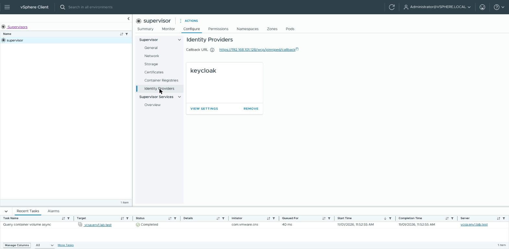
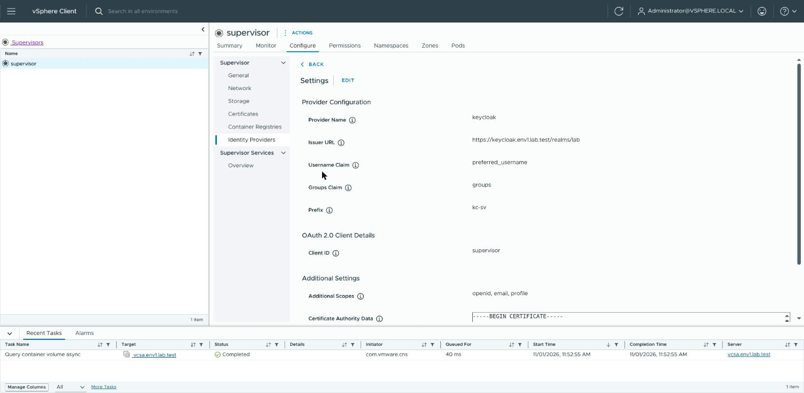
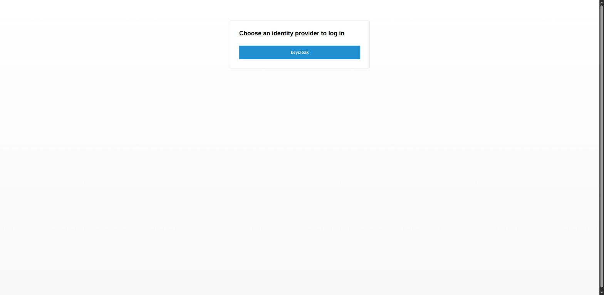
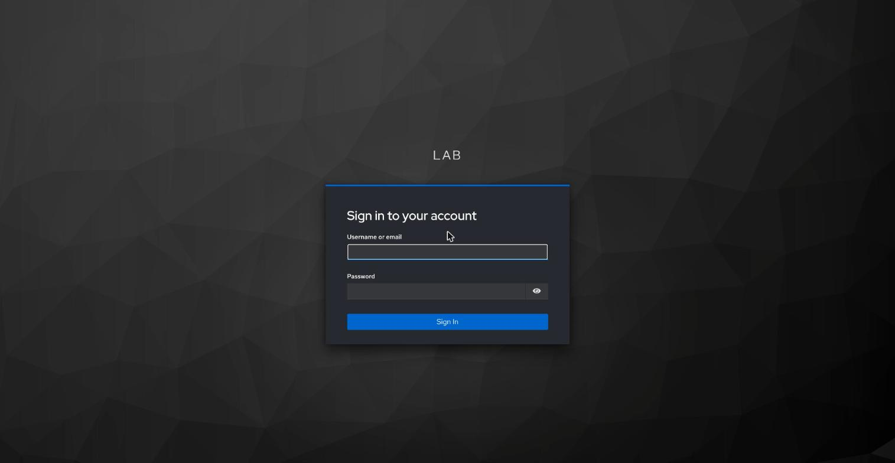
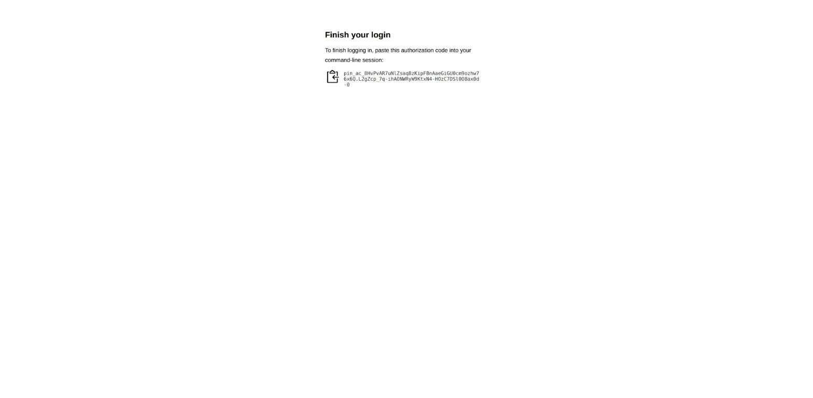

# Identity and access for VKS clusters

> [!NOTE]
> **Official Broadcom documentation (VCF 9.1), Kubernetes documentation and vCenter API reference for this guide**
>
> - [Connect to the VKS Cluster Control Plane as a Kubernetes Administrator](https://techdocs.broadcom.com/us/en/vmware-cis/vcf/vcf-consumption/latest/managing-vsphere-kuberenetes-service-clusters-and-workloads/configuring-identity-and-access-for-tkg-service-clusters/connect-to-the-tkg-service-cluster-control-plane-as-a-kubernetes-administrator.html) (the administrator kubeconfig)
> - [Configure vSphere Namespace Permissions for vCenter Single Sign-On Users and Groups](https://techdocs.broadcom.com/us/en/vmware-cis/vcf/vcf-service-administration-and-development/9-1/managing-vsphere-kubernetes-service/configuring-vsphere-namespaces-for-hosting-tkg-service-clusters/configure-vsphere-namespace-persmissions-for-vcenter-sso-users-and-groups.html)
> - [Configure an External Identity Provider for VKS Clusters](https://techdocs.broadcom.com/us/en/vmware-cis/vcf/vcf-9-0-and-later/9-0/vsphere-supervisor-installation-and-configuration/configuring-and-managing-a-supervisor-cluster/configure-an-external-idp-for-use-with-tkg-service-clusters.html), [Configure vSphere Namespace Permissions for External Identity Provider Users and Groups](https://techdocs.broadcom.com/us/en/vmware-cis/vcf/vsphere-supervisor-services-and-standalone-components/latest/managing-vsphere-kuberenetes-service-clusters-and-workloads/configuring-identity-and-access-for-tkg-service-clusters/connecting-to-tkg-service-clusters-using-an-external-identity-provider/configure-vsphere-namespace-permissions-for-external-idp-users-and-groups.html)
> - vCenter API 9.1.1: [Namespaces Instances Access](https://developer.broadcom.com/xapis/vsphere-automation-api/9.1.1/data-structures/Vcenter%20Namespaces%20Instances%20Access/) (the `identity_provider` of a namespace permission)
> - [VCF CLI command reference: cluster](https://techdocs.broadcom.com/us/en/vmware-cis/vcf/vcf-consumption/latest/consumer-interfaces-in-vcf/installing-and-using-vcf-cli-v9/command-reference2/cluster2.html) (`vcf cluster kubeconfig get --export-file`)
> - Kubernetes: [Authenticating](https://kubernetes.io/docs/reference/access-authn-authz/authentication/) (ServiceAccount tokens, client certificates), [Certificates and Certificate Signing Requests](https://kubernetes.io/docs/reference/access-authn-authz/certificate-signing-requests/), [Using RBAC Authorization](https://kubernetes.io/docs/reference/access-authn-authz/rbac/) (the `edit` and `view` roles)

As the cluster's administrator you can let someone work in one namespace of a VKS cluster (a
folder inside the cluster for their workloads, not the vSphere Namespace), without giving them the
cluster's administrator file. You give a name a role there (`edit` to deploy, `view` to read only)
with a RoleBinding; a ServiceAccount is such a name for a team or a tool rather than a person. Pick
one way:

| way | for | set up by | they need | lasts | to take it away |
|---|---|---|---|---|---|
| [A ServiceAccount token](#a-serviceaccount-token) | a team, a person or a tool | the cluster administrator | kubectl | the days you set | delete the ServiceAccount: every copy stops |
| [A personal certificate](#a-personal-certificate) | one person | the cluster administrator | kubectl | the days you set | cannot be withdrawn: delete its RoleBinding and never bind its name again |
| [The person's own SSO account](#the-persons-own-sso-account) | one vCenter SSO user | a vCenter administrator, then the cluster administrator | kubectl, and the VCF CLI or the kubectl vSphere plugin | 10 hours per login | delete the person's RoleBinding and their role on the vSphere Namespace |
| [A Keycloak account through the Supervisor](#a-keycloak-account-through-the-supervisor) | a Keycloak group | the Keycloak administrator (users, groups), a vSphere administrator (once per Supervisor), a vCenter administrator, then the cluster administrator | kubectl and the VCF CLI | while the person's sign-in lasts | disable the Keycloak user, or delete the group's RoleBinding and its role on the vSphere Namespace |
| [A Keycloak account on one cluster](KEYCLOAK.md) (clusters made for it) | a Keycloak group, on that cluster | the Keycloak administrator (users, groups), whoever creates the cluster, then the cluster administrator | kubectl and kubelogin | while the person's sign-in lasts | delete the group's RoleBinding |

The first two hand out a file that works for whoever holds a copy; the Keycloak ways a file with no
secret, which only tells kubectl where to sign in. Which file holds what, how to hand it over, use
and merge it: [KUBECONFIG.md](KUBECONFIG.md).

## Prerequisites

- the VKS cluster's administrator kubeconfig
  ([LOGIN.md](LOGIN.md#get-the-vks-clusters-kubeconfig)) and [kubectl](KUBECTL.md); for a
  personal certificate also openssl ([PREREQS.md](PREREQS.md); on Windows, run it in WSL);
- for the SSO way and the Keycloak way through the Supervisor: a vCenter administrator, and the
  vCenter CA ([LOGIN.md](LOGIN.md#create-supervisor-context-with-ca), step 1); for the person, the
  [VCF CLI](VCF.md) (SSO way: or the kubectl vSphere plugin, step 2c);
- for the Keycloak way through the Supervisor: Keycloak registered as the Supervisor's identity
  provider by the vSphere administrator (Broadcom's page above), curl and jq
  ([PREREQS.md](PREREQS.md)), and a login to the Supervisor with the **Edit** role on the
  vSphere Namespace ([LOGIN.md](LOGIN.md#create-supervisor-context-with-ca)).

The connections this guide needs, for a firewall (all TCP, besides DNS):

| from | to | port | for |
|---|---|---|---|
| your machine | the VKS cluster's API address (in its kubeconfig) | 6443 | kubectl as the cluster's administrator (every way) |
| your machine | vCenter | 443 | [Give the group a role on the vSphere Namespace](#2-give-the-group-a-role-on-the-vsphere-namespace-vcenter-administrator) |
| your machine | the Supervisor's address | 443 | [Make the group's kubeconfig](#4-make-the-groups-kubeconfig-and-hand-it-over-cluster-administrator) |
| the person's machine | the VKS cluster's API address | 6443 | kubectl with the person's file (every way) |
| the person's machine | the Supervisor's address | 443 | the SSO login and the plugin download (step 2c); the Keycloak sign-in through the Supervisor |
| the person's browser | the Supervisor's address, and Keycloak | 443 | [Log in (the person)](#5-log-in-the-person) |

## A ServiceAccount token

The file holds a token for a ServiceAccount: whoever has a copy acts in the cluster as that
ServiceAccount (`system:serviceaccount:kubeconfig-access:team-a`), not as a person. Removing or disabling an SSO or
Keycloak user does not take it away; only deleting the ServiceAccount does (see
[Take it away](#take-it-away)).

The ServiceAccount lives in its own namespace, `SA_NAMESPACE`, where the team has no rights (so it
cannot make more tokens for it), and gets its role in `TEAM_NAMESPACE`. Pick `DAYS` as short as the
work allows: 30 by default, never more than 90; the cluster does not shorten it.

### Make it

This makes the namespaces `SA_NAMESPACE` and `TEAM_NAMESPACE`, the ServiceAccount `TEAM`, the role
`ROLE` for it in `TEAM_NAMESPACE` (`edit` to deploy, `view` to read only), and a token valid for
`DAYS` days. It writes the kubeconfig to `TEAM_KUBECONFIG`, readable only by you, then shows when
the token ends and what it may do. One ServiceAccount per person or tool lets you take each away
alone.

<details>
<summary><b>Linux (Ubuntu, AlmaLinux, Photon OS), macOS, WSL (bash or zsh)</b></summary>

```sh
ADMIN_KUBECONFIG="$HOME/.kube/my-vks-cluster.kubeconfig"
TEAM="team-a"
TEAM_NAMESPACE="team-a"
SA_NAMESPACE="kubeconfig-access"
ROLE="edit"
DAYS="30"
TEAM_KUBECONFIG="$HOME/${TEAM}.kubeconfig"

adm() { kubectl --kubeconfig "$ADMIN_KUBECONFIG" "$@"; }
for NS in "$SA_NAMESPACE" "$TEAM_NAMESPACE"; do
  adm create namespace "$NS" --dry-run=client -o yaml | adm apply -f - >/dev/null
done
adm -n "$SA_NAMESPACE" create serviceaccount "$TEAM" --dry-run=client -o yaml | adm apply -f - >/dev/null
adm -n "$TEAM_NAMESPACE" create rolebinding "${TEAM}-${ROLE}" --clusterrole="$ROLE" \
  --serviceaccount="${SA_NAMESPACE}:${TEAM}" --dry-run=client -o yaml | adm apply -f - >/dev/null
TOKEN="$(adm -n "$SA_NAMESPACE" create token "$TEAM" --duration="$((DAYS * 24))h")"
SERVER="$(adm config view --minify -o jsonpath='{.clusters[0].cluster.server}')"
CA="$(adm config view --minify --raw -o jsonpath='{.clusters[0].cluster.certificate-authority-data}')"
if [ -n "$TOKEN" ] && [ -n "$SERVER" ] && [ -n "$CA" ]; then
  rm -f "$TEAM_KUBECONFIG"
  ( umask 077
    printf 'apiVersion: v1\nkind: Config\nclusters:\n- name: %s\n  cluster:\n    server: %s\n    certificate-authority-data: %s\nusers:\n- name: %s\n  user:\n    token: %s\ncontexts:\n- name: %s\n  context:\n    cluster: %s\n    user: %s\n    namespace: %s\ncurrent-context: %s\n' \
      "$TEAM" "$SERVER" "$CA" "$TEAM" "$TOKEN" "$TEAM" "$TEAM" "$TEAM" "$TEAM_NAMESPACE" "$TEAM" > "$TEAM_KUBECONFIG" )
  P="$(printf '%s' "$TOKEN" | cut -d. -f2 | tr '_-' '/+')"
  while [ $(( ${#P} % 4 )) -ne 0 ]; do P="$P="; done
  EXP="$(printf '%s' "$P" | base64 -d 2>/dev/null | sed -n 's/.*"exp":\([0-9]*\).*/\1/p')"
  if [ -n "$EXP" ]; then echo "token ends in: $(( (EXP - $(date +%s)) / 86400 )) days"; else echo "token ends in: unknown"; fi
  echo "acts as: $(kubectl --kubeconfig "$TEAM_KUBECONFIG" auth whoami -o jsonpath='{.status.userInfo.username}')"
  echo "create deployments in $TEAM_NAMESPACE: $(kubectl --kubeconfig "$TEAM_KUBECONFIG" auth can-i create deployments)"
  echo "list pods in kube-system: $(kubectl --kubeconfig "$TEAM_KUBECONFIG" auth can-i list pods -n kube-system)"
else
  echo "FAILED: no token, server or CA read (see the kubectl errors above)"
fi
unset TOKEN
```

</details>

<details>
<summary><b>Windows (PowerShell)</b></summary>

```powershell
$ADMIN_KUBECONFIG = "$HOME\.kube\my-vks-cluster.kubeconfig"
$TEAM = "team-a"
$TEAM_NAMESPACE = "team-a"
$SA_NAMESPACE = "kubeconfig-access"
$ROLE = "edit"
$DAYS = 30
$TEAM_KUBECONFIG = "$HOME\${TEAM}.kubeconfig"

function adm { $input | kubectl --kubeconfig $ADMIN_KUBECONFIG @args }
foreach ($NS in $SA_NAMESPACE, $TEAM_NAMESPACE) { adm create namespace $NS --dry-run=client -o yaml | adm apply -f - | Out-Null }
adm -n $SA_NAMESPACE create serviceaccount $TEAM --dry-run=client -o yaml | adm apply -f - | Out-Null
adm -n $TEAM_NAMESPACE create rolebinding "$TEAM-$ROLE" "--clusterrole=$ROLE" "--serviceaccount=${SA_NAMESPACE}:$TEAM" --dry-run=client -o yaml | adm apply -f - | Out-Null
$TOKEN = adm -n $SA_NAMESPACE create token $TEAM "--duration=$($DAYS * 24)h"
$SERVER = adm config view --minify -o jsonpath='{.clusters[0].cluster.server}'
$CA = adm config view --minify --raw -o jsonpath='{.clusters[0].cluster.certificate-authority-data}'
if ($TOKEN -and $SERVER -and $CA) {
  Set-Content -Encoding ascii -Path $TEAM_KUBECONFIG -Value @(
    'apiVersion: v1', 'kind: Config', 'clusters:', "- name: $TEAM", '  cluster:', "    server: $SERVER",
    "    certificate-authority-data: $CA", 'users:', "- name: $TEAM", '  user:', "    token: $TOKEN",
    'contexts:', "- name: $TEAM", '  context:', "    cluster: $TEAM", "    user: $TEAM", "    namespace: $TEAM_NAMESPACE",
    "current-context: $TEAM")
  $P = $TOKEN.Split('.')[1].Replace('-', '+').Replace('_', '/'); while ($P.Length % 4) { $P += '=' }
  $EXP = ([Text.Encoding]::UTF8.GetString([Convert]::FromBase64String($P)) | ConvertFrom-Json).exp
  "token ends in: $([math]::Floor(($EXP - [DateTimeOffset]::UtcNow.ToUnixTimeSeconds()) / 86400)) days"
  "acts as: $(kubectl --kubeconfig $TEAM_KUBECONFIG auth whoami -o jsonpath='{.status.userInfo.username}')"
  "create deployments in ${TEAM_NAMESPACE}: $(kubectl --kubeconfig $TEAM_KUBECONFIG auth can-i create deployments)"
  "list pods in kube-system: $(kubectl --kubeconfig $TEAM_KUBECONFIG auth can-i list pods -n kube-system)"
} else {
  "FAILED: no token, server or CA read (see the kubectl errors above)"
}
Remove-Variable TOKEN
```

</details>

**Expect:** `token ends in: 29 days` or `30 days` (for `DAYS="30"`),
`acts as: system:serviceaccount:kubeconfig-access:team-a`, `create deployments in team-a: yes`
(`no` with `ROLE="view"`) and `list pods in kube-system: no`.

**If not:**
- `FAILED: …` with `Forbidden` or `Unauthorized` above it: `ADMIN_KUBECONFIG` is not the cluster's
  administrator file, or it has expired; get it again.
- `may not specify a duration less than 10 minutes`: `DAYS` is 0 or empty; set it to 1 or more.

### Renew it

Run the block above again before the token ends, with the same values, and give the person the new
file. The old file keeps working until its own end; to stop it sooner, take the access away and
make a new one.

### Take it away

This deletes the ServiceAccount: every copy of the file answers `Unauthorized` within about
15 seconds, and making a ServiceAccount of the same name again does not bring the copies back.
It also deletes the token Secrets in `TEAM_NAMESPACE`: with `edit`, the team could have made
lasting tokens for the ServiceAccounts there. Tokens it made that way with `kubectl create token`,
and workloads it started, keep working: delete the team's workloads, and delete and re-create any
ServiceAccount in `TEAM_NAMESPACE` that has rights. So never give `edit` on a namespace that holds
software with wider rights.

**Linux (Ubuntu, AlmaLinux, Photon OS), macOS, WSL (bash or zsh):**

```sh
ADMIN_KUBECONFIG="$HOME/.kube/my-vks-cluster.kubeconfig"
TEAM="team-a"
TEAM_NAMESPACE="team-a"
SA_NAMESPACE="kubeconfig-access"

kubectl --kubeconfig "$ADMIN_KUBECONFIG" -n "$SA_NAMESPACE" delete serviceaccount "$TEAM"
kubectl --kubeconfig "$ADMIN_KUBECONFIG" -n "$TEAM_NAMESPACE" delete secret --field-selector type=kubernetes.io/service-account-token
```

**Windows (PowerShell):**

```powershell
$ADMIN_KUBECONFIG = "$HOME\.kube\my-vks-cluster.kubeconfig"
$TEAM = "team-a"
$TEAM_NAMESPACE = "team-a"
$SA_NAMESPACE = "kubeconfig-access"

kubectl --kubeconfig $ADMIN_KUBECONFIG -n $SA_NAMESPACE delete serviceaccount $TEAM
kubectl --kubeconfig $ADMIN_KUBECONFIG -n $TEAM_NAMESPACE delete secret --field-selector type=kubernetes.io/service-account-token
```

**Expect:** `serviceaccount "team-a" deleted from kubeconfig-access namespace` (older kubectl:
`serviceaccount "team-a" deleted`), then a `deleted` line for each token Secret in `team-a`, or
`No resources found`.

**If not:**
- `Error from server (NotFound)`: the ServiceAccount is already gone, or `TEAM` or `SA_NAMESPACE`
  is not what the make block used.

## A personal certificate

This makes a key and a certificate for a new name, `PERSON` plus the date and time (for example
`alice-20261029223015`), valid for `DAYS` days and signed by the cluster. It gives that name the
`edit` role in `TEAM_NAMESPACE` and writes the kubeconfig, key included, to `PERSON_KUBECONFIG`,
readable only by you. A certificate cannot be withdrawn before it ends, so each one gets its own
name, and that name is never given rights again.

<details>
<summary><b>Linux (Ubuntu, AlmaLinux, Photon OS), macOS, WSL (bash or zsh)</b></summary>

```sh
ADMIN_KUBECONFIG="$HOME/.kube/my-vks-cluster.kubeconfig"
PERSON="alice"
TEAM_NAMESPACE="team-a"
DAYS="30"
PERSON_KUBECONFIG="$HOME/${PERSON}.kubeconfig"

adm() { kubectl --kubeconfig "$ADMIN_KUBECONFIG" "$@"; }
NAME="${PERSON}-$(date +%Y%m%d%H%M%S)"
CSR="kubeconfig-${NAME}"
adm delete csr "$CSR" --ignore-not-found >/dev/null
TMP="$(mktemp -d)"
openssl req -new -newkey rsa:2048 -nodes -keyout "$TMP/key.pem" -subj "/CN=${NAME}" -out "$TMP/csr.pem" 2>/dev/null
REQ="$(base64 < "$TMP/csr.pem" | tr -d '\n')"
printf 'apiVersion: certificates.k8s.io/v1\nkind: CertificateSigningRequest\nmetadata:\n  name: %s\nspec:\n  request: %s\n  signerName: kubernetes.io/kube-apiserver-client\n  expirationSeconds: %s\n  usages: [client auth]\n' \
  "$CSR" "$REQ" "$((DAYS * 86400))" | adm create -f - >/dev/null
if [ "$(adm get csr "$CSR" -o jsonpath='{.spec.request}')" = "$REQ" ]; then adm certificate approve "$CSR" >/dev/null; fi
CERT=""
for i in 1 2 3 4 5 6 7 8 9 10; do
  CERT="$(adm get csr "$CSR" -o jsonpath='{.status.certificate}')"
  [ -n "$CERT" ] && break
  sleep 2
done
SERVER="$(adm config view --minify -o jsonpath='{.clusters[0].cluster.server}')"
CA="$(adm config view --minify --raw -o jsonpath='{.clusters[0].cluster.certificate-authority-data}')"
adm get csr "$CSR" -o go-template='{{.status.certificate | base64decode}}' > "$TMP/cert.pem" 2>/dev/null
if [ -n "$CERT" ] && [ -n "$SERVER" ] && [ -n "$CA" ] \
   && [ "$(openssl x509 -in "$TMP/cert.pem" -noout -pubkey)" = "$(openssl pkey -in "$TMP/key.pem" -pubout)" ]; then
  adm create namespace "$TEAM_NAMESPACE" --dry-run=client -o yaml | adm apply -f - >/dev/null
  adm -n "$TEAM_NAMESPACE" create rolebinding "${NAME}-edit" --clusterrole=edit --user="$NAME" >/dev/null
  rm -f "$PERSON_KUBECONFIG"
  ( umask 077
    printf 'apiVersion: v1\nkind: Config\nclusters:\n- name: %s\n  cluster:\n    server: %s\n    certificate-authority-data: %s\nusers:\n- name: %s\n  user:\n    client-certificate-data: %s\n    client-key-data: %s\ncontexts:\n- name: %s\n  context:\n    cluster: %s\n    user: %s\n    namespace: %s\ncurrent-context: %s\n' \
      "$NAME" "$SERVER" "$CA" "$NAME" "$CERT" "$(base64 < "$TMP/key.pem" | tr -d '\n')" \
      "$NAME" "$NAME" "$NAME" "$TEAM_NAMESPACE" "$NAME" > "$PERSON_KUBECONFIG" )
  openssl x509 -in "$TMP/cert.pem" -noout -subject -enddate
  echo "create deployments in $TEAM_NAMESPACE: $(kubectl --kubeconfig "$PERSON_KUBECONFIG" auth can-i create deployments)"
else
  echo "FAILED: no matching certificate, server or CA (see the kubectl errors above)"
fi
adm delete csr "$CSR" --ignore-not-found >/dev/null; rm -rf "$TMP"
```

</details>

**Expect:** `subject=CN=alice-…` (or `subject=CN = alice-…`, `subject= /CN=alice-…`), `notAfter=` about `DAYS` days from
now (the cluster signs for at most a year), and `create deployments in team-a: yes`. Write down the
name.

**If not:** `FAILED: …` with `Forbidden` or `Unauthorized` above it: `ADMIN_KUBECONFIG` is not the
cluster's administrator file, or it has expired.

To take its rights away, delete its RoleBinding. The certificate keeps proving its name until
`notAfter`, so never give that name rights again; for new access, run the block above again.

`NAME`: from the `subject=` line above.

**Linux (Ubuntu, AlmaLinux, Photon OS), macOS, WSL (bash or zsh):**

```sh
ADMIN_KUBECONFIG="$HOME/.kube/my-vks-cluster.kubeconfig"
NAME="alice-20261029223015"
TEAM_NAMESPACE="team-a"

kubectl --kubeconfig "$ADMIN_KUBECONFIG" -n "$TEAM_NAMESPACE" delete rolebinding "${NAME}-edit"
```

**Windows (PowerShell):**

```powershell
$ADMIN_KUBECONFIG = "$HOME\.kube\my-vks-cluster.kubeconfig"
$NAME = "alice-20261029223015"
$TEAM_NAMESPACE = "team-a"

kubectl --kubeconfig $ADMIN_KUBECONFIG -n $TEAM_NAMESPACE delete rolebinding "$NAME-edit"
```

**Expect:** `rolebinding.rbac.authorization.k8s.io "alice-20261029223015-edit" deleted` (newer
kubectl: `… deleted from team-a namespace`).

**If not:** `Error from server (NotFound)`: the RoleBinding is already gone, or `NAME` or
`TEAM_NAMESPACE` is not what the make block printed and used.

## The person's own SSO account

The person logs in with their own SSO user, with the VCF CLI (step 2a) or, without it, the kubectl
vSphere plugin (steps 2b to 2d). No file is handed over.

### 1. Give the person a role on the vSphere Namespace (vCenter administrator)

Give the person's SSO user the **Can view** role (**Namespaces View**) on the vSphere Namespace
([NAMESPACE.md](NAMESPACE.md) step 4). Not **Can edit** or **Owner**: those make them an
administrator of every VKS cluster in the namespace. Then send the person the Supervisor's
address, the vSphere Namespace's and the cluster's names, and the vCenter CA file
([LOGIN.md](LOGIN.md#create-supervisor-context-with-ca), step 1). The person logs in (step 2a, or
2b to 2d) and sends you the name it prints; you give that name rights (step 3).

### 2a. Log in with the VCF CLI (the person)

This needs the [VCF CLI](VCF.md) and the vCenter CA
([Create Supervisor context with CA](LOGIN.md#create-supervisor-context-with-ca), step 1). It logs in to the
VKS cluster as `SSO_USER` into its own kubeconfig, readable only by you, and prints the name the
cluster knows you by. Send that name, exactly as printed, to the cluster's administrator. Type the
password first, on its own line; run both again when kubectl answers `Unauthorized`, 10 hours
after a login. **A few failed logins in a row lock the SSO user for some minutes.**

**Linux (Ubuntu, AlmaLinux, Photon OS), macOS, WSL (bash or zsh):**

```sh
printf 'SSO password: '; IFS= read -rs SSO_PASSWORD; echo
```

**Windows (PowerShell):**

```powershell
$SSO_PASSWORD = Read-Host 'SSO password' -AsSecureString
```

`SUPERVISOR_ENDPOINT`: the Supervisor's IP address or DNS name.

<details>
<summary><b>Linux (Ubuntu, AlmaLinux, Photon OS), macOS, WSL (bash or zsh)</b></summary>

```sh
SUPERVISOR_ENDPOINT="10.0.0.10"
SUPERVISOR_CA="$HOME/.kube/vcenter-ca.pem"
SSO_USER="alice@vsphere.local"
VKS_NAMESPACE="my-namespace"
VKS_CLUSTER="my-vks-cluster"
VKS_SSO_KUBECONFIG="$HOME/.kube/${VKS_CLUSTER}-sso.kubeconfig"

if [ -z "$SSO_PASSWORD" ]; then
  echo "FAILED: no password in this terminal; run the password line above"
elif [ ! -f "$SUPERVISOR_CA" ] || [ ! -s "$SUPERVISOR_CA" ]; then
  echo "FAILED: not found: $SUPERVISOR_CA"
elif mkdir -p "$HOME/.kube" && ( umask 077; : >> "$VKS_SSO_KUBECONFIG" ) && chmod 600 "$VKS_SSO_KUBECONFIG" \
     && { KUBECONFIG="$VKS_SSO_KUBECONFIG" vcf context delete "${VKS_CLUSTER}-sso" -y --skip-delete-kubeconfig-context </dev/null >/dev/null 2>&1; true; } \
     && KUBECONFIG="$VKS_SSO_KUBECONFIG" VCF_CLI_VSPHERE_PASSWORD="$SSO_PASSWORD" \
        vcf context create "${VKS_CLUSTER}-sso" --type k8s --endpoint "https://${SUPERVISOR_ENDPOINT}" \
          --username "$SSO_USER" --auth-type basic --ca-certificate "$SUPERVISOR_CA" --skip-create-related-contexts \
          --workload-cluster-name "$VKS_CLUSTER" --workload-cluster-namespace "$VKS_NAMESPACE" </dev/null \
     && kubectl --kubeconfig "$VKS_SSO_KUBECONFIG" config use-context "${VKS_CLUSTER}-sso:${VKS_CLUSTER}" >/dev/null; then
  echo "send this name: $(kubectl --kubeconfig "$VKS_SSO_KUBECONFIG" auth whoami -o jsonpath='{.status.userInfo.username}')"
else
  echo "FAILED: login (see the error above)"
fi
unset SSO_PASSWORD
```

</details>

<details>
<summary><b>Windows (PowerShell)</b></summary>

```powershell
$SUPERVISOR_ENDPOINT = "10.0.0.10"
$SUPERVISOR_CA = "$HOME\.kube\vcenter-ca.pem"
$SSO_USER = "alice@vsphere.local"
$VKS_NAMESPACE = "my-namespace"
$VKS_CLUSTER = "my-vks-cluster"
$VKS_SSO_KUBECONFIG = "$HOME\.kube\${VKS_CLUSTER}-sso.kubeconfig"

if (-not $SSO_PASSWORD -or $SSO_PASSWORD.Length -eq 0) {
  "FAILED: no password in this PowerShell; run the password line above"
} elseif (-not (Test-Path $SUPERVISOR_CA -PathType Leaf) -or (Get-Item $SUPERVISOR_CA).Length -eq 0) {
  "FAILED: not found: $SUPERVISOR_CA"
} else {
  New-Item -ItemType Directory -Force -Path "$HOME\.kube" | Out-Null
  $OLD_KUBECONFIG = $env:KUBECONFIG; $env:KUBECONFIG = $VKS_SSO_KUBECONFIG
  try {
    $null | vcf context delete "$VKS_CLUSTER-sso" -y --skip-delete-kubeconfig-context 2>&1 | Out-Null
    $env:VCF_CLI_VSPHERE_PASSWORD = [Net.NetworkCredential]::new('', $SSO_PASSWORD).Password
    $global:LASTEXITCODE = $null
    $null | vcf context create "$VKS_CLUSTER-sso" --type k8s --endpoint "https://$SUPERVISOR_ENDPOINT" `
      --username $SSO_USER --auth-type basic "--ca-certificate=$SUPERVISOR_CA" --skip-create-related-contexts `
      --workload-cluster-name $VKS_CLUSTER --workload-cluster-namespace $VKS_NAMESPACE
    $OK = $LASTEXITCODE -eq 0
  } finally {
    Remove-Item Env:VCF_CLI_VSPHERE_PASSWORD -ErrorAction SilentlyContinue; $env:KUBECONFIG = $OLD_KUBECONFIG
  }
  Remove-Variable SSO_PASSWORD
  if ($OK) {
    kubectl --kubeconfig $VKS_SSO_KUBECONFIG config use-context "$VKS_CLUSTER-sso:$VKS_CLUSTER" | Out-Null
    "send this name: $(kubectl --kubeconfig $VKS_SSO_KUBECONFIG auth whoami -o jsonpath='{.status.userInfo.username}')"
  } else {
    "FAILED: login (see the error above)"
  }
}
```

</details>

**Expect:** `Successfully logged in to Kubernetes cluster <cluster>`, the contexts `<cluster>-sso` and
`<cluster>-sso:<cluster>`, and `send this name: sso:…` (SSO writes the name in its own letter case,
for example `sso:Alice@vsphere.local`).

**If not:**
- `FAILED: no password …`: run the password line, then this block.
- `FAILED: not found: …`: save the vCenter CA first
  ([Create Supervisor context with CA](LOGIN.md#create-supervisor-context-with-ca), step 1).
- `invalid or missing credentials`: check `SSO_USER`, then run the password line and this block
  again. Mind the lock-out.
- `x509: certificate signed by unknown authority`: `SUPERVISOR_CA` is not the vCenter CA.
- `Invalid vSphere Supervisor endpoint`: check `SUPERVISOR_ENDPOINT` and that this machine reaches
  it on port 443.
- `Login failed: bad request`: check `VKS_CLUSTER` and `VKS_NAMESPACE`.
- After fixing a value, run the password line and this block again.
- `Initialization done!` and lines about plugins on the first run: harmless.

Without the VCF CLI, steps 2b to 2d use the kubectl vSphere plugin. Broadcom replaced it with the VCF CLI in VCF 9
([KB 435399](https://knowledge.broadcom.com/external/article/435399)); it still works on 9.1. The
Supervisor serves it for Linux, macOS and Windows on amd64 (Apple silicon would need Rosetta; not
tested).

### 2b. Windows and macOS: trust the vCenter CA (the person, once)

There the plugin (and on Windows the download below) checks the Supervisor's certificate
against your user's trusted CAs, not `SUPERVISOR_CA`. On macOS (not tested):
`security add-trusted-cert -r trustRoot -k ~/Library/Keychains/login.keychain-db ~/.kube/vcenter-ca.pem`.
Windows asks you to confirm with **Yes**:

**Windows (PowerShell):**

```powershell
Import-Certificate -FilePath "$HOME\.kube\vcenter-ca.pem" -CertStoreLocation Cert:\CurrentUser\Root
```

**Expect:** a line with the CA's thumbprint and its name (`CN=CA` for vCenter's own CA).

**If not:** `UI is not allowed in this operation`: this PowerShell has no desktop to ask on (for
example over SSH). Run the line in Windows PowerShell on the desktop.

### 2c. Install the kubectl vSphere plugin (the person, once)

This downloads it from the Supervisor, checking
the Supervisor's certificate against the vCenter CA
([Create Supervisor context with CA](LOGIN.md#create-supervisor-context-with-ca), step 1; on Windows,
the trusted CA from the step above), runs it, and only then installs it.

`SUPERVISOR_ENDPOINT`: the Supervisor's IP address or DNS name.

<details>
<summary><b>Linux (Ubuntu, AlmaLinux, Photon OS), macOS, WSL (bash or zsh)</b></summary>

```sh
SUPERVISOR_ENDPOINT="10.0.0.10"
SUPERVISOR_CA="$HOME/.kube/vcenter-ca.pem"
INSTALL_DIR="$HOME/.local/bin"

case "$(uname -s)" in Darwin) OS=darwin ;; *) OS=linux ;; esac
TMP="$(mktemp -d)"
if curl -fsS --connect-timeout 20 --speed-time 60 --cacert "$SUPERVISOR_CA" -o "$TMP/plugin.zip" \
     "https://${SUPERVISOR_ENDPOINT}/wcp/plugin/${OS}-amd64/vsphere-plugin.zip" \
   && { if command -v unzip >/dev/null 2>&1 || ! command -v bsdtar >/dev/null 2>&1; then unzip -q -o "$TMP/plugin.zip" -d "$TMP"; else bsdtar -xf "$TMP/plugin.zip" -C "$TMP"; fi; } \
   && "$TMP/bin/kubectl-vsphere" version; then
  mkdir -p "$INSTALL_DIR" && install -m 755 "$TMP/bin/kubectl-vsphere" "$INSTALL_DIR/kubectl-vsphere" \
    && echo "installed $INSTALL_DIR/kubectl-vsphere"
else
  echo "FAILED: no working plugin from https://${SUPERVISOR_ENDPOINT} (see the error above)"
fi
rm -rf "$TMP"
```

</details>

<details>
<summary><b>Windows (PowerShell)</b></summary>

```powershell
$SUPERVISOR_ENDPOINT = "10.0.0.10"
$INSTALL_DIR = "$env:LOCALAPPDATA\Programs\vks-tools"

$ProgressPreference = 'SilentlyContinue'
if ([Net.ServicePointManager]::SecurityProtocol -ne 'SystemDefault') { [Net.ServicePointManager]::SecurityProtocol = [Net.ServicePointManager]::SecurityProtocol -bor 'Tls12' }
$TMP = Join-Path $env:TEMP ([guid]::NewGuid()); New-Item -ItemType Directory -Path $TMP | Out-Null
$global:LASTEXITCODE = 1
try {
  Invoke-WebRequest -UseBasicParsing -TimeoutSec 300 -Uri "https://$SUPERVISOR_ENDPOINT/wcp/plugin/windows-amd64/vsphere-plugin.zip" -OutFile "$TMP\plugin.zip"
  Expand-Archive -Path "$TMP\plugin.zip" -DestinationPath $TMP; & "$TMP\bin\kubectl-vsphere.exe" version
} catch { $_.Exception.Message }
if ($LASTEXITCODE -eq 0) {
  New-Item -ItemType Directory -Force -Path $INSTALL_DIR | Out-Null
  Copy-Item -Force "$TMP\bin\kubectl-vsphere.exe" "$INSTALL_DIR\kubectl-vsphere.exe"
  "installed $INSTALL_DIR\kubectl-vsphere.exe"
} else {
  "FAILED: no working plugin from https://$SUPERVISOR_ENDPOINT (see the error above)"
}
Remove-Item -Recurse -Force $TMP
```

</details>

**Expect:** `kubectl-vsphere: version …`, then `installed …`.

**If not:** `FAILED: …` after `curl: (60)` (Windows: `Could not establish trust relationship`):
`SUPERVISOR_CA` is not the vCenter CA, or on Windows the step above was not done; after
`curl: (22) … 404` (Windows: `(404) Not Found`): there is no build for this machine.

### 2d. Log in with the plugin (the person)

This logs in to the VKS cluster as `SSO_USER` into its own kubeconfig,
readable only by you, and prints the name the cluster knows you by. Send that name, exactly as
printed, to the cluster's administrator. Run it again when kubectl answers `Unauthorized`, 10
hours after a login. **A few failed logins in a row lock the SSO user for some minutes.**

`SUPERVISOR_ENDPOINT`: the Supervisor's IP address or DNS name.

<details>
<summary><b>Linux (Ubuntu, AlmaLinux, Photon OS), macOS, WSL (bash or zsh)</b></summary>

```sh
SUPERVISOR_ENDPOINT="10.0.0.10"
SUPERVISOR_CA="$HOME/.kube/vcenter-ca.pem"
SSO_USER="alice@vsphere.local"
VKS_NAMESPACE="my-namespace"
VKS_CLUSTER="my-vks-cluster"
VKS_SSO_KUBECONFIG="$HOME/.kube/${VKS_CLUSTER}-sso.kubeconfig"

mkdir -p "$HOME/.kube" && ( umask 077; : >> "$VKS_SSO_KUBECONFIG" ) && chmod 600 "$VKS_SSO_KUBECONFIG"
( printf 'SSO password: '; IFS= read -rs P; echo
  KUBECONFIG="$VKS_SSO_KUBECONFIG" SSL_CERT_FILE="$SUPERVISOR_CA" KUBECTL_VSPHERE_PASSWORD="$P" \
    "$HOME/.local/bin/kubectl-vsphere" login --server "$SUPERVISOR_ENDPOINT" --vsphere-username "$SSO_USER" \
    --tanzu-kubernetes-cluster-namespace "$VKS_NAMESPACE" --tanzu-kubernetes-cluster-name "$VKS_CLUSTER" ); chmod 600 "$VKS_SSO_KUBECONFIG"; kubectl --kubeconfig "$VKS_SSO_KUBECONFIG" config use-context "$VKS_CLUSTER" >/dev/null && echo "send this name: $(kubectl --kubeconfig "$VKS_SSO_KUBECONFIG" auth whoami -o jsonpath='{.status.userInfo.username}')"
```

</details>

On Windows, type the password first, on its own (it stays in this PowerShell until the next block
uses and removes it):

**Windows (PowerShell):**

```powershell
$SSO_PASSWORD = Read-Host 'SSO password' -AsSecureString
```

<details>
<summary><b>Windows (PowerShell)</b></summary>

```powershell
$SUPERVISOR_ENDPOINT = "10.0.0.10"
$SSO_USER = "alice@vsphere.local"
$VKS_NAMESPACE = "my-namespace"
$VKS_CLUSTER = "my-vks-cluster"
$VKS_SSO_KUBECONFIG = "$HOME\.kube\${VKS_CLUSTER}-sso.kubeconfig"

if (-not $SSO_PASSWORD -or $SSO_PASSWORD.Length -eq 0) {
  "FAILED: no password in this PowerShell; run the password line above"
} else {
  New-Item -ItemType Directory -Force -Path "$HOME\.kube" | Out-Null
  $OLD_KUBECONFIG = $env:KUBECONFIG; $env:KUBECONFIG = $VKS_SSO_KUBECONFIG
  try {
    $env:KUBECTL_VSPHERE_PASSWORD = [Net.NetworkCredential]::new('', $SSO_PASSWORD).Password
    kubectl-vsphere login --server $SUPERVISOR_ENDPOINT --vsphere-username $SSO_USER `
      --tanzu-kubernetes-cluster-namespace $VKS_NAMESPACE --tanzu-kubernetes-cluster-name $VKS_CLUSTER
  } finally {
    Remove-Item Env:KUBECTL_VSPHERE_PASSWORD -ErrorAction SilentlyContinue; $env:KUBECONFIG = $OLD_KUBECONFIG
  }
  Remove-Variable SSO_PASSWORD
  kubectl --kubeconfig $VKS_SSO_KUBECONFIG config use-context $VKS_CLUSTER | Out-Null
  if ($LASTEXITCODE -eq 0) { "send this name: $(kubectl --kubeconfig $VKS_SSO_KUBECONFIG auth whoami -o jsonpath='{.status.userInfo.username}')" }
}
```

</details>

**Expect:** `Logged in successfully.`, the contexts it made, and `send this name: sso:…` (SSO
writes the name in its own letter case, for example `sso:Alice@vsphere.local`).

**If not:**
- `x509: certificate signed by unknown authority`: `SUPERVISOR_CA` is not the vCenter CA (Windows
  and macOS: the CA step above was not done).
- `FAILED: no password …` (Windows): run the password line, then this block.
- `Login failed: bad request`, then `no context exists with the name`: check `VKS_CLUSTER` and
  `VKS_NAMESPACE`. A cluster with the same name as its vSphere Namespace can also hide one of the
  two contexts
  ([Broadcom KB 435635](https://knowledge.broadcom.com/external/article/435635)).
- Any other login error: check `SSO_USER`, then run this block again (Windows: the password line
  first) and type the password carefully. Mind the lock-out.
- `send this name:` with `Unauthorized`: the login did not work; see the error above it.

### 3. Give that name rights (cluster administrator)

Set `SSO_NAME` to the name the person sent,
letter for letter: a name in other letter case gets no rights.

**Linux (Ubuntu, AlmaLinux, Photon OS), macOS, WSL (bash or zsh):**

```sh
ADMIN_KUBECONFIG="$HOME/.kube/my-vks-cluster.kubeconfig"
SSO_NAME="sso:Alice@vsphere.local"
TEAM_NAMESPACE="team-a"

B="$(printf '%s' "$SSO_NAME" | tr 'A-Z' 'a-z' | tr -c 'a-z0-9.\n' '-')-edit"
kubectl --kubeconfig "$ADMIN_KUBECONFIG" create namespace "$TEAM_NAMESPACE" --dry-run=client -o yaml | kubectl --kubeconfig "$ADMIN_KUBECONFIG" apply -f - >/dev/null
kubectl --kubeconfig "$ADMIN_KUBECONFIG" -n "$TEAM_NAMESPACE" create rolebinding "$B" --clusterrole=edit --user="$SSO_NAME"
```

**Windows (PowerShell):**

```powershell
$ADMIN_KUBECONFIG = "$HOME\.kube\my-vks-cluster.kubeconfig"
$SSO_NAME = "sso:Alice@vsphere.local"
$TEAM_NAMESPACE = "team-a"

$B = ($SSO_NAME.ToLower() -replace '[^a-z0-9.]', '-') + '-edit'
kubectl --kubeconfig $ADMIN_KUBECONFIG create namespace $TEAM_NAMESPACE --dry-run=client -o yaml | kubectl --kubeconfig $ADMIN_KUBECONFIG apply -f - | Out-Null
kubectl --kubeconfig $ADMIN_KUBECONFIG -n $TEAM_NAMESPACE create rolebinding $B --clusterrole=edit "--user=$SSO_NAME"
```

**Expect:** `rolebinding.rbac.authorization.k8s.io/sso-alice-vsphere.local-edit created`. The
person then gets `yes` from `kubectl --kubeconfig ~/.kube/<cluster>-sso.kubeconfig -n team-a auth
can-i create deployments`.

**If not:** `already exists`: a binding of that name is there, perhaps for the name in other letter
case. `kubectl --kubeconfig <admin file> -n team-a get rolebinding <name> -o
jsonpath='{.subjects[0].name}'` must print `SSO_NAME` letter for letter; if not, delete that
binding and run this again.

To take it away, delete that RoleBinding (`kubectl --kubeconfig <admin file> -n team-a delete
rolebinding sso-alice-vsphere.local-edit`; it stops at once) and remove the person's role on the
vSphere Namespace ([NAMESPACE.md](NAMESPACE.md) step 4); disable the SSO user too if they should
lose vCenter as well.

## A Keycloak account through the Supervisor

Your vSphere administrator can register Keycloak as the Supervisor's identity provider. People in a
Keycloak group then sign in to the VKS clusters with their Keycloak account (their password, and a
one-time code if the realm asks for one) in a browser; they need no vCenter account. One Supervisor takes one identity provider, and it
applies to all its VKS clusters. The cluster knows the person as `<prefix>:<user>` and their groups
as `<prefix>:<group>`, where `<prefix>` is the one set at registration.

1. Check that Keycloak is registered (vSphere administrator).
2. Give the group a role on the vSphere Namespace (vCenter administrator).
3. Give the group rights inside the VKS cluster (cluster administrator).
4. Make the group's kubeconfig and hand it over (cluster administrator).
5. Log in (the person).
6. Log out (the person).
7. Take access away (Keycloak and cluster administrators).

### 1. Check that Keycloak is registered (vSphere administrator)

In the vSphere Client: menu > **Supervisor Management** > **Supervisors** > your Supervisor >
**Configure** > **Identity Providers** shows a card for Keycloak. Its **VIEW SETTINGS** shows the
**Provider Name**, the **Issuer URL** (your Keycloak realm), the **Groups Claim** and the
**Prefix**: write the provider name and the prefix down.
The Keycloak administrator must send group names without a leading `/` (in the client's group
mapper, **Full group path** off), or the cluster sees `<prefix>:/<group>`.





### 2. Give the group a role on the vSphere Namespace (vCenter administrator)

The vSphere Client's **Add Permission** window offers only vCenter's own domains, so this uses
vCenter's API. It gives the Keycloak group `KC_GROUP` (without the prefix) the role `ROLE` on
the vSphere Namespace: `VIEW` (Can view) for people who only use the clusters,
`EDIT` (Can edit), which makes every member an administrator of every VKS cluster in the namespace,
or `REMOVE` to take the role away. It then reads the permission back. Type the vCenter
administrator's password first, on its own line. **A few failed logins in a row lock the user for
some minutes.**

**Linux (Ubuntu, AlmaLinux, Photon OS), macOS, WSL (bash or zsh):**

```sh
printf 'SSO password: '; IFS= read -rs SSO_PASSWORD; echo
```

**Windows (PowerShell):**

```powershell
$SSO_PASSWORD = Read-Host 'SSO password' -AsSecureString
```

`IDP_NAME`: the **Provider Name** from step 1. `KC_GROUP`: the group's name in Keycloak, letters,
digits, `-` or `_` only. A group that already has a role gets the new one.

<details>
<summary><b>Linux (Ubuntu, AlmaLinux, Photon OS), macOS, WSL (bash or zsh)</b></summary>

```sh
VCENTER_FQDN="vcenter.example.com"
VCENTER_CA="$HOME/.kube/vcenter-ca.pem"
SSO_USER="administrator@vsphere.local"
IDP_NAME="keycloak"
VKS_NAMESPACE="my-namespace"
KC_GROUP="k8s-devs"
ROLE="VIEW"

if [ -z "$SSO_PASSWORD" ]; then
  echo "FAILED: no password in this terminal; run the password line above"
elif [ ! -f "$VCENTER_CA" ] || [ ! -s "$VCENTER_CA" ]; then
  echo "FAILED: not found: $VCENTER_CA"
else
  B64="$(printf '%s:%s' "$SSO_USER" "$SSO_PASSWORD" | base64 | tr -d '\n')"; unset SSO_PASSWORD
  TOK="$(printf 'header = "Authorization: Basic %s"\n' "$B64" | curl -sS --connect-timeout 20 --cacert "$VCENTER_CA" -X POST -K - "https://${VCENTER_FQDN}/api/session" | tr -d '"')"; unset B64
  api() { printf 'header = "vmware-api-session-id: %s"\n' "$TOK" | curl -sS --connect-timeout 20 --cacert "$VCENTER_CA" -K - "$@"; }
  SUP="$(api "https://${VCENTER_FQDN}/api/vcenter/namespaces/instances/v2/${VKS_NAMESPACE}" | jq -r '.supervisor // empty' 2>/dev/null)"
  IDP="$(api "https://${VCENTER_FQDN}/api/vcenter/namespace-management/supervisors/${SUP}/identity/providers" | jq -r --arg n "$IDP_NAME" '.[]? | select(.display_name == $n) | .provider' 2>/dev/null)"
  URL="https://${VCENTER_FQDN}/api/vcenter/namespaces/instances/${VKS_NAMESPACE}/access/no-domain/${KC_GROUP}?type=GROUP"
  if [ -z "$SUP" ] || [ -z "$IDP" ]; then
    echo "FAILED: no vCenter login, vSphere Namespace ${VKS_NAMESPACE} or identity provider ${IDP_NAME} (see above)"
  else
    if [ "$ROLE" = "REMOVE" ]; then
      api -X DELETE "$URL"
    elif api "$URL" | grep -q '"role"'; then
      api -X PUT -H 'Content-Type: application/json' -d "{\"role\":\"${ROLE}\",\"identity_provider\":\"${IDP}\"}" "$URL"
    else
      api -X POST -H 'Content-Type: application/json' -d "{\"role\":\"${ROLE}\",\"identity_provider\":\"${IDP}\"}" "$URL"
    fi
    echo "now: $(api "$URL")"
  fi
  api -X DELETE "https://${VCENTER_FQDN}/api/session"; unset TOK
fi
```

</details>

<details>
<summary><b>Windows (PowerShell)</b></summary>

```powershell
$VCENTER_FQDN = "vcenter.example.com"
$VCENTER_CA = "$HOME\.kube\vcenter-ca.pem"
$SSO_USER = "administrator@vsphere.local"
$IDP_NAME = "keycloak"
$VKS_NAMESPACE = "my-namespace"
$KC_GROUP = "k8s-devs"
$ROLE = "VIEW"

if (-not $SSO_PASSWORD -or $SSO_PASSWORD.Length -eq 0) {
  "FAILED: no password in this PowerShell; run the password line above"
} elseif (-not (Test-Path $VCENTER_CA -PathType Leaf) -or (Get-Item $VCENTER_CA).Length -eq 0) {
  "FAILED: not found: $VCENTER_CA"
} else {
  $B64 = [Convert]::ToBase64String([Text.Encoding]::UTF8.GetBytes("${SSO_USER}:" + [Net.NetworkCredential]::new('', $SSO_PASSWORD).Password))
  Remove-Variable SSO_PASSWORD
  $TOK = ("header = `"Authorization: Basic $B64`"" | curl.exe -sS --connect-timeout 20 --ssl-no-revoke --cacert $VCENTER_CA -X POST -K - "https://$VCENTER_FQDN/api/session") -replace '"', ''
  Remove-Variable B64
  function api { "header = `"vmware-api-session-id: $TOK`"" | curl.exe -sS --connect-timeout 20 --ssl-no-revoke --cacert $VCENTER_CA -K - @args }
  $SUP = $null; $IDP = $null
  try { $SUP = (api "https://$VCENTER_FQDN/api/vcenter/namespaces/instances/v2/$VKS_NAMESPACE" | ConvertFrom-Json).supervisor } catch { }
  if ($SUP) { $IDP = (@(api "https://$VCENTER_FQDN/api/vcenter/namespace-management/supervisors/$SUP/identity/providers" | ConvertFrom-Json) | Where-Object { $_.display_name -eq $IDP_NAME }).provider }
  $URL = "https://$VCENTER_FQDN/api/vcenter/namespaces/instances/$VKS_NAMESPACE/access/no-domain/${KC_GROUP}?type=GROUP"
  if (-not $SUP -or -not $IDP) {
    "FAILED: no vCenter login, vSphere Namespace $VKS_NAMESPACE or identity provider $IDP_NAME (see above)"
  } else {
    if ($ROLE -eq "REMOVE") {
      api -X DELETE $URL
    } else {
      $METHOD = "POST"; if ((api $URL) -match '"role"') { $METHOD = "PUT" }
      $BODY = Join-Path $env:TEMP ([guid]::NewGuid())
      Set-Content -Encoding ascii -Path $BODY -Value (@{ role = $ROLE; identity_provider = $IDP } | ConvertTo-Json -Compress)
      api -X $METHOD -H "Content-Type: application/json" --data-binary "@$BODY" $URL
      Remove-Item -Force $BODY
    }
    "now: $(api $URL)"
  }
  api -X DELETE "https://$VCENTER_FQDN/api/session" | Out-Null; Remove-Variable TOK
}
```

</details>

**Expect:** `now: {"identity_provider":"…","role":"VIEW","inherited":false}`; for `REMOVE`,
`now: {"error_type":"UNSUPPORTED",…"Principal k8s-devs on domain no-domain and type GROUP is not
associated with namespace my-namespace."…}`. Within a minute the Supervisor gives the group the matching
Kubernetes role in the vSphere Namespace (a RoleBinding `view:<prefix>:<group>`).

**If not:**
- `FAILED: no password …`: run the password line, then this block.
- `FAILED: not found: …`: save the vCenter CA first
  ([LOGIN.md](LOGIN.md#create-supervisor-context-with-ca), step 1).
- `FAILED: no vCenter login, …` under `curl: (60)` or `SSL`: `VCENTER_CA` is not vCenter's CA.
- `FAILED: no vCenter login, …` otherwise: check `SSO_USER` and `VCENTER_FQDN`, then run the
  password line and this block again; mind the lock-out. Or check `VKS_NAMESPACE` and `IDP_NAME`
  (step 1).

### 3. Give the group rights inside the VKS cluster (cluster administrator)

The namespace role from step 2 lets the person sign in; with **Can view** it gives no rights inside
the VKS cluster. This gives the group `edit` (or `view`) in `TEAM_NAMESPACE` of the cluster. Set
`KC_PREFIX` to the prefix from step 1.

**Linux (Ubuntu, AlmaLinux, Photon OS), macOS, WSL (bash or zsh):**

```sh
ADMIN_KUBECONFIG="$HOME/.kube/my-vks-cluster.kubeconfig"
KC_PREFIX="keycloak"
KC_GROUP="k8s-devs"
TEAM_NAMESPACE="team-a"
ROLE="edit"

kubectl --kubeconfig "$ADMIN_KUBECONFIG" create namespace "$TEAM_NAMESPACE" --dry-run=client -o yaml | kubectl --kubeconfig "$ADMIN_KUBECONFIG" apply -f - >/dev/null
kubectl --kubeconfig "$ADMIN_KUBECONFIG" -n "$TEAM_NAMESPACE" create rolebinding "${KC_PREFIX}-${KC_GROUP}-${ROLE}" --clusterrole="$ROLE" --group="${KC_PREFIX}:${KC_GROUP}"
```

**Windows (PowerShell):**

```powershell
$ADMIN_KUBECONFIG = "$HOME\.kube\my-vks-cluster.kubeconfig"
$KC_PREFIX = "keycloak"
$KC_GROUP = "k8s-devs"
$TEAM_NAMESPACE = "team-a"
$ROLE = "edit"

kubectl --kubeconfig $ADMIN_KUBECONFIG create namespace $TEAM_NAMESPACE --dry-run=client -o yaml | kubectl --kubeconfig $ADMIN_KUBECONFIG apply -f - | Out-Null
kubectl --kubeconfig $ADMIN_KUBECONFIG -n $TEAM_NAMESPACE create rolebinding "$KC_PREFIX-$KC_GROUP-$ROLE" "--clusterrole=$ROLE" "--group=${KC_PREFIX}:$KC_GROUP"
```

**Expect:** `rolebinding.rbac.authorization.k8s.io/keycloak-k8s-devs-edit created`. It works at
once, also for people already signed in.

**If not:** `already exists`: the group already has it.

To take it away, delete that RoleBinding (`kubectl --kubeconfig <admin file> -n team-a delete
rolebinding keycloak-k8s-devs-edit`).

### 4. Make the group's kubeconfig and hand it over (cluster administrator)

This writes a kubeconfig for the VKS cluster that holds no password, token or key: it runs the VCF
CLI, which asks for a Keycloak sign-in. One file serves the whole group; it may be sent by email or
chat. It needs your Supervisor login with the **Edit** role
([LOGIN.md](LOGIN.md#create-supervisor-context-with-ca)), then shows which program the file runs.

**Linux (Ubuntu, AlmaLinux, Photon OS), macOS, WSL (bash or zsh):**

```sh
VKS_NAMESPACE="my-namespace"
VKS_CLUSTER="my-vks-cluster"
KC_KUBECONFIG="$HOME/${VKS_CLUSTER}-keycloak-sv.kubeconfig"

rm -f "$KC_KUBECONFIG"
vcf context use supervisor </dev/null
vcf cluster kubeconfig get "$VKS_CLUSTER" -n "$VKS_NAMESPACE" --export-file "$KC_KUBECONFIG" </dev/null && kubectl --kubeconfig "$KC_KUBECONFIG" config view -o jsonpath='runs: {.users[0].user.exec.command} {.users[0].user.exec.args[0]}{"\n"}'
```

**Windows (PowerShell):**

```powershell
$VKS_NAMESPACE = "my-namespace"
$VKS_CLUSTER = "my-vks-cluster"
$KC_KUBECONFIG = "$HOME\${VKS_CLUSTER}-keycloak-sv.kubeconfig"

Remove-Item -Force -ErrorAction SilentlyContinue $KC_KUBECONFIG
$null | vcf context use supervisor
$null | vcf cluster kubeconfig get $VKS_CLUSTER -n $VKS_NAMESPACE --export-file $KC_KUBECONFIG
if ($LASTEXITCODE -eq 0) { kubectl --kubeconfig $KC_KUBECONFIG config view -o jsonpath='runs: {.users[0].user.exec.command} {.users[0].user.exec.args[0]}' }
```

**Expect:** `You can now access the cluster by specifying '--kubeconfig …' flag`, then
`runs: vcf pinniped-auth`. A `failed to discover plugin sources …` line from `vcf context use` is
harmless ([VCF.md](VCF.md)). Send the file and the name of the namespace from step 3.

**If not:**
- `Unable to read password from terminal`, or `Unauthorized`: run
  [Renew the Supervisor login](LOGIN.md#renew-the-supervisor-login), then this block again.
- `context "supervisor" not found`: log in to the Supervisor first
  ([LOGIN.md](LOGIN.md#create-supervisor-context-with-ca)).
- `not found` for the cluster: check `VKS_CLUSTER` and `VKS_NAMESPACE`.
- No answer for minutes: your role on the namespace cannot read the cluster's details; ask for
  **Edit**.

### 5. Log in (the person)

You need kubectl and the [VCF CLI](VCF.md) (the file runs `vcf`; you do not log in with it), and a
browser that trusts Keycloak's and the Supervisor's certificates. Save the file in your `.kube`
folder, readable only by you ([KUBECONFIG.md](KUBECONFIG.md#3-hand-a-file-over)). The first command
opens the browser: choose **keycloak**, sign in with your Keycloak password (and one-time code, if
asked), and kubectl goes on. Later commands sign in again by themselves until your Keycloak
session ends. Before the first use, check that the file runs `vcf pinniped-auth` and that its
`server:` is the cluster address you were told ([KUBECONFIG.md](KUBECONFIG.md#1-see-what-a-file-holds)).

On a machine without a browser (over SSH, a jump box), the command prints a link instead: open it
in the browser on your own computer, sign in, copy the code the last page shows, and paste it at
`Optionally, paste your authorization code:`.







**Linux (Ubuntu, AlmaLinux, Photon OS), macOS, WSL (bash or zsh):**

```sh
KC_KUBECONFIG="$HOME/.kube/my-vks-cluster-keycloak-sv.kubeconfig"
TEAM_NAMESPACE="team-a"

kubectl --kubeconfig "$KC_KUBECONFIG" auth whoami && kubectl --kubeconfig "$KC_KUBECONFIG" -n "$TEAM_NAMESPACE" auth can-i create deployments
```

**Windows (PowerShell):**

```powershell
$KC_KUBECONFIG = "$HOME\.kube\my-vks-cluster-keycloak-sv.kubeconfig"
$TEAM_NAMESPACE = "team-a"

kubectl --kubeconfig $KC_KUBECONFIG auth whoami
if ($LASTEXITCODE -eq 0) { kubectl --kubeconfig $KC_KUBECONFIG -n $TEAM_NAMESPACE auth can-i create deployments }
```

**Expect:** `Username  <prefix>:<you>`, `Groups  [<prefix>:<group> system:authenticated]`, then
`yes` (`no` with the `view` role).

**If not:**
- `executable file not found` or `"vcf": not found`: install the [VCF CLI](VCF.md).
- `could not open browser` and a link: you are on a machine without a browser; see above.
- `no` or `Forbidden`: the group has no rights in that namespace (step 3), or you are not in the
  group in Keycloak.
- The browser warns about the certificate: it does not trust Keycloak's or the Supervisor's CA;
  ask your administrators for them.

### 6. Log out (the person)

This deletes the VCF CLI's saved sign-in; the next command asks for a sign-in again. Also sign out
of Keycloak in the browser.

**Linux (Ubuntu, AlmaLinux, Photon OS), macOS, WSL (bash or zsh):**

```sh
rm -f "$HOME/.config/vcf/pinniped/sessions.yaml" "$HOME/.config/vcf/pinniped/credentials.yaml"
```

**Windows (PowerShell):**

```powershell
Remove-Item -ErrorAction SilentlyContinue "$HOME\.config\vcf\pinniped\sessions.yaml", "$HOME\.config\vcf\pinniped\credentials.yaml"
```

**Expect:** no output; the next `kubectl --kubeconfig <your file> …` opens the sign-in (or prints
the link).

**If not:** the next command still answers without a sign-in: you ran it in another account than
the one that signed in.

### 7. Take access away (Keycloak and cluster administrators)

To take one person's access away, **disable** their user in Keycloak, or sign them out (the user's
**Sessions** tab > **Sign out**): the next time their sign-in is renewed, it is refused. A credential
the cluster already gave them keeps working until it expires. Removing them from one of their groups
takes that group away when the sign-in is next renewed. Removing them from their **last** group does
not: the Supervisor keeps the groups it saw before, so also disable the user or sign them out. Before
you enable a user again, sign them out, or their old sign-in can work again.

To take the group's access away, delete its RoleBinding (step 3) and its role on the vSphere
Namespace (step 2, `ROLE="REMOVE"`). For a group with **Can edit**, the namespace role is what made
it an administrator of the clusters: remove it.

Back to [README](../README.md).
