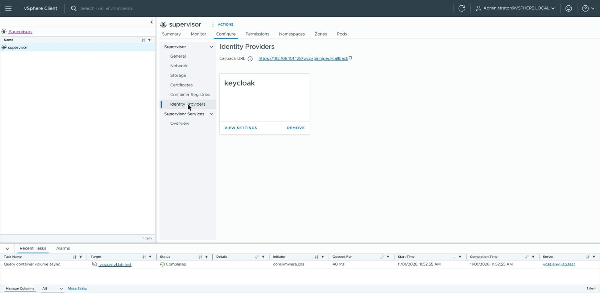
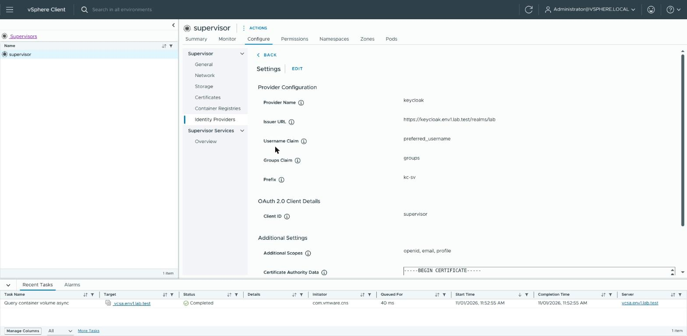
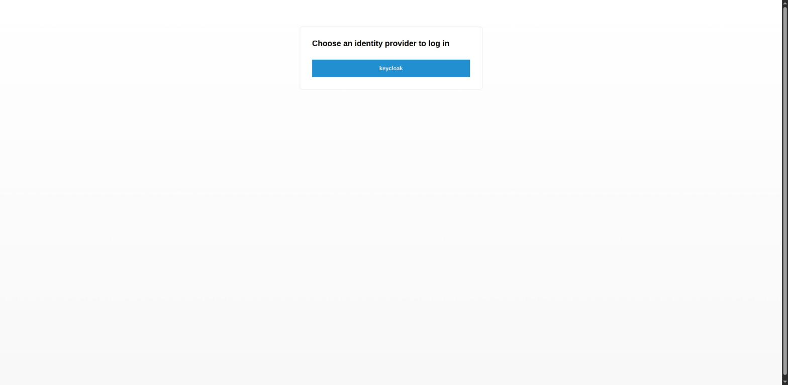
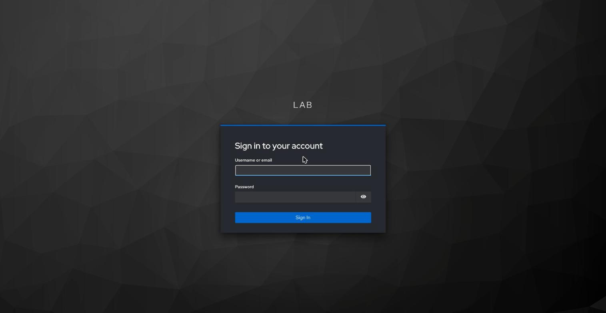

# Grant access to VKS clusters

> [!NOTE]
> **Official Broadcom documentation (VCF 9.1), Kubernetes documentation and vCenter API reference for this guide**
>
> - [Connect to the VKS Cluster Control Plane as a Kubernetes Administrator](https://techdocs.broadcom.com/us/en/vmware-cis/vcf/vcf-consumption/latest/managing-vsphere-kuberenetes-service-clusters-and-workloads/configuring-identity-and-access-for-tkg-service-clusters/connect-to-the-tkg-service-cluster-control-plane-as-a-kubernetes-administrator.html) (the administrator kubeconfig)
> - [Configure vSphere Namespace Permissions for vCenter Single Sign-On Users and Groups](https://techdocs.broadcom.com/us/en/vmware-cis/vcf/vcf-service-administration-and-development/9-1/managing-vsphere-kubernetes-service/configuring-vsphere-namespaces-for-hosting-tkg-service-clusters/configure-vsphere-namespace-persmissions-for-vcenter-sso-users-and-groups.html)
> - [Configure an External Identity Provider for VKS Clusters](https://techdocs.broadcom.com/us/en/vmware-cis/vcf/vcf-service-administration-and-development/9-1/managing-vsphere-kubernetes-service/connecting-to-tkg-service-clusters-using-an-external-identity-provider/configure-an-external-idp-for-use-with-tkg-service-clusters.html), [Configure vSphere Namespace Permissions for External Identity Provider Users and Groups](https://techdocs.broadcom.com/us/en/vmware-cis/vcf/vsphere-supervisor-services-and-standalone-components/latest/managing-vsphere-kuberenetes-service-clusters-and-workloads/configuring-identity-and-access-for-tkg-service-clusters/connecting-to-tkg-service-clusters-using-an-external-identity-provider/configure-vsphere-namespace-permissions-for-external-idp-users-and-groups.html)
> - vCenter API 9.1.1: [Namespaces Instances Access](https://developer.broadcom.com/xapis/vsphere-automation-api/9.1.1/data-structures/Vcenter%20Namespaces%20Instances%20Access/) (the `identity_provider` of a namespace permission)
> - [VCF CLI command reference: cluster](https://techdocs.broadcom.com/us/en/vmware-cis/vcf/vcf-consumption/latest/consumer-interfaces-in-vcf/installing-and-using-vcf-cli-v9/command-reference2/cluster2.html) (`vcf cluster kubeconfig get --export-file`)
> - Broadcom KB 423015: [Generate Non-Expiring Token in TKG cluster](https://knowledge.broadcom.com/external/article/423015/generate-nonexpiring-token-in-tkg-cluste.html) (written for Supervisor 8.x; the administrator ServiceAccount token)
> - Kubernetes: [Authenticating](https://kubernetes.io/docs/reference/access-authn-authz/authentication/) (ServiceAccount tokens, client certificates), [Certificates and Certificate Signing Requests](https://kubernetes.io/docs/reference/access-authn-authz/certificate-signing-requests/), [Using RBAC Authorization](https://kubernetes.io/docs/reference/access-authn-authz/rbac/) (the `edit` and `view` roles)

Your internal customers (application developers, testers, DevOps engineers and their pipelines)
work in a VKS cluster with kubectl, the Kubernetes command-line tool. This guide gives each of them
their own access, with only the rights they need, so that you never send the cluster's
administrator kubeconfig and can take each access away on its own.

**The words used here** (more in [KUBECONFIG.md](KUBECONFIG.md#the-words-used-here)):

| word | what it is |
|---|---|
| vSphere Namespace | the vCenter object on the Supervisor that holds VKS clusters; you give people roles on it in vCenter (**Can view**, **Can edit**, **Owner**) |
| namespace | a folder inside one VKS cluster for a team's workloads, made with kubectl; not the vSphere Namespace |
| kubeconfig | a file that tells kubectl the cluster's address and the login to use; a *context* in it pairs the two (the team and certificate files also name a namespace) |
| ServiceAccount | a login that lives inside the cluster, not an SSO or identity provider user; here for a tool, a team, or a person who needs the whole cluster |
| token | the key of one login, written into the kubeconfig: whoever holds a copy is that login |
| `cluster-admin` | the built-in role for everything in the cluster |
| `edit` | the built-in role to create, change and delete most things in one namespace, its Secrets included; it can act as any ServiceAccount there, but cannot change who has rights |
| `view` | the built-in role to read most things in one namespace, but not Secrets or who has rights |
| RoleBinding, ClusterRoleBinding | what gives a user, a group or a ServiceAccount a role: in one namespace, or in the whole cluster |

**Which way for which customer:**

| your customer | the way | why this way |
|---|---|---|
| a developer, tester or DevOps engineer with a vCenter SSO account | [The person's own SSO account](#the-persons-own-sso-account) | they log in as themselves; you send no secret; you take it away in vCenter and the cluster |
| people in your organization's identity provider (Keycloak in this guide) with no vCenter account | [A group from an external identity provider, through the Supervisor](#a-group-from-an-external-identity-provider-through-the-supervisor) | you give rights once, to a group; the identity provider decides who is in it; one file with no secret serves the whole group |
| a CI pipeline, a deployment tool, or a team that shares one login, in one namespace | [A ServiceAccount token](#a-serviceaccount-token) | no person's account; works unattended for the days you set; deleting it stops every copy |
| a tool or a person that needs the whole cluster | [An administrator ServiceAccount token (whole cluster)](#an-administrator-serviceaccount-token-whole-cluster) | send it instead of the administrator kubeconfig: this one can be taken away |
| one person with no SSO or identity provider account, for a few days | [A personal certificate](#a-personal-certificate) | needs nothing but kubectl; it cannot be withdrawn before it ends, so keep it short |
| people in an identity provider that is not registered on the Supervisor | [An external identity provider on one cluster](KEYCLOAK.md) | a new cluster (VKS 3.8) is created to trust the provider; people need kubectl and kubelogin |

These ways give access to the cluster through kubectl. Add-ons with a web page have their own
sign-in: Headlamp takes the person's SSO login or a token
([HEADLAMP.md steps 6 to 8](HEADLAMP.md#6-log-in-with-your-own-sso-user)); ArgoCD, Harbor and
Grafana have their own sign-in; their guides set up only the `admin` user
([ARGOCD.md step 4](ARGOCD.md#4-log-in-to-the-argocd-web-page),
[HARBOR.md step 9](HARBOR.md#9-save-harbors-ca-and-log-in),
[MONITORING.md step 3](MONITORING.md#3-set-grafanas-admin-password)). For tools, Harbor has robot
accounts ([HARBOR.md step 10](HARBOR.md#10-create-a-project-and-a-robot-account)).

Who does what:

| role | who it is | does here |
|---|---|---|
| cluster administrator | holds the VKS cluster's administrator kubeconfig ([LOGIN.md](LOGIN.md#get-the-vks-clusters-kubeconfig)) | gives rights inside the cluster, makes the files and sends them |
| vCenter administrator | administers vCenter and the Supervisor | gives roles on the vSphere Namespace; registers the identity provider on the Supervisor (for Keycloak: [KEYCLOAK-VKS.md step 11](KEYCLOAK-VKS.md#11-register-keycloak-with-the-supervisor-optional)) and reads its settings |
| identity provider's administrator | administers the external identity provider (Keycloak in this guide) | makes its users and groups |
| the person | gets the access | logs in, and sends their name back where a way needs it |

**The ways and their steps:**

- [The person's own SSO account](#the-persons-own-sso-account)
  1. [Give the person a role on the vSphere Namespace](#1-give-the-person-a-role-on-the-vsphere-namespace-vcenter-administrator) (vCenter administrator)
  2. Log in and send the name (the person): [with the VCF CLI](#2a-log-in-with-the-vcf-cli-the-person), or with the kubectl vSphere plugin ([2b](#2b-windows-and-macos-trust-the-vcenter-ca-the-person-once), [2c](#2c-install-the-kubectl-vsphere-plugin-the-person-once), [2d](#2d-log-in-with-the-plugin-the-person))
  3. [Give that name rights](#3-give-that-name-rights-cluster-administrator) (cluster administrator)
  4. [Use the login and renew it](#4-use-the-login-and-renew-it-the-person) (the person)
  5. [Take it away](#5-take-it-away-cluster-administrator-vcenter-administrator) (cluster administrator, vCenter administrator)
- [A group from an external identity provider, through the Supervisor](#a-group-from-an-external-identity-provider-through-the-supervisor)
  1. [Read the provider name and prefix](#1-read-the-provider-name-and-prefix-vcenter-administrator) (vCenter administrator)
  2. [Give the group a role on the vSphere Namespace](#2-give-the-group-a-role-on-the-vsphere-namespace-vcenter-administrator) (vCenter administrator)
  3. [Give the group rights inside the VKS cluster](#3-give-the-group-rights-inside-the-vks-cluster-cluster-administrator) (cluster administrator)
  4. [Make the group's kubeconfig and hand it over](#4-make-the-groups-kubeconfig-and-hand-it-over-cluster-administrator) (cluster administrator)
  5. [Log in](#5-log-in-the-person) (the person)
  6. [Log out](#6-log-out-the-person) (the person)
  7. [Take one person's access away](#7-take-one-persons-access-away-identity-providers-administrator) (identity provider's administrator)
  8. [Take the group's access away](#8-take-the-groups-access-away-cluster-administrator-vcenter-administrator) (cluster administrator, vCenter administrator)
- [A ServiceAccount token](#a-serviceaccount-token)
  1. [Make the team's token and its file](#1-make-the-teams-token-and-its-file-cluster-administrator) (cluster administrator)
  2. [Hand it over and use it](#2-hand-it-over-and-use-it-cluster-administrator-then-the-team-or-tool) (cluster administrator, then the team or tool)
  3. [Renew the team's token](#3-renew-the-teams-token-cluster-administrator) (cluster administrator)
  4. [Take the team's token away](#4-take-the-teams-token-away-cluster-administrator) (cluster administrator)
- [An administrator ServiceAccount token (whole cluster)](#an-administrator-serviceaccount-token-whole-cluster)
  1. [Make the administrator token and its file](#1-make-the-administrator-token-and-its-file-cluster-administrator) (cluster administrator)
  2. [Hand it over and use it on another machine](#2-hand-it-over-and-use-it-on-another-machine-cluster-administrator-then-the-tool-or-person) (cluster administrator, then the tool or person)
  3. [Renew the administrator token](#3-renew-the-administrator-token-cluster-administrator) (cluster administrator)
  4. [Take the administrator token away](#4-take-the-administrator-token-away-cluster-administrator) (cluster administrator)
- [A personal certificate](#a-personal-certificate)
  1. [Make the certificate and its file](#1-make-the-certificate-and-its-file-cluster-administrator) (cluster administrator)
  2. [Hand it over and use it](#2-hand-it-over-and-use-it-cluster-administrator-then-the-person) (cluster administrator, then the person)
  3. [Renew the certificate](#3-renew-the-certificate-cluster-administrator) (cluster administrator)
  4. [Take the certificate away](#4-take-the-certificate-away-cluster-administrator) (cluster administrator)

Compare the ways:

| way | set up by | they need | lasts | to take it away |
|---|---|---|---|---|
| [The person's own SSO account](#the-persons-own-sso-account) | the vCenter administrator, then the cluster administrator | kubectl, and the VCF CLI or the kubectl vSphere plugin | 10 hours per login | delete the person's RoleBinding and their role on the vSphere Namespace |
| [A group from an external identity provider, through the Supervisor](#a-group-from-an-external-identity-provider-through-the-supervisor) | the identity provider's, vCenter and cluster administrators | kubectl and the VCF CLI | while the person's sign-in lasts | disable the user in the identity provider, or delete the group's RoleBinding and its role on the vSphere Namespace |
| [A ServiceAccount token](#a-serviceaccount-token) | the cluster administrator | kubectl | the days you set | delete the ServiceAccount: every copy stops |
| [An administrator ServiceAccount token (whole cluster)](#an-administrator-serviceaccount-token-whole-cluster) | the cluster administrator | kubectl | the days you set (365 for a year), or until you take it away | delete its ClusterRoleBinding, token Secret and ServiceAccount: every copy stops (not logins the holder made) |
| [A personal certificate](#a-personal-certificate) | the cluster administrator | kubectl | the days you set | cannot be withdrawn: delete its RoleBinding and never bind its name again |
| [An external identity provider on one cluster](KEYCLOAK.md) | the identity provider's and cluster administrators | kubectl and kubelogin | while the person's sign-in lasts | delete the group's RoleBinding |

The SSO way hands out no kubeconfig: the person's login writes their own. The group way hands out a file
with no secret, which only tells kubectl where to sign in. The two ServiceAccount ways and the
personal certificate hand out a file that works for whoever holds a copy. Which file holds what,
how to hand it over, use and merge it: [KUBECONFIG.md](KUBECONFIG.md).

## Prerequisites

- cluster administrator: the VKS cluster's administrator kubeconfig
  ([LOGIN.md](LOGIN.md#get-the-vks-clusters-kubeconfig)) and [kubectl](KUBECTL.md); for a personal
  certificate also openssl ([PREREQS.md](PREREQS.md); on Windows, run it in WSL); for the identity
  provider way, a Supervisor login with the **Can edit** role on the vSphere Namespace
  ([LOGIN.md](LOGIN.md#create-supervisor-context-with-ca));
- vCenter administrator (SSO and identity provider ways): the vCenter CA
  ([LOGIN.md](LOGIN.md#create-supervisor-context-with-ca), step 1); for the identity provider way,
  curl and jq ([PREREQS.md](PREREQS.md)), and the identity provider registered on the Supervisor
  (for Keycloak: [KEYCLOAK-VKS.md step 11](KEYCLOAK-VKS.md#11-register-keycloak-with-the-supervisor-optional));
- the person or tool: [kubectl](KUBECTL.md) (every way); SSO way: the [VCF CLI](VCF.md) or the
  kubectl vSphere plugin ([step 2c](#2c-install-the-kubectl-vsphere-plugin-the-person-once)), and
  the vCenter CA (sent in step 1); identity provider way: the VCF CLI and a browser.

The connections this guide needs, for a firewall (all TCP, besides DNS; the Supervisor's DNS
servers must resolve the identity provider's name):

| from | to | port | for |
|---|---|---|---|
| the cluster administrator's machine | the VKS cluster's API address (in its kubeconfig) | 6443 | kubectl as the cluster's administrator (every way) |
| the vCenter administrator's machine | vCenter | 443 | [Give the group a role on the vSphere Namespace](#2-give-the-group-a-role-on-the-vsphere-namespace-vcenter-administrator) |
| the cluster administrator's machine | the Supervisor's address | 443 | [Make the group's kubeconfig](#4-make-the-groups-kubeconfig-and-hand-it-over-cluster-administrator) |
| the person's machine | the VKS cluster's API address | 6443 | kubectl with the person's file (every way) |
| the person's machine | the Supervisor's address | 443 | the SSO login and the plugin download ([step 2c](#2c-install-the-kubectl-vsphere-plugin-the-person-once)); the identity provider sign-in through the Supervisor |
| the person's browser | the Supervisor's address, and the identity provider | 443 | [Log in (the person)](#5-log-in-the-person) |
| the Supervisor's control plane | the identity provider | 443 (or the Issuer URL's port) | checking the sign-in ([step 5](#5-log-in-the-person)) |
| the VKS cluster's control-plane nodes | the Supervisor's address | 443 | checking group sign-ins ([step 5](#5-log-in-the-person)) |

## The person's own SSO account

Pick this for people who have a vCenter SSO account. They log in as themselves with the VCF CLI or
the kubectl vSphere plugin, and the login writes their own kubeconfig: you send them names and the
vCenter CA, not a kubeconfig. The vCenter administrator lets them log in (step 1); the cluster administrator gives their
name rights inside the cluster (step 3). A login lasts 10 hours.

### 1. Give the person a role on the vSphere Namespace (vCenter administrator)

Give the person's SSO user the **Can view** role (**Namespaces View**) on the vSphere Namespace
([NAMESPACE.md](NAMESPACE.md) step 4). Not **Can edit** or **Owner**: those make them an
administrator of every VKS cluster in the namespace. Then send the person the Supervisor's
address, the vSphere Namespace's and the cluster's names, and the vCenter CA file
([LOGIN.md](LOGIN.md#create-supervisor-context-with-ca), step 1).

### 2a. Log in with the VCF CLI (the person)

You need the [VCF CLI](VCF.md) and the vCenter CA from step 1 ([Create Supervisor context with
CA](LOGIN.md#create-supervisor-context-with-ca), step 1). **A few failed logins in a row lock the
SSO user for some minutes.**

Type your SSO password first, so that it never shows on the screen or in the shell's history. This
line only keeps it in this terminal; nothing else changes. You then have the password ready for the
next block, which uses it and removes it.

**Linux, macOS, WSL (bash or zsh):**

```sh
printf 'SSO password: '; IFS= read -rs SSO_PASSWORD; echo
```

**Windows (PowerShell):**

```powershell
$SSO_PASSWORD = Read-Host 'SSO password' -AsSecureString
```

Then run this in the same terminal, once to get the name the cluster knows you by (the cluster
administrator needs it for step 3), and again whenever kubectl answers `Unauthorized`, 10 hours
after a login. It logs in to the VKS cluster as `SSO_USER` through the Supervisor, writes the login
to its own kubeconfig `VKS_SSO_KUBECONFIG`, readable only by you. You then have that
file, and the name the cluster knows you by: send it, exactly as printed, to the cluster
administrator.

`SUPERVISOR_ENDPOINT`: the Supervisor's IP address or DNS name.

<details>
<summary><b>Linux, macOS, WSL (bash or zsh)</b></summary>

```sh
SUPERVISOR_ENDPOINT="10.0.0.10"
SUPERVISOR_CA="$HOME/.kube/vcenter-ca.pem"
SSO_USER="alice@vsphere.local"
VKS_NAMESPACE="my-namespace"
VKS_CLUSTER="my-vks-cluster"
VKS_SSO_KUBECONFIG="$HOME/.kube/${VKS_CLUSTER}-sso.kubeconfig"

if [ -z "$SSO_PASSWORD" ]; then
  echo "FAILED: no password in this terminal; run the password line above"
elif [ ! -f "$SUPERVISOR_CA" ] || [ ! -s "$SUPERVISOR_CA" ]; then
  echo "FAILED: not found: $SUPERVISOR_CA"
elif mkdir -p "$HOME/.kube" && ( umask 077; : >> "$VKS_SSO_KUBECONFIG" ) && chmod 600 "$VKS_SSO_KUBECONFIG" \
     && { KUBECONFIG="$VKS_SSO_KUBECONFIG" vcf context delete "${VKS_CLUSTER}-sso" -y --skip-delete-kubeconfig-context </dev/null >/dev/null 2>&1; true; } \
     && KUBECONFIG="$VKS_SSO_KUBECONFIG" VCF_CLI_VSPHERE_PASSWORD="$SSO_PASSWORD" \
        vcf context create "${VKS_CLUSTER}-sso" --type k8s --endpoint "https://${SUPERVISOR_ENDPOINT}" \
          --username "$SSO_USER" --auth-type basic --ca-certificate "$SUPERVISOR_CA" --skip-create-related-contexts \
          --workload-cluster-name "$VKS_CLUSTER" --workload-cluster-namespace "$VKS_NAMESPACE" </dev/null \
     && kubectl --kubeconfig "$VKS_SSO_KUBECONFIG" config use-context "${VKS_CLUSTER}-sso:${VKS_CLUSTER}" >/dev/null; then
  echo "send this name: $(kubectl --kubeconfig "$VKS_SSO_KUBECONFIG" auth whoami -o jsonpath='{.status.userInfo.username}')"
else
  echo "FAILED: login (see the error above)"
fi
unset SSO_PASSWORD
```

</details>

<details>
<summary><b>Windows (PowerShell)</b></summary>

```powershell
$SUPERVISOR_ENDPOINT = "10.0.0.10"
$SUPERVISOR_CA = "$HOME\.kube\vcenter-ca.pem"
$SSO_USER = "alice@vsphere.local"
$VKS_NAMESPACE = "my-namespace"
$VKS_CLUSTER = "my-vks-cluster"
$VKS_SSO_KUBECONFIG = "$HOME\.kube\${VKS_CLUSTER}-sso.kubeconfig"

if (-not $SSO_PASSWORD -or $SSO_PASSWORD.Length -eq 0) {
  "FAILED: no password in this PowerShell; run the password line above"
} elseif (-not (Test-Path $SUPERVISOR_CA -PathType Leaf) -or (Get-Item $SUPERVISOR_CA).Length -eq 0) {
  "FAILED: not found: $SUPERVISOR_CA"
} else {
  New-Item -ItemType Directory -Force -Path "$HOME\.kube" | Out-Null
  $OLD_KUBECONFIG = $env:KUBECONFIG; $env:KUBECONFIG = $VKS_SSO_KUBECONFIG
  try {
    $null | vcf context delete "$VKS_CLUSTER-sso" -y --skip-delete-kubeconfig-context 2>&1 | Out-Null
    $env:VCF_CLI_VSPHERE_PASSWORD = [Net.NetworkCredential]::new('', $SSO_PASSWORD).Password
    $global:LASTEXITCODE = $null
    $null | vcf context create "$VKS_CLUSTER-sso" --type k8s --endpoint "https://$SUPERVISOR_ENDPOINT" `
      --username $SSO_USER --auth-type basic "--ca-certificate=$SUPERVISOR_CA" --skip-create-related-contexts `
      --workload-cluster-name $VKS_CLUSTER --workload-cluster-namespace $VKS_NAMESPACE
    $OK = $LASTEXITCODE -eq 0
  } finally {
    Remove-Item Env:VCF_CLI_VSPHERE_PASSWORD -ErrorAction SilentlyContinue; $env:KUBECONFIG = $OLD_KUBECONFIG
  }
  Remove-Variable SSO_PASSWORD
  if ($OK) {
    kubectl --kubeconfig $VKS_SSO_KUBECONFIG config use-context "$VKS_CLUSTER-sso:$VKS_CLUSTER" | Out-Null
    "send this name: $(kubectl --kubeconfig $VKS_SSO_KUBECONFIG auth whoami -o jsonpath='{.status.userInfo.username}')"
  } else {
    "FAILED: login (see the error above)"
  }
}
```

</details>

**Expect:** `Successfully logged in to Kubernetes cluster <cluster>`, the contexts `<cluster>-sso` and
`<cluster>-sso:<cluster>`, and `send this name: sso:…` (SSO writes the name in its own letter case,
for example `sso:Alice@vsphere.local`).

**If not:**
- `FAILED: no password …`: run the password line, then this block.
- `FAILED: not found: …`: save the vCenter CA first
  ([Create Supervisor context with CA](LOGIN.md#create-supervisor-context-with-ca), step 1).
- `invalid or missing credentials`: check `SSO_USER`, then run the password line and this block
  again. Mind the lock-out.
- `x509: certificate signed by unknown authority`: `SUPERVISOR_CA` is not the vCenter CA.
- `Invalid vSphere Supervisor endpoint`: check `SUPERVISOR_ENDPOINT` and that this machine reaches
  it on port 443.
- `Login failed: bad request`: check `VKS_CLUSTER` and `VKS_NAMESPACE`.
- After fixing a value, run the password line and this block again.
- `Initialization done!` and lines about plugins on the first run: harmless.

Without the VCF CLI, steps 2c and 2d use the kubectl vSphere plugin (on Windows and macOS, step 2b first). Broadcom replaced it with the
VCF CLI, but it still works on 9.1 ([KB 435399](https://knowledge.broadcom.com/external/article/435399)).
The Supervisor serves it only as an amd64 build (Apple silicon and Windows on Arm would need x64
emulation; not tested).

### 2b. Windows and macOS: trust the vCenter CA (the person, once)

Do this once on Windows or macOS, before steps 2c and 2d, and before a browser sign-in through the
Supervisor (group step 5): there the browser, the plugin (and on Windows the download in step 2c) check the Supervisor's certificate against your user's trusted CAs, not
`SUPERVISOR_CA`. It adds the vCenter CA to your user's trusted CAs. You then trust certificates
the vCenter CA signed, the Supervisor's among them, as this user. On macOS (not tested):
`security add-trusted-cert -r trustRoot -k ~/Library/Keychains/login.keychain-db ~/.kube/vcenter-ca.pem`.
Windows asks you to confirm with **Yes**:

**Windows (PowerShell):**

```powershell
Import-Certificate -FilePath "$HOME\.kube\vcenter-ca.pem" -CertStoreLocation Cert:\CurrentUser\Root
```

**Expect:** a line with the CA's thumbprint and its name (`CN=CA` for vCenter's own CA).

**If not:** `UI is not allowed in this operation`: this PowerShell has no desktop to ask on (for
example over SSH). Run the line in Windows PowerShell on the desktop.

### 2c. Install the kubectl vSphere plugin (the person, once)

Do this once, when you use the plugin instead of the VCF CLI. It downloads the plugin from the
Supervisor, checking the Supervisor's certificate against the vCenter CA
([Create Supervisor context with CA](LOGIN.md#create-supervisor-context-with-ca), step 1; on Windows,
the trusted CA from step 2b), runs it, and only then installs it into `INSTALL_DIR`. You then have
the `kubectl-vsphere` command for step 2d.

`SUPERVISOR_ENDPOINT`: the Supervisor's IP address or DNS name.

<details>
<summary><b>Linux, macOS, WSL (bash or zsh)</b></summary>

```sh
SUPERVISOR_ENDPOINT="10.0.0.10"
SUPERVISOR_CA="$HOME/.kube/vcenter-ca.pem"
INSTALL_DIR="$HOME/.local/bin"

case "$(uname -s)" in Darwin) OS=darwin ;; *) OS=linux ;; esac
TMP="$(mktemp -d)"
if curl -fsS --connect-timeout 20 --speed-time 60 --cacert "$SUPERVISOR_CA" -o "$TMP/plugin.zip" \
     "https://${SUPERVISOR_ENDPOINT}/wcp/plugin/${OS}-amd64/vsphere-plugin.zip" \
   && { if command -v unzip >/dev/null 2>&1 || ! command -v bsdtar >/dev/null 2>&1; then unzip -q -o "$TMP/plugin.zip" -d "$TMP"; else bsdtar -xf "$TMP/plugin.zip" -C "$TMP"; fi; } \
   && "$TMP/bin/kubectl-vsphere" version; then
  mkdir -p "$INSTALL_DIR" && install -m 755 "$TMP/bin/kubectl-vsphere" "$INSTALL_DIR/kubectl-vsphere" \
    && echo "installed $INSTALL_DIR/kubectl-vsphere"
else
  echo "FAILED: no working plugin from https://${SUPERVISOR_ENDPOINT} (see the error above)"
fi
rm -rf "$TMP"
```

</details>

<details>
<summary><b>Windows (PowerShell)</b></summary>

```powershell
$SUPERVISOR_ENDPOINT = "10.0.0.10"
$INSTALL_DIR = "$env:LOCALAPPDATA\Programs\vks-tools"

$ProgressPreference = 'SilentlyContinue'
if ([Net.ServicePointManager]::SecurityProtocol -ne 'SystemDefault') { [Net.ServicePointManager]::SecurityProtocol = [Net.ServicePointManager]::SecurityProtocol -bor 'Tls12' }
$TMP = Join-Path $env:TEMP ([guid]::NewGuid()); New-Item -ItemType Directory -Path $TMP | Out-Null
$global:LASTEXITCODE = 1
try {
  Invoke-WebRequest -UseBasicParsing -TimeoutSec 300 -Uri "https://$SUPERVISOR_ENDPOINT/wcp/plugin/windows-amd64/vsphere-plugin.zip" -OutFile "$TMP\plugin.zip"
  Expand-Archive -Path "$TMP\plugin.zip" -DestinationPath $TMP; & "$TMP\bin\kubectl-vsphere.exe" version
} catch { $_.Exception.Message }
if ($LASTEXITCODE -eq 0) {
  New-Item -ItemType Directory -Force -Path $INSTALL_DIR | Out-Null
  Copy-Item -Force "$TMP\bin\kubectl-vsphere.exe" "$INSTALL_DIR\kubectl-vsphere.exe"
  "installed $INSTALL_DIR\kubectl-vsphere.exe"
} else {
  "FAILED: no working plugin from https://$SUPERVISOR_ENDPOINT (see the error above)"
}
Remove-Item -Recurse -Force $TMP
```

</details>

**Expect:** `kubectl-vsphere: version …`, then `installed …`.

**If not:** `FAILED: …` after `curl: (60)` (Windows: `Could not establish trust relationship`):
`SUPERVISOR_CA` is not the vCenter CA, or on Windows the step above was not done; after
`curl: (22) … 404` (Windows: `(404) Not Found`): there is no build for this machine.

### 2d. Log in with the plugin (the person)

Do this to log in with the plugin: once to get the name the cluster knows you by (the cluster
administrator needs it for step 3), and again whenever kubectl answers `Unauthorized`, 10 hours
after a login. **A few failed logins in a row lock the SSO user for some minutes.** It logs in to
the VKS cluster as `SSO_USER` and writes the login to its own kubeconfig `VKS_SSO_KUBECONFIG`,
readable only by you. On Linux, macOS and WSL it asks for the SSO password. You then have that
file, and the name the cluster knows you by: send it, exactly as printed, to the cluster
administrator.

`SUPERVISOR_ENDPOINT`: the Supervisor's IP address or DNS name.

<details>
<summary><b>Linux, macOS, WSL (bash or zsh)</b></summary>

```sh
SUPERVISOR_ENDPOINT="10.0.0.10"
SUPERVISOR_CA="$HOME/.kube/vcenter-ca.pem"
SSO_USER="alice@vsphere.local"
VKS_NAMESPACE="my-namespace"
VKS_CLUSTER="my-vks-cluster"
VKS_SSO_KUBECONFIG="$HOME/.kube/${VKS_CLUSTER}-sso.kubeconfig"

mkdir -p "$HOME/.kube" && ( umask 077; : >> "$VKS_SSO_KUBECONFIG" ) && chmod 600 "$VKS_SSO_KUBECONFIG"
( printf 'SSO password: '; IFS= read -rs P; echo
  KUBECONFIG="$VKS_SSO_KUBECONFIG" SSL_CERT_FILE="$SUPERVISOR_CA" KUBECTL_VSPHERE_PASSWORD="$P" \
    "$HOME/.local/bin/kubectl-vsphere" login --server "$SUPERVISOR_ENDPOINT" --vsphere-username "$SSO_USER" \
    --tanzu-kubernetes-cluster-namespace "$VKS_NAMESPACE" --tanzu-kubernetes-cluster-name "$VKS_CLUSTER" ); chmod 600 "$VKS_SSO_KUBECONFIG"; kubectl --kubeconfig "$VKS_SSO_KUBECONFIG" config use-context "$VKS_CLUSTER" >/dev/null && echo "send this name: $(kubectl --kubeconfig "$VKS_SSO_KUBECONFIG" auth whoami -o jsonpath='{.status.userInfo.username}')"
```

</details>

On Windows, type the password first, so that it never shows on the screen. This line only keeps it
in this PowerShell; nothing else changes. You then have it ready for the next block, which uses it
and removes it:

**Windows (PowerShell):**

```powershell
$SSO_PASSWORD = Read-Host 'SSO password' -AsSecureString
```

<details>
<summary><b>Windows (PowerShell)</b></summary>

```powershell
$SUPERVISOR_ENDPOINT = "10.0.0.10"
$SSO_USER = "alice@vsphere.local"
$VKS_NAMESPACE = "my-namespace"
$VKS_CLUSTER = "my-vks-cluster"
$VKS_SSO_KUBECONFIG = "$HOME\.kube\${VKS_CLUSTER}-sso.kubeconfig"

if (-not $SSO_PASSWORD -or $SSO_PASSWORD.Length -eq 0) {
  "FAILED: no password in this PowerShell; run the password line above"
} else {
  New-Item -ItemType Directory -Force -Path "$HOME\.kube" | Out-Null
  $OLD_KUBECONFIG = $env:KUBECONFIG; $env:KUBECONFIG = $VKS_SSO_KUBECONFIG
  try {
    $env:KUBECTL_VSPHERE_PASSWORD = [Net.NetworkCredential]::new('', $SSO_PASSWORD).Password
    kubectl-vsphere login --server $SUPERVISOR_ENDPOINT --vsphere-username $SSO_USER `
      --tanzu-kubernetes-cluster-namespace $VKS_NAMESPACE --tanzu-kubernetes-cluster-name $VKS_CLUSTER
  } finally {
    Remove-Item Env:KUBECTL_VSPHERE_PASSWORD -ErrorAction SilentlyContinue; $env:KUBECONFIG = $OLD_KUBECONFIG
  }
  Remove-Variable SSO_PASSWORD
  kubectl --kubeconfig $VKS_SSO_KUBECONFIG config use-context $VKS_CLUSTER | Out-Null
  if ($LASTEXITCODE -eq 0) { "send this name: $(kubectl --kubeconfig $VKS_SSO_KUBECONFIG auth whoami -o jsonpath='{.status.userInfo.username}')" }
}
```

</details>

**Expect:** `Logged in successfully.`, the contexts it made, and `send this name: sso:…` (SSO
writes the name in its own letter case, for example `sso:Alice@vsphere.local`).

**If not:**
- `x509: certificate signed by unknown authority`: `SUPERVISOR_CA` is not the vCenter CA (Windows
  and macOS: the CA step above was not done).
- `FAILED: no password …` (Windows): run the password line, then this block.
- `Login failed: bad request`, then `no context exists with the name`: check `VKS_CLUSTER` and
  `VKS_NAMESPACE`. A cluster with the same name as its vSphere Namespace can also hide one of the
  two contexts
  ([Broadcom KB 435635](https://knowledge.broadcom.com/external/article/435635)).
- Any other login error: check `SSO_USER`, then run this block again (Windows: the password line
  first) and type the password carefully. Mind the lock-out.
- `send this name:` with `Unauthorized`: the login did not work; see the error above it.

### 3. Give that name rights (cluster administrator)

Do this when the person has sent their name: the role from step 1 lets them log in, but gives no
rights inside the VKS cluster. This makes the namespace `TEAM_NAMESPACE` if it is not there, and a
RoleBinding that gives the name `edit` in it. The person can then deploy in that namespace. Set
`SSO_NAME` to the name the person sent, letter for letter: a name in other letter case gets no
rights.

**Linux, macOS, WSL (bash or zsh):**

```sh
ADMIN_KUBECONFIG="$HOME/.kube/my-vks-cluster.kubeconfig"
SSO_NAME="sso:Alice@vsphere.local"
TEAM_NAMESPACE="team-a"

B="$(printf '%s' "$SSO_NAME" | tr 'A-Z' 'a-z' | tr -c 'a-z0-9.\n' '-')-edit"
kubectl --kubeconfig "$ADMIN_KUBECONFIG" create namespace "$TEAM_NAMESPACE" --dry-run=client -o yaml | kubectl --kubeconfig "$ADMIN_KUBECONFIG" apply -f - >/dev/null
kubectl --kubeconfig "$ADMIN_KUBECONFIG" -n "$TEAM_NAMESPACE" create rolebinding "$B" --clusterrole=edit --user="$SSO_NAME"
```

**Windows (PowerShell):**

```powershell
$ADMIN_KUBECONFIG = "$HOME\.kube\my-vks-cluster.kubeconfig"
$SSO_NAME = "sso:Alice@vsphere.local"
$TEAM_NAMESPACE = "team-a"

$B = ($SSO_NAME.ToLower() -replace '[^a-z0-9.]', '-') + '-edit'
kubectl --kubeconfig $ADMIN_KUBECONFIG create namespace $TEAM_NAMESPACE --dry-run=client -o yaml | kubectl --kubeconfig $ADMIN_KUBECONFIG apply -f - | Out-Null
kubectl --kubeconfig $ADMIN_KUBECONFIG -n $TEAM_NAMESPACE create rolebinding $B --clusterrole=edit "--user=$SSO_NAME"
```

**Expect:** `rolebinding.rbac.authorization.k8s.io/sso-alice-vsphere.local-edit created`. The
person then gets `yes` from `kubectl --kubeconfig "$HOME/.kube/<cluster>-sso.kubeconfig" -n team-a
auth can-i create deployments`.

**If not:** `already exists`: a binding of that name is there, perhaps for the name in other letter
case. `kubectl --kubeconfig <admin file> -n team-a get rolebinding <name> -o
jsonpath='{.subjects[0].name}'` must print `SSO_NAME` letter for letter; if not, delete that
binding and run this again.

### 4. Use the login and renew it (the person)

Use the file from step 2a or 2d, `~/.kube/<cluster>-sso.kubeconfig`, with `--kubeconfig` or
`KUBECONFIG` ([KUBECONFIG.md](KUBECONFIG.md#2-use-a-file)), and name the namespace you were given
in each command (`-n team-a`). It needs no password until the login ends: 10 hours after it,
kubectl answers `Unauthorized`; log in again (step 2a, or 2d). The rights from step 3 stay.

### 5. Take it away (cluster administrator, vCenter administrator)

- Cluster administrator: delete the RoleBinding from step 3 (`kubectl --kubeconfig <admin file> -n
  team-a delete rolebinding sso-alice-vsphere.local-edit`); it stops at once.
- vCenter administrator: remove the person's role on the vSphere Namespace
  ([NAMESPACE.md](NAMESPACE.md) step 4), and disable the SSO user if they should lose vCenter as
  well.

<a id="a-keycloak-account-through-the-supervisor"></a>

## A group from an external identity provider, through the Supervisor

Pick this when people are in your organization's identity provider and have no vCenter account.
Once the vCenter administrator has registered an external OpenID Connect (OIDC) identity provider
on the Supervisor (for Keycloak, the example in this guide: [KEYCLOAK-VKS.md step 11](KEYCLOAK-VKS.md#11-register-keycloak-with-the-supervisor-optional)),
people in one of its groups sign in to the VKS clusters in a browser with their identity provider
account.

One Supervisor takes one identity provider, for all its VKS clusters. The cluster knows the person
as `<prefix>:<user>` and their groups as `<prefix>:<group>`; the prefix is set when the provider is
registered.

First, the identity provider's administrator makes the group, adds the people, and sends the
group's name to the vCenter administrator and the cluster administrator. The provider must send
group names without a leading `/`, or the cluster sees `<prefix>:/<group>` (in Keycloak: the group
mapper of the client `supervisor`,
[KEYCLOAK-VKS.md step 11.2](KEYCLOAK-VKS.md#112-make-the-client-keycloak-administrator), with
**Full group path** off).

### 1. Read the provider name and prefix (vCenter administrator)

In the vSphere Client: menu > **Supervisor Management** > **Supervisors** > your Supervisor >
**Configure** > **Supervisor** > **Identity Providers** shows a card for the provider (here
**keycloak**). Its **VIEW SETTINGS** shows the **Provider Name**, the **Issuer URL** (the provider's
address; for Keycloak, your realm), the **Groups Claim** and the **Prefix**.

Keep the **Provider Name** for step 2, and send the **Prefix** to the cluster administrator for
step 3. No card: the provider is not registered yet ([KEYCLOAK-VKS.md step 11](KEYCLOAK-VKS.md#11-register-keycloak-with-the-supervisor-optional)).





### 2. Give the group a role on the vSphere Namespace (vCenter administrator)

The vSphere Client's **Add Permission** window offers only vCenter's own domains, so this step
uses vCenter's API, with the vCenter administrator's password. Type that password first, so that it
never shows on the screen or in the shell's history. This line only keeps it in this terminal;
nothing else changes. You then have the password ready for the next block, which uses it and
removes it. **A few failed logins in a row lock the user for some minutes.**

**Linux, macOS, WSL (bash or zsh):**

```sh
printf 'SSO password: '; IFS= read -rs SSO_PASSWORD; echo
```

**Windows (PowerShell):**

```powershell
$SSO_PASSWORD = Read-Host 'SSO password' -AsSecureString
```

Then, in the same terminal, run this for each group that should sign in to the Supervisor's VKS
clusters, and with `ROLE="REMOVE"` when it should no longer. It gives the identity provider's group
`KC_GROUP` (without the prefix) the role `ROLE` on the vSphere Namespace: `VIEW` (Can view) for
people who only use the clusters, `EDIT` (Can edit), which makes every member an administrator of
every VKS cluster in the namespace, or `REMOVE` to take the role away. It then reads the permission
back. The group's members can then sign in; step 3 gives them rights inside the cluster.

`IDP_NAME`: the **Provider Name** from step 1. `KC_GROUP`: the group's name at the identity
provider (in Keycloak, as the realm lists it), letters, digits, `-` or `_` only. A group that
already has a role gets the new one. After the provider was removed and registered again, run this
for each group again.

<details>
<summary><b>Linux, macOS, WSL (bash or zsh)</b></summary>

```sh
VCENTER_FQDN="vcenter.example.com"
VCENTER_CA="$HOME/.kube/vcenter-ca.pem"
SSO_USER="administrator@vsphere.local"
IDP_NAME="keycloak"
VKS_NAMESPACE="my-namespace"
KC_GROUP="k8s-devs"
ROLE="VIEW"

if ! command -v jq >/dev/null 2>&1; then
  echo "MISSING: jq (PREREQS.md)"
elif [ -z "$SSO_PASSWORD" ]; then
  echo "FAILED: no password in this terminal; run the password line above"
elif [ ! -f "$VCENTER_CA" ] || [ ! -s "$VCENTER_CA" ]; then
  echo "FAILED: not found: $VCENTER_CA"
else
  B64="$(printf '%s:%s' "$SSO_USER" "$SSO_PASSWORD" | base64 | tr -d '\n')"; unset SSO_PASSWORD
  TOK="$(printf 'header = "Authorization: Basic %s"\n' "$B64" | curl -sS --connect-timeout 20 --cacert "$VCENTER_CA" -X POST -K - "https://${VCENTER_FQDN}/api/session" | tr -d '"')"; unset B64
  api() { printf 'header = "vmware-api-session-id: %s"\n' "$TOK" | curl -sS --connect-timeout 20 --cacert "$VCENTER_CA" -K - "$@"; }
  SUP="$(api "https://${VCENTER_FQDN}/api/vcenter/namespaces/instances/v2/${VKS_NAMESPACE}" | jq -r '.supervisor // empty' 2>/dev/null)"
  IDP="$(api "https://${VCENTER_FQDN}/api/vcenter/namespace-management/supervisors/${SUP}/identity/providers" | jq -r --arg n "$IDP_NAME" '.[]? | select(.display_name == $n) | .provider' 2>/dev/null)"
  URL="https://${VCENTER_FQDN}/api/vcenter/namespaces/instances/${VKS_NAMESPACE}/access/no-domain/${KC_GROUP}?type=GROUP"
  if [ -z "$SUP" ] || [ -z "$IDP" ]; then
    echo "FAILED: no vCenter login, vSphere Namespace ${VKS_NAMESPACE} or identity provider ${IDP_NAME} (see above)"
  else
    if [ "$ROLE" = "REMOVE" ]; then
      api -X DELETE "$URL"
    elif api "$URL" | grep -q '"role"'; then
      api -X PUT -H 'Content-Type: application/json' -d "{\"role\":\"${ROLE}\",\"identity_provider\":\"${IDP}\"}" "$URL"
    else
      api -X POST -H 'Content-Type: application/json' -d "{\"role\":\"${ROLE}\",\"identity_provider\":\"${IDP}\"}" "$URL"
    fi
    echo "now: $(api "$URL")"
  fi
  api -X DELETE "https://${VCENTER_FQDN}/api/session"; unset TOK
fi
```

</details>

<details>
<summary><b>Windows (PowerShell)</b></summary>

```powershell
$VCENTER_FQDN = "vcenter.example.com"
$VCENTER_CA = "$HOME\.kube\vcenter-ca.pem"
$SSO_USER = "administrator@vsphere.local"
$IDP_NAME = "keycloak"
$VKS_NAMESPACE = "my-namespace"
$KC_GROUP = "k8s-devs"
$ROLE = "VIEW"

if (-not $SSO_PASSWORD -or $SSO_PASSWORD.Length -eq 0) {
  "FAILED: no password in this PowerShell; run the password line above"
} elseif (-not (Test-Path $VCENTER_CA -PathType Leaf) -or (Get-Item $VCENTER_CA).Length -eq 0) {
  "FAILED: not found: $VCENTER_CA"
} else {
  $B64 = [Convert]::ToBase64String([Text.Encoding]::UTF8.GetBytes("${SSO_USER}:" + [Net.NetworkCredential]::new('', $SSO_PASSWORD).Password))
  Remove-Variable SSO_PASSWORD
  $TOK = ("header = `"Authorization: Basic $B64`"" | curl.exe -sS --connect-timeout 20 --ssl-no-revoke --cacert $VCENTER_CA -X POST -K - "https://$VCENTER_FQDN/api/session") -replace '"', ''
  Remove-Variable B64
  function api { "header = `"vmware-api-session-id: $TOK`"" | curl.exe -sS --connect-timeout 20 --ssl-no-revoke --cacert $VCENTER_CA -K - @args }
  $SUP = $null; $IDP = $null
  try { $SUP = (api "https://$VCENTER_FQDN/api/vcenter/namespaces/instances/v2/$VKS_NAMESPACE" | ConvertFrom-Json).supervisor } catch { }
  if ($SUP) { $IDP = (@(api "https://$VCENTER_FQDN/api/vcenter/namespace-management/supervisors/$SUP/identity/providers" | ConvertFrom-Json) | Where-Object { $_.display_name -eq $IDP_NAME }).provider }
  $URL = "https://$VCENTER_FQDN/api/vcenter/namespaces/instances/$VKS_NAMESPACE/access/no-domain/${KC_GROUP}?type=GROUP"
  if (-not $SUP -or -not $IDP) {
    "FAILED: no vCenter login, vSphere Namespace $VKS_NAMESPACE or identity provider $IDP_NAME (see above)"
  } else {
    if ($ROLE -eq "REMOVE") {
      api -X DELETE $URL
    } else {
      $METHOD = "POST"; if ((api $URL) -match '"role"') { $METHOD = "PUT" }
      $BODY = Join-Path $env:TEMP ([guid]::NewGuid())
      Set-Content -Encoding ascii -Path $BODY -Value (@{ role = $ROLE; identity_provider = $IDP } | ConvertTo-Json -Compress)
      api -X $METHOD -H "Content-Type: application/json" --data-binary "@$BODY" $URL
      Remove-Item -Force $BODY
    }
    "now: $(api $URL)"
  }
  api -X DELETE "https://$VCENTER_FQDN/api/session" | Out-Null; Remove-Variable TOK
}
```

</details>

**Expect:** `now: {"identity_provider":"…","role":"VIEW","inherited":false}`; for `REMOVE`,
`now: {"error_type":"UNSUPPORTED",…"Principal k8s-devs on domain no-domain and type GROUP is not
associated with namespace my-namespace."…}`. Within a minute the Supervisor gives the group the matching
Kubernetes role in the vSphere Namespace (a RoleBinding `view:<prefix>:<group>`).

**If not:**
- `FAILED: no password …`: run the password line, then this block.
- `FAILED: not found: …`: save the vCenter CA first
  ([LOGIN.md](LOGIN.md#create-supervisor-context-with-ca), step 1).
- `FAILED: no vCenter login, …` under `curl: (60)` or `SSL`: `VCENTER_CA` is not vCenter's CA.
- `FAILED: no vCenter login, …` otherwise: check `SSO_USER` and `VCENTER_FQDN`, then run the
  password line and this block again; mind the lock-out. Or check `VKS_NAMESPACE` and `IDP_NAME`
  (step 1).

### 3. Give the group rights inside the VKS cluster (cluster administrator)

Do this so that the group can work inside the cluster: the namespace role from step 2 lets the
person sign in; with **Can view** it gives no rights inside the VKS cluster. This makes the
namespace `TEAM_NAMESPACE` if it is not there, and a RoleBinding that gives the group `edit` (or
`view`) in it. Every member then has those rights. Set `KC_PREFIX` to the prefix from step 1.

**Linux, macOS, WSL (bash or zsh):**

```sh
ADMIN_KUBECONFIG="$HOME/.kube/my-vks-cluster.kubeconfig"
KC_PREFIX="keycloak-sv"
KC_GROUP="k8s-devs"
TEAM_NAMESPACE="team-a"
ROLE="edit"

kubectl --kubeconfig "$ADMIN_KUBECONFIG" create namespace "$TEAM_NAMESPACE" --dry-run=client -o yaml | kubectl --kubeconfig "$ADMIN_KUBECONFIG" apply -f - >/dev/null
kubectl --kubeconfig "$ADMIN_KUBECONFIG" -n "$TEAM_NAMESPACE" create rolebinding "${KC_PREFIX}-${KC_GROUP}-${ROLE}" --clusterrole="$ROLE" --group="${KC_PREFIX}:${KC_GROUP}"
```

**Windows (PowerShell):**

```powershell
$ADMIN_KUBECONFIG = "$HOME\.kube\my-vks-cluster.kubeconfig"
$KC_PREFIX = "keycloak-sv"
$KC_GROUP = "k8s-devs"
$TEAM_NAMESPACE = "team-a"
$ROLE = "edit"

kubectl --kubeconfig $ADMIN_KUBECONFIG create namespace $TEAM_NAMESPACE --dry-run=client -o yaml | kubectl --kubeconfig $ADMIN_KUBECONFIG apply -f - | Out-Null
kubectl --kubeconfig $ADMIN_KUBECONFIG -n $TEAM_NAMESPACE create rolebinding "$KC_PREFIX-$KC_GROUP-$ROLE" "--clusterrole=$ROLE" "--group=${KC_PREFIX}:$KC_GROUP"
```

**Expect:** `rolebinding.rbac.authorization.k8s.io/keycloak-sv-k8s-devs-edit created`. It works at
once, also for people already signed in.

**If not:** `already exists`: the group already has it.

To take it away, delete that RoleBinding (`kubectl --kubeconfig <admin file> -n team-a delete
rolebinding keycloak-sv-k8s-devs-edit`).

### 4. Make the group's kubeconfig and hand it over (cluster administrator)

Do this once per cluster, after step 3, to make the file the people use. It needs your Supervisor
login with the **Can edit** role ([LOGIN.md](LOGIN.md#create-supervisor-context-with-ca)) and makes
it the VCF CLI's current login. It writes a kubeconfig for the VKS cluster that holds no password,
token or key: it runs the VCF CLI (`vcf pinniped-auth`), which asks for a sign-in at the identity
provider. Then it shows which program the file runs. You then have `KC_KUBECONFIG`: one file for
the whole group, which may be sent by email or chat.

<details>
<summary><b>Linux, macOS, WSL (bash or zsh)</b></summary>

```sh
VKS_NAMESPACE="my-namespace"
VKS_CLUSTER="my-vks-cluster"
SUPERVISOR_CONTEXT="supervisor"
SUPERVISOR_KUBECONFIG="$HOME/.kube/${SUPERVISOR_CONTEXT}.kubeconfig"
KC_KUBECONFIG="$HOME/${VKS_CLUSTER}-keycloak-sv.kubeconfig"

rm -f "$KC_KUBECONFIG.new"
VCF_USE="$(vcf context use "$SUPERVISOR_CONTEXT" </dev/null 2>&1)"
RUNS=""
if ! printf '%s\n' "$VCF_USE" | grep -qF "Successfully activated context '${SUPERVISOR_CONTEXT}'"; then
  printf '%s\n' "$VCF_USE"
  echo "FAILED: the VCF CLI is not on context ${SUPERVISOR_CONTEXT}: log in or renew (LOGIN.md), then run this again"
elif ! kubectl --kubeconfig "$SUPERVISOR_KUBECONFIG" -n "$VKS_NAMESPACE" get clusters.cluster.x-k8s.io "$VKS_CLUSTER" -o name >/dev/null; then
  echo "FAILED: cannot read the cluster $VKS_CLUSTER in $VKS_NAMESPACE (see the error above)"
elif vcf cluster kubeconfig get "$VKS_CLUSTER" -n "$VKS_NAMESPACE" --export-file "$KC_KUBECONFIG.new" </dev/null \
   && RUNS="$(kubectl --kubeconfig "$KC_KUBECONFIG.new" config view -o jsonpath='{.users[0].user.exec.command} {.users[0].user.exec.args[0]}')" \
   && [ "$RUNS" = "vcf pinniped-auth" ]; then
  if mv -f "$KC_KUBECONFIG.new" "$KC_KUBECONFIG"; then echo "runs: $RUNS"; echo "saved $KC_KUBECONFIG"
  else echo "FAILED: $KC_KUBECONFIG is as it was (see the mv error above)"; fi
else
  rm -f "$KC_KUBECONFIG.new"
  echo "FAILED: the new file runs '$RUNS'; $KC_KUBECONFIG is as it was (see the error above)"
fi
```

</details>

<details>
<summary><b>Windows (PowerShell)</b></summary>

```powershell
$VKS_NAMESPACE = "my-namespace"
$VKS_CLUSTER = "my-vks-cluster"
$SUPERVISOR_CONTEXT = "supervisor"
$SUPERVISOR_KUBECONFIG = "$HOME\.kube\${SUPERVISOR_CONTEXT}.kubeconfig"
$KC_KUBECONFIG = "$HOME\${VKS_CLUSTER}-keycloak-sv.kubeconfig"

Remove-Item -Force -ErrorAction SilentlyContinue "$KC_KUBECONFIG.new"
& {
  $VCF_USE = ($null | vcf context use $SUPERVISOR_CONTEXT 2>&1 | ForEach-Object { "$_" }) -join "`n"
  if (-not $VCF_USE.Contains("Successfully activated context '${SUPERVISOR_CONTEXT}'")) {
    $VCF_USE
    "FAILED: the VCF CLI is not on context ${SUPERVISOR_CONTEXT}: log in or renew (LOGIN.md), then run this again"
    return
  }
  $global:LASTEXITCODE = $null
  kubectl --kubeconfig $SUPERVISOR_KUBECONFIG -n $VKS_NAMESPACE get clusters.cluster.x-k8s.io $VKS_CLUSTER -o name | Out-Null
  if ($LASTEXITCODE -ne 0) {
    "FAILED: cannot read the cluster $VKS_CLUSTER in $VKS_NAMESPACE (see the error above)"
    return
  }
  $null | vcf cluster kubeconfig get $VKS_CLUSTER -n $VKS_NAMESPACE --export-file "$KC_KUBECONFIG.new"
  $RUNS = kubectl --kubeconfig "$KC_KUBECONFIG.new" config view -o jsonpath='{.users[0].user.exec.command} {.users[0].user.exec.args[0]}'
  if ($RUNS -ceq 'vcf pinniped-auth') {
    Move-Item -Force "$KC_KUBECONFIG.new" $KC_KUBECONFIG
    if ($?) { "runs: $RUNS"; "saved $KC_KUBECONFIG" } else { "FAILED: $KC_KUBECONFIG is as it was (see the error above)" }
  } else {
    Remove-Item -Force -ErrorAction SilentlyContinue "$KC_KUBECONFIG.new"
    "FAILED: the new file runs '$RUNS'; $KC_KUBECONFIG is as it was (see the error above)"
  }
}
```

</details>

**Expect:** `You can now access the cluster by specifying '--kubeconfig ….new' flag` (the block
renames that file), then `runs: vcf pinniped-auth` and `saved …`.

**If not:**
- `FAILED: the VCF CLI is not on context …`, under `Unable to read password from terminal` (Windows:
  `The handle is invalid`): run [Renew the Supervisor login](LOGIN.md#renew-the-supervisor-login),
  then this block again; under `context … not found`: log in to the Supervisor first
  ([LOGIN.md](LOGIN.md#create-supervisor-context-with-ca)).
- `FAILED: cannot read the cluster …` after `clusters.cluster.x-k8s.io "…" not found`: check
  `VKS_CLUSTER`; after `namespaces "…" not found`: check `VKS_NAMESPACE`.
- `FAILED: cannot read the cluster …` after `Forbidden`: check `VKS_NAMESPACE` (a user who is not
  a vCenter administrator gets `Forbidden` for a name that does not exist); if it is right, ask
  for the **Can edit** role on it.
- `FAILED: cannot read the cluster …` after `Unauthorized`: run
  [Renew the Supervisor login](LOGIN.md#renew-the-supervisor-login), then this block again.
- `FAILED: cannot read the cluster …` after `… .kubeconfig: no such file or directory` (Windows:
  `cannot find the file specified`): log in to the Supervisor first
  ([LOGIN.md](LOGIN.md#create-supervisor-context-with-ca)).
- `FAILED: the new file runs '…'`: the fetch failed (the error is above) or made another kind of
  file; the file you had is unchanged.
- `FAILED: … is as it was`, under a `mv` or `Move-Item` error: the file could not be replaced (the
  error says why); the new one stays as `….new`.
- No answer for minutes: the cluster is not ready yet ([CLUSTER.md](CLUSTER.md)), or your role
  cannot read the cluster's details; ask for **Can edit**.

Send the people the file, the namespace from step 3 and the cluster's address (the file's `server:`
line), so that they can check the file before they use it.

### 5. Log in (the person)

You need kubectl and the [VCF CLI](VCF.md) (the file runs `vcf`; you do not log in with it), and a
browser that trusts the identity provider's CA (for Keycloak:
[KEYCLOAK-VKS.md step 8](KEYCLOAK-VKS.md#8-trust-keycloaks-ca-each-person-once)) and the vCenter CA
(on Windows and macOS: [step 2b](#2b-windows-and-macos-trust-the-vcenter-ca-the-person-once)). Save the file in your `.kube` folder, readable only by you
([KUBECONFIG.md](KUBECONFIG.md#3-hand-a-file-over)).

Before the first use, check that the file runs `vcf pinniped-auth` and that its `server:` is the
cluster address you were sent ([KUBECONFIG.md](KUBECONFIG.md#1-see-what-a-file-holds)).

The first command opens the browser: choose the provider (here **keycloak**), sign in with your
account (in Keycloak: password, and one-time code if asked), and kubectl goes on. Later commands
sign in again by themselves until your session at the identity provider ends.

On a machine without a browser (over SSH, a jump box), the command prints a link instead: open it
in the browser on your own computer, sign in, copy the code the last page shows, and paste it at
`Optionally, paste your authorization code:`.






Run this the first time you use the file, and whenever you want to check your rights. It asks the
cluster who you are and whether you may deploy in `TEAM_NAMESPACE`, signing you in first when
needed; it changes nothing on the cluster. You then have a sign-in saved on this machine (step 6
removes it), and see your name, your groups and your rights.

**Linux, macOS, WSL (bash or zsh):**

```sh
KC_KUBECONFIG="$HOME/.kube/my-vks-cluster-keycloak-sv.kubeconfig"
TEAM_NAMESPACE="team-a"

kubectl --kubeconfig "$KC_KUBECONFIG" auth whoami && kubectl --kubeconfig "$KC_KUBECONFIG" -n "$TEAM_NAMESPACE" auth can-i create deployments
```

**Windows (PowerShell):**

```powershell
$KC_KUBECONFIG = "$HOME\.kube\my-vks-cluster-keycloak-sv.kubeconfig"
$TEAM_NAMESPACE = "team-a"

kubectl --kubeconfig $KC_KUBECONFIG auth whoami
if ($LASTEXITCODE -eq 0) { kubectl --kubeconfig $KC_KUBECONFIG -n $TEAM_NAMESPACE auth can-i create deployments }
```

**Expect:** `Username  <prefix>:<you>`, `Groups  [<prefix>:<group> system:authenticated]`, then
`yes` (`no` with the `view` role).

**If not:**
- `executable file not found` or `"vcf": not found`: install the [VCF CLI](VCF.md).
- `could not open browser` and a link: you are on a machine without a browser; see above.
- `no` or `Forbidden`: the group has no rights in that namespace (step 3), or you are not in the
  group at the identity provider.
- The browser warns about the certificate: it does not trust the Supervisor's CA (the vCenter CA:
  ask the vCenter administrator) or the identity provider's CA (ask the identity provider's
  administrator).

### 6. Log out (the person)

Do this when you are done on a shared machine. It deletes the VCF CLI's saved sign-in on this
machine; nothing changes on the cluster. The next command then asks for a sign-in again. Also sign
out of the identity provider in the browser.

**Linux, macOS, WSL (bash or zsh):**

```sh
rm -f "$HOME/.config/vcf/pinniped/sessions.yaml" "$HOME/.config/vcf/pinniped/credentials.yaml"
```

**Windows (PowerShell):**

```powershell
Remove-Item -ErrorAction SilentlyContinue "$HOME\.config\vcf\pinniped\sessions.yaml", "$HOME\.config\vcf\pinniped\credentials.yaml"
```

**Expect:** no output; the next `kubectl --kubeconfig <your file> …` opens the sign-in (or prints
the link).

**If not:** the next command still answers without a sign-in: you ran it in another account than
the one that signed in.

### 7. Take one person's access away (identity provider's administrator)

Disable the user at the identity provider, or end their sessions there: their next sign-in renewal
is refused. A credential the cluster already gave them keeps working until it expires, at most
5 minutes later. In Keycloak:

- **Disable** the user, or sign them out (the user's **Sessions** tab > **Sign out**).
- Removing them from one of their groups takes that group away at the next renewal, but not from
  their **last** group: then also disable the user or sign them out.
- Before you enable a user again, sign them out, or their old sign-in can work again.

### 8. Take the group's access away (cluster administrator, vCenter administrator)

- Cluster administrator: delete the group's RoleBinding (step 3).
- vCenter administrator: run step 2 with `ROLE="REMOVE"`. For a group with **Can edit**, that role
  is what made it an administrator of the clusters.

## A ServiceAccount token

Pick this for a CI pipeline, a deployment tool, or a team that shares one login, in one namespace.
The file holds a token for a ServiceAccount: whoever has a copy acts in the cluster as that
ServiceAccount (`system:serviceaccount:kubeconfig-access:team-a`), not as a person. Removing or
disabling an SSO or identity provider user does not take it away; only deleting the ServiceAccount
does (step 4).

The ServiceAccount lives in its own namespace, `SA_NAMESPACE`, where the team has no rights (so it
cannot make more tokens for it), and gets its role in `TEAM_NAMESPACE`. Pick `DAYS` as short as the
work allows: 30 by default, never more than 90 for a team; the cluster does not shorten it.

<a id="make-it"></a>

### 1. Make the team's token and its file (cluster administrator)

Do this when a team or tool needs access to one namespace. It makes the namespaces `SA_NAMESPACE`
and `TEAM_NAMESPACE`, the ServiceAccount `TEAM`, a RoleBinding that gives it the role `ROLE` in
`TEAM_NAMESPACE` (`edit` to deploy, `view` to read only), and a token valid for `DAYS` days. It
writes the kubeconfig to `TEAM_KUBECONFIG`, readable only by you, then shows when the token ends
and what it may do. You then have one file for that team or tool; one ServiceAccount per team or
tool lets you take each away alone.

<details>
<summary><b>Linux, macOS, WSL (bash or zsh)</b></summary>

```sh
ADMIN_KUBECONFIG="$HOME/.kube/my-vks-cluster.kubeconfig"
TEAM="team-a"
TEAM_NAMESPACE="team-a"
SA_NAMESPACE="kubeconfig-access"
ROLE="edit"
DAYS="30"
TEAM_KUBECONFIG="$HOME/${TEAM}.kubeconfig"

adm() { kubectl --kubeconfig "$ADMIN_KUBECONFIG" "$@"; }
for NS in "$SA_NAMESPACE" "$TEAM_NAMESPACE"; do
  adm create namespace "$NS" --dry-run=client -o yaml | adm apply -f - >/dev/null
done
adm -n "$SA_NAMESPACE" create serviceaccount "$TEAM" --dry-run=client -o yaml | adm apply -f - >/dev/null
adm -n "$TEAM_NAMESPACE" create rolebinding "${TEAM}-${ROLE}" --clusterrole="$ROLE" \
  --serviceaccount="${SA_NAMESPACE}:${TEAM}" --dry-run=client -o yaml | adm apply -f - >/dev/null
TOKEN="$(adm -n "$SA_NAMESPACE" create token "$TEAM" --duration="$((DAYS * 24))h")"
SERVER="$(adm config view --minify -o jsonpath='{.clusters[0].cluster.server}')"
CA="$(adm config view --minify --raw -o jsonpath='{.clusters[0].cluster.certificate-authority-data}')"
if [ -n "$TOKEN" ] && [ -n "$SERVER" ] && [ -n "$CA" ]; then
  rm -f "$TEAM_KUBECONFIG"
  ( umask 077
    printf 'apiVersion: v1\nkind: Config\nclusters:\n- name: %s\n  cluster:\n    server: %s\n    certificate-authority-data: %s\nusers:\n- name: %s\n  user:\n    token: %s\ncontexts:\n- name: %s\n  context:\n    cluster: %s\n    user: %s\n    namespace: %s\ncurrent-context: %s\n' \
      "$TEAM" "$SERVER" "$CA" "$TEAM" "$TOKEN" "$TEAM" "$TEAM" "$TEAM" "$TEAM_NAMESPACE" "$TEAM" > "$TEAM_KUBECONFIG" )
  P="$(printf '%s' "$TOKEN" | cut -d. -f2 | tr '_-' '/+')"
  while [ $(( ${#P} % 4 )) -ne 0 ]; do P="$P="; done
  EXP="$(printf '%s' "$P" | base64 -d 2>/dev/null | sed -n 's/.*"exp":\([0-9]*\).*/\1/p')"
  if [ -n "$EXP" ]; then echo "token ends in: $(( (EXP - $(date +%s)) / 86400 )) days"; else echo "token ends in: unknown"; fi
  echo "acts as: $(kubectl --kubeconfig "$TEAM_KUBECONFIG" auth whoami -o jsonpath='{.status.userInfo.username}')"
  echo "create deployments in $TEAM_NAMESPACE: $(kubectl --kubeconfig "$TEAM_KUBECONFIG" auth can-i create deployments)"
  echo "list pods in kube-system: $(kubectl --kubeconfig "$TEAM_KUBECONFIG" auth can-i list pods -n kube-system)"
else
  echo "FAILED: no token, server or CA read (see the kubectl errors above)"
fi
unset TOKEN
```

</details>

<details>
<summary><b>Windows (PowerShell)</b></summary>

```powershell
$ADMIN_KUBECONFIG = "$HOME\.kube\my-vks-cluster.kubeconfig"
$TEAM = "team-a"
$TEAM_NAMESPACE = "team-a"
$SA_NAMESPACE = "kubeconfig-access"
$ROLE = "edit"
$DAYS = 30
$TEAM_KUBECONFIG = "$HOME\${TEAM}.kubeconfig"

function adm { $input | kubectl --kubeconfig $ADMIN_KUBECONFIG @args }
foreach ($NS in $SA_NAMESPACE, $TEAM_NAMESPACE) { adm create namespace $NS --dry-run=client -o yaml | adm apply -f - | Out-Null }
adm -n $SA_NAMESPACE create serviceaccount $TEAM --dry-run=client -o yaml | adm apply -f - | Out-Null
adm -n $TEAM_NAMESPACE create rolebinding "$TEAM-$ROLE" "--clusterrole=$ROLE" "--serviceaccount=${SA_NAMESPACE}:$TEAM" --dry-run=client -o yaml | adm apply -f - | Out-Null
$TOKEN = adm -n $SA_NAMESPACE create token $TEAM "--duration=$($DAYS * 24)h"
$SERVER = adm config view --minify -o jsonpath='{.clusters[0].cluster.server}'
$CA = adm config view --minify --raw -o jsonpath='{.clusters[0].cluster.certificate-authority-data}'
if ($TOKEN -and $SERVER -and $CA) {
  Set-Content -Encoding ascii -Path $TEAM_KUBECONFIG -Value @(
    'apiVersion: v1', 'kind: Config', 'clusters:', "- name: $TEAM", '  cluster:', "    server: $SERVER",
    "    certificate-authority-data: $CA", 'users:', "- name: $TEAM", '  user:', "    token: $TOKEN",
    'contexts:', "- name: $TEAM", '  context:', "    cluster: $TEAM", "    user: $TEAM", "    namespace: $TEAM_NAMESPACE",
    "current-context: $TEAM")
  $P = $TOKEN.Split('.')[1].Replace('-', '+').Replace('_', '/'); while ($P.Length % 4) { $P += '=' }
  $EXP = ([Text.Encoding]::UTF8.GetString([Convert]::FromBase64String($P)) | ConvertFrom-Json).exp
  "token ends in: $([math]::Floor(($EXP - [DateTimeOffset]::UtcNow.ToUnixTimeSeconds()) / 86400)) days"
  "acts as: $(kubectl --kubeconfig $TEAM_KUBECONFIG auth whoami -o jsonpath='{.status.userInfo.username}')"
  "create deployments in ${TEAM_NAMESPACE}: $(kubectl --kubeconfig $TEAM_KUBECONFIG auth can-i create deployments)"
  "list pods in kube-system: $(kubectl --kubeconfig $TEAM_KUBECONFIG auth can-i list pods -n kube-system)"
} else {
  "FAILED: no token, server or CA read (see the kubectl errors above)"
}
Remove-Variable TOKEN
```

</details>

**Expect:** `token ends in: 29 days` or `30 days` (for `DAYS="30"`),
`acts as: system:serviceaccount:kubeconfig-access:team-a`, `create deployments in team-a: yes`
(`no` with `ROLE="view"`) and `list pods in kube-system: no`.

**If not:**
- `FAILED: …` with `Forbidden` or `Unauthorized` above it: `ADMIN_KUBECONFIG` is not the cluster's
  administrator file, or it has expired; get it again.
- `may not specify a duration less than 10 minutes`: `DAYS` is 0 or empty; set it to 1 or more.

### 2. Hand it over and use it (cluster administrator, then the team or tool)

Send `TEAM_KUBECONFIG` to the team as a secret: whoever has a copy acts as the ServiceAccount
([KUBECONFIG.md](KUBECONFIG.md#3-hand-a-file-over)). The team saves it in their `.kube` folder,
readable only by them, and uses it with `--kubeconfig` or `KUBECONFIG`
([KUBECONFIG.md](KUBECONFIG.md#2-use-a-file)). It needs only [kubectl](KUBECTL.md) and a way to
the cluster's API address on port 6443 (the file's `server:` line): no password, SSO account or
VCF CLI. Its commands act in `TEAM_NAMESPACE` unless they name another namespace. For a pipeline,
store the file as one of the pipeline's secrets.

<a id="renew-it"></a>

### 3. Renew the team's token (cluster administrator)

Run the block in step 1 again before the token ends, with the same values, and send the team the new
file. The old file keeps working until its own end; to stop it sooner, take the access away and make
a new one.

<a id="take-it-away"></a>

### 4. Take the team's token away (cluster administrator)

Do this when the team or tool should lose its access, or a copy of the file may have leaked. It
deletes the ServiceAccount and **every ServiceAccount token Secret in `TEAM_NAMESPACE`, also those
the team did not make** (with `edit`, the team could have made lasting ones). Every copy of the file
then answers `Unauthorized` within about 15 seconds, and making a ServiceAccount of the same name
again does not bring the copies back. Tokens the team made with `kubectl create token`, and
workloads it started, keep working: delete the team's workloads, and delete and re-create any
ServiceAccount in `TEAM_NAMESPACE` that has rights. So never give `edit` on a namespace that holds
software with wider rights.

**Linux, macOS, WSL (bash or zsh):**

```sh
ADMIN_KUBECONFIG="$HOME/.kube/my-vks-cluster.kubeconfig"
TEAM="team-a"
TEAM_NAMESPACE="team-a"
SA_NAMESPACE="kubeconfig-access"

kubectl --kubeconfig "$ADMIN_KUBECONFIG" -n "$SA_NAMESPACE" delete serviceaccount "$TEAM"
kubectl --kubeconfig "$ADMIN_KUBECONFIG" -n "$TEAM_NAMESPACE" delete secret --field-selector type=kubernetes.io/service-account-token
```

**Windows (PowerShell):**

```powershell
$ADMIN_KUBECONFIG = "$HOME\.kube\my-vks-cluster.kubeconfig"
$TEAM = "team-a"
$TEAM_NAMESPACE = "team-a"
$SA_NAMESPACE = "kubeconfig-access"

kubectl --kubeconfig $ADMIN_KUBECONFIG -n $SA_NAMESPACE delete serviceaccount $TEAM
kubectl --kubeconfig $ADMIN_KUBECONFIG -n $TEAM_NAMESPACE delete secret --field-selector type=kubernetes.io/service-account-token
```

**Expect:** `serviceaccount "team-a" deleted from kubeconfig-access namespace` (older kubectl:
`serviceaccount "team-a" deleted`), then a `deleted` line for each token Secret in `team-a`, or
`No resources found`.

**If not:**
- `Error from server (NotFound)`: the ServiceAccount is already gone, or `TEAM` or `SA_NAMESPACE`
  is not what step 1 used.

## An administrator ServiceAccount token (whole cluster)

Pick this when a tool, a pipeline or a person needs the whole cluster: send this, never the
cluster's administrator kubeconfig, because this one can be taken away. The file holds a token for
a ServiceAccount with `cluster-admin` on the whole VKS cluster: whoever has a copy can do
everything in it.

- It lasts `DAYS` days (365 for a year), or with `DAYS="never"` until you take it away; the cluster
  does not shorten either.
- Taking it away stops this file only. With `cluster-admin`, the holder can make other logins of
  their own (another ServiceAccount, or a certificate signed with the cluster's keys) that keep
  working; after a file may have leaked, only a new cluster is certain to be clean.
- vCenter does not see what it does; the cluster's own audit log on its control-plane node does, as
  `system:serviceaccount:kubeconfig-access:<name>`.

<a id="make-the-administrator-token"></a>

### 1. Make the administrator token and its file (cluster administrator)

Do this when a tool or a person needs the whole cluster. It makes the namespace `SA_NAMESPACE`, the
ServiceAccount `SA_NAME` and the ClusterRoleBinding `<SA_NAME>-cluster-admin`, which gives it
`cluster-admin`, then a token valid for `DAYS` days, or with `DAYS="never"` a token Secret
`<SA_NAME>-token` that does not expire. It writes the kubeconfig to `SA_KUBECONFIG`, readable only
by you, then shows when the token ends and what it may do. You then have one file for that tool or
person; one ServiceAccount per tool or person lets you take each away alone.

<details>
<summary><b>Linux, macOS, WSL (bash or zsh)</b></summary>

```sh
ADMIN_KUBECONFIG="$HOME/.kube/my-vks-cluster.kubeconfig"
SA_NAME="cluster-admin-ci"
SA_NAMESPACE="kubeconfig-access"
DAYS="365"
SA_KUBECONFIG="$HOME/${SA_NAME}.kubeconfig"

adm() { kubectl --kubeconfig "$ADMIN_KUBECONFIG" "$@"; }
TOKEN=""
if [ "$DAYS" != "never" ] && { ! [ "$DAYS" -ge 1 ] 2>/dev/null || [ "${DAYS#0}" != "$DAYS" ] || [ "$DAYS" -gt 36500 ]; }; then
  echo "STOPPED: DAYS is a number of days, 1 to 36500, or never: $DAYS"
else
  adm create namespace "$SA_NAMESPACE" --dry-run=client -o yaml | adm apply -f - >/dev/null
  adm -n "$SA_NAMESPACE" create serviceaccount "$SA_NAME" --dry-run=client -o yaml | adm apply -f - >/dev/null
  adm create clusterrolebinding "${SA_NAME}-cluster-admin" --clusterrole=cluster-admin \
    --serviceaccount="${SA_NAMESPACE}:${SA_NAME}" --dry-run=client -o yaml | adm apply -f - >/dev/null
  if [ "$DAYS" = "never" ]; then
    printf 'apiVersion: v1\nkind: Secret\nmetadata:\n  name: %s-token\n  namespace: %s\n  annotations:\n    kubernetes.io/service-account.name: %s\ntype: kubernetes.io/service-account-token\n' \
      "$SA_NAME" "$SA_NAMESPACE" "$SA_NAME" | adm apply -f - >/dev/null
    for i in 1 2 3 4 5 6 7 8 9 10; do
      TOKEN="$(adm -n "$SA_NAMESPACE" get secret "${SA_NAME}-token" -o jsonpath='{.data.token}' 2>/dev/null | base64 -d 2>/dev/null)"
      if [ -n "$TOKEN" ]; then break; fi
      sleep 2
    done
    if [ -z "$TOKEN" ]; then adm -n "$SA_NAMESPACE" delete secret "${SA_NAME}-token" --ignore-not-found >/dev/null; fi
  else
    TOKEN="$(adm -n "$SA_NAMESPACE" create token "$SA_NAME" --duration="$((DAYS * 24))h")"
  fi
  SERVER="$(adm config view --minify -o jsonpath='{.clusters[0].cluster.server}')"
  CA="$(adm config view --minify --raw -o jsonpath='{.clusters[0].cluster.certificate-authority-data}')"
  if [ -n "$TOKEN" ] && [ -n "$SERVER" ] && [ -n "$CA" ]; then
    rm -f "$SA_KUBECONFIG"
    ( umask 077
      printf 'apiVersion: v1\nkind: Config\nclusters:\n- name: %s\n  cluster:\n    server: %s\n    certificate-authority-data: %s\nusers:\n- name: %s\n  user:\n    token: %s\ncontexts:\n- name: %s\n  context:\n    cluster: %s\n    user: %s\ncurrent-context: %s\n' \
        "$SA_NAME" "$SERVER" "$CA" "$SA_NAME" "$TOKEN" "$SA_NAME" "$SA_NAME" "$SA_NAME" "$SA_NAME" > "$SA_KUBECONFIG" )
    P="$(printf '%s' "$TOKEN" | cut -d. -f2 | tr '_-' '/+')"
    while [ $(( ${#P} % 4 )) -ne 0 ]; do P="$P="; done
    EXP="$(printf '%s' "$P" | base64 -d 2>/dev/null | sed -n 's/.*"exp":\([0-9]*\).*/\1/p')"
    if [ -n "$EXP" ]; then echo "token ends in: $(( (EXP - $(date +%s)) / 86400 )) days"
    elif [ "$DAYS" = "never" ]; then echo "token ends: never (until you take it away)"
    else echo "token ends in: unknown"; fi
    echo "acts as: $(kubectl --kubeconfig "$SA_KUBECONFIG" auth whoami -o jsonpath='{.status.userInfo.username}')"
    echo "everything in every namespace: $(kubectl --kubeconfig "$SA_KUBECONFIG" auth can-i '*' '*' --all-namespaces)"
  else
    echo "FAILED: no token, server or CA read (see the kubectl errors above)"
  fi
fi
unset TOKEN
```

</details>

<details>
<summary><b>Windows (PowerShell)</b></summary>

```powershell
$ADMIN_KUBECONFIG = "$HOME\.kube\my-vks-cluster.kubeconfig"
$SA_NAME = "cluster-admin-ci"
$SA_NAMESPACE = "kubeconfig-access"
$DAYS = "365"
$SA_KUBECONFIG = "$HOME\${SA_NAME}.kubeconfig"

function adm { $input | kubectl --kubeconfig $ADMIN_KUBECONFIG @args }
$TOKEN = $null; $B = $null
if ($DAYS -ne "never" -and ("$DAYS" -notmatch '^[1-9][0-9]{0,4}$' -or [int]"$DAYS" -gt 36500)) {
  "STOPPED: DAYS is a number of days, 1 to 36500, or never: $DAYS"
} else {
  adm create namespace $SA_NAMESPACE --dry-run=client -o yaml | adm apply -f - | Out-Null
  adm -n $SA_NAMESPACE create serviceaccount $SA_NAME --dry-run=client -o yaml | adm apply -f - | Out-Null
  adm create clusterrolebinding "$SA_NAME-cluster-admin" "--clusterrole=cluster-admin" "--serviceaccount=${SA_NAMESPACE}:$SA_NAME" --dry-run=client -o yaml | adm apply -f - | Out-Null
  if ($DAYS -eq "never") {
    @('apiVersion: v1', 'kind: Secret', 'metadata:', "  name: $SA_NAME-token", "  namespace: $SA_NAMESPACE", '  annotations:',
      "    kubernetes.io/service-account.name: $SA_NAME", 'type: kubernetes.io/service-account-token') | adm apply -f - | Out-Null
    foreach ($i in 1..10) {
      $B = adm -n $SA_NAMESPACE get secret "$SA_NAME-token" -o jsonpath='{.data.token}' 2>$null
      if ($B) { $TOKEN = [Text.Encoding]::UTF8.GetString([Convert]::FromBase64String($B)); break }
      Start-Sleep 2
    }
    if (-not $TOKEN) { adm -n $SA_NAMESPACE delete secret "$SA_NAME-token" --ignore-not-found | Out-Null }
  } else {
    $TOKEN = adm -n $SA_NAMESPACE create token $SA_NAME "--duration=$([int]$DAYS * 24)h"
  }
  $SERVER = adm config view --minify -o jsonpath='{.clusters[0].cluster.server}'
  $CA = adm config view --minify --raw -o jsonpath='{.clusters[0].cluster.certificate-authority-data}'
  if ($TOKEN -and $SERVER -and $CA) {
    Set-Content -Encoding ascii -Path $SA_KUBECONFIG -Value @(
      'apiVersion: v1', 'kind: Config', 'clusters:', "- name: $SA_NAME", '  cluster:', "    server: $SERVER",
      "    certificate-authority-data: $CA", 'users:', "- name: $SA_NAME", '  user:', "    token: $TOKEN",
      'contexts:', "- name: $SA_NAME", '  context:', "    cluster: $SA_NAME", "    user: $SA_NAME", "current-context: $SA_NAME")
    $P = $TOKEN.Split('.')[1].Replace('-', '+').Replace('_', '/'); while ($P.Length % 4) { $P += '=' }
    $EXP = ([Text.Encoding]::UTF8.GetString([Convert]::FromBase64String($P)) | ConvertFrom-Json).exp
    if ($EXP) { "token ends in: $([math]::Floor(($EXP - [DateTimeOffset]::UtcNow.ToUnixTimeSeconds()) / 86400)) days" }
    elseif ($DAYS -eq "never") { "token ends: never (until you take it away)" }
    else { "token ends in: unknown" }
    "acts as: $(kubectl --kubeconfig $SA_KUBECONFIG auth whoami -o jsonpath='{.status.userInfo.username}')"
    "everything in every namespace: $(kubectl --kubeconfig $SA_KUBECONFIG auth can-i '*' '*' --all-namespaces)"
  } else {
    "FAILED: no token, server or CA read (see the kubectl errors above)"
  }
}
Remove-Variable TOKEN, B
```

</details>

**Expect:** `token ends in: 364 days` or `365 days` (for `DAYS="365"`; `token ends: never (until you
take it away)` for `DAYS="never"`), `acts as: system:serviceaccount:kubeconfig-access:cluster-admin-ci`
and `everything in every namespace: yes`.

**If not:**
- `STOPPED: DAYS is …`: set `DAYS` to a whole number of days from 1 to 36500, with no leading 0, or to `never`.
- `FAILED: …` with `Forbidden` or `Unauthorized` above it: `ADMIN_KUBECONFIG` is not the cluster's
  administrator file, or it has expired; get it again.
- `FAILED: …` with no error above it, for `DAYS="never"`: the cluster did not fill the token Secret
  within 20 seconds; run the block again.

<a id="use-the-administrator-token"></a>

### 2. Hand it over and use it on another machine (cluster administrator, then the tool or person)

Send `SA_KUBECONFIG` as a secret ([KUBECONFIG.md](KUBECONFIG.md#3-hand-a-file-over)). The file
needs no password, no SSO account and no VCF CLI: only [kubectl](KUBECTL.md) and a way to the
cluster's API address on port 6443 (the file's `server:` line). Save it in your `.kube` folder as
`cluster-admin-ci.kubeconfig` (Windows: `$HOME\.kube\cluster-admin-ci.kubeconfig`).

Run this once on the machine that received the file, before a tool relies on it. It makes the file
readable only by you, shows who it acts as, then creates, reads, changes and deletes a test
namespace `CHECK_NAMESPACE` with a ConfigMap in it, then deletes that namespace again. You then
know the file can create, change and delete in the cluster; afterwards use it with `--kubeconfig`
or `KUBECONFIG` ([KUBECONFIG.md](KUBECONFIG.md#2-use-a-file)).

**Linux, macOS, WSL (bash or zsh):**

```sh
SA_KUBECONFIG="$HOME/.kube/cluster-admin-ci.kubeconfig"
CHECK_NAMESPACE="access-check"

k() { kubectl --kubeconfig "$SA_KUBECONFIG" "$@"; }
chmod 600 "$SA_KUBECONFIG"
echo "acts as: $(k auth whoami -o jsonpath='{.status.userInfo.username}')"
k create namespace "$CHECK_NAMESPACE"
k -n "$CHECK_NAMESPACE" create configmap check --from-literal=step=created --save-config
k -n "$CHECK_NAMESPACE" create configmap check --from-literal=step=updated --dry-run=client -o yaml | k apply -f -
echo "read back: $(k -n "$CHECK_NAMESPACE" get configmap check -o jsonpath='{.data.step}')"
k delete namespace "$CHECK_NAMESPACE"
```

**Windows (PowerShell):**

```powershell
$SA_KUBECONFIG = "$HOME\.kube\cluster-admin-ci.kubeconfig"
$CHECK_NAMESPACE = "access-check"

function k { $input | kubectl --kubeconfig $SA_KUBECONFIG @args }
icacls $SA_KUBECONFIG /inheritance:r /grant:r "${env:USERNAME}:F" | Out-Null
"acts as: $(k auth whoami -o jsonpath='{.status.userInfo.username}')"
k create namespace $CHECK_NAMESPACE
k -n $CHECK_NAMESPACE create configmap check --from-literal=step=created --save-config
k -n $CHECK_NAMESPACE create configmap check --from-literal=step=updated --dry-run=client -o yaml | k apply -f -
"read back: $(k -n $CHECK_NAMESPACE get configmap check -o jsonpath='{.data.step}')"
k delete namespace $CHECK_NAMESPACE
```

**Expect:** `acts as: system:serviceaccount:kubeconfig-access:cluster-admin-ci`,
`namespace/access-check created`, `configmap/check created`, `configmap/check configured`,
`read back: updated`, then `namespace "access-check" deleted`.

**If not:**
- `Unable to connect to the server` or `i/o timeout`: this machine cannot reach the `server:`
  address on port 6443 (Prerequisites, firewall).
- `x509: certificate signed by unknown authority`: the file was changed, is for another cluster, or
  a proxy between this machine and the cluster replaces the certificate; ask for the file again, or
  reach the cluster without the proxy.
- `Unauthorized`: the access was taken away, or a token with days has ended; ask for a new file.
- `already exists`: a test namespace of that name is there; set `CHECK_NAMESPACE` to another name.

### 3. Renew the administrator token (cluster administrator)

A token with days: run step 1 again before it ends, with the same values, and send the new file;
the old one keeps working until its own end. A token with `DAYS="never"` needs no renewal: step 1
run again gives the same token. Every older token keeps working until its own end, a `never` one
until step 4, also after you switch `DAYS` to a number: to stop it, take the access away (step 4)
and make a new one.

<a id="take-the-administrator-token-away"></a>

### 4. Take the administrator token away (cluster administrator)

Do this when the tool or person should lose the cluster, or a copy of the file may have leaked. It
deletes the ClusterRoleBinding (the file loses its rights at once), the token Secret and the
ServiceAccount, then tries your copy of the file 20 seconds later. Every copy then answers
`Unauthorized`; other logins the holder made with it keep working (see the start of this way).

**Linux, macOS, WSL (bash or zsh):**

```sh
ADMIN_KUBECONFIG="$HOME/.kube/my-vks-cluster.kubeconfig"
SA_NAME="cluster-admin-ci"
SA_NAMESPACE="kubeconfig-access"
SA_KUBECONFIG="$HOME/${SA_NAME}.kubeconfig"

kubectl --kubeconfig "$ADMIN_KUBECONFIG" delete clusterrolebinding "${SA_NAME}-cluster-admin" --ignore-not-found
kubectl --kubeconfig "$ADMIN_KUBECONFIG" -n "$SA_NAMESPACE" delete secret "${SA_NAME}-token" --ignore-not-found
kubectl --kubeconfig "$ADMIN_KUBECONFIG" -n "$SA_NAMESPACE" delete serviceaccount "$SA_NAME" --ignore-not-found
sleep 20; kubectl --kubeconfig "$SA_KUBECONFIG" get namespaces
```

**Windows (PowerShell):**

```powershell
$ADMIN_KUBECONFIG = "$HOME\.kube\my-vks-cluster.kubeconfig"
$SA_NAME = "cluster-admin-ci"
$SA_NAMESPACE = "kubeconfig-access"
$SA_KUBECONFIG = "$HOME\${SA_NAME}.kubeconfig"

kubectl --kubeconfig $ADMIN_KUBECONFIG delete clusterrolebinding "$SA_NAME-cluster-admin" --ignore-not-found
kubectl --kubeconfig $ADMIN_KUBECONFIG -n $SA_NAMESPACE delete secret "$SA_NAME-token" --ignore-not-found
kubectl --kubeconfig $ADMIN_KUBECONFIG -n $SA_NAMESPACE delete serviceaccount $SA_NAME --ignore-not-found
Start-Sleep 20; kubectl --kubeconfig $SA_KUBECONFIG get namespaces
```

**Expect:** a `deleted` line for each that existed (the Secret only with `DAYS="never"`), then
`error: You must be logged in to the server (Unauthorized)`.

**If not:**
- `Forbidden` or `Unauthorized` on the delete lines: `ADMIN_KUBECONFIG` is not the cluster's
  administrator file, or it has expired; get it again and run the block again.
- The last command lists namespaces: wait a minute and run it again; if it still does, check that
  `SA_NAME` and `SA_NAMESPACE` are what step 1 used.

## A personal certificate

Pick this for one person with no SSO or identity provider account, for a few days. The file holds a
key and a certificate signed by the cluster: whoever has a copy acts as that person, with kubectl
alone. A certificate cannot be withdrawn before it ends: taking it away removes the rights of its
name, and that name is never given rights again.

### 1. Make the certificate and its file (cluster administrator)

Do this when such a person needs access (on Windows, in WSL). It makes a key and a certificate for a
new name, `PERSON` plus the date and time (for example `alice-20261029223015`), valid for `DAYS`
days and signed by the cluster. It makes `TEAM_NAMESPACE` if it is not there and a RoleBinding that
gives that name `edit` in it, and writes the kubeconfig, key included, to `PERSON_KUBECONFIG`,
readable only by you. You then have one file for that person. Each certificate gets its own name,
so that you can take it away alone.

<details>
<summary><b>Linux, macOS, WSL (bash or zsh)</b></summary>

```sh
ADMIN_KUBECONFIG="$HOME/.kube/my-vks-cluster.kubeconfig"
PERSON="alice"
TEAM_NAMESPACE="team-a"
DAYS="30"
PERSON_KUBECONFIG="$HOME/${PERSON}.kubeconfig"

adm() { kubectl --kubeconfig "$ADMIN_KUBECONFIG" "$@"; }
NAME="${PERSON}-$(date +%Y%m%d%H%M%S)"
CSR="kubeconfig-${NAME}"
adm delete csr "$CSR" --ignore-not-found >/dev/null
TMP="$(mktemp -d)"
openssl req -new -newkey rsa:2048 -nodes -keyout "$TMP/key.pem" -subj "/CN=${NAME}" -out "$TMP/csr.pem" 2>/dev/null
REQ="$(base64 < "$TMP/csr.pem" | tr -d '\n')"
printf 'apiVersion: certificates.k8s.io/v1\nkind: CertificateSigningRequest\nmetadata:\n  name: %s\nspec:\n  request: %s\n  signerName: kubernetes.io/kube-apiserver-client\n  expirationSeconds: %s\n  usages: [client auth]\n' \
  "$CSR" "$REQ" "$((DAYS * 86400))" | adm create -f - >/dev/null
if [ "$(adm get csr "$CSR" -o jsonpath='{.spec.request}')" = "$REQ" ]; then adm certificate approve "$CSR" >/dev/null; fi
CERT=""
for i in 1 2 3 4 5 6 7 8 9 10; do
  CERT="$(adm get csr "$CSR" -o jsonpath='{.status.certificate}')"
  [ -n "$CERT" ] && break
  sleep 2
done
SERVER="$(adm config view --minify -o jsonpath='{.clusters[0].cluster.server}')"
CA="$(adm config view --minify --raw -o jsonpath='{.clusters[0].cluster.certificate-authority-data}')"
adm get csr "$CSR" -o go-template='{{.status.certificate | base64decode}}' > "$TMP/cert.pem" 2>/dev/null
if [ -n "$CERT" ] && [ -n "$SERVER" ] && [ -n "$CA" ] \
   && [ "$(openssl x509 -in "$TMP/cert.pem" -noout -pubkey)" = "$(openssl pkey -in "$TMP/key.pem" -pubout)" ]; then
  adm create namespace "$TEAM_NAMESPACE" --dry-run=client -o yaml | adm apply -f - >/dev/null
  adm -n "$TEAM_NAMESPACE" create rolebinding "${NAME}-edit" --clusterrole=edit --user="$NAME" >/dev/null
  rm -f "$PERSON_KUBECONFIG"
  ( umask 077
    printf 'apiVersion: v1\nkind: Config\nclusters:\n- name: %s\n  cluster:\n    server: %s\n    certificate-authority-data: %s\nusers:\n- name: %s\n  user:\n    client-certificate-data: %s\n    client-key-data: %s\ncontexts:\n- name: %s\n  context:\n    cluster: %s\n    user: %s\n    namespace: %s\ncurrent-context: %s\n' \
      "$NAME" "$SERVER" "$CA" "$NAME" "$CERT" "$(base64 < "$TMP/key.pem" | tr -d '\n')" \
      "$NAME" "$NAME" "$NAME" "$TEAM_NAMESPACE" "$NAME" > "$PERSON_KUBECONFIG" )
  openssl x509 -in "$TMP/cert.pem" -noout -subject -enddate
  echo "create deployments in $TEAM_NAMESPACE: $(kubectl --kubeconfig "$PERSON_KUBECONFIG" auth can-i create deployments)"
else
  echo "FAILED: no matching certificate, server or CA (see the kubectl errors above)"
fi
adm delete csr "$CSR" --ignore-not-found >/dev/null; rm -rf "$TMP"
```

</details>

**Expect:** `subject=CN=alice-…` (or `subject=CN = alice-…`, `subject= /CN=alice-…`), `notAfter=` about `DAYS` days from
now (the cluster signs for at most a year), and `create deployments in team-a: yes`. Write down the
name: you need it to take the access away.

**If not:** `FAILED: …` with `Forbidden` or `Unauthorized` above it: `ADMIN_KUBECONFIG` is not the
cluster's administrator file, or it has expired.

### 2. Hand it over and use it (cluster administrator, then the person)

Send `PERSON_KUBECONFIG` to the person as a secret: it holds their key
([KUBECONFIG.md](KUBECONFIG.md#3-hand-a-file-over)). They save it in their `.kube` folder, readable
only by them, and use it with `--kubeconfig` or `KUBECONFIG`
([KUBECONFIG.md](KUBECONFIG.md#2-use-a-file)): they need only [kubectl](KUBECTL.md), no password.
Its commands act in `TEAM_NAMESPACE` unless they name another namespace.

### 3. Renew the certificate (cluster administrator)

A certificate cannot be renewed: before it ends, run step 1 again (it makes a new name), send the
new file, and take the old name's rights away (step 4).

### 4. Take the certificate away (cluster administrator)

Do this when the person should lose access, or has a new certificate from step 3. It deletes the
RoleBinding of the name from step 1; nothing else changes. That name then has no rights in
`TEAM_NAMESPACE`, but the certificate keeps proving the name until `notAfter`, so never give that
name rights again. Set `NAME` to the name from step 1's `subject=` line.

**Linux, macOS, WSL (bash or zsh):**

```sh
ADMIN_KUBECONFIG="$HOME/.kube/my-vks-cluster.kubeconfig"
NAME="alice-20261029223015"
TEAM_NAMESPACE="team-a"

kubectl --kubeconfig "$ADMIN_KUBECONFIG" -n "$TEAM_NAMESPACE" delete rolebinding "${NAME}-edit"
```

**Windows (PowerShell):**

```powershell
$ADMIN_KUBECONFIG = "$HOME\.kube\my-vks-cluster.kubeconfig"
$NAME = "alice-20261029223015"
$TEAM_NAMESPACE = "team-a"

kubectl --kubeconfig $ADMIN_KUBECONFIG -n $TEAM_NAMESPACE delete rolebinding "$NAME-edit"
```

**Expect:** `rolebinding.rbac.authorization.k8s.io "alice-20261029223015-edit" deleted` (newer
kubectl: `… deleted from team-a namespace`).

**If not:** `Error from server (NotFound)`: the RoleBinding is already gone, or `NAME` or
`TEAM_NAMESPACE` is not what step 1 printed and used.

Back to [README](../README.md).
