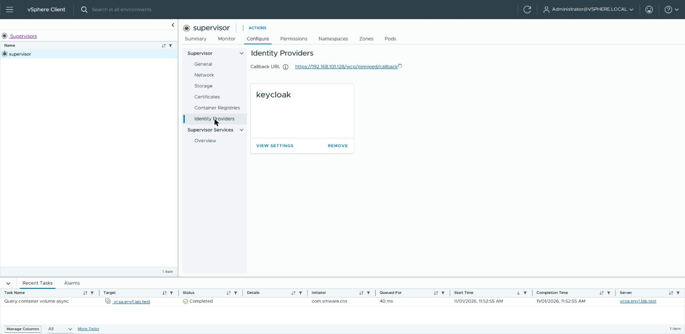
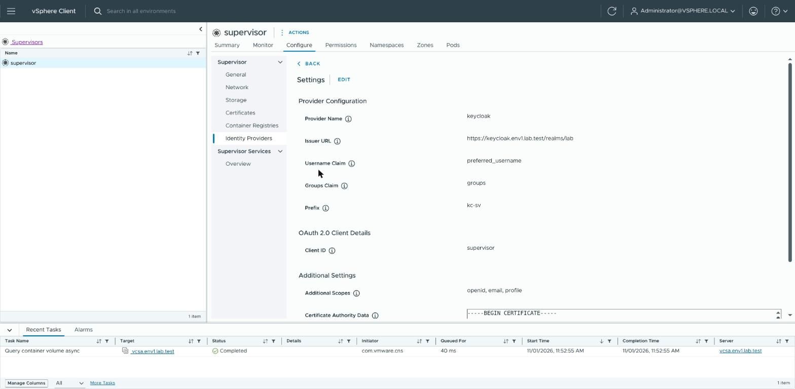
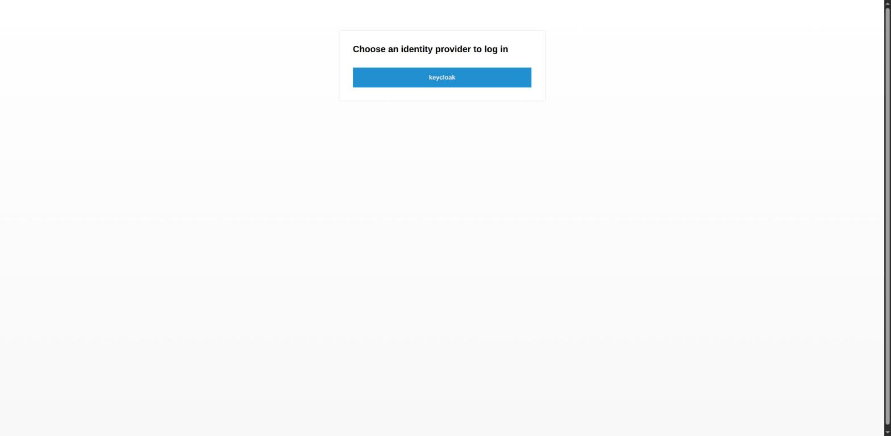
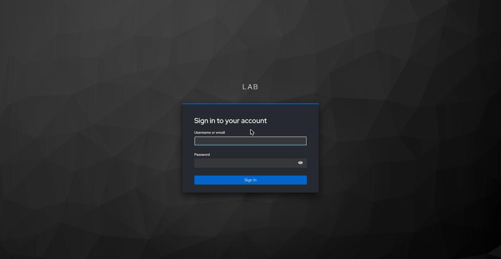
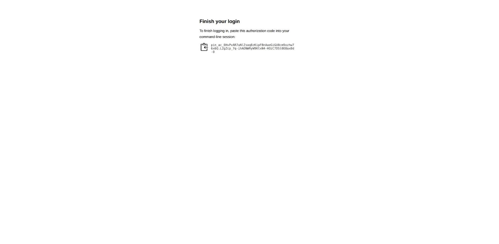

# Give an identity provider group access to VKS clusters, through the Supervisor

> [!NOTE]
> **Official Broadcom documentation (VCF 9.1), Kubernetes documentation and vCenter API reference for this guide**
>
> - [Configure an External Identity Provider for VKS Clusters](https://techdocs.broadcom.com/us/en/vmware-cis/vcf/vcf-service-administration-and-development/9-1/managing-vsphere-kubernetes-service/connecting-to-tkg-service-clusters-using-an-external-identity-provider/configure-an-external-idp-for-use-with-tkg-service-clusters.html), [Configure vSphere Namespace Permissions for External Identity Provider Users and Groups](https://techdocs.broadcom.com/us/en/vmware-cis/vcf/vsphere-supervisor-services-and-standalone-components/latest/managing-vsphere-kuberenetes-service-clusters-and-workloads/configuring-identity-and-access-for-tkg-service-clusters/connecting-to-tkg-service-clusters-using-an-external-identity-provider/configure-vsphere-namespace-permissions-for-external-idp-users-and-groups.html)
> - vCenter API 9.1.1: [Namespaces Instances Access](https://developer.broadcom.com/xapis/vsphere-automation-api/9.1.1/data-structures/Vcenter%20Namespaces%20Instances%20Access/) (the `identity_provider` of a namespace permission)
> - [VCF CLI command reference: cluster](https://techdocs.broadcom.com/us/en/vmware-cis/vcf/vcf-consumption/latest/consumer-interfaces-in-vcf/installing-and-using-vcf-cli-v9/command-reference2/cluster2.html) (`vcf cluster kubeconfig get --export-file`)
> - Kubernetes: [Using RBAC Authorization](https://kubernetes.io/docs/reference/access-authn-authz/rbac/) (the `edit` and `view` roles)

Pick this when people are in your organization's identity provider and have no vCenter account.
Once the vCenter administrator has registered an external OpenID Connect (OIDC) identity provider
on the Supervisor (for Keycloak, the example in this guide: [KEYCLOAK-VKS.md step 11](KEYCLOAK-VKS.md#11-register-keycloak-with-the-supervisor-optional)),
people in one of its groups sign in to the VKS clusters in a browser with their identity provider
account.

One Supervisor takes one identity provider, for all its VKS clusters. The cluster knows the person
as `<prefix>:<user>` and their groups as `<prefix>:<group>`; the prefix is set when the provider is
registered.

First, the identity provider's administrator makes the group, adds the people, and sends the
group's name to the vCenter administrator and the cluster administrator. The provider must send
group names without a leading `/`, or the cluster sees `<prefix>:/<group>` (in Keycloak: the group
mapper of the client `supervisor`,
[KEYCLOAK-VKS.md step 11.2](KEYCLOAK-VKS.md#112-make-the-client-keycloak-administrator), with
**Full group path** off).

For the other ways to give access (a person's own vCenter SSO account, a ServiceAccount token, a
personal certificate), see [Give people and tools access to a VKS cluster](ADMIN-GRANT-ACCESS.md).

The steps:

1. [Read the provider name and prefix](#1-read-the-provider-name-and-prefix-vcenter-administrator) (vCenter administrator)
2. [Give the group a role on the vSphere Namespace](#2-give-the-group-a-role-on-the-vsphere-namespace-vcenter-administrator) (vCenter administrator)
3. [Give the group rights inside the VKS cluster](#3-give-the-group-rights-inside-the-vks-cluster-cluster-administrator) (cluster administrator)
4. [Make the group's kubeconfig and hand it over](#4-make-the-groups-kubeconfig-and-hand-it-over-cluster-administrator) (cluster administrator)
5. [Log in](#5-log-in-the-person) (the person)
6. [Log out](#6-log-out-the-person) (the person)
7. [Take one person's access away](#7-take-one-persons-access-away-identity-providers-administrator) (identity provider's administrator)
8. [Take the group's access away](#8-take-the-groups-access-away-cluster-administrator-vcenter-administrator) (cluster administrator, vCenter administrator)

## Prerequisites

- the identity provider registered on the Supervisor (for Keycloak:
  [KEYCLOAK-VKS.md step 11](KEYCLOAK-VKS.md#11-register-keycloak-with-the-supervisor-optional));
- vCenter administrator: the vCenter CA ([SUPERVISOR-LOGIN.md](SUPERVISOR-LOGIN.md#create-supervisor-context-with-ca),
  step 1), curl and jq ([PREREQS.md](PREREQS.md));
- cluster administrator: the VKS cluster's administrator kubeconfig
  ([SUPERVISOR-LOGIN.md](SUPERVISOR-LOGIN.md#get-the-vks-clusters-kubeconfig)), [kubectl](KUBECTL.md), and a Supervisor
  login with the **Can edit** role on the vSphere Namespace
  ([SUPERVISOR-LOGIN.md](SUPERVISOR-LOGIN.md#create-supervisor-context-with-ca));
- the person: [kubectl](KUBECTL.md), the [VCF CLI](VCF.md) and a browser; on Windows and macOS,
  the vCenter CA trusted by their user
  ([USER-LOGIN.md, plugin step 1](USER-LOGIN.md#1-windows-and-macos-trust-the-vcenter-ca-the-person-once)).

The connections this guide needs, for a firewall (all TCP, besides DNS; the Supervisor's DNS
servers must resolve the identity provider's name):

| from | to | port | for |
|---|---|---|---|
| the vCenter administrator's machine | vCenter | 443 | [Give the group a role on the vSphere Namespace](#2-give-the-group-a-role-on-the-vsphere-namespace-vcenter-administrator) |
| the cluster administrator's machine | the VKS cluster's API address (in its kubeconfig) | 6443 | [Give the group rights](#3-give-the-group-rights-inside-the-vks-cluster-cluster-administrator) |
| the cluster administrator's machine | the Supervisor's address | 443 | [Make the group's kubeconfig](#4-make-the-groups-kubeconfig-and-hand-it-over-cluster-administrator) |
| the person's machine | the Supervisor's address | 443 | the sign-in through the Supervisor ([step 5](#5-log-in-the-person)) |
| the person's machine | the VKS cluster's API address | 6443 | kubectl with the group's file |
| the person's browser | the Supervisor's address, and the identity provider | 443 | [Log in (the person)](#5-log-in-the-person) |
| the Supervisor's control plane | the identity provider | 443 (or the Issuer URL's port) | checking the sign-in ([step 5](#5-log-in-the-person)) |
| the VKS cluster's control-plane nodes | the Supervisor's address | 443 | checking group sign-ins ([step 5](#5-log-in-the-person)) |

## 1. Read the provider name and prefix (vCenter administrator)

In the vSphere Client: menu > **Supervisor Management** > **Supervisors** > your Supervisor >
**Configure** > **Supervisor** > **Identity Providers** shows a card for the provider (here
**keycloak**). Its **VIEW SETTINGS** shows the **Provider Name**, the **Issuer URL** (the provider's
address; for Keycloak, your realm), the **Groups Claim** and the **Prefix**.

Keep the **Provider Name** for step 2, and send the **Prefix** to the cluster administrator for
step 3. No card: the provider is not registered yet ([KEYCLOAK-VKS.md step 11](KEYCLOAK-VKS.md#11-register-keycloak-with-the-supervisor-optional)).





## 2. Give the group a role on the vSphere Namespace (vCenter administrator)

The vSphere Client's **Add Permission** window offers only vCenter's own domains, so this step
uses vCenter's API, with the vCenter administrator's password. Type that password first, so that it
never shows on the screen or in the shell's history. This line only keeps it in this terminal;
nothing else changes. You then have the password ready for the next block, which uses it and
removes it. **A few failed logins in a row lock the user for some minutes.**

**Linux, macOS, WSL (bash or zsh):**

```sh
printf 'SSO password: '; IFS= read -rs SSO_PASSWORD; echo
```

**Windows (PowerShell):**

```powershell
$SSO_PASSWORD = Read-Host 'SSO password' -AsSecureString
```

Then, in the same terminal, run this for each group that should sign in to the Supervisor's VKS
clusters, and with `ROLE="REMOVE"` when it should no longer. It gives the identity provider's group
`KC_GROUP` (without the prefix) the role `ROLE` on the vSphere Namespace: `VIEW` (Can view) for
people who only use the clusters, `EDIT` (Can edit), which makes every member an administrator of
every VKS cluster in the namespace, or `REMOVE` to take the role away. A group that already has a
role gets the new one. It then reads the permission back. The group's members can then sign in;
step 3 gives them rights inside the cluster.

Set `VCENTER_FQDN` to vCenter's address, `VCENTER_CA` to the vCenter CA file
([Create Supervisor context with CA](SUPERVISOR-LOGIN.md#create-supervisor-context-with-ca), step 1),
`SSO_USER` to the vCenter administrator's SSO user, `IDP_NAME` to the **Provider Name** from step
1, `VSPHERE_NAMESPACE` to the vSphere Namespace, `ROLE` to `VIEW`, `EDIT` or `REMOVE`, and `KC_GROUP`
to the group's name at the identity provider (in Keycloak, as the realm lists it), letters,
digits, `-` or `_` only.

<details>
<summary><b>Linux, macOS, WSL (bash or zsh)</b></summary>

```sh
VCENTER_FQDN="vcenter.example.com"
VCENTER_CA="$HOME/.kube/vcenter-ca.pem"
SSO_USER="administrator@vsphere.local"
IDP_NAME="keycloak"
VSPHERE_NAMESPACE="my-namespace"
KC_GROUP="k8s-devs"
ROLE="VIEW"

if ! command -v jq >/dev/null 2>&1; then
  echo "MISSING: jq (PREREQS.md)"
elif [ -z "$SSO_PASSWORD" ]; then
  echo "FAILED: no password in this terminal; run the password line above"
elif [ ! -f "$VCENTER_CA" ] || [ ! -s "$VCENTER_CA" ]; then
  echo "FAILED: not found: $VCENTER_CA"
else
  B64="$(printf '%s:%s' "$SSO_USER" "$SSO_PASSWORD" | base64 | tr -d '\n')"; unset SSO_PASSWORD
  TOK="$(printf 'header = "Authorization: Basic %s"\n' "$B64" | curl -sS --connect-timeout 20 --cacert "$VCENTER_CA" -X POST -K - "https://${VCENTER_FQDN}/api/session" | tr -d '"')"; unset B64
  api() { printf 'header = "vmware-api-session-id: %s"\n' "$TOK" | curl -sS --connect-timeout 20 --cacert "$VCENTER_CA" -K - "$@"; }
  SUP="$(api "https://${VCENTER_FQDN}/api/vcenter/namespaces/instances/v2/${VSPHERE_NAMESPACE}" | jq -r '.supervisor // empty' 2>/dev/null)"
  IDP="$(api "https://${VCENTER_FQDN}/api/vcenter/namespace-management/supervisors/${SUP}/identity/providers" | jq -r --arg n "$IDP_NAME" '.[]? | select(.display_name == $n) | .provider' 2>/dev/null)"
  URL="https://${VCENTER_FQDN}/api/vcenter/namespaces/instances/${VSPHERE_NAMESPACE}/access/no-domain/${KC_GROUP}?type=GROUP"
  if [ -z "$SUP" ] || [ -z "$IDP" ]; then
    echo "FAILED: no vCenter login, vSphere Namespace ${VSPHERE_NAMESPACE} or identity provider ${IDP_NAME} (see above)"
  else
    if [ "$ROLE" = "REMOVE" ]; then
      api -X DELETE "$URL"
    elif api "$URL" | grep -q '"role"'; then
      api -X PUT -H 'Content-Type: application/json' -d "{\"role\":\"${ROLE}\",\"identity_provider\":\"${IDP}\"}" "$URL"
    else
      api -X POST -H 'Content-Type: application/json' -d "{\"role\":\"${ROLE}\",\"identity_provider\":\"${IDP}\"}" "$URL"
    fi
    echo "now: $(api "$URL")"
  fi
  api -X DELETE "https://${VCENTER_FQDN}/api/session"; unset TOK
fi
```

</details>

<details>
<summary><b>Windows (PowerShell)</b></summary>

```powershell
$VCENTER_FQDN = "vcenter.example.com"
$VCENTER_CA = "$HOME\.kube\vcenter-ca.pem"
$SSO_USER = "administrator@vsphere.local"
$IDP_NAME = "keycloak"
$VSPHERE_NAMESPACE = "my-namespace"
$KC_GROUP = "k8s-devs"
$ROLE = "VIEW"

if (-not $SSO_PASSWORD -or $SSO_PASSWORD.Length -eq 0) {
  "FAILED: no password in this PowerShell; run the password line above"
} elseif (-not (Test-Path $VCENTER_CA -PathType Leaf) -or (Get-Item $VCENTER_CA).Length -eq 0) {
  "FAILED: not found: $VCENTER_CA"
} else {
  $B64 = [Convert]::ToBase64String([Text.Encoding]::UTF8.GetBytes("${SSO_USER}:" + [Net.NetworkCredential]::new('', $SSO_PASSWORD).Password))
  Remove-Variable SSO_PASSWORD
  $TOK = ("header = `"Authorization: Basic $B64`"" | curl.exe -sS --connect-timeout 20 --ssl-no-revoke --cacert $VCENTER_CA -X POST -K - "https://$VCENTER_FQDN/api/session") -replace '"', ''
  Remove-Variable B64
  function api { "header = `"vmware-api-session-id: $TOK`"" | curl.exe -sS --connect-timeout 20 --ssl-no-revoke --cacert $VCENTER_CA -K - @args }
  $SUP = $null; $IDP = $null
  try { $SUP = (api "https://$VCENTER_FQDN/api/vcenter/namespaces/instances/v2/$VSPHERE_NAMESPACE" | ConvertFrom-Json).supervisor } catch { }
  if ($SUP) { $IDP = (@(api "https://$VCENTER_FQDN/api/vcenter/namespace-management/supervisors/$SUP/identity/providers" | ConvertFrom-Json) | Where-Object { $_.display_name -eq $IDP_NAME }).provider }
  $URL = "https://$VCENTER_FQDN/api/vcenter/namespaces/instances/$VSPHERE_NAMESPACE/access/no-domain/${KC_GROUP}?type=GROUP"
  if (-not $SUP -or -not $IDP) {
    "FAILED: no vCenter login, vSphere Namespace $VSPHERE_NAMESPACE or identity provider $IDP_NAME (see above)"
  } else {
    if ($ROLE -eq "REMOVE") {
      api -X DELETE $URL
    } else {
      $METHOD = "POST"; if ((api $URL) -match '"role"') { $METHOD = "PUT" }
      $BODY = Join-Path $env:TEMP ([guid]::NewGuid())
      Set-Content -Encoding ascii -Path $BODY -Value (@{ role = $ROLE; identity_provider = $IDP } | ConvertTo-Json -Compress)
      api -X $METHOD -H "Content-Type: application/json" --data-binary "@$BODY" $URL
      Remove-Item -Force $BODY
    }
    "now: $(api $URL)"
  }
  api -X DELETE "https://$VCENTER_FQDN/api/session" | Out-Null; Remove-Variable TOK
}
```

</details>

**Expect:** `now: {"identity_provider":"…","role":"VIEW","inherited":false}`; for `REMOVE`,
`now: {"error_type":"UNSUPPORTED",…"Principal k8s-devs on domain no-domain and type GROUP is not
associated with namespace my-namespace."…}`. Within a minute the Supervisor gives the group the matching
Kubernetes role in the vSphere Namespace (a RoleBinding `view:<prefix>:<group>`).

**If not:**
- `FAILED: no password …`: run the password line, then this block.
- `FAILED: not found: …`: save the vCenter CA first
  ([SUPERVISOR-LOGIN.md](SUPERVISOR-LOGIN.md#create-supervisor-context-with-ca), step 1).
- `FAILED: no vCenter login, …` under `curl: (60)` or `SSL`: `VCENTER_CA` is not vCenter's CA.
- `FAILED: no vCenter login, …` otherwise: check `SSO_USER` and `VCENTER_FQDN`, then run the
  password line and this block again; mind the lock-out. Or check `VSPHERE_NAMESPACE` and `IDP_NAME`
  (step 1).

**Provider registered again:** after the provider was removed and registered again, run this block
for each group again.

## 3. Give the group rights inside the VKS cluster (cluster administrator)

Do this so that the group can work inside the cluster: the role on the vSphere Namespace from
step 2 lets the person sign in; with **Can view** it gives no rights inside the VKS cluster. It
makes the namespace `VKS_CLUSTER_NAMESPACE` inside the VKS cluster (a folder for the team's workloads, not
the vSphere Namespace) if it is not there, and a RoleBinding (the record that gives a group a role
in one namespace) that gives the group `ROLE` in it: `edit` to deploy, `view` to read only. Every
member then has those rights; step 4 makes their file. Run it once per group and namespace; for the
same group, role and namespace again it answers `already exists`. To change the role, delete the
old RoleBinding first (below).

Set `VKS_CLUSTER` to the cluster's name (`ADMIN_KUBECONFIG` is then its administrator kubeconfig
from [SUPERVISOR-LOGIN.md](SUPERVISOR-LOGIN.md#get-the-vks-clusters-kubeconfig); change it if you saved that file
elsewhere), `KC_PREFIX` to the prefix from step 1, `KC_GROUP` to the group's name from step 2,
`VKS_CLUSTER_NAMESPACE` to the team's namespace and `ROLE` to `edit` or `view`.

**Linux, macOS, WSL (bash or zsh):**

```sh
VKS_CLUSTER="my-vks-cluster"
ADMIN_KUBECONFIG="$HOME/.kube/${VKS_CLUSTER}.kubeconfig"
KC_PREFIX="keycloak-sv"
KC_GROUP="k8s-devs"
VKS_CLUSTER_NAMESPACE="team-a"
ROLE="edit"

kubectl --kubeconfig "$ADMIN_KUBECONFIG" create namespace "$VKS_CLUSTER_NAMESPACE" --dry-run=client -o yaml | kubectl --kubeconfig "$ADMIN_KUBECONFIG" apply -f - >/dev/null
kubectl --kubeconfig "$ADMIN_KUBECONFIG" -n "$VKS_CLUSTER_NAMESPACE" create rolebinding "${KC_PREFIX}-${KC_GROUP}-${ROLE}" --clusterrole="$ROLE" --group="${KC_PREFIX}:${KC_GROUP}"
```

**Windows (PowerShell):**

```powershell
$VKS_CLUSTER = "my-vks-cluster"
$ADMIN_KUBECONFIG = "$HOME\.kube\${VKS_CLUSTER}.kubeconfig"
$KC_PREFIX = "keycloak-sv"
$KC_GROUP = "k8s-devs"
$VKS_CLUSTER_NAMESPACE = "team-a"
$ROLE = "edit"

kubectl --kubeconfig $ADMIN_KUBECONFIG create namespace $VKS_CLUSTER_NAMESPACE --dry-run=client -o yaml | kubectl --kubeconfig $ADMIN_KUBECONFIG apply -f - | Out-Null
kubectl --kubeconfig $ADMIN_KUBECONFIG -n $VKS_CLUSTER_NAMESPACE create rolebinding "$KC_PREFIX-$KC_GROUP-$ROLE" "--clusterrole=$ROLE" "--group=${KC_PREFIX}:$KC_GROUP"
```

**Expect:** `rolebinding.rbac.authorization.k8s.io/keycloak-sv-k8s-devs-edit created`. It works at
once, also for people already signed in.

**If not:** `already exists`: the group already has it.

To take it away, delete that RoleBinding (`kubectl --kubeconfig <admin file> -n team-a delete
rolebinding keycloak-sv-k8s-devs-edit`).

## 4. Make the group's kubeconfig and hand it over (cluster administrator)

Do this once per cluster, after step 3, to make the file the people use. It needs your Supervisor
login with the **Can edit** role ([SUPERVISOR-LOGIN.md](SUPERVISOR-LOGIN.md#create-supervisor-context-with-ca)) and makes
it the active one for the VCF CLI and in its kubeconfig file, and that stays after the block. It
writes a kubeconfig for the VKS cluster that holds no password, token or key: when used, the file
runs the VCF CLI (`vcf pinniped-auth`), which asks for a sign-in at the identity provider. Then it
shows which program the file runs. You then have `KC_KUBECONFIG`: one file for the whole group,
which may be sent by email or chat (below). Run again, it replaces that file only when the new one
checks out.

Set `VSPHERE_NAMESPACE` to the vSphere Namespace, `VKS_CLUSTER` to the cluster, and
`SUPERVISOR_CONTEXT` to your Supervisor login's name ([SUPERVISOR-LOGIN.md](SUPERVISOR-LOGIN.md#create-supervisor-context-with-ca)).

<details>
<summary><b>Linux, macOS, WSL (bash or zsh)</b></summary>

```sh
VSPHERE_NAMESPACE="my-namespace"
VKS_CLUSTER="my-vks-cluster"
SUPERVISOR_CONTEXT="supervisor"
SUPERVISOR_KUBECONFIG="$HOME/.kube/${SUPERVISOR_CONTEXT}.kubeconfig"
KC_KUBECONFIG="$HOME/${VKS_CLUSTER}-keycloak-sv.kubeconfig"

rm -f "$KC_KUBECONFIG.new"
VCF_USE="$(vcf context use "$SUPERVISOR_CONTEXT" </dev/null 2>&1)"
RUNS=""
if ! printf '%s\n' "$VCF_USE" | grep -qF "Successfully activated context '${SUPERVISOR_CONTEXT}'"; then
  printf '%s\n' "$VCF_USE"
  echo "FAILED: the VCF CLI is not on context ${SUPERVISOR_CONTEXT}: log in or renew (SUPERVISOR-LOGIN.md), then run this again"
elif ! kubectl --kubeconfig "$SUPERVISOR_KUBECONFIG" -n "$VSPHERE_NAMESPACE" get clusters.cluster.x-k8s.io "$VKS_CLUSTER" -o name >/dev/null; then
  echo "FAILED: cannot read the cluster $VKS_CLUSTER in $VSPHERE_NAMESPACE (see the error above)"
elif vcf cluster kubeconfig get "$VKS_CLUSTER" -n "$VSPHERE_NAMESPACE" --export-file "$KC_KUBECONFIG.new" </dev/null \
   && RUNS="$(kubectl --kubeconfig "$KC_KUBECONFIG.new" config view -o jsonpath='{.users[0].user.exec.command} {.users[0].user.exec.args[0]}')" \
   && [ "$RUNS" = "vcf pinniped-auth" ]; then
  if mv -f "$KC_KUBECONFIG.new" "$KC_KUBECONFIG"; then echo "runs: $RUNS"; echo "saved $KC_KUBECONFIG"
  else echo "FAILED: $KC_KUBECONFIG is as it was (see the mv error above)"; fi
else
  rm -f "$KC_KUBECONFIG.new"
  echo "FAILED: the new file runs '$RUNS'; $KC_KUBECONFIG is as it was (see the error above)"
fi
```

</details>

<details>
<summary><b>Windows (PowerShell)</b></summary>

```powershell
$VSPHERE_NAMESPACE = "my-namespace"
$VKS_CLUSTER = "my-vks-cluster"
$SUPERVISOR_CONTEXT = "supervisor"
$SUPERVISOR_KUBECONFIG = "$HOME\.kube\${SUPERVISOR_CONTEXT}.kubeconfig"
$KC_KUBECONFIG = "$HOME\${VKS_CLUSTER}-keycloak-sv.kubeconfig"

Remove-Item -Force -ErrorAction SilentlyContinue "$KC_KUBECONFIG.new"
& {
  $VCF_USE = ($null | vcf context use $SUPERVISOR_CONTEXT 2>&1 | ForEach-Object { "$_" }) -join "`n"
  if (-not $VCF_USE.Contains("Successfully activated context '${SUPERVISOR_CONTEXT}'")) {
    $VCF_USE
    "FAILED: the VCF CLI is not on context ${SUPERVISOR_CONTEXT}: log in or renew (SUPERVISOR-LOGIN.md), then run this again"
    return
  }
  $global:LASTEXITCODE = $null
  kubectl --kubeconfig $SUPERVISOR_KUBECONFIG -n $VSPHERE_NAMESPACE get clusters.cluster.x-k8s.io $VKS_CLUSTER -o name | Out-Null
  if ($LASTEXITCODE -ne 0) {
    "FAILED: cannot read the cluster $VKS_CLUSTER in $VSPHERE_NAMESPACE (see the error above)"
    return
  }
  $null | vcf cluster kubeconfig get $VKS_CLUSTER -n $VSPHERE_NAMESPACE --export-file "$KC_KUBECONFIG.new"
  $RUNS = kubectl --kubeconfig "$KC_KUBECONFIG.new" config view -o jsonpath='{.users[0].user.exec.command} {.users[0].user.exec.args[0]}'
  if ($RUNS -ceq 'vcf pinniped-auth') {
    Move-Item -Force "$KC_KUBECONFIG.new" $KC_KUBECONFIG
    if ($?) { "runs: $RUNS"; "saved $KC_KUBECONFIG" } else { "FAILED: $KC_KUBECONFIG is as it was (see the error above)" }
  } else {
    Remove-Item -Force -ErrorAction SilentlyContinue "$KC_KUBECONFIG.new"
    "FAILED: the new file runs '$RUNS'; $KC_KUBECONFIG is as it was (see the error above)"
  }
}
```

</details>

**Expect:** `You can now access the cluster by specifying '--kubeconfig ….new' flag` (the block
renames that file), then `runs: vcf pinniped-auth` and `saved …`.

**If not:**
- `FAILED: the VCF CLI is not on context …`, under `Unable to read password from terminal` (Windows:
  `The handle is invalid`): run [Renew the Supervisor login](SUPERVISOR-LOGIN.md#renew-the-supervisor-login),
  then this block again; under `context … not found`: log in to the Supervisor first
  ([SUPERVISOR-LOGIN.md](SUPERVISOR-LOGIN.md#create-supervisor-context-with-ca)).
- `FAILED: cannot read the cluster …` after `clusters.cluster.x-k8s.io "…" not found`: check
  `VKS_CLUSTER`; after `namespaces "…" not found`: check `VSPHERE_NAMESPACE`.
- `FAILED: cannot read the cluster …` after `Forbidden`: check `VSPHERE_NAMESPACE` (a user who is not
  a vCenter administrator gets `Forbidden` for a name that does not exist); if it is right, ask
  for the **Can edit** role on it.
- `FAILED: cannot read the cluster …` after `Unauthorized`: run
  [Renew the Supervisor login](SUPERVISOR-LOGIN.md#renew-the-supervisor-login), then this block again.
- `FAILED: cannot read the cluster …` after `… .kubeconfig: no such file or directory` (Windows:
  `cannot find the file specified`): log in to the Supervisor first
  ([SUPERVISOR-LOGIN.md](SUPERVISOR-LOGIN.md#create-supervisor-context-with-ca)).
- `FAILED: the new file runs '…'`: the fetch failed (the error is above) or made another kind of
  file; the file you had is unchanged.
- `FAILED: … is as it was`, under a `mv` or `Move-Item` error: the file could not be replaced (the
  error says why); the new one stays as `….new`.
- No answer for minutes: the cluster is not ready yet ([CLUSTER.md](CLUSTER.md#6-wait-for-the-cluster)), or your role
  cannot read the cluster's details; ask for **Can edit**.

Send the people the file, the namespace from step 3 and the cluster's address (the file's `server:`
line), so that they can check the file before they use it.

## 5. Log in (the person)

You need kubectl and the [VCF CLI](VCF.md) (the file runs `vcf`; you do not log in with it), and a
browser that trusts the identity provider's CA (for Keycloak:
[KEYCLOAK-VKS.md step 8](KEYCLOAK-VKS.md#8-trust-keycloaks-ca-each-person-once)) and the vCenter CA
(on Windows and macOS: [USER-LOGIN.md, plugin step 1](USER-LOGIN.md#1-windows-and-macos-trust-the-vcenter-ca-the-person-once)). Save the file in your `.kube` folder, readable only by you
([KUBECONFIG.md](KUBECONFIG.md#3-hand-a-file-over)).

Before the first use, check that the file runs `vcf pinniped-auth` and that its `server:` is the
cluster address you were sent ([KUBECONFIG.md](KUBECONFIG.md#1-see-what-a-file-holds)).

The first command opens the browser: choose the provider (here **keycloak**), sign in with your
account (in Keycloak: password, and one-time code if asked), and kubectl goes on. Later commands
sign in again by themselves until your session at the identity provider ends.

On a machine without a browser (over SSH, a jump box), the command prints a link instead: open it
in the browser on your own computer, sign in, copy the code the last page shows, and paste it at
`Optionally, paste your authorization code:`.







Run this the first time you use the file, and whenever you want to check your rights. It asks the
cluster who you are and whether you may deploy in `VKS_CLUSTER_NAMESPACE`, signing you in first when
needed; it changes nothing on the cluster. You then have a sign-in saved on this machine (step 6
removes it), and see your name, your groups and your rights.

Set `KC_KUBECONFIG` to where you saved the file and `VKS_CLUSTER_NAMESPACE` to the namespace inside the VKS
cluster that you were sent.

**Linux, macOS, WSL (bash or zsh):**

```sh
KC_KUBECONFIG="$HOME/.kube/my-vks-cluster-keycloak-sv.kubeconfig"
VKS_CLUSTER_NAMESPACE="team-a"

kubectl --kubeconfig "$KC_KUBECONFIG" auth whoami && kubectl --kubeconfig "$KC_KUBECONFIG" -n "$VKS_CLUSTER_NAMESPACE" auth can-i create deployments
```

**Windows (PowerShell):**

```powershell
$KC_KUBECONFIG = "$HOME\.kube\my-vks-cluster-keycloak-sv.kubeconfig"
$VKS_CLUSTER_NAMESPACE = "team-a"

kubectl --kubeconfig $KC_KUBECONFIG auth whoami
if ($LASTEXITCODE -eq 0) { kubectl --kubeconfig $KC_KUBECONFIG -n $VKS_CLUSTER_NAMESPACE auth can-i create deployments }
```

**Expect:** `Username  <prefix>:<you>`, `Groups  [<prefix>:<group> system:authenticated]`, then
`yes` (`no` with the `view` role).

**If not:**
- `executable file not found` or `"vcf": not found`: install the [VCF CLI](VCF.md).
- `could not open browser` and a link: you are on a machine without a browser; see above.
- `no` or `Forbidden`: the group has no rights in that namespace (step 3), or you are not in the
  group at the identity provider.
- The browser warns about the certificate: it does not trust the Supervisor's CA (the vCenter CA:
  ask the vCenter administrator) or the identity provider's CA (ask the identity provider's
  administrator).

## 6. Log out (the person)

Do this when you are done on a shared machine. It deletes the VCF CLI's saved sign-in on this
machine; nothing changes on the cluster. The next command then asks for a sign-in again. Also sign
out of the identity provider in the browser.

**Linux, macOS, WSL (bash or zsh):**

```sh
rm -f "$HOME/.config/vcf/pinniped/sessions.yaml" "$HOME/.config/vcf/pinniped/credentials.yaml"
```

**Windows (PowerShell):**

```powershell
Remove-Item -ErrorAction SilentlyContinue "$HOME\.config\vcf\pinniped\sessions.yaml", "$HOME\.config\vcf\pinniped\credentials.yaml"
```

**Expect:** no output; the next `kubectl --kubeconfig <your file> …` opens the sign-in (or prints
the link).

**If not:** the next command still answers without a sign-in: you ran it in another account than
the one that signed in.

## 7. Take one person's access away (identity provider's administrator)

Disable the user at the identity provider, or end their sessions there: their next sign-in renewal
is refused. A credential the cluster already gave them keeps working until it expires, at most
5 minutes later. In Keycloak:

- **Disable** the user, or sign them out (the user's **Sessions** tab > **Sign out**).
- Removing them from one of their groups takes that group away at the next renewal, but not from
  their **last** group: then also disable the user or sign them out.
- Before you enable a user again, sign them out, or their old sign-in can work again.

## 8. Take the group's access away (cluster administrator, vCenter administrator)

- Cluster administrator: delete the group's RoleBinding (step 3).
- vCenter administrator: run step 2 with `ROLE="REMOVE"`. For a group with **Can edit**, that role
  is what made it an administrator of the clusters.

Back to [README](../README.md).
