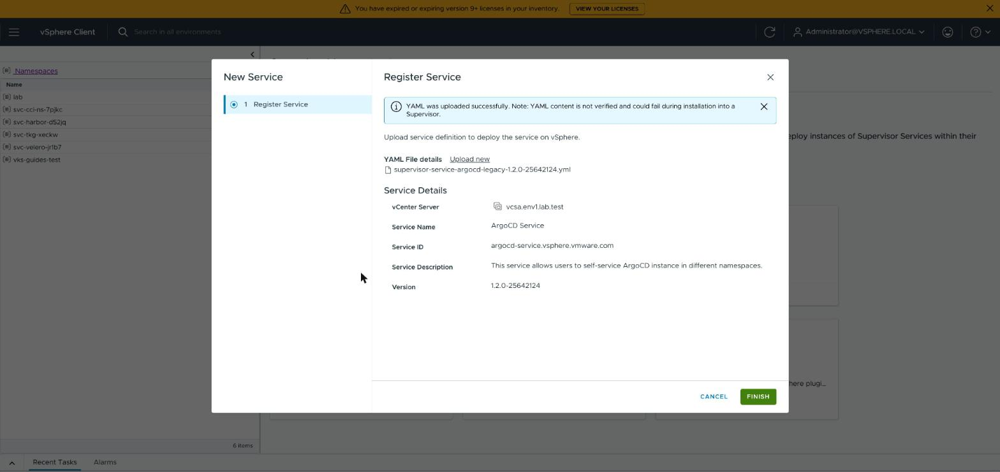
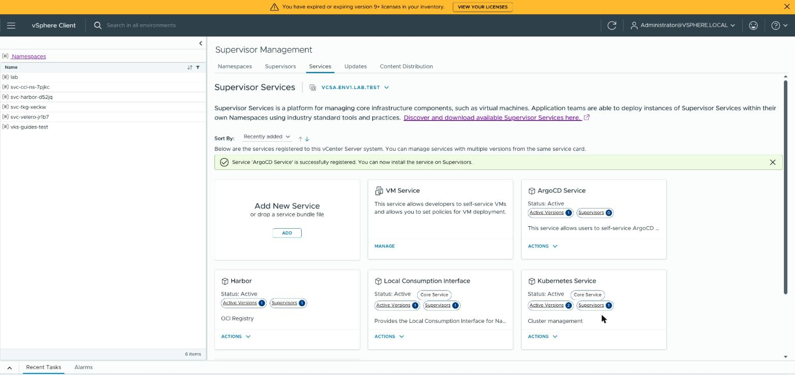
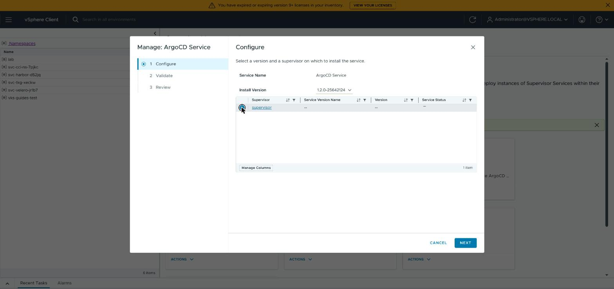
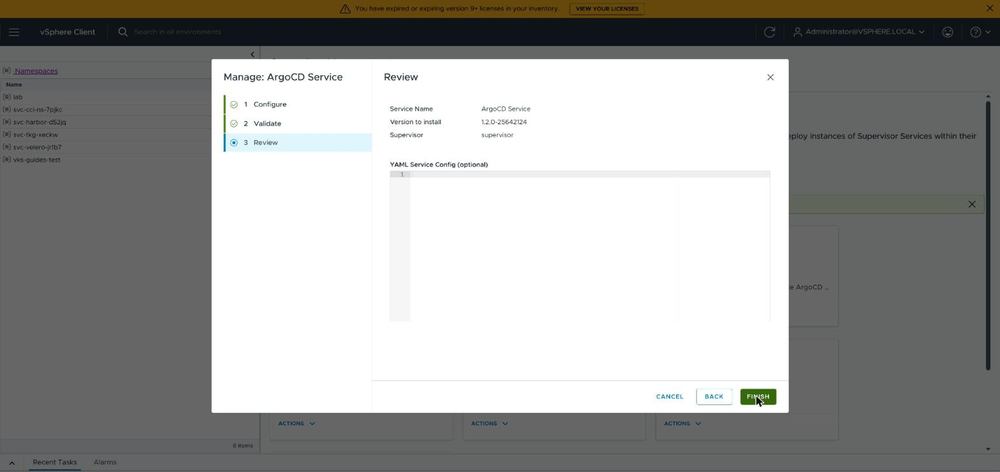
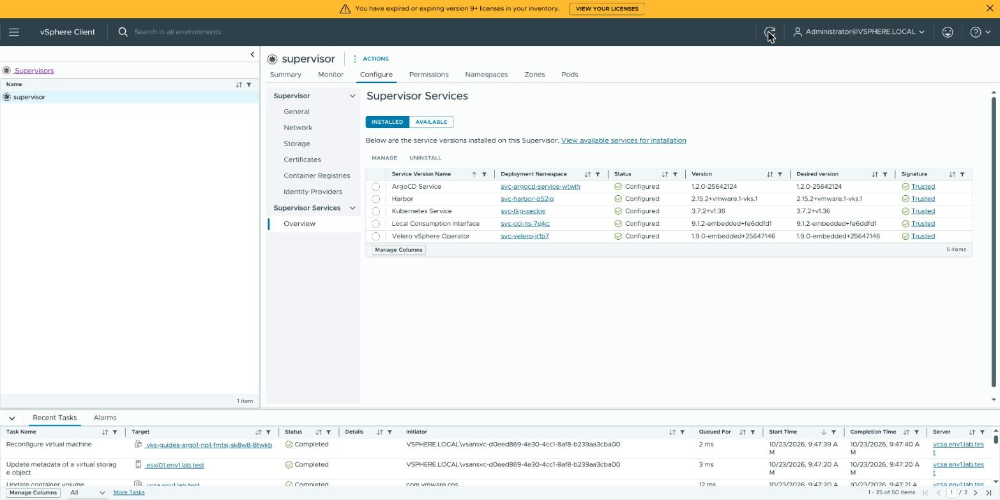
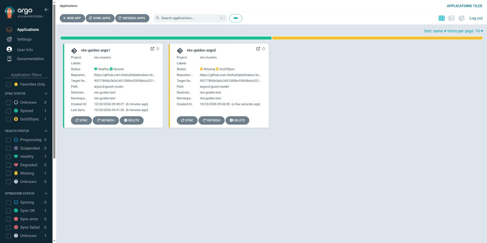
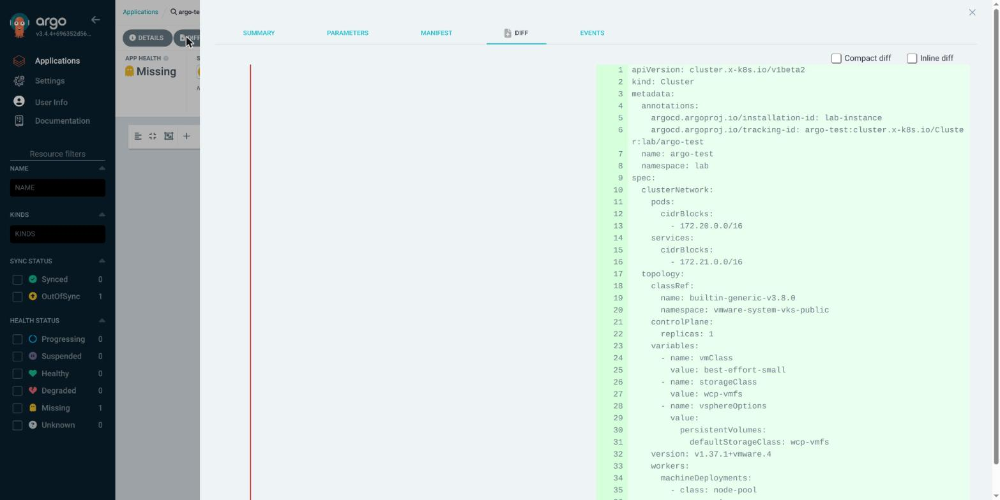
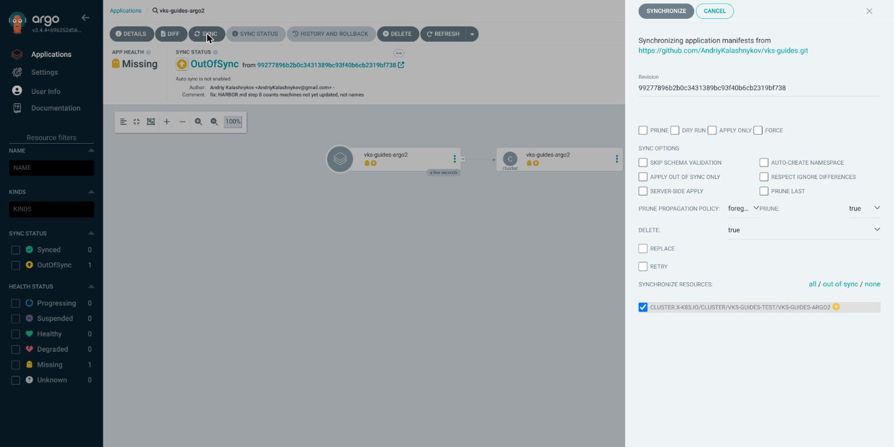
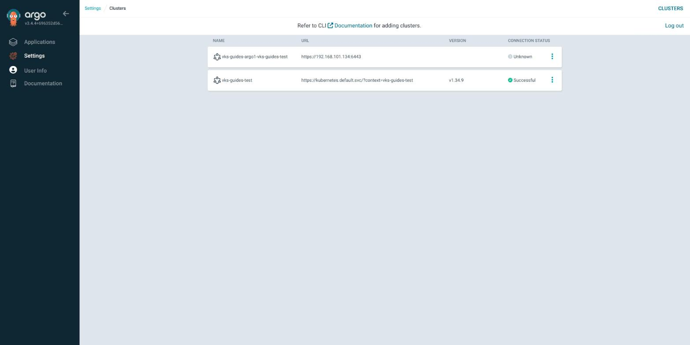
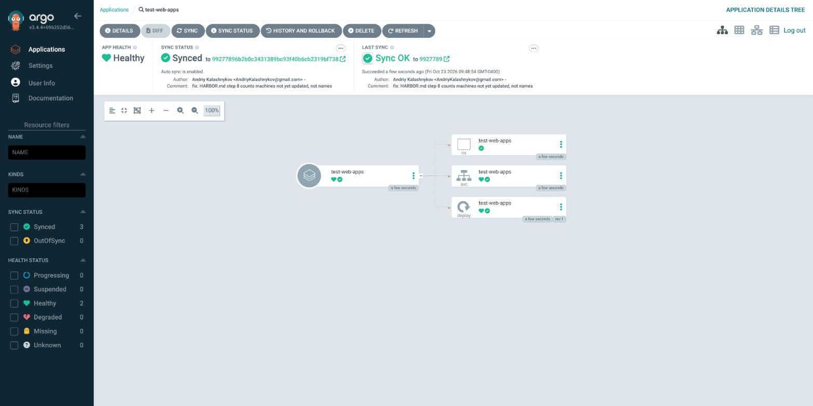

# Create a VKS cluster and deploy an app with ArgoCD

> [!NOTE]
> **Official Broadcom documentation (VCF 9.1) and Argo CD documentation for this guide**
>
> - [Supervisor Services: how to find and install them](https://github.com/vsphere-tmm/Supervisor-Services/blob/main/README.md) (the `legacy` manifest)
> - [Add a Supervisor Service to vCenter](https://techdocs.broadcom.com/us/en/vmware-cis/vcf/vcf-service-administration-and-development/9-1/managing-supervisor-services-with-vsphere-iaas-control-plane/supervisor-service-life-cycle-management-and-consumption/add-a-vsphere-services-to-vcenter-server.html)
> - [Install a Supervisor Service on a Supervisor](https://techdocs.broadcom.com/us/en/vmware-cis/vcf/vcf-service-administration-and-development/9-1/managing-supervisor-services-with-vsphere-iaas-control-plane/supervisor-service-life-cycle-management-and-consumption/install-a-supervisor-service-on-supervisors.html)
> - [Deploy an Argo CD Instance on a Supervisor without VCF Automation](https://techdocs.broadcom.com/us/en/vmware-cis/vcf/vcf-service-administration-and-development/9-1/using-argo-cd-service/deploying-and-managing-an-argo-cd-instance-as-a-supervisor-service/deploy-and-argo-cd-instance-on-a-supervisor-without-vcf-automation.html)
> - [Approach 1: Add and Manage a vSphere Namespace in an Argo CD Instance on Supervisor Service by Using kubectl](https://techdocs.broadcom.com/us/en/vmware-cis/vcf/vcf-service-administration-and-development/9-1/using-argo-cd-service/deploying-and-managing-an-argo-cd-instance-as-a-supervisor-service/register-a-vsphere-namespace-as-a-target-cluster-in-argo-cd-supervisor-service/manage-a-vsphere-namespace-in-an-argo-cd-instance-on-supervisor-service-using-kubect.html)
> - [Workflow for Provisioning VKS Clusters Using kubectl](https://techdocs.broadcom.com/us/en/vmware-cis/vcf/vcf-consumption/latest/managing-vsphere-kuberenetes-service-clusters-and-workloads/provisioning-tkg-service-clusters/workflow-for-provisioning-tkg-clusters-using-kubectl.html) (Kubernetes releases, VM classes, storage classes)
> - [Register and Manage VKS Clusters in an Argo CD Instance on Supervisor Service by Using kubectl](https://techdocs.broadcom.com/us/en/vmware-cis/vcf/vcf-service-administration-and-development/9-1/using-argo-cd-service/deploying-and-managing-an-argo-cd-instance-as-a-supervisor-service/create-a-cluster-by-argocd.html)
> - Argo CD 3.4: [Getting Started: Sync (Deploy) The Application](https://argo-cd.readthedocs.io/en/release-3.4/getting_started/#7-sync-deploy-the-application), [TLS configuration](https://argo-cd.readthedocs.io/en/release-3.4/operator-manual/tls/), [Declarative Setup](https://argo-cd.readthedocs.io/en/release-3.4/operator-manual/declarative-setup/), [Helm](https://argo-cd.readthedocs.io/en/release-3.4/user-guide/helm/), [Automated Sync Policy](https://argo-cd.readthedocs.io/en/release-3.4/user-guide/auto_sync/), [App Deletion](https://argo-cd.readthedocs.io/en/release-3.4/user-guide/app_deletion/)
> - [Argo CD Service API](https://developer.broadcom.com/xapis/argocd-service-api/latest/api-docs.html) (the `ArgoCD` and `ManagedEntity` fields)
> - [Uninstall a Supervisor Service from a Supervisor](https://techdocs.broadcom.com/us/en/vmware-cis/vcf/vcf-service-administration-and-development/9-1/managing-supervisor-services-with-vsphere-iaas-control-plane/supervisor-service-life-cycle-management-and-consumption/uninstall-a-supervisor-service-version-from-a-supervisor.html)
> - [Delete a Supervisor Service](https://techdocs.broadcom.com/us/en/vmware-cis/vcf/vcf-service-administration-and-development/9-1/managing-supervisor-services-with-vsphere-iaas-control-plane/supervisor-service-life-cycle-management-and-consumption/delete-a-vsphere-service.html)

ArgoCD keeps what is in a Git folder applied to a destination. On a Supervisor it is the ArgoCD
Service: a vCenter administrator installs the service once, then a vSphere Namespace runs its own
ArgoCD (an *instance*). In this guide ArgoCD creates a VKS cluster from the chart in
[`argocd/guest-cluster`](../argocd/guest-cluster), then deploys the app in
[`argocd/test-web-apps`](../argocd/test-web-apps) into that cluster and keeps it in sync.

Needs [kubectl](KUBECTL.md), `jq` and `openssl` ([Prerequisites](PREREQS.md)), a
[Supervisor login](LOGIN.md) and a [vSphere Namespace](NAMESPACE.md) with the **Namespaces Edit**
role for your SSO user. Steps 2 and 10 need a vCenter administrator. Written for ArgoCD Service
1.2.0 on VCF 9.1.1 with VKS 3.8. The Supervisor must reach `github.com`, and the VKS cluster
`docker.io` (step 8).

`ARGOCD_NAMESPACE` is the vSphere Namespace that runs ArgoCD, `VKS_NAMESPACE` the one that holds
the VKS cluster. They can be the same namespace.

## 1. Check for an ArgoCD you have

This checks what is already there, so you can skip the steps that are done: whether the ArgoCD
Service is installed on the Supervisor, whether your vSphere Namespace already runs its own ArgoCD,
and whether ArgoCD's first `admin` password can still be read.

**Linux (Ubuntu, AlmaLinux, Photon OS), macOS, WSL (bash or zsh):**

```sh
SUPERVISOR_KUBECONFIG="$HOME/.kube/supervisor.kubeconfig"
ARGOCD_NAMESPACE="my-namespace"

kubectl --kubeconfig "$SUPERVISOR_KUBECONFIG" get argocdversion argocd-supported-versions -o name
kubectl --kubeconfig "$SUPERVISOR_KUBECONFIG" -n "$ARGOCD_NAMESPACE" get argocd -o jsonpath='{range .items[*]}{"ArgoCD instance: "}{.metadata.name}{"  "}{.status.phase}{"  https://"}{.status.externalIP}{"\n"}{end}'
kubectl --kubeconfig "$SUPERVISOR_KUBECONFIG" -n "$ARGOCD_NAMESPACE" get secret argocd-initial-admin-secret --ignore-not-found -o name
```

**Windows (PowerShell):**

```powershell
$SUPERVISOR_KUBECONFIG = "$HOME\.kube\supervisor.kubeconfig"
$ARGOCD_NAMESPACE = "my-namespace"

kubectl --kubeconfig $SUPERVISOR_KUBECONFIG get argocdversion argocd-supported-versions -o name
kubectl --kubeconfig $SUPERVISOR_KUBECONFIG -n $ARGOCD_NAMESPACE get argocd -o jsonpath='{range .items[*]}{''ArgoCD instance: ''}{.metadata.name}{''  ''}{.status.phase}{''  https://''}{.status.externalIP}{''\n''}{end}'
kubectl --kubeconfig $SUPERVISOR_KUBECONFIG -n $ARGOCD_NAMESPACE get secret argocd-initial-admin-secret --ignore-not-found -o name
```

**Expect:** three lines: `argocdversion…/argocd-supported-versions` (the service is installed),
`ArgoCD instance: <name>  Ready  https://<address>` (your namespace runs ArgoCD), and
`secret/argocd-initial-admin-secret`. With all three, go to
[step 4](#4-log-in-to-the-argocd-web-page).

**If not:**
- `the server doesn't have a resource type "argocdversion"`: the service is not installed. Do
  step 2 (a vCenter administrator).
- The first line only: the service is installed and your namespace has no instance. Go to
  [step 3](#3-create-the-argocd-instance).
- No `secret/…` line: someone changed the admin password and removed the first one. Ask them for
  the login.
- `Forbidden`: your SSO user has no **Namespaces Edit** role on the namespace.
  `Unauthorized`: run [Renew the Supervisor login](LOGIN.md#renew-the-supervisor-login).

## 2. Install the ArgoCD Service (vCenter administrator)

Needs the privileges **Manage Supervisor Services** and **Manage Supervisor Services on
Supervisors**.

1. Download the service manifest: [Broadcom support](https://support.broadcom.com/group/ecx/downloads)
   → **My Downloads** → search **vSphere Supervisor Services** → **ArgoCD Service** → **1.2.0**.
   Tick **I agree to the Terms and Conditions** if the page shows it. Take release 1.2.0 even
   when a newer one is listed. Broadcom offers two manifests, which differ only in where the
   Supervisor downloads ArgoCD from:
   - `supervisor-service-argocd-1.2.0-25642124.yml` (*Internet Connected VCF 9.1 and newer*):
     from the VCF Software Depot (`depot.kube-system.svc`). For a VCF 9.1 with a depot.
   - `supervisor-service-argocd-legacy-1.2.0-25642124.yml` (*VCF 9.0 or older and
     disconnected/airgapped VCF 9.1*): from `projects.packages.broadcom.com`. For a Supervisor
     without a depot.

Before you upload the file, check that it arrived whole. This prints its checksum (SHA-256) to
compare with the **SHA2** value on the download page. Set `MANIFEST` to the file you downloaded.

**Linux (Ubuntu, AlmaLinux, Photon OS), macOS, WSL (bash or zsh):**

```sh
MANIFEST="$HOME/Downloads/supervisor-service-argocd-legacy-1.2.0-25642124.yml"

if [ ! -f "$MANIFEST" ]; then
  echo "FAILED: not found: $MANIFEST"
else
  sha256sum "$MANIFEST" 2>/dev/null || shasum -a 256 "$MANIFEST"
fi
```

**Windows (PowerShell):**

```powershell
$MANIFEST = "$HOME\Downloads\supervisor-service-argocd-legacy-1.2.0-25642124.yml"

if (-not (Test-Path $MANIFEST)) {
  "FAILED: not found: $MANIFEST"
} else {
  "$((Get-FileHash -Algorithm SHA256 $MANIFEST).Hash.ToLower())  $MANIFEST"
}
```

**Expect:** the value the download page shows as **SHA2**:

| file | SHA-256 |
|---|---|
| `supervisor-service-argocd-1.2.0-25642124.yml` | `ac936c659338b91c2a5e5451cecc50c89e178c2e512c21b93b6714dbeb5263b9` |
| `supervisor-service-argocd-legacy-1.2.0-25642124.yml` | `e4f0d0bb85bc4c63d32ab52d0e39bb40b322dcecbbc4e5f29587f8ef765eb7f1` |

**If not:** `FAILED: not found`: set `MANIFEST` to where the browser saved the file. A different
checksum: delete the file and download it again; do not use it.

2. In the vSphere Client (`https://<your vCenter>/ui`): menu (☰) → **Supervisor Management** →
   **Services**. Skip to 4 if an **ArgoCD Service** card is there.
3. On the **Add New Service** card click **ADD**, then **UPLOAD**, and choose the manifest. The
   window shows **ArgoCD Service**, `argocd-service.vsphere.vmware.com`, `1.2.0-25642124`. Click
   **FINISH**.

   

   The page shows *Service 'ArgoCD Service' is successfully registered* and an **ArgoCD
   Service** card.

   

4. On the **ArgoCD Service** card click **ACTIONS** → **Manage Service**. Leave **Install
   Version** at `1.2.0-25642124`, select your Supervisor, click **NEXT**. Wait for
   **Compatibility Check** and **Signature Verification** to **Pass**, click **NEXT**. Leave
   **YAML Service Config** empty, click **FINISH**.

   

   

5. **Supervisors** tab → your Supervisor's row → **View** in the **Services** column.

**Expect:** **ArgoCD Service**, **Configured**, `1.2.0-25642124`, after about a minute.



**If not:**
- No **ADD** button, or the upload is refused: your user lacks **Manage Supervisor Services**.
- An error naming the YAML: wrong file; do not edit the manifest.
- **Configuring** for more than 10 minutes: the Supervisor cannot download ArgoCD. With the
  `legacy` file, allow `projects.packages.broadcom.com`; with the other, check the VCF Software
  Depot, or uninstall (step 10) and install the `legacy` file.

## 3. Create the ArgoCD instance

This lists the ArgoCD versions the service offers. You pick one of them in the next block.

**Linux (Ubuntu, AlmaLinux, Photon OS), macOS, WSL (bash or zsh):**

```sh
SUPERVISOR_KUBECONFIG="$HOME/.kube/supervisor.kubeconfig"

kubectl --kubeconfig "$SUPERVISOR_KUBECONFIG" get argocdversion argocd-supported-versions -o jsonpath='{range .spec.versions[*]}{.version}{"  "}{.description}{"\n"}{end}'
```

**Windows (PowerShell):**

```powershell
$SUPERVISOR_KUBECONFIG = "$HOME\.kube\supervisor.kubeconfig"

kubectl --kubeconfig $SUPERVISOR_KUBECONFIG get argocdversion argocd-supported-versions -o jsonpath='{range .spec.versions[*]}{.version}{''  ''}{.description}{''\n''}{end}'
```

**Expect:** lines such as `3.4.4+vmware.1-vks.1  Recommended version.`

**If not:** `the server doesn't have a resource type "argocdversion"`: step 2 is not finished.

This starts your own ArgoCD, the instance `argocd-1`, in the vSphere Namespace `ARGOCD_NAMESPACE`.
Set `ARGOCD_VERSION` to the first *Recommended* version from the list above.

**Linux (Ubuntu, AlmaLinux, Photon OS), macOS, WSL (bash or zsh):**

```sh
SUPERVISOR_KUBECONFIG="$HOME/.kube/supervisor.kubeconfig"
ARGOCD_NAMESPACE="my-namespace"
ARGOCD_VERSION="3.4.4+vmware.1-vks.1"

kubectl --kubeconfig "$SUPERVISOR_KUBECONFIG" -n "$ARGOCD_NAMESPACE" apply -f - <<EOF
apiVersion: argocd-service.vsphere.vmware.com/v1alpha1
kind: ArgoCD
metadata:
  name: argocd-1
spec:
  version: "${ARGOCD_VERSION}"
EOF
```

**Windows (PowerShell):**

```powershell
$SUPERVISOR_KUBECONFIG = "$HOME\.kube\supervisor.kubeconfig"
$ARGOCD_NAMESPACE = "my-namespace"
$ARGOCD_VERSION = "3.4.4+vmware.1-vks.1"

@"
apiVersion: argocd-service.vsphere.vmware.com/v1alpha1
kind: ArgoCD
metadata:
  name: argocd-1
spec:
  version: "${ARGOCD_VERSION}"
"@ | kubectl --kubeconfig $SUPERVISOR_KUBECONFIG -n $ARGOCD_NAMESPACE apply -f -
```

**Expect:** `argocd.argocd-service.vsphere.vmware.com/argocd-1 created`. Then run step 1's block
every half minute until it shows `Ready` and an address: one to two minutes.

**If not:**
- `Forbidden`: your SSO user has no **Namespaces Edit** role on the namespace.
- `failed calling webhook` with `connection refused`: the service is still starting after step 2.
  Wait a minute and run the block again.
- Not `Ready` after 10 minutes: `kubectl --kubeconfig <supervisor.kubeconfig> -n <namespace>
  describe argocd argocd-1` shows why. No address: the Supervisor has no free load-balancer
  address.

## 4. Log in to the ArgoCD web page

This prints what you need to log in to ArgoCD's web page:

- its address;
- the fingerprint of its certificate. ArgoCD made the certificate itself, so your browser cannot
  check it and warns. Comparing the fingerprint shows that you reached your ArgoCD;
- the first password of the user `admin`.

Set `ARGOCD_INSTANCE` to the instance's name from step 1, or `argocd-1` if you created it in step
3. Clear the terminal afterwards: the
password stays on the screen.

**Linux (Ubuntu, AlmaLinux, Photon OS), macOS, WSL (bash or zsh):**

```sh
SUPERVISOR_KUBECONFIG="$HOME/.kube/supervisor.kubeconfig"
ARGOCD_NAMESPACE="my-namespace"
ARGOCD_INSTANCE="argocd-1"

kubectl --kubeconfig "$SUPERVISOR_KUBECONFIG" -n "$ARGOCD_NAMESPACE" get argocd "$ARGOCD_INSTANCE" -o jsonpath='https://{.status.externalIP}{"\n"}'
kubectl --kubeconfig "$SUPERVISOR_KUBECONFIG" -n "$ARGOCD_NAMESPACE" get secret argocd-secret -o go-template='{{index .data "tls.crt" | base64decode}}' | openssl x509 -noout -fingerprint -sha256
kubectl --kubeconfig "$SUPERVISOR_KUBECONFIG" -n "$ARGOCD_NAMESPACE" get secret argocd-initial-admin-secret -o go-template='{{.data.password | base64decode}}{{"\n"}}'
```

**Windows (PowerShell):**

```powershell
$SUPERVISOR_KUBECONFIG = "$HOME\.kube\supervisor.kubeconfig"
$ARGOCD_NAMESPACE = "my-namespace"
$ARGOCD_INSTANCE = "argocd-1"

$global:LASTEXITCODE = $null
kubectl --kubeconfig $SUPERVISOR_KUBECONFIG -n $ARGOCD_NAMESPACE get argocd $ARGOCD_INSTANCE -o jsonpath='https://{.status.externalIP}{''\n''}'
$CRT = kubectl --kubeconfig $SUPERVISOR_KUBECONFIG -n $ARGOCD_NAMESPACE get secret argocd-secret -o jsonpath='{.data.tls\.crt}'
if ($LASTEXITCODE -eq 0 -and $CRT) {
  $X = [Security.Cryptography.X509Certificates.X509Certificate2]::new([Convert]::FromBase64String($CRT))
  $H = [BitConverter]::ToString([Security.Cryptography.SHA256]::Create().ComputeHash($X.RawData))
  "sha256 Fingerprint=$($H.Replace('-', ':'))"
}
kubectl --kubeconfig $SUPERVISOR_KUBECONFIG -n $ARGOCD_NAMESPACE get secret argocd-initial-admin-secret -o go-template='{{.data.password | base64decode}}'
```

**Expect:** `https://<address>`, `sha256 Fingerprint=…` (`SHA256 Fingerprint=` on macOS), then the
password on a line of its own.

1. Open the address in your browser. It warns, for example *Your connection is not private*.
2. Open the certificate (Chrome: **Not secure** → **Certificate details**). Compare its
   **SHA-256** fingerprint of the **Certificate** (not the **Public Key**) with the printed one,
   ignoring colons and upper/lower case.
3. Only if they match: go on (Chrome: **Advanced** → **Proceed to …**) and log in as `admin` with
   the printed password.

**Expect:** the **Applications** page, *No applications available to you just yet*.

**If not:**
- Different fingerprints: something between you and ArgoCD replaces certificates (a company
  proxy), or the address is another server. Do not type the password.
- `secrets "argocd-initial-admin-secret" not found`: someone changed the admin password and
  removed the first one. Ask them for it.

This guide needs no `argocd` program. Broadcom builds it two ways: `vcf argocd`, from the
[VCF CLI](VCF.md) plugin bundle, and `argocd-cli-…-vcf.gz` (amd64) on this service's download
page.

## 5. Let ArgoCD manage your vSphere Namespace

**Whoever can log in to this ArgoCD as `admin`, or has Namespaces Edit on `ARGOCD_NAMESPACE`
(it can read ArgoCD's admin password there), can then do everything Namespaces Edit allows in
`VKS_NAMESPACE`**: create and delete VKS clusters and VMs, and read every VKS cluster's
kubeconfig. Give both only to people who may do that.

ArgoCD can create a VKS cluster only in a vSphere Namespace it may change. This allows it in
`VKS_NAMESPACE`:

- ArgoCD's account `argocd-k8s-sa` gets the `edit` role there;
- the namespace becomes a *destination*, a place ArgoCD may deploy to, named after the namespace.
  Step 6 uses it.

<details>
<summary><b>Linux (Ubuntu, AlmaLinux, Photon OS), macOS, WSL (bash or zsh)</b></summary>

```sh
SUPERVISOR_KUBECONFIG="$HOME/.kube/supervisor.kubeconfig"
ARGOCD_NAMESPACE="my-namespace"
VKS_NAMESPACE="my-namespace"

kubectl --kubeconfig "$SUPERVISOR_KUBECONFIG" apply -f - <<EOF
apiVersion: rbac.authorization.k8s.io/v1
kind: RoleBinding
metadata:
  name: argocd-k8s-sa-edit
  namespace: ${VKS_NAMESPACE}
subjects:
  - kind: ServiceAccount
    name: argocd-k8s-sa
    namespace: ${ARGOCD_NAMESPACE}
roleRef:
  apiGroup: rbac.authorization.k8s.io
  kind: ClusterRole
  name: edit
---
apiVersion: argocd-service.vsphere.vmware.com/v1alpha1
kind: ManagedEntity
metadata:
  name: ns-${VKS_NAMESPACE}
  namespace: ${ARGOCD_NAMESPACE}
spec:
  argoCDProject: vks-clusters
  targetRef:
    apiGroup: ""
    kind: Namespace
    name: ${VKS_NAMESPACE}
EOF
```

</details>

<details>
<summary><b>Windows (PowerShell)</b></summary>

```powershell
$SUPERVISOR_KUBECONFIG = "$HOME\.kube\supervisor.kubeconfig"
$ARGOCD_NAMESPACE = "my-namespace"
$VKS_NAMESPACE = "my-namespace"

@"
apiVersion: rbac.authorization.k8s.io/v1
kind: RoleBinding
metadata:
  name: argocd-k8s-sa-edit
  namespace: ${VKS_NAMESPACE}
subjects:
  - kind: ServiceAccount
    name: argocd-k8s-sa
    namespace: ${ARGOCD_NAMESPACE}
roleRef:
  apiGroup: rbac.authorization.k8s.io
  kind: ClusterRole
  name: edit
---
apiVersion: argocd-service.vsphere.vmware.com/v1alpha1
kind: ManagedEntity
metadata:
  name: ns-${VKS_NAMESPACE}
  namespace: ${ARGOCD_NAMESPACE}
spec:
  argoCDProject: vks-clusters
  targetRef:
    apiGroup: ""
    kind: Namespace
    name: ${VKS_NAMESPACE}
"@ | kubectl --kubeconfig $SUPERVISOR_KUBECONFIG apply -f -
```

</details>

**Expect:** `rolebinding…/argocd-k8s-sa-edit created` and `managedentity…/ns-<namespace>
created` (`unchanged` on a second run). `configured` or `unchanged` on your first run: someone
else made them; stop and ask them.

This checks that ArgoCD accepted the namespace as a destination:

**Linux (Ubuntu, AlmaLinux, Photon OS), macOS, WSL (bash or zsh):**

```sh
SUPERVISOR_KUBECONFIG="$HOME/.kube/supervisor.kubeconfig"
ARGOCD_NAMESPACE="my-namespace"

kubectl --kubeconfig "$SUPERVISOR_KUBECONFIG" -n "$ARGOCD_NAMESPACE" get managedentity
```

**Windows (PowerShell):**

```powershell
$SUPERVISOR_KUBECONFIG = "$HOME\.kube\supervisor.kubeconfig"
$ARGOCD_NAMESPACE = "my-namespace"

kubectl --kubeconfig $SUPERVISOR_KUBECONFIG -n $ARGOCD_NAMESPACE get managedentity
```

**Expect:** `ns-<namespace>` with `PHASE` `Ready`. In the ArgoCD page, **Settings** →
**Clusters** lists the namespace at `https://kubernetes.default.svc/?context=<namespace>`, status
**Unknown** until an Application uses it (picture in step 7).

**If not:** not `Ready` after a minute:
`kubectl --kubeconfig <supervisor.kubeconfig> -n <ArgoCD namespace> describe managedentity
ns-<namespace>` names the failed condition. `MissingRoleBinding`: the RoleBinding was not
created.

## 6. Create a VKS cluster with ArgoCD

In ArgoCD, an *Application* is a folder in Git that ArgoCD applies to a destination, and a project
sets limits for a group of Applications. This creates the project `vks-clusters`, so that the
cluster's Application below can only read this repository, deploy only to `VKS_NAMESPACE`, and
create only VKS clusters.

<details>
<summary><b>Linux (Ubuntu, AlmaLinux, Photon OS), macOS, WSL (bash or zsh)</b></summary>

```sh
SUPERVISOR_KUBECONFIG="$HOME/.kube/supervisor.kubeconfig"
ARGOCD_NAMESPACE="my-namespace"
VKS_NAMESPACE="my-namespace"

kubectl --kubeconfig "$SUPERVISOR_KUBECONFIG" -n "$ARGOCD_NAMESPACE" apply -f - <<EOF
apiVersion: argoproj.io/v1alpha1
kind: AppProject
metadata:
  name: vks-clusters
spec:
  description: VKS clusters from vks-guides into ${VKS_NAMESPACE}
  sourceRepos:
    - https://github.com/AndriyKalashnykov/vks-guides.git
  destinations:
    - name: ${VKS_NAMESPACE}
      namespace: ${VKS_NAMESPACE}
  namespaceResourceWhitelist:
    - group: cluster.x-k8s.io
      kind: Cluster
EOF
```

</details>

<details>
<summary><b>Windows (PowerShell)</b></summary>

```powershell
$SUPERVISOR_KUBECONFIG = "$HOME\.kube\supervisor.kubeconfig"
$ARGOCD_NAMESPACE = "my-namespace"
$VKS_NAMESPACE = "my-namespace"

@"
apiVersion: argoproj.io/v1alpha1
kind: AppProject
metadata:
  name: vks-clusters
spec:
  description: VKS clusters from vks-guides into ${VKS_NAMESPACE}
  sourceRepos:
    - https://github.com/AndriyKalashnykov/vks-guides.git
  destinations:
    - name: ${VKS_NAMESPACE}
      namespace: ${VKS_NAMESPACE}
  namespaceResourceWhitelist:
    - group: cluster.x-k8s.io
      kind: Cluster
"@ | kubectl --kubeconfig $SUPERVISOR_KUBECONFIG -n $ARGOCD_NAMESPACE apply -f -
```

</details>

**Expect:** `appproject.argoproj.io/vks-clusters created`.

This lists the choices your vSphere Namespace offers for a new VKS cluster. You copy one from each
list into the Application block below:

- Kubernetes versions, written as the cluster needs them (without the `-vkr.N` ending);
- cluster classes: VMware's templates for a cluster;
- VM classes: the size of each node, in CPUs and memory;
- storage classes: where the cluster's disks go.

<details>
<summary><b>Linux (Ubuntu, AlmaLinux, Photon OS), macOS, WSL (bash or zsh)</b></summary>

```sh
SUPERVISOR_KUBECONFIG="$HOME/.kube/supervisor.kubeconfig"
VKS_NAMESPACE="my-namespace"

echo "Kubernetes versions:"
kubectl --kubeconfig "$SUPERVISOR_KUBECONFIG" get kr -o json \
  | jq -r '.items[] | select([.status.conditions[]? | select(.type == "Ready" or .type == "Compatible") | .status] | length == 2 and all(. == "True")) | .spec.version | sub("-vkr[.][0-9]+$"; "")'
echo "Cluster classes:"
kubectl --kubeconfig "$SUPERVISOR_KUBECONFIG" -n vmware-system-vks-public get clusterclass -o jsonpath='{range .items[*]}{.metadata.name}{"\n"}{end}'
echo "VM classes:"
kubectl --kubeconfig "$SUPERVISOR_KUBECONFIG" -n "$VKS_NAMESPACE" get virtualmachineclass --no-headers
echo "Storage classes:"
kubectl --kubeconfig "$SUPERVISOR_KUBECONFIG" -n "$VKS_NAMESPACE" get storagepolicyquota \
  -o jsonpath='{range .items[*].status.total[*]}{.storageClassName}{"\n"}{end}' | sort -u
```

</details>

<details>
<summary><b>Windows (PowerShell)</b></summary>

```powershell
$SUPERVISOR_KUBECONFIG = "$HOME\.kube\supervisor.kubeconfig"
$VKS_NAMESPACE = "my-namespace"

$global:LASTEXITCODE = $null
"Kubernetes versions:"
$J = kubectl --kubeconfig $SUPERVISOR_KUBECONFIG get kr -o json
if ($LASTEXITCODE -eq 0) {
  ($J | Out-String | ConvertFrom-Json).items | Where-Object {
    @($_.status.conditions | Where-Object { ($_.type -eq 'Ready' -or $_.type -eq 'Compatible') -and $_.status -eq 'True' }).Count -eq 2
  } | ForEach-Object { $_.spec.version -replace '-vkr\.[0-9]+$', '' }
}
"Cluster classes:"
kubectl --kubeconfig $SUPERVISOR_KUBECONFIG -n vmware-system-vks-public get clusterclass -o jsonpath='{range .items[*]}{.metadata.name}{''\n''}{end}'
"VM classes:"
kubectl --kubeconfig $SUPERVISOR_KUBECONFIG -n $VKS_NAMESPACE get virtualmachineclass --no-headers
"Storage classes:"
$J = kubectl --kubeconfig $SUPERVISOR_KUBECONFIG -n $VKS_NAMESPACE get storagepolicyquota -o json
if ($LASTEXITCODE -eq 0) {
  ($J | Out-String | ConvertFrom-Json).items | ForEach-Object { $_.status.total } |
    ForEach-Object { $_.storageClassName } | Sort-Object -Unique
}
```

</details>

**Expect:** under each heading at least one line, for example `v1.37.1+vmware.4`,
`builtin-generic-v3.8.0`, `best-effort-small  2  4Gi …`, `wcp-vmfs`.

**If not:** an empty list or `Forbidden`: run [Check the namespace](NAMESPACE.md#8-check-the-namespace).

Choose a name no cluster in `VKS_NAMESPACE` has: lower-case letters, digits and `-`, starting with
a letter. ArgoCD would take over an existing cluster of that name, and deleting the Application
would delete it. This checks that nothing has the name now:

**Linux (Ubuntu, AlmaLinux, Photon OS), macOS, WSL (bash or zsh):**

```sh
SUPERVISOR_KUBECONFIG="$HOME/.kube/supervisor.kubeconfig"
ARGOCD_NAMESPACE="my-namespace"
VKS_NAMESPACE="my-namespace"
VKS_CLUSTER="my-vks-cluster"

kubectl --kubeconfig "$SUPERVISOR_KUBECONFIG" -n "$VKS_NAMESPACE" get clusters.cluster.x-k8s.io "$VKS_CLUSTER"
kubectl --kubeconfig "$SUPERVISOR_KUBECONFIG" -n "$ARGOCD_NAMESPACE" get applications.argoproj.io "$VKS_CLUSTER"
```

**Windows (PowerShell):**

```powershell
$SUPERVISOR_KUBECONFIG = "$HOME\.kube\supervisor.kubeconfig"
$ARGOCD_NAMESPACE = "my-namespace"
$VKS_NAMESPACE = "my-namespace"
$VKS_CLUSTER = "my-vks-cluster"

kubectl --kubeconfig $SUPERVISOR_KUBECONFIG -n $VKS_NAMESPACE get clusters.cluster.x-k8s.io $VKS_CLUSTER
kubectl --kubeconfig $SUPERVISOR_KUBECONFIG -n $ARGOCD_NAMESPACE get applications.argoproj.io $VKS_CLUSTER
```

**Expect:** two `Error from server (NotFound): …` lines.

**If not:** a cluster or Application is listed: choose another `VKS_CLUSTER`.

This creates the Application for your VKS cluster: it points ArgoCD at the folder
`argocd/guest-cluster` of this repository, with your cluster's name and the four values from the
lists above. Nothing is created yet: ArgoCD shows what it would create, and creates the cluster
only when you click **SYNC** below.

<details>
<summary><b>Linux (Ubuntu, AlmaLinux, Photon OS), macOS, WSL (bash or zsh)</b></summary>

```sh
SUPERVISOR_KUBECONFIG="$HOME/.kube/supervisor.kubeconfig"
ARGOCD_NAMESPACE="my-namespace"
VKS_NAMESPACE="my-namespace"
VKS_CLUSTER="my-vks-cluster"
K8S_VERSION="v1.37.1+vmware.4"
CLUSTER_CLASS="builtin-generic-v3.8.0"
VM_CLASS="best-effort-small"
STORAGE_CLASS="wcp-vmfs"

kubectl --kubeconfig "$SUPERVISOR_KUBECONFIG" -n "$ARGOCD_NAMESPACE" apply -f - <<EOF
apiVersion: argoproj.io/v1alpha1
kind: Application
metadata:
  name: ${VKS_CLUSTER}
  finalizers:
    - resources-finalizer.argocd.argoproj.io
spec:
  project: vks-clusters
  source:
    repoURL: https://github.com/AndriyKalashnykov/vks-guides.git
    targetRevision: "b0802ca479f40c5d11e13c7534fae8b92d1891a7"
    path: argocd/guest-cluster
    helm:
      valuesObject:
        name: "${VKS_CLUSTER}"
        kubernetesVersion: "${K8S_VERSION}"
        clusterClass: "${CLUSTER_CLASS}"
        vmClass: "${VM_CLASS}"
        storageClass: "${STORAGE_CLASS}"
  destination:
    name: ${VKS_NAMESPACE}
    namespace: ${VKS_NAMESPACE}
EOF
```

</details>

<details>
<summary><b>Windows (PowerShell)</b></summary>

```powershell
$SUPERVISOR_KUBECONFIG = "$HOME\.kube\supervisor.kubeconfig"
$ARGOCD_NAMESPACE = "my-namespace"
$VKS_NAMESPACE = "my-namespace"
$VKS_CLUSTER = "my-vks-cluster"
$K8S_VERSION = "v1.37.1+vmware.4"
$CLUSTER_CLASS = "builtin-generic-v3.8.0"
$VM_CLASS = "best-effort-small"
$STORAGE_CLASS = "wcp-vmfs"

@"
apiVersion: argoproj.io/v1alpha1
kind: Application
metadata:
  name: ${VKS_CLUSTER}
  finalizers:
    - resources-finalizer.argocd.argoproj.io
spec:
  project: vks-clusters
  source:
    repoURL: https://github.com/AndriyKalashnykov/vks-guides.git
    targetRevision: "b0802ca479f40c5d11e13c7534fae8b92d1891a7"
    path: argocd/guest-cluster
    helm:
      valuesObject:
        name: "${VKS_CLUSTER}"
        kubernetesVersion: "${K8S_VERSION}"
        clusterClass: "${CLUSTER_CLASS}"
        vmClass: "${VM_CLASS}"
        storageClass: "${STORAGE_CLASS}"
  destination:
    name: ${VKS_NAMESPACE}
    namespace: ${VKS_NAMESPACE}
"@ | kubectl --kubeconfig $SUPERVISOR_KUBECONFIG -n $ARGOCD_NAMESPACE apply -f -
```

</details>

**Expect:** `application.argoproj.io/<cluster> created`, after a `Warning:` about the finalizer
name (harmless: it is Argo CD's documented name). In the ArgoCD page, a tile named after the
cluster: **Missing** and **OutOfSync**.



**If not:**
- `application destination … is not permitted in project`: create the project above.
- The tile shows `ComparisonError` with `repository not accessible` or a timeout: the Supervisor
  cannot reach `github.com`. Behind a proxy, add it to the instance:
  `kubectl --kubeconfig <supervisor.kubeconfig> -n <ArgoCD namespace> patch argocd argocd-1
  --type merge -p '{"spec":{"repo":{"proxy":{"httpsProxy":"http://<proxy>:<port>"}}}}'`
  (PowerShell: write each `"` inside the quotes as `\"`).
- `set kubernetesVersion` or another `set …`: that value is empty.

Now look at it, then sync:

1. Click the tile, then **DIFF**. The right half shows, in green, the `Cluster` with your
   values. The left half must be empty. If it is not, a cluster of that name exists: do not
   sync; delete the Application in the ArgoCD page with **Non-cascading** and choose another
   name.

   

2. Close it, click **SYNC**, then **SYNCHRONIZE**.

   

This shows whether ArgoCD has finished (`Synced  Healthy`) and whether the VKS cluster is ready
(`AVAILABLE` `True`). VKS builds the cluster in 5 to 10 minutes: run it again every few minutes.

**Linux (Ubuntu, AlmaLinux, Photon OS), macOS, WSL (bash or zsh):**

```sh
SUPERVISOR_KUBECONFIG="$HOME/.kube/supervisor.kubeconfig"
ARGOCD_NAMESPACE="my-namespace"
VKS_NAMESPACE="my-namespace"
VKS_CLUSTER="my-vks-cluster"

kubectl --kubeconfig "$SUPERVISOR_KUBECONFIG" -n "$ARGOCD_NAMESPACE" get applications.argoproj.io "$VKS_CLUSTER" -o jsonpath='{.status.sync.status}  {.status.health.status}{"\n"}'
kubectl --kubeconfig "$SUPERVISOR_KUBECONFIG" -n "$VKS_NAMESPACE" get clusters.cluster.x-k8s.io "$VKS_CLUSTER"
```

**Windows (PowerShell):**

```powershell
$SUPERVISOR_KUBECONFIG = "$HOME\.kube\supervisor.kubeconfig"
$ARGOCD_NAMESPACE = "my-namespace"
$VKS_NAMESPACE = "my-namespace"
$VKS_CLUSTER = "my-vks-cluster"

kubectl --kubeconfig $SUPERVISOR_KUBECONFIG -n $ARGOCD_NAMESPACE get applications.argoproj.io $VKS_CLUSTER -o jsonpath='{.status.sync.status}  {.status.health.status}{''\n''}'
kubectl --kubeconfig $SUPERVISOR_KUBECONFIG -n $VKS_NAMESPACE get clusters.cluster.x-k8s.io $VKS_CLUSTER
```

**Expect:** `Synced  Healthy`, and the cluster with `AVAILABLE` `True`.

**If not:**
- `OutOfSync` right after a sync: `K8S_VERSION` has a `-vkr.N` ending. Run the Application block
  again without it.
- `Progressing` after 30 minutes: `kubectl --kubeconfig <supervisor.kubeconfig> -n <namespace>
  describe clusters.cluster.x-k8s.io <cluster>` shows what it waits for (a VM class too small, a
  namespace without room).

ArgoCD changes this cluster only when you click **SYNC**; it does not recreate a cluster deleted
elsewhere. To use the cluster, run [Get the VKS cluster's kubeconfig](LOGIN.md#get-the-vks-clusters-kubeconfig).

## 7. Add the VKS cluster to ArgoCD

So far ArgoCD can only create VKS clusters. To deploy apps into the VKS cluster, it needs the
cluster's login. This:

- lets ArgoCD's account `argocd-k8s-sa` read VKS clusters and their logins, and nothing else (the
  role `argocd-manage-vks`);
- asks the ArgoCD Service to add the cluster as a destination, for step 8.

Nothing is installed on the cluster.

<details>
<summary><b>Linux (Ubuntu, AlmaLinux, Photon OS), macOS, WSL (bash or zsh)</b></summary>

```sh
SUPERVISOR_KUBECONFIG="$HOME/.kube/supervisor.kubeconfig"
ARGOCD_NAMESPACE="my-namespace"
VKS_NAMESPACE="my-namespace"
VKS_CLUSTER="my-vks-cluster"
ROLE="argocd-manage-vks"

kubectl --kubeconfig "$SUPERVISOR_KUBECONFIG" apply -f - <<EOF
apiVersion: rbac.authorization.k8s.io/v1
kind: RoleBinding
metadata:
  name: argocd-k8s-sa-vks
  namespace: ${VKS_NAMESPACE}
subjects:
  - kind: ServiceAccount
    name: argocd-k8s-sa
    namespace: ${ARGOCD_NAMESPACE}
roleRef:
  apiGroup: rbac.authorization.k8s.io
  kind: ClusterRole
  name: ${ROLE}
---
apiVersion: argocd-service.vsphere.vmware.com/v1alpha1
kind: ManagedEntity
metadata:
  name: vks-${VKS_NAMESPACE}-${VKS_CLUSTER}
  namespace: ${ARGOCD_NAMESPACE}
spec:
  argoCDProject: test-web-apps
  targetRef:
    apiGroup: cluster.x-k8s.io
    kind: Cluster
    name: ${VKS_CLUSTER}
    namespace: ${VKS_NAMESPACE}
EOF
```

</details>

<details>
<summary><b>Windows (PowerShell)</b></summary>

```powershell
$SUPERVISOR_KUBECONFIG = "$HOME\.kube\supervisor.kubeconfig"
$ARGOCD_NAMESPACE = "my-namespace"
$VKS_NAMESPACE = "my-namespace"
$VKS_CLUSTER = "my-vks-cluster"
$ROLE = "argocd-manage-vks"

@"
apiVersion: rbac.authorization.k8s.io/v1
kind: RoleBinding
metadata:
  name: argocd-k8s-sa-vks
  namespace: ${VKS_NAMESPACE}
subjects:
  - kind: ServiceAccount
    name: argocd-k8s-sa
    namespace: ${ARGOCD_NAMESPACE}
roleRef:
  apiGroup: rbac.authorization.k8s.io
  kind: ClusterRole
  name: ${ROLE}
---
apiVersion: argocd-service.vsphere.vmware.com/v1alpha1
kind: ManagedEntity
metadata:
  name: vks-${VKS_NAMESPACE}-${VKS_CLUSTER}
  namespace: ${ARGOCD_NAMESPACE}
spec:
  argoCDProject: test-web-apps
  targetRef:
    apiGroup: cluster.x-k8s.io
    kind: Cluster
    name: ${VKS_CLUSTER}
    namespace: ${VKS_NAMESPACE}
"@ | kubectl --kubeconfig $SUPERVISOR_KUBECONFIG apply -f -
```

</details>

**Expect:** `rolebinding…/argocd-k8s-sa-vks created` and `managedentity…/vks-<namespace>-<cluster>
created`.

**If not:**
- `clusterroles.rbac.authorization.k8s.io "argocd-manage-vks" not found`: set `ROLE="edit"` and
  run the block again.
- `Forbidden` on the RoleBinding: your role may not grant `ROLE`. Ask a vCenter administrator to
  run the block.

This checks that the cluster was added, and shows when ArgoCD's login to it ends; after that date
ArgoCD cannot deploy to it. That login is the VKS cluster's administrator certificate, which
ArgoCD keeps in a Secret (a Kubernetes object that holds a login or password) in
`ARGOCD_NAMESPACE`. Anyone who may read Secrets there, or log in to this ArgoCD as `admin`, can use
the cluster as its administrator until that certificate ends.

<details>
<summary><b>Linux (Ubuntu, AlmaLinux, Photon OS), macOS, WSL (bash or zsh)</b></summary>

```sh
SUPERVISOR_KUBECONFIG="$HOME/.kube/supervisor.kubeconfig"
ARGOCD_NAMESPACE="my-namespace"
VKS_NAMESPACE="my-namespace"
VKS_CLUSTER="my-vks-cluster"

kubectl --kubeconfig "$SUPERVISOR_KUBECONFIG" -n "$ARGOCD_NAMESPACE" get managedentity
CERT="$(kubectl --kubeconfig "$SUPERVISOR_KUBECONFIG" -n "$ARGOCD_NAMESPACE" get secret "cls-vks-${VKS_NAMESPACE}-${VKS_CLUSTER}" \
  -o go-template='{{.data.config | base64decode}}' | jq -r '.tlsClientConfig.certData // empty | @base64d')"
if [ -z "$CERT" ]; then
  echo "No certificate stored for ${VKS_CLUSTER}-${VKS_NAMESPACE} (see the error above)"
else
  printf '%s\n' "$CERT" | openssl x509 -noout -subject -enddate
fi
```

</details>

<details>
<summary><b>Windows (PowerShell)</b></summary>

```powershell
$SUPERVISOR_KUBECONFIG = "$HOME\.kube\supervisor.kubeconfig"
$ARGOCD_NAMESPACE = "my-namespace"
$VKS_NAMESPACE = "my-namespace"
$VKS_CLUSTER = "my-vks-cluster"

$global:LASTEXITCODE = $null
kubectl --kubeconfig $SUPERVISOR_KUBECONFIG -n $ARGOCD_NAMESPACE get managedentity
$C = kubectl --kubeconfig $SUPERVISOR_KUBECONFIG -n $ARGOCD_NAMESPACE get secret "cls-vks-${VKS_NAMESPACE}-${VKS_CLUSTER}" `
  -o go-template='{{.data.config | base64decode}}'
$D = if ($LASTEXITCODE -eq 0 -and $C) { ($C | Out-String | ConvertFrom-Json).tlsClientConfig.certData }
if (-not $D) {
  "No certificate stored for ${VKS_CLUSTER}-${VKS_NAMESPACE} (see the error above)"
} else {
  $X = [Security.Cryptography.X509Certificates.X509Certificate2]::new([Convert]::FromBase64String($D))
  "subject=$($X.Subject)"
  "notAfter=$($X.NotAfter.ToUniversalTime().ToString('u'))"
}
```

</details>

**Expect:** `ns-<namespace>` and `vks-<namespace>-<cluster>`, both `Ready`; then `subject=…` and
`notAfter=…`, a date after today, at most a year away. In the ArgoCD page, **Settings** → **Clusters** lists
`<cluster>-<namespace>` at `https://<address>:6443`.



**If not:**
- Not `Ready`: `kubectl --kubeconfig <supervisor.kubeconfig> -n <ArgoCD namespace> describe
  managedentity vks-<namespace>-<cluster>` names the failed condition. `MissingRoleBinding`: the
  RoleBinding above is missing.
- `secrets "cls-vks-…" not found`: `kubectl --kubeconfig <supervisor.kubeconfig> -n <ArgoCD
  namespace> get secret -l argocd.argoproj.io/secret-type=cluster` lists the stored destinations.

ArgoCD's certificate is a copy of the one in the VKS cluster's kubeconfig, made when the cluster
was added. When its end date (`notAfter`) is near, run this. It prints the end date of the
kubeconfig's certificate as the Supervisor holds it now; a later date means that adding the
cluster again gives ArgoCD a newer certificate:

**Linux (Ubuntu, AlmaLinux, Photon OS), macOS, WSL (bash or zsh):**

```sh
SUPERVISOR_KUBECONFIG="$HOME/.kube/supervisor.kubeconfig"
VKS_NAMESPACE="my-namespace"
VKS_CLUSTER="my-vks-cluster"

kubectl --kubeconfig "$SUPERVISOR_KUBECONFIG" -n "$VKS_NAMESPACE" get secret "${VKS_CLUSTER}-kubeconfig" -o go-template='{{.data.value | base64decode}}' \
  | sed -n 's/^ *client-certificate-data: //p' | openssl base64 -d -A | openssl x509 -noout -enddate
```

**Windows (PowerShell):**

```powershell
$SUPERVISOR_KUBECONFIG = "$HOME\.kube\supervisor.kubeconfig"
$VKS_NAMESPACE = "my-namespace"
$VKS_CLUSTER = "my-vks-cluster"

$global:LASTEXITCODE = $null
$K = kubectl --kubeconfig $SUPERVISOR_KUBECONFIG -n $VKS_NAMESPACE get secret "${VKS_CLUSTER}-kubeconfig" -o jsonpath='{.data.value}'
if ($LASTEXITCODE -eq 0 -and $K) {
  $Y = [Text.Encoding]::UTF8.GetString([Convert]::FromBase64String("$K"))
  $C = (($Y -split "`n") | Where-Object { $_ -match '^\s*client-certificate-data: ' }) -replace '^\s*client-certificate-data: ', ''
  $X = New-Object System.Security.Cryptography.X509Certificates.X509Certificate2 (,[Convert]::FromBase64String("$C".Trim()))
  "notAfter=$($X.NotAfter.ToUniversalTime().ToString('u'))"
}
```

**Expect:** `notAfter=…`. A later date than ArgoCD's: delete the destination and register again
(the apps on the cluster keep running, and their Applications show `Unknown` until the
destination is back):
`kubectl --kubeconfig <supervisor.kubeconfig> -n <ArgoCD namespace> delete managedentity
vks-<namespace>-<cluster>`, then the registration block above. The same date: ask a vCenter
administrator.

## 8. Deploy the test app

This has ArgoCD deploy a small test web server (nginx) into your VKS cluster from the folder
[`argocd/test-web-apps`](../argocd/test-web-apps), which shows that ArgoCD can run apps there. It
creates:

- the project `test-web-apps`, which limits ArgoCD to this one app on this cluster;
- the Application `test-web-apps`, which ArgoCD deploys at once.

On the cluster you get the namespace `test-web-apps`, five copies (pods) of the web server, and a
Service: an address you can open from your machine. If someone changes or deletes them on the
cluster, ArgoCD puts them back.

<details>
<summary><b>Linux (Ubuntu, AlmaLinux, Photon OS), macOS, WSL (bash or zsh)</b></summary>

```sh
SUPERVISOR_KUBECONFIG="$HOME/.kube/supervisor.kubeconfig"
ARGOCD_NAMESPACE="my-namespace"
VKS_NAMESPACE="my-namespace"
VKS_CLUSTER="my-vks-cluster"

kubectl --kubeconfig "$SUPERVISOR_KUBECONFIG" -n "$ARGOCD_NAMESPACE" apply -f - <<EOF
apiVersion: argoproj.io/v1alpha1
kind: AppProject
metadata:
  name: test-web-apps
spec:
  description: test-web-apps from vks-guides into ${VKS_CLUSTER}
  sourceRepos:
    - https://github.com/AndriyKalashnykov/vks-guides.git
  destinations:
    - name: ${VKS_CLUSTER}-${VKS_NAMESPACE}
      namespace: test-web-apps
  clusterResourceWhitelist:
    - group: ""
      kind: Namespace
      name: test-web-apps
  namespaceResourceWhitelist:
    - group: apps
      kind: Deployment
    - group: ""
      kind: Service
---
apiVersion: argoproj.io/v1alpha1
kind: Application
metadata:
  name: test-web-apps
  finalizers:
    - resources-finalizer.argocd.argoproj.io
spec:
  project: test-web-apps
  source:
    repoURL: https://github.com/AndriyKalashnykov/vks-guides.git
    targetRevision: "173fba41691ffd7c0379443a6ca2fb014a3205d8"
    path: argocd/test-web-apps
  destination:
    name: ${VKS_CLUSTER}-${VKS_NAMESPACE}
    namespace: test-web-apps
  syncPolicy:
    automated:
      prune: true
      selfHeal: true
EOF
```

</details>

<details>
<summary><b>Windows (PowerShell)</b></summary>

```powershell
$SUPERVISOR_KUBECONFIG = "$HOME\.kube\supervisor.kubeconfig"
$ARGOCD_NAMESPACE = "my-namespace"
$VKS_NAMESPACE = "my-namespace"
$VKS_CLUSTER = "my-vks-cluster"

@"
apiVersion: argoproj.io/v1alpha1
kind: AppProject
metadata:
  name: test-web-apps
spec:
  description: test-web-apps from vks-guides into ${VKS_CLUSTER}
  sourceRepos:
    - https://github.com/AndriyKalashnykov/vks-guides.git
  destinations:
    - name: ${VKS_CLUSTER}-${VKS_NAMESPACE}
      namespace: test-web-apps
  clusterResourceWhitelist:
    - group: ""
      kind: Namespace
      name: test-web-apps
  namespaceResourceWhitelist:
    - group: apps
      kind: Deployment
    - group: ""
      kind: Service
---
apiVersion: argoproj.io/v1alpha1
kind: Application
metadata:
  name: test-web-apps
  finalizers:
    - resources-finalizer.argocd.argoproj.io
spec:
  project: test-web-apps
  source:
    repoURL: https://github.com/AndriyKalashnykov/vks-guides.git
    targetRevision: "173fba41691ffd7c0379443a6ca2fb014a3205d8"
    path: argocd/test-web-apps
  destination:
    name: ${VKS_CLUSTER}-${VKS_NAMESPACE}
    namespace: test-web-apps
  syncPolicy:
    automated:
      prune: true
      selfHeal: true
"@ | kubectl --kubeconfig $SUPERVISOR_KUBECONFIG -n $ARGOCD_NAMESPACE apply -f -
```

</details>

**Expect:** `appproject.argoproj.io/test-web-apps created` and
`application.argoproj.io/test-web-apps created`, after the same finalizer `Warning:` as in step 6.

**If not:** `strict decoding error: unknown field "spec.clusterResourceWhitelist[0].name"`: your
ArgoCD is older than 3.3. Delete the line `name: test-web-apps` under `kind: Namespace` and run it
again (the Application then shows `unchanged`); the project may then create a namespace with any
name.

This shows that the app runs: ArgoCD's status for it, how many of the five pods are ready, and
whether its address answers. It needs the VKS cluster's kubeconfig from
[Get the VKS cluster's kubeconfig](LOGIN.md#get-the-vks-clusters-kubeconfig). Run it again until
it shows `5/5`: a minute or two.

**Linux (Ubuntu, AlmaLinux, Photon OS), macOS, WSL (bash or zsh):**

```sh
SUPERVISOR_KUBECONFIG="$HOME/.kube/supervisor.kubeconfig"
ARGOCD_NAMESPACE="my-namespace"
VKS_CLUSTER="my-vks-cluster"
VKS_KUBECONFIG="$HOME/.kube/${VKS_CLUSTER}.kubeconfig"

kubectl --kubeconfig "$SUPERVISOR_KUBECONFIG" -n "$ARGOCD_NAMESPACE" get applications.argoproj.io test-web-apps -o jsonpath='{.status.sync.status}  {.status.health.status}{"\n"}'
kubectl --kubeconfig "$VKS_KUBECONFIG" -n test-web-apps get deployment test-web-apps
IP="$(kubectl --kubeconfig "$VKS_KUBECONFIG" -n test-web-apps get service test-web-apps -o jsonpath='{.status.loadBalancer.ingress[0].ip}{.status.loadBalancer.ingress[0].hostname}')"
if [ -z "$IP" ]; then
  echo "No address yet: run this block again in a minute"
else
  curl -s -o /dev/null --connect-timeout 20 --max-time 30 -w "http://${IP}/ answers %{http_code}\n" "http://${IP}/"
fi
```

**Windows (PowerShell):**

```powershell
$SUPERVISOR_KUBECONFIG = "$HOME\.kube\supervisor.kubeconfig"
$ARGOCD_NAMESPACE = "my-namespace"
$VKS_CLUSTER = "my-vks-cluster"
$VKS_KUBECONFIG = "$HOME\.kube\${VKS_CLUSTER}.kubeconfig"

kubectl --kubeconfig $SUPERVISOR_KUBECONFIG -n $ARGOCD_NAMESPACE get applications.argoproj.io test-web-apps -o jsonpath='{.status.sync.status}  {.status.health.status}{''\n''}'
kubectl --kubeconfig $VKS_KUBECONFIG -n test-web-apps get deployment test-web-apps
$IP = kubectl --kubeconfig $VKS_KUBECONFIG -n test-web-apps get service test-web-apps -o jsonpath='{.status.loadBalancer.ingress[0].ip}{.status.loadBalancer.ingress[0].hostname}'
if (-not $IP) {
  "No address yet: run this block again in a minute"
} else {
  curl.exe -s -o NUL --connect-timeout 20 --max-time 30 -w "http://${IP}/ answers %{http_code}\n" "http://${IP}/"
}
```

**Expect:** `Synced  Healthy`, then `test-web-apps   5/5   5   5`, then
`http://<address>/ answers 200`. In the ArgoCD page, `test-web-apps` is **Healthy** and
**Synced**, with its namespace, Service and Deployment.



**If not:**
- The tile in the ArgoCD page shows `application destination … is not permitted in project`:
  step 7 is not done, or its destination has another name (**Settings** → **Clusters** shows it).
- `OutOfSync`, and the tile shows `ComparisonError`: see the proxy line in step 6.
- `0/5` with `ErrImagePull` or `ImagePullBackOff` (`kubectl --kubeconfig <cluster.kubeconfig> -n
  test-web-apps get pods`): the cluster cannot pull from `docker.io`. Copy the image into a
  registry it can reach, change `image:` in your own copy of the folder, and point `repoURL` and
  `sourceRepos` in step 8's block at that copy.
- `No address yet` for more than 5 minutes: the Supervisor has no free load-balancer address.
- `answers 000`: this machine cannot reach the address.

## 9. Clean up (optional)

If you installed monitoring with ArgoCD, run [MONITORING.md](MONITORING.md) step 10 first. Do
these in order: an Application can be deleted only while ArgoCD still reaches its
destination, and deleting an Application deletes what it created.

This deletes the test app and its namespace on the VKS cluster, then its project in ArgoCD:

**Linux (Ubuntu, AlmaLinux, Photon OS), macOS, WSL (bash or zsh):**

```sh
SUPERVISOR_KUBECONFIG="$HOME/.kube/supervisor.kubeconfig"
ARGOCD_NAMESPACE="my-namespace"

kubectl --kubeconfig "$SUPERVISOR_KUBECONFIG" -n "$ARGOCD_NAMESPACE" delete applications.argoproj.io test-web-apps --timeout=5m \
  && kubectl --kubeconfig "$SUPERVISOR_KUBECONFIG" -n "$ARGOCD_NAMESPACE" delete appproject test-web-apps
```

**Windows (PowerShell):**

```powershell
$SUPERVISOR_KUBECONFIG = "$HOME\.kube\supervisor.kubeconfig"
$ARGOCD_NAMESPACE = "my-namespace"

$global:LASTEXITCODE = $null
kubectl --kubeconfig $SUPERVISOR_KUBECONFIG -n $ARGOCD_NAMESPACE delete applications.argoproj.io test-web-apps --timeout=5m
if ($LASTEXITCODE -eq 0) { kubectl --kubeconfig $SUPERVISOR_KUBECONFIG -n $ARGOCD_NAMESPACE delete appproject test-web-apps }
```

**Expect:** `application.argoproj.io "test-web-apps" deleted`, then
`appproject.argoproj.io "test-web-apps" deleted`. Newer kubectl adds `from <namespace>
namespace` to each `deleted` line.

**If not:** `timed out waiting`: ArgoCD cannot reach the VKS cluster (step 7's certificate ended,
or the cluster is gone). In the ArgoCD page, delete the Application with **Non-cascading**.

This removes the VKS cluster from ArgoCD's destinations and takes back ArgoCD's access to it.
Then it deletes the cluster's Application, which makes ArgoCD delete the VKS cluster itself; that
takes a few minutes:

**Linux (Ubuntu, AlmaLinux, Photon OS), macOS, WSL (bash or zsh):**

```sh
SUPERVISOR_KUBECONFIG="$HOME/.kube/supervisor.kubeconfig"
ARGOCD_NAMESPACE="my-namespace"
VKS_NAMESPACE="my-namespace"
VKS_CLUSTER="my-vks-cluster"

kubectl --kubeconfig "$SUPERVISOR_KUBECONFIG" -n "$ARGOCD_NAMESPACE" delete managedentity "vks-${VKS_NAMESPACE}-${VKS_CLUSTER}" --ignore-not-found
kubectl --kubeconfig "$SUPERVISOR_KUBECONFIG" -n "$VKS_NAMESPACE" delete rolebinding argocd-k8s-sa-vks --ignore-not-found
kubectl --kubeconfig "$SUPERVISOR_KUBECONFIG" -n "$ARGOCD_NAMESPACE" delete applications.argoproj.io "$VKS_CLUSTER" --wait=false
```

**Windows (PowerShell):**

```powershell
$SUPERVISOR_KUBECONFIG = "$HOME\.kube\supervisor.kubeconfig"
$ARGOCD_NAMESPACE = "my-namespace"
$VKS_NAMESPACE = "my-namespace"
$VKS_CLUSTER = "my-vks-cluster"

kubectl --kubeconfig $SUPERVISOR_KUBECONFIG -n $ARGOCD_NAMESPACE delete managedentity "vks-${VKS_NAMESPACE}-${VKS_CLUSTER}" --ignore-not-found
kubectl --kubeconfig $SUPERVISOR_KUBECONFIG -n $VKS_NAMESPACE delete rolebinding argocd-k8s-sa-vks --ignore-not-found
kubectl --kubeconfig $SUPERVISOR_KUBECONFIG -n $ARGOCD_NAMESPACE delete applications.argoproj.io $VKS_CLUSTER --wait=false
```

**Expect:** three `… deleted` lines. Then run the name check of step 6 every few minutes until it
prints two `NotFound` lines.

This deletes the project, the namespace destination and ArgoCD's role in `VKS_NAMESPACE`. Run it
only if steps 5 and 6 printed `created` for them. It deletes nothing while an Application of the
project is left.

**Linux (Ubuntu, AlmaLinux, Photon OS), macOS, WSL (bash or zsh):**

```sh
SUPERVISOR_KUBECONFIG="$HOME/.kube/supervisor.kubeconfig"
ARGOCD_NAMESPACE="my-namespace"
VKS_NAMESPACE="my-namespace"

if ! A="$(kubectl --kubeconfig "$SUPERVISOR_KUBECONFIG" -n "$ARGOCD_NAMESPACE" get applications.argoproj.io -o jsonpath="{range .items[?(@.spec.project=='vks-clusters')]}{.metadata.name}{' '}{end}")"; then
  echo "Nothing deleted: cannot list the Applications (see the error above)"
elif [ -n "$A" ]; then
  echo "Nothing deleted: these Applications still use vks-clusters: $A"
else
  kubectl --kubeconfig "$SUPERVISOR_KUBECONFIG" -n "$ARGOCD_NAMESPACE" delete appproject vks-clusters --ignore-not-found
  kubectl --kubeconfig "$SUPERVISOR_KUBECONFIG" -n "$ARGOCD_NAMESPACE" delete managedentity "ns-${VKS_NAMESPACE}" --ignore-not-found
  kubectl --kubeconfig "$SUPERVISOR_KUBECONFIG" -n "$VKS_NAMESPACE" delete rolebinding argocd-k8s-sa-edit --ignore-not-found
fi
```

**Windows (PowerShell):**

```powershell
$SUPERVISOR_KUBECONFIG = "$HOME\.kube\supervisor.kubeconfig"
$ARGOCD_NAMESPACE = "my-namespace"
$VKS_NAMESPACE = "my-namespace"

$global:LASTEXITCODE = $null
$A = kubectl --kubeconfig $SUPERVISOR_KUBECONFIG -n $ARGOCD_NAMESPACE get applications.argoproj.io -o jsonpath='{range .items[?(@.spec.project==''vks-clusters'')]}{.metadata.name}{'' ''}{end}'
if ($LASTEXITCODE -ne 0) { "Nothing deleted: cannot list the Applications (see the error above)" }
elseif ("$A".Trim()) { "Nothing deleted: these Applications still use vks-clusters: $A" }
else {
  kubectl --kubeconfig $SUPERVISOR_KUBECONFIG -n $ARGOCD_NAMESPACE delete appproject vks-clusters --ignore-not-found
  kubectl --kubeconfig $SUPERVISOR_KUBECONFIG -n $ARGOCD_NAMESPACE delete managedentity "ns-${VKS_NAMESPACE}" --ignore-not-found
  kubectl --kubeconfig $SUPERVISOR_KUBECONFIG -n $VKS_NAMESPACE delete rolebinding argocd-k8s-sa-edit --ignore-not-found
}
```

**Expect:** three `… deleted` lines.

**If not:** `Nothing deleted: these Applications …`: a cluster Application is still being
deleted; run step 6's name check until it prints two `NotFound` lines, then this block again.

This deletes the instance `argocd-1` and two Secrets it leaves behind, one of them the first
`admin` password. Run it only if step 3 printed `created`.

**Linux (Ubuntu, AlmaLinux, Photon OS), macOS, WSL (bash or zsh):**

```sh
SUPERVISOR_KUBECONFIG="$HOME/.kube/supervisor.kubeconfig"
ARGOCD_NAMESPACE="my-namespace"

kubectl --kubeconfig "$SUPERVISOR_KUBECONFIG" -n "$ARGOCD_NAMESPACE" delete argocd argocd-1 --ignore-not-found
kubectl --kubeconfig "$SUPERVISOR_KUBECONFIG" -n "$ARGOCD_NAMESPACE" delete secret argocd-initial-admin-secret argocd-redis --ignore-not-found
```

**Windows (PowerShell):**

```powershell
$SUPERVISOR_KUBECONFIG = "$HOME\.kube\supervisor.kubeconfig"
$ARGOCD_NAMESPACE = "my-namespace"

kubectl --kubeconfig $SUPERVISOR_KUBECONFIG -n $ARGOCD_NAMESPACE delete argocd argocd-1 --ignore-not-found
kubectl --kubeconfig $SUPERVISOR_KUBECONFIG -n $ARGOCD_NAMESPACE delete secret argocd-initial-admin-secret argocd-redis --ignore-not-found
```

**Expect:** up to three `… deleted` lines.

## 10. Remove the ArgoCD Service (vCenter administrator)

Only if step 2 installed it, and only when no ArgoCD instance is left on the Supervisor. This
lists them:

**Linux (Ubuntu, AlmaLinux, Photon OS), macOS, WSL (bash or zsh):**

```sh
SUPERVISOR_KUBECONFIG="$HOME/.kube/supervisor.kubeconfig"

kubectl --kubeconfig "$SUPERVISOR_KUBECONFIG" get argocd -A
```

**Windows (PowerShell):**

```powershell
$SUPERVISOR_KUBECONFIG = "$HOME\.kube\supervisor.kubeconfig"

kubectl --kubeconfig $SUPERVISOR_KUBECONFIG get argocd -A
```

**Expect:** `No resources found`.

**If not:** a list: do not go on until their owners have deleted them. `Forbidden`: a vCenter
administrator must run this.

1. vSphere Client: **Supervisor Management** → **Supervisors** → **View** in your Supervisor's
   **Services** column. Select **ArgoCD Service**, click **UNINSTALL**, then **UNINSTALL** again.
2. Only if no other Supervisor of this vCenter will use it: **Services** tab → **ArgoCD
   Service** card → **ACTIONS** → **Delete**. Section *2. Uninstall all versions from
   Supervisors* must have a green tick, and the table under section 3 must show `0` under
   **Supervisors**; otherwise stop and close the window. Click **CONFIRM** under *1. Deactivate
   service*, **CONFIRM** under *3. Delete all versions of the Service*, then **DELETE**.

**Expect:** the row disappears from the Supervisor's services; after 2, *'ArgoCD Service'
successfully deleted.*

Back to [README](../README.md).
