# Create a VKS cluster and deploy an app with ArgoCD

> [!NOTE]
> **Official Broadcom documentation (VCF 9.1) and Argo CD documentation for this guide**
>
> - [Supervisor Services: how to find and install them](https://github.com/vsphere-tmm/Supervisor-Services/blob/main/README.md) (the `legacy` manifest)
> - [Add a Supervisor Service to vCenter](https://techdocs.broadcom.com/us/en/vmware-cis/vcf/vcf-service-administration-and-development/9-1/managing-supervisor-services-with-vsphere-iaas-control-plane/supervisor-service-life-cycle-management-and-consumption/add-a-vsphere-services-to-vcenter-server.html)
> - [Install a Supervisor Service on a Supervisor](https://techdocs.broadcom.com/us/en/vmware-cis/vcf/vcf-service-administration-and-development/9-1/managing-supervisor-services-with-vsphere-iaas-control-plane/supervisor-service-life-cycle-management-and-consumption/install-a-supervisor-service-on-supervisors.html)
> - [Deploy an Argo CD Instance on a Supervisor without VCF Automation](https://techdocs.broadcom.com/us/en/vmware-cis/vcf/vcf-service-administration-and-development/9-1/using-argo-cd-service/deploying-and-managing-an-argo-cd-instance-as-a-supervisor-service/deploy-and-argo-cd-instance-on-a-supervisor-without-vcf-automation.html)
> - [Approach 1: Add and Manage a vSphere Namespace in an Argo CD Instance on Supervisor Service by Using kubectl](https://techdocs.broadcom.com/us/en/vmware-cis/vcf/vcf-service-administration-and-development/9-1/using-argo-cd-service/deploying-and-managing-an-argo-cd-instance-as-a-supervisor-service/register-a-vsphere-namespace-as-a-target-cluster-in-argo-cd-supervisor-service/approach-1-add-and-manage-a-vsphere-namespace-in-an-argo-cd-instance-on-supervisor-service/manage-a-vsphere-namespace-in-an-argo-cd-instance-on-supervisor-service-using-kubect.html)
> - [Workflow for Provisioning VKS Clusters Using kubectl](https://techdocs.broadcom.com/us/en/vmware-cis/vcf/vcf-consumption/latest/managing-vsphere-kuberenetes-service-clusters-and-workloads/provisioning-tkg-service-clusters/workflow-for-provisioning-tkg-clusters-using-kubectl.html) (Kubernetes releases, VM classes, storage classes)
> - [Register and Manage VKS Clusters in an Argo CD Instance on Supervisor Service by Using kubectl](https://techdocs.broadcom.com/us/en/vmware-cis/vcf/vcf-service-administration-and-development/9-1/using-argo-cd-service/deploying-and-managing-an-argo-cd-instance-as-a-supervisor-service/registering-and-managing-vks-clusters-in-argo-cd-supervisor-service/create-a-cluster-by-argocd.html)
> - Argo CD 3.5: [Getting Started: Sync (Deploy) The Application](https://argo-cd.readthedocs.io/en/release-3.5/getting_started/#7-sync-deploy-the-application), [TLS configuration](https://argo-cd.readthedocs.io/en/release-3.5/operator-manual/tls/), [Declarative Setup](https://argo-cd.readthedocs.io/en/release-3.5/operator-manual/declarative-setup/), [Helm](https://argo-cd.readthedocs.io/en/release-3.5/user-guide/helm/), [Automated Sync Policy](https://argo-cd.readthedocs.io/en/release-3.5/user-guide/auto_sync/), [App Deletion](https://argo-cd.readthedocs.io/en/release-3.5/user-guide/app_deletion/)
> - [Argo CD Service API](https://developer.broadcom.com/xapis/argocd-service-api/latest/api-docs.html) (the `ArgoCD` and `ManagedEntity` fields)
> - [Argo CD: upgrading 3.4 to 3.5](https://argo-cd.readthedocs.io/en/release-3.5/operator-manual/upgrading/3.4-3.5/) (step 10.4)
> - [Add a New Version to a Supervisor Service](https://techdocs.broadcom.com/us/en/vmware-cis/vcf/vcf-service-administration-and-development/9-1/managing-supervisor-services-with-vsphere-iaas-control-plane/supervisor-service-life-cycle-management-and-consumption/add-a-new-version-to-a-vsphere-service.html) (step 10.2)
> - [Upgrade a Supervisor Service to a Newer Version](https://techdocs.broadcom.com/us/en/vmware-cis/vcf/vcf-service-administration-and-development/9-1/managing-supervisor-services-with-vsphere-iaas-control-plane/supervisor-service-life-cycle-management-and-consumption/upgrade-a-supervisor-service-to-a-new-version.html) (step 10.2)
> - [ArgoCD Service 1.3.0 release notes](https://github.com/vsphere-tmm/Supervisor-Services/blob/main/argocd-service/release-notes-v1.3.0.md) (step 10: instances below ArgoCD 3.4 move to 3.4 first)
> - [Uninstall a Supervisor Service from a Supervisor](https://techdocs.broadcom.com/us/en/vmware-cis/vcf/vcf-service-administration-and-development/9-1/managing-supervisor-services-with-vsphere-iaas-control-plane/supervisor-service-life-cycle-management-and-consumption/uninstall-a-supervisor-service-version-from-a-supervisor.html)
> - [Delete a Supervisor Service](https://techdocs.broadcom.com/us/en/vmware-cis/vcf/vcf-service-administration-and-development/9-1/managing-supervisor-services-with-vsphere-iaas-control-plane/supervisor-service-life-cycle-management-and-consumption/delete-a-vsphere-service.html)

ArgoCD is a program that reads a folder in Git and applies what it describes to a place it may
deploy to (a *destination*): a vSphere Namespace or a VKS cluster. On a Supervisor it is the ArgoCD
Service: a vCenter administrator installs the service once, then a vSphere Namespace runs its own
ArgoCD (an *instance*). In this guide ArgoCD creates a VKS cluster from the chart in
[`argocd/guest-cluster`](../argocd/guest-cluster), then deploys the app in
[`argocd/test-web-apps`](../argocd/test-web-apps) into that cluster and keeps it in sync: if someone
changes or deletes the app on the cluster, ArgoCD puts it back.

You choose two vSphere Namespaces: one that runs ArgoCD (you set it as `ARGOCD_NAMESPACE` in the
blocks) and one that holds the VKS cluster (`VSPHERE_NAMESPACE`). They can be the same namespace.

## Prerequisites

- a [vSphere Namespace](NAMESPACE.md) where your SSO user has the **Namespaces Edit** role, and a
  [Supervisor login](SUPERVISOR-LOGIN.md);
- [kubectl](KUBECTL.md), [jq and openssl](PREREQS.md), and for steps 8 and 10.3 [curl](PREREQS.md);
- for steps 2, 10.1, 10.2 and 11: a vCenter administrator;
- three free load-balancer addresses: one for ArgoCD (step 3), one for the VKS cluster's API
  (step 6), one for the test app (step 8);
- for step 6: a vSphere Namespace that offers `best-effort-medium`, with about 84 GB of storage
  free.

Written for ArgoCD Service 1.3.0 on VCF 9.1.1 with VKS 3.8.

The connections this guide needs, for a firewall (all TCP, besides DNS; for a registry, also
the hosts in [Registry hosts](PREREQS.md#registry-hosts-for-a-firewall)):

| from | to | port | for |
|---|---|---|---|
| your machine (laptop or jump box) | the Supervisor's address | 443 | kubectl with the Supervisor login (steps 1, 3 to 11) |
| your machine (laptop or jump box) | the VKS cluster's API address (in its kubeconfig) | 6443 | kubectl (step 8) |
| your browser | `support.broadcom.com` | 443 | downloading the service manifest (steps 2, 10.2) |
| your browser | vCenter (the vSphere Client) | 443 | steps 2, 10.2 and 11 |
| the Supervisor | `projects.packages.broadcom.com` | 443 | ArgoCD's images, with the `legacy` manifest (steps 2, 3, 10.2, 10.3) |
| your browser | ArgoCD's address (step 4) | 443 | ArgoCD's web page |
| your machine (laptop or jump box) | ArgoCD's address (step 4) | 443 | asking ArgoCD its version (step 10.3) |
| ArgoCD, on the Supervisor | `github.com` | 443 | reading this repository (steps 6, 8) |
| ArgoCD, on the Supervisor | the VKS cluster's API address | 6443 | deploying the test app (steps 7, 8) |
| the VKS cluster's nodes | `docker.io` | 443 | the test app's image (step 8) |
| your machine (laptop or jump box) | the test app's address (step 8) | 80 | checking that the app answers |

## 1. Check for an ArgoCD you have

Run this first, so you can skip the steps that are already done. It only reads, with your
Supervisor login from SUPERVISOR-LOGIN.md, and changes nothing: it checks whether the ArgoCD Service is
installed on the Supervisor, whether your vSphere Namespace already runs its own ArgoCD, and
whether ArgoCD's first `admin` password can still be read. You get one line for each thing found,
and **Expect** says which step to go to. Set `ARGOCD_NAMESPACE` to the vSphere Namespace that runs
ArgoCD, or will.

**Linux, macOS, WSL (bash or zsh):**

```sh
SUPERVISOR_CONTEXT="supervisor"
SUPERVISOR_KUBECONFIG="$HOME/.kube/${SUPERVISOR_CONTEXT}.kubeconfig"
ARGOCD_NAMESPACE="my-namespace"

kubectl --kubeconfig "$SUPERVISOR_KUBECONFIG" get argocdversion argocd-supported-versions -o name
kubectl --kubeconfig "$SUPERVISOR_KUBECONFIG" -n "$ARGOCD_NAMESPACE" get argocd -o jsonpath='{range .items[*]}{"ArgoCD instance: "}{.metadata.name}{"  "}{.status.phase}{"  https://"}{.status.externalIP}{"\n"}{end}'
kubectl --kubeconfig "$SUPERVISOR_KUBECONFIG" -n "$ARGOCD_NAMESPACE" get secret argocd-initial-admin-secret --ignore-not-found -o name
```

**Windows (PowerShell):**

```powershell
$SUPERVISOR_CONTEXT = "supervisor"
$SUPERVISOR_KUBECONFIG = "$HOME\.kube\${SUPERVISOR_CONTEXT}.kubeconfig"
$ARGOCD_NAMESPACE = "my-namespace"

kubectl --kubeconfig $SUPERVISOR_KUBECONFIG get argocdversion argocd-supported-versions -o name
kubectl --kubeconfig $SUPERVISOR_KUBECONFIG -n $ARGOCD_NAMESPACE get argocd -o jsonpath='{range .items[*]}{''ArgoCD instance: ''}{.metadata.name}{''  ''}{.status.phase}{''  https://''}{.status.externalIP}{''\n''}{end}'
kubectl --kubeconfig $SUPERVISOR_KUBECONFIG -n $ARGOCD_NAMESPACE get secret argocd-initial-admin-secret --ignore-not-found -o name
```

**Expect:** three lines: `argocdversion…/argocd-supported-versions` (the service is installed),
`ArgoCD instance: <name>  Ready  https://<address>` (your namespace runs ArgoCD), and
`secret/argocd-initial-admin-secret`. With all three, go to
[step 4](#4-log-in-to-the-argocd-web-page).

**If not:**
- `the server doesn't have a resource type "argocdversion"`: the service is not installed. Do
  step 2 (a vCenter administrator).
- The first line only: the service is installed and your namespace has no instance. Go to
  [step 3](#3-create-the-argocd-instance).
- No `secret/…` line: someone changed the admin password and removed the first one. Ask them for
  the login.
- `Forbidden`: your SSO user has no **Namespaces Edit** role on the namespace.
  `Unauthorized`: run [Renew the Supervisor login](SUPERVISOR-LOGIN.md#renew-the-supervisor-login).
- `Failed` instead of `Ready`: after a service upgrade, run step 10.3; otherwise `kubectl
  --kubeconfig <Supervisor kubeconfig> -n <namespace> describe argocd <name>` shows why.

## 2. Install the ArgoCD Service (vCenter administrator)

Needs the privileges **Manage Supervisor Services** and **Manage Supervisor Services on
Supervisors**.

1. Download the service manifest: [Broadcom support](https://support.broadcom.com/group/ecx/downloads)
   → **My Downloads** → search **vSphere Supervisor Services** → **ArgoCD Service** → **1.3.0**.
   Tick **I agree to the Terms and Conditions** if the page shows it. Take release 1.3.0 even
   when a newer one is listed. Broadcom offers two manifests, which differ only in where the
   Supervisor downloads ArgoCD from:
   - `supervisor-service-argocd-1.3.0-25873627.yml` (*Supervisor 9.1 with Software Depot
     configured*): from the VCF Software Depot (`depot.kube-system.svc`). For a VCF 9.1 with a
     depot.
   - `supervisor-service-argocd-legacy-1.3.0-25873627.yml` (*packages.broadcom.com will reach EOS
     at the end of 2027*): from `projects.packages.broadcom.com`. For a Supervisor without a depot.

Before you upload the file, check that it arrived whole. This prints its checksum (SHA-256) and
changes nothing. You compare the checksum with the **SHA2** value on the download page, then go on
with item 2 below. Set `MANIFEST` to the file you downloaded.

**Linux, macOS, WSL (bash or zsh):**

```sh
MANIFEST="$HOME/Downloads/supervisor-service-argocd-legacy-1.3.0-25873627.yml"

if [ ! -f "$MANIFEST" ]; then
  echo "FAILED: not found: $MANIFEST"
else
  sha256sum "$MANIFEST" 2>/dev/null || shasum -a 256 "$MANIFEST"
fi
```

**Windows (PowerShell):**

```powershell
$MANIFEST = "$HOME\Downloads\supervisor-service-argocd-legacy-1.3.0-25873627.yml"

if (-not (Test-Path $MANIFEST)) {
  "FAILED: not found: $MANIFEST"
} else {
  "$((Get-FileHash -Algorithm SHA256 $MANIFEST).Hash.ToLower())  $MANIFEST"
}
```

**Expect:** the value the download page shows as **SHA2**:

| file | SHA-256 |
|---|---|
| `supervisor-service-argocd-1.3.0-25873627.yml` | `0171c53e208fc39a731b9c6986f8280024fd92cd9155da9e5013c3ff5ae3f116` |
| `supervisor-service-argocd-legacy-1.3.0-25873627.yml` | `dd6575eae06f68178849f2281db98d05076263eb63ae35f08709de1c618e551f` |

**If not:** `FAILED: not found`: set `MANIFEST` to where the browser saved the file. A different
checksum: delete the file and download it again; do not use it.

2. In the vSphere Client (`https://<your vCenter>/ui`): menu (☰) → **Supervisor Management** →
   **Services**. If an **ArgoCD Service** card is there (click **Active Versions** to see its
   version): on 1.3.0, skip to 4; on an older version, use step 10 instead.
3. On the **Add New Service** card click **ADD**, then **UPLOAD**, and choose the manifest. The
   window shows **ArgoCD Service**, `argocd-service.vsphere.vmware.com`, `1.3.0-25873627`. Click
   **FINISH**. The pictures of this step show release 1.2.0.

   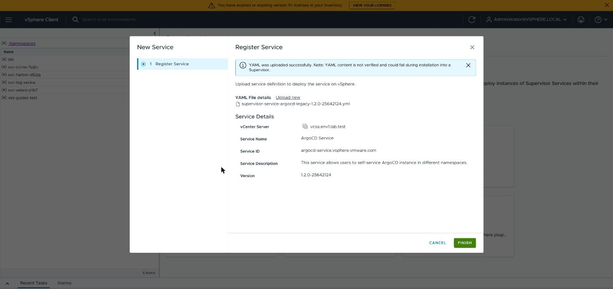

   The page shows *Service 'ArgoCD Service' is successfully registered* and an **ArgoCD
   Service** card.

   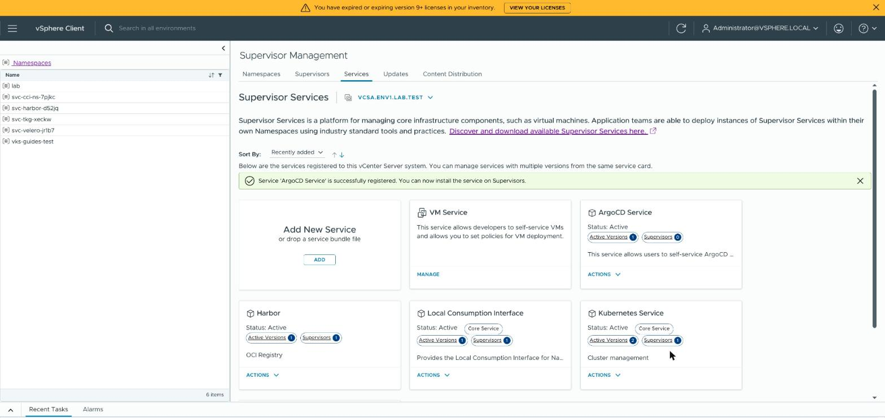

4. On the **ArgoCD Service** card click **ACTIONS** → **Manage Service**. Leave **Install
   Version** at `1.3.0-25873627`, select your Supervisor, click **NEXT**. Wait for
   **Compatibility Check** and **Signature Verification** to **Pass**, click **NEXT**. Leave
   **YAML Service Config** empty, click **FINISH**.

   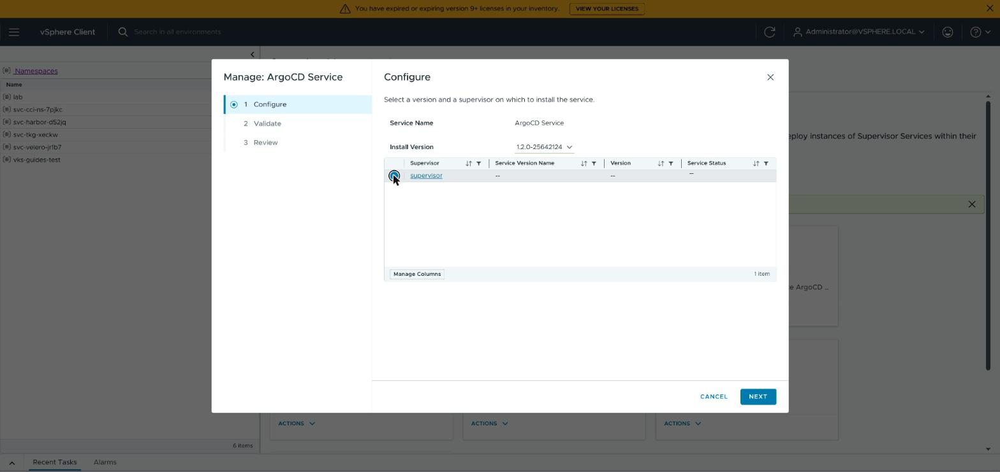

   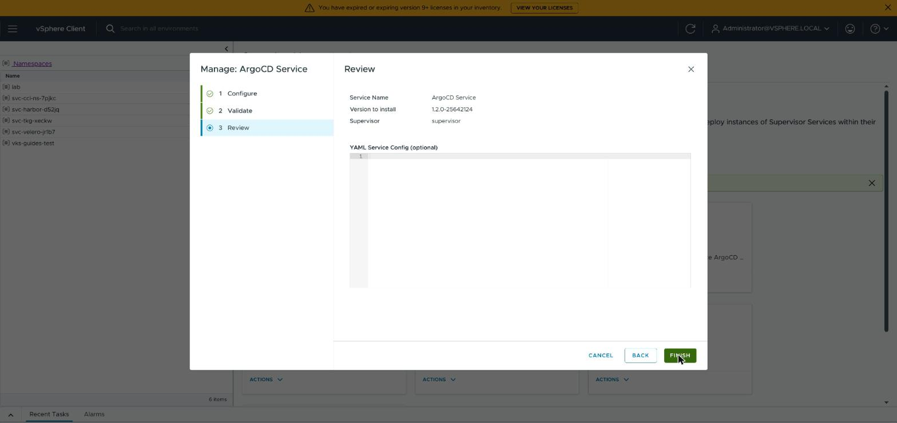

5. **Supervisors** tab → your Supervisor's row → **View** in the **Services** column.

**Expect:** **ArgoCD Service**, **Configured**, `1.3.0-25873627`, after about a minute.

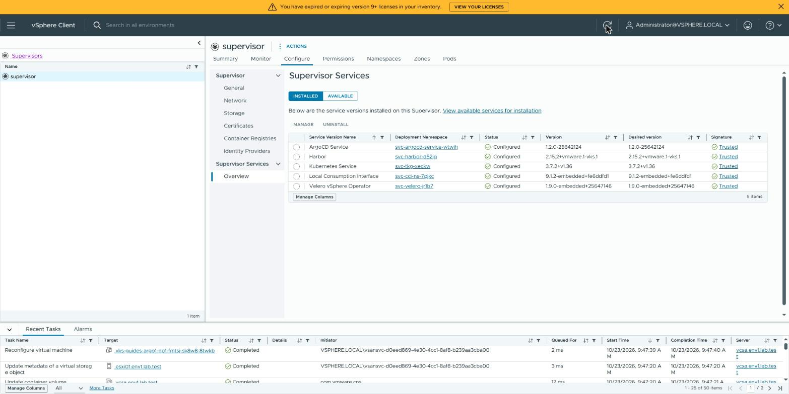

**If not:**
- No **ADD** button, or the upload is refused: your user lacks **Manage Supervisor Services**.
- An error naming the YAML: wrong file; do not edit the manifest.
- **Configuring** for more than 10 minutes: the Supervisor cannot download ArgoCD. With the
  `legacy` file, allow `projects.packages.broadcom.com`; with the other, check the VCF Software
  Depot, or uninstall (step 11) and install the `legacy` file.

## 3. Create the ArgoCD instance

Do this step if step 1 found no ArgoCD instance in your namespace. An instance is your own ArgoCD,
which the ArgoCD Service runs in your vSphere Namespace, in the ArgoCD version you choose. This
lists the ArgoCD versions the service offers and changes nothing. You get one line per version, and
you pick one of them in the next block.

**Linux, macOS, WSL (bash or zsh):**

```sh
SUPERVISOR_CONTEXT="supervisor"
SUPERVISOR_KUBECONFIG="$HOME/.kube/${SUPERVISOR_CONTEXT}.kubeconfig"

kubectl --kubeconfig "$SUPERVISOR_KUBECONFIG" get argocdversion argocd-supported-versions -o jsonpath='{range .spec.versions[*]}{.version}{"  "}{.description}{"\n"}{end}'
```

**Windows (PowerShell):**

```powershell
$SUPERVISOR_CONTEXT = "supervisor"
$SUPERVISOR_KUBECONFIG = "$HOME\.kube\${SUPERVISOR_CONTEXT}.kubeconfig"

kubectl --kubeconfig $SUPERVISOR_KUBECONFIG get argocdversion argocd-supported-versions -o jsonpath='{range .spec.versions[*]}{.version}{''  ''}{.description}{''\n''}{end}'
```

**Expect:** lines such as `3.5.3+vmware.1-vks.1  Recommended version.`

**If not:** `the server doesn't have a resource type "argocdversion"`: step 2 is not finished. No
`3.5.` line: the service is older than 1.3.0; a 1.2 service works for steps 3 to 9. Step 10
upgrades a 1.2 service; an older one moves to 1.2.0 first, which upgrades only from 1.1.0.

Run this to get your own ArgoCD. It creates the instance `argocd-1` in the vSphere Namespace
`ARGOCD_NAMESPACE`, and the Supervisor starts ArgoCD there on one of your free load-balancer
addresses. You get ArgoCD's address, which step 1's block shows once ArgoCD is ready. Set
`ARGOCD_VERSION` to the first *Recommended* version from the list above.

**Linux, macOS, WSL (bash or zsh):**

```sh
SUPERVISOR_CONTEXT="supervisor"
SUPERVISOR_KUBECONFIG="$HOME/.kube/${SUPERVISOR_CONTEXT}.kubeconfig"
ARGOCD_NAMESPACE="my-namespace"
ARGOCD_VERSION="3.5.3+vmware.1-vks.1"

kubectl --kubeconfig "$SUPERVISOR_KUBECONFIG" -n "$ARGOCD_NAMESPACE" apply -f - <<EOF
apiVersion: argocd-service.vsphere.vmware.com/v1alpha1
kind: ArgoCD
metadata:
  name: argocd-1
spec:
  version: "${ARGOCD_VERSION}"
EOF
```

**Windows (PowerShell):**

```powershell
$SUPERVISOR_CONTEXT = "supervisor"
$SUPERVISOR_KUBECONFIG = "$HOME\.kube\${SUPERVISOR_CONTEXT}.kubeconfig"
$ARGOCD_NAMESPACE = "my-namespace"
$ARGOCD_VERSION = "3.5.3+vmware.1-vks.1"

@"
apiVersion: argocd-service.vsphere.vmware.com/v1alpha1
kind: ArgoCD
metadata:
  name: argocd-1
spec:
  version: "${ARGOCD_VERSION}"
"@ | kubectl --kubeconfig $SUPERVISOR_KUBECONFIG -n $ARGOCD_NAMESPACE apply -f -
```

**Expect:** `argocd.argocd-service.vsphere.vmware.com/argocd-1 created`. Then run step 1's block
every half minute until it shows `Ready` and an address: one to two minutes.

**If not:**
- `Forbidden`: your SSO user has no **Namespaces Edit** role on the namespace.
- `failed calling webhook` with `connection refused`: the service is still starting after step 2.
  Wait a minute and run the block again.
- Not `Ready` after 10 minutes: `kubectl --kubeconfig <Supervisor kubeconfig> -n <namespace>
  describe argocd argocd-1` shows why. No address: the Supervisor has no free load-balancer
  address.

## 4. Log in to the ArgoCD web page

Run this once step 1 shows your instance `Ready`: in ArgoCD's web page you watch and start what
ArgoCD deploys. This only reads, and prints what you need to log in there:

- its address;
- the fingerprint of its certificate. Unless you gave ArgoCD one in `argocd-server-tls`, ArgoCD
  made the certificate itself, so your browser cannot check it and warns. Comparing the
  fingerprint shows that you reached your ArgoCD;
- the first password of the user `admin`, to log in with.

Set `ARGOCD_INSTANCE` to the instance's name from step 1, or `argocd-1` if you created it in
step 3. Clear the terminal afterwards: the password stays on the screen.

**Linux, macOS, WSL (bash or zsh):**

```sh
SUPERVISOR_CONTEXT="supervisor"
SUPERVISOR_KUBECONFIG="$HOME/.kube/${SUPERVISOR_CONTEXT}.kubeconfig"
ARGOCD_NAMESPACE="my-namespace"
ARGOCD_INSTANCE="argocd-1"

kubectl --kubeconfig "$SUPERVISOR_KUBECONFIG" -n "$ARGOCD_NAMESPACE" get argocd "$ARGOCD_INSTANCE" -o jsonpath='https://{.status.externalIP}{"\n"}'
{ kubectl --kubeconfig "$SUPERVISOR_KUBECONFIG" -n "$ARGOCD_NAMESPACE" get secret argocd-server-tls -o go-template='{{index .data "tls.crt" | base64decode}}' 2>/dev/null \
  || kubectl --kubeconfig "$SUPERVISOR_KUBECONFIG" -n "$ARGOCD_NAMESPACE" get secret argocd-secret -o go-template='{{index .data "tls.crt" | base64decode}}'; } | openssl x509 -noout -fingerprint -sha256
kubectl --kubeconfig "$SUPERVISOR_KUBECONFIG" -n "$ARGOCD_NAMESPACE" get secret argocd-initial-admin-secret -o go-template='{{.data.password | base64decode}}{{"\n"}}'
```

**Windows (PowerShell):**

```powershell
$SUPERVISOR_CONTEXT = "supervisor"
$SUPERVISOR_KUBECONFIG = "$HOME\.kube\${SUPERVISOR_CONTEXT}.kubeconfig"
$ARGOCD_NAMESPACE = "my-namespace"
$ARGOCD_INSTANCE = "argocd-1"

$global:LASTEXITCODE = $null
kubectl --kubeconfig $SUPERVISOR_KUBECONFIG -n $ARGOCD_NAMESPACE get argocd $ARGOCD_INSTANCE -o jsonpath='https://{.status.externalIP}{''\n''}'
$CRT = kubectl --kubeconfig $SUPERVISOR_KUBECONFIG -n $ARGOCD_NAMESPACE get secret argocd-server-tls -o jsonpath='{.data.tls\.crt}' 2>$null
if (-not $CRT) { $CRT = kubectl --kubeconfig $SUPERVISOR_KUBECONFIG -n $ARGOCD_NAMESPACE get secret argocd-secret -o jsonpath='{.data.tls\.crt}' }
if ($LASTEXITCODE -eq 0 -and $CRT) {
  $X = [Security.Cryptography.X509Certificates.X509Certificate2]::new([Convert]::FromBase64String($CRT))
  $H = [BitConverter]::ToString([Security.Cryptography.SHA256]::Create().ComputeHash($X.RawData))
  "sha256 Fingerprint=$($H.Replace('-', ':'))"
}
kubectl --kubeconfig $SUPERVISOR_KUBECONFIG -n $ARGOCD_NAMESPACE get secret argocd-initial-admin-secret -o go-template='{{.data.password | base64decode}}'
```

**Expect:** `https://<address>`, `sha256 Fingerprint=…` (`SHA256 Fingerprint=` on macOS), then the
password on a line of its own.

1. Open the address in your browser. It warns, for example *Your connection is not private*.
2. Open the certificate (Chrome: **Not secure** → **Certificate details**). Compare its
   **SHA-256** fingerprint of the **Certificate** (not the **Public Key**) with the printed one,
   ignoring colons and upper/lower case.
3. Only if they match: go on (Chrome: **Advanced** → **Proceed to …**) and log in as `admin` with
   the printed password.

**Expect:** the **Applications** page, *No applications available to you just yet*.

**If not:**
- Different fingerprints: something between you and ArgoCD replaces certificates (a company
  proxy), or the address is another server. Do not type the password. If `argocd-server-tls`
  exists, check first that its `tls.crt` and `tls.key` belong together: otherwise ArgoCD serves
  `argocd-secret`'s certificate.
- `secrets "argocd-initial-admin-secret" not found`: someone changed the admin password and
  removed the first one. Ask them for it.

This guide needs no `argocd` program. Broadcom builds it two ways: `vcf argocd`, from the
[VCF CLI](VCF.md) plugin bundle, and `argocd-cli-…-vcf.gz` (amd64) on this service's download
page.

## 5. Let ArgoCD manage your vSphere Namespace

**Whoever can log in to this ArgoCD as `admin`, or has Namespaces Edit on `ARGOCD_NAMESPACE`
(it can read ArgoCD's admin password there), can then do everything Namespaces Edit allows in
`VSPHERE_NAMESPACE`**: create and delete VKS clusters and VMs, and read every VKS cluster's
kubeconfig. Give both only to people who may do that.

ArgoCD can create a VKS cluster only in a vSphere Namespace it may change. Run this once for the
vSphere Namespace that will hold the VKS cluster (set `VSPHERE_NAMESPACE` to it). It allows ArgoCD in
there:

- ArgoCD's account `argocd-k8s-sa` (a login for the ArgoCD program, not a person) gets the `edit`
  role there, the same rights as **Namespaces Edit**;
- the namespace becomes a *destination*, a place ArgoCD may deploy to, named after the namespace,
  for the project `vks-clusters` that step 6 creates. The ArgoCD Service keeps it as the
  ManagedEntity `ns-<namespace>`, its record of one destination.

Afterwards ArgoCD may create VKS clusters in that namespace, which step 6 does.

<details>
<summary><b>Linux, macOS, WSL (bash or zsh)</b></summary>

```sh
SUPERVISOR_CONTEXT="supervisor"
SUPERVISOR_KUBECONFIG="$HOME/.kube/${SUPERVISOR_CONTEXT}.kubeconfig"
ARGOCD_NAMESPACE="my-namespace"
VSPHERE_NAMESPACE="my-namespace"

kubectl --kubeconfig "$SUPERVISOR_KUBECONFIG" apply -f - <<EOF
apiVersion: rbac.authorization.k8s.io/v1
kind: RoleBinding
metadata:
  name: argocd-k8s-sa-edit
  namespace: ${VSPHERE_NAMESPACE}
subjects:
  - kind: ServiceAccount
    name: argocd-k8s-sa
    namespace: ${ARGOCD_NAMESPACE}
roleRef:
  apiGroup: rbac.authorization.k8s.io
  kind: ClusterRole
  name: edit
---
apiVersion: argocd-service.vsphere.vmware.com/v1alpha1
kind: ManagedEntity
metadata:
  name: ns-${VSPHERE_NAMESPACE}
  namespace: ${ARGOCD_NAMESPACE}
spec:
  argoCDProject: vks-clusters
  targetRef:
    apiGroup: ""
    kind: Namespace
    name: ${VSPHERE_NAMESPACE}
EOF
```

</details>

<details>
<summary><b>Windows (PowerShell)</b></summary>

```powershell
$SUPERVISOR_CONTEXT = "supervisor"
$SUPERVISOR_KUBECONFIG = "$HOME\.kube\${SUPERVISOR_CONTEXT}.kubeconfig"
$ARGOCD_NAMESPACE = "my-namespace"
$VSPHERE_NAMESPACE = "my-namespace"

@"
apiVersion: rbac.authorization.k8s.io/v1
kind: RoleBinding
metadata:
  name: argocd-k8s-sa-edit
  namespace: ${VSPHERE_NAMESPACE}
subjects:
  - kind: ServiceAccount
    name: argocd-k8s-sa
    namespace: ${ARGOCD_NAMESPACE}
roleRef:
  apiGroup: rbac.authorization.k8s.io
  kind: ClusterRole
  name: edit
---
apiVersion: argocd-service.vsphere.vmware.com/v1alpha1
kind: ManagedEntity
metadata:
  name: ns-${VSPHERE_NAMESPACE}
  namespace: ${ARGOCD_NAMESPACE}
spec:
  argoCDProject: vks-clusters
  targetRef:
    apiGroup: ""
    kind: Namespace
    name: ${VSPHERE_NAMESPACE}
"@ | kubectl --kubeconfig $SUPERVISOR_KUBECONFIG apply -f -
```

</details>

**Expect:** `rolebinding…/argocd-k8s-sa-edit created` and `managedentity…/ns-<namespace>
created` (`unchanged` on a second run). `configured` or `unchanged` on your first run: someone
else made them; stop and ask them.

**If not:**
- `Unauthorized`: run [Renew the Supervisor login](SUPERVISOR-LOGIN.md#renew-the-supervisor-login), then this
  block again.
- `Forbidden`: your SSO user has no **Namespaces Edit** role on the namespace.

Run this right after the block above, to see that ArgoCD accepted the namespace as a destination.
It only reads, and changes nothing. You get the destination `ns-<namespace>` and its state:

**Linux, macOS, WSL (bash or zsh):**

```sh
SUPERVISOR_CONTEXT="supervisor"
SUPERVISOR_KUBECONFIG="$HOME/.kube/${SUPERVISOR_CONTEXT}.kubeconfig"
ARGOCD_NAMESPACE="my-namespace"

kubectl --kubeconfig "$SUPERVISOR_KUBECONFIG" -n "$ARGOCD_NAMESPACE" get managedentity
```

**Windows (PowerShell):**

```powershell
$SUPERVISOR_CONTEXT = "supervisor"
$SUPERVISOR_KUBECONFIG = "$HOME\.kube\${SUPERVISOR_CONTEXT}.kubeconfig"
$ARGOCD_NAMESPACE = "my-namespace"

kubectl --kubeconfig $SUPERVISOR_KUBECONFIG -n $ARGOCD_NAMESPACE get managedentity
```

**Expect:** `ns-<namespace>` with `PHASE` `Ready`. In the ArgoCD page, **Settings** →
**Clusters** lists the namespace at `https://kubernetes.default.svc/?context=<namespace>`, status
**Unknown** until an Application uses it (picture in step 7).

**If not:** not `Ready` after a minute: `kubectl --kubeconfig <Supervisor kubeconfig> -n <ArgoCD
namespace> get managedentity ns-<namespace> -o yaml` shows, under `conditions`, the ones with
`status: "False"` and why.
`MissingRoleBinding`: the RoleBinding was not created.

## 6. Create a VKS cluster with ArgoCD

In ArgoCD, an *Application* is a folder in Git that ArgoCD applies to a destination; to *sync* it
is to apply it now. A *project* sets limits for a group of Applications. Run this once, before the
cluster's Application below. It creates the project `vks-clusters` in ArgoCD and nothing else.
You get a project in which the cluster's Application can only read this repository, deploy only
to `VSPHERE_NAMESPACE`, and create only VKS clusters.

<details>
<summary><b>Linux, macOS, WSL (bash or zsh)</b></summary>

```sh
SUPERVISOR_CONTEXT="supervisor"
SUPERVISOR_KUBECONFIG="$HOME/.kube/${SUPERVISOR_CONTEXT}.kubeconfig"
ARGOCD_NAMESPACE="my-namespace"
VSPHERE_NAMESPACE="my-namespace"

kubectl --kubeconfig "$SUPERVISOR_KUBECONFIG" -n "$ARGOCD_NAMESPACE" apply -f - <<EOF
apiVersion: argoproj.io/v1alpha1
kind: AppProject
metadata:
  name: vks-clusters
spec:
  description: VKS clusters from vks-guides into ${VSPHERE_NAMESPACE}
  sourceRepos:
    - https://github.com/AndriyKalashnykov/vks-guides.git
  destinations:
    - name: ${VSPHERE_NAMESPACE}
      namespace: ${VSPHERE_NAMESPACE}
  namespaceResourceWhitelist:
    - group: cluster.x-k8s.io
      kind: Cluster
EOF
```

</details>

<details>
<summary><b>Windows (PowerShell)</b></summary>

```powershell
$SUPERVISOR_CONTEXT = "supervisor"
$SUPERVISOR_KUBECONFIG = "$HOME\.kube\${SUPERVISOR_CONTEXT}.kubeconfig"
$ARGOCD_NAMESPACE = "my-namespace"
$VSPHERE_NAMESPACE = "my-namespace"

@"
apiVersion: argoproj.io/v1alpha1
kind: AppProject
metadata:
  name: vks-clusters
spec:
  description: VKS clusters from vks-guides into ${VSPHERE_NAMESPACE}
  sourceRepos:
    - https://github.com/AndriyKalashnykov/vks-guides.git
  destinations:
    - name: ${VSPHERE_NAMESPACE}
      namespace: ${VSPHERE_NAMESPACE}
  namespaceResourceWhitelist:
    - group: cluster.x-k8s.io
      kind: Cluster
"@ | kubectl --kubeconfig $SUPERVISOR_KUBECONFIG -n $ARGOCD_NAMESPACE apply -f -
```

</details>

**Expect:** `appproject.argoproj.io/vks-clusters created`.

**If not:**
- `Unauthorized`: run [Renew the Supervisor login](SUPERVISOR-LOGIN.md#renew-the-supervisor-login), then this
  block again.
- `Forbidden`: your SSO user has no **Namespaces Edit** role on `ARGOCD_NAMESPACE`.

The cluster's Application needs four values. This lists the choices for a new VKS cluster in
`VSPHERE_NAMESPACE`, and changes nothing. You get four lists, and you copy one value from each list into
the Application block below:

- Kubernetes versions, written as the cluster needs them (without the `-vkr.N` ending);
- cluster classes: VMware's templates for a cluster;
- VM classes: the size of each node, in CPUs and memory;
- storage classes: where the cluster's disks go.

<details>
<summary><b>Linux, macOS, WSL (bash or zsh)</b></summary>

```sh
SUPERVISOR_CONTEXT="supervisor"
SUPERVISOR_KUBECONFIG="$HOME/.kube/${SUPERVISOR_CONTEXT}.kubeconfig"
VSPHERE_NAMESPACE="my-namespace"

echo "Kubernetes versions:"
kubectl --kubeconfig "$SUPERVISOR_KUBECONFIG" get kr -o json \
  | jq -r '.items[] | select([.status.conditions[]? | select(.type == "Ready" or .type == "Compatible") | .status] | length == 2 and all(. == "True")) | .spec.version | sub("-vkr[.][0-9]+$"; "")'
echo "Cluster classes:"
kubectl --kubeconfig "$SUPERVISOR_KUBECONFIG" -n vmware-system-vks-public get clusterclass -o jsonpath='{range .items[*]}{.metadata.name}{"\n"}{end}'
echo "VM classes:"
kubectl --kubeconfig "$SUPERVISOR_KUBECONFIG" -n "$VSPHERE_NAMESPACE" get virtualmachineclass --no-headers
echo "Storage classes:"
kubectl --kubeconfig "$SUPERVISOR_KUBECONFIG" -n "$VSPHERE_NAMESPACE" get storagepolicyquota \
  -o jsonpath='{range .items[*].status.total[*]}{.storageClassName}{"\n"}{end}' | sort -u
```

</details>

<details>
<summary><b>Windows (PowerShell)</b></summary>

```powershell
$SUPERVISOR_CONTEXT = "supervisor"
$SUPERVISOR_KUBECONFIG = "$HOME\.kube\${SUPERVISOR_CONTEXT}.kubeconfig"
$VSPHERE_NAMESPACE = "my-namespace"

$global:LASTEXITCODE = $null
"Kubernetes versions:"
$J = kubectl --kubeconfig $SUPERVISOR_KUBECONFIG get kr -o json
if ($LASTEXITCODE -eq 0) {
  ($J | Out-String | ConvertFrom-Json).items | Where-Object {
    @($_.status.conditions | Where-Object { ($_.type -eq 'Ready' -or $_.type -eq 'Compatible') -and $_.status -eq 'True' }).Count -eq 2
  } | ForEach-Object { $_.spec.version -replace '-vkr\.[0-9]+$', '' }
}
"Cluster classes:"
kubectl --kubeconfig $SUPERVISOR_KUBECONFIG -n vmware-system-vks-public get clusterclass -o jsonpath='{range .items[*]}{.metadata.name}{''\n''}{end}'
"VM classes:"
kubectl --kubeconfig $SUPERVISOR_KUBECONFIG -n $VSPHERE_NAMESPACE get virtualmachineclass --no-headers
"Storage classes:"
$J = kubectl --kubeconfig $SUPERVISOR_KUBECONFIG -n $VSPHERE_NAMESPACE get storagepolicyquota -o json
if ($LASTEXITCODE -eq 0) {
  ($J | Out-String | ConvertFrom-Json).items | ForEach-Object { $_.status.total } |
    ForEach-Object { $_.storageClassName } | Sort-Object -Unique
}
```

</details>

**Expect:** under each heading at least one line, for example `v1.37.1+vmware.4`,
`builtin-generic-v3.8.0`, `best-effort-medium  2  8Gi …`, `wcp-vmfs`.

**If not:** an empty list or `Forbidden`: run [Check the namespace](NAMESPACE.md#8-check-the-namespace).

Choose a name for the new VKS cluster that no cluster in `VSPHERE_NAMESPACE` has: lower-case letters,
digits and `-`, starting with a letter. ArgoCD would take over an existing cluster of that name,
and deleting the Application would delete it. This checks that neither a VKS cluster nor an
Application has the name now, and changes nothing. You get two `NotFound` lines when the name is
free. Set `VKS_CLUSTER` to the name:

**Linux, macOS, WSL (bash or zsh):**

```sh
SUPERVISOR_CONTEXT="supervisor"
SUPERVISOR_KUBECONFIG="$HOME/.kube/${SUPERVISOR_CONTEXT}.kubeconfig"
ARGOCD_NAMESPACE="my-namespace"
VSPHERE_NAMESPACE="my-namespace"
VKS_CLUSTER="my-vks-cluster"

kubectl --kubeconfig "$SUPERVISOR_KUBECONFIG" -n "$VSPHERE_NAMESPACE" get clusters.cluster.x-k8s.io "$VKS_CLUSTER"
kubectl --kubeconfig "$SUPERVISOR_KUBECONFIG" -n "$ARGOCD_NAMESPACE" get applications.argoproj.io "$VKS_CLUSTER"
```

**Windows (PowerShell):**

```powershell
$SUPERVISOR_CONTEXT = "supervisor"
$SUPERVISOR_KUBECONFIG = "$HOME\.kube\${SUPERVISOR_CONTEXT}.kubeconfig"
$ARGOCD_NAMESPACE = "my-namespace"
$VSPHERE_NAMESPACE = "my-namespace"
$VKS_CLUSTER = "my-vks-cluster"

kubectl --kubeconfig $SUPERVISOR_KUBECONFIG -n $VSPHERE_NAMESPACE get clusters.cluster.x-k8s.io $VKS_CLUSTER
kubectl --kubeconfig $SUPERVISOR_KUBECONFIG -n $ARGOCD_NAMESPACE get applications.argoproj.io $VKS_CLUSTER
```

**Expect:** two `Error from server (NotFound): …` lines.

**If not:** a cluster or Application is listed: choose another `VKS_CLUSTER`.

Run this once the name is free. It creates the Application for your VKS cluster in ArgoCD: it points
ArgoCD at the folder `argocd/guest-cluster` of this repository, with your cluster's name and the
four values from the lists above. No VKS cluster is created yet: ArgoCD shows what it would create,
and creates the cluster only when you click **SYNC** below. Set `VKS_CLUSTER` to the name, and
`K8S_VERSION`, `CLUSTER_CLASS`, `VM_CLASS` and `STORAGE_CLASS` to a value from each list (for a VM
class, its first column; [CLUSTER.md step 2](CLUSTER.md#2-choose-a-name-and-the-values) says which).
The cluster has one control-plane node and two workers of that class; with `best-effort-medium` it
takes about 84 GB of the namespace's storage.

<details>
<summary><b>Linux, macOS, WSL (bash or zsh)</b></summary>

```sh
SUPERVISOR_CONTEXT="supervisor"
SUPERVISOR_KUBECONFIG="$HOME/.kube/${SUPERVISOR_CONTEXT}.kubeconfig"
ARGOCD_NAMESPACE="my-namespace"
VSPHERE_NAMESPACE="my-namespace"
VKS_CLUSTER="my-vks-cluster"
K8S_VERSION="v1.37.1+vmware.4"
CLUSTER_CLASS="builtin-generic-v3.8.0"
VM_CLASS="best-effort-medium"
STORAGE_CLASS="wcp-vmfs"

kubectl --kubeconfig "$SUPERVISOR_KUBECONFIG" -n "$ARGOCD_NAMESPACE" apply -f - <<EOF
apiVersion: argoproj.io/v1alpha1
kind: Application
metadata:
  name: ${VKS_CLUSTER}
  finalizers:
    - resources-finalizer.argocd.argoproj.io
spec:
  project: vks-clusters
  source:
    repoURL: https://github.com/AndriyKalashnykov/vks-guides.git
    targetRevision: "b0802ca479f40c5d11e13c7534fae8b92d1891a7"
    path: argocd/guest-cluster
    helm:
      valuesObject:
        name: "${VKS_CLUSTER}"
        kubernetesVersion: "${K8S_VERSION}"
        clusterClass: "${CLUSTER_CLASS}"
        vmClass: "${VM_CLASS}"
        storageClass: "${STORAGE_CLASS}"
  destination:
    name: ${VSPHERE_NAMESPACE}
    namespace: ${VSPHERE_NAMESPACE}
EOF
```

</details>

<details>
<summary><b>Windows (PowerShell)</b></summary>

```powershell
$SUPERVISOR_CONTEXT = "supervisor"
$SUPERVISOR_KUBECONFIG = "$HOME\.kube\${SUPERVISOR_CONTEXT}.kubeconfig"
$ARGOCD_NAMESPACE = "my-namespace"
$VSPHERE_NAMESPACE = "my-namespace"
$VKS_CLUSTER = "my-vks-cluster"
$K8S_VERSION = "v1.37.1+vmware.4"
$CLUSTER_CLASS = "builtin-generic-v3.8.0"
$VM_CLASS = "best-effort-medium"
$STORAGE_CLASS = "wcp-vmfs"

@"
apiVersion: argoproj.io/v1alpha1
kind: Application
metadata:
  name: ${VKS_CLUSTER}
  finalizers:
    - resources-finalizer.argocd.argoproj.io
spec:
  project: vks-clusters
  source:
    repoURL: https://github.com/AndriyKalashnykov/vks-guides.git
    targetRevision: "b0802ca479f40c5d11e13c7534fae8b92d1891a7"
    path: argocd/guest-cluster
    helm:
      valuesObject:
        name: "${VKS_CLUSTER}"
        kubernetesVersion: "${K8S_VERSION}"
        clusterClass: "${CLUSTER_CLASS}"
        vmClass: "${VM_CLASS}"
        storageClass: "${STORAGE_CLASS}"
  destination:
    name: ${VSPHERE_NAMESPACE}
    namespace: ${VSPHERE_NAMESPACE}
"@ | kubectl --kubeconfig $SUPERVISOR_KUBECONFIG -n $ARGOCD_NAMESPACE apply -f -
```

</details>

**Expect:** `application.argoproj.io/<cluster> created`, after a `Warning:` about the finalizer
name (harmless: it is Argo CD's documented name). In the ArgoCD page, a tile named after the
cluster: **Missing** and **OutOfSync**.

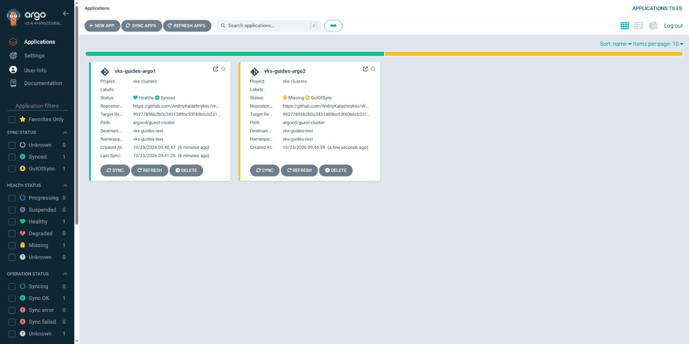

**If not:**
- `application destination … is not permitted in project`: create the project above.
- The tile shows `ComparisonError` with `repository not accessible` or a timeout: the Supervisor
  cannot reach `github.com`. Behind a proxy, add it to the instance:
  `kubectl --kubeconfig <Supervisor kubeconfig> -n <ArgoCD namespace> patch argocd argocd-1
  --type merge -p '{"spec":{"repo":{"proxy":{"httpsProxy":"http://<proxy>:<port>"}}}}'`
  (PowerShell: write each `"` inside the quotes as `\"`).
- `set kubernetesVersion` or another `set …`: that value is empty.

Now look at it, then sync:

1. Click the tile, then **DIFF**. The right half shows, in green, the `Cluster` with your
   values. The left half must be empty. If it is not, a cluster of that name exists: do not
   sync; delete the Application in the ArgoCD page with **Non-cascading** and choose another
   name.

   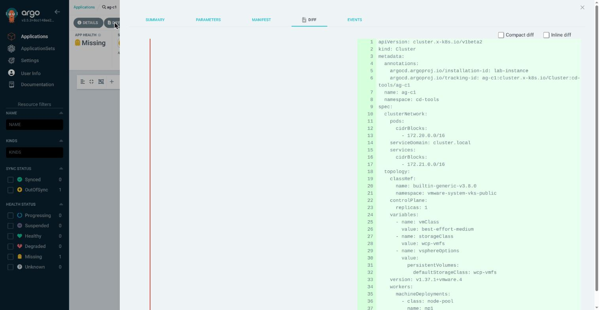

2. Close it, click **SYNC**, then **SYNCHRONIZE**.

   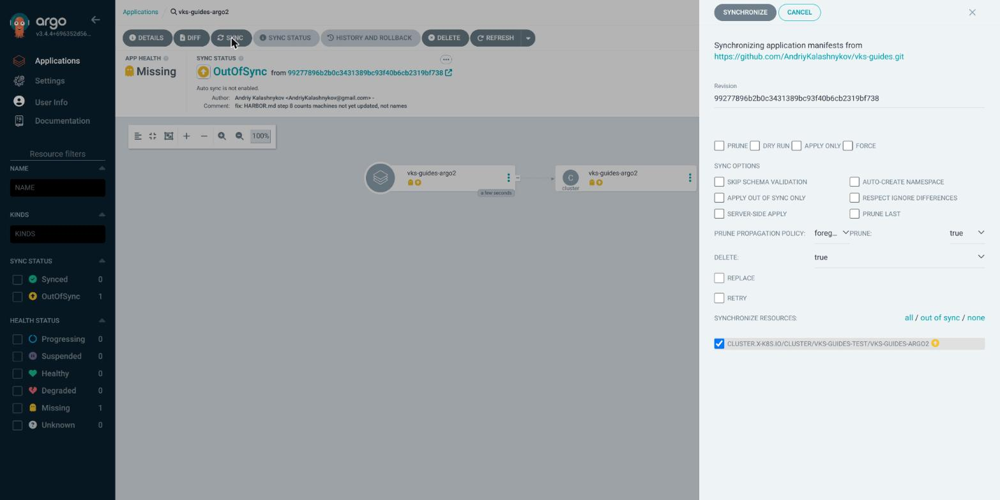

Run this after the sync, to follow the build of the VKS cluster. It only reads: it shows whether
ArgoCD has finished (`Synced  Healthy`) and whether the VKS cluster is ready (`AVAILABLE` `True`).
VKS builds the cluster in 5 to 10 minutes: run it again every few minutes.

**Linux, macOS, WSL (bash or zsh):**

```sh
SUPERVISOR_CONTEXT="supervisor"
SUPERVISOR_KUBECONFIG="$HOME/.kube/${SUPERVISOR_CONTEXT}.kubeconfig"
ARGOCD_NAMESPACE="my-namespace"
VSPHERE_NAMESPACE="my-namespace"
VKS_CLUSTER="my-vks-cluster"

kubectl --kubeconfig "$SUPERVISOR_KUBECONFIG" -n "$ARGOCD_NAMESPACE" get applications.argoproj.io "$VKS_CLUSTER" -o jsonpath='{.status.sync.status}  {.status.health.status}{"\n"}'
kubectl --kubeconfig "$SUPERVISOR_KUBECONFIG" -n "$VSPHERE_NAMESPACE" get clusters.cluster.x-k8s.io "$VKS_CLUSTER"
```

**Windows (PowerShell):**

```powershell
$SUPERVISOR_CONTEXT = "supervisor"
$SUPERVISOR_KUBECONFIG = "$HOME\.kube\${SUPERVISOR_CONTEXT}.kubeconfig"
$ARGOCD_NAMESPACE = "my-namespace"
$VSPHERE_NAMESPACE = "my-namespace"
$VKS_CLUSTER = "my-vks-cluster"

kubectl --kubeconfig $SUPERVISOR_KUBECONFIG -n $ARGOCD_NAMESPACE get applications.argoproj.io $VKS_CLUSTER -o jsonpath='{.status.sync.status}  {.status.health.status}{''\n''}'
kubectl --kubeconfig $SUPERVISOR_KUBECONFIG -n $VSPHERE_NAMESPACE get clusters.cluster.x-k8s.io $VKS_CLUSTER
```

**Expect:** `Synced  Healthy`, and the cluster with `AVAILABLE` `True`.

**If not:**
- `OutOfSync` right after a sync: `K8S_VERSION` has a `-vkr.N` ending. Run the Application block
  again without it.
- `Progressing` after 30 minutes: `kubectl --kubeconfig <Supervisor kubeconfig> -n <namespace>
  describe clusters.cluster.x-k8s.io <cluster>` shows what it waits for (a VM class too small, a
  namespace without room).

ArgoCD changes this cluster only when you click **SYNC**; it does not recreate a cluster deleted
elsewhere. To use the cluster, run [Get the VKS cluster's kubeconfig](SUPERVISOR-LOGIN.md#get-the-vks-clusters-kubeconfig).

## 7. Add the VKS cluster to ArgoCD

So far ArgoCD can only create VKS clusters. To deploy apps into a VKS cluster, it needs that
cluster's login. Run this once per VKS cluster, when step 6 shows it `AVAILABLE`. This:

- lets ArgoCD's account `argocd-k8s-sa` read VKS clusters and their logins (the
  role `argocd-manage-vks`, which the ArgoCD Service installs on the Supervisor);
- asks the ArgoCD Service to add the cluster as a destination: one for every app, step 8's,
  [MONITORING.md](MONITORING.md#9-install-with-argocd-instead-of-steps-4-and-5)'s and [CICD.md](CICD.md#5-let-argocd-deploy-it)'s alike. Each app's project says what it
  may deploy there.

Nothing is installed on the cluster. Set `VKS_CLUSTER` to the cluster's name. Afterwards ArgoCD
may deploy apps to the cluster, as step 8 does.

<details>
<summary><b>Linux, macOS, WSL (bash or zsh)</b></summary>

```sh
SUPERVISOR_CONTEXT="supervisor"
SUPERVISOR_KUBECONFIG="$HOME/.kube/${SUPERVISOR_CONTEXT}.kubeconfig"
ARGOCD_NAMESPACE="my-namespace"
VSPHERE_NAMESPACE="my-namespace"
VKS_CLUSTER="my-vks-cluster"
ROLE="argocd-manage-vks"

kubectl --kubeconfig "$SUPERVISOR_KUBECONFIG" apply -f - <<EOF
apiVersion: rbac.authorization.k8s.io/v1
kind: RoleBinding
metadata:
  name: argocd-k8s-sa-vks
  namespace: ${VSPHERE_NAMESPACE}
subjects:
  - kind: ServiceAccount
    name: argocd-k8s-sa
    namespace: ${ARGOCD_NAMESPACE}
roleRef:
  apiGroup: rbac.authorization.k8s.io
  kind: ClusterRole
  name: ${ROLE}
---
apiVersion: argocd-service.vsphere.vmware.com/v1alpha1
kind: ManagedEntity
metadata:
  name: vks-${VSPHERE_NAMESPACE}-${VKS_CLUSTER}
  namespace: ${ARGOCD_NAMESPACE}
spec:
  targetRef:
    apiGroup: cluster.x-k8s.io
    kind: Cluster
    name: ${VKS_CLUSTER}
    namespace: ${VSPHERE_NAMESPACE}
EOF
```

</details>

<details>
<summary><b>Windows (PowerShell)</b></summary>

```powershell
$SUPERVISOR_CONTEXT = "supervisor"
$SUPERVISOR_KUBECONFIG = "$HOME\.kube\${SUPERVISOR_CONTEXT}.kubeconfig"
$ARGOCD_NAMESPACE = "my-namespace"
$VSPHERE_NAMESPACE = "my-namespace"
$VKS_CLUSTER = "my-vks-cluster"
$ROLE = "argocd-manage-vks"

@"
apiVersion: rbac.authorization.k8s.io/v1
kind: RoleBinding
metadata:
  name: argocd-k8s-sa-vks
  namespace: ${VSPHERE_NAMESPACE}
subjects:
  - kind: ServiceAccount
    name: argocd-k8s-sa
    namespace: ${ARGOCD_NAMESPACE}
roleRef:
  apiGroup: rbac.authorization.k8s.io
  kind: ClusterRole
  name: ${ROLE}
---
apiVersion: argocd-service.vsphere.vmware.com/v1alpha1
kind: ManagedEntity
metadata:
  name: vks-${VSPHERE_NAMESPACE}-${VKS_CLUSTER}
  namespace: ${ARGOCD_NAMESPACE}
spec:
  targetRef:
    apiGroup: cluster.x-k8s.io
    kind: Cluster
    name: ${VKS_CLUSTER}
    namespace: ${VSPHERE_NAMESPACE}
"@ | kubectl --kubeconfig $SUPERVISOR_KUBECONFIG apply -f -
```

</details>

**Expect:** `rolebinding…/argocd-k8s-sa-vks created` and `managedentity…/vks-<namespace>-<cluster>
created`.

**If not:**
- `clusterroles.rbac.authorization.k8s.io "argocd-manage-vks" not found`: your ArgoCD Service did
  not install that role. Set `ROLE="edit"` and run the block again: ArgoCD then gets everything
  Namespaces Edit allows in `VSPHERE_NAMESPACE`, as step 5 describes.
- `Forbidden` on the RoleBinding: your role may not grant `ROLE`. Ask a vCenter administrator to
  run the block.
- `spec.targetRef is already in use by another ManagedEntity`: the cluster is already added, by
  the policy below; nothing to do.
- You ran this block before, with an `argoCDProject:` line in it: that line let every app of that
  project deploy anywhere on the cluster, and running the block again leaves it in place. Delete
  the destination (`kubectl --kubeconfig <Supervisor kubeconfig> -n <ArgoCD namespace> delete
  managedentity vks-<namespace>-<cluster>`) and run the block again.

Run this after the block above, and again now and then. It only reads: it checks that the cluster
was added, and shows when ArgoCD's login to it ends; after that date ArgoCD cannot deploy to it.
That login is the VKS cluster's administrator certificate, which ArgoCD keeps in a Secret (a
Kubernetes object that holds a login or password) in `ARGOCD_NAMESPACE`.

<details>
<summary><b>Linux, macOS, WSL (bash or zsh)</b></summary>

```sh
SUPERVISOR_CONTEXT="supervisor"
SUPERVISOR_KUBECONFIG="$HOME/.kube/${SUPERVISOR_CONTEXT}.kubeconfig"
ARGOCD_NAMESPACE="my-namespace"
VSPHERE_NAMESPACE="my-namespace"
VKS_CLUSTER="my-vks-cluster"

kubectl --kubeconfig "$SUPERVISOR_KUBECONFIG" -n "$ARGOCD_NAMESPACE" get managedentity
CERT="$(kubectl --kubeconfig "$SUPERVISOR_KUBECONFIG" -n "$ARGOCD_NAMESPACE" get secret "cls-vks-${VSPHERE_NAMESPACE}-${VKS_CLUSTER}" \
  -o go-template='{{.data.config | base64decode}}' | jq -r '.tlsClientConfig.certData // empty | @base64d')"
if [ -z "$CERT" ]; then
  echo "No certificate stored for ${VKS_CLUSTER}-${VSPHERE_NAMESPACE} (see the error above)"
else
  printf '%s\n' "$CERT" | openssl x509 -noout -subject -enddate
fi
```

</details>

<details>
<summary><b>Windows (PowerShell)</b></summary>

```powershell
$SUPERVISOR_CONTEXT = "supervisor"
$SUPERVISOR_KUBECONFIG = "$HOME\.kube\${SUPERVISOR_CONTEXT}.kubeconfig"
$ARGOCD_NAMESPACE = "my-namespace"
$VSPHERE_NAMESPACE = "my-namespace"
$VKS_CLUSTER = "my-vks-cluster"

$global:LASTEXITCODE = $null
kubectl --kubeconfig $SUPERVISOR_KUBECONFIG -n $ARGOCD_NAMESPACE get managedentity
$C = kubectl --kubeconfig $SUPERVISOR_KUBECONFIG -n $ARGOCD_NAMESPACE get secret "cls-vks-${VSPHERE_NAMESPACE}-${VKS_CLUSTER}" `
  -o go-template='{{.data.config | base64decode}}'
$D = if ($LASTEXITCODE -eq 0 -and $C) { ($C | Out-String | ConvertFrom-Json).tlsClientConfig.certData }
if (-not $D) {
  "No certificate stored for ${VKS_CLUSTER}-${VSPHERE_NAMESPACE} (see the error above)"
} else {
  $X = [Security.Cryptography.X509Certificates.X509Certificate2]::new([Convert]::FromBase64String($D))
  "subject=$($X.Subject)"
  "notAfter=$($X.NotAfter.ToUniversalTime().ToString('u'))"
}
```

</details>

**Expect:** `vks-<namespace>-<cluster>` `Ready` (and `ns-<namespace>` if you did step 5); then
`subject=…` and `notAfter=…`, a date after today, at most a year away. In the ArgoCD page, **Settings**
→ **Clusters** lists `<cluster>-<namespace>` at `https://<address>:6443`.

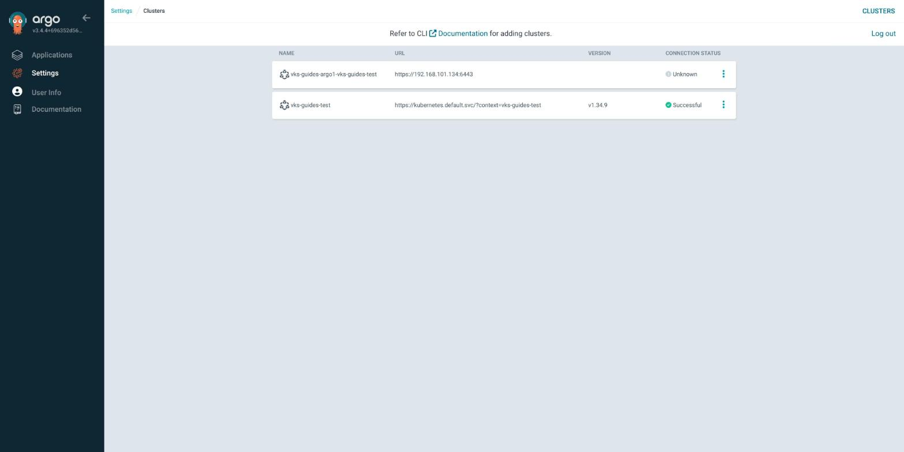

**If not:**
- Not `Ready`: `kubectl --kubeconfig <Supervisor kubeconfig> -n <ArgoCD namespace> get
  managedentity vks-<namespace>-<cluster> -o yaml` shows, under `conditions`, the ones with
  `status: "False"` and why.
  `MissingRoleBinding`: the RoleBinding above is missing.
- `secrets "cls-vks-…" not found`: `kubectl --kubeconfig <Supervisor kubeconfig> -n <ArgoCD
  namespace> get secret -l argocd.argoproj.io/secret-type=cluster` lists the stored destinations.

**Who can use ArgoCD's login:** anyone who may read Secrets in `ARGOCD_NAMESPACE`, or log in to
this ArgoCD as `admin`, can use the cluster as its administrator until that certificate ends.

ArgoCD's certificate is a copy of the one in the VKS cluster's kubeconfig, made when the cluster
was added. When its end date (`notAfter`) is near, run this. It only reads, and prints the end
date of the kubeconfig's certificate as the Supervisor holds it now; a later date means that
adding the cluster again gives ArgoCD a newer certificate:

**Linux, macOS, WSL (bash or zsh):**

```sh
SUPERVISOR_CONTEXT="supervisor"
SUPERVISOR_KUBECONFIG="$HOME/.kube/${SUPERVISOR_CONTEXT}.kubeconfig"
VSPHERE_NAMESPACE="my-namespace"
VKS_CLUSTER="my-vks-cluster"

kubectl --kubeconfig "$SUPERVISOR_KUBECONFIG" -n "$VSPHERE_NAMESPACE" get secret "${VKS_CLUSTER}-kubeconfig" -o go-template='{{.data.value | base64decode}}' \
  | sed -n 's/^ *client-certificate-data: //p' | openssl base64 -d -A | openssl x509 -noout -enddate
```

**Windows (PowerShell):**

```powershell
$SUPERVISOR_CONTEXT = "supervisor"
$SUPERVISOR_KUBECONFIG = "$HOME\.kube\${SUPERVISOR_CONTEXT}.kubeconfig"
$VSPHERE_NAMESPACE = "my-namespace"
$VKS_CLUSTER = "my-vks-cluster"

$global:LASTEXITCODE = $null
$K = kubectl --kubeconfig $SUPERVISOR_KUBECONFIG -n $VSPHERE_NAMESPACE get secret "${VKS_CLUSTER}-kubeconfig" -o jsonpath='{.data.value}'
if ($LASTEXITCODE -eq 0 -and $K) {
  $Y = [Text.Encoding]::UTF8.GetString([Convert]::FromBase64String("$K"))
  $C = (($Y -split "`n") | Where-Object { $_ -match '^\s*client-certificate-data: ' }) -replace '^\s*client-certificate-data: ', ''
  $X = New-Object System.Security.Cryptography.X509Certificates.X509Certificate2 (,[Convert]::FromBase64String("$C".Trim()))
  "notAfter=$($X.NotAfter.ToUniversalTime().ToString('u'))"
}
```

**Expect:** `notAfter=…`. A later date than ArgoCD's: delete the destination and register again
(the apps on the cluster keep running, and their Applications show `Unknown` until the
destination is back):
`kubectl --kubeconfig <Supervisor kubeconfig> -n <ArgoCD namespace> delete managedentity
vks-<namespace>-<cluster>`, then the registration block above. The same date: ask a vCenter
administrator.

**If not:**
- `secrets "<cluster>-kubeconfig" not found`: check `VKS_CLUSTER` and `VSPHERE_NAMESPACE`.
- `Unauthorized`: run [Renew the Supervisor login](SUPERVISOR-LOGIN.md#renew-the-supervisor-login), then this
  block again.

### Add every VKS cluster of a namespace (optional)

Use this instead of step 7's first block when ArgoCD should deploy to every VKS cluster of a
vSphere Namespace. Instead of one ManagedEntity (the ArgoCD Service's record of one destination)
per cluster, it creates a policy that asks the ArgoCD Service to add every VKS cluster in
`VSPHERE_NAMESPACE`, also the ones created later once they are ready, the same way as step 7's first
block. You get the same destination `<cluster>-<namespace>` and the same Secret, so step 8 and the
checks above work unchanged. A cluster already added with step 7's first block stays as it is.

<details>
<summary><b>Linux, macOS, WSL (bash or zsh)</b></summary>

```sh
SUPERVISOR_CONTEXT="supervisor"
SUPERVISOR_KUBECONFIG="$HOME/.kube/${SUPERVISOR_CONTEXT}.kubeconfig"
ARGOCD_NAMESPACE="my-namespace"
VSPHERE_NAMESPACE="my-namespace"
ROLE="argocd-manage-vks"

kubectl --kubeconfig "$SUPERVISOR_KUBECONFIG" apply -f - <<EOF
apiVersion: rbac.authorization.k8s.io/v1
kind: RoleBinding
metadata:
  name: argocd-k8s-sa-vks
  namespace: ${VSPHERE_NAMESPACE}
subjects:
  - kind: ServiceAccount
    name: argocd-k8s-sa
    namespace: ${ARGOCD_NAMESPACE}
roleRef:
  apiGroup: rbac.authorization.k8s.io
  kind: ClusterRole
  name: ${ROLE}
---
apiVersion: argocd-service.vsphere.vmware.com/v1alpha1
kind: EntityManagementPolicy
metadata:
  name: vks-clusters-${VSPHERE_NAMESPACE}
  namespace: ${ARGOCD_NAMESPACE}
spec:
  rules:
    - apiGroup: cluster.x-k8s.io
      kind: Cluster
      namespaces:
        nameSelector:
          - ${VSPHERE_NAMESPACE}
EOF
```

</details>

<details>
<summary><b>Windows (PowerShell)</b></summary>

```powershell
$SUPERVISOR_CONTEXT = "supervisor"
$SUPERVISOR_KUBECONFIG = "$HOME\.kube\${SUPERVISOR_CONTEXT}.kubeconfig"
$ARGOCD_NAMESPACE = "my-namespace"
$VSPHERE_NAMESPACE = "my-namespace"
$ROLE = "argocd-manage-vks"

@"
apiVersion: rbac.authorization.k8s.io/v1
kind: RoleBinding
metadata:
  name: argocd-k8s-sa-vks
  namespace: ${VSPHERE_NAMESPACE}
subjects:
  - kind: ServiceAccount
    name: argocd-k8s-sa
    namespace: ${ARGOCD_NAMESPACE}
roleRef:
  apiGroup: rbac.authorization.k8s.io
  kind: ClusterRole
  name: ${ROLE}
---
apiVersion: argocd-service.vsphere.vmware.com/v1alpha1
kind: EntityManagementPolicy
metadata:
  name: vks-clusters-${VSPHERE_NAMESPACE}
  namespace: ${ARGOCD_NAMESPACE}
spec:
  rules:
    - apiGroup: cluster.x-k8s.io
      kind: Cluster
      namespaces:
        nameSelector:
          - ${VSPHERE_NAMESPACE}
"@ | kubectl --kubeconfig $SUPERVISOR_KUBECONFIG apply -f -
```

</details>

**Expect:** `rolebinding…/argocd-k8s-sa-vks created` (or `unchanged`) and
`entitymanagementpolicy…/vks-clusters-<namespace> created`.

**If not:**
- `clusterroles…"argocd-manage-vks" not found`: your ArgoCD Service did not install that role. Set
  `ROLE="edit"` and run the block again: ArgoCD then gets everything Namespaces Edit allows in
  `VSPHERE_NAMESPACE`, as step 5 describes.
- `Forbidden`: as for the block above.

Run this after the policy block, to see that the policy added your clusters. It only reads, and
changes nothing. You get what the policy decided for each cluster, then the destinations it made:

**Linux, macOS, WSL (bash or zsh):**

```sh
SUPERVISOR_CONTEXT="supervisor"
SUPERVISOR_KUBECONFIG="$HOME/.kube/${SUPERVISOR_CONTEXT}.kubeconfig"
ARGOCD_NAMESPACE="my-namespace"
VSPHERE_NAMESPACE="my-namespace"

kubectl --kubeconfig "$SUPERVISOR_KUBECONFIG" -n "$ARGOCD_NAMESPACE" get entitymanagementpolicy "vks-clusters-${VSPHERE_NAMESPACE}" \
  -o jsonpath='{range .status.decisions[*]}{.name}{"  "}{.outcome}{"  "}{.reason}{"\n"}{end}'
kubectl --kubeconfig "$SUPERVISOR_KUBECONFIG" -n "$ARGOCD_NAMESPACE" get managedentity
```

**Windows (PowerShell):**

```powershell
$SUPERVISOR_CONTEXT = "supervisor"
$SUPERVISOR_KUBECONFIG = "$HOME\.kube\${SUPERVISOR_CONTEXT}.kubeconfig"
$ARGOCD_NAMESPACE = "my-namespace"
$VSPHERE_NAMESPACE = "my-namespace"

kubectl --kubeconfig $SUPERVISOR_KUBECONFIG -n $ARGOCD_NAMESPACE get entitymanagementpolicy "vks-clusters-${VSPHERE_NAMESPACE}" `
  -o jsonpath='{range .status.decisions[*]}{.name}{''  ''}{.outcome}{''  ''}{.reason}{''\n''}{end}'
kubectl --kubeconfig $SUPERVISOR_KUBECONFIG -n $ARGOCD_NAMESPACE get managedentity
```

**Expect:** a line per cluster within a minute: `<cluster>  EligibleAndManaged  The entity is
managed by the policy`, and the ManagedEntity `vkscluster---<namespace>---<cluster>`, `Ready`. A
cluster added with the block above shows `EligibleButNotManaged`.

**If not:** no line: the policy has not run yet; run the block again in a minute.

Deleting the policy keeps the clusters it added; step 9 removes them one by one. A cluster whose
ManagedEntity you delete, the policy's or the block above's, is added again only when the cluster
or the policy changes; to add it at once, delete the policy and run the policy block again.

## 8. Deploy the test app

Run this once step 7 shows the VKS cluster `Ready`, to prove that ArgoCD can run apps there. It
has ArgoCD deploy a small test web server (nginx) into your VKS cluster from the folder
[`argocd/test-web-apps`](../argocd/test-web-apps). It creates in ArgoCD:

- the project `test-web-apps`, which limits ArgoCD to this one app on this cluster;
- the Application `test-web-apps`, which ArgoCD deploys at once.

On the cluster you get the namespace `test-web-apps` (inside the VKS cluster, not a vSphere
Namespace), five copies (pods) of the web server, and a Service: an address you can open from
your machine. If someone changes or deletes them on the cluster, ArgoCD puts them back. Set
`VKS_CLUSTER` to the cluster from step 6.

<details>
<summary><b>Linux, macOS, WSL (bash or zsh)</b></summary>

```sh
SUPERVISOR_CONTEXT="supervisor"
SUPERVISOR_KUBECONFIG="$HOME/.kube/${SUPERVISOR_CONTEXT}.kubeconfig"
ARGOCD_NAMESPACE="my-namespace"
VSPHERE_NAMESPACE="my-namespace"
VKS_CLUSTER="my-vks-cluster"

kubectl --kubeconfig "$SUPERVISOR_KUBECONFIG" -n "$ARGOCD_NAMESPACE" apply -f - <<EOF
apiVersion: argoproj.io/v1alpha1
kind: AppProject
metadata:
  name: test-web-apps
spec:
  description: test-web-apps from vks-guides into ${VKS_CLUSTER}
  sourceRepos:
    - https://github.com/AndriyKalashnykov/vks-guides.git
  destinations:
    - name: ${VKS_CLUSTER}-${VSPHERE_NAMESPACE}
      namespace: test-web-apps
  clusterResourceWhitelist:
    - group: ""
      kind: Namespace
      name: test-web-apps
  namespaceResourceWhitelist:
    - group: apps
      kind: Deployment
    - group: ""
      kind: Service
---
apiVersion: argoproj.io/v1alpha1
kind: Application
metadata:
  name: test-web-apps
  finalizers:
    - resources-finalizer.argocd.argoproj.io
spec:
  project: test-web-apps
  source:
    repoURL: https://github.com/AndriyKalashnykov/vks-guides.git
    targetRevision: "173fba41691ffd7c0379443a6ca2fb014a3205d8"
    path: argocd/test-web-apps
  destination:
    name: ${VKS_CLUSTER}-${VSPHERE_NAMESPACE}
    namespace: test-web-apps
  syncPolicy:
    automated:
      prune: true
      selfHeal: true
EOF
```

</details>

<details>
<summary><b>Windows (PowerShell)</b></summary>

```powershell
$SUPERVISOR_CONTEXT = "supervisor"
$SUPERVISOR_KUBECONFIG = "$HOME\.kube\${SUPERVISOR_CONTEXT}.kubeconfig"
$ARGOCD_NAMESPACE = "my-namespace"
$VSPHERE_NAMESPACE = "my-namespace"
$VKS_CLUSTER = "my-vks-cluster"

@"
apiVersion: argoproj.io/v1alpha1
kind: AppProject
metadata:
  name: test-web-apps
spec:
  description: test-web-apps from vks-guides into ${VKS_CLUSTER}
  sourceRepos:
    - https://github.com/AndriyKalashnykov/vks-guides.git
  destinations:
    - name: ${VKS_CLUSTER}-${VSPHERE_NAMESPACE}
      namespace: test-web-apps
  clusterResourceWhitelist:
    - group: ""
      kind: Namespace
      name: test-web-apps
  namespaceResourceWhitelist:
    - group: apps
      kind: Deployment
    - group: ""
      kind: Service
---
apiVersion: argoproj.io/v1alpha1
kind: Application
metadata:
  name: test-web-apps
  finalizers:
    - resources-finalizer.argocd.argoproj.io
spec:
  project: test-web-apps
  source:
    repoURL: https://github.com/AndriyKalashnykov/vks-guides.git
    targetRevision: "173fba41691ffd7c0379443a6ca2fb014a3205d8"
    path: argocd/test-web-apps
  destination:
    name: ${VKS_CLUSTER}-${VSPHERE_NAMESPACE}
    namespace: test-web-apps
  syncPolicy:
    automated:
      prune: true
      selfHeal: true
"@ | kubectl --kubeconfig $SUPERVISOR_KUBECONFIG -n $ARGOCD_NAMESPACE apply -f -
```

</details>

**Expect:** `appproject.argoproj.io/test-web-apps created` and
`application.argoproj.io/test-web-apps created`, after the same finalizer `Warning:` as in step 6.

**If not:** `strict decoding error: unknown field "spec.clusterResourceWhitelist[0].name"`: your
ArgoCD is older than 3.3. Delete the line `name: test-web-apps` under `kind: Namespace` and run it
again (the Application then shows `unchanged`); the project may then create a namespace with any
name.

Run this after the block above, to see the app run. It only reads, and shows ArgoCD's status for
the app, how many of the five pods are ready, and whether its address answers. It needs the VKS
cluster's kubeconfig file `~/.kube/<cluster>.kubeconfig` from
[Get the VKS cluster's kubeconfig](SUPERVISOR-LOGIN.md#get-the-vks-clusters-kubeconfig). Run it again until
it shows `5/5`: a minute or two.

**Linux, macOS, WSL (bash or zsh):**

```sh
SUPERVISOR_CONTEXT="supervisor"
SUPERVISOR_KUBECONFIG="$HOME/.kube/${SUPERVISOR_CONTEXT}.kubeconfig"
ARGOCD_NAMESPACE="my-namespace"
VKS_CLUSTER="my-vks-cluster"
VKS_KUBECONFIG="$HOME/.kube/${VKS_CLUSTER}.kubeconfig"

kubectl --kubeconfig "$SUPERVISOR_KUBECONFIG" -n "$ARGOCD_NAMESPACE" get applications.argoproj.io test-web-apps -o jsonpath='{.status.sync.status}  {.status.health.status}{"\n"}'
kubectl --kubeconfig "$VKS_KUBECONFIG" -n test-web-apps get deployment test-web-apps
IP="$(kubectl --kubeconfig "$VKS_KUBECONFIG" -n test-web-apps get service test-web-apps -o jsonpath='{.status.loadBalancer.ingress[0].ip}{.status.loadBalancer.ingress[0].hostname}')"
if [ -z "$IP" ]; then
  echo "No address yet: run this block again in a minute"
else
  curl -s -o /dev/null --connect-timeout 20 --max-time 30 -w "http://${IP}/ answers %{http_code}\n" "http://${IP}/"
fi
```

**Windows (PowerShell):**

```powershell
$SUPERVISOR_CONTEXT = "supervisor"
$SUPERVISOR_KUBECONFIG = "$HOME\.kube\${SUPERVISOR_CONTEXT}.kubeconfig"
$ARGOCD_NAMESPACE = "my-namespace"
$VKS_CLUSTER = "my-vks-cluster"
$VKS_KUBECONFIG = "$HOME\.kube\${VKS_CLUSTER}.kubeconfig"

kubectl --kubeconfig $SUPERVISOR_KUBECONFIG -n $ARGOCD_NAMESPACE get applications.argoproj.io test-web-apps -o jsonpath='{.status.sync.status}  {.status.health.status}{''\n''}'
kubectl --kubeconfig $VKS_KUBECONFIG -n test-web-apps get deployment test-web-apps
$IP = kubectl --kubeconfig $VKS_KUBECONFIG -n test-web-apps get service test-web-apps -o jsonpath='{.status.loadBalancer.ingress[0].ip}{.status.loadBalancer.ingress[0].hostname}'
if (-not $IP) {
  "No address yet: run this block again in a minute"
} else {
  curl.exe -s -o NUL --connect-timeout 20 --max-time 30 -w "http://${IP}/ answers %{http_code}\n" "http://${IP}/"
}
```

**Expect:** `Synced  Healthy`, then `test-web-apps   5/5   5   5`, then
`http://<address>/ answers 200`. In the ArgoCD page, `test-web-apps` is **Healthy** and
**Synced**, with its namespace, Service and Deployment.

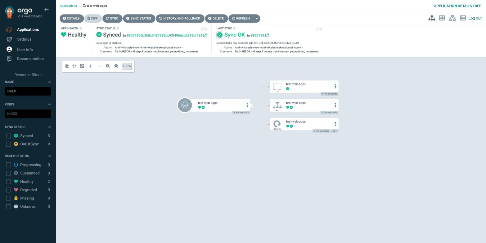

**If not:**
- The tile in the ArgoCD page shows `application destination … is not permitted in project`:
  step 7 is not done, or its destination has another name (**Settings** → **Clusters** shows it).
- `OutOfSync`, and the tile shows `ComparisonError`: see the proxy line in step 6.
- `0/5` with `ErrImagePull` or `ImagePullBackOff` (`kubectl --kubeconfig <cluster.kubeconfig> -n
  test-web-apps get pods`): the cluster cannot pull from `docker.io`. Copy the image into a
  registry it can reach, change `image:` in your own copy of the folder, and point `repoURL` and
  `sourceRepos` in step 8's block at that copy.
- `No address yet` for more than 5 minutes: the Supervisor has no free load-balancer address.
- `answers 000`: this machine cannot reach the address.

## 9. Clean up (optional)

If you installed monitoring with ArgoCD, run [MONITORING.md](MONITORING.md#10-uninstall-with-argocd-optional) step 10 first. Do
these in order: an Application can be deleted only while ArgoCD still reaches its
destination, and deleting an Application deletes what it created.

Run this first, while ArgoCD still reaches the VKS cluster. It deletes the Application
`test-web-apps`, which makes ArgoCD delete the test app and its namespace on the VKS cluster, then
the project `test-web-apps` in ArgoCD. Afterwards the test app is gone; the VKS cluster itself
stays:

**Linux, macOS, WSL (bash or zsh):**

```sh
SUPERVISOR_CONTEXT="supervisor"
SUPERVISOR_KUBECONFIG="$HOME/.kube/${SUPERVISOR_CONTEXT}.kubeconfig"
ARGOCD_NAMESPACE="my-namespace"

kubectl --kubeconfig "$SUPERVISOR_KUBECONFIG" -n "$ARGOCD_NAMESPACE" delete applications.argoproj.io test-web-apps --timeout=5m \
  && kubectl --kubeconfig "$SUPERVISOR_KUBECONFIG" -n "$ARGOCD_NAMESPACE" delete appproject test-web-apps
```

**Windows (PowerShell):**

```powershell
$SUPERVISOR_CONTEXT = "supervisor"
$SUPERVISOR_KUBECONFIG = "$HOME\.kube\${SUPERVISOR_CONTEXT}.kubeconfig"
$ARGOCD_NAMESPACE = "my-namespace"

$global:LASTEXITCODE = $null
kubectl --kubeconfig $SUPERVISOR_KUBECONFIG -n $ARGOCD_NAMESPACE delete applications.argoproj.io test-web-apps --timeout=5m
if ($LASTEXITCODE -eq 0) { kubectl --kubeconfig $SUPERVISOR_KUBECONFIG -n $ARGOCD_NAMESPACE delete appproject test-web-apps }
```

**Expect:** `application.argoproj.io "test-web-apps" deleted`, then
`appproject.argoproj.io "test-web-apps" deleted`. Newer kubectl adds `from <namespace>
namespace` to each `deleted` line.

**If not:** `timed out waiting`: ArgoCD cannot reach the VKS cluster (step 7's certificate ended,
or the cluster is gone). In the ArgoCD page, delete the Application with **Non-cascading**.

Run this next, only when you no longer need the VKS cluster or any app on it. It removes the VKS
cluster from ArgoCD's destinations and takes back ArgoCD's access to it. Then it deletes the
cluster's Application, which makes ArgoCD delete the VKS cluster itself; that takes a few minutes:

**Linux, macOS, WSL (bash or zsh):**

```sh
SUPERVISOR_CONTEXT="supervisor"
SUPERVISOR_KUBECONFIG="$HOME/.kube/${SUPERVISOR_CONTEXT}.kubeconfig"
ARGOCD_NAMESPACE="my-namespace"
VSPHERE_NAMESPACE="my-namespace"
VKS_CLUSTER="my-vks-cluster"

kubectl --kubeconfig "$SUPERVISOR_KUBECONFIG" -n "$ARGOCD_NAMESPACE" delete managedentity "vks-${VSPHERE_NAMESPACE}-${VKS_CLUSTER}" "vkscluster---${VSPHERE_NAMESPACE}---${VKS_CLUSTER}" --ignore-not-found
kubectl --kubeconfig "$SUPERVISOR_KUBECONFIG" -n "$VSPHERE_NAMESPACE" delete rolebinding argocd-k8s-sa-vks --ignore-not-found
kubectl --kubeconfig "$SUPERVISOR_KUBECONFIG" -n "$ARGOCD_NAMESPACE" delete applications.argoproj.io "$VKS_CLUSTER" --wait=false
```

**Windows (PowerShell):**

```powershell
$SUPERVISOR_CONTEXT = "supervisor"
$SUPERVISOR_KUBECONFIG = "$HOME\.kube\${SUPERVISOR_CONTEXT}.kubeconfig"
$ARGOCD_NAMESPACE = "my-namespace"
$VSPHERE_NAMESPACE = "my-namespace"
$VKS_CLUSTER = "my-vks-cluster"

kubectl --kubeconfig $SUPERVISOR_KUBECONFIG -n $ARGOCD_NAMESPACE delete managedentity "vks-${VSPHERE_NAMESPACE}-${VKS_CLUSTER}" "vkscluster---${VSPHERE_NAMESPACE}---${VKS_CLUSTER}" --ignore-not-found
kubectl --kubeconfig $SUPERVISOR_KUBECONFIG -n $VSPHERE_NAMESPACE delete rolebinding argocd-k8s-sa-vks --ignore-not-found
kubectl --kubeconfig $SUPERVISOR_KUBECONFIG -n $ARGOCD_NAMESPACE delete applications.argoproj.io $VKS_CLUSTER --wait=false
```

**Expect:** three `… deleted` lines. Then run the name check of step 6 every few minutes until it
prints two `NotFound` lines.

**If not:**
- `Error from server (NotFound)` for the Application: it is already gone, or `VKS_CLUSTER` is not
  its name.
- `Unauthorized`: run [Renew the Supervisor login](SUPERVISOR-LOGIN.md#renew-the-supervisor-login), then this
  block again. `Forbidden`: your SSO user has no **Namespaces Edit** role on the namespace.

Run this once the cluster is gone, to take back ArgoCD's rights in your vSphere Namespace. It
deletes the project `vks-clusters`, the namespace destination, ArgoCD's `edit` role in
`VSPHERE_NAMESPACE` and step 7's policy. Run it only if steps 5 and 6 printed `created` for them (and
step 7 for the policy). It deletes nothing while an Application of the project is left.
Afterwards ArgoCD may no longer create VKS clusters in `VSPHERE_NAMESPACE`.

**Linux, macOS, WSL (bash or zsh):**

```sh
SUPERVISOR_CONTEXT="supervisor"
SUPERVISOR_KUBECONFIG="$HOME/.kube/${SUPERVISOR_CONTEXT}.kubeconfig"
ARGOCD_NAMESPACE="my-namespace"
VSPHERE_NAMESPACE="my-namespace"

if ! A="$(kubectl --kubeconfig "$SUPERVISOR_KUBECONFIG" -n "$ARGOCD_NAMESPACE" get applications.argoproj.io -o jsonpath="{range .items[?(@.spec.project=='vks-clusters')]}{.metadata.name}{' '}{end}")"; then
  echo "Nothing deleted: cannot list the Applications (see the error above)"
elif [ -n "$A" ]; then
  echo "Nothing deleted: these Applications still use vks-clusters: $A"
else
  kubectl --kubeconfig "$SUPERVISOR_KUBECONFIG" -n "$ARGOCD_NAMESPACE" delete appproject vks-clusters --ignore-not-found
  kubectl --kubeconfig "$SUPERVISOR_KUBECONFIG" -n "$ARGOCD_NAMESPACE" delete managedentity "ns-${VSPHERE_NAMESPACE}" --ignore-not-found
  kubectl --kubeconfig "$SUPERVISOR_KUBECONFIG" -n "$ARGOCD_NAMESPACE" delete entitymanagementpolicy "vks-clusters-${VSPHERE_NAMESPACE}" --ignore-not-found
  kubectl --kubeconfig "$SUPERVISOR_KUBECONFIG" -n "$VSPHERE_NAMESPACE" delete rolebinding argocd-k8s-sa-edit --ignore-not-found
fi
```

**Windows (PowerShell):**

```powershell
$SUPERVISOR_CONTEXT = "supervisor"
$SUPERVISOR_KUBECONFIG = "$HOME\.kube\${SUPERVISOR_CONTEXT}.kubeconfig"
$ARGOCD_NAMESPACE = "my-namespace"
$VSPHERE_NAMESPACE = "my-namespace"

$global:LASTEXITCODE = $null
$A = kubectl --kubeconfig $SUPERVISOR_KUBECONFIG -n $ARGOCD_NAMESPACE get applications.argoproj.io -o jsonpath='{range .items[?(@.spec.project==''vks-clusters'')]}{.metadata.name}{'' ''}{end}'
if ($LASTEXITCODE -ne 0) { "Nothing deleted: cannot list the Applications (see the error above)" } elseif ("$A".Trim()) { "Nothing deleted: these Applications still use vks-clusters: $A" } else {
  kubectl --kubeconfig $SUPERVISOR_KUBECONFIG -n $ARGOCD_NAMESPACE delete appproject vks-clusters --ignore-not-found
  kubectl --kubeconfig $SUPERVISOR_KUBECONFIG -n $ARGOCD_NAMESPACE delete managedentity "ns-${VSPHERE_NAMESPACE}" --ignore-not-found
  kubectl --kubeconfig $SUPERVISOR_KUBECONFIG -n $ARGOCD_NAMESPACE delete entitymanagementpolicy "vks-clusters-${VSPHERE_NAMESPACE}" --ignore-not-found
  kubectl --kubeconfig $SUPERVISOR_KUBECONFIG -n $VSPHERE_NAMESPACE delete rolebinding argocd-k8s-sa-edit --ignore-not-found
}
```

**Expect:** three `… deleted` lines, four with the policy.

**If not:** `Nothing deleted: these Applications …`: a cluster Application is still being
deleted; run step 6's name check until it prints two `NotFound` lines, then this block again.

Run this last, when nobody uses this ArgoCD any more. It deletes the instance `argocd-1`, then what
it leaves behind: two Secrets, one of them the first `admin` password, and its project `default`.
Run it only if step 3 printed `created`. Afterwards ArgoCD's web page and address are gone.

**Linux, macOS, WSL (bash or zsh):**

```sh
SUPERVISOR_CONTEXT="supervisor"
SUPERVISOR_KUBECONFIG="$HOME/.kube/${SUPERVISOR_CONTEXT}.kubeconfig"
ARGOCD_NAMESPACE="my-namespace"

kubectl --kubeconfig "$SUPERVISOR_KUBECONFIG" -n "$ARGOCD_NAMESPACE" delete argocd argocd-1 --ignore-not-found --timeout=5m \
  && kubectl --kubeconfig "$SUPERVISOR_KUBECONFIG" -n "$ARGOCD_NAMESPACE" delete secret argocd-initial-admin-secret argocd-redis --ignore-not-found \
  && kubectl --kubeconfig "$SUPERVISOR_KUBECONFIG" -n "$ARGOCD_NAMESPACE" delete appproject default --ignore-not-found
```

**Windows (PowerShell):**

```powershell
$SUPERVISOR_CONTEXT = "supervisor"
$SUPERVISOR_KUBECONFIG = "$HOME\.kube\${SUPERVISOR_CONTEXT}.kubeconfig"
$ARGOCD_NAMESPACE = "my-namespace"

$global:LASTEXITCODE = $null
kubectl --kubeconfig $SUPERVISOR_KUBECONFIG -n $ARGOCD_NAMESPACE delete argocd argocd-1 --ignore-not-found --timeout=5m
if ($LASTEXITCODE -eq 0) {
  kubectl --kubeconfig $SUPERVISOR_KUBECONFIG -n $ARGOCD_NAMESPACE delete secret argocd-initial-admin-secret argocd-redis --ignore-not-found
  kubectl --kubeconfig $SUPERVISOR_KUBECONFIG -n $ARGOCD_NAMESPACE delete appproject default --ignore-not-found
}
```

**Expect:** up to four `… deleted` lines.

**If not:** an error on the instance deletes nothing else.
- `Unauthorized`: run [Renew the Supervisor login](SUPERVISOR-LOGIN.md#renew-the-supervisor-login), then this
  block again. `Forbidden`: your SSO user has no **Namespaces Edit** role on the namespace.
- `timed out waiting`: the instance is still being removed; run the block again in a few minutes.
- `the server doesn't have a resource type "argocd"`: the ArgoCD Service is removed, and the
  instance with it; run the last two `kubectl` commands alone (in sh without the `&&`).

## 10. Upgrade to ArgoCD Service 1.3.0

Do this when the service runs 1.2.0 and you want ArgoCD 3.5: step 3's version list then has no
`3.5.` line. The upgrade has three parts, in this order: a vCenter administrator checks every
ArgoCD instance on the Supervisor (10.1) and upgrades the service (10.2); then each instance's owner
upgrades their instance (10.3) and checks it (10.4).

### 10.1 Check that every instance can follow (vCenter administrator)

Run this before 10.2: ArgoCD Service 1.3.0's upgrade check accepts only instances on ArgoCD 3.4 or
3.5, and an instance below 3.4 must move to 3.4 while the service is still on 1.2.0. It lists every
instance in every vSphere Namespace with its ArgoCD version, and changes nothing. You get each
instance, then one line that says whether to go on.

**Linux, macOS, WSL (bash or zsh):**

```sh
SUPERVISOR_CONTEXT="supervisor"
SUPERVISOR_KUBECONFIG="$HOME/.kube/${SUPERVISOR_CONTEXT}.kubeconfig"

OFFERED="$(kubectl --kubeconfig "$SUPERVISOR_KUBECONFIG" get argocdversion argocd-supported-versions -o jsonpath='{range .spec.versions[*]}{.version}{"\n"}{end}')" || OFFERED=""
LIST="$(kubectl --kubeconfig "$SUPERVISOR_KUBECONFIG" get argocd -A -o jsonpath='{range .items[*]}{.metadata.namespace}{" "}{.metadata.name}{" "}{.spec.version}{"\n"}{end}')" || LIST="FAILED"

if [ -z "$OFFERED" ] || [ "$LIST" = "FAILED" ]; then
  echo "FAILED: cannot read the service or the instances (see the error above)"
else
  printf '%s\n' "$LIST"
  OLD="$(printf '%s\n' "$LIST" | awk 'NF == 3 { split($3, v, "."); if (v[1] + 0 < 3 || (v[1] + 0 == 3 && v[2] + 0 < 4)) print $1 "/" $2 " " $3 }')"
  if printf '%s\n' "$OFFERED" | grep -q '^3\.5\.'; then
    echo "DONE: the service already offers ArgoCD 3.5; each owner goes on with 10.3"
    printf '%s\n' "$LIST" | while read -r NS NAME VER; do
      if [ -n "$VER" ] && ! printf '%s\n' "$OFFERED" | grep -qxF "$VER"; then echo "UPGRADE: $NS/$NAME $VER is not offered; its owner runs 10.3"; fi
    done
  elif ! printf '%s\n' "$OFFERED" | grep -q '^3\.4\.'; then
    echo "STOP: the service is older than 1.2.0; a vCenter administrator installs 1.2.0 first"
  elif [ -n "$OLD" ]; then
    printf '%s\n' "$OLD" | while read -r X; do echo "STOP: $X is below ArgoCD 3.4"; done
  else
    echo "OK: every instance is on ArgoCD 3.4 or newer; go on with 10.2"
  fi
fi
```

**Windows (PowerShell):**

```powershell
$SUPERVISOR_CONTEXT = "supervisor"
$SUPERVISOR_KUBECONFIG = "$HOME\.kube\${SUPERVISOR_CONTEXT}.kubeconfig"

$OFFERED = @(kubectl --kubeconfig $SUPERVISOR_KUBECONFIG get argocdversion argocd-supported-versions -o jsonpath='{range .spec.versions[*]}{.version}{''\n''}{end}')
$OK1 = $LASTEXITCODE -eq 0
$LIST = @(kubectl --kubeconfig $SUPERVISOR_KUBECONFIG get argocd -A -o jsonpath='{range .items[*]}{.metadata.namespace}{'' ''}{.metadata.name}{'' ''}{.spec.version}{''\n''}{end}')
if (-not $OK1 -or $LASTEXITCODE -ne 0 -or $OFFERED.Count -eq 0) {
  "FAILED: cannot read the service or the instances (see the error above)"
} else {
  $LIST
  $OLD = @($LIST | Where-Object { $_ } | ForEach-Object {
    $f = $_ -split ' '
    if ($f.Count -eq 3 -and [version](($f[2] -split '\+')[0]) -lt [version]'3.4') { "$($f[0])/$($f[1]) $($f[2])" }
  })
  if (@($OFFERED | Where-Object { $_ -like '3.5.*' }).Count -gt 0) {
    "DONE: the service already offers ArgoCD 3.5; each owner goes on with 10.3"
    $LIST | Where-Object { $_ } | ForEach-Object {
      $f = $_ -split ' '
      if ($f.Count -eq 3 -and $OFFERED -notcontains $f[2]) { "UPGRADE: $($f[0])/$($f[1]) $($f[2]) is not offered; its owner runs 10.3" }
    }
  } elseif (@($OFFERED | Where-Object { $_ -like '3.4.*' }).Count -eq 0) {
    "STOP: the service is older than 1.2.0; a vCenter administrator installs 1.2.0 first"
  } elseif ($OLD.Count -gt 0) {
    $OLD | ForEach-Object { "STOP: $_ is below ArgoCD 3.4" }
  } else {
    "OK: every instance is on ArgoCD 3.4 or newer; go on with 10.2"
  }
}
```

**Expect:** a line `<namespace> <instance> <version>` per instance, then `OK: every instance is
on ArgoCD 3.4 or newer; go on with 10.2`.

**If not:**
- `STOP: <namespace>/<instance> <version> is below ArgoCD 3.4`: that instance's owner runs 10.3
  now, with a `3.4.` version from step 3's list; then run this again.
- `DONE: …`: the service is already upgraded; each `UPGRADE: …` instance's owner runs 10.3.
- `STOP: the service is older than 1.2.0`: add release 1.2.0 with **Add New Version** and
  **Manage Service** as in 10.2 (1.2.0 upgrades only from 1.1.0), then come back.
- `Forbidden`: a vCenter administrator must run this; it reads every namespace.

### 10.2 Upgrade the service (vCenter administrator)

Do this after 10.1 printed `OK`. It registers ArgoCD Service 1.3.0 in vCenter and installs it on
the Supervisor in place of 1.2.0, in about a minute. **There is no way back: Broadcom documents
none, and 1.2.0 accepts neither 1.3.0 nor ArgoCD 3.5 instances.** Tell the instances' owners
first: right after it, an instance on a version 1.3.0 does not offer (such as
`3.4.4+vmware.1-vks.1`) shows `Failed` in step 1 but keeps serving, until its owner runs 10.3.

1. Download the 1.3.0 manifest as in step 2, item 1, of the same kind as the one step 2 installed
   (`-legacy-` in its name or not), and check it with step 2's checksum block and table.
2. vSphere Client: menu (☰) → **Supervisor Management** → **Services**. On the **ArgoCD Service**
   card click **ACTIONS** → **Add New Version**, then **UPLOAD**, choose the manifest, click
   **NEXT** if the window shows it, accept the EULA if one is shown, and click **FINISH**.
3. On the card click **ACTIONS** → **Manage Service**. Set **Install Version** to
   `1.3.0-25873627` (not the `1.2.0-25642124` that is there now), select your Supervisor, click
   **NEXT**. Wait for **Compatibility Check** and **Signature Verification** to **Pass**, click
   **NEXT**, leave **YAML Service Config** empty, and click **FINISH**.

**Expect:** after about a minute, **Active Versions** lists `1.3.0-25873627` on your Supervisor
and `1.2.0-25642124` on one fewer, and the Supervisor's services (**Supervisors** tab → **View** in
the **Services** column) show **ArgoCD Service**, **Configured**, `1.3.0-25873627`.

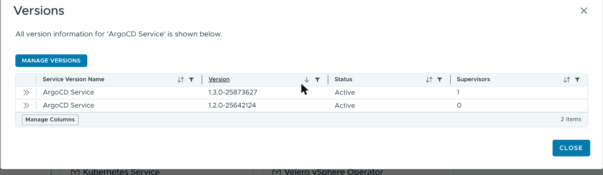

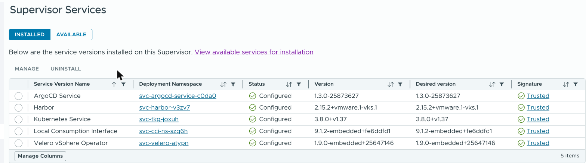

**If not:**
- **Compatibility Check** does not pass: an instance is below ArgoCD 3.4, or the service is older
  than 1.2.0; run 10.1 and do what it prints, then **Manage Service** again.
- **Configuring** for more than 10 minutes: the Supervisor cannot download 1.3.0. With the
  `legacy` file, allow `projects.packages.broadcom.com`; with the other, check the VCF Software
  Depot. Do not uninstall the service: that removes every instance.

### 10.3 Upgrade your ArgoCD instance

Run this after 10.2, for each instance you own; or before 10.2 when 10.1 printed `STOP` for your
instance. It sets the instance to a new ArgoCD version, waits until the Supervisor has rolled it
out, then asks ArgoCD for the version it runs. ArgoCD's web page and its Applications stay; the
page may not answer for a minute while ArgoCD restarts. Set `ARGOCD_NAMESPACE`,
`ARGOCD_INSTANCE` (step 1 shows it) and `ARGOCD_VERSION` to a version from step 3's list: the first
*Recommended* one, or a `3.4.` one when 10.1 printed `STOP`.

**Linux, macOS, WSL (bash or zsh):**

```sh
SUPERVISOR_CONTEXT="supervisor"
SUPERVISOR_KUBECONFIG="$HOME/.kube/${SUPERVISOR_CONTEXT}.kubeconfig"
ARGOCD_NAMESPACE="my-namespace"
ARGOCD_INSTANCE="argocd-1"
ARGOCD_VERSION="3.5.3+vmware.1-vks.1"

if kubectl --kubeconfig "$SUPERVISOR_KUBECONFIG" -n "$ARGOCD_NAMESPACE" patch argocd "$ARGOCD_INSTANCE" --type merge -p "spec: {version: $ARGOCD_VERSION}"; then
  GEN="$(kubectl --kubeconfig "$SUPERVISOR_KUBECONFIG" -n "$ARGOCD_NAMESPACE" get argocd "$ARGOCD_INSTANCE" -o jsonpath='{.metadata.generation}')"
  STATE=""
  for i in $(seq 60); do
    STATE="$(kubectl --kubeconfig "$SUPERVISOR_KUBECONFIG" -n "$ARGOCD_NAMESPACE" get argocd "$ARGOCD_INSTANCE" -o jsonpath='{.status.observedGeneration} {.status.phase}')"
    if [ "$STATE" = "$GEN Ready" ]; then break; fi
    sleep 10
  done
  IP="$(kubectl --kubeconfig "$SUPERVISOR_KUBECONFIG" -n "$ARGOCD_NAMESPACE" get argocd "$ARGOCD_INSTANCE" -o jsonpath='{.status.externalIP}')"
  if [ "$STATE" != "$GEN Ready" ]; then
    echo "NOT YET: $STATE (generation $GEN); run this block again in a few minutes"
  else
    RUNS=""
    for i in $(seq 30); do
      RUNS="$(curl -sk --connect-timeout 5 --max-time 10 "https://$IP/api/version")"
      case "$RUNS" in *"v${ARGOCD_VERSION%%+*}+"*) break ;; esac
      sleep 10
    done
    case "$RUNS" in
      *"v${ARGOCD_VERSION%%+*}+"*) echo "ArgoCD at https://$IP runs: $RUNS" ;;
      *) echo "NOT YET: ArgoCD at https://$IP answers: $RUNS; run this block again in a minute" ;;
    esac
  fi
fi
```

**Windows (PowerShell):**

```powershell
$SUPERVISOR_CONTEXT = "supervisor"
$SUPERVISOR_KUBECONFIG = "$HOME\.kube\${SUPERVISOR_CONTEXT}.kubeconfig"
$ARGOCD_NAMESPACE = "my-namespace"
$ARGOCD_INSTANCE = "argocd-1"
$ARGOCD_VERSION = "3.5.3+vmware.1-vks.1"

kubectl --kubeconfig $SUPERVISOR_KUBECONFIG -n $ARGOCD_NAMESPACE patch argocd $ARGOCD_INSTANCE --type merge -p "spec: {version: $ARGOCD_VERSION}"
if ($LASTEXITCODE -eq 0) {
  $GEN = kubectl --kubeconfig $SUPERVISOR_KUBECONFIG -n $ARGOCD_NAMESPACE get argocd $ARGOCD_INSTANCE -o jsonpath='{.metadata.generation}'
  $STATE = ""
  foreach ($i in 1..60) {
    $STATE = kubectl --kubeconfig $SUPERVISOR_KUBECONFIG -n $ARGOCD_NAMESPACE get argocd $ARGOCD_INSTANCE -o jsonpath='{.status.observedGeneration} {.status.phase}'
    if ($STATE -eq "$GEN Ready") { break }
    Start-Sleep -Seconds 10
  }
  $IP = kubectl --kubeconfig $SUPERVISOR_KUBECONFIG -n $ARGOCD_NAMESPACE get argocd $ARGOCD_INSTANCE -o jsonpath='{.status.externalIP}'
  if ($STATE -ne "$GEN Ready") {
    "NOT YET: $STATE (generation $GEN); run this block again in a few minutes"
  } else {
    $RUNS = ""
    foreach ($i in 1..30) {
      $RUNS = curl.exe -sk --connect-timeout 5 --max-time 10 "https://$IP/api/version"
      if ($RUNS -like "*v$(($ARGOCD_VERSION -split '\+')[0])+*") { break }
      Start-Sleep -Seconds 10
    }
    if ($RUNS -like "*v$(($ARGOCD_VERSION -split '\+')[0])+*") { "ArgoCD at https://$IP runs: $RUNS" } else { "NOT YET: ArgoCD at https://$IP answers: $RUNS; run this block again in a minute" }
  }
}
```

**Expect:** `argocd.argocd-service.vsphere.vmware.com/<instance> patched`, then after one to a few
minutes `ArgoCD at https://<address> runs: {"Version":"v<the version you set>+…"}`.

**If not:**
- `patched (no change)`: the instance already runs that version.
- `Forbidden`: your SSO user has no **Namespaces Edit** role on the namespace.
- `admission webhook … denied the request: spec.version … is not in the supported versions list`:
  take a version from step 3's list. `… downgrade … is not allowed`: an instance cannot go back to
  an older version.
- `NOT YET`: run the block again; still not `Ready` after 15 minutes: `kubectl --kubeconfig
  <Supervisor kubeconfig> -n <namespace> describe argocd <instance>` shows why.

### 10.4 Check your Applications after the upgrade

Run this after 10.3, to see that ArgoCD still deploys what it deployed before. ArgoCD 3.5 renders
Helm charts with Helm 4, so an Application can show `OutOfSync` or `Unknown` although nothing
changed in Git. It lists every Application in the namespace with its sync and health state, then
the vSphere Namespaces and VKS clusters the instance manages (ManagedEntities), and changes
nothing. Set `ARGOCD_NAMESPACE` as in step 1.

**Linux, macOS, WSL (bash or zsh):**

```sh
SUPERVISOR_CONTEXT="supervisor"
SUPERVISOR_KUBECONFIG="$HOME/.kube/${SUPERVISOR_CONTEXT}.kubeconfig"
ARGOCD_NAMESPACE="my-namespace"

kubectl --kubeconfig "$SUPERVISOR_KUBECONFIG" -n "$ARGOCD_NAMESPACE" get applications.argoproj.io -o jsonpath='{range .items[*]}{"Application: "}{.metadata.name}{"  "}{.status.sync.status}{"  "}{.status.health.status}{"\n"}{end}'
kubectl --kubeconfig "$SUPERVISOR_KUBECONFIG" -n "$ARGOCD_NAMESPACE" get managedentities.argocd-service.vsphere.vmware.com
```

**Windows (PowerShell):**

```powershell
$SUPERVISOR_CONTEXT = "supervisor"
$SUPERVISOR_KUBECONFIG = "$HOME\.kube\${SUPERVISOR_CONTEXT}.kubeconfig"
$ARGOCD_NAMESPACE = "my-namespace"

kubectl --kubeconfig $SUPERVISOR_KUBECONFIG -n $ARGOCD_NAMESPACE get applications.argoproj.io -o jsonpath='{range .items[*]}{''Application: ''}{.metadata.name}{''  ''}{.status.sync.status}{''  ''}{.status.health.status}{''\n''}{end}'
kubectl --kubeconfig $SUPERVISOR_KUBECONFIG -n $ARGOCD_NAMESPACE get managedentities.argocd-service.vsphere.vmware.com
```

**Expect:** `Application: <name>  Synced  Healthy` for each Application, then one row per
ManagedEntity with **PHASE** `Ready` (`No resources found` when the instance manages none).

**If not:**
- `OutOfSync` on an Application you did not change: open it on ArgoCD's web page (step 4) and read
  **DIFF**; click **SYNC** only when it changes nothing under `spec.topology` (that can replace a
  VKS cluster's nodes).
- `Unknown`: the web page shows the comparison error; see
  [Argo CD's 3.4 to 3.5 notes](https://argo-cd.readthedocs.io/en/release-3.5/operator-manual/upgrading/3.4-3.5/).
- `Progressing` or `Missing`: wait a minute after 10.3 and run this again.
- No lines at all: the namespace has no Applications (step 9 removed the test app).

## 11. Remove the ArgoCD Service (vCenter administrator)

Do this step only if step 2 installed the service, and only when no ArgoCD instance is left on the
Supervisor: removing the service removes the instances with it. This lists the instances in every
vSphere Namespace, and changes nothing. You get `No resources found` when none is left:

**Linux, macOS, WSL (bash or zsh):**

```sh
SUPERVISOR_CONTEXT="supervisor"
SUPERVISOR_KUBECONFIG="$HOME/.kube/${SUPERVISOR_CONTEXT}.kubeconfig"

kubectl --kubeconfig "$SUPERVISOR_KUBECONFIG" get argocd -A
```

**Windows (PowerShell):**

```powershell
$SUPERVISOR_CONTEXT = "supervisor"
$SUPERVISOR_KUBECONFIG = "$HOME\.kube\${SUPERVISOR_CONTEXT}.kubeconfig"

kubectl --kubeconfig $SUPERVISOR_KUBECONFIG get argocd -A
```

**Expect:** `No resources found`.

**If not:** a list: do not go on until their owners have deleted them. `Forbidden`: a vCenter
administrator must run this.

1. vSphere Client: **Supervisor Management** → **Supervisors** → **View** in your Supervisor's
   **Services** column. Select **ArgoCD Service**, click **UNINSTALL**, then **UNINSTALL** again.
2. Only if no other Supervisor of this vCenter will use it: **Services** tab → **ArgoCD
   Service** card → **ACTIONS** → **Delete**. Section *2. Uninstall all versions from
   Supervisors* must have a green tick, and the table under section 3 must show `0` under
   **Supervisors**; otherwise stop and close the window. Click **CONFIRM** under *1. Deactivate
   service*, **CONFIRM** under *3. Delete all versions of the Service*, then **DELETE**.

**Expect:** the row disappears from the Supervisor's services; after 2, *'ArgoCD Service'
successfully deleted.*

Back to [README](../README.md).
