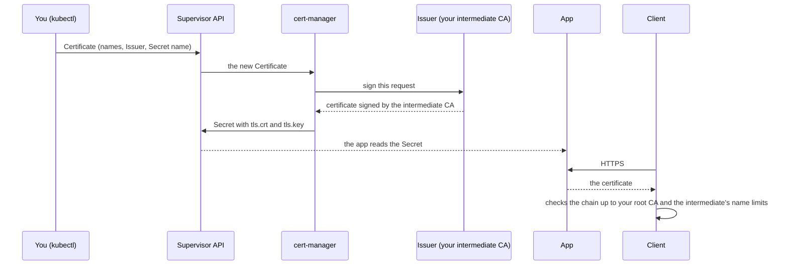

# Sign certificates with your own CA in one vSphere Namespace

Option C of three ways to get certificates ([CERTIFICATES.md](CERTIFICATES.md) helps you choose):
option A is [ACME](ACME-CERTIFICATES.md), option B is [a ClusterIssuer](CA-CLUSTERISSUER.md).

This guide keeps a CA (certificate authority) in one vSphere Namespace, so that the apps of that
namespace get certificates signed by it, for example the certificate an ArgoCD instance serves
(`argocd-server-tls`). The Supervisor runs cert-manager itself (in `vmware-system-cert-manager`):
nothing is installed. You make an intermediate CA from your root CA on your own machine, put only
the intermediate CA in the namespace, and create a cert-manager Issuer of kind CA there. The
Issuer signs any name it is asked for; the intermediate CA allows only the names under your apps'
DNS zone and no IP address, so clients refuse a certificate for any other name. Clients trust
your root CA. The root CA's key never goes to the Supervisor. Words: [GLOSSARY.md](GLOSSARY.md).

What you accept with it:

- every user with the **Namespaces Edit** or **Namespaces Owner** role on the namespace can read
  the intermediate CA's key, and so sign certificates for any name in your apps' zone: the people
  of that namespace are who you trust with that zone;
- nothing revokes a certificate it signed, unless you run a revocation service yourself: a
  certificate stays valid until it expires.

On Windows, run the blocks in WSL ([PREREQS.md](PREREQS.md#wsl-2-with-ubuntu)), logged in to the
Supervisor from WSL: Windows PowerShell has no `openssl`.

How a certificate is issued:



The steps:

1. [Check what you may do in the namespace](#1-check-what-you-may-do-in-the-namespace) (a user of the namespace)
2. [Make a root CA (only if you have none)](#2-make-a-root-ca-only-if-you-have-none) (the CA's owner, on their machine)
3. [Make the namespace's intermediate CA](#3-make-the-namespaces-intermediate-ca) (the CA's owner, on their machine)
4. [Put the intermediate CA in the namespace and create the Issuer](#4-put-the-intermediate-ca-in-the-namespace-and-create-the-issuer) (a user of the namespace)
5. [Check the Issuer](#5-check-the-issuer) (a user of the namespace)
6. [Request a certificate for an app](#6-request-a-certificate-for-an-app) (a user of the namespace)
7. [Make the clients trust your root CA](#7-make-the-clients-trust-your-root-ca) (each person, once)

## Prerequisites

- a [Supervisor login](SUPERVISOR-LOGIN.md) for a user with the **Namespaces Edit** or
  **Namespaces Owner** role on the vSphere Namespace
  ([NAMESPACE.md step 4](NAMESPACE.md#4-give-users-a-role));
- [kubectl](KUBECTL.md) and [openssl](PREREQS.md);
- the DNS zone of the namespace's apps (in this guide `apps.example.com`): only names under it get
  a certificate clients accept;
- your organization's root CA, its certificate and key, on the machine where you run steps 3 and
  5, or step 2 to make one.

The connections this guide needs, for a firewall (all TCP, besides DNS):

| from | to | port | for |
|---|---|---|---|
| your machine (laptop or jump box) | the Supervisor's address | 443 | kubectl (steps 1, 4, 5, 6) |

## 1. Check what you may do in the namespace

Run this first, before you make any CA, to learn whether your user may keep a CA in the namespace.
It asks the Supervisor whether your user may create Secrets, Issuers and Certificates there and
read Secrets, and changes nothing. Five answers `yes` mean you may go on. Set `VSPHERE_NAMESPACE`
to the namespace's name and `SUPERVISOR_CONTEXT` to your login's name for the Supervisor.

**Linux, macOS, WSL (bash or zsh):**

```sh
VSPHERE_NAMESPACE="my-namespace"
SUPERVISOR_CONTEXT="supervisor"
SUPERVISOR_KUBECONFIG="$HOME/.kube/${SUPERVISOR_CONTEXT}.kubeconfig"

for v in "create secrets" "get secrets" "list secrets" "create issuers.cert-manager.io" "create certificates.cert-manager.io"; do
  echo "$v: $(kubectl --kubeconfig "$SUPERVISOR_KUBECONFIG" -n "$VSPHERE_NAMESPACE" auth can-i $v 2>&1)"
done
```

**Expect:** five lines, each ending in `yes`.

**If not:**
- `no`: your user has no **Namespaces Edit** or **Namespaces Owner** role on this namespace; ask
  a vCenter administrator ([NAMESPACE.md step 4](NAMESPACE.md#4-give-users-a-role)).
- `Unauthorized`: run [Renew the Supervisor login](SUPERVISOR-LOGIN.md#renew-the-supervisor-login).

## 2. Make a root CA (only if you have none)

Run this only if your organization has no root CA for these apps. It makes a root CA in
`~/vks-ca`: `root.crt`, which every client will trust, and `root.key`, which signs the
intermediate CAs. It changes nothing on the Supervisor, and replaces no root CA that is there. You
then have the root CA for step 3. Keep `root.key` on this machine, or offline: it never goes to
the Supervisor. Set `ROOT_CN` to the name clients show for it, and `DAYS` to how many days it is
valid.

<details>
<summary><b>Linux, macOS, WSL (bash or zsh)</b></summary>

```sh
ROOT_CN="Example root CA"
CA_HOME="$HOME/vks-ca"
DAYS=3650

if [ -e "$CA_HOME/root.crt" ] || [ -e "$CA_HOME/root.key" ]; then
  echo "FAILED: $CA_HOME already holds a root CA; it was not replaced"
else
  (umask 077; mkdir -p "$CA_HOME")
  printf '%s\n' "[r]" "basicConstraints=critical,CA:TRUE" "keyUsage=critical,keyCertSign,cRLSign" "subjectKeyIdentifier=hash" > "$CA_HOME/root.ext"
  if (umask 077; openssl req -x509 -newkey ec -pkeyopt ec_paramgen_curve:P-256 -nodes -keyout "$CA_HOME/root.key" -out "$CA_HOME/root.crt" -days "$DAYS" -subj "/CN=$ROOT_CN" -extensions r -config "$CA_HOME/root.ext"); then
    chmod 644 "$CA_HOME/root.crt"
    openssl x509 -in "$CA_HOME/root.crt" -noout -subject -enddate
  else
    rm -f "$CA_HOME/root.key" "$CA_HOME/root.crt"
    echo "FAILED: the root CA was not made (see the error above)"
  fi
fi
```

</details>

**Expect:** `subject=CN=Example root CA` (your `ROOT_CN`) and `notAfter=` with the date it ends.
Lines of dots and `+` while the key is made are normal.

**If not:**
- `FAILED: … already holds a root CA`: use that root CA in step 3, or set `CA_HOME` to another
  folder.
- `FAILED: the root CA was not made`: read the `openssl` error above it; a `not found` line for
  `openssl`: install it ([PREREQS.md](PREREQS.md)).

## 3. Make the namespace's intermediate CA

Run this once per namespace, on the machine that holds your root CA's key, before you put a CA in
the namespace. It makes an intermediate CA signed by your root CA that may sign only names under
`APPS_ZONE`, no IPv4 or IPv6 address, and no further CA (`pathlen:0`). It writes
`intermediate.crt` and `intermediate.key` to `~/vks-ca/<namespace>`, and changes nothing on the
Supervisor. You then have the CA to put in the namespace in step 4. Set `VSPHERE_NAMESPACE`,
`APPS_ZONE` to your apps' DNS zone, `ROOT_CRT` and `ROOT_KEY` to your root CA's files, and `DAYS`
to how many days it is valid (no longer than the root CA).

<details>
<summary><b>Linux, macOS, WSL (bash or zsh)</b></summary>

```sh
VSPHERE_NAMESPACE="my-namespace"
APPS_ZONE="apps.example.com"
ROOT_CRT="$HOME/vks-ca/root.crt"
ROOT_KEY="$HOME/vks-ca/root.key"
CA_DIR="$HOME/vks-ca/$VSPHERE_NAMESPACE"
DAYS=1825

if [ -e "$CA_DIR/intermediate.crt" ]; then
  echo "FAILED: $CA_DIR/intermediate.crt exists; this namespace has an intermediate CA already"
elif [ ! -s "$ROOT_CRT" ] || [ ! -s "$ROOT_KEY" ]; then
  echo "FAILED: no root CA at $ROOT_CRT and $ROOT_KEY"
else
  (umask 077; mkdir -p "$CA_DIR")
  printf '%s\n' "[i]" "basicConstraints=critical,CA:TRUE,pathlen:0" "keyUsage=critical,keyCertSign,cRLSign" "nameConstraints=critical,permitted;DNS:$APPS_ZONE,excluded;IP:0.0.0.0/0.0.0.0,excluded;IP:0:0:0:0:0:0:0:0/0:0:0:0:0:0:0:0" "subjectKeyIdentifier=hash" "authorityKeyIdentifier=keyid" > "$CA_DIR/intermediate.ext"
  if (umask 077; openssl req -newkey ec -pkeyopt ec_paramgen_curve:P-256 -nodes -keyout "$CA_DIR/intermediate.key" -out "$CA_DIR/intermediate.csr" -subj "/CN=$VSPHERE_NAMESPACE intermediate CA") \
    && openssl x509 -req -in "$CA_DIR/intermediate.csr" -CA "$ROOT_CRT" -CAkey "$ROOT_KEY" -set_serial "0x$(openssl rand -hex 8)" -days "$DAYS" -extfile "$CA_DIR/intermediate.ext" -extensions i -out "$CA_DIR/intermediate.crt"; then
    rm -f "$CA_DIR/intermediate.csr"
    chmod 644 "$CA_DIR/intermediate.crt"
    openssl x509 -in "$CA_DIR/intermediate.crt" -noout -subject -ext nameConstraints,basicConstraints
  else
    rm -f "$CA_DIR/intermediate.key" "$CA_DIR/intermediate.csr" "$CA_DIR/intermediate.crt"
    echo "FAILED: the intermediate CA was not made (see the error above)"
  fi
fi
```

</details>

**Expect:** `Certificate request self-signature ok`, `subject=CN=my-namespace intermediate CA`,
then `CA:TRUE, pathlen:0`, under `Permitted:` the line `DNS:apps.example.com` (your `APPS_ZONE`),
and under `Excluded:` the lines `IP:0.0.0.0/0.0.0.0` and `IP:0:0:0:0:0:0:0:0/0:0:0:0:0:0:0:0`.

**If not:**
- `FAILED: … exists`: the namespace has its intermediate CA already; go on with step 4, or, if
  step 4 ran, step 5.
- `FAILED: no root CA …`: set `ROOT_CRT` and `ROOT_KEY` to your root CA's files, or make one in
  step 2.
- `FAILED: the intermediate CA was not made`: read the `openssl` error above it; a wrong root key
  for `ROOT_CRT` shows as a key that does not match.

## 4. Put the intermediate CA in the namespace and create the Issuer

Run this once, after step 3, so that cert-manager can sign the namespace's certificates. It puts
the intermediate CA's certificate and key in a Secret of type `kubernetes.io/tls` named
`ISSUER_NAME`, creates the Issuer of kind CA with the same name, and then deletes
`intermediate.key` from your machine: from then on the key is only in that Secret. It keeps
`intermediate.crt`, which steps 5 and 6 use. You then have an Issuer that signs certificates in
the namespace. Set `VSPHERE_NAMESPACE`, `SUPERVISOR_CONTEXT` and `ISSUER_NAME`.

<details>
<summary><b>Linux, macOS, WSL (bash or zsh)</b></summary>

```sh
VSPHERE_NAMESPACE="my-namespace"
SUPERVISOR_CONTEXT="supervisor"
SUPERVISOR_KUBECONFIG="$HOME/.kube/${SUPERVISOR_CONTEXT}.kubeconfig"
CA_DIR="$HOME/vks-ca/$VSPHERE_NAMESPACE"
ISSUER_NAME="namespace-ca"

if [ ! -s "$CA_DIR/intermediate.key" ] || [ ! -s "$CA_DIR/intermediate.crt" ]; then
  echo "FAILED: no intermediate CA in $CA_DIR: make it in step 3 (if this block ran before, the key is in the Secret already)"
elif ! kubectl --kubeconfig "$SUPERVISOR_KUBECONFIG" -n "$VSPHERE_NAMESPACE" create secret tls "$ISSUER_NAME" --cert="$CA_DIR/intermediate.crt" --key="$CA_DIR/intermediate.key"; then
  echo "FAILED: the Secret $ISSUER_NAME was not created; the key stays in $CA_DIR"
else
  rm -f "$CA_DIR/intermediate.key"
  printf '%s\n' "apiVersion: cert-manager.io/v1" "kind: Issuer" "metadata:" "  name: $ISSUER_NAME" "  namespace: $VSPHERE_NAMESPACE" "spec:" "  ca:" "    secretName: $ISSUER_NAME" \
    | kubectl --kubeconfig "$SUPERVISOR_KUBECONFIG" apply -f - || echo "FAILED: the Issuer $ISSUER_NAME was not created; run this block again (the Secret is there)"
fi
```

</details>

**Expect:** `secret/namespace-ca created` and `issuer.cert-manager.io/namespace-ca created`.

**If not:**
- `AlreadyExists` for the Secret: the namespace holds a CA of that name already. Use it (step 5),
  or set another `ISSUER_NAME`. The key stays in `CA_DIR`.
- `FAILED: no intermediate CA …` after an earlier run of this block: the Secret holds the key
  already. If only the Issuer is missing, run the `printf … | kubectl … apply -f -` line alone
  with the same values.
- `Forbidden`: step 1 did not answer `yes` five times.
- `Unauthorized`: run [Renew the Supervisor login](SUPERVISOR-LOGIN.md#renew-the-supervisor-login).

## 5. Check the Issuer

Run this after step 4, before an app uses the Issuer, to see that clients accept the names of your
zone and refuse every other name. It asks the Issuer for two test certificates, one for a name
under `APPS_ZONE` and one for `OUTSIDE_NAME`, and checks each against your root CA and the
intermediate CA. The Issuer signs both: only the check shows which one clients refuse. At its end
it deletes the two test Certificates and their Secrets. You then know the chain and the name
limits work. Set `OUTSIDE_NAME` to a name outside the zone, for example your vCenter's.

<details>
<summary><b>Linux, macOS, WSL (bash or zsh)</b></summary>

```sh
VSPHERE_NAMESPACE="my-namespace"
SUPERVISOR_CONTEXT="supervisor"
SUPERVISOR_KUBECONFIG="$HOME/.kube/${SUPERVISOR_CONTEXT}.kubeconfig"
ISSUER_NAME="namespace-ca"
APPS_ZONE="apps.example.com"
OUTSIDE_NAME="vcenter.example.com"
ROOT_CRT="$HOME/vks-ca/root.crt"
CA_DIR="$HOME/vks-ca/$VSPHERE_NAMESPACE"

T="$(mktemp -d)"
if ! L="$(kubectl --kubeconfig "$SUPERVISOR_KUBECONFIG" -n "$VSPHERE_NAMESPACE" get certificates.cert-manager.io,secrets ca-check-inside ca-check-outside ca-check-inside-tls ca-check-outside-tls --ignore-not-found -o name)"; then
  echo "FAILED: cannot read the namespace (see the error above); nothing was created"
elif [ -n "$L" ]; then
  echo "FAILED: left by an earlier check, delete it first: $L"
elif ! printf '%s\n' "apiVersion: cert-manager.io/v1" "kind: Certificate" "metadata:" "  name: ca-check-inside" "  namespace: $VSPHERE_NAMESPACE" "spec:" "  secretName: ca-check-inside-tls" "  commonName: ca-check-inside" "  dnsNames: [\"ca-check.$APPS_ZONE\"]" "  duration: 1h" "  issuerRef:" "    kind: Issuer" "    name: $ISSUER_NAME" \
    "---" "apiVersion: cert-manager.io/v1" "kind: Certificate" "metadata:" "  name: ca-check-outside" "  namespace: $VSPHERE_NAMESPACE" "spec:" "  secretName: ca-check-outside-tls" "  commonName: ca-check-outside" "  dnsNames: [\"$OUTSIDE_NAME\"]" "  duration: 1h" "  issuerRef:" "    kind: Issuer" "    name: $ISSUER_NAME" \
    | kubectl --kubeconfig "$SUPERVISOR_KUBECONFIG" create -f -; then
  echo "FAILED: the test Certificates were not created (see the error above)"
  kubectl --kubeconfig "$SUPERVISOR_KUBECONFIG" -n "$VSPHERE_NAMESPACE" delete certificates.cert-manager.io ca-check-inside ca-check-outside --ignore-not-found
else
  i=0; R=""
  while [ "$i" -lt 12 ]; do
    i=$((i+1)); sleep 10
    R="$(kubectl --kubeconfig "$SUPERVISOR_KUBECONFIG" -n "$VSPHERE_NAMESPACE" get certificates.cert-manager.io ca-check-inside ca-check-outside -o jsonpath='{range .items[*]}{.status.conditions[?(@.type=="Ready")].status}{" "}{end}')"
    case "$R" in *True*True*) break ;; esac
  done
  for n in inside outside; do
    if kubectl --kubeconfig "$SUPERVISOR_KUBECONFIG" -n "$VSPHERE_NAMESPACE" get secret "ca-check-$n-tls" -o go-template='{{index .data "tls.crt" | base64decode}}' > "$T/$n.crt" && [ -s "$T/$n.crt" ]; then
      echo "== $n:"
      openssl x509 -in "$T/$n.crt" -noout -subject -issuer -ext subjectAltName
      openssl verify -CAfile "$ROOT_CRT" -untrusted "$CA_DIR/intermediate.crt" "$T/$n.crt"
    else
      echo "FAILED: no certificate in ca-check-$n-tls after $((i*10)) s (Ready: $R)"
    fi
  done
  kubectl --kubeconfig "$SUPERVISOR_KUBECONFIG" -n "$VSPHERE_NAMESPACE" delete certificates.cert-manager.io ca-check-inside ca-check-outside
  kubectl --kubeconfig "$SUPERVISOR_KUBECONFIG" -n "$VSPHERE_NAMESPACE" delete secret ca-check-inside-tls ca-check-outside-tls --ignore-not-found
fi
rm -rf "$T"
```

</details>

**Expect:** two `created` lines, then under `== inside:` `subject=CN=ca-check-inside`,
`issuer=CN=my-namespace intermediate CA`, `DNS:ca-check.apps.example.com` and a line ending in
`inside.crt: OK`; under `== outside:` `DNS:vcenter.example.com` (your `OUTSIDE_NAME`),
`error 47 at 0 depth lookup: permitted subtree violation` and `verification failed`; then four
`deleted` lines.

**If not:**
- `outside.crt: OK`: the intermediate CA does not limit the names; check the `Permitted:` line of
  step 3. Do not let apps use this Issuer.
- `inside.crt` fails with `unable to get local issuer certificate`: `ROOT_CRT` is not the root CA
  that signed the intermediate CA.
- `FAILED: no certificate in …`: the Issuer is not ready; read
  `kubectl --kubeconfig "$SUPERVISOR_KUBECONFIG" -n "$VSPHERE_NAMESPACE" describe issuer namespace-ca`
  and check step 4's Secret name.
- `FAILED: left by an earlier check …`: delete what it names (`kubectl … delete <name>` with the
  same `--kubeconfig` and `-n`), then run the block again.

## 6. Request a certificate for an app

Run this for each app of the namespace that serves HTTPS under your zone. It creates a cert-manager
Certificate that asks the Issuer for a certificate for `APP_HOST`; cert-manager writes it, with its
key, to the Secret `SECRET_NAME`, which the app then reads. Run again, it changes nothing that is
already right. You then have the app's certificate in the namespace. Set `CERT_NAME`,
`SECRET_NAME` to the Secret the app reads, and `APP_HOST` to the app's name under your zone.

<details>
<summary><b>Linux, macOS, WSL (bash or zsh)</b></summary>

```sh
VSPHERE_NAMESPACE="my-namespace"
SUPERVISOR_CONTEXT="supervisor"
SUPERVISOR_KUBECONFIG="$HOME/.kube/${SUPERVISOR_CONTEXT}.kubeconfig"
ISSUER_NAME="namespace-ca"
CERT_NAME="my-app"
SECRET_NAME="my-app-tls"
APP_HOST="my-app.apps.example.com"

if printf '%s\n' "apiVersion: cert-manager.io/v1" "kind: Certificate" "metadata:" "  name: $CERT_NAME" "  namespace: $VSPHERE_NAMESPACE" "spec:" "  secretName: $SECRET_NAME" "  commonName: $CERT_NAME" "  dnsNames: [\"$APP_HOST\"]" "  issuerRef:" "    kind: Issuer" "    name: $ISSUER_NAME" \
  | kubectl --kubeconfig "$SUPERVISOR_KUBECONFIG" apply -f -; then
  i=0; R=""
  while [ "$i" -lt 12 ]; do
    i=$((i+1)); sleep 10
    R="$(kubectl --kubeconfig "$SUPERVISOR_KUBECONFIG" -n "$VSPHERE_NAMESPACE" get certificates.cert-manager.io "$CERT_NAME" -o jsonpath='{.status.conditions[?(@.type=="Ready")].status}')"
    [ "$R" = "True" ] && break
  done
  echo "Ready: $R"
else
  echo "FAILED: the Certificate $CERT_NAME was not created (see the error above)"
fi
```

</details>

**Expect:** `certificate.cert-manager.io/my-app created` (`unchanged` when run again), then
`Ready: True`.

**If not:**
- `Ready:` with nothing or `False`: read
  `kubectl --kubeconfig "$SUPERVISOR_KUBECONFIG" -n "$VSPHERE_NAMESPACE" describe certificate my-app`;
  run step 5 to check the Issuer.
- `APP_HOST` outside your zone: cert-manager still writes a certificate, and clients refuse it
  (step 5). Use a name under the zone.

## 7. Make the clients trust your root CA

Do this once on each machine whose browser opens the namespace's apps. Give each person
`root.crt` (it holds no secret; never `root.key` or the namespace's Secret). In
[USER-IDP-LOGIN.md step 2](USER-IDP-LOGIN.md#2-trust-the-cas-once-on-the-machine-whose-browser-you-sign-in-with)
run the lines for your OS with `CA_FILE` set to that `root.crt` (on Windows after WSL:
`$HOME\root.crt`), and on Linux `CA_NAME` and `OLD_NAME` both set to its name (your `ROOT_CN`).
Clients trust the root CA, not the intermediate CA.

## References

**Official Broadcom, cert-manager and OpenSSL documentation for this guide**

- Broadcom: [Configure vSphere Namespace Permissions for vCenter Single Sign-On Users and Groups](https://techdocs.broadcom.com/us/en/vmware-cis/vcf/vcf-service-administration-and-development/9-1/managing-vsphere-kubernetes-service/configuring-vsphere-namespaces-for-hosting-tkg-service-clusters/configure-vsphere-namespace-persmissions-for-vcenter-sso-users-and-groups.html)
- cert-manager: [CA issuer](https://cert-manager.io/docs/configuration/ca/) (name constraints are not checked when it signs), [Certificate resource](https://cert-manager.io/docs/usage/certificate/)
- OpenSSL: [x509v3_config](https://docs.openssl.org/3.0/man5/x509v3_config/) (`basicConstraints`, `nameConstraints`)

Back to [README](../README.md).
