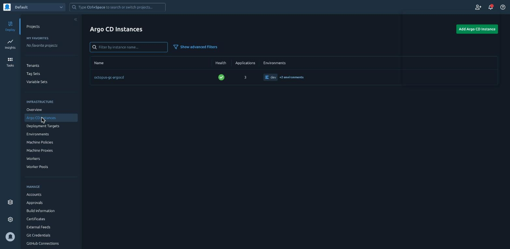
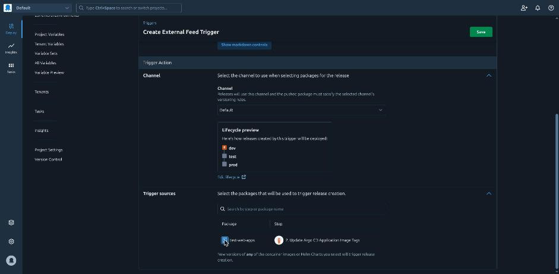

# Promote releases with Octopus and ArgoCD

This ties Octopus Deploy, ArgoCD and Nexus together. A new image version lands in Nexus; Octopus
creates a release and deploys it to `dev`; deploying means Octopus commits the new image tag into
the folder `envs/dev` of a Git repository; ArgoCD on the Supervisor sees the commit and rolls it
out to the namespace `test-web-apps-dev` of a VKS cluster. You then promote the same release to
`test` and, after an approval, to `prod`, and roll `prod` back to the previous release when you need
to. Octopus never reaches the VKS cluster: it only writes to Git and reads ArgoCD's status through
its Argo CD gateway, a small program that runs in Octopus's cluster.

The app is a page that says which version it runs. [GLOSSARY.md](GLOSSARY.md) explains the words
this guide uses (release, lifecycle, feed, gateway, sync). The Octopus Argo CD integration is a preview
feature of Octopus Server 2026.3 ([Argo CD in Octopus](https://octopus.com/docs/argo-cd)).

## Prerequisites

Do these first:

- [NEXUS.md](NEXUS.md) steps 1 to 10: Nexus with the Docker repository `apps`, its push and pull users,
  and `nexus-ca.pem`; your machine trusts Nexus's CA;
- [OCTOPUS.md](OCTOPUS.md) steps 1 to 11: Octopus Server 2026.3 with the environments `dev`, `test`
  and `prod`, the lifecycle `dev-test-prod`, the Docker feed `nexus`, and `octopus-ca.pem`;
- [GITEA.md](GITEA.md) steps 1 to 7, step 8's 1. (the repository `hello` public) and [Over HTTPS, for
  pushes and tokens](GITEA.md#over-https-for-pushes-and-tokens), with `gitea-ca.pem`;
- [ARGOCD.md](ARGOCD.md) steps 1 to 4 and 7: an ArgoCD instance and the VKS cluster for the app
  added to it;
- [NEXUS.md step 11](NEXUS.md#11-let-vks-clusters-pull-from-nexus) for the app's cluster: its nodes
  trust Nexus's CA, and [Check that a cluster can pull](NEXUS.md#check-that-a-cluster-can-pull) made
  the pull Secret `nexus-pull` in its namespace `default`.

The blocks name three VKS clusters: Octopus's (`my-octopus-cluster`), Gitea's (`my-gitea-cluster`)
and the app's (`my-app-cluster`, the one added to ArgoCD). They may be the same cluster; set each
block's `VKS_CLUSTER` to the one it names.

You need [kubectl](KUBECTL.md), [Helm](HELM.md), [the VCF CLI](VCF.md), [jq, curl, openssl and git, and
podman or docker](PREREQS.md); the **Namespaces Edit** role on ArgoCD's vSphere Namespace; Octopus's
`admin` (or a user who may manage Argo CD instances, Git credentials and projects); and Gitea's
administrator.

**The VKS clusters to make.** This guide adds little to the clusters of the guides above. In
Octopus's cluster, the Argo CD gateway asks for nothing and used 1 to 9m CPU and 17 to 19 MiB
(measured on VKS 3.8). The app's cluster runs one small web server per environment (0.05 CPU and 32
MiB reserved each): one `best-effort-medium` worker with room for that is enough; the app may share
the cluster of [ARGOCD.md](ARGOCD.md).

The connections this guide needs, for a firewall (all TCP, besides DNS; for a registry, also
[its other hosts](PREREQS.md#registry-hosts-for-a-firewall)):

| from | to | port | for |
|---|---|---|---|
| your machine (laptop or jump box) | the Supervisor's address | 443 | kubectl (steps 1, 5, 6, 7 and 13) |
| your machine (laptop or jump box) | the VKS clusters' API addresses (in their kubeconfigs) | 6443 | kubectl and Helm (steps 3, 4, 5, 7 and 13) |
| your machine (laptop or jump box) | `octopus-grpc`'s address (OCTOPUS.md step 4) | 8443 | reading the certificate of Octopus's gRPC port (step 7) |
| your machine (laptop or jump box) | the app's load-balancer addresses | 80 | step 5's check of the three pages |
| your machine (laptop or jump box) | Nexus's address | 443 | pushing images (steps 2 and 9) |
| your machine (laptop or jump box) | `registry-1.docker.io` | 443 | the gateway's Helm chart (step 7) |
| your machine and your browser | Octopus's web address, ArgoCD's address, Gitea's HTTPS address | 443 | the web pages and REST APIs |
| the nodes of Octopus's cluster | `docker.io` | 443 | the gateway's image (step 7) |
| the gateway (Octopus's cluster) | Octopus's web and gRPC Services, in the cluster | 443 and 8443 | registering, then the link to Octopus |
| the gateway (Octopus's cluster) | ArgoCD's address | 443 | reading and syncing the Applications |
| Octopus Server | Gitea's HTTPS address | 443 | committing the new image tags |
| Octopus Server | Nexus's address | 443 | listing image versions |
| ArgoCD (the Supervisor) | Gitea's HTTPS address | 443 | reading the `deploy` repository |
| ArgoCD (the Supervisor) | the app cluster's API address | 6443 | deploying the app |
| the app cluster's nodes | Nexus's address | 443 | pulling the app's image |

## 1. Check what is in place

Run this first, to see that the guides this one builds on are done before you change anything. It
only reads: it asks Octopus for its version, Nexus and Gitea whether they answer over HTTPS with the
CAs you saved, and the Supervisor for ArgoCD's instance and the app cluster's ArgoCD destination. You
get one line per part. Set `OCTOPUS_ADDRESS`, `NEXUS_REGISTRY` and `GITEA_ADDRESS` to their addresses,
`ARGOCD_NAMESPACE` to ArgoCD's vSphere Namespace, and `VSPHERE_NAMESPACE` and `VKS_CLUSTER` to the app's
cluster.

<details>
<summary><b>Linux, macOS, WSL (bash or zsh)</b></summary>

```sh
OCTOPUS_ADDRESS="192.168.10.70"
NEXUS_REGISTRY="192.168.10.50"
GITEA_ADDRESS="192.168.10.60"
ARGOCD_NAMESPACE="my-namespace"
VSPHERE_NAMESPACE="my-namespace"
VKS_CLUSTER="my-app-cluster"
SUPERVISOR_CONTEXT="supervisor"
SUPERVISOR_KUBECONFIG="$HOME/.kube/${SUPERVISOR_CONTEXT}.kubeconfig"

c() { curl -sS --connect-timeout 20 --max-time 30 "$@"; }
echo "Octopus: $(c --cacert "$HOME/octopus-ca.pem" "https://$OCTOPUS_ADDRESS/api" | sed -n 's/.*"Version": *"\([^"]*\)".*/\1/p')"
echo "Nexus: $(c --cacert "$HOME/nexus-ca.pem" -o /dev/null -w '%{http_code}' "https://$NEXUS_REGISTRY/service/rest/v1/status")"
echo "Gitea: $(c --cacert "$HOME/gitea-ca.pem" -o /dev/null -w '%{http_code}' "https://$GITEA_ADDRESS/api/v1/version")"
kubectl --kubeconfig "$SUPERVISOR_KUBECONFIG" -n "$ARGOCD_NAMESPACE" get argocd argocd-1 -o jsonpath='ArgoCD: {.status.phase} https://{.status.externalIP}{"\n"}'
kubectl --kubeconfig "$SUPERVISOR_KUBECONFIG" -n "$ARGOCD_NAMESPACE" get managedentities.argocd-service.vsphere.vmware.com "vks-${VSPHERE_NAMESPACE}-${VKS_CLUSTER}" -o jsonpath='ArgoCD destination: {.status.phase}{"\n"}'
```

</details>

<details>
<summary><b>Windows (PowerShell)</b></summary>

```powershell
$OCTOPUS_ADDRESS = "192.168.10.70"
$NEXUS_REGISTRY = "192.168.10.50"
$GITEA_ADDRESS = "192.168.10.60"
$ARGOCD_NAMESPACE = "my-namespace"
$VSPHERE_NAMESPACE = "my-namespace"
$VKS_CLUSTER = "my-app-cluster"
$SUPERVISOR_CONTEXT = "supervisor"
$SUPERVISOR_KUBECONFIG = "$HOME\.kube\${SUPERVISOR_CONTEXT}.kubeconfig"

function c($CA, $ADDR, $NAME, $URLPATH) {
  $RV = @(); if ($ADDR -match '^[0-9]+\.[0-9]+\.[0-9]+\.[0-9]+$') { $RV = '--resolve', "${NAME}:443:$ADDR"; $ADDR = $NAME }
  curl.exe -sS --connect-timeout 20 --max-time 30 --ssl-no-revoke --cacert $CA @RV -D - --suppress-connect-headers "https://$ADDR$URLPATH" | Out-String
}
function hc($T) { if ($T -match '(?s).*HTTP/\S+ (\d{3})') { $Matches[1] } else { '000' } }
$O = c "$HOME\octopus-ca.pem" $OCTOPUS_ADDRESS 'octopus-web.octopus.svc' '/api'
$V = if ($O -match '"Version": *"([^"]*)"') { $Matches[1] } else { '' }
"Octopus: $V"
"Nexus: $(hc (c "$HOME\nexus-ca.pem" $NEXUS_REGISTRY 'nexus.nexus.svc' '/service/rest/v1/status'))"
"Gitea: $(hc (c "$HOME\gitea-ca.pem" $GITEA_ADDRESS 'gitea-https.gitea.svc' '/api/v1/version'))"
kubectl --kubeconfig $SUPERVISOR_KUBECONFIG -n $ARGOCD_NAMESPACE get argocd argocd-1 -o 'jsonpath=ArgoCD: {.status.phase} https://{.status.externalIP}{''\n''}'
kubectl --kubeconfig $SUPERVISOR_KUBECONFIG -n $ARGOCD_NAMESPACE get managedentities.argocd-service.vsphere.vmware.com "vks-${VSPHERE_NAMESPACE}-${VKS_CLUSTER}" -o 'jsonpath=ArgoCD destination: {.status.phase}{''\n''}'
```

</details>

**Expect:** `Octopus: 2026.3.…`, `Nexus: 200`, `Gitea: 200`, `ArgoCD: Ready https://<address>` and
`ArgoCD destination: Ready`.

**If not:**
- `Octopus:` with nothing after it, or `Nexus:`/`Gitea:` with `000`: this machine cannot reach the
  address, or the CA file is missing (`curl` prints why above the line); do that guide first.
- `managedentities… not found`: do [ARGOCD.md step 7](ARGOCD.md#7-add-the-vks-cluster-to-argocd) for
  the app's cluster.
- `Octopus:` older than `2026.3`: the steps in this guide need Octopus 2026.3 or newer.


## 2. Push the first version to Nexus

Run this to give Octopus a first version to release; later, in step 9, you run it again with
`VERSION="1.0.1"` and `VERSION="1.0.2"`. It builds the app's image on your machine (an nginx page that shows its version),
names it `<NEXUS_REGISTRY>/<NEXUS_REPO>/test-web-apps:<VERSION>`, logs in to Nexus as the push user,
pushes it and logs out. You get version `1.0.0` of `test-web-apps` in Nexus; Octopus reads its
versions from there. A version cannot be pushed twice. Your machine must trust Nexus's CA
([NEXUS.md step 10](NEXUS.md#10-trust-nexus-and-push-an-image)).

The block logs in as the push user, so type that user's password
([NEXUS.md step 9](NEXUS.md#9-create-the-docker-repository-a-push-user-and-a-pull-user)) first, in
the same terminal:

**Linux, macOS, WSL (bash or zsh):**

```sh
printf 'Push user password: '; IFS= read -rs NEXUS_PUSH_PASSWORD; echo
```

**Windows (PowerShell):**

```powershell
$NEXUS_PUSH_PASSWORD = Read-Host 'Push user password' -AsSecureString
```

Then run this. Set `CONTAINER_ENGINE` to `podman` or `docker`, `NEXUS_REGISTRY`, `NEXUS_REPO` and
`NEXUS_PUSH_USER` as in NEXUS.md.

<details>
<summary><b>Linux, macOS, WSL (bash or zsh)</b></summary>

```sh
CONTAINER_ENGINE="podman"
NEXUS_REGISTRY="192.168.10.50"
NEXUS_REPO="apps"
NEXUS_PUSH_USER="apps-push"
VERSION="1.0.0"

IMG="${NEXUS_REGISTRY}/${NEXUS_REPO}/test-web-apps:${VERSION}"
D="$(mktemp -d)"
cat > "$D/Dockerfile" <<'EOF'
FROM docker.io/nginxinc/nginx-unprivileged:1.30.6-alpine@sha256:f5116ed4606f3eb015dd4a8e28cb9b351476dc0ad4bc6e9f93b19cec130cdf03
COPY index.html /usr/share/nginx/html/index.html
EXPOSE 8080
EOF
printf '<!doctype html>\n<html lang="en"><head><meta charset="utf-8"><title>test-web-apps</title></head>\n<body><h1>test-web-apps %s</h1></body></html>\n' "$VERSION" > "$D/index.html"
if [ -z "${NEXUS_PUSH_PASSWORD:-}" ]; then
  echo "STOPPED: type the push user's password first (the line above)"
elif "$CONTAINER_ENGINE" build --platform linux/amd64 -t "$IMG" "$D" \
     && printf '%s\n' "$NEXUS_PUSH_PASSWORD" | "$CONTAINER_ENGINE" login -u "$NEXUS_PUSH_USER" --password-stdin "$NEXUS_REGISTRY"; then
  "$CONTAINER_ENGINE" push "$IMG" && echo "pushed: $IMG"
  "$CONTAINER_ENGINE" logout "$NEXUS_REGISTRY"
fi
unset NEXUS_PUSH_PASSWORD; rm -rf "$D"
```

</details>

<details>
<summary><b>Windows (PowerShell)</b></summary>

```powershell
$CONTAINER_ENGINE = "podman"
$NEXUS_REGISTRY = "192.168.10.50"
$NEXUS_REPO = "apps"
$NEXUS_PUSH_USER = "apps-push"
$VERSION = "1.0.0"

$IMG = "$NEXUS_REGISTRY/$NEXUS_REPO/test-web-apps:$VERSION"
$D = Join-Path ([IO.Path]::GetTempPath()) ([IO.Path]::GetRandomFileName())
New-Item -ItemType Directory $D | Out-Null
[IO.File]::WriteAllText("$D\Dockerfile", "FROM docker.io/nginxinc/nginx-unprivileged:1.30.6-alpine@sha256:f5116ed4606f3eb015dd4a8e28cb9b351476dc0ad4bc6e9f93b19cec130cdf03`nCOPY index.html /usr/share/nginx/html/index.html`nEXPOSE 8080`n")
[IO.File]::WriteAllText("$D\index.html", "<!doctype html>`n<html lang=`"en`"><head><meta charset=`"utf-8`"><title>test-web-apps</title></head>`n<body><h1>test-web-apps $VERSION</h1></body></html>`n")
$global:LASTEXITCODE = $null
if (-not $NEXUS_PUSH_PASSWORD -or $NEXUS_PUSH_PASSWORD.Length -eq 0) { "STOPPED: type the push user's password first (the line above)" } else {
  & $CONTAINER_ENGINE build --platform linux/amd64 -t $IMG $D
  if ($LASTEXITCODE -eq 0) { [Net.NetworkCredential]::new('', $NEXUS_PUSH_PASSWORD).Password | & $CONTAINER_ENGINE login -u $NEXUS_PUSH_USER --password-stdin $NEXUS_REGISTRY }
  if ($LASTEXITCODE -eq 0) {
    & $CONTAINER_ENGINE push $IMG
    if ($LASTEXITCODE -eq 0) { "pushed: $IMG" }
    & $CONTAINER_ENGINE logout $NEXUS_REGISTRY
  }
}
Remove-Variable -ErrorAction SilentlyContinue NEXUS_PUSH_PASSWORD
Remove-Item -Recurse -Force $D
```

</details>

**Expect:** the build, `Login Succeeded`, the push, `pushed: <NEXUS_REGISTRY>/apps/test-web-apps:1.0.0`,
then `Removed login credentials for …` (docker: `Removing login credentials for …`).

**If not:** as in [NEXUS.md step 10](NEXUS.md#10-trust-nexus-and-push-an-image); `redeploy is not
allowed` means this version was pushed before: push with a new `VERSION`.

## 3. Create the deploy repository and Gitea's users

Run this once, after step 2: ArgoCD deploys what this repository says, and Octopus changes it. Type
`gitea-admin`'s password first, in the terminal where you run this guide's blocks; it stays in this
terminal only:

**Linux, macOS, WSL (bash or zsh):**

```sh
printf 'gitea-admin password: '; IFS= read -rs GITEA_PASSWORD; echo
```

**Windows (PowerShell):**

```powershell
$GITEA_PASSWORD = Read-Host 'gitea-admin password' -AsSecureString
```

Then run this, in the same terminal. Through Gitea's HTTPS address it creates the private repository
`deploy`, with the folders `envs/dev`, `envs/test` and `envs/prod`; each holds the app's Deployment
(the image `<NEXUS_REGISTRY>/<NEXUS_REPO>/test-web-apps:1.0.0`, pulled with the Secret `nexus-pull`)
and a Service with a load-balancer address. It then creates two Gitea users whose passwords no one
knows and who may create no repositories: `octopus`, who may write to `deploy`, and `argocd`, who may
only read it, and saves a token for each, readable only by you, in `~/.config/vks-guides/cd-octopus`
(`gitea-octopus.token` for step 8, `gitea-argocd.token` for step 5). A second run keeps the
repository, the users and the tokens. Set `VKS_CLUSTER` to Gitea's cluster, `GITEA_ADDRESS` to its
HTTPS address, and `NEXUS_REGISTRY` and `NEXUS_REPO` as in NEXUS.md.

<details>
<summary><b>Linux, macOS, WSL (bash or zsh)</b></summary>

```sh
VKS_CLUSTER="my-gitea-cluster"
GITEA_ADDRESS="192.168.10.60"
NEXUS_REGISTRY="192.168.10.50"
NEXUS_REPO="apps"
VKS_KUBECONFIG="$HOME/.kube/${VKS_CLUSTER}.kubeconfig"
CD_DIR="$HOME/.config/vks-guides/cd-octopus"

gx() { kubectl --kubeconfig "$VKS_KUBECONFIG" -n gitea exec deployment/gitea -- gitea admin user "$@"; }
mkdir -p "$CD_DIR" && chmod 700 "$CD_DIR"
if ! command -v jq >/dev/null 2>&1; then
  echo "MISSING: jq (PREREQS.md)"
elif [ -z "${GITEA_PASSWORD:-}" ]; then
  echo "STOPPED: type gitea-admin's password first (the line above)"
elif [ ! -s "$HOME/gitea-ca.pem" ]; then
  echo "MISSING: $HOME/gitea-ca.pem (GITEA.md, Over HTTPS, 4.)"
else
  ( umask 077; printf 'user = "gitea-admin:%s"\n' "$(printf '%s' "$GITEA_PASSWORD" | sed 's/\\/\\\\/g; s/"/\\"/g')" > "$CD_DIR/gitea-admin.cfg" )
  api() { curl -sS --connect-timeout 20 --max-time 30 --cacert "$HOME/gitea-ca.pem" -K "$CD_DIR/gitea-admin.cfg" -H 'Content-Type: application/json' "$@"; }
  if [ "$(api -o /dev/null -w '%{http_code}' "https://$GITEA_ADDRESS/api/v1/user")" != 200 ]; then
    echo "FAILED: Gitea did not accept gitea-admin and this password at https://$GITEA_ADDRESS"
  else
    echo "repository deploy: $(api -o /dev/null -w '%{http_code}' -d '{"name":"deploy","private":true,"default_branch":"main"}' "https://$GITEA_ADDRESS/api/v1/user/repos")"
    for E in dev test prod; do
      for F in deployment service; do
        if [ "$F" = deployment ]; then
          Y="$(printf 'apiVersion: apps/v1\nkind: Deployment\nmetadata:\n  name: test-web-apps\nspec:\n  replicas: 1\n  strategy:\n    rollingUpdate:\n      maxUnavailable: 0\n      maxSurge: 1\n  selector:\n    matchLabels:\n      app.kubernetes.io/name: test-web-apps\n  template:\n    metadata:\n      labels:\n        app.kubernetes.io/name: test-web-apps\n    spec:\n      automountServiceAccountToken: false\n      imagePullSecrets:\n        - name: nexus-pull\n      securityContext:\n        runAsNonRoot: true\n        runAsUser: 101\n        runAsGroup: 101\n        seccompProfile:\n          type: RuntimeDefault\n      containers:\n        - name: web\n          image: %s/%s/test-web-apps:1.0.0\n          ports:\n            - name: http\n              containerPort: 8080\n          readinessProbe:\n            httpGet:\n              path: /\n              port: http\n            periodSeconds: 5\n          securityContext:\n            allowPrivilegeEscalation: false\n            readOnlyRootFilesystem: true\n            capabilities:\n              drop: ["ALL"]\n          resources:\n            requests:\n              cpu: 50m\n              memory: 32Mi\n            limits:\n              memory: 128Mi\n          volumeMounts:\n            - name: tmp\n              mountPath: /tmp\n      volumes:\n        - name: tmp\n          emptyDir: {}\n' "$NEXUS_REGISTRY" "$NEXUS_REPO")"
        else
          Y="$(printf 'apiVersion: v1\nkind: Service\nmetadata:\n  name: test-web-apps\nspec:\n  type: LoadBalancer\n  selector:\n    app.kubernetes.io/name: test-web-apps\n  ports:\n    - name: http\n      port: 80\n      targetPort: http\n')"
        fi
        jq -n --arg c "$(printf '%s\n' "$Y" | base64 | tr -d '\n')" --arg f "envs/$E/$F.yaml" '{content: $c, message: "add \($f)", branch: "main"}' \
          | api -o /dev/null -w "  envs/$E/$F.yaml: %{http_code}\n" --data-binary @- "https://$GITEA_ADDRESS/api/v1/repos/gitea-admin/deploy/contents/envs/$E/$F.yaml"
      done
    done
    for U in octopus argocd; do
      if gx list | awk -v u="$U" '$2 == u { f = 1 } END { exit !f }'; then
        echo "user $U: exists, kept"
      else
        gx create --username "$U" --email "$U@localhost" --random-password --must-change-password=false >/dev/null && echo "user $U: created"
        jq -n --arg u "$U" '{source_id: 0, login_name: $u, max_repo_creation: 0}' \
          | api -o /dev/null -w "user $U may create no repositories: %{http_code}\n" -X PATCH --data-binary @- "https://$GITEA_ADDRESS/api/v1/admin/users/$U"
      fi
    done
    echo "octopus writes deploy: $(api -o /dev/null -w '%{http_code}' -X PUT -d '{"permission":"write"}' "https://$GITEA_ADDRESS/api/v1/repos/gitea-admin/deploy/collaborators/octopus")"
    echo "argocd reads deploy: $(api -o /dev/null -w '%{http_code}' -X PUT -d '{"permission":"read"}' "https://$GITEA_ADDRESS/api/v1/repos/gitea-admin/deploy/collaborators/argocd")"
    for U in octopus argocd; do
      if [ -s "$CD_DIR/gitea-$U.token" ]; then
        echo "token for $U: kept"
      else
        [ "$U" = octopus ] && S=write:repository || S=read:repository
        ( umask 077; gx generate-access-token --username "$U" --token-name "cd-octopus-$(date +%Y%m%d%H%M%S)" --scopes "$S" --raw \
            | tr -d '\r\n' > "$CD_DIR/gitea-$U.token.new" )
        if grep -Eq '^[0-9a-f]{40}$' "$CD_DIR/gitea-$U.token.new"; then
          mv "$CD_DIR/gitea-$U.token.new" "$CD_DIR/gitea-$U.token" && echo "token for $U: saved"
        else
          rm -f "$CD_DIR/gitea-$U.token.new"; echo "FAILED: Gitea made no token for $U"
        fi
      fi
    done
  fi
  rm -f "$CD_DIR/gitea-admin.cfg"
fi
```

</details>

<details>
<summary><b>Windows (PowerShell)</b></summary>

```powershell
$VKS_CLUSTER = "my-gitea-cluster"
$GITEA_ADDRESS = "192.168.10.60"
$NEXUS_REGISTRY = "192.168.10.50"
$NEXUS_REPO = "apps"
$VKS_KUBECONFIG = "$HOME\.kube\${VKS_CLUSTER}.kubeconfig"
$CD_DIR = "$HOME\.config\vks-guides\cd-octopus"

$DEP = @'
apiVersion: apps/v1
kind: Deployment
metadata:
  name: test-web-apps
spec:
  replicas: 1
  selector:
    matchLabels:
      app.kubernetes.io/name: test-web-apps
  template:
    metadata:
      labels:
        app.kubernetes.io/name: test-web-apps
    spec:
      automountServiceAccountToken: false
      imagePullSecrets:
        - name: nexus-pull
      securityContext:
        runAsNonRoot: true
        runAsUser: 101
        runAsGroup: 101
        seccompProfile:
          type: RuntimeDefault
      containers:
        - name: web
          image: @IMAGE@
          ports:
            - name: http
              containerPort: 8080
          securityContext:
            allowPrivilegeEscalation: false
            readOnlyRootFilesystem: true
            capabilities:
              drop: ["ALL"]
          resources:
            requests:
              cpu: 50m
              memory: 32Mi
            limits:
              memory: 128Mi
          volumeMounts:
            - name: tmp
              mountPath: /tmp
      volumes:
        - name: tmp
          emptyDir: {}
'@
$SVC = @'
apiVersion: v1
kind: Service
metadata:
  name: test-web-apps
spec:
  type: LoadBalancer
  selector:
    app.kubernetes.io/name: test-web-apps
  ports:
    - name: http
      port: 80
      targetPort: http
'@
$YAML = @{
  deployment = ($DEP -replace "`r`n", "`n").Replace('@IMAGE@', "$NEXUS_REGISTRY/$NEXUS_REPO/test-web-apps:1.0.0") + "`n"
  service = ($SVC -replace "`r`n", "`n") + "`n"
}
$GH = $GITEA_ADDRESS; $RV = @()
if ($GITEA_ADDRESS -match '^[0-9]+\.[0-9]+\.[0-9]+\.[0-9]+$') { $GH = 'gitea-https.gitea.svc'; $RV = '--resolve', "${GH}:443:$GITEA_ADDRESS" }
function api { curl.exe -sS --connect-timeout 20 --max-time 30 --ssl-no-revoke --cacert "$HOME\gitea-ca.pem" -K "$CD_DIR\gitea-admin.cfg" @RV -H 'Content-Type: application/json' -o NUL -D - --suppress-connect-headers @args | Out-String }
function hc($T) { if ($T -match '(?s).*HTTP/\S+ (\d{3})') { $Matches[1] } else { '000' } }
function body($O) { [IO.File]::WriteAllText("$CD_DIR\body.json", ($O | ConvertTo-Json -Compress)) }
New-Item -ItemType Directory -Force -Path $CD_DIR | Out-Null
icacls $CD_DIR /inheritance:r /grant:r "${env:USERNAME}:(OI)(CI)F" | Out-Null
if (-not $GITEA_PASSWORD -or $GITEA_PASSWORD.Length -eq 0) {
  "STOPPED: type gitea-admin's password first (the line above)"
} elseif (-not (Test-Path "$HOME\gitea-ca.pem") -or (Get-Item "$HOME\gitea-ca.pem").Length -eq 0) {
  "MISSING: $HOME\gitea-ca.pem (GITEA.md, Over HTTPS, 4.)"
} else {
  try {
    $P = [Net.NetworkCredential]::new('', $GITEA_PASSWORD).Password.Replace('\', '\\').Replace('"', '\"')
    [IO.File]::WriteAllText("$CD_DIR\gitea-admin.cfg", "user = `"gitea-admin:$P`"`n")
    Remove-Variable P
    if ((hc (api "https://$GH/api/v1/user")) -ne '200') {
      "FAILED: Gitea did not accept gitea-admin and this password at https://$GITEA_ADDRESS"
    } else {
      body @{ name = 'deploy'; private = $true; default_branch = 'main' }
      "repository deploy: $(hc (api -d "@$CD_DIR\body.json" "https://$GH/api/v1/user/repos"))"
      foreach ($E in 'dev', 'test', 'prod') {
        foreach ($F in 'deployment', 'service') {
          body @{ content = [Convert]::ToBase64String([Text.Encoding]::UTF8.GetBytes($YAML[$F])); message = "add envs/$E/$F.yaml"; branch = 'main' }
          "  envs/$E/${F}.yaml: $(hc (api -d "@$CD_DIR\body.json" "https://$GH/api/v1/repos/gitea-admin/deploy/contents/envs/$E/$F.yaml"))"
        }
      }
      foreach ($U in 'octopus', 'argocd') {
        if (@(kubectl --kubeconfig $VKS_KUBECONFIG -n gitea exec deployment/gitea -- gitea admin user list | Where-Object { (-split $_)[1] -ceq $U }).Count) {
          "user ${U}: exists, kept"
        } else {
          $global:LASTEXITCODE = $null
          kubectl --kubeconfig $VKS_KUBECONFIG -n gitea exec deployment/gitea -- gitea admin user create `
            --username $U --email "$U@localhost" --random-password --must-change-password=false | Out-Null
          if ($LASTEXITCODE -eq 0) { "user ${U}: created" }
          body @{ source_id = 0; login_name = $U; max_repo_creation = 0 }
          "user $U may create no repositories: $(hc (api -X PATCH -d "@$CD_DIR\body.json" "https://$GH/api/v1/admin/users/$U"))"
        }
      }
      body @{ permission = 'write' }
      "octopus writes deploy: $(hc (api -X PUT -d "@$CD_DIR\body.json" "https://$GH/api/v1/repos/gitea-admin/deploy/collaborators/octopus"))"
      body @{ permission = 'read' }
      "argocd reads deploy: $(hc (api -X PUT -d "@$CD_DIR\body.json" "https://$GH/api/v1/repos/gitea-admin/deploy/collaborators/argocd"))"
      foreach ($U in 'octopus', 'argocd') {
        $TF = "$CD_DIR\gitea-$U.token"
        if ((Test-Path $TF) -and (Get-Item $TF).Length -gt 0) {
          "token for ${U}: kept"
        } else {
          $S = if ($U -eq 'octopus') { 'write:repository' } else { 'read:repository' }
          $T = (kubectl --kubeconfig $VKS_KUBECONFIG -n gitea exec deployment/gitea -- gitea admin user generate-access-token `
            --username $U --token-name "cd-octopus-$(Get-Date -Format yyyyMMddHHmmss)" --scopes $S --raw | Out-String).Trim()
          if ($T -cmatch '^[0-9a-f]{40}$') {
            [IO.File]::WriteAllText($TF, $T)
            "token for ${U}: saved"
          } else {
            "FAILED: Gitea made no token for $U"
          }
          Remove-Variable T
        }
      }
    }
  } finally {
    Remove-Item -Force -ErrorAction SilentlyContinue "$CD_DIR\gitea-admin.cfg", "$CD_DIR\body.json"
  }
}
```

</details>

**Expect:** `repository deploy: 201`, six `envs/…: 201` lines, `user octopus: created`, `user argocd:
created`, two `… may create no repositories: 200`, `octopus writes deploy: 204`, `argocd reads deploy:
204`, `token for octopus: saved` and `token for argocd: saved`. Run again: `repository deploy: 409`,
six `422` lines (the files are kept as they are), `exists, kept`, the two `204` lines and `token …:
kept`.

**If not:**
- `FAILED: Gitea did not accept …`: the password or `GITEA_ADDRESS` is wrong, or this machine does not
  trust Gitea's CA (`curl --cacert ~/gitea-ca.pem https://<GITEA_ADDRESS>` says why).
- `deployments.apps "gitea" not found`: `VKS_CLUSTER` is not Gitea's cluster (both ways of GITEA.md
  step 4 run Gitea as the deployment `gitea` in the namespace `gitea`).
- `FAILED: Gitea made no token for …`: the line above it says why; run the block again.


## 4. Prepare the app cluster

Run this once, before step 5: ArgoCD deploys into namespaces that exist, and the app's pods pull from
Nexus with a login. It creates the namespaces `test-web-apps-dev`, `test-web-apps-test` and
`test-web-apps-prod` (inside the VKS cluster, not vSphere Namespaces), which allow only pods that follow
the `restricted` Pod Security Standard, and copies into each the pull Secret `nexus-pull` that
[NEXUS.md step 11](NEXUS.md#check-that-a-cluster-can-pull) made in the namespace `default`. Run again,
it updates the copies. Set `VKS_CLUSTER` to the app's cluster.

**Linux, macOS, WSL (bash or zsh):**

```sh
VKS_CLUSTER="my-app-cluster"
VKS_KUBECONFIG="$HOME/.kube/${VKS_CLUSTER}.kubeconfig"

kc() { kubectl --kubeconfig "$VKS_KUBECONFIG" "$@"; }
if ! command -v jq >/dev/null 2>&1; then echo "MISSING: jq (PREREQS.md)"
elif ! S="$(kc -n default get secret nexus-pull -o json)"; then echo "FAILED: no Secret nexus-pull in default (NEXUS.md step 11)"
else
  for E in dev test prod; do
    kc create namespace "test-web-apps-$E" --dry-run=client -o yaml | kc apply -f - >/dev/null \
      && kc label namespace "test-web-apps-$E" --overwrite pod-security.kubernetes.io/enforce=restricted pod-security.kubernetes.io/warn=restricted \
      && printf '%s' "$S" | jq --arg n "test-web-apps-$E" '{apiVersion, kind, type, data, metadata: {name: .metadata.name, namespace: $n}}' | kc apply -f -
  done
fi
```

**Windows (PowerShell):**

```powershell
$VKS_CLUSTER = "my-app-cluster"
$VKS_KUBECONFIG = "$HOME\.kube\${VKS_CLUSTER}.kubeconfig"

$global:LASTEXITCODE = $null
$S = kubectl --kubeconfig $VKS_KUBECONFIG -n default get secret nexus-pull -o json | Out-String
if ($LASTEXITCODE -ne 0) { "FAILED: no Secret nexus-pull in default (NEXUS.md step 11)" } else {
  $J = $S | ConvertFrom-Json
  foreach ($E in 'dev', 'test', 'prod') {
    kubectl --kubeconfig $VKS_KUBECONFIG create namespace "test-web-apps-$E" --dry-run=client -o yaml | kubectl --kubeconfig $VKS_KUBECONFIG apply -f - | Out-Null
    kubectl --kubeconfig $VKS_KUBECONFIG label namespace "test-web-apps-$E" --overwrite pod-security.kubernetes.io/enforce=restricted pod-security.kubernetes.io/warn=restricted
    @{ apiVersion = 'v1'; kind = 'Secret'; type = $J.type; data = $J.data; metadata = @{ name = 'nexus-pull'; namespace = "test-web-apps-$E" } } |
      ConvertTo-Json -Depth 5 | kubectl --kubeconfig $VKS_KUBECONFIG apply -f -
  }
}
```

**Expect:** for each environment `namespace/test-web-apps-<env> labeled` (`not labeled` when run again)
and `secret/nexus-pull created` (`configured` or `unchanged` when run again).

**If not:** `FAILED: no Secret nexus-pull in default`: run [NEXUS.md step
11](NEXUS.md#check-that-a-cluster-can-pull) for this cluster first.

<!-- DRAFT: second-run arm PASS on the lab 2026-11-14 (sh 14:3x, PowerShell 15:05 on Windows: not labeled / unchanged x3); first-run arm by an equivalent script 2026-11-13. -->

## 5. Create the ArgoCD project and the three Applications

Run this once, after steps 3 and 4, on the Supervisor: ArgoCD then deploys each environment's folder
of `deploy` to its namespace, and Octopus finds the Applications by their annotations. It:

- adds Gitea's CA to ArgoCD's list of trusted Git servers (the ConfigMap `argocd-tls-certs-cm`, under
  Gitea's address), so ArgoCD checks Gitea's certificate;
- stores the Gitea user `argocd` and its token (step 3) as ArgoCD's login for `deploy`;
- creates the project `test-web-apps`, which may take only `deploy` and deploy only a Deployment and a
  Service into the three namespaces, with the role `octopus` that may only read and sync its apps and
  read their logs (step 6 makes its token);
- creates the Applications `test-web-apps-dev`, `-test` and `-prod`, each with the annotations
  `argo.octopus.com/project: test-web-apps` and `argo.octopus.com/environment: <env>`, synced
  automatically.

You get the three environments running version 1.0.0. Run again, it changes nothing. Set
`ARGOCD_NAMESPACE` to ArgoCD's vSphere Namespace, `VSPHERE_NAMESPACE` and `VKS_CLUSTER` to the app's
cluster (as in [ARGOCD.md step 7](ARGOCD.md#7-add-the-vks-cluster-to-argocd)), and `GITEA_ADDRESS` as
in step 3.

<details>
<summary><b>Linux, macOS, WSL (bash or zsh)</b></summary>

```sh
SUPERVISOR_CONTEXT="supervisor"
SUPERVISOR_KUBECONFIG="$HOME/.kube/${SUPERVISOR_CONTEXT}.kubeconfig"
ARGOCD_NAMESPACE="my-namespace"
VSPHERE_NAMESPACE="my-namespace"
VKS_CLUSTER="my-app-cluster"
GITEA_ADDRESS="192.168.10.60"
CD_DIR="$HOME/.config/vks-guides/cd-octopus"

K() { kubectl --kubeconfig "$SUPERVISOR_KUBECONFIG" -n "$ARGOCD_NAMESPACE" "$@"; }
REPO="https://$GITEA_ADDRESS/gitea-admin/deploy.git"
DEST="${VKS_CLUSTER}-${VSPHERE_NAMESPACE}"
if ! command -v jq >/dev/null 2>&1; then echo "MISSING: jq (PREREQS.md)"
elif [ ! -s "$HOME/gitea-ca.pem" ] || [ ! -s "$CD_DIR/gitea-argocd.token" ]; then
  echo "MISSING: $HOME/gitea-ca.pem or $CD_DIR/gitea-argocd.token (GITEA.md Over HTTPS 4., step 3)"
else
  jq -n --arg k "$GITEA_ADDRESS" --rawfile c "$HOME/gitea-ca.pem" '{data: {($k): $c}}' \
    | K patch configmap argocd-tls-certs-cm --type merge --patch-file /dev/stdin
  jq -n --arg u "$REPO" --rawfile t "$CD_DIR/gitea-argocd.token" '{apiVersion: "v1", kind: "Secret",
      metadata: {name: "repo-gitea-deploy", labels: {"argocd.argoproj.io/secret-type": "repository"}},
      stringData: {type: "git", url: $u, username: "argocd", password: $t, project: "test-web-apps"}}' | K apply -f -
  K apply -f - <<EOF
apiVersion: argoproj.io/v1alpha1
kind: AppProject
metadata:
  name: test-web-apps
spec:
  description: test-web-apps, promoted by Octopus
  sourceRepos:
    - ${REPO}
  destinations:
    - name: ${DEST}
      namespace: test-web-apps-dev
    - name: ${DEST}
      namespace: test-web-apps-test
    - name: ${DEST}
      namespace: test-web-apps-prod
  clusterResourceWhitelist: []
  namespaceResourceWhitelist:
    - group: apps
      kind: Deployment
    - group: ""
      kind: Service
  roles:
    - name: octopus
      description: the Octopus Argo CD gateway
      policies:
        - p, proj:test-web-apps:octopus, applications, get, test-web-apps/*, allow
        - p, proj:test-web-apps:octopus, applications, sync, test-web-apps/*, allow
        - p, proj:test-web-apps:octopus, logs, get, test-web-apps/*, allow
EOF
  for E in dev test prod; do
    K apply -f - <<EOF
apiVersion: argoproj.io/v1alpha1
kind: Application
metadata:
  name: test-web-apps-${E}
  annotations:
    argo.octopus.com/project: test-web-apps
    argo.octopus.com/environment: ${E}
  finalizers:
    - resources-finalizer.argocd.argoproj.io
spec:
  project: test-web-apps
  source:
    repoURL: ${REPO}
    targetRevision: main
    path: envs/${E}
  destination:
    name: ${DEST}
    namespace: test-web-apps-${E}
  syncPolicy:
    automated:
      prune: true
      selfHeal: true
EOF
  done
fi
```

</details>

<details>
<summary><b>Windows (PowerShell)</b></summary>

```powershell
$SUPERVISOR_CONTEXT = "supervisor"
$SUPERVISOR_KUBECONFIG = "$HOME\.kube\${SUPERVISOR_CONTEXT}.kubeconfig"
$ARGOCD_NAMESPACE = "my-namespace"
$VSPHERE_NAMESPACE = "my-namespace"
$VKS_CLUSTER = "my-app-cluster"
$GITEA_ADDRESS = "192.168.10.60"
$CD_DIR = "$HOME\.config\vks-guides\cd-octopus"

$KS = '--kubeconfig', $SUPERVISOR_KUBECONFIG, '-n', $ARGOCD_NAMESPACE
$REPO = "https://$GITEA_ADDRESS/gitea-admin/deploy.git"
$DEST = "${VKS_CLUSTER}-${VSPHERE_NAMESPACE}"
$CA = "$HOME\gitea-ca.pem"; $TF = "$CD_DIR\gitea-argocd.token"
if (-not (Test-Path $CA) -or (Get-Item $CA).Length -eq 0 -or -not (Test-Path $TF) -or (Get-Item $TF).Length -eq 0) {
  "MISSING: $CA or $TF (GITEA.md Over HTTPS 4., step 3)"
} else {
  [IO.File]::WriteAllText("$CD_DIR\tls-patch.json", (@{ data = @{ $GITEA_ADDRESS = [IO.File]::ReadAllText($CA) } } | ConvertTo-Json -Compress))
  kubectl @KS patch configmap argocd-tls-certs-cm --type merge --patch-file "$CD_DIR\tls-patch.json"
  Remove-Item -Force "$CD_DIR\tls-patch.json"
  @{ apiVersion = 'v1'; kind = 'Secret'
     metadata = @{ name = 'repo-gitea-deploy'; labels = @{ 'argocd.argoproj.io/secret-type' = 'repository' } }
     stringData = @{ type = 'git'; url = $REPO; username = 'argocd'; password = [IO.File]::ReadAllText($TF); project = 'test-web-apps' } } |
    ConvertTo-Json -Depth 5 | kubectl @KS apply -f -
@"
apiVersion: argoproj.io/v1alpha1
kind: AppProject
metadata:
  name: test-web-apps
spec:
  description: test-web-apps, promoted by Octopus
  sourceRepos:
    - ${REPO}
  destinations:
    - name: ${DEST}
      namespace: test-web-apps-dev
    - name: ${DEST}
      namespace: test-web-apps-test
    - name: ${DEST}
      namespace: test-web-apps-prod
  clusterResourceWhitelist: []
  namespaceResourceWhitelist:
    - group: apps
      kind: Deployment
    - group: ""
      kind: Service
  roles:
    - name: octopus
      description: the Octopus Argo CD gateway
      policies:
        - p, proj:test-web-apps:octopus, applications, get, test-web-apps/*, allow
        - p, proj:test-web-apps:octopus, applications, sync, test-web-apps/*, allow
        - p, proj:test-web-apps:octopus, logs, get, test-web-apps/*, allow
"@ | kubectl @KS apply -f -
  foreach ($E in 'dev', 'test', 'prod') {
@"
apiVersion: argoproj.io/v1alpha1
kind: Application
metadata:
  name: test-web-apps-${E}
  annotations:
    argo.octopus.com/project: test-web-apps
    argo.octopus.com/environment: ${E}
  finalizers:
    - resources-finalizer.argocd.argoproj.io
spec:
  project: test-web-apps
  source:
    repoURL: ${REPO}
    targetRevision: main
    path: envs/${E}
  destination:
    name: ${DEST}
    namespace: test-web-apps-${E}
  syncPolicy:
    automated:
      prune: true
      selfHeal: true
"@ | kubectl @KS apply -f -
  }
}
```

</details>

**Expect:** `configmap/argocd-tls-certs-cm patched`, `secret/repo-gitea-deploy created`,
`appproject.argoproj.io/test-web-apps created` and three `application.argoproj.io/test-web-apps-<env>
created`, each Application after a `Warning:` about the finalizer name (as in ARGOCD.md step 8). Run
again: `patched (no change)`, `configured` for the Secret and the project (`unchanged` when nothing
changed), and `unchanged` for the Applications.

**If not:** `configmaps "argocd-tls-certs-cm" not found`: `ARGOCD_NAMESPACE` is not ArgoCD's vSphere
Namespace.


Run this after the block above, to see the three environments run. It only reads: it shows ArgoCD's
status for each Application, how many of its pods are ready with which image, and what the page at
its address says. Run it again until all three show `Synced  Healthy`, `1/1` and a page: ArgoCD may
need two minutes to trust Gitea's CA. Set the values as above.

**Linux, macOS, WSL (bash or zsh):**

```sh
SUPERVISOR_CONTEXT="supervisor"
SUPERVISOR_KUBECONFIG="$HOME/.kube/${SUPERVISOR_CONTEXT}.kubeconfig"
ARGOCD_NAMESPACE="my-namespace"
VKS_CLUSTER="my-app-cluster"
VKS_KUBECONFIG="$HOME/.kube/${VKS_CLUSTER}.kubeconfig"

for E in dev test prod; do
  A="$(kubectl --kubeconfig "$SUPERVISOR_KUBECONFIG" -n "$ARGOCD_NAMESPACE" get applications.argoproj.io "test-web-apps-$E" -o jsonpath='{.status.sync.status}  {.status.health.status}')"
  D="$(kubectl --kubeconfig "$VKS_KUBECONFIG" -n "test-web-apps-$E" get deployment test-web-apps -o jsonpath='{.status.readyReplicas}/{.spec.replicas} {.spec.template.spec.containers[0].image}' 2>/dev/null)"
  IP="$(kubectl --kubeconfig "$VKS_KUBECONFIG" -n "test-web-apps-$E" get service test-web-apps -o jsonpath='{.status.loadBalancer.ingress[0].ip}' 2>/dev/null)"
  P=""; [ -z "$IP" ] || P="$(curl -s --connect-timeout 10 --max-time 20 "http://$IP/" | sed -n 's/.*<h1>\(.*\)<\/h1>.*/\1/p')"
  echo "$E: ArgoCD $A | pods ${D:-none} | http://${IP:-?}/ ${P:-no page}"
done
```

**Windows (PowerShell):**

```powershell
$SUPERVISOR_CONTEXT = "supervisor"
$SUPERVISOR_KUBECONFIG = "$HOME\.kube\${SUPERVISOR_CONTEXT}.kubeconfig"
$ARGOCD_NAMESPACE = "my-namespace"
$VKS_CLUSTER = "my-app-cluster"
$VKS_KUBECONFIG = "$HOME\.kube\${VKS_CLUSTER}.kubeconfig"

foreach ($E in 'dev', 'test', 'prod') {
  $A = kubectl --kubeconfig $SUPERVISOR_KUBECONFIG -n $ARGOCD_NAMESPACE get applications.argoproj.io "test-web-apps-$E" -o 'jsonpath={.status.sync.status}  {.status.health.status}'
  $D = kubectl --kubeconfig $VKS_KUBECONFIG -n "test-web-apps-$E" get deployment test-web-apps -o 'jsonpath={.status.readyReplicas}/{.spec.replicas} {.spec.template.spec.containers[0].image}' 2>$null
  $IP = kubectl --kubeconfig $VKS_KUBECONFIG -n "test-web-apps-$E" get service test-web-apps -o 'jsonpath={.status.loadBalancer.ingress[0].ip}' 2>$null
  $P = ''
  if ($IP -and ("$(curl.exe -s --connect-timeout 10 --max-time 20 "http://$IP/")" -match '<h1>(.*)</h1>')) { $P = $Matches[1] }
  "${E}: ArgoCD $A | pods $(if ($D) { $D } else { 'none' }) | http://$(if ($IP) { $IP } else { '?' })/ $(if ($P) { $P } else { 'no page' })"
}
```

**Expect:** three lines such as `dev: ArgoCD Synced  Healthy | pods 1/1
<NEXUS_REGISTRY>/apps/test-web-apps:1.0.0 | http://<address>/ test-web-apps 1.0.0`.

**If not:**
- `Unknown` instead of `Synced`, and the ArgoCD page shows `x509: certificate signed by unknown
  authority` for the Application: ArgoCD has not read Gitea's CA yet. Wait two minutes, then in the
  ArgoCD page open the Application and click **Refresh** → **Hard Refresh**.
- `pods none`: the Application is not synced yet, or its namespace is missing (step 4).
- `0/1` with `ErrImagePull` (`kubectl --kubeconfig <file> -n test-web-apps-<env> get pods`): the
  cluster's nodes do not trust Nexus's CA, or `nexus-pull` is missing (step 4).


## 6. Give the gateway its ArgoCD token

Run this once, after step 5, as ArgoCD's `admin`: the gateway signs in to ArgoCD with a token of the
project's role `octopus`, which may only read and sync the apps of the project `test-web-apps` and
read their logs. It reads ArgoCD's first `admin` password and certificate from the Supervisor,
signs in to ArgoCD, makes a token that ends after 90 days, and saves it in
`~/.config/vks-guides/cd-octopus/argocd-project.token` (readable only by you), then signs out. It
checks the token by listing the project's apps with it. You get the token that step 7 gives the
gateway; ArgoCD keeps no copy you can read again, so run this again for a new one. Set
`ARGOCD_NAMESPACE` to ArgoCD's vSphere Namespace.

<details>
<summary><b>Linux, macOS, WSL (bash or zsh)</b></summary>

```sh
SUPERVISOR_CONTEXT="supervisor"
SUPERVISOR_KUBECONFIG="$HOME/.kube/${SUPERVISOR_CONTEXT}.kubeconfig"
ARGOCD_NAMESPACE="my-namespace"
CD_DIR="$HOME/.config/vks-guides/cd-octopus"

K() { kubectl --kubeconfig "$SUPERVISOR_KUBECONFIG" -n "$ARGOCD_NAMESPACE" "$@"; }
mkdir -p "$CD_DIR" && chmod 700 "$CD_DIR"
IP="$(K get argocd argocd-1 -o jsonpath='{.status.externalIP}')"
if ! command -v jq >/dev/null 2>&1; then echo "MISSING: jq (PREREQS.md)"
elif [ -z "$IP" ] || ! K get secret argocd-secret -o go-template='{{index .data "tls.crt" | base64decode}}' > "$CD_DIR/argocd-server.pem"; then
  echo "FAILED: no ArgoCD address or certificate (ARGOCD.md step 1)"
else
  ac() { curl -fsS --resolve "argocd-server:443:$IP" --cacert "$CD_DIR/argocd-server.pem" --connect-timeout 20 --max-time 60 -H 'Content-Type: application/json' "$@"; }
  ( umask 077
    K get secret argocd-initial-admin-secret -o go-template='{{.data.password | base64decode}}' | jq -Rs '{username:"admin",password:.}' > "$CD_DIR/login.json"
    ac --data-binary @"$CD_DIR/login.json" https://argocd-server/api/v1/session \
      | jq -r '"header = \"Authorization: Bearer \(.token // "")\""' > "$CD_DIR/admin.cfg"
    jq -n --arg id "octopus-gateway-$(date +%Y%m%d%H%M%S)" '{id:$id,expiresIn:7776000}' \
      | ac -K "$CD_DIR/admin.cfg" --data-binary @- https://argocd-server/api/v1/projects/test-web-apps/roles/octopus/token \
      | jq -j '.token // empty' > "$CD_DIR/argocd-project.token.new"
    ac -K "$CD_DIR/admin.cfg" -X DELETE -o /dev/null https://argocd-server/api/v1/session || echo "NOTE: ArgoCD sign-out failed (the session ends by itself)"
    rm -f "$CD_DIR/login.json" "$CD_DIR/admin.cfg"
    printf 'header = "Authorization: Bearer %s"\n' "$(cat "$CD_DIR/argocd-project.token.new")" > "$CD_DIR/project.cfg" )
  if [ -s "$CD_DIR/argocd-project.token.new" ] \
     && N="$(ac -K "$CD_DIR/project.cfg" https://argocd-server/api/v1/applications | jq -e '(.items // []) | length')"; then
    mv "$CD_DIR/argocd-project.token.new" "$CD_DIR/argocd-project.token"
    echo "token saved: lists $N apps of test-web-apps"
  else
    rm -f "$CD_DIR/argocd-project.token.new"
    echo "FAILED: no working token; $CD_DIR/argocd-project.token is as it was"
  fi
  rm -f "$CD_DIR/project.cfg"
fi
```

</details>

<details>
<summary><b>Windows (PowerShell)</b></summary>

```powershell
$SUPERVISOR_CONTEXT = "supervisor"
$SUPERVISOR_KUBECONFIG = "$HOME\.kube\${SUPERVISOR_CONTEXT}.kubeconfig"
$ARGOCD_NAMESPACE = "my-namespace"
$CD_DIR = "$HOME\.config\vks-guides\cd-octopus"

$KS = '--kubeconfig', $SUPERVISOR_KUBECONFIG, '-n', $ARGOCD_NAMESPACE
New-Item -ItemType Directory -Force -Path $CD_DIR | Out-Null
icacls $CD_DIR /inheritance:r /grant:r "${env:USERNAME}:(OI)(CI)F" | Out-Null
$IP = kubectl @KS get argocd argocd-1 -o 'jsonpath={.status.externalIP}'
$global:LASTEXITCODE = $null
$CRT = kubectl @KS get secret argocd-secret -o 'jsonpath={.data.tls\.crt}'
if (-not $IP -or $LASTEXITCODE -ne 0 -or -not $CRT) {
  "FAILED: no ArgoCD address or certificate (ARGOCD.md step 1)"
} else {
  [IO.File]::WriteAllText("$CD_DIR\argocd-server.pem", [Text.Encoding]::ASCII.GetString([Convert]::FromBase64String($CRT)))
  $AC = '-fsS', '--ssl-no-revoke', '--resolve', "argocd-server:443:$IP", '--cacert', "$CD_DIR\argocd-server.pem", '--connect-timeout', '20', '--max-time', '60', '-H', 'Content-Type: application/json'
  $NEW = "$CD_DIR\argocd-project.token.new"
  function tok($J) { try { "$(($J | ConvertFrom-Json -ErrorAction Stop).token)" } catch { '' } }
  try {
    $B = kubectl @KS get secret argocd-initial-admin-secret -o 'jsonpath={.data.password}'
    [IO.File]::WriteAllText("$CD_DIR\login.json", (@{ username = 'admin'; password = [Text.Encoding]::UTF8.GetString([Convert]::FromBase64String("$B")) } | ConvertTo-Json -Compress))
    $B = $null
    $S = curl.exe @AC --data-binary "@$CD_DIR\login.json" https://argocd-server/api/v1/session | Out-String
    [IO.File]::WriteAllText("$CD_DIR\admin.cfg", "header = `"Authorization: Bearer $(tok $S)`"`n")
    $S = $null
    [IO.File]::WriteAllText("$CD_DIR\body.json", (@{ id = "octopus-gateway-$(Get-Date -Format yyyyMMddHHmmss)"; expiresIn = 7776000 } | ConvertTo-Json -Compress))
    $M = curl.exe @AC -K "$CD_DIR\admin.cfg" --data-binary "@$CD_DIR\body.json" https://argocd-server/api/v1/projects/test-web-apps/roles/octopus/token | Out-String
    [IO.File]::WriteAllText($NEW, (tok $M))
    $M = $null
    $global:LASTEXITCODE = $null
    curl.exe @AC -K "$CD_DIR\admin.cfg" -X DELETE -o NUL https://argocd-server/api/v1/session
    if ($LASTEXITCODE -ne 0) { "NOTE: ArgoCD sign-out failed (the session ends by itself)" }
  } catch {
    "FAILED: $($_.Exception.Message)"
  } finally {
    Remove-Item -Force -ErrorAction SilentlyContinue "$CD_DIR\login.json", "$CD_DIR\admin.cfg", "$CD_DIR\body.json"
  }
  $PT = if (Test-Path $NEW) { [IO.File]::ReadAllText($NEW) } else { '' }
  [IO.File]::WriteAllText("$CD_DIR\project.cfg", "header = `"Authorization: Bearer $PT`"`n")
  $N = $null
  if ($PT) {
    $global:LASTEXITCODE = $null
    $L = curl.exe @AC -K "$CD_DIR\project.cfg" https://argocd-server/api/v1/applications | Out-String
    if ($LASTEXITCODE -eq 0) { try { $J = $L | ConvertFrom-Json -ErrorAction Stop; $N = if ($J.items) { @($J.items).Count } else { 0 } } catch { } }
  }
  if ($null -ne $N) {
    Move-Item -Force $NEW "$CD_DIR\argocd-project.token"
    "token saved: lists $N apps of test-web-apps"
  } else {
    Remove-Item -Force -ErrorAction SilentlyContinue $NEW
    "FAILED: no working token; $CD_DIR\argocd-project.token is as it was"
  }
  Remove-Item -Force -ErrorAction SilentlyContinue "$CD_DIR\project.cfg"
  Remove-Variable -ErrorAction SilentlyContinue PT, J, L
}
```

</details>

**Expect:** `token saved: lists 3 apps of test-web-apps`. Run again, it makes another token and
prints the same; the earlier token keeps working until it ends (step 12 removes it).

**If not:**
- `FAILED: no working token`, after `curl: (22) The requested URL returned error: 401`: ArgoCD's first
  `admin` password was changed, so the Secret `argocd-initial-admin-secret` no longer holds it; ask
  whoever changed it for the password.
- … after `curl: (22) The requested URL returned error: 404`: step 5 did not create the project
  `test-web-apps` with its role `octopus`.
- `FAILED: no ArgoCD address or certificate`: the instance is not `Ready` ([ARGOCD.md step
  1](ARGOCD.md#1-check-for-an-argocd-you-have)).


## 7. Connect Octopus to ArgoCD (the gateway)

The Argo CD gateway is a small program that Octopus provides; it runs in Octopus's cluster, keeps a
connection to Octopus (gRPC, port 8443) and to ArgoCD, and tells Octopus which Applications exist and
how they are doing. It registers itself in Octopus once, with an Octopus API key.

1. In Octopus's web page, click your user (bottom left) → **Profile** → **My API Keys** → **New API
   key**, enter a purpose such as `argocd gateway`, and click **Generate new**. Copy the key (it starts
   with `API-`); Octopus shows it once. You delete it again in 4.
2. Type the key in the terminal where you run this guide's blocks; it stays in this terminal only:

**Linux, macOS, WSL (bash or zsh):**

```sh
printf 'Octopus API key: '; IFS= read -rs OCTOPUS_API_KEY; echo
```

**Windows (PowerShell):**

```powershell
$OCTOPUS_API_KEY = Read-Host 'Octopus API key' -AsSecureString
```

3. Then run this, in the same terminal. In Octopus's cluster it creates the namespace
   `octopus-argocd-gateway` (`restricted` pods only) and in it:

   - the Service `argocd-server`, which points at ArgoCD's address, so that the gateway reaches ArgoCD
     by the name ArgoCD's certificate is made for (`argocd-server`) and checks that certificate;
   - three Secrets: the API key, step 6's ArgoCD token, and the certificates to trust (Octopus's CA
     from OCTOPUS.md step 5 and ArgoCD's own certificate);
   - the gateway, installed with Helm from Octopus's chart `octopus-argocd-gateway-chart` 2.4.0 (image
     `v2.2.1`, pinned by its digest), with its daily self-update turned off, reaching Octopus inside the
     cluster and pinned to the certificate of Octopus's gRPC port.

   It registers the gateway in Octopus as `<VKS_CLUSTER>-argocd` for the environments `dev`, `test` and
   `prod`, waits until it runs, and prints its log lines about the connections. You get Octopus and
   ArgoCD connected. Run again, it keeps the registration (it changes the gateway only if a value
   changed). Set `VKS_CLUSTER` to Octopus's cluster, `ARGOCD_NAMESPACE` to ArgoCD's vSphere Namespace.

<details>
<summary><b>Linux, macOS, WSL (bash or zsh)</b></summary>

```sh
VKS_CLUSTER="my-octopus-cluster"
ARGOCD_NAMESPACE="my-namespace"
SUPERVISOR_CONTEXT="supervisor"
SUPERVISOR_KUBECONFIG="$HOME/.kube/${SUPERVISOR_CONTEXT}.kubeconfig"
VKS_KUBECONFIG="$HOME/.kube/${VKS_CLUSTER}.kubeconfig"
CD_DIR="$HOME/.config/vks-guides/cd-octopus"
CHART="oci://registry-1.docker.io/octopusdeploy/octopus-argocd-gateway-chart"
NS="octopus-argocd-gateway"

kc() { kubectl --kubeconfig "$VKS_KUBECONFIG" "$@"; }
ARGOCD_IP="$(kubectl --kubeconfig "$SUPERVISOR_KUBECONFIG" -n "$ARGOCD_NAMESPACE" get argocd argocd-1 -o jsonpath='{.status.externalIP}')"
GRPC_IP="$(kc -n octopus get service octopus-grpc -o jsonpath='{.status.loadBalancer.ingress[0].ip}')"
if ! command -v helm >/dev/null 2>&1; then echo "MISSING: helm (HELM.md)"
elif [ -z "${OCTOPUS_API_KEY:-}" ]; then echo "STOPPED: type the Octopus API key first (the line above)"
elif [ -z "$ARGOCD_IP" ] || [ -z "$GRPC_IP" ]; then echo "FAILED: no ArgoCD address or no octopus-grpc address (OCTOPUS.md step 4)"
elif [ ! -s "$CD_DIR/argocd-project.token" ] || [ ! -s "$CD_DIR/argocd-server.pem" ]; then echo "MISSING: step 6's token or certificate in $CD_DIR"
elif ! TP="$(openssl s_client -connect "$GRPC_IP:8443" </dev/null 2>/dev/null | openssl x509 -noout -fingerprint -sha1 | cut -d= -f2 | tr -d :)" || [ -z "$TP" ]; then
  echo "FAILED: cannot read the certificate of Octopus's gRPC port $GRPC_IP:8443"
else
  kc create namespace "$NS" --dry-run=client -o yaml | kc apply -f - >/dev/null
  kc label namespace "$NS" --overwrite pod-security.kubernetes.io/enforce=restricted pod-security.kubernetes.io/warn=restricted >/dev/null
  kc -n "$NS" apply -f - <<EOF
apiVersion: v1
kind: Service
metadata:
  name: argocd-server
spec:
  ports:
    - name: https
      port: 443
      targetPort: 443
---
apiVersion: discovery.k8s.io/v1
kind: EndpointSlice
metadata:
  name: argocd-server-1
  labels:
    kubernetes.io/service-name: argocd-server
addressType: IPv4
ports:
  - name: https
    port: 443
    protocol: TCP
endpoints:
  - addresses:
      - ${ARGOCD_IP}
EOF
  printf '%s' "$OCTOPUS_API_KEY" | kc -n "$NS" create secret generic octo-registration --from-file=token=/dev/stdin --dry-run=client -o yaml | kc apply -f -
  kc -n "$NS" create secret generic gw-project-tokens --from-file=PROJECT_AUTH_TOKEN_test-web-apps="$CD_DIR/argocd-project.token" --dry-run=client -o yaml | kc apply -f -
  kc -n octopus get secret octopus-ca -o go-template='{{index .data "ca.crt" | base64decode}}' \
    | kc -n "$NS" create secret generic gw-certs --from-file=octopus-server-http-certificate.pem=/dev/stdin \
        --from-file=argo-cd-server-certificate.pem="$CD_DIR/argocd-server.pem" --dry-run=client -o yaml | kc apply -f -
  cat > "$CD_DIR/gateway-values.yaml" <<EOF
image:
  tag: "v2.2.1@sha256:9c8aa3317525c383a4ef623346b7c76b4dbe83b72e61c8b195d3281507b031f7"
autoUpdate:
  enabled: false
podSecurityContext:
  runAsNonRoot: true
registration:
  octopus:
    name: ${VKS_CLUSTER}-argocd
    serverApiUrl: https://octopus-web.octopus.svc
    serverAccessTokenSecretName: octo-registration
    serverAccessTokenSecretKey: token
    environments:
      - dev
      - test
      - prod
    spaceId: Spaces-1
  argocd:
    webUiUrl: https://${ARGOCD_IP}
gateway:
  serverCertificateSecretName: gw-certs
  octopus:
    serverGrpcUrl: grpc://octopus-grpc.octopus.svc:8443
    serverThumbprint: "${TP}"
  argocd:
    serverGrpcUrl: grpc://argocd-server:443
    projectAuthenticationSecretName: gw-project-tokens
EOF
  helm upgrade --install --atomic --timeout 6m gw "$CHART" --version 2.4.0 --kubeconfig "$VKS_KUBECONFIG" -n "$NS" -f "$CD_DIR/gateway-values.yaml" >/dev/null \
    && kc -n "$NS" rollout status deployment/octopus-argocd-gateway --timeout=3m \
    && sleep 20 && kc -n "$NS" logs deployment/octopus-argocd-gateway | grep -E '"state":"READY"|token status' | cut -c1-200
fi
unset OCTOPUS_API_KEY
```

</details>

<details>
<summary><b>Windows (PowerShell)</b></summary>

```powershell
$VKS_CLUSTER = "my-octopus-cluster"
$ARGOCD_NAMESPACE = "my-namespace"
$SUPERVISOR_CONTEXT = "supervisor"
$SUPERVISOR_KUBECONFIG = "$HOME\.kube\${SUPERVISOR_CONTEXT}.kubeconfig"
$VKS_KUBECONFIG = "$HOME\.kube\${VKS_CLUSTER}.kubeconfig"
$CD_DIR = "$HOME\.config\vks-guides\cd-octopus"
$CHART = "oci://registry-1.docker.io/octopusdeploy/octopus-argocd-gateway-chart"
$NS = "octopus-argocd-gateway"

$ARGOCD_IP = kubectl --kubeconfig $SUPERVISOR_KUBECONFIG -n $ARGOCD_NAMESPACE get argocd argocd-1 -o 'jsonpath={.status.externalIP}'
$GRPC_IP = kubectl --kubeconfig $VKS_KUBECONFIG -n octopus get service octopus-grpc -o 'jsonpath={.status.loadBalancer.ingress[0].ip}'
$TF = "$CD_DIR\argocd-project.token"; $PEM = "$CD_DIR\argocd-server.pem"
$TP = $null; $T = $null
if ($GRPC_IP) {
  try {
    $T = New-Object Net.Sockets.TcpClient($GRPC_IP, 8443)
    $T.ReceiveTimeout = 20000; $T.SendTimeout = 20000
    $S = New-Object Net.Security.SslStream($T.GetStream(), $false, { $true })
    $S.AuthenticateAsClient($GRPC_IP)
    $TP = [Security.Cryptography.X509Certificates.X509Certificate2]::new($S.RemoteCertificate).Thumbprint
  } catch { $TP = $null } finally { if ($T) { $T.Close() } }
}
if (-not (Get-Command helm -ErrorAction SilentlyContinue)) { "MISSING: helm (HELM.md)"
} elseif (-not $OCTOPUS_API_KEY -or $OCTOPUS_API_KEY.Length -eq 0) { "STOPPED: type the Octopus API key first (the line above)"
} elseif (-not $ARGOCD_IP -or -not $GRPC_IP) { "FAILED: no ArgoCD address or no octopus-grpc address (OCTOPUS.md step 4)"
} elseif (-not (Test-Path $TF) -or (Get-Item $TF).Length -eq 0 -or -not (Test-Path $PEM) -or (Get-Item $PEM).Length -eq 0) { "MISSING: step 6's token or certificate in $CD_DIR"
} elseif (-not $TP) { "FAILED: cannot read the certificate of Octopus's gRPC port ${GRPC_IP}:8443"
} else {
  $KC = '--kubeconfig', $VKS_KUBECONFIG
  kubectl @KC create namespace $NS --dry-run=client -o yaml | kubectl @KC apply -f - | Out-Null
  kubectl @KC label namespace $NS --overwrite pod-security.kubernetes.io/enforce=restricted pod-security.kubernetes.io/warn=restricted | Out-Null
@"
apiVersion: v1
kind: Service
metadata:
  name: argocd-server
spec:
  ports:
    - name: https
      port: 443
      targetPort: 443
---
apiVersion: discovery.k8s.io/v1
kind: EndpointSlice
metadata:
  name: argocd-server-1
  labels:
    kubernetes.io/service-name: argocd-server
addressType: IPv4
ports:
  - name: https
    port: 443
    protocol: TCP
endpoints:
  - addresses:
      - ${ARGOCD_IP}
"@ | kubectl @KC -n $NS apply -f -
  @{ apiVersion = 'v1'; kind = 'Secret'; type = 'Opaque'; metadata = @{ name = 'octo-registration'; namespace = $NS }
     data = @{ token = [Convert]::ToBase64String([Text.Encoding]::UTF8.GetBytes([Net.NetworkCredential]::new('', $OCTOPUS_API_KEY).Password)) } } |
    ConvertTo-Json -Depth 5 | kubectl @KC apply -f -
  kubectl @KC -n $NS create secret generic gw-project-tokens "--from-file=PROJECT_AUTH_TOKEN_test-web-apps=$TF" --dry-run=client -o yaml | kubectl @KC apply -f -
  $global:LASTEXITCODE = $null
  $OCA = kubectl @KC -n octopus get secret octopus-ca -o 'jsonpath={.data.ca\.crt}'
  if ($LASTEXITCODE -ne 0 -or -not $OCA) { "FAILED: no Secret octopus-ca in the namespace octopus (OCTOPUS.md step 5)" } else {
    @{ apiVersion = 'v1'; kind = 'Secret'; type = 'Opaque'; metadata = @{ name = 'gw-certs'; namespace = $NS }
       data = @{ 'octopus-server-http-certificate.pem' = $OCA; 'argo-cd-server-certificate.pem' = [Convert]::ToBase64String([IO.File]::ReadAllBytes($PEM)) } } |
      ConvertTo-Json -Depth 5 | kubectl @KC apply -f -
    $V = @"
image:
  tag: "v2.2.1@sha256:9c8aa3317525c383a4ef623346b7c76b4dbe83b72e61c8b195d3281507b031f7"
autoUpdate:
  enabled: false
podSecurityContext:
  runAsNonRoot: true
registration:
  octopus:
    name: ${VKS_CLUSTER}-argocd
    serverApiUrl: https://octopus-web.octopus.svc
    serverAccessTokenSecretName: octo-registration
    serverAccessTokenSecretKey: token
    environments:
      - dev
      - test
      - prod
    spaceId: Spaces-1
  argocd:
    webUiUrl: https://${ARGOCD_IP}
gateway:
  serverCertificateSecretName: gw-certs
  octopus:
    serverGrpcUrl: grpc://octopus-grpc.octopus.svc:8443
    serverThumbprint: "${TP}"
  argocd:
    serverGrpcUrl: grpc://argocd-server:443
    projectAuthenticationSecretName: gw-project-tokens
"@
    [IO.File]::WriteAllText("$CD_DIR\gateway-values.yaml", ($V -replace "`r`n", "`n") + "`n")
    $global:LASTEXITCODE = $null
    helm upgrade --install --atomic --timeout 6m gw $CHART --version 2.4.0 --kubeconfig $VKS_KUBECONFIG -n $NS -f "$CD_DIR\gateway-values.yaml" | Out-Null
    if ($LASTEXITCODE -eq 0) { kubectl @KC -n $NS rollout status deployment/octopus-argocd-gateway --timeout=3m }
    if ($LASTEXITCODE -eq 0) {
      Start-Sleep 20
      kubectl @KC -n $NS logs deployment/octopus-argocd-gateway | Select-String -CaseSensitive -Pattern '"state":"READY"|token status' | ForEach-Object { $_.Line.Substring(0, [Math]::Min(200, $_.Line.Length)) }
    }
  }
}
Remove-Variable -ErrorAction SilentlyContinue OCTOPUS_API_KEY
```

</details>

**Expect:** `service/argocd-server created`, `endpointslice…/argocd-server-1 created`, three `secret/…
created` lines, `deployment "octopus-argocd-gateway" successfully rolled out`, then the gateway's log
lines: `"Argo CD authentication token status"` with `"status":"ok"`, and `"state":"READY"` for
`octopus-grpc.octopus.svc:8443` and for `argocd-server:443`. Run again: `unchanged` or `configured`
lines and the same log lines. Helm 4 also prints `Flag --atomic has been deprecated`.

**If not:**
- `Error: … pre-install: … octopus-argocd-gateway-registration … failed`: `kubectl --kubeconfig <file>
  -n octopus-argocd-gateway logs job/octopus-argocd-gateway-registration` says why. `invalid header
  field value for "Authorization"`: the API key was typed with a space or a line break; type it again.
  `An ArgoCDGateway with this name already exists`: an earlier install registered it; delete the
  instance in Octopus (**Infrastructure** → **Argo CD Instances**), then run the block again.
- No `"state":"READY"` for `argocd-server:443`: the gateway cannot reach ArgoCD's address on port 443,
  or ArgoCD's certificate changed; run step 6 again (it saves the certificate), then this block.

<!-- DRAFT: second-run arm of this exact block PASS on the lab 2026-11-14 15:02 EST; first-run arm by an equivalent script 2026-11-13 18:08 (the newline finding); Windows twin parsed, not run. -->

4. In Octopus, open **Infrastructure** → **Argo CD Instances**: the instance `<VKS_CLUSTER>-argocd` is
   healthy and shows the three Applications. Then delete the API key from 1. (**Profile** → **My API
   Keys**): the gateway needs it only to register.



## 8. Create the Octopus project

Do this once, in Octopus's web page signed in as `admin`, and with one terminal block. It tells Octopus how to deploy: commit the
new image tag into the Application's folder of `deploy`, ask ArgoCD to sync, and wait until the
Application is healthy; with an approval before `prod`, and a new release for every new image in
Nexus.

**Octopus's Git login.** Octopus commits to `deploy` as the Gitea user `octopus` (step 3). Under
**Manage** → **Git Credentials** → **Add Git Credential**: **Git credential name** `gitea-deploy`,
**HTTP/HTTPS**, **Username** `octopus`, **Personal Access Token or Password** the content of
`~/.config/vks-guides/cd-octopus/gitea-octopus.token`, and under **Allowed Repositories** **Only allow
specified Git repositories** with `https://<GITEA_ADDRESS>/gitea-admin/deploy.git` (**Add to list**),
then **Save**.


**Octopus trusts Gitea.** Octopus checks Gitea's certificate when it clones `deploy`; until it trusts
Gitea's CA, the deployment stops at `Cloning repository failed` and `The remote certificate is invalid
because of errors in the certificate chain: PartialChain`. Put Nexus's and Gitea's CAs in one file and
give it to Octopus with [OCTOPUS.md step 11](OCTOPUS.md#11-trust-nexus-and-add-it-as-a-docker-feed-optional)
(set `NEXUS_CA` there to this file), then restart Octopus as that step's **If not:** says. This line
makes the file `~/octopus-extra-cas.pem` from the two CA files:

**Linux, macOS, WSL (bash or zsh):**

```sh
cat "$HOME/nexus-ca.pem" "$HOME/gitea-ca.pem" > "$HOME/octopus-extra-cas.pem" && grep -c BEGIN "$HOME/octopus-extra-cas.pem"
```

**Windows (PowerShell):**

```powershell
Get-Content "$HOME\nexus-ca.pem", "$HOME\gitea-ca.pem" | Set-Content -Encoding ascii "$HOME\octopus-extra-cas.pem"; (Select-String -Path "$HOME\octopus-extra-cas.pem" -Pattern 'BEGIN').Count
```

**Expect:** `2`.

**Expect:** after the restart, `kubectl --kubeconfig <file> -n octopus logs octopus-octopus-deploy-0 -c
ca-bundle` prints one more CA than before.

**The project.** **Projects** → **Add Project**: **Project name** `test-web-apps`, **Deploy to**
**Kubernetes**, **Are you using Argo CD?** **Yes**, and under **Lifecycle** `dev-test-prod` (OCTOPUS.md
step 10), then **Create Project**. The project's name must be `test-web-apps`: the Applications'
annotation `argo.octopus.com/project` (step 5) names it.


**The step that changes the image.** In the **Process Editor**, under **Argo CD**, add **Update Argo CD
Application Image Tags**. Under **Container Images** click **Add**: **Package feed** `nexus`, **Package
ID** `apps/test-web-apps` (`<NEXUS_REPO>/test-web-apps`), **Name** `test-web-apps`, then **Add
Package**. Keep the rest as it is: commit straight to `main` (**Git Commit Method** without pull
requests: Gitea has none in Octopus), **Step Verification** **Argo CD application is healthy** with a
180-second timeout, and **Trigger Sync** for all environments. **Save**.


**Argo CD Applications** then shows **Applications ready to update** `3`. Right after you create the
project it may say **No Argo CD applications found matching the current scope** for a few minutes,
until the gateway reports the Applications again; reload the page.


**An approval before prod.** **Add Step** → **Manual Intervention Required**: **Instructions** such as
`Approve the release for prod: check that test shows the new version.`, under **Environments** **Run
only for specific environments** `prod`, and under **Required** **Prevent this step from being skipped
when deploying**; **Save**. Then, in the step list's menu, **Reorder steps**: move it above the image
step, **Done**, **Save**. A release keeps the process it was created with: create releases after this.


**A release for every new image.** **Triggers** → **Create Trigger** → **External feed**: **Release
trigger name** `new image in nexus`, and under **Trigger sources** tick `test-web-apps`; **Save**.
Octopus checks Nexus every few minutes; for a new tag it creates a release and, because `dev` is the
lifecycle's automatic phase, deploys it to `dev`.



## 9. Release a new version to dev, test and prod

1. Push a new version: run step 2's block again with `VERSION="1.0.1"`.
2. Within a few minutes the trigger creates a release (`0.0.1` and up; Octopus numbers releases itself)
   with `test-web-apps` `1.0.1` and deploys it to `dev`: Octopus commits the new tag into
   `envs/dev/deployment.yaml` as the user `octopus` (message `Octopus Deploy updated image versions`),
   asks ArgoCD to sync, and waits until the Application is healthy. Watch it under **Projects** →
   `test-web-apps` → **Releases**.

   

3. Run step 5's check block: `dev` shows `test-web-apps 1.0.1`; `test` and `prod` still show the
   version they had.
4. Promote it: on the release's page click **Deploy to test...**, then **Deploy**. When `test` shows
   the new version, click **Deploy to prod...** → **Deploy**. The prod deployment stops at **Manual
   Intervention Required**: click **Assign to me**, read the instructions, then **Proceed** (or **Reject
   Deployment**). Until then nothing changes in `envs/prod`.

   

5. Run step 5's check block again: all three show the new version.
6. Do 1. to 5. once more with `VERSION="1.0.2"`, so that `prod` has an earlier release to go back to
   (step 10).

If a version does not start (its pods crash), the deployment fails after the step's 180-second wait
with `Verification failed due to the timeout being exceeded (180 seconds)`. The environment keeps
serving the version before: its Deployment starts a new pod next to the old one and removes the old
one only when the new one is ready. Deploy the release before it again (step 10) to put `deploy`
back in line with what runs.

Each deployment is one commit in `deploy`, which changes only that environment's
`envs/<env>/deployment.yaml`; Gitea's history of `deploy` is the record of what ran where.

Or deploy from a terminal, with Octopus's REST API: run this to deploy a release to an environment
(the prod approval still waits in the web page). It needs an Octopus API key typed first, as in
step 7 (1. and 2.); delete the key afterwards. On Windows, Windows must trust Octopus's CA ([OCTOPUS.md
step 9](OCTOPUS.md#9-sign-in)). Set `OCTOPUS_ADDRESS` (OCTOPUS.md step 4), `RELEASE` to
the release's number and `ENVIRONMENT` to `dev`, `test` or `prod`.

**Linux, macOS, WSL (bash or zsh):**

```sh
OCTOPUS_ADDRESS="192.168.10.70"
RELEASE="0.0.2"
ENVIRONMENT="test"

if ! command -v jq >/dev/null 2>&1; then echo "MISSING: jq (PREREQS.md)"
elif [ -z "${OCTOPUS_API_KEY:-}" ]; then echo "STOPPED: type the Octopus API key first (step 7, 2.)"
else
  CFG="$(mktemp)"; ( umask 077; printf 'header = "X-Octopus-ApiKey: %s"\n' "$OCTOPUS_API_KEY" > "$CFG" )
  oc() { curl -fsS --connect-timeout 20 --max-time 60 --cacert "$HOME/octopus-ca.pem" -K "$CFG" "$@"; }
  O="https://$OCTOPUS_ADDRESS/api/Spaces-1"
  if P="$(oc "$O/projects/test-web-apps" | jq -er .Id)" \
     && R="$(oc "$O/projects/$P/releases?take=100" | jq -er --arg v "$RELEASE" '.Items[] | select(.Version == $v) | .Id')" \
     && E="$(oc "$O/environments?name=$ENVIRONMENT" | jq -er '.Items[0].Id')"; then
    jq -n --arg r "$R" --arg e "$E" '{ReleaseId: $r, EnvironmentId: $e}' \
      | oc -H 'Content-Type: application/json' --data-binary @- "$O/deployments" | jq -r '"deployment \(.Id) started, task \(.TaskId)"'
  else
    echo "FAILED: no project test-web-apps, release $RELEASE or environment $ENVIRONMENT"
  fi
  rm -f "$CFG"
fi
```

**Windows (PowerShell):**

```powershell
$OCTOPUS_ADDRESS = "192.168.10.70"
$RELEASE = "0.0.2"
$ENVIRONMENT = "test"

if (-not $OCTOPUS_API_KEY) { "STOPPED: type the Octopus API key first (step 7, 2.)" } else {
  $H = @{ 'X-Octopus-ApiKey' = [Net.NetworkCredential]::new('', $OCTOPUS_API_KEY).Password }
  $O = "https://$OCTOPUS_ADDRESS/api/Spaces-1"
  try {
    $P = (Invoke-RestMethod -Headers $H "$O/projects/test-web-apps").Id
    $R = ((Invoke-RestMethod -Headers $H "$O/projects/$P/releases?take=100").Items | Where-Object { $_.Version -eq $RELEASE }).Id
    $E = ((Invoke-RestMethod -Headers $H "$O/environments?name=$ENVIRONMENT").Items | Select-Object -First 1).Id
    if (-not $R -or -not $E) { throw "no release $RELEASE or environment $ENVIRONMENT" }
    $D = Invoke-RestMethod -Headers $H -Method Post -ContentType 'application/json' -Body (@{ ReleaseId = $R; EnvironmentId = $E } | ConvertTo-Json) "$O/deployments"
    "deployment $($D.Id) started, task $($D.TaskId)"
  } catch { "FAILED: $($_.Exception.Message)" }
}
```

<!-- DRAFT: Expect/If not; the sh form ran on the lab as an equivalent script 2026-11-14 12:10-12:13 (Deployments-28..30); the PowerShell form not run on Windows yet. -->

## 10. Roll prod back

To put `prod` back on the version it had, deploy the earlier release to `prod` again: on that release's
page, **Deploy to prod...** → **Deploy** (or the block in step 9 with its `RELEASE`). It waits for the
same approval; after **Proceed**, Octopus commits the earlier tag into `envs/prod/deployment.yaml` and
ArgoCD rolls it out. Run step 5's check block: `prod` shows the earlier version, `dev` and `test` keep
the new one.


## 11. Build the image with Tekton instead (optional)

Do this if new versions should come from a build in the cluster instead of step 2 on your machine.
Tekton builds the image from a Git repository with Kaniko and pushes it to Nexus; Octopus's trigger
(step 8) then takes it from there, as for a pushed image. Install Tekton first in Gitea's cluster
([TEKTON.md](TEKTON.md) steps 1 and 2, or 1 and 3): the build clones from Gitea inside that cluster.
The build runs as root (Kaniko needs it), so its namespace allows `baseline` pods, not only
`restricted` ones; from there it can reach the other programs in the cluster over the pod network.

Run this once. Type the push user's password (as in step 2) and `gitea-admin`'s password (as in
step 3) first, in the same terminal:

**Linux, macOS, WSL (bash or zsh):**

```sh
printf 'Push user password: '; IFS= read -rs NEXUS_PUSH_PASSWORD; echo; printf 'gitea-admin password: '; IFS= read -rs GITEA_PASSWORD; echo
```

**Windows (PowerShell):**

```powershell
$NEXUS_PUSH_PASSWORD = Read-Host 'Push user password' -AsSecureString; $GITEA_PASSWORD = Read-Host 'gitea-admin password' -AsSecureString
```

Then run this. In Gitea's cluster it creates the namespace `cd-octopus-ci` (`baseline` pods), with
Nexus's CA, a Kaniko login for the push user (the Secret `nexus-build`, read by the build only), and
the build's Task `build-test-web-apps`. In Gitea it creates the public repository `app` with the
app's Dockerfile, its page (`index.html`, where the build writes the version) and the file `VERSION`
with the first version to build. You get everything the build needs; the second block runs a build.
Run again, it keeps the repository and updates the rest. Set `VKS_CLUSTER` to Gitea's cluster,
`GITEA_ADDRESS` as in step 3, `NEXUS_REGISTRY`, `NEXUS_REPO` and `NEXUS_PUSH_USER` as in NEXUS.md, and
`FIRST_VERSION` to a version not yet in Nexus.

<details>
<summary><b>Linux, macOS, WSL (bash or zsh)</b></summary>

```sh
VKS_CLUSTER="my-gitea-cluster"
GITEA_ADDRESS="192.168.10.60"
NEXUS_REGISTRY="192.168.10.50"
NEXUS_REPO="apps"
NEXUS_PUSH_USER="apps-push"
FIRST_VERSION="1.0.3"
VKS_KUBECONFIG="$HOME/.kube/${VKS_CLUSTER}.kubeconfig"
CD_DIR="$HOME/.config/vks-guides/cd-octopus"

kc() { kubectl --kubeconfig "$VKS_KUBECONFIG" "$@"; }
mkdir -p "$CD_DIR" && chmod 700 "$CD_DIR"
if ! command -v jq >/dev/null 2>&1; then echo "MISSING: jq (PREREQS.md)"
elif [ -z "${NEXUS_PUSH_PASSWORD:-}" ] || [ -z "${GITEA_PASSWORD:-}" ]; then
  echo "STOPPED: type the two passwords first (the line above)"
elif [ ! -s "$HOME/nexus-ca.pem" ] || [ ! -s "$HOME/gitea-ca.pem" ] || ! kc get crd tasks.tekton.dev -o name >/dev/null; then
  echo "MISSING: $HOME/nexus-ca.pem, $HOME/gitea-ca.pem, or Tekton in this cluster (TEKTON.md)"
else
  kc create namespace cd-octopus-ci --dry-run=client -o yaml | kc apply -f - >/dev/null
  kc label namespace cd-octopus-ci --overwrite pod-security.kubernetes.io/enforce=baseline pod-security.kubernetes.io/warn=baseline
  kc -n cd-octopus-ci create configmap nexus-ca --from-file=ca.crt="$HOME/nexus-ca.pem" --dry-run=client -o yaml | kc apply -f -
  printf '%s:%s' "$NEXUS_PUSH_USER" "$NEXUS_PUSH_PASSWORD" | base64 | tr -d '\n' \
    | jq -Rs --arg r "$NEXUS_REGISTRY" '{apiVersion: "v1", kind: "Secret", metadata: {name: "nexus-build", namespace: "cd-octopus-ci"},
        type: "Opaque", stringData: {"config.json": ({auths: {($r): {auth: .}}} | tojson)}}' | kc apply -f -
  kc apply -f - <<'EOF'
apiVersion: v1
kind: ServiceAccount
metadata: {name: build, namespace: cd-octopus-ci}
automountServiceAccountToken: false
---
apiVersion: tekton.dev/v1
kind: Task
metadata: {name: build-test-web-apps, namespace: cd-octopus-ci}
spec:
  params:
    - {name: app-url, type: string}
    - {name: registry, type: string}
    - {name: repo, type: string}
  results:
    - name: version
    - name: digest
  volumes:
    - {name: src, emptyDir: {}}
    - {name: push, secret: {secretName: nexus-build}}
    - {name: ca, configMap: {name: nexus-ca}}
  steps:
    - name: clone
      image: docker.io/alpine/git:v2.54.0@sha256:e8ceedc73bd80992ae8d58a7d24c58b8322146c354f1d2e81a97db4452068ec0
      env:
        - {name: HOME, value: /tmp}
        - {name: URL, value: $(params.app-url)}
      securityContext:
        allowPrivilegeEscalation: false
        runAsNonRoot: true
        runAsUser: 65532
        capabilities: {drop: ["ALL"]}
        seccompProfile: {type: RuntimeDefault}
      volumeMounts:
        - {name: src, mountPath: /src}
      script: |
        #!/bin/sh
        set -eu
        git clone -q --depth 1 "$URL" /src/app
        V="$(tr -d ' \r\n' < /src/app/VERSION)"
        printf '%s' "$V" > "$(results.version.path)"
        sed -i "s/@VERSION@/$V/" /src/app/index.html
        rm -rf /src/app/.git
        echo "building version $V"
    - name: kaniko
      image: ghcr.io/osscontainertools/kaniko:v1.29.0-debug@sha256:350929376b8a69afb1d8b362086c809e4ef6799fa1bcb317c2806ae1447b3845
      computeResources:
        requests: {cpu: 500m, memory: 512Mi, ephemeral-storage: 2Gi}
        limits: {memory: 2Gi, ephemeral-storage: 4Gi}
      volumeMounts:
        - {name: src, mountPath: /src}
        - {name: push, mountPath: /kaniko/.docker, readOnly: true}
        - {name: ca, mountPath: /run/ca, readOnly: true}
      env:
        - {name: REGISTRY, value: $(params.registry)}
        - {name: REPO, value: $(params.repo)}
      script: |
        #!/busybox/sh
        set -eu
        export SSL_CERT_DIR=/kaniko/ssl/certs
        /kaniko/executor --context=/src/app --dockerfile=/src/app/Dockerfile \
          --destination="${REGISTRY}/${REPO}/test-web-apps:$(cat "$(results.version.path)")" \
          --registry-certificate="${REGISTRY}=/run/ca/ca.crt" \
          --digest-file="$(results.digest.path)"
EOF
  ( umask 077; printf 'user = "gitea-admin:%s"\n' "$(printf '%s' "$GITEA_PASSWORD" | sed 's/\\/\\\\/g; s/"/\\"/g')" > "$CD_DIR/gitea-admin.cfg" )
  api() { curl -sS --connect-timeout 20 --max-time 30 --cacert "$HOME/gitea-ca.pem" -K "$CD_DIR/gitea-admin.cfg" -H 'Content-Type: application/json' "$@"; }
  echo "repository app: $(api -o /dev/null -w '%{http_code}' -d '{"name":"app","private":false,"default_branch":"main"}' "https://$GITEA_ADDRESS/api/v1/user/repos")"
  for F in Dockerfile index.html VERSION; do
    case "$F" in
      Dockerfile) C="$(printf 'FROM docker.io/nginxinc/nginx-unprivileged:1.30.6-alpine@sha256:f5116ed4606f3eb015dd4a8e28cb9b351476dc0ad4bc6e9f93b19cec130cdf03\nCOPY index.html /usr/share/nginx/html/index.html\nEXPOSE 8080\n')" ;;
      index.html) C="$(printf '<!doctype html>\n<html lang="en"><head><meta charset="utf-8"><title>test-web-apps</title></head>\n<body><h1>test-web-apps @VERSION@</h1></body></html>\n')" ;;
      VERSION) C="$FIRST_VERSION" ;;
    esac
    jq -n --arg c "$(printf '%s\n' "$C" | base64 | tr -d '\n')" --arg f "$F" '{content: $c, message: "add \($f)", branch: "main"}' \
      | api -o /dev/null -w "  $F: %{http_code}\n" --data-binary @- "https://$GITEA_ADDRESS/api/v1/repos/gitea-admin/app/contents/$F"
  done
  rm -f "$CD_DIR/gitea-admin.cfg"
fi
unset NEXUS_PUSH_PASSWORD GITEA_PASSWORD
```

</details>

<!-- DRAFT: Windows twin. -->

**Expect:** `namespace/cd-octopus-ci labeled`, `configmap/nexus-ca created`, `secret/nexus-build
created`, `serviceaccount/build created`, `task.tekton.dev/build-test-web-apps created`, `repository
app: 201` and three `201` lines (`configured`/`unchanged`, `409` and `422` when run again).

**If not:** `MISSING: … or Tekton in this cluster`: install Tekton ([TEKTON.md](TEKTON.md)) in Gitea's
cluster first.

Run this for each build, after you changed the app in Gitea and raised the number in `VERSION` (a
version can be pushed to Nexus only once). It runs the Task once (a TaskRun) on the repository `app`,
waits up to 10 minutes, and prints the result and the pushed version. Within a few minutes Octopus's
trigger creates a release with that version and deploys it to `dev` (step 9 from 2. on). Set
`VKS_CLUSTER`, `NEXUS_REGISTRY` and `NEXUS_REPO` as above.

**Linux, macOS, WSL (bash or zsh):**

```sh
VKS_CLUSTER="my-gitea-cluster"
NEXUS_REGISTRY="192.168.10.50"
NEXUS_REPO="apps"
VKS_KUBECONFIG="$HOME/.kube/${VKS_CLUSTER}.kubeconfig"

kc() { kubectl --kubeconfig "$VKS_KUBECONFIG" -n cd-octopus-ci "$@"; }
if TR="$(printf 'apiVersion: tekton.dev/v1\nkind: TaskRun\nmetadata: {generateName: build-test-web-apps-}\nspec:\n  serviceAccountName: build\n  taskRef: {name: build-test-web-apps}\n  params:\n    - {name: app-url, value: "http://gitea-http.gitea.svc:3000/gitea-admin/app.git"}\n    - {name: registry, value: "%s"}\n    - {name: repo, value: "%s"}\n' "$NEXUS_REGISTRY" "$NEXUS_REPO" | kc create -o name -f -)"; then
  echo "started $TR"
  for i in $(seq 60); do
    ST="$(kc get "$TR" -o jsonpath='{.status.conditions[0].status}')"
    if [ "$ST" = True ] || [ "$ST" = False ]; then break; fi
    sleep 10
  done
  kc get "$TR" -o jsonpath='{.status.conditions[0].reason}: {.status.conditions[0].message}{"\n"}'
  if [ "$ST" = True ]; then
    kc get "$TR" -o jsonpath='pushed version {.status.results[?(@.name=="version")].value} {.status.results[?(@.name=="digest")].value}{"\n"}'
  else
    echo "FAILED: nothing pushed; the last lines of the build:"
    kc logs -l "tekton.dev/taskRun=${TR#*/}" -c step-kaniko --tail=2
  fi
fi
```

<!-- DRAFT: Windows twin. -->

**Expect:** `started taskrun.tekton.dev/build-test-web-apps-…`, then `Succeeded: All Steps have
completed executing` and `pushed version <VERSION> sha256:…` (about half a minute). A few minutes
later `dev` shows the new version (step 5's check block).

**If not:**
- `StepFailed: "step-kaniko" exited with code 1`, `FAILED: nothing pushed`, and a line with
  `REDEPLOY_DISABLED: … cannot be updated as asset already exists`: this version is in Nexus already;
  raise `VERSION` in Gitea and run again.
- … with `x509` or `UNAUTHORIZED`: Nexus's CA or the push user's password in the first block is wrong;
  run it again.

## 12. Rotate the tokens (optional)

Step 6's token ends after 90 days; when it ends, Octopus no longer sees ArgoCD's Applications. Do
this before then, or when a token may have leaked.

1. Run step 6 again: it makes a new token and saves it in place of the old file.
2. Run the block below. It gives the gateway the new token (the Secret `gw-project-tokens` in Octopus's
   cluster) and restarts the gateway, then signs in to ArgoCD as `admin`, deletes every token of the
   role `octopus` except the one in your token file, and signs out. You get the gateway on the new
   token and the old ones refused at once. It deletes nothing if it cannot read the role's tokens.
   Set `VKS_CLUSTER` to Octopus's cluster and `ARGOCD_NAMESPACE` to ArgoCD's vSphere Namespace.

<details>
<summary><b>Linux, macOS, WSL (bash or zsh)</b></summary>

```sh
VKS_CLUSTER="my-octopus-cluster"
ARGOCD_NAMESPACE="my-namespace"
SUPERVISOR_CONTEXT="supervisor"
SUPERVISOR_KUBECONFIG="$HOME/.kube/${SUPERVISOR_CONTEXT}.kubeconfig"
VKS_KUBECONFIG="$HOME/.kube/${VKS_CLUSTER}.kubeconfig"
CD_DIR="$HOME/.config/vks-guides/cd-octopus"
NS="octopus-argocd-gateway"

K() { kubectl --kubeconfig "$SUPERVISOR_KUBECONFIG" -n "$ARGOCD_NAMESPACE" "$@"; }
kc() { kubectl --kubeconfig "$VKS_KUBECONFIG" -n "$NS" "$@"; }
IP="$(K get argocd argocd-1 -o jsonpath='{.status.externalIP}')"
if ! command -v jq >/dev/null 2>&1; then echo "MISSING: jq (PREREQS.md)"
elif [ -z "$IP" ] || [ ! -s "$CD_DIR/argocd-project.token" ] || [ ! -s "$CD_DIR/argocd-server.pem" ]; then
  echo "FAILED: no ArgoCD address, or no token or certificate from step 6 in $CD_DIR"
elif kc create secret generic gw-project-tokens --from-file=PROJECT_AUTH_TOKEN_test-web-apps="$CD_DIR/argocd-project.token" --dry-run=client -o yaml | kc apply -f - \
     && kc rollout restart deployment/octopus-argocd-gateway && kc rollout status deployment/octopus-argocd-gateway --timeout=3m; then
  sleep 20; kc logs deployment/octopus-argocd-gateway | grep 'token status' | tail -1 | cut -c1-200
  ac() { curl -fsS --resolve "argocd-server:443:$IP" --cacert "$CD_DIR/argocd-server.pem" --connect-timeout 20 --max-time 60 -H 'Content-Type: application/json' "$@"; }
  if ! J="$(K get appproject test-web-apps -o json)"; then
    echo "FAILED: cannot read the project's tokens; nothing deleted"
  else
    KEEP="$(cut -d. -f2 "$CD_DIR/argocd-project.token" | tr '_-' '/+' | base64 -d 2>/dev/null | jq -r '.jti // empty' 2>/dev/null)"
    T="$(printf '%s' "$J" | jq -r --arg k "$KEEP" '.status.jwtTokensByRole.octopus.items[]? | select(.id != $k) | "\(.iat) \(.id // "")"')"
    if [ -z "$KEEP" ]; then
      echo "FAILED: cannot read the id of the token in $CD_DIR; nothing deleted"
    elif [ -z "$T" ]; then
      echo "old tokens: none"
    else
      ( umask 077
        K get secret argocd-initial-admin-secret -o go-template='{{.data.password | base64decode}}' | jq -Rs '{username:"admin",password:.}' > "$CD_DIR/login.json"
        ac --data-binary @"$CD_DIR/login.json" https://argocd-server/api/v1/session | jq -r '"header = \"Authorization: Bearer \(.token // "")\""' > "$CD_DIR/admin.cfg"
        rm -f "$CD_DIR/login.json" )
      printf '%s\n' "$T" | while read -r IAT ID; do
        ac -K "$CD_DIR/admin.cfg" -X DELETE -o /dev/null "https://argocd-server/api/v1/projects/test-web-apps/roles/octopus/token/$IAT?id=$ID" </dev/null \
          && echo "deleted old token $ID (issued $IAT)"
      done
      ac -K "$CD_DIR/admin.cfg" -X DELETE -o /dev/null https://argocd-server/api/v1/session </dev/null || echo "NOTE: ArgoCD sign-out failed (the session ends by itself)"
      rm -f "$CD_DIR/admin.cfg"
    fi
  fi
else
  echo "FAILED: the gateway did not restart with the new token (see the error above)"
fi
```

</details>

**Expect:** `deployment.apps/octopus-argocd-gateway restarted`, `successfully rolled out`, a log line with
`"Argo CD authentication token status"`, the new `"expires_at"` and `"status":"ok"`, then one `deleted
old token …` line per older token (`old tokens: none` when there was none).

**If not:** a log line with `"status"` other than `ok`: the token in the file does not work; run step 6
again, then this block.

<!-- DRAFT: Windows twin. sh block PASS on the lab 2026-11-14 14:52 EST (step 6 then this: status ok, 5 older tokens deleted). -->

To change the Gitea token of `octopus` (it does not end): delete
`~/.config/vks-guides/cd-octopus/gitea-octopus.token`, run step 3 again (it makes a new one), put it into
the Git credential `gitea-deploy` (step 8), and deploy to `dev` once to check it.

### Gitea got a new CA or address

After Gitea was installed again ([GITEA.md step 9](GITEA.md#9-uninstall-optional)) or its HTTPS address
changed, give the new CA and address to both sides:

1. Run [Over HTTPS, for pushes and tokens](GITEA.md#over-https-for-pushes-and-tokens) 2. to 4. again
   (a new `~/gitea-ca.pem`), and step 3 if the repository and users are gone.
2. Run step 5 again with the new `GITEA_ADDRESS`: it adds the new CA to ArgoCD and points the project and
   the Applications at the new address.
3. Run the CA line of step 8 again and give the file to Octopus with OCTOPUS.md step 11, then restart
   Octopus as that step's **If not:** says; change the allowed repository of the Git credential
   `gitea-deploy` to the new address (step 8).

<!-- DRAFT: not run on the lab yet. -->

## 13. Clean up (optional)

Do this when you no longer need the example. It removes only what this guide made; Octopus, Nexus,
Gitea, ArgoCD and the clusters stay.

1. In Octopus: **Projects** → `test-web-apps` → **Settings** → the menu (⋮) → **Delete**; then
   **Infrastructure** → **Argo CD Instances** → `<VKS_CLUSTER>-argocd` → the menu → **Delete** (the
   gateway stops reporting); then **Manage** → **Git Credentials** → `gitea-deploy` → **Delete**.
2. Run the block below. On the Supervisor it deletes the three Applications, which deletes the app in
   the three namespaces, and waits until they are gone; then the project `test-web-apps`, ArgoCD's login
   for `deploy` and Gitea's CA in ArgoCD. In the app's cluster it deletes the three namespaces; in
   Octopus's cluster it uninstalls the gateway and deletes its namespace. It stops before deleting
   anything of the project if an Application is still there. Run again, it says what is already gone.
   Set the values as in steps 5 and 7.

<details>
<summary><b>Linux, macOS, WSL (bash or zsh)</b></summary>

```sh
SUPERVISOR_CONTEXT="supervisor"
SUPERVISOR_KUBECONFIG="$HOME/.kube/${SUPERVISOR_CONTEXT}.kubeconfig"
ARGOCD_NAMESPACE="my-namespace"
VKS_CLUSTER="my-app-cluster"
OCTOPUS_CLUSTER="my-octopus-cluster"
GITEA_ADDRESS="192.168.10.60"

K() { kubectl --kubeconfig "$SUPERVISOR_KUBECONFIG" -n "$ARGOCD_NAMESPACE" "$@"; }
for E in dev test prod; do K delete applications.argoproj.io "test-web-apps-$E" --ignore-not-found --wait=false; done
N=""
for i in $(seq 60); do
  if ! N="$(K get applications.argoproj.io test-web-apps-dev test-web-apps-test test-web-apps-prod --ignore-not-found -o name)"; then N="FAILED"; break; fi
  [ -z "$N" ] && break
  sleep 5
done
if [ -n "$N" ]; then
  echo "FAILED: Applications not gone after 5 minutes ($N); the project, its login and the CA are kept"
else
  K delete appproject test-web-apps --ignore-not-found
  K delete secret repo-gitea-deploy --ignore-not-found
  if ! C="$(K get configmap argocd-tls-certs-cm -o jsonpath='{.data}')"; then
    echo "FAILED: cannot read argocd-tls-certs-cm; Gitea's CA in ArgoCD is kept"
  elif printf '%s' "$C" | grep -qF "\"$GITEA_ADDRESS\""; then
    K patch configmap argocd-tls-certs-cm --type json -p "[{\"op\":\"remove\",\"path\":\"/data/$GITEA_ADDRESS\"}]"
  else
    echo "Gitea's CA in ArgoCD: already gone"
  fi
  for E in dev test prod; do kubectl --kubeconfig "$HOME/.kube/${VKS_CLUSTER}.kubeconfig" delete namespace "test-web-apps-$E" --ignore-not-found; done
  helm uninstall gw --kubeconfig "$HOME/.kube/${OCTOPUS_CLUSTER}.kubeconfig" -n octopus-argocd-gateway --ignore-not-found
  kubectl --kubeconfig "$HOME/.kube/${OCTOPUS_CLUSTER}.kubeconfig" delete namespace octopus-argocd-gateway --ignore-not-found
fi
```

</details>

<!-- DRAFT: Windows twin; Expect/If not; run on the lab at the very end (it removes the test setup). -->

3. In Gitea, if you no longer need them: delete the repository `deploy` (its **Settings** → **Danger
   Zone**) and the users `octopus` and `argocd` (**Site Administration** → **User Accounts**), and
   delete `~/.config/vks-guides/cd-octopus`.

## References

- Octopus: [Argo CD in Octopus](https://octopus.com/docs/argo-cd)
