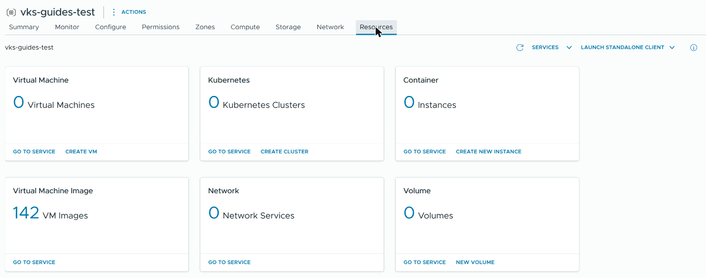
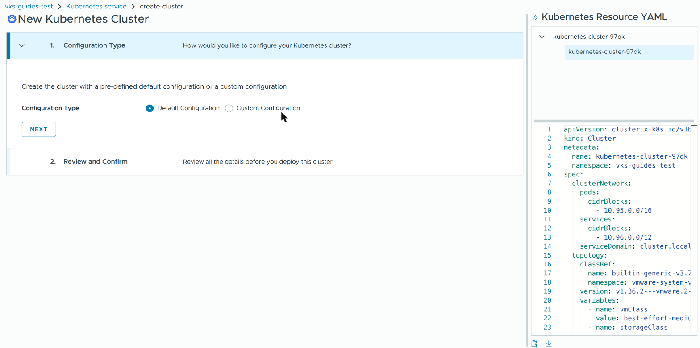
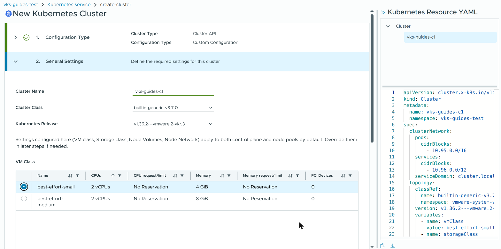
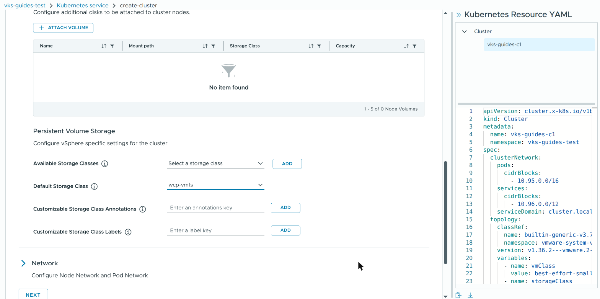
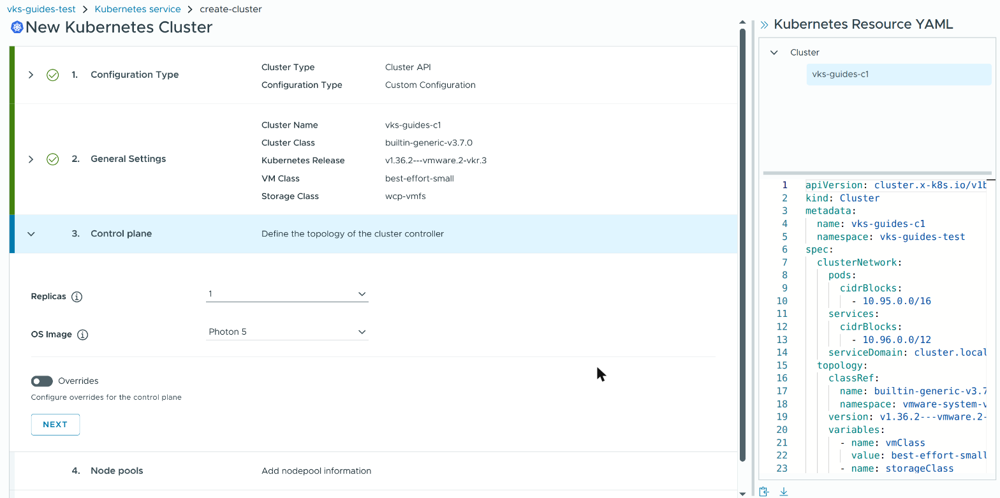
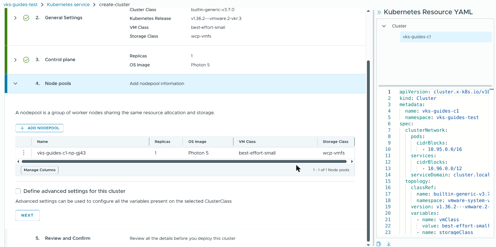
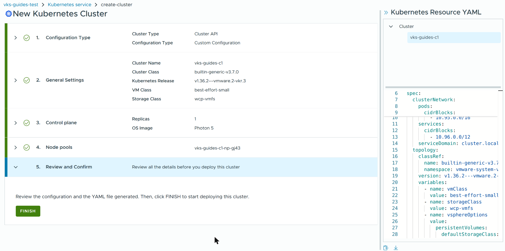
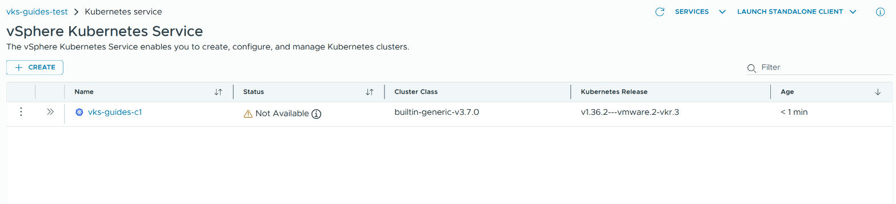
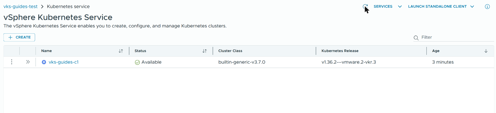

# Create a VKS cluster

> [!NOTE]
> **Official Broadcom documentation (VCF 9.1) for this guide**
>
> - [Access the IaaS Services Console or Local Consumption Interface](https://techdocs.broadcom.com/us/en/vmware-cis/vcf/vcf-consumption/latest/consumer-interfaces-in-vcf/access-the-iaas-services-console-or-local-consumption-interface.html)
> - [Provision a Kubernetes Cluster Using Self-Service](https://techdocs.broadcom.com/us/en/vmware-cis/vcf/vcf-consumption/latest/managing-vsphere-kuberenetes-service-clusters-and-workloads/provision-and-manage-kubernetes-clusters/provision-a-kubernetes-cluster-using-the-iaas-services-console-in-vcf-automation.html)
> - [Using Kubernetes Releases with VKS Clusters](https://techdocs.broadcom.com/us/en/vmware-cis/vcf/vcf-service-administration-and-development/9-1/managing-vsphere-kubernetes-service/administering-kubernetes-releases-for-tkg-service-clusters/using-kubernetes-releases-with-tkg-service-clusters.html)
> - [Using VM Classes with VKS Clusters](https://techdocs.broadcom.com/us/en/vmware-cis/vcf/vcf-service-administration-and-development/9-1/managing-vsphere-kubernetes-service/configuring-vsphere-namespaces-for-hosting-tkg-service-clusters/using-vm-classes-with-tkg-service-clusters.html)
> - [Using the Versioned ClusterClass](https://techdocs.broadcom.com/us/en/vmware-cis/vcf/vcf-consumption/latest/managing-vsphere-kuberenetes-service-clusters-and-workloads/provisioning-tkg-service-clusters/using-the-cluster-v1beta1-api/using-the-versioned-clusterclass.html) (`builtin-generic-v3.7.0`, the newest in VKS 3.7.2)
> - [ClusterClass Variable Reference, VKS 3.7.0](https://developer.broadcom.com/xapis/vmware-vsphere-kubernetes-service/3.7.0/variable-docs.html) (`defaultStorageClass`; for `builtin-generic-v3.7.0`. [Other versions](https://developer.broadcom.com/xapis/vmware-vsphere-kubernetes-service/latest/) match other Cluster Classes)
> - [Check VKS Cluster Readiness Using Kubectl](https://techdocs.broadcom.com/us/en/vmware-cis/vcf/vcf-consumption/latest/managing-vsphere-kuberenetes-service-clusters-and-workloads/operating-tkg-service-clusters/check-tkg-cluster-readiness-using-kubectl.html)
> - [Connect to the VKS Cluster Control Plane as a Kubernetes Administrator](https://techdocs.broadcom.com/us/en/vmware-cis/vcf/vcf-consumption/latest/managing-vsphere-kuberenetes-service-clusters-and-workloads/configuring-identity-and-access-for-tkg-service-clusters/connect-to-the-tkg-service-cluster-control-plane-as-a-kubernetes-administrator.html) (the kubeconfig)
> - [Delete a VKS Cluster Using Kubectl or Using VCF CLI](https://techdocs.broadcom.com/us/en/vmware-cis/vcf/vcf-consumption/latest/managing-vsphere-kuberenetes-service-clusters-and-workloads/provisioning-tkg-service-clusters/delete-a-tkg-cluster-using-kubectl-or-using-the-tanzu-cli.html)
> - [Clean Up Persistent Volumes and Volume Snapshots while Deleting VKS Clusters](https://techdocs.broadcom.com/us/en/vmware-cis/vcf/vcf-consumption/latest/managing-vsphere-kuberenetes-service-clusters-and-workloads/provisioning-tkg-service-clusters/delete-a-tkg-cluster-using-kubectl-or-using-the-tanzu-cli/clean-up-pvc-pv-and-volume-snapshots-while-deleting-vks-clusters.html)
> - [Guest cluster deployment via the Local Consumption Interface (LCI) fails with 'best-effort-xsmall' VM Class](https://knowledge.broadcom.com/external/article/446139/guest-cluster-deployment-via-the-local-c.html) (Broadcom KB 446139: VM class size)
> - [VKS cluster provisioning fails with "context deadline exceeded" during back-to-back recreation in VCF 9.x](https://knowledge.broadcom.com/external/article/439698/vks-cluster-provisioning-fails-with-cont.html) (Broadcom KB 439698: reusing a name)

You create the cluster in the vSphere Client, on your vSphere Namespace's **Resources** tab (the
Local Consumption Interface). Steps 3 to 5 are clicks; the other steps use a terminal and need
[kubectl](KUBECTL.md), [jq](PREREQS.md) and a [Supervisor login](LOGIN.md). The names are those
of the vSphere Client for VCF 9.1.1 with VKS 3.7. The screenshots show example names; yours
differ. Steps 3 to 5 were tested as a vCenter administrator; the terminal steps also as a user
with only **Namespaces Edit**.

You need a vSphere Namespace that passes [Check the namespace](NAMESPACE.md#8-check-the-namespace),
and the **Edit** role on it.

## 1. Check the namespace

Run both blocks of [Check the namespace](NAMESPACE.md#8-check-the-namespace). They print what a
cluster can use: the VM classes, the storage classes and how many Kubernetes releases are ready.

**Expect:** `yes`, at least one VM class, at least one storage class, and a number above 0 for
the Kubernetes releases and the cluster classes.

## 2. Choose a name and the values

| value | what to choose |
|---|---|
| name | lower-case letters, digits and `-`, a name no cluster in this namespace ever had |
| Kubernetes release | the newest the create page offers |
| VM class | `best-effort-small` (2 CPUs, 4 GB) ran this guide's clusters; Broadcom recommends `best-effort-medium` or larger (KB 446139). If the Supervisor runs the Metrics Aggregator ([OBSERVABILITY.md](OBSERVABILITY.md) step 11), each new cluster also runs Broadcom's monitoring add-ons, about 400 MiB in all |
| storage class | one from step 1 |
| control-plane nodes | `1`, or `3` for a cluster that must stay up when a node fails |
| worker nodes | `1` or more |

Never reuse a cluster's name in the same namespace: a new cluster under an old name can get the
old cluster's address and never become available. After `dev-1`, take `dev-2`.

If you will install Harbor on this Supervisor, install it before you create clusters: installing
it updates every node of every VKS cluster.

This checks that nothing in the namespace holds the name.

**Linux, macOS, WSL (bash or zsh):**

```sh
VKS_NAMESPACE="my-namespace"
VKS_CLUSTER="my-vks-cluster"
SUPERVISOR_KUBECONFIG="$HOME/.kube/supervisor.kubeconfig"

if ! kubectl --kubeconfig "$SUPERVISOR_KUBECONFIG" get namespace "$VKS_NAMESPACE" >/dev/null; then
  echo "FAILED: cannot read the namespace $VKS_NAMESPACE (see the error above)"
elif L="$(kubectl --kubeconfig "$SUPERVISOR_KUBECONFIG" -n "$VKS_NAMESPACE" get clusters.cluster.x-k8s.io,virtualmachineservices "$VKS_CLUSTER" --ignore-not-found -o name)"; then
  if [ -n "$L" ]; then echo "in use:"; printf '%s\n' "$L"; else echo "none now: no cluster and no address named $VKS_CLUSTER"; fi
else
  echo "unknown (see the error above)"
fi
```

**Windows (PowerShell):**

```powershell
$VKS_NAMESPACE = "my-namespace"
$VKS_CLUSTER = "my-vks-cluster"
$SUPERVISOR_KUBECONFIG = "$HOME\.kube\supervisor.kubeconfig"

$global:LASTEXITCODE = $null
kubectl --kubeconfig $SUPERVISOR_KUBECONFIG get namespace $VKS_NAMESPACE | Out-Null
if ($LASTEXITCODE -ne 0) { "FAILED: cannot read the namespace $VKS_NAMESPACE (see the error above)" } else {
  $L = kubectl --kubeconfig $SUPERVISOR_KUBECONFIG -n $VKS_NAMESPACE get clusters.cluster.x-k8s.io,virtualmachineservices $VKS_CLUSTER --ignore-not-found -o name
  if ($LASTEXITCODE -ne 0) { "unknown (see the error above)" } elseif ($L) { "in use:"; $L } else { "none now: no cluster and no address named $VKS_CLUSTER" }
}
```

**Expect:** `none now: no cluster and no address named <your name>`. This cannot see a name
used before and deleted; such a name is still not safe.

**If not:**
- `in use:`: choose another name.
- `unknown`: your user may not read clusters or their addresses in this namespace. Ask for the
  **Edit** role.
- `FAILED: cannot read the namespace`: see **If not** under
  [Check the namespace](NAMESPACE.md#8-check-the-namespace).

## 3. Open the create page

1. In the vSphere Client, from the menu (☰) choose **Supervisor Management**, the **Namespaces**
   tab, and your namespace. Open its **Resources** tab.

   

2. On the **Kubernetes** card click **CREATE CLUSTER**.

**Expect:** a page **New Kubernetes Cluster**, with the pane **Kubernetes Resource YAML** on the
right.

**If not:** no **Resources** tab: the **Local Consumption Interface** service is not running on
the Supervisor. Ask a vCenter administrator.

## 4. Fill in the create page

1. **1. Configuration Type:** choose **Custom Configuration** and click **NEXT**.

   

2. **2. General Settings:** replace the generated **Cluster Name** with your name. Choose the
   newest **Cluster Class** the list offers (`builtin-generic-v3.7.0` with VKS 3.7.2) and your
   **Kubernetes Release**. In the **VM Class** table, select your class with the round button:
   the page preselects one, which may not be the one you want. Choose your **Storage Class**.

   

3. Still in step 2, open **Storage** and choose your storage class under **Default Storage
   Class**. The page leaves it empty; without it, every app that asks for a disk without naming a
   storage class waits forever. Click **NEXT**.

   

4. **3. Control plane:** set **Replicas** (`1` or `3`). Click **NEXT**.

   

5. **4. Node pools:** the table holds one pool with **Replicas** `1`. To change the number of
   workers, open the row's ⋮ menu, choose **Edit** and set **Replicas**. Click **NEXT**.

   

**Expect:** **5. Review and Confirm** opens, and steps 1 to 4 each show a green tick.

## 5. Review and create

1. In the **Kubernetes Resource YAML** pane, check the name, the version, `vmClass`,
   `storageClass`, and `defaultStorageClass` under `vsphereOptions`.

   

2. Click **FINISH**.

**Expect:** the list **vSphere Kubernetes Service** with your cluster, **Status** **Not
Available**, **Age** `< 1 min`.



## 6. Wait for the cluster

Watch the row; the refresh arrow reloads the list. Or run this block.

**Linux, macOS, WSL (bash or zsh):**

```sh
VKS_NAMESPACE="my-namespace"
VKS_CLUSTER="my-vks-cluster"
SUPERVISOR_KUBECONFIG="$HOME/.kube/supervisor.kubeconfig"

kubectl --kubeconfig "$SUPERVISOR_KUBECONFIG" -n "$VKS_NAMESPACE" get clusters.cluster.x-k8s.io "$VKS_CLUSTER" \
  && kubectl --kubeconfig "$SUPERVISOR_KUBECONFIG" -n "$VKS_NAMESPACE" get machines.cluster.x-k8s.io -l "cluster.x-k8s.io/cluster-name=$VKS_CLUSTER"
```

**Windows (PowerShell):**

```powershell
$VKS_NAMESPACE = "my-namespace"
$VKS_CLUSTER = "my-vks-cluster"
$SUPERVISOR_KUBECONFIG = "$HOME\.kube\supervisor.kubeconfig"

$global:LASTEXITCODE = $null
kubectl --kubeconfig $SUPERVISOR_KUBECONFIG -n $VKS_NAMESPACE get clusters.cluster.x-k8s.io $VKS_CLUSTER
if ($LASTEXITCODE -eq 0) { kubectl --kubeconfig $SUPERVISOR_KUBECONFIG -n $VKS_NAMESPACE get machines.cluster.x-k8s.io -l "cluster.x-k8s.io/cluster-name=$VKS_CLUSTER" }
```

**Expect:** the cluster with `AVAILABLE` `True`, and each machine `Running`; in the client,
**Available** with a green tick. A cluster of one control-plane node and one worker took about
5 minutes on a small lab; the first cluster of a Kubernetes release takes longer, while vCenter
downloads its node image.



**If not:** still `False` after 30 minutes. First check that the cluster got its own address.

**Linux, macOS, WSL (bash or zsh):**

```sh
VKS_NAMESPACE="my-namespace"
VKS_CLUSTER="my-vks-cluster"
SUPERVISOR_KUBECONFIG="$HOME/.kube/supervisor.kubeconfig"

E="$(kubectl --kubeconfig "$SUPERVISOR_KUBECONFIG" -n "$VKS_NAMESPACE" get clusters.cluster.x-k8s.io "$VKS_CLUSTER" -o jsonpath='{.spec.controlPlaneEndpoint.host}')" \
  && A="$(kubectl --kubeconfig "$SUPERVISOR_KUBECONFIG" -n "$VKS_NAMESPACE" get virtualmachineservices "$VKS_CLUSTER" -o jsonpath='{.status.loadBalancer.ingress[0].ip}')" \
  && echo "cluster address: ${E:-none}, load balancer address: ${A:-none}"
```

**Windows (PowerShell):**

```powershell
$VKS_NAMESPACE = "my-namespace"
$VKS_CLUSTER = "my-vks-cluster"
$SUPERVISOR_KUBECONFIG = "$HOME\.kube\supervisor.kubeconfig"

$global:LASTEXITCODE = $null
$E = kubectl --kubeconfig $SUPERVISOR_KUBECONFIG -n $VKS_NAMESPACE get clusters.cluster.x-k8s.io $VKS_CLUSTER -o jsonpath='{.spec.controlPlaneEndpoint.host}'
if ($LASTEXITCODE -eq 0) { $A = kubectl --kubeconfig $SUPERVISOR_KUBECONFIG -n $VKS_NAMESPACE get virtualmachineservices $VKS_CLUSTER -o jsonpath='{.status.loadBalancer.ingress[0].ip}' }
if ($LASTEXITCODE -eq 0) { "cluster address: $(if ($E) { $E } else { 'none' }), load balancer address: $(if ($A) { $A } else { 'none' })" }
```

**Expect:** the same address twice. `none`, or `NotFound` for the virtual machine service: wait,
the address comes first. Two different addresses: the cluster kept an old address; delete it
(step 8) and create it again under a new name.

If the addresses match, this shows why the cluster waits: read the `Conditions` and the `Events`
at the end.

**Linux, macOS, WSL (bash or zsh):**

```sh
VKS_NAMESPACE="my-namespace"
VKS_CLUSTER="my-vks-cluster"
SUPERVISOR_KUBECONFIG="$HOME/.kube/supervisor.kubeconfig"

kubectl --kubeconfig "$SUPERVISOR_KUBECONFIG" -n "$VKS_NAMESPACE" describe clusters.cluster.x-k8s.io "$VKS_CLUSTER"
```

**Windows (PowerShell):**

```powershell
$VKS_NAMESPACE = "my-namespace"
$VKS_CLUSTER = "my-vks-cluster"
$SUPERVISOR_KUBECONFIG = "$HOME\.kube\supervisor.kubeconfig"

kubectl --kubeconfig $SUPERVISOR_KUBECONFIG -n $VKS_NAMESPACE describe clusters.cluster.x-k8s.io $VKS_CLUSTER
```

Never switch the cluster's virtual machines on or off in the vSphere Client: VKS owns them.

## 7. Get the kubeconfig and check the cluster

Run [Get the VKS cluster's kubeconfig](LOGIN.md#get-the-vks-clusters-kubeconfig) and
[Match kubectl to the cluster's version](LOGIN.md#match-kubectl-to-the-clusters-version). Then
this checks the nodes and the default storage class.

**Linux, macOS, WSL (bash or zsh):**

```sh
VKS_CLUSTER="my-vks-cluster"
VKS_KUBECONFIG="$HOME/.kube/${VKS_CLUSTER}.kubeconfig"

if kubectl --kubeconfig "$VKS_KUBECONFIG" get nodes && J="$(kubectl --kubeconfig "$VKS_KUBECONFIG" get storageclass -o json)"; then
  echo "default storage class: $(printf '%s' "$J" | jq -r '[.items[] | select(.metadata.annotations["storageclass.kubernetes.io/is-default-class"] == "true") | .metadata.name] | if length == 0 then "NONE" else join(" ") end')"
else
  echo "FAILED: cannot read the cluster (see the error above)"
fi
```

**Windows (PowerShell):**

```powershell
$VKS_CLUSTER = "my-vks-cluster"
$VKS_KUBECONFIG = "$HOME\.kube\${VKS_CLUSTER}.kubeconfig"

$global:LASTEXITCODE = $null
kubectl --kubeconfig $VKS_KUBECONFIG get nodes
if ($LASTEXITCODE -eq 0) { $J = kubectl --kubeconfig $VKS_KUBECONFIG get storageclass -o json | Out-String }
if ($LASTEXITCODE -eq 0) {
  $D = @((ConvertFrom-Json $J).items | Where-Object { $_.metadata.annotations.'storageclass.kubernetes.io/is-default-class' -eq 'true' } | ForEach-Object { $_.metadata.name })
  "default storage class: $(if ($D.Count) { $D -join ' ' } else { 'NONE' })"
} else {
  "FAILED: cannot read the cluster (see the error above)"
}
```

**Expect:** each node `Ready`, then `default storage class:` and the storage class you chose.

**If not:**
- Nothing after `default storage class:`, under `jq: command not found`: install jq
  ([PREREQS.md](PREREQS.md)).
- `default storage class: NONE`: **Default Storage Class** was left empty in step 4. Name the
  storage class in each disk request, or create a new cluster with it set.
- `FAILED: cannot read the cluster`, under `no such file or directory` (Windows: `cannot find
  the file specified`): run
  [Get the VKS cluster's kubeconfig](LOGIN.md#get-the-vks-clusters-kubeconfig) first.

## 8. Delete the cluster (optional)

If you installed monitoring with ArgoCD, run [MONITORING.md](MONITORING.md) step 10 first.
**This destroys the cluster and its virtual machines.** The disks its apps created stay in the
vSphere Namespace and keep their storage
([Broadcom KB 402764](https://knowledge.broadcom.com/external/article/402764)). A cluster that
ArgoCD manages comes back after you delete it here; delete it in ArgoCD instead.

First run the block in [step 2](#2-choose-a-name-and-the-values) with your cluster's name.

**Expect:** `in use:`, then `cluster.cluster.x-k8s.io/<name>` and
`virtualmachineservice.vmoperator.vmware.com/<name>`. If it says `none now` or `unknown`, stop:
the name is wrong, or you may not read it.

Then this lists the disks of the cluster's apps: first as the cluster sees them, then as they
sit in the vSphere Namespace.

**Linux, macOS, WSL (bash or zsh):**

```sh
VKS_NAMESPACE="my-namespace"
VKS_CLUSTER="my-vks-cluster"
SUPERVISOR_KUBECONFIG="$HOME/.kube/supervisor.kubeconfig"
VKS_KUBECONFIG="$HOME/.kube/${VKS_CLUSTER}.kubeconfig"

kubectl --kubeconfig "$VKS_KUBECONFIG" get persistentvolumeclaims -A
kubectl --kubeconfig "$SUPERVISOR_KUBECONFIG" -n "$VKS_NAMESPACE" get persistentvolumeclaims -l "$VKS_CLUSTER/TKGService"
```

**Windows (PowerShell):**

```powershell
$VKS_NAMESPACE = "my-namespace"
$VKS_CLUSTER = "my-vks-cluster"
$SUPERVISOR_KUBECONFIG = "$HOME\.kube\supervisor.kubeconfig"
$VKS_KUBECONFIG = "$HOME\.kube\${VKS_CLUSTER}.kubeconfig"

kubectl --kubeconfig $VKS_KUBECONFIG get persistentvolumeclaims -A
kubectl --kubeconfig $SUPERVISOR_KUBECONFIG -n $VKS_NAMESPACE get persistentvolumeclaims -l "$VKS_CLUSTER/TKGService"
```

**Expect:** `No resources found` twice. Each disk listed stays after the delete. In the cluster,
delete the apps you do not need and then their disk claims (a claim still in use waits for its
app), and run the block again.

Then this deletes the cluster.

**Linux, macOS, WSL (bash or zsh):**

```sh
VKS_NAMESPACE="my-namespace"
VKS_CLUSTER="my-vks-cluster"
SUPERVISOR_KUBECONFIG="$HOME/.kube/supervisor.kubeconfig"

kubectl --kubeconfig "$SUPERVISOR_KUBECONFIG" -n "$VKS_NAMESPACE" delete clusters.cluster.x-k8s.io "$VKS_CLUSTER" --wait=false
```

**Windows (PowerShell):**

```powershell
$VKS_NAMESPACE = "my-namespace"
$VKS_CLUSTER = "my-vks-cluster"
$SUPERVISOR_KUBECONFIG = "$HOME\.kube\supervisor.kubeconfig"

kubectl --kubeconfig $SUPERVISOR_KUBECONFIG -n $VKS_NAMESPACE delete clusters.cluster.x-k8s.io $VKS_CLUSTER --wait=false
```

**Expect:** `cluster.cluster.x-k8s.io "<name>" deleted` (newer kubectl: `… deleted from <your
namespace> namespace`). Then run the block in
[step 2](#2-choose-a-name-and-the-values) again until it says `none now`, and the disk block
above: its first command now fails (the cluster is gone); its second list shows the disks the
cluster left behind.

**If not:** `Forbidden`: your role on the namespace cannot delete clusters; ask for the **Edit**
role.

**This deletes those disks and what they hold, for good.** It deletes nothing while a cluster of
that name exists.

**Linux, macOS, WSL (bash or zsh):**

```sh
VKS_NAMESPACE="my-namespace"
VKS_CLUSTER="my-vks-cluster"
SUPERVISOR_KUBECONFIG="$HOME/.kube/supervisor.kubeconfig"

if ! L="$(kubectl --kubeconfig "$SUPERVISOR_KUBECONFIG" -n "$VKS_NAMESPACE" get clusters.cluster.x-k8s.io "$VKS_CLUSTER" --ignore-not-found -o name)"; then
  echo "Nothing deleted: cannot read the clusters (see the error above)"
elif [ -n "$L" ]; then
  echo "Nothing deleted: $L still exists"
else
  kubectl --kubeconfig "$SUPERVISOR_KUBECONFIG" -n "$VKS_NAMESPACE" delete persistentvolumeclaims -l "$VKS_CLUSTER/TKGService"
fi
```

**Windows (PowerShell):**

```powershell
$VKS_NAMESPACE = "my-namespace"
$VKS_CLUSTER = "my-vks-cluster"
$SUPERVISOR_KUBECONFIG = "$HOME\.kube\supervisor.kubeconfig"

$global:LASTEXITCODE = $null
$L = kubectl --kubeconfig $SUPERVISOR_KUBECONFIG -n $VKS_NAMESPACE get clusters.cluster.x-k8s.io $VKS_CLUSTER --ignore-not-found -o name
if ($LASTEXITCODE -ne 0) { "Nothing deleted: cannot read the clusters (see the error above)" }
elseif ($L) { "Nothing deleted: $L still exists" }
else { kubectl --kubeconfig $SUPERVISOR_KUBECONFIG -n $VKS_NAMESPACE delete persistentvolumeclaims -l "$VKS_CLUSTER/TKGService" }
```

**Expect:** a `persistentvolumeclaim "<id>" deleted` line for each disk, or `No resources found`.

Do not create the next cluster under the same name. The cluster's kubeconfig stays in
`~/.kube`; delete it yourself.
