# Create a VKS cluster

> [!NOTE]
> **Official Broadcom documentation (VCF 9.1) for this guide**
>
> - [Access the IaaS Services Console or Local Consumption Interface](https://techdocs.broadcom.com/us/en/vmware-cis/vcf/vcf-consumption/latest/consumer-interfaces-in-vcf/access-the-iaas-services-console-or-local-consumption-interface.html)
> - [Provision a Kubernetes Cluster Using Self-Service](https://techdocs.broadcom.com/us/en/vmware-cis/vcf/vcf-consumption/latest/managing-vsphere-kuberenetes-service-clusters-and-workloads/provision-and-manage-kubernetes-clusters/provision-a-kubernetes-cluster-using-the-iaas-services-console-in-vcf-automation.html)
> - [Using Kubernetes Releases with VKS Clusters](https://techdocs.broadcom.com/us/en/vmware-cis/vcf/vcf-service-administration-and-development/9-1/managing-vsphere-kubernetes-service/administering-kubernetes-releases-for-tkg-service-clusters/using-kubernetes-releases-with-tkg-service-clusters.html)
> - [Using VM Classes with VKS Clusters](https://techdocs.broadcom.com/us/en/vmware-cis/vcf/vcf-service-administration-and-development/9-1/managing-vsphere-kubernetes-service/configuring-vsphere-namespaces-for-hosting-tkg-service-clusters/using-vm-classes-with-tkg-service-clusters.html)
> - [Using the Versioned ClusterClass](https://techdocs.broadcom.com/us/en/vmware-cis/vcf/vcf-consumption/latest/managing-vsphere-kuberenetes-service-clusters-and-workloads/provisioning-tkg-service-clusters/using-the-cluster-v1beta1-api/using-the-versioned-clusterclass.html) (`builtin-generic-v3.8.0`, the newest in VKS 3.8.0)
> - [ClusterClass Variable Overrides](https://techdocs.broadcom.com/us/en/vmware-cis/vcf/vcf-consumption/latest/managing-vsphere-kuberenetes-service-clusters-and-workloads/provisioning-tkg-service-clusters/using-the-cluster-v1beta1-api/using-the-versioned-clusterclass/clusterclass-variable-overrides.html) (step 10: a node pool's `vmClass`)
> - [ClusterClass Variable Reference, VKS 3.8.0](https://developer.broadcom.com/xapis/vmware-vsphere-kubernetes-service/3.8.0/variable-docs.html) (`defaultStorageClass`; for `builtin-generic-v3.8.0`. [Other versions](https://developer.broadcom.com/xapis/vmware-vsphere-kubernetes-service/latest/) match other Cluster Classes)
> - [Workflow for Provisioning VKS Clusters Using kubectl](https://techdocs.broadcom.com/us/en/vmware-cis/vcf/vcf-consumption/latest/managing-vsphere-kuberenetes-service-clusters-and-workloads/provisioning-tkg-service-clusters/workflow-for-provisioning-tkg-clusters-using-kubectl.html) (step 9)
> - [Using builtin-generic-v3.6.0 Cluster Class with VKS 3.6.0 and Later](https://techdocs.broadcom.com/us/en/vmware-cis/vcf/vcf-consumption/latest/managing-vsphere-kuberenetes-service-clusters-and-workloads/provisioning-tkg-service-clusters/using-the-cluster-v1beta1-api/using-the-versioned-clusterclass/using-builtin-generic-v3-6-0-with-vks.html) (step 9: Broadcom's `v1beta2` Cluster YAML; `builtin-generic-v3.8.0` takes the same fields)
> - [Check VKS Cluster Readiness Using Kubectl](https://techdocs.broadcom.com/us/en/vmware-cis/vcf/vcf-consumption/latest/managing-vsphere-kuberenetes-service-clusters-and-workloads/operating-tkg-service-clusters/check-tkg-cluster-readiness-using-kubectl.html)
> - [Connect to the VKS Cluster Control Plane as a Kubernetes Administrator](https://techdocs.broadcom.com/us/en/vmware-cis/vcf/vcf-consumption/latest/managing-vsphere-kuberenetes-service-clusters-and-workloads/configuring-identity-and-access-for-tkg-service-clusters/connect-to-the-tkg-service-cluster-control-plane-as-a-kubernetes-administrator.html) (the kubeconfig)
> - [Delete a VKS Cluster Using Kubectl or Using VCF CLI](https://techdocs.broadcom.com/us/en/vmware-cis/vcf/vcf-consumption/latest/managing-vsphere-kuberenetes-service-clusters-and-workloads/provisioning-tkg-service-clusters/delete-a-tkg-cluster-using-kubectl-or-using-the-tanzu-cli.html)
> - [Clean Up Persistent Volumes and Volume Snapshots while Deleting VKS Clusters](https://techdocs.broadcom.com/us/en/vmware-cis/vcf/vcf-consumption/latest/managing-vsphere-kuberenetes-service-clusters-and-workloads/provisioning-tkg-service-clusters/delete-a-tkg-cluster-using-kubectl-or-using-the-tanzu-cli/clean-up-pvc-pv-and-volume-snapshots-while-deleting-vks-clusters.html)
> - [Guest cluster deployment via the Local Consumption Interface (LCI) fails with 'best-effort-xsmall' VM Class](https://knowledge.broadcom.com/external/article/446139/guest-cluster-deployment-via-the-local-c.html) (Broadcom KB 446139: VM class size)
> - [VKS cluster provisioning fails with "context deadline exceeded" during back-to-back recreation in VCF 9.x](https://knowledge.broadcom.com/external/article/439698/vks-cluster-provisioning-fails-with-cont.html) (Broadcom KB 439698: reusing a name)

You create the cluster in the vSphere Client, on your vSphere Namespace's **Resources** tab (the
Local Consumption Interface). Steps 3 to 5 are clicks; the other steps use a terminal and need
[kubectl](KUBECTL.md), [jq](PREREQS.md) and a [Supervisor login](SUPERVISOR-LOGIN.md). The names and
screenshots of steps 3 to 5 are from the vSphere Client for VCF 9.1.1; the screenshots show example
names; yours differ.

To create the cluster from a YAML file with kubectl instead of clicks, see
[step 9](#9-create-the-cluster-with-kubectl-and-a-yaml-file).

The steps (step 9 replaces steps 3 to 5; 8 and 10 are optional):

1. [Check the namespace](#1-check-the-namespace)
2. [Choose a name and the values](#2-choose-a-name-and-the-values)
3. [Open the create page](#3-open-the-create-page)
4. [Fill in the create page](#4-fill-in-the-create-page)
5. [Review and create](#5-review-and-create)
6. [Wait for the cluster](#6-wait-for-the-cluster)
7. [Get the kubeconfig and check the cluster](#7-get-the-kubeconfig-and-check-the-cluster)
8. [Delete the cluster (optional)](#8-delete-the-cluster-optional)
9. [Create the cluster with kubectl and a YAML file](#9-create-the-cluster-with-kubectl-and-a-yaml-file) (instead of steps 3 to 5)
10. [Resize the cluster (optional)](#10-resize-the-cluster-optional)

## Prerequisites

- a vSphere Namespace that passes [Check the namespace](NAMESPACE.md#8-check-the-namespace), and
  the **Namespaces Edit** role on it;
- a [Supervisor login](SUPERVISOR-LOGIN.md) with the [VCF CLI](VCF.md), [kubectl](KUBECTL.md) and
  [jq](PREREQS.md);
- one free load-balancer address, for the address kubectl uses to reach the cluster;
- if you will install Harbor on this Supervisor, install it first ([HARBOR.md](HARBOR.md) steps 1
  to 10): installing it updates every node of every VKS cluster.

The connections this guide needs, for a firewall (all TCP, besides DNS):

| from | to | port | for |
|---|---|---|---|
| your browser | vCenter (the vSphere Client) | 443 | the storage limit, creating, watching and resizing the cluster (steps 2 to 6, 10) |
| your machine (laptop or jump box) | the Supervisor's address | 443 | kubectl with the Supervisor kubeconfig (steps 1, 2, 6 to 10) |
| your machine (laptop or jump box) | the VKS cluster's API address (in its kubeconfig) | 6443 | kubectl (steps 7, 8) |

## 1. Check the namespace

Run both blocks of [Check the namespace](NAMESPACE.md#8-check-the-namespace). They print what a
cluster can use: the VM classes, the storage classes and how many Kubernetes releases are ready.

**Expect:** `yes`, at least one VM class, at least one storage class, and a number above 0 for
the Kubernetes releases and the cluster classes.

## 2. Choose a name and the values

### Choose the values

A cluster has control-plane nodes (they run Kubernetes itself) and worker nodes (they run your
apps), grouped in node pools of the same size. A Kubernetes release is the Kubernetes version and
the node images (OS) built for it; a cluster class is Broadcom's template for the cluster.

| value | what to choose |
|---|---|
| name | lower-case letters, digits and `-`, a name no cluster in this namespace ever had |
| Kubernetes release | the newest the create page offers |
| VM class | `best-effort-medium` (2 CPUs, 8 GB) or larger, for the control plane and the workers: Broadcom recommends it, and never a small or xsmall class for workers that run apps (KB 446139); a `best-effort-small` (2 CPUs, 4 GB) control-plane node used 2.6 to 3.1 GiB, 95% to 110% of the memory it hands out to pods (about 2.8 GiB), measured on VKS 3.8. If the Supervisor runs the Metrics Aggregator ([OBSERVABILITY.md](OBSERVABILITY.md) step 11), each new cluster also runs Broadcom's monitoring add-ons, about 100 MiB per node |
| storage class | one from step 1 |
| control-plane nodes | `1`, or `3` for a cluster that must stay up when a node fails |
| worker nodes | `1` or more |
| storage | room in the namespace's storage limit for each node: about 20 GB of disk plus the memory its VM class does not reserve (its swap file), and room for the extra nodes of an update or a resize (see below) |

### Check the namespace's storage limit

Each node of a cluster takes about 20 GB of disk plus its memory from the namespace's storage
(`best-effort-*` classes reserve no memory, so all of it). A Kubernetes version change replaced
one node at a time (measured on VKS 3.7). A change of VM class first adds one node of the new class
for the control plane and one per node pool, next to the old ones. Plan for that: a cluster of 1
control-plane node and 1 worker of `best-effort-medium` needs about 2 × (20 + 8) = 56 GB, and while
it changes to `best-effort-large`, 2 × (20 + 8) + 2 × (20 + 16) = 128 GB. Each extra worker adds its
own 20 GB plus memory.

In the vSphere Client, open the namespace: its **Summary** tab shows, under **Capacity and Usage**,
**Storage**, how much is used and the limit. The limit minus what is used must leave that room.

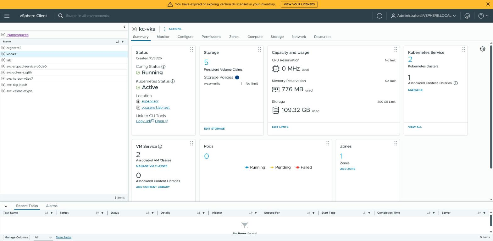

If it does not, a vCenter administrator clicks **EDIT LIMITS** there and raises **Storage** (or
clears it for no limit), then **OK**. Above the limit, vCenter shows *The storage usage exceeds the
quota set for the namespace*.

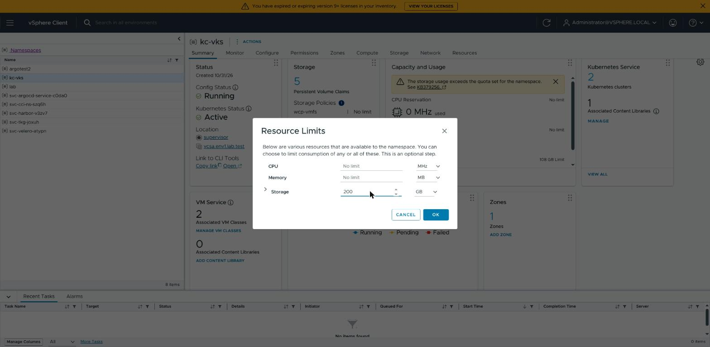

### Check that the name is free

Never reuse a cluster's name in the same namespace: a new cluster under an old name can get the
old cluster's address and never become available. After `dev-1`, take `dev-2`.

Run this before you create the cluster, with the name you chose. It checks that nothing in your
vSphere Namespace holds the name, neither a cluster nor its address entry (the load-balancer entry
that gives a cluster its address), and changes nothing. You then know whether the name is free to
use now. Set `VKS_NAMESPACE` to your vSphere Namespace and `VKS_CLUSTER` to the name you chose.

**Linux, macOS, WSL (bash or zsh):**

```sh
VKS_NAMESPACE="my-namespace"
VKS_CLUSTER="my-vks-cluster"
SUPERVISOR_CONTEXT="supervisor"
SUPERVISOR_KUBECONFIG="$HOME/.kube/${SUPERVISOR_CONTEXT}.kubeconfig"

if ! kubectl --kubeconfig "$SUPERVISOR_KUBECONFIG" get namespace "$VKS_NAMESPACE" >/dev/null; then
  echo "FAILED: cannot read the namespace $VKS_NAMESPACE (see the error above)"
elif L="$(kubectl --kubeconfig "$SUPERVISOR_KUBECONFIG" -n "$VKS_NAMESPACE" get clusters.cluster.x-k8s.io,virtualmachineservices "$VKS_CLUSTER" --ignore-not-found -o name)"; then
  if [ -n "$L" ]; then echo "in use:"; printf '%s\n' "$L"; else echo "none now: no cluster and no address named $VKS_CLUSTER"; fi
else
  echo "unknown (see the error above)"
fi
```

**Windows (PowerShell):**

```powershell
$VKS_NAMESPACE = "my-namespace"
$VKS_CLUSTER = "my-vks-cluster"
$SUPERVISOR_CONTEXT = "supervisor"
$SUPERVISOR_KUBECONFIG = "$HOME\.kube\${SUPERVISOR_CONTEXT}.kubeconfig"

$global:LASTEXITCODE = $null
kubectl --kubeconfig $SUPERVISOR_KUBECONFIG get namespace $VKS_NAMESPACE | Out-Null
if ($LASTEXITCODE -ne 0) { "FAILED: cannot read the namespace $VKS_NAMESPACE (see the error above)" } else {
  $L = kubectl --kubeconfig $SUPERVISOR_KUBECONFIG -n $VKS_NAMESPACE get clusters.cluster.x-k8s.io,virtualmachineservices $VKS_CLUSTER --ignore-not-found -o name
  if ($LASTEXITCODE -ne 0) { "unknown (see the error above)" } elseif ($L) { "in use:"; $L } else { "none now: no cluster and no address named $VKS_CLUSTER" }
}
```

**Expect:** `none now: no cluster and no address named <your name>`. This cannot see a name
used before and deleted; such a name is still not safe.

**If not:**
- `in use:`: choose another name.
- `unknown`: your user may not read clusters or their addresses in this namespace. Ask for the
  **Namespaces Edit** role.
- `FAILED: cannot read the namespace`: see **If not** under
  [Check the namespace](NAMESPACE.md#8-check-the-namespace).

## 3. Open the create page

To create the cluster from a YAML file with kubectl instead of steps 3 to 5, see
[step 9](#9-create-the-cluster-with-kubectl-and-a-yaml-file).

1. In the vSphere Client, from the menu (☰) choose **Supervisor Management**, the **Namespaces**
   tab, and your namespace. Open its **Resources** tab.

   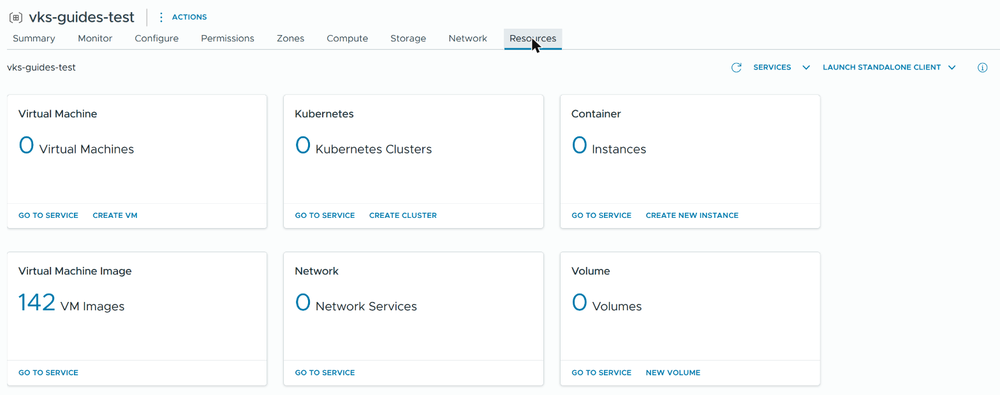

2. On the **Kubernetes** card click **CREATE CLUSTER**.

**Expect:** a page **New Kubernetes Cluster**, with the pane **Kubernetes Resource YAML** on the
right.

**If not:**
- The tab shows the **vSphere Kubernetes Service** list instead of the cards (it reopens the view
  you used last): click your namespace's name above the list to get the cards back.
- No **Resources** tab: the **Local Consumption Interface** service is not running on the
  Supervisor. Ask a vCenter administrator.

## 4. Fill in the create page

1. **1. Configuration Type:** choose **Custom Configuration** and click **NEXT**.

   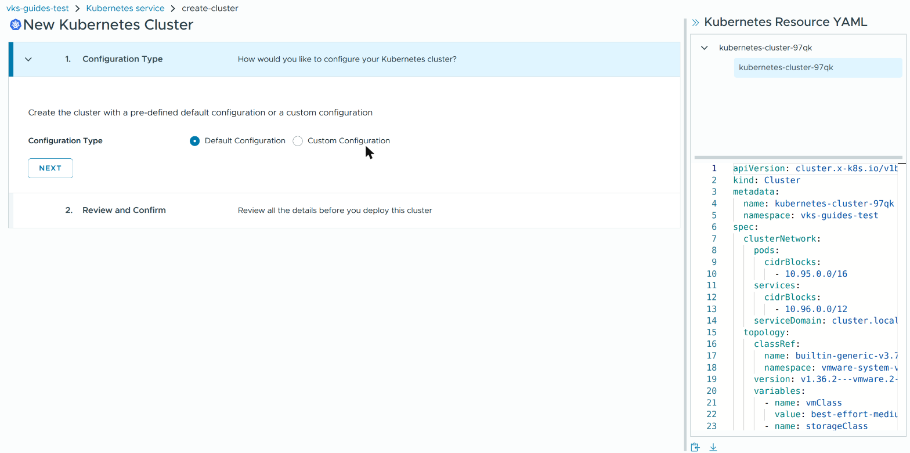

2. **2. General Settings:** replace the generated **Cluster Name** with your name. Choose the
   newest **Cluster Class** the list offers and your
   **Kubernetes Release**. In the **VM Class** table, select your class with the round button:
   the page preselects one, which may not be the one you want. Choose your **Storage Class**.

   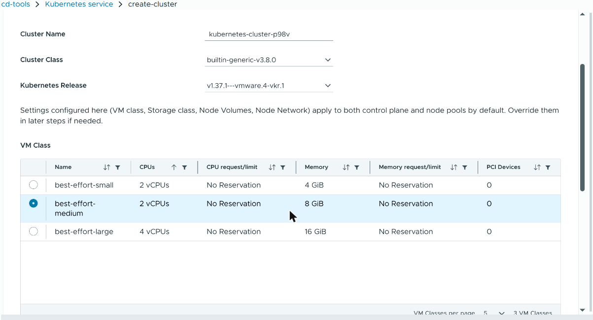

3. Still in step 2, open **Storage** and choose your storage class under **Default Storage
   Class**. The page leaves it empty; without it, every app that asks for a disk without naming a
   storage class waits forever. Click **NEXT**.

   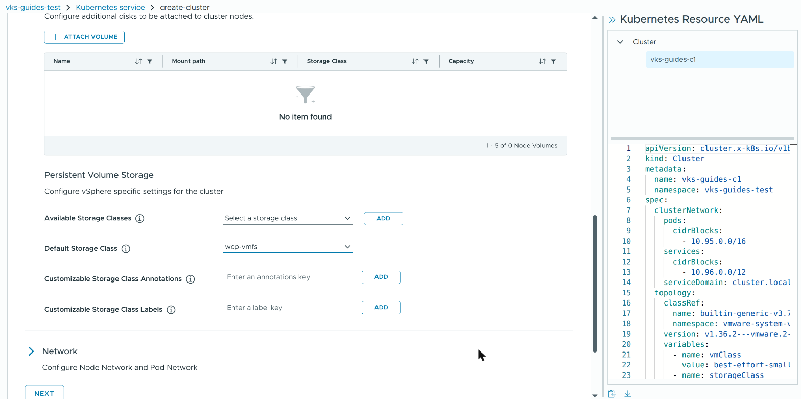

4. **3. Control plane:** set **Replicas** (`1` or `3`) and leave **OS Image** as it is. Click
   **NEXT**.

   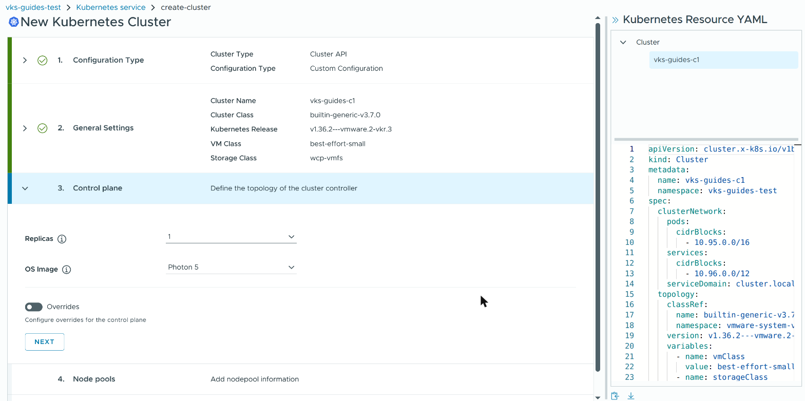

5. **4. Node pools:** the table holds one pool with **Replicas** `1`. To change the number of
   workers, open the row's ⋮ menu, choose **Edit** and set **Replicas**. To give the workers
   another VM class than the control plane (for example `best-effort-large` workers with a
   `best-effort-medium` control plane), turn on **Overrides** at the bottom of that window, click
   **NEXT**, and select the class under **VM Class & Storage Class**; click **NEXT** through the
   other steps and **FINISH**. The row then shows the pool's class. Click **NEXT**.

   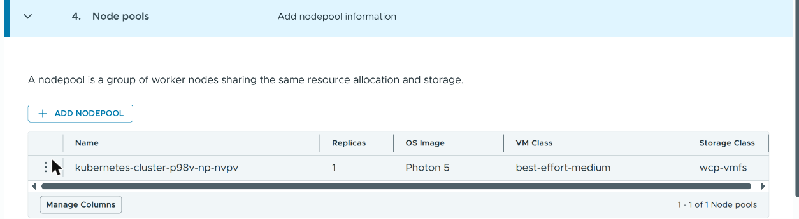

**Expect:** **5. Review and Confirm** opens, and steps 1 to 4 each show a green tick.

## 5. Review and create

1. In the **Kubernetes Resource YAML** pane, check the name, the version, `vmClass`,
   `storageClass`, and `defaultStorageClass` under `vsphereOptions`.

   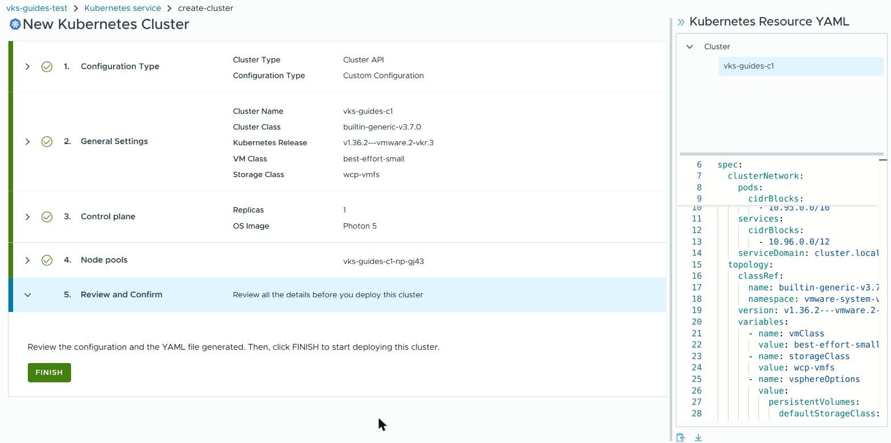

2. Click **FINISH**.

**Expect:** the list **vSphere Kubernetes Service** with your cluster, **Status** **Not
Available**, **Age** `< 1 min`.

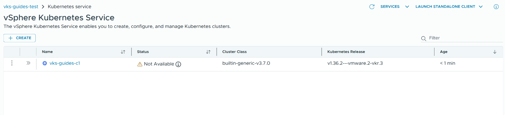

## 6. Wait for the cluster

Creating the cluster takes a few minutes, and you can use it only once it is available. Watch its
row in the vSphere Client (the refresh arrow reloads the list), or run this block after **FINISH**
(or step 9): it shows the cluster and each of its machines (the virtual machines that become its
nodes), with their state, and changes nothing. Run it again until the cluster is available. Set
`VKS_NAMESPACE` to your vSphere Namespace and `VKS_CLUSTER` to the cluster's name.

**Linux, macOS, WSL (bash or zsh):**

```sh
VKS_NAMESPACE="my-namespace"
VKS_CLUSTER="my-vks-cluster"
SUPERVISOR_CONTEXT="supervisor"
SUPERVISOR_KUBECONFIG="$HOME/.kube/${SUPERVISOR_CONTEXT}.kubeconfig"

kubectl --kubeconfig "$SUPERVISOR_KUBECONFIG" -n "$VKS_NAMESPACE" get clusters.cluster.x-k8s.io "$VKS_CLUSTER" \
  && kubectl --kubeconfig "$SUPERVISOR_KUBECONFIG" -n "$VKS_NAMESPACE" get machines.cluster.x-k8s.io -l "cluster.x-k8s.io/cluster-name=$VKS_CLUSTER"
```

**Windows (PowerShell):**

```powershell
$VKS_NAMESPACE = "my-namespace"
$VKS_CLUSTER = "my-vks-cluster"
$SUPERVISOR_CONTEXT = "supervisor"
$SUPERVISOR_KUBECONFIG = "$HOME\.kube\${SUPERVISOR_CONTEXT}.kubeconfig"

$global:LASTEXITCODE = $null
kubectl --kubeconfig $SUPERVISOR_KUBECONFIG -n $VKS_NAMESPACE get clusters.cluster.x-k8s.io $VKS_CLUSTER
if ($LASTEXITCODE -eq 0) { kubectl --kubeconfig $SUPERVISOR_KUBECONFIG -n $VKS_NAMESPACE get machines.cluster.x-k8s.io -l "cluster.x-k8s.io/cluster-name=$VKS_CLUSTER" }
```

**Expect:** the cluster with `AVAILABLE` `True`, and each machine `Running`; in the client,
**Available** with a green tick. The first cluster of a Kubernetes release takes longer, while
vCenter downloads its node image.

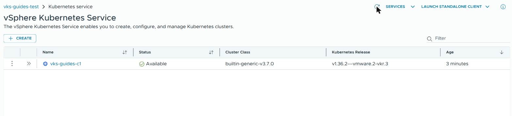

**If not:** still `False` after 30 minutes: run the three blocks below, in order, to find why.

Run this first when the cluster stays `False`: a cluster can get stuck on an address left over
from an older cluster of the same name. It prints the address the cluster uses and the address its
load balancer got, and changes nothing. If the two addresses are the same, the address is not
the cause. Set `VKS_NAMESPACE` to your vSphere Namespace and `VKS_CLUSTER` to the cluster's name.

**Linux, macOS, WSL (bash or zsh):**

```sh
VKS_NAMESPACE="my-namespace"
VKS_CLUSTER="my-vks-cluster"
SUPERVISOR_CONTEXT="supervisor"
SUPERVISOR_KUBECONFIG="$HOME/.kube/${SUPERVISOR_CONTEXT}.kubeconfig"

E="$(kubectl --kubeconfig "$SUPERVISOR_KUBECONFIG" -n "$VKS_NAMESPACE" get clusters.cluster.x-k8s.io "$VKS_CLUSTER" -o jsonpath='{.spec.controlPlaneEndpoint.host}')" \
  && A="$(kubectl --kubeconfig "$SUPERVISOR_KUBECONFIG" -n "$VKS_NAMESPACE" get virtualmachineservices "$VKS_CLUSTER" -o jsonpath='{.status.loadBalancer.ingress[0].ip}')" \
  && echo "cluster address: ${E:-none}, load balancer address: ${A:-none}"
```

**Windows (PowerShell):**

```powershell
$VKS_NAMESPACE = "my-namespace"
$VKS_CLUSTER = "my-vks-cluster"
$SUPERVISOR_CONTEXT = "supervisor"
$SUPERVISOR_KUBECONFIG = "$HOME\.kube\${SUPERVISOR_CONTEXT}.kubeconfig"

$global:LASTEXITCODE = $null
$E = kubectl --kubeconfig $SUPERVISOR_KUBECONFIG -n $VKS_NAMESPACE get clusters.cluster.x-k8s.io $VKS_CLUSTER -o jsonpath='{.spec.controlPlaneEndpoint.host}'
if ($LASTEXITCODE -eq 0) { $A = kubectl --kubeconfig $SUPERVISOR_KUBECONFIG -n $VKS_NAMESPACE get virtualmachineservices $VKS_CLUSTER -o jsonpath='{.status.loadBalancer.ingress[0].ip}' }
if ($LASTEXITCODE -eq 0) { "cluster address: $(if ($E) { $E } else { 'none' }), load balancer address: $(if ($A) { $A } else { 'none' })" }
```

**Expect:** the same address twice.

**If not:**
- `none`, or `NotFound` for the virtual machine service (the load-balancer entry that gives the
  cluster its address): wait, the address comes first.
- Two different addresses: the cluster kept an old address; delete it (step 8) and create it again
  under a new name.

Run this next if the two addresses match, to learn why the cluster waits. It describes the cluster
and changes nothing. Read the `Conditions` (the cluster's state checks) and the `Events` (what
happened to it) at the end of its output. Set `VKS_NAMESPACE` to your vSphere Namespace and
`VKS_CLUSTER` to the cluster's name.

**Linux, macOS, WSL (bash or zsh):**

```sh
VKS_NAMESPACE="my-namespace"
VKS_CLUSTER="my-vks-cluster"
SUPERVISOR_CONTEXT="supervisor"
SUPERVISOR_KUBECONFIG="$HOME/.kube/${SUPERVISOR_CONTEXT}.kubeconfig"

kubectl --kubeconfig "$SUPERVISOR_KUBECONFIG" -n "$VKS_NAMESPACE" describe clusters.cluster.x-k8s.io "$VKS_CLUSTER"
```

**Windows (PowerShell):**

```powershell
$VKS_NAMESPACE = "my-namespace"
$VKS_CLUSTER = "my-vks-cluster"
$SUPERVISOR_CONTEXT = "supervisor"
$SUPERVISOR_KUBECONFIG = "$HOME\.kube\${SUPERVISOR_CONTEXT}.kubeconfig"

kubectl --kubeconfig $SUPERVISOR_KUBECONFIG -n $VKS_NAMESPACE describe clusters.cluster.x-k8s.io $VKS_CLUSTER
```

**Expect:** the cluster's description, ending in its `Conditions` and `Events`.

**If not:**
- `NotFound`: check `VKS_NAMESPACE` and `VKS_CLUSTER`.
- No event says why the cluster waits: run the block below.

Run this last if no event says why the cluster waits. It checks, for each machine of the cluster,
whether vSphere could make its virtual machine, and changes nothing. You get one line per machine,
with vSphere's reason when it could not. Set `VKS_NAMESPACE` to your vSphere Namespace and
`VKS_CLUSTER` to the cluster's name.

**Linux, macOS, WSL (bash or zsh):**

```sh
VKS_NAMESPACE="my-namespace"
VKS_CLUSTER="my-vks-cluster"
SUPERVISOR_CONTEXT="supervisor"
SUPERVISOR_KUBECONFIG="$HOME/.kube/${SUPERVISOR_CONTEXT}.kubeconfig"

kubectl --kubeconfig "$SUPERVISOR_KUBECONFIG" -n "$VKS_NAMESPACE" get vspheremachines.vmware.infrastructure.cluster.x-k8s.io -l "cluster.x-k8s.io/cluster-name=$VKS_CLUSTER" -o json \
  | jq -r '.items[] | "\(.metadata.name): " + ([.status.conditions[]? | select(.type == "VirtualMachineProvisioned") | "\(.status) \(.reason // "") \(.message // "")"] | join(""))'
```

**Windows (PowerShell):**

```powershell
$VKS_NAMESPACE = "my-namespace"
$VKS_CLUSTER = "my-vks-cluster"
$SUPERVISOR_CONTEXT = "supervisor"
$SUPERVISOR_KUBECONFIG = "$HOME\.kube\${SUPERVISOR_CONTEXT}.kubeconfig"

$global:LASTEXITCODE = $null
$J = kubectl --kubeconfig $SUPERVISOR_KUBECONFIG -n $VKS_NAMESPACE get vspheremachines.vmware.infrastructure.cluster.x-k8s.io -l "cluster.x-k8s.io/cluster-name=$VKS_CLUSTER" -o json | Out-String
if ($LASTEXITCODE -eq 0) {
  foreach ($M in (ConvertFrom-Json $J).items) { $C = @($M.status.conditions | Where-Object { $_.type -eq 'VirtualMachineProvisioned' })[0]; "$($M.metadata.name): $($C.status) $($C.reason) $($C.message)" }
}
```

**Expect:** a line per machine, `True Provisioned` once vSphere made its virtual machine.

**If not:**
- `False` and a message that ends in `insufficient storage quota`: the vSphere Namespace's storage
  limit is full. A cluster of one control-plane node and two `best-effort-medium` workers in one
  node pool needs about 84 GB, and about 156 GB while it changes to `best-effort-large` (step 2).
  Free storage in the namespace, or ask your vCenter administrator to raise its limit.
- Nothing printed: check `VKS_NAMESPACE` and `VKS_CLUSTER`, or wait until the first block of this
  step lists machines.
- `Forbidden`: ask your vCenter administrator to run it.

Never switch the cluster's virtual machines on or off in the vSphere Client: VKS owns them.

## 7. Get the kubeconfig and check the cluster

Get the cluster's kubeconfig (the file that lets kubectl reach the cluster), in the vSphere
Client ([Download the VKS cluster's kubeconfig from the vSphere Client](SUPERVISOR-LOGIN.md#download-the-vks-clusters-kubeconfig-from-the-vsphere-client))
or with the VCF CLI ([Get the VKS cluster's kubeconfig](SUPERVISOR-LOGIN.md#get-the-vks-clusters-kubeconfig)):
either way it is saved as `~/.kube/<cluster>.kubeconfig`. Then run
[Match kubectl to the cluster's version](SUPERVISOR-LOGIN.md#match-kubectl-to-the-clusters-version-optional).

Then run this once the cluster is available, to check that every node is ready for apps. It reads
the cluster with `~/.kube/<VKS_CLUSTER>.kubeconfig` and changes nothing. It lists the nodes and
names the storage class an app's disk gets when the app names none. Set `VKS_CLUSTER` to the
cluster's name.

**Linux, macOS, WSL (bash or zsh):**

```sh
VKS_CLUSTER="my-vks-cluster"
VKS_KUBECONFIG="$HOME/.kube/${VKS_CLUSTER}.kubeconfig"

if kubectl --kubeconfig "$VKS_KUBECONFIG" get nodes && J="$(kubectl --kubeconfig "$VKS_KUBECONFIG" get storageclass -o json)"; then
  echo "default storage class: $(printf '%s' "$J" | jq -r '[.items[] | select(.metadata.annotations["storageclass.kubernetes.io/is-default-class"] == "true") | .metadata.name] | if length == 0 then "NONE" else join(" ") end')"
else
  echo "FAILED: cannot read the cluster (see the error above)"
fi
```

**Windows (PowerShell):**

```powershell
$VKS_CLUSTER = "my-vks-cluster"
$VKS_KUBECONFIG = "$HOME\.kube\${VKS_CLUSTER}.kubeconfig"

$global:LASTEXITCODE = $null
kubectl --kubeconfig $VKS_KUBECONFIG get nodes
if ($LASTEXITCODE -eq 0) { $J = kubectl --kubeconfig $VKS_KUBECONFIG get storageclass -o json | Out-String }
if ($LASTEXITCODE -eq 0) {
  $D = @((ConvertFrom-Json $J).items | Where-Object { $_.metadata.annotations.'storageclass.kubernetes.io/is-default-class' -eq 'true' } | ForEach-Object { $_.metadata.name })
  "default storage class: $(if ($D.Count) { $D -join ' ' } else { 'NONE' })"
} else {
  "FAILED: cannot read the cluster (see the error above)"
}
```

**Expect:** each node `Ready`, then `default storage class:` and the storage class you chose.

**If not:**
- Nothing after `default storage class:`, under `jq: command not found`: install jq
  ([PREREQS.md](PREREQS.md)).
- `default storage class: NONE`: **Default Storage Class** was left empty in step 4. Name the
  storage class in each disk request, or create a new cluster with it set.
- `FAILED: cannot read the cluster`, under `no such file or directory` (Windows: `cannot find
  the file specified`): get the kubeconfig first (the start of this step).

## 8. Delete the cluster (optional)

If you installed monitoring with ArgoCD, run [MONITORING.md](MONITORING.md) step 10 first.
**This destroys the cluster and its virtual machines.** The disks its apps created stay in the
vSphere Namespace and keep their storage
([Broadcom KB 402764](https://knowledge.broadcom.com/external/article/402764)). A cluster that
ArgoCD manages comes back after you delete it here; delete it in ArgoCD instead.

First run the block in [Check that the name is free](#check-that-the-name-is-free) (step 2) with
your cluster's name.

**Expect:** `in use:`, then `cluster.cluster.x-k8s.io/<name>` and
`virtualmachineservice.vmoperator.vmware.com/<name>` (the cluster and its address entry). If it
says `none now` or `unknown`, stop: the name is wrong, or you may not read it.

Then run this before the delete, to know which disks the cluster's apps made: they outlive the
cluster. It lists them, first as the cluster sees them, then as they sit in the vSphere Namespace,
and changes nothing. Keep the list to compare with after the delete. Set `VKS_NAMESPACE` to your
vSphere Namespace and `VKS_CLUSTER` to the cluster's name.

**Linux, macOS, WSL (bash or zsh):**

```sh
VKS_NAMESPACE="my-namespace"
VKS_CLUSTER="my-vks-cluster"
SUPERVISOR_CONTEXT="supervisor"
SUPERVISOR_KUBECONFIG="$HOME/.kube/${SUPERVISOR_CONTEXT}.kubeconfig"
VKS_KUBECONFIG="$HOME/.kube/${VKS_CLUSTER}.kubeconfig"

kubectl --kubeconfig "$VKS_KUBECONFIG" get persistentvolumeclaims -A
kubectl --kubeconfig "$SUPERVISOR_KUBECONFIG" -n "$VKS_NAMESPACE" get persistentvolumeclaims -l "$VKS_CLUSTER/TKGService"
```

**Windows (PowerShell):**

```powershell
$VKS_NAMESPACE = "my-namespace"
$VKS_CLUSTER = "my-vks-cluster"
$SUPERVISOR_CONTEXT = "supervisor"
$SUPERVISOR_KUBECONFIG = "$HOME\.kube\${SUPERVISOR_CONTEXT}.kubeconfig"
$VKS_KUBECONFIG = "$HOME\.kube\${VKS_CLUSTER}.kubeconfig"

kubectl --kubeconfig $VKS_KUBECONFIG get persistentvolumeclaims -A
kubectl --kubeconfig $SUPERVISOR_KUBECONFIG -n $VKS_NAMESPACE get persistentvolumeclaims -l "$VKS_CLUSTER/TKGService"
```

**Expect:** `No resources found` twice, or the disks listed. Each disk listed stays after the
delete and keeps its storage; the optional last block of this step deletes them all.

**If not:** the first list fails under `no such file or directory` (Windows: `cannot find the file
specified`): get the kubeconfig first (step 7).

Then run this, with the disk list kept, to delete the cluster. It deletes the cluster and its
virtual machines, and returns at once without waiting. Once the delete finishes, the cluster is
gone, and the disks listed above stay. Set `VKS_NAMESPACE` to your vSphere Namespace and
`VKS_CLUSTER` to the cluster's name.

**Linux, macOS, WSL (bash or zsh):**

```sh
VKS_NAMESPACE="my-namespace"
VKS_CLUSTER="my-vks-cluster"
SUPERVISOR_CONTEXT="supervisor"
SUPERVISOR_KUBECONFIG="$HOME/.kube/${SUPERVISOR_CONTEXT}.kubeconfig"

kubectl --kubeconfig "$SUPERVISOR_KUBECONFIG" -n "$VKS_NAMESPACE" delete clusters.cluster.x-k8s.io "$VKS_CLUSTER" --wait=false
```

**Windows (PowerShell):**

```powershell
$VKS_NAMESPACE = "my-namespace"
$VKS_CLUSTER = "my-vks-cluster"
$SUPERVISOR_CONTEXT = "supervisor"
$SUPERVISOR_KUBECONFIG = "$HOME\.kube\${SUPERVISOR_CONTEXT}.kubeconfig"

kubectl --kubeconfig $SUPERVISOR_KUBECONFIG -n $VKS_NAMESPACE delete clusters.cluster.x-k8s.io $VKS_CLUSTER --wait=false
```

**Expect:** `cluster.cluster.x-k8s.io "<name>" deleted` (newer kubectl: `… deleted from <your
namespace> namespace`). Then run the block in
[Check that the name is free](#check-that-the-name-is-free) again until it says `none now`, and
the disk block above: its first command now fails (the cluster is gone); its second list shows the
disks the cluster left behind.

**If not:** `Forbidden`: your role on the namespace cannot delete clusters; ask for the
**Namespaces Edit** role.

Optional: run this after the delete, when nobody needs the data on the deleted cluster's disks:
they still use the vSphere Namespace's storage. **This deletes them (the second list of the disk
block above) and what they hold, for good.** It deletes nothing while a cluster of that name
exists. Afterwards the second list of the disk block is empty. Set `VKS_NAMESPACE` to your
vSphere Namespace and `VKS_CLUSTER` to the deleted cluster's name.

**Linux, macOS, WSL (bash or zsh):**

```sh
VKS_NAMESPACE="my-namespace"
VKS_CLUSTER="my-vks-cluster"
SUPERVISOR_CONTEXT="supervisor"
SUPERVISOR_KUBECONFIG="$HOME/.kube/${SUPERVISOR_CONTEXT}.kubeconfig"

if ! L="$(kubectl --kubeconfig "$SUPERVISOR_KUBECONFIG" -n "$VKS_NAMESPACE" get clusters.cluster.x-k8s.io "$VKS_CLUSTER" --ignore-not-found -o name)"; then
  echo "Nothing deleted: cannot read the clusters (see the error above)"
elif [ -n "$L" ]; then
  echo "Nothing deleted: $L still exists"
else
  kubectl --kubeconfig "$SUPERVISOR_KUBECONFIG" -n "$VKS_NAMESPACE" delete persistentvolumeclaims -l "$VKS_CLUSTER/TKGService"
fi
```

**Windows (PowerShell):**

```powershell
$VKS_NAMESPACE = "my-namespace"
$VKS_CLUSTER = "my-vks-cluster"
$SUPERVISOR_CONTEXT = "supervisor"
$SUPERVISOR_KUBECONFIG = "$HOME\.kube\${SUPERVISOR_CONTEXT}.kubeconfig"

$global:LASTEXITCODE = $null
$L = kubectl --kubeconfig $SUPERVISOR_KUBECONFIG -n $VKS_NAMESPACE get clusters.cluster.x-k8s.io $VKS_CLUSTER --ignore-not-found -o name
if ($LASTEXITCODE -ne 0) { "Nothing deleted: cannot read the clusters (see the error above)" }
elseif ($L) { "Nothing deleted: $L still exists" }
else { kubectl --kubeconfig $SUPERVISOR_KUBECONFIG -n $VKS_NAMESPACE delete persistentvolumeclaims -l "$VKS_CLUSTER/TKGService" }
```

**Expect:** a `persistentvolumeclaim "<id>" deleted` line for each disk, or `No resources found`.

**If not:**
- `Nothing deleted: … still exists`: the cluster's delete has not finished. Run the block in
  [Check that the name is free](#check-that-the-name-is-free) until it says `none now`, then this
  block again.
- `Nothing deleted: cannot read the clusters`: the error above says why; under `Unauthorized`,
  run [Renew the Supervisor login](SUPERVISOR-LOGIN.md#renew-the-supervisor-login), then this block again.

Do not create the next cluster under the same name. The cluster's kubeconfig stays in
`~/.kube`; delete it yourself.

## 9. Create the cluster with kubectl and a YAML file

This replaces steps 3 to 5: you write the cluster as a YAML file and create it with kubectl. Run
steps 1 and 2 first.

1. Run this before you write the file, to know which values your Supervisor and namespace accept.
   It lists the Kubernetes releases you may use, the newest cluster class, and the namespace's VM
   classes and storage classes, and changes nothing. You copy its values into the file in the
   next step. Set `VKS_NAMESPACE` to your vSphere Namespace.

<details>
<summary><b>Linux, macOS, WSL (bash or zsh)</b></summary>

```sh
VKS_NAMESPACE="my-namespace"
SUPERVISOR_CONTEXT="supervisor"
SUPERVISOR_KUBECONFIG="$HOME/.kube/${SUPERVISOR_CONTEXT}.kubeconfig"

if J="$(kubectl --kubeconfig "$SUPERVISOR_KUBECONFIG" get kr -o json)"; then
  echo "Kubernetes releases ready to use (version:), newest last:"
  printf '%s' "$J" | jq -r '[.items[] | select([.status.conditions[]? | select(.type == "Ready" or .type == "Compatible") | .status] | length == 2 and all(. == "True")) | .metadata.name] | sort_by(split("---")[0] | ltrimstr("v") | split(".") | map(tonumber)) | .[]'
else
  echo "Kubernetes releases: unknown (see the error above)"
fi
if J="$(kubectl --kubeconfig "$SUPERVISOR_KUBECONFIG" -n vmware-system-vks-public get clusterclass -o json)"; then
  echo "Newest cluster class (classRef name:): $(printf '%s' "$J" | jq -r '[.items[].metadata.name] | sort_by(capture("v(?<v>[0-9.]+)$").v | split(".") | map(tonumber)) | last')"
else
  echo "Cluster classes: unknown (see the error above)"
fi
echo "VM classes (vmClass:):"
kubectl --kubeconfig "$SUPERVISOR_KUBECONFIG" -n "$VKS_NAMESPACE" get virtualmachineclass --no-headers
echo "Storage classes (storageClass:, defaultStorageClass:):"
kubectl --kubeconfig "$SUPERVISOR_KUBECONFIG" -n "$VKS_NAMESPACE" get storagepolicyquota \
  -o jsonpath='{range .items[*].status.total[*]}{.storageClassName}{"\n"}{end}' | sort -u
```

</details>

<details>
<summary><b>Windows (PowerShell)</b></summary>

```powershell
$VKS_NAMESPACE = "my-namespace"
$SUPERVISOR_CONTEXT = "supervisor"
$SUPERVISOR_KUBECONFIG = "$HOME\.kube\${SUPERVISOR_CONTEXT}.kubeconfig"

$global:LASTEXITCODE = $null
$J = kubectl --kubeconfig $SUPERVISOR_KUBECONFIG get kr -o json
if ($LASTEXITCODE -eq 0) {
  "Kubernetes releases ready to use (version:), newest last:"
  ($J | Out-String | ConvertFrom-Json).items | Where-Object {
    @($_.status.conditions | Where-Object { ($_.type -eq 'Ready' -or $_.type -eq 'Compatible') -and $_.status -eq 'True' }).Count -eq 2
  } | ForEach-Object { $_.metadata.name } | Sort-Object { [version](($_ -split '---')[0].TrimStart('v')) }
} else {
  "Kubernetes releases: unknown (see the error above)"
}
$J = kubectl --kubeconfig $SUPERVISOR_KUBECONFIG -n vmware-system-vks-public get clusterclass -o json
if ($LASTEXITCODE -eq 0) {
  $N = ($J | Out-String | ConvertFrom-Json).items | ForEach-Object { $_.metadata.name } |
    Sort-Object { [version]($_ -replace '^.*-v', '') } | Select-Object -Last 1
  "Newest cluster class (classRef name:): $N"
} else {
  "Cluster classes: unknown (see the error above)"
}
"VM classes (vmClass:):"
kubectl --kubeconfig $SUPERVISOR_KUBECONFIG -n $VKS_NAMESPACE get virtualmachineclass --no-headers
"Storage classes (storageClass:, defaultStorageClass:):"
$J = kubectl --kubeconfig $SUPERVISOR_KUBECONFIG -n $VKS_NAMESPACE get storagepolicyquota -o json
if ($LASTEXITCODE -eq 0) {
  ($J | Out-String | ConvertFrom-Json).items | ForEach-Object { $_.status.total } |
    ForEach-Object { $_.storageClassName } | Sort-Object -Unique
}
```

</details>

**Expect:** one or more release names such as `v1.37.1---vmware.4-vkr.1`, a cluster class such as
`builtin-generic-v3.8.0`, at least one VM class and at least one storage class.

**If not:** as in [Check the namespace](NAMESPACE.md#8-check-the-namespace).

2. Save this as `cluster.yaml` in your home folder (Windows: `C:\Users\<you>`). Change the lines
   marked `# <--`, with the values from the block above; leave the rest as it is.

```yaml
apiVersion: cluster.x-k8s.io/v1beta2
kind: Cluster
metadata:
  name: my-vks-cluster                  # <-- 1. the name from step 2
  namespace: my-namespace               # <-- 2. your vSphere Namespace
spec:
  clusterNetwork:
    pods:
      cidrBlocks:
        - 10.95.0.0/16                  # <-- 8. only if your network uses this range
    services:
      cidrBlocks:
        - 10.96.0.0/12                  # <-- 8. only if your network uses this range
    serviceDomain: cluster.local
  topology:
    classRef:
      name: builtin-generic-v3.8.0      # <-- 3. the newest cluster class
      namespace: vmware-system-vks-public
    version: v1.37.1---vmware.4-vkr.1   # <-- 4. a Kubernetes release, usually the newest
    controlPlane:
      replicas: 1                       # <-- 5. control-plane nodes: 1 or 3
    workers:
      machineDeployments:
        - class: node-pool
          name: node-pool-1
          replicas: 1                   # <-- 6. worker nodes: 1 or more
    variables:
      - name: vmClass
        value: best-effort-medium       # <-- 7. a VM class
      - name: storageClass
        value: wcp-vmfs                 # <-- 7. a storage class
      - name: vsphereOptions
        value:
          persistentVolumes:
            defaultStorageClass: wcp-vmfs   # <-- 7. the same storage class
```

| # | line | what to put |
|---|---|---|
| 1 | `metadata.name` | the cluster's name from step 2, never used before in this namespace |
| 2 | `metadata.namespace` | your vSphere Namespace; the same as `VKS_NAMESPACE` in the block below |
| 3 | `classRef.name` | the newest cluster class the block lists |
| 4 | `version` | one name from the block's release list. The cluster stores it shortened: `v1.37.1---vmware.4-vkr.1` becomes `v1.37.1+vmware.4` |
| 5 | `controlPlane.replicas` | `1`, or `3` for a cluster that must stay up when a node fails |
| 6 | `machineDeployments` `replicas` | the number of worker nodes |
| 7 | `vmClass`, `storageClass`, `defaultStorageClass` | a VM class and a storage class from the block (see the table in step 2). `defaultStorageClass` is the class apps get when they do not name one |
| 8 | `cidrBlocks` | the cluster's internal address ranges for apps (pods) and services; the vSphere Client's create page uses these same values. Change them only if they overlap your Supervisor's workload networks or load balancer addresses; ask a vCenter administrator |

Leave `class: node-pool` (the node pool type the cluster class defines), `serviceDomain` and
`classRef.namespace` as they are.

3. Run this once the file is saved, to create the cluster from it. It first checks the file on
   the Supervisor without creating anything (`--dry-run=server`), and creates the cluster only if
   that check passes. Afterwards the cluster is being created, as after **FINISH** in step 5. Set
   `VKS_NAMESPACE` to the vSphere Namespace in the file's `metadata.namespace`.

**Linux, macOS, WSL (bash or zsh):**

```sh
VKS_NAMESPACE="my-namespace"
CLUSTER_YAML="$HOME/cluster.yaml"
SUPERVISOR_CONTEXT="supervisor"
SUPERVISOR_KUBECONFIG="$HOME/.kube/${SUPERVISOR_CONTEXT}.kubeconfig"

kubectl --kubeconfig "$SUPERVISOR_KUBECONFIG" -n "$VKS_NAMESPACE" create --dry-run=server -f "$CLUSTER_YAML" \
  && kubectl --kubeconfig "$SUPERVISOR_KUBECONFIG" -n "$VKS_NAMESPACE" create -f "$CLUSTER_YAML"
```

**Windows (PowerShell):**

```powershell
$VKS_NAMESPACE = "my-namespace"
$CLUSTER_YAML = "$HOME\cluster.yaml"
$SUPERVISOR_CONTEXT = "supervisor"
$SUPERVISOR_KUBECONFIG = "$HOME\.kube\${SUPERVISOR_CONTEXT}.kubeconfig"

$global:LASTEXITCODE = $null
kubectl --kubeconfig $SUPERVISOR_KUBECONFIG -n $VKS_NAMESPACE create --dry-run=server -f $CLUSTER_YAML
if ($LASTEXITCODE -eq 0) { kubectl --kubeconfig $SUPERVISOR_KUBECONFIG -n $VKS_NAMESPACE create -f $CLUSTER_YAML }
```

**Expect:** `cluster.cluster.x-k8s.io/<name> created (server dry run)`, then
`cluster.cluster.x-k8s.io/<name> created`.

**If not:** nothing is created when the first line fails. Fix the file and run the block again.
- `AlreadyExists`: choose another name (step 2).
- `Could not resolve KR/OSImage`: `version` is not a release from the list.
- `vm class(es): … not found` or `storage class(es): … not found`: line 7 names a class the
  namespace does not have.
- `MachineDeploymentClass with name … does not exist`: put back `class: node-pool`.
- `does not match the namespace`: `metadata.namespace` and `VKS_NAMESPACE` differ.
- `the path "…" does not exist`: the file is not where `CLUSTER_YAML` says.
- `Forbidden` with none of these messages: your user needs the **Namespaces Edit** role on the
  namespace.

Then go on with [step 6](#6-wait-for-the-cluster). Step 8 deletes a cluster made this way too.

## 10. Resize the cluster (optional)

This changes the size of a running cluster's nodes (its VM class) or its number of workers, in the
vSphere Client. VKS replaces the nodes one at a time: it makes a new node first, moves the pods,
then deletes the old one. The cluster keeps its address, and apps with a volume keep their data.

Before you start, check the namespace's storage limit as in
[step 2](#check-the-namespaces-storage-limit):
during the change the cluster has one node more for the control plane and one more per node pool.

1. In the vSphere Client, open your namespace, its **Resources** tab, and **Kubernetes service**.
   On your cluster's row, open the ⋮ menu and choose **View YAML**.

   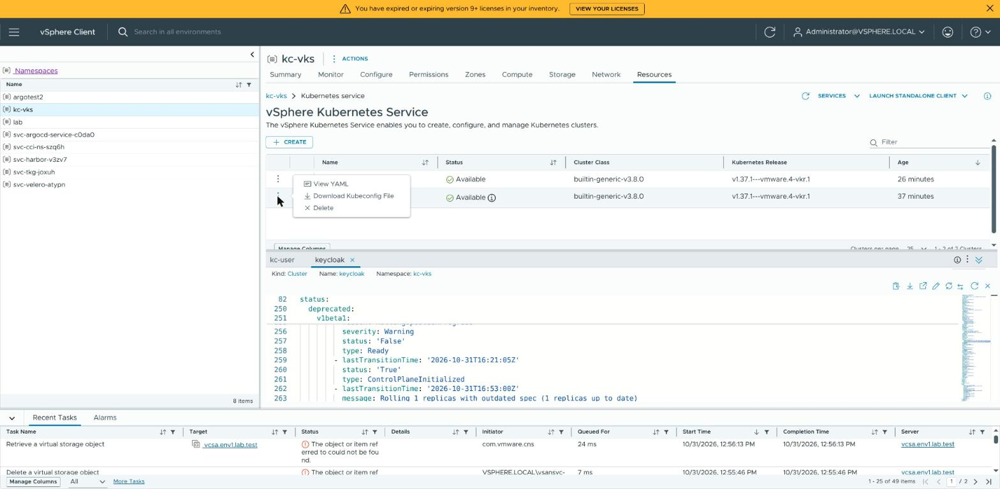

2. In the YAML pane below the list, click the pencil icon (**Reload and edit latest YAML**). Under
   `spec`, `topology`:
   - for the node size, change the `value` under `- name: vmClass` (in `variables`) to another
     VM class of the namespace (step 9's first block lists them). A cluster made on the create page
     with **Overrides** has a `vmClass` under `controlPlane` or a node pool's `overrides` as well;
     change those too;
   - for the size of the workers only (for example `best-effort-large` workers, a class the
     namespace has, with a `best-effort-medium` control plane), when the node pool has no
     `overrides` yet: add a line below the line `name: node-pool-1` (your pool's name, under
     `machineDeployments`; under each pool you change), starting in the same column as `name:`,
     with the class you want:
     `variables: {overrides: [{name: vmClass, value: best-effort-large}]}`. The editor does not
     indent a new line, so type the spaces. A wrong column either makes **SAVE** report a YAML
     syntax error, or saves nothing for the pool: after **SAVE**, reload the YAML and check that it
     shows four lines under the pool (`variables:`, `overrides:`, `- name: vmClass`, `value: …`);
     to go back to the cluster's class, delete those four lines;
   - for the number of workers, change `replicas` under `workers`, `machineDeployments`.

   The editor's **Find and replace** (Ctrl+H) finds the line.

   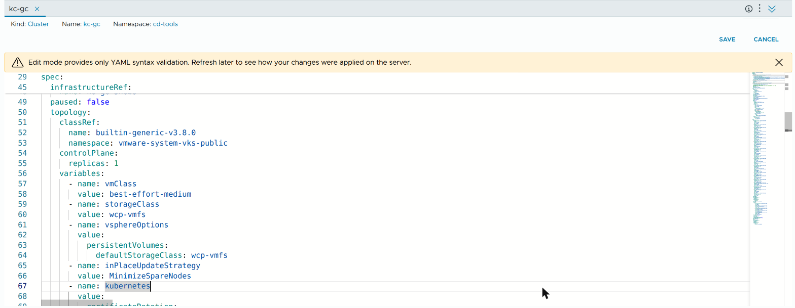

3. Click **SAVE**. The vSphere Client checks only that the text is YAML, not that the change
   works: check it with the block below.

   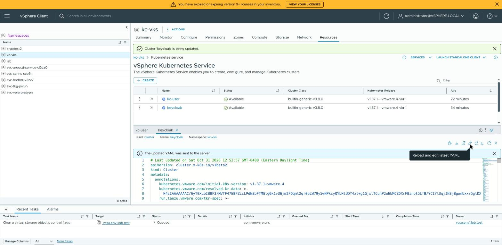

While the nodes are replaced, the cluster's status shows an ⓘ, and its YAML's `status` reads
*Rolling 1 replicas with outdated spec*.

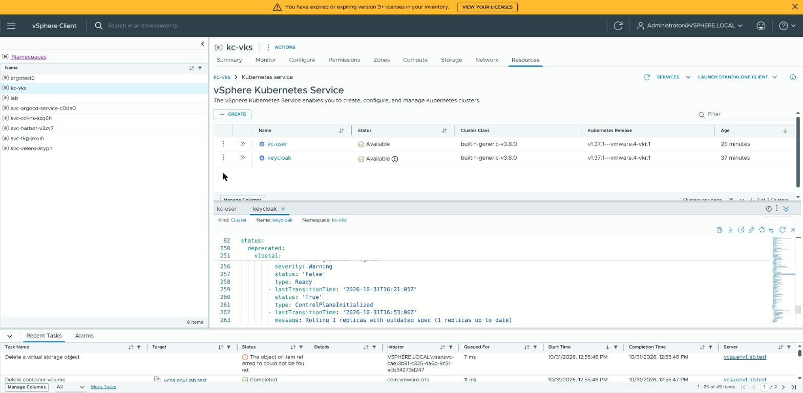

Run this after **SAVE**, to follow the change and know when it is done. It shows the VM class the
cluster asks for, the class of each node, and whether all nodes are up to date, and changes
nothing. Run it again until every node is of the new class (or the number of workers is the one you
set), `PoweredOn`, and both lines say `True`: then the resize is done. Set `VKS_NAMESPACE` to your
vSphere Namespace and `VKS_CLUSTER` to the cluster's name.

**Linux, macOS, WSL (bash or zsh):**

```sh
VKS_NAMESPACE="my-namespace"
VKS_CLUSTER="my-vks-cluster"
SUPERVISOR_CONTEXT="supervisor"
SUPERVISOR_KUBECONFIG="$HOME/.kube/${SUPERVISOR_CONTEXT}.kubeconfig"

sv() { kubectl --kubeconfig "$SUPERVISOR_KUBECONFIG" -n "$VKS_NAMESPACE" "$@"; }
if V="$(sv get cluster "$VKS_CLUSTER" -o jsonpath='{.spec.topology.variables[?(@.name=="vmClass")].value}')"; then
  echo "the cluster asks for: $V"
  sv get virtualmachines -l "cluster.x-k8s.io/cluster-name=$VKS_CLUSTER" -o custom-columns='NODE:.metadata.name,CLASS:.spec.className,POWER:.status.powerState'
  sv get cluster "$VKS_CLUSTER" -o jsonpath='control plane up to date: {.status.conditions[?(@.type=="ControlPlaneMachinesUpToDate")].status}{"\n"}workers up to date: {.status.conditions[?(@.type=="WorkerMachinesUpToDate")].status}{"\n"}'
else
  echo "FAILED: cannot read the cluster (see the error above)"
fi
```

**Windows (PowerShell):**

```powershell
$VKS_NAMESPACE = "my-namespace"
$VKS_CLUSTER = "my-vks-cluster"
$SUPERVISOR_CONTEXT = "supervisor"
$SUPERVISOR_KUBECONFIG = "$HOME\.kube\${SUPERVISOR_CONTEXT}.kubeconfig"

$global:LASTEXITCODE = $null
$V = kubectl --kubeconfig $SUPERVISOR_KUBECONFIG -n $VKS_NAMESPACE get cluster $VKS_CLUSTER -o jsonpath='{.spec.topology.variables[?(@.name==''vmClass'')].value}'
if ($LASTEXITCODE -eq 0) {
  "the cluster asks for: $V"
  kubectl --kubeconfig $SUPERVISOR_KUBECONFIG -n $VKS_NAMESPACE get virtualmachines -l "cluster.x-k8s.io/cluster-name=$VKS_CLUSTER" -o custom-columns='NODE:.metadata.name,CLASS:.spec.className,POWER:.status.powerState'
  kubectl --kubeconfig $SUPERVISOR_KUBECONFIG -n $VKS_NAMESPACE get cluster $VKS_CLUSTER -o jsonpath='control plane up to date: {.status.conditions[?(@.type==''ControlPlaneMachinesUpToDate'')].status}{''\n''}workers up to date: {.status.conditions[?(@.type==''WorkerMachinesUpToDate'')].status}{''\n''}'
} else {
  "FAILED: cannot read the cluster (see the error above)"
}
```

**Expect:** `the cluster asks for:` the new class; during the change, a new node for the control
plane and for each node pool next to the old ones; at the end, every node of the new class,
`PoweredOn`, and `control plane up to date: True`, `workers up to date: True`. For the workers
only: `the cluster asks for:` still shows the cluster's class, only the workers get the new class,
and the control-plane node is not replaced.

**If not:**
- After 20 minutes still a node of the old class (for the workers only: a worker), or a node that
  never powers on: the `describe` block in [step 6](#6-wait-for-the-cluster)'s **If not** names
  the reason. A namespace storage limit without room for the new nodes
  ([step 2](#check-the-namespaces-storage-limit)) stops the change. Fix the cause, or set the value
  back, and save again.
- Nodes of the old class after the change finished (unless you changed the workers only): the
  cluster has a `vmClass` under `overrides` too (step 2 above).
- Pods `Pending` with `Insufficient memory` after the change: the new class is too small for what
  runs in the cluster; choose a larger one.
