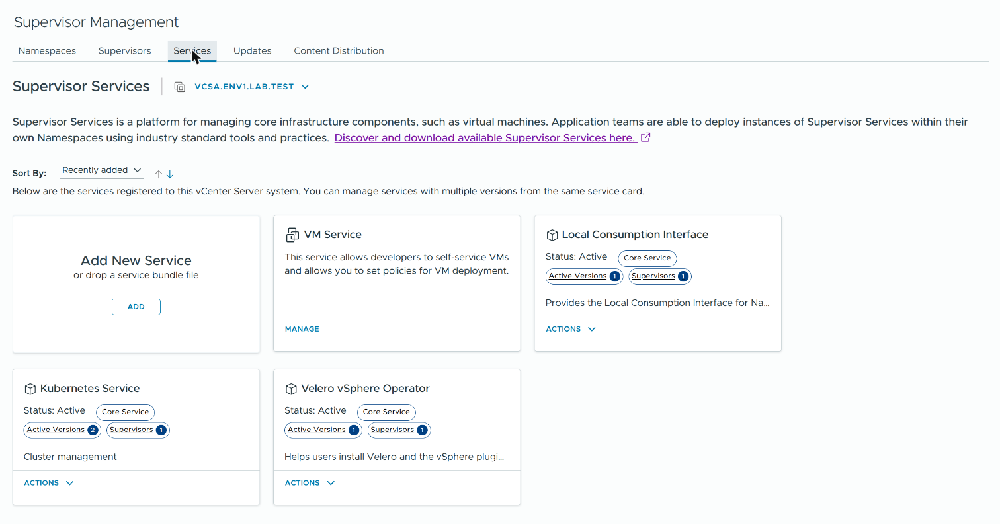
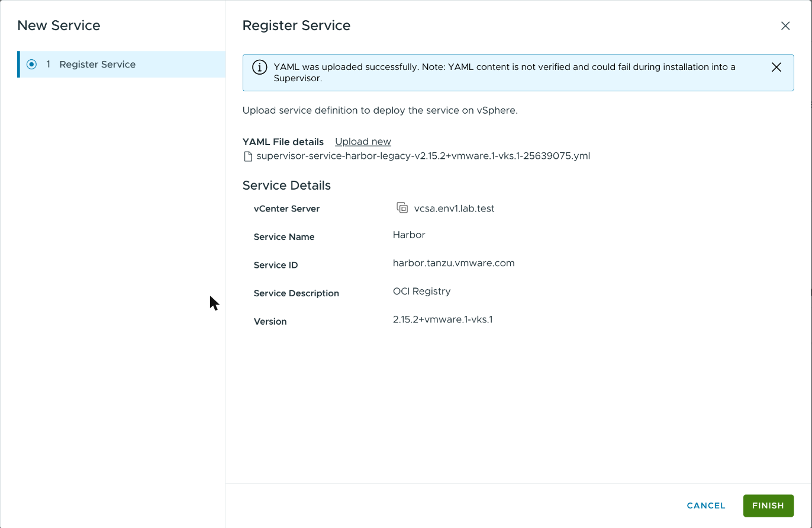
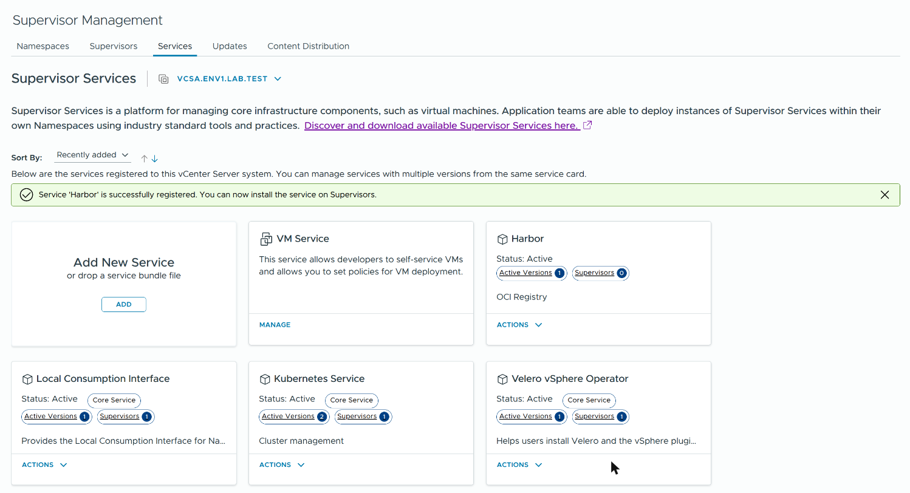
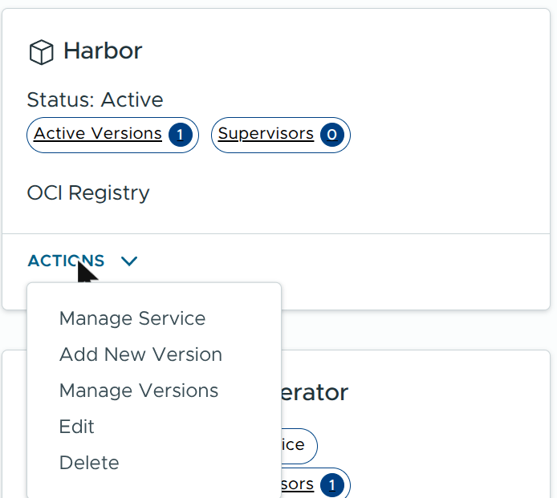
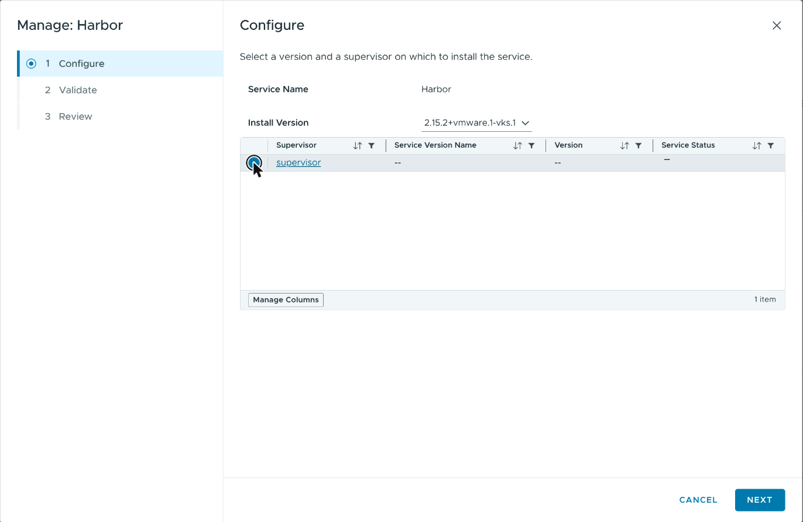
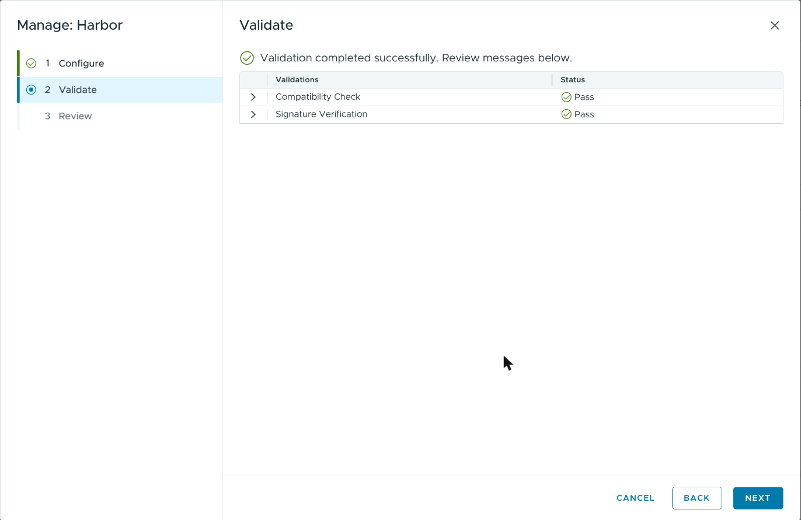
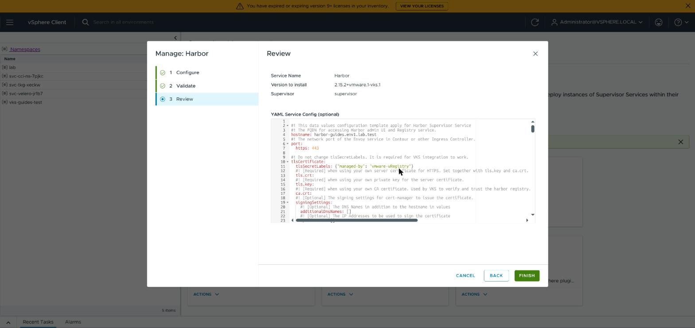
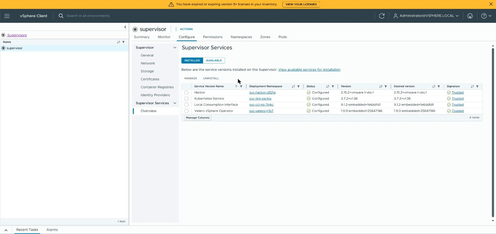
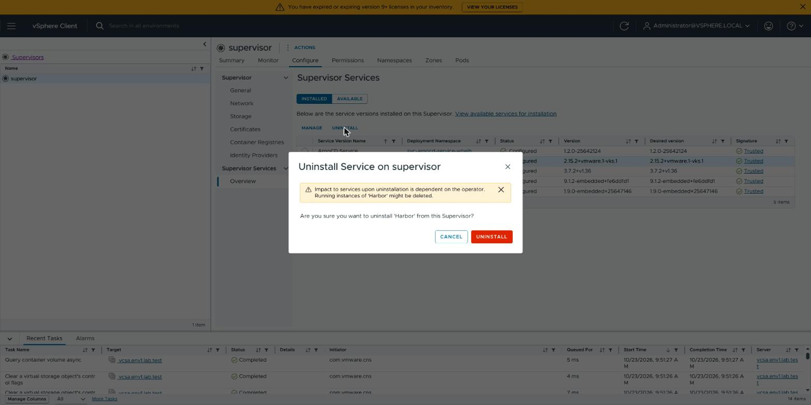

# Install Harbor on the Supervisor

> [!NOTE]
> **Official Broadcom documentation (VCF 9.1) and Harbor documentation for this guide**
>
> - [Installing and Configuring Harbor as a Supervisor Service](https://techdocs.broadcom.com/us/en/vmware-cis/vcf/vcf-service-administration-and-development/9-1/using-harbor-as-vcf-service/installing-and-configuring-harbor-and-contour.html)
> - [Install Harbor as a Supervisor Service](https://techdocs.broadcom.com/us/en/vmware-cis/vcf/vcf-service-administration-and-development/9-1/using-harbor-as-vcf-service/installing-and-configuring-harbor-and-contour/install-harbor-as-a-supervisor-service.html)
> - [Supervisor Service Supported Input Parameters and Day 2 Alternations](https://techdocs.broadcom.com/us/en/vmware-cis/vcf/vcf-service-administration-and-development/9-1/using-harbor-as-vcf-service/using-harbor-as-a-vcf-service/supervisor-service-supported-input-parameters-and-day-2-alternations.html) (which values cannot change later)
> - [Map the Harbor FQDN to the Ingress IP Address](https://techdocs.broadcom.com/us/en/vmware-cis/vcf/vcf-service-administration-and-development/9-1/using-harbor-as-vcf-service/installing-and-configuring-harbor-and-contour/map-the-harbor-fqdn-to-the-envoy-ingress-ip-address.html)
> - [Add a Supervisor Service to vCenter](https://techdocs.broadcom.com/us/en/vmware-cis/vcf/vcf-service-administration-and-development/9-1/managing-supervisor-services-with-vsphere-iaas-control-plane/supervisor-service-life-cycle-management-and-consumption/add-a-vsphere-services-to-vcenter-server.html)
> - [Uninstall a Supervisor Service from a Supervisor](https://techdocs.broadcom.com/us/en/vmware-cis/vcf/vcf-service-administration-and-development/9-1/managing-supervisor-services-with-vsphere-iaas-control-plane/supervisor-service-life-cycle-management-and-consumption/uninstall-a-supervisor-service-version-from-a-supervisor.html)
> - [Delete a Supervisor Service](https://techdocs.broadcom.com/us/en/vmware-cis/vcf/vcf-service-administration-and-development/9-1/managing-supervisor-services-with-vsphere-iaas-control-plane/supervisor-service-life-cycle-management-and-consumption/delete-a-vsphere-service.html)
> - [Using Harbor as a Private Registry](https://techdocs.broadcom.com/us/en/vmware-cis/vcf/vcf-consumption/latest/managing-vsphere-kuberenetes-service-clusters-and-workloads/using-private-registries-with-tkg-service-clusters/install-the-harbor-supervisor-service.html) (the node update)
> - [Configure a Docker Client with the Harbor Registry Certificate](https://techdocs.broadcom.com/us/en/vmware-cis/vcf/vcf-consumption/latest/managing-vsphere-kuberenetes-service-clusters-and-workloads/using-private-registries-with-tkg-service-clusters/configure-a-docker-client-with-the-harbor-registry-certificate.html) (Harbor's CA)
> - [Supervisor Services: how to find and install them](https://github.com/vsphere-tmm/Supervisor-Services/blob/main/README.md) (the `legacy` manifest)
> - Harbor 2.15: [Create Projects](https://goharbor.io/docs/2.15.0/working-with-projects/create-projects/), [Create Project Robot Accounts](https://goharbor.io/docs/2.15.0/working-with-projects/project-configuration/create-robot-accounts/), [Garbage Collection](https://goharbor.io/docs/2.15.0/administration/garbage-collection/)

You install Harbor in the vSphere Client; the blocks before and after need
[kubectl](KUBECTL.md), [jq, curl and openssl](PREREQS.md) and a [Supervisor login](LOGIN.md).
Written for VCF 9.1.1 and Harbor Service 2.15.2 on a Supervisor with vSphere Distributed Switch
networking and the Foundation Load Balancer (not NSX). Upgrading Harbor is not covered.

You need:

- a vCenter administrator's SSO user (it may manage Supervisor Services and read Secrets on the
  Supervisor);
- a Broadcom support account that can download **vSphere Supervisor Services**;
- a Supervisor that reaches `projects.packages.broadcom.com` (and `ghcr.io`, for Harbor's
  scanner, Trivy);
- a storage class with room for about 18 GiB, and one free load-balancer address;
- someone who can create a DNS record.

**Installing or uninstalling Harbor updates every node of every VKS cluster on this
Supervisor**: VKS replaces some nodes and updates others in place, restarting their container
runtimes. Do it before you create VKS clusters, or in a maintenance window.

The blocks keep their files in `~/.config/vks-guides/harbor` (PowerShell:
`$HOME\.config\vks-guides\harbor`). Run them all on the same machine.

## 1. Check the Supervisor

This tells you whether the Supervisor already runs a Harbor, and records that it did not, for
step 12.

<details>
<summary><b>Linux, macOS, WSL (bash or zsh)</b></summary>

```sh
SUPERVISOR_KUBECONFIG="$HOME/.kube/supervisor.kubeconfig"
HARBOR_DIR="$HOME/.config/vks-guides/harbor"

if ! SUP="$(kubectl --kubeconfig "$SUPERVISOR_KUBECONFIG" get namespace kube-system -o jsonpath='{.metadata.uid}')" || [ -z "$SUP" ]; then
  echo "FAILED: cannot read the Supervisor (see the error above)"
elif ! H="$(kubectl --kubeconfig "$SUPERVISOR_KUBECONFIG" get namespace -l appplatform.vmware.com/serviceId=harbor -o name)"; then
  echo "FAILED: cannot list the Supervisor's namespaces (see the error above)"
else
  MARK="$HARBOR_DIR/none-before-$SUP"
  echo "Harbor on this Supervisor: ${H:-none}"
  if [ -z "$H" ] && [ ! -e "$MARK" ]; then
    mkdir -p "$HARBOR_DIR" && : > "$MARK"
  fi
  if [ -e "$MARK" ]; then
    echo "recorded: this Supervisor had no Harbor when you began"
  else
    echo "recorded: nothing (a Harbor was already here)"
  fi
fi
```

</details>

<details>
<summary><b>Windows (PowerShell)</b></summary>

```powershell
$SUPERVISOR_KUBECONFIG = "$HOME\.kube\supervisor.kubeconfig"
$HARBOR_DIR = "$HOME\.config\vks-guides\harbor"

$global:LASTEXITCODE = $null
$SUP = kubectl --kubeconfig $SUPERVISOR_KUBECONFIG get namespace kube-system -o jsonpath='{.metadata.uid}'
if ($LASTEXITCODE -ne 0 -or -not $SUP) {
  "FAILED: cannot read the Supervisor (see the error above)"
} else {
  $H = kubectl --kubeconfig $SUPERVISOR_KUBECONFIG get namespace -l appplatform.vmware.com/serviceId=harbor -o name
  if ($LASTEXITCODE -ne 0) {
    "FAILED: cannot list the Supervisor's namespaces (see the error above)"
  } else {
    $MARK = "$HARBOR_DIR\none-before-$SUP"
    "Harbor on this Supervisor: $(if ($H) { $H -join ' ' } else { 'none' })"
    if (-not $H -and -not (Test-Path $MARK)) {
      New-Item -ItemType Directory -Force -Path $HARBOR_DIR | Out-Null
      New-Item -ItemType File -Path $MARK | Out-Null
    }
    if (Test-Path $MARK) {
      "recorded: this Supervisor had no Harbor when you began"
    } else {
      "recorded: nothing (a Harbor was already here)"
    }
  }
}
```

</details>

**Expect:** `Harbor on this Supervisor: none`, then
`recorded: this Supervisor had no Harbor when you began`.

**If not:**
- `FAILED: …` above `Unauthorized`: run [Renew the Supervisor login](LOGIN.md#renew-the-supervisor-login).
  Above `Forbidden`: log in as a vCenter administrator.
- `namespace/svc-harbor-…` and `recorded: nothing …`: this Supervisor already runs a Harbor that
  you did not install. Use it, and do not install a second one.

## 2. Download the Harbor files

Download two files from Broadcom into `Downloads`. Tick **"I agree to the Terms and
Conditions"** if the page shows it, or the download icon does nothing.

| file | where to click |
|---|---|
| `supervisor-service-harbor-legacy-v2.15.2+vmware.1-vks.1-25639075.yml` | [Harbor 2.15.2](https://support.broadcom.com/group/ecx/productfiles?subFamily=vSphere%20Supervisor%20Services&displayGroup=Harbor&release=2.15.2&os=&servicePk=545829&language=EN) → *Installation Package Manifest (VCF 9.0 or older and disconnected/airgapped VCF 9.1)* |
| `supervisor-service-harbor-data-values-v2.15.2.yml` | [Harbor 2.15.2](https://support.broadcom.com/group/ecx/productfiles?subFamily=vSphere%20Supervisor%20Services&displayGroup=Harbor&release=2.15.2&os=&servicePk=545829&language=EN) → the row with this file name |

Take the manifest with **legacy** in its name: it downloads Harbor from
`projects.packages.broadcom.com`. The other one needs a VCF Software Depot and is not covered.
Do not put these files into a Git repository; they are licensed to your Broadcom account.

**Linux, macOS, WSL (bash or zsh):**

```sh
HARBOR_MANIFEST="$HOME/Downloads/supervisor-service-harbor-legacy-v2.15.2+vmware.1-vks.1-25639075.yml"
HARBOR_VALUES_TEMPLATE="$HOME/Downloads/supervisor-service-harbor-data-values-v2.15.2.yml"

for f in "$HARBOR_MANIFEST" "$HARBOR_VALUES_TEMPLATE"; do
  if [ -f "$f" ]; then
    printf '%s  %s\n' "$( (sha256sum "$f" 2>/dev/null || shasum -a 256 "$f") | awk '{print $1}')" "$(basename "$f")"
  else
    echo "Not found: $f"
  fi
done
```

**Windows (PowerShell):**

```powershell
$HARBOR_MANIFEST = "$HOME\Downloads\supervisor-service-harbor-legacy-v2.15.2+vmware.1-vks.1-25639075.yml"
$HARBOR_VALUES_TEMPLATE = "$HOME\Downloads\supervisor-service-harbor-data-values-v2.15.2.yml"

foreach ($f in $HARBOR_MANIFEST, $HARBOR_VALUES_TEMPLATE) {
  if (Test-Path -LiteralPath $f) {
    "$((Get-FileHash -Algorithm SHA256 -LiteralPath $f).Hash.ToLower())  $(Split-Path -Leaf $f)"
  } else {
    "Not found: $f"
  }
}
```

**Expect:** these two lines:

```text
77115ad171c571a9e76ad234ca8fc9198aebdfc0db90e5244830603b52914902  supervisor-service-harbor-legacy-v2.15.2+vmware.1-vks.1-25639075.yml
52167e43d58bad377c7f10dde87bb9b8e27faacacd9a3d9e1810cb8815f53805  supervisor-service-harbor-data-values-v2.15.2.yml
```

**If not:**
- `Not found: …`: the file is not in `Downloads` under that name. Set the variable to where it
  is.
- `d26fcbf774df52db4963bd34d43c3ac000c6d537a5cb98c81bf0b504fda4ab6e`: that is the manifest
  without **legacy** in its name; download the other one.
- Any other checksum: a damaged or wrong download. Delete it and download it again.

## 3. Make the secrets file

Harbor is installed with seven passwords and keys. This block makes seven random ones and saves
them in `secrets.env` (on Linux, macOS and WSL, readable only by you). A file that exists is
kept. Nothing secret is printed.

<details>
<summary><b>Linux, macOS, WSL (bash or zsh)</b></summary>

```sh
HARBOR_DIR="$HOME/.config/vks-guides/harbor"

SECRETS="$HARBOR_DIR/secrets.env"
mkdir -p "$HARBOR_DIR"
if [ -e "$SECRETS" ]; then
  echo "kept the existing $SECRETS"
else
  ( umask 077
    { printf "HARBOR_ADMIN_PASSWORD='A%sz'\n" "$(openssl rand -hex 12)"
      printf "HARBOR_SECRET_KEY='%s'\n" "$(openssl rand -hex 8)"
      printf "HARBOR_DB_PASSWORD='%s'\n" "$(openssl rand -hex 16)"
      printf "HARBOR_CORE_SECRET='%s'\n" "$(openssl rand -hex 16)"
      printf "HARBOR_XSRF_KEY='%s'\n" "$(openssl rand -hex 16)"
      printf "HARBOR_JOBSERVICE_SECRET='%s'\n" "$(openssl rand -hex 16)"
      printf "HARBOR_REGISTRY_SECRET='%s'\n" "$(openssl rand -hex 16)"
    } > "$SECRETS" )
fi
awk -F "'" '/^HARBOR_/ { n++; if ($2 !~ /^[A-Za-z0-9]+$/) bad++ } /^HARBOR_SECRET_KEY=/ { k = length($2) } /^HARBOR_XSRF_KEY=/ { x = length($2) } END { printf "secrets file: %d values, %d not letters and digits, secretKey %d characters, xsrfKey %d characters\n", n, bad, k, x }' "$SECRETS"
```

</details>

<details>
<summary><b>Windows (PowerShell)</b></summary>

```powershell
$HARBOR_DIR = "$HOME\.config\vks-guides\harbor"

$SECRETS = "$HARBOR_DIR\secrets.env"
function New-Hex($n) {
  $b = New-Object byte[] $n
  [Security.Cryptography.RandomNumberGenerator]::Create().GetBytes($b)
  ($b | ForEach-Object { $_.ToString('x2') }) -join ''
}
New-Item -ItemType Directory -Force -Path $HARBOR_DIR | Out-Null
if (Test-Path $SECRETS) {
  "kept the existing $SECRETS"
} else {
  Set-Content -Encoding ascii -Path $SECRETS -Value @(
    "HARBOR_ADMIN_PASSWORD='A$(New-Hex 12)z'"
    "HARBOR_SECRET_KEY='$(New-Hex 8)'"
    "HARBOR_DB_PASSWORD='$(New-Hex 16)'"
    "HARBOR_CORE_SECRET='$(New-Hex 16)'"
    "HARBOR_XSRF_KEY='$(New-Hex 16)'"
    "HARBOR_JOBSERVICE_SECRET='$(New-Hex 16)'"
    "HARBOR_REGISTRY_SECRET='$(New-Hex 16)'"
  )
}
$S = @{}; $BAD = 0
foreach ($l in Get-Content $SECRETS) {
  if ($l -cmatch "^(HARBOR_[A-Z_]+)='(.*)'$") {
    $k = $Matches[1]; $v = $Matches[2]; $S[$k] = $v
    if ($v -cnotmatch '^[A-Za-z0-9]+$') { $BAD++ }
  }
}
"secrets file: $($S.Count) values, $BAD not letters and digits, secretKey $("$($S['HARBOR_SECRET_KEY'])".Length) characters, xsrfKey $("$($S['HARBOR_XSRF_KEY'])".Length) characters"
```

</details>

**Expect:** `secrets file: 7 values, 0 not letters and digits, secretKey 16 characters, xsrfKey 32 characters`,
after `kept the existing …` when the file was there.

**If not:** other numbers: the file was edited or cut short. If no Harbor was installed with it
yet, delete it and run the block again.

**Keep this file, and a copy where you keep passwords, for as long as this Harbor exists**: any
later change to its configuration must send the same seven values (with another
`HARBOR_SECRET_KEY` Harbor can no longer read what it encrypted). vCenter shows the configuration
to everyone who may manage Supervisor Services.

## 4. Write the configuration file

### Choose the storage class

Harbor keeps its data on five volumes. This lists the storage classes the Supervisor offers:

**Linux, macOS, WSL (bash or zsh):**

```sh
SUPERVISOR_KUBECONFIG="$HOME/.kube/supervisor.kubeconfig"

kubectl --kubeconfig "$SUPERVISOR_KUBECONFIG" get storageclass -o custom-columns=NAME:.metadata.name --no-headers
```

**Windows (PowerShell):**

```powershell
$SUPERVISOR_KUBECONFIG = "$HOME\.kube\supervisor.kubeconfig"

kubectl --kubeconfig $SUPERVISOR_KUBECONFIG get storageclass -o custom-columns=NAME:.metadata.name --no-headers
```

**Expect:** one name per line, for example `wcp-vmfs`.

### Write the file

This writes `harbor-data-values.yml` from Broadcom's file and changes only these fields:

| field in Broadcom's file | Broadcom's value | set to |
|---|---|---|
| `hostname` | `yourdomain.com` | `HARBOR_FQDN` |
| `enableNginxLoadBalancer`, `enableContourHttpProxy` | `false`, `true` | `true`, `false`: Harbor gets its own load-balancer address |
| `harborAdminPassword`, `secretKey`, `database.password`, `core.secret`, `core.xsrfKey`, `jobservice.secret`, `registry.secret` | `Harbor12345`, `0123456789ABCDEF`, `change-it`, … | the seven values of `secrets.env` (step 3) |
| `storageClass` of the five volumes | `insert-storage-class-name-here` | `HARBOR_STORAGE_CLASS` |
| the registry volume's `size` | `10Gi` | `HARBOR_REGISTRY_SIZE` |

Set at the top:

- `HARBOR_FQDN`: Harbor's DNS name. Choose it now: this guide does not cover changing it later.
- `HARBOR_STORAGE_CLASS`: a name from the list above.
- `HARBOR_REGISTRY_SIZE`: the volume for your images. `10Gi` fills up in regular use, and this
  guide does not cover growing it.

<details>
<summary><b>Linux, macOS, WSL (bash or zsh)</b></summary>

```sh
HARBOR_FQDN="harbor.example.test"
HARBOR_STORAGE_CLASS="my-storage-class"
HARBOR_REGISTRY_SIZE="50Gi"
HARBOR_VALUES_TEMPLATE="$HOME/Downloads/supervisor-service-harbor-data-values-v2.15.2.yml"
HARBOR_DIR="$HOME/.config/vks-guides/harbor"

SECRETS="$HARBOR_DIR/secrets.env"
VALUES="$HARBOR_DIR/harbor-data-values.yml"
WANT=52167e43d58bad377c7f10dde87bb9b8e27faacacd9a3d9e1810cb8815f53805
GOT="$( (sha256sum "$HARBOR_VALUES_TEMPLATE" 2>/dev/null || shasum -a 256 "$HARBOR_VALUES_TEMPLATE" 2>/dev/null) | awk '{print $1}')"
case "$HARBOR_FQDN" in ""|harbor.example.test|*[!a-z0-9.-]*) BAD_NAME=1 ;; *) BAD_NAME="" ;; esac
case "$HARBOR_STORAGE_CLASS" in ""|my-storage-class|*[!a-z0-9.-]*) BAD_SC=1 ;; *) BAD_SC="" ;; esac
case "$HARBOR_REGISTRY_SIZE" in ""|*[!0-9A-Za-z]*) BAD_SIZE=1 ;; *) BAD_SIZE="" ;; esac
if [ -n "$BAD_NAME" ]; then
  echo "NOT WRITTEN: set HARBOR_FQDN to this Harbor's DNS name"
elif [ -n "$BAD_SC" ] || [ -n "$BAD_SIZE" ]; then
  echo "NOT WRITTEN: set HARBOR_STORAGE_CLASS to a name from the list, and HARBOR_REGISTRY_SIZE"
elif [ ! -r "$SECRETS" ] || [ "$(grep -c -E "^HARBOR_[A-Z_]+='[A-Za-z0-9]+'\$" "$SECRETS")" != 7 ]; then
  echo "NOT WRITTEN: $SECRETS is missing or not as step 3 writes it"
elif [ "$GOT" != "$WANT" ]; then
  echo "NOT WRITTEN: $HARBOR_VALUES_TEMPLATE is missing or not the 2.15.2 file (step 2)"
else
  rm -f "$VALUES"
  ( umask 077
    set -a; . "$SECRETS"; set +a
    awk -v fqdn="$HARBOR_FQDN" -v sc="$HARBOR_STORAGE_CLASS" -v size="$HARBOR_REGISTRY_SIZE" '
      function q(v) { return "\"" v "\"" }
      /^[A-Za-z][A-Za-z0-9_]*:/     { top = $1; sub(/:.*/, "", top); k4 = "" }
      /^    [A-Za-z][A-Za-z0-9_]*:/ { k4 = $1; sub(/:.*/, "", k4) }
      /^hostname:/                { print "hostname: " fqdn; next }
      /^enableNginxLoadBalancer:/ { print "enableNginxLoadBalancer: true"; next }
      /^enableContourHttpProxy:/  { print "enableContourHttpProxy: false"; next }
      /^harborAdminPassword:/     { print "harborAdminPassword: " q(ENVIRON["HARBOR_ADMIN_PASSWORD"]); next }
      /^secretKey:/               { print "secretKey: " q(ENVIRON["HARBOR_SECRET_KEY"]); next }
      /^  password:/ && top == "database"   { print "  password: " q(ENVIRON["HARBOR_DB_PASSWORD"]); next }
      /^  secret:/   && top == "core"       { print "  secret: " q(ENVIRON["HARBOR_CORE_SECRET"]); next }
      /^  xsrfKey:/  && top == "core"       { print "  xsrfKey: " q(ENVIRON["HARBOR_XSRF_KEY"]); next }
      /^  secret:/   && top == "jobservice" { print "  secret: " q(ENVIRON["HARBOR_JOBSERVICE_SECRET"]); next }
      /^  secret:/   && top == "registry"   { print "  secret: " q(ENVIRON["HARBOR_REGISTRY_SECRET"]); next }
      /^ +storageClass:/          { sub(/storageClass:.*/, "storageClass: " q(sc)); print; next }
      /^      size:/ && top == "persistence" && k4 == "registry" { print "      size: " size; next }
      { print }
    ' "$HARBOR_VALUES_TEMPLATE" > "$VALUES" )
  NAME="$(sed -n 's/^hostname: //p' "$VALUES")"
  LEFT="$(grep -c -E 'yourdomain\.com|insert-storage-class-name-here|change-it|Harbor12345|0123456789ABCDEF' "$VALUES")"
  SC="$(grep -c -F "storageClass: \"$HARBOR_STORAGE_CLASS\"" "$VALUES")"
  SIZE="$(awk '/^[A-Za-z][A-Za-z0-9_]*:/ { top = $1; k4 = "" } /^    [A-Za-z][A-Za-z0-9_]*:/ { k4 = $1 } /^      size:/ && top == "persistence:" && k4 == "registry:" { print $2 }' "$VALUES")"
  grep -E '^(hostname|enableNginxLoadBalancer|enableContourHttpProxy):' "$VALUES"
  echo "storage class fields set: $SC of 5"
  echo "registry volume: ${SIZE:-not found}"
  echo "placeholders left: $LEFT"
  if [ -z "$NAME" ] || [ "$NAME" != "$HARBOR_FQDN" ] || [ "$LEFT" != 0 ] || [ "$SC" != 5 ] || [ "$SIZE" != "$HARBOR_REGISTRY_SIZE" ]; then
    rm -f "$VALUES"
    echo "FAILED: the file did not come out as expected and was deleted"
  fi
fi
```

</details>

<details>
<summary><b>Windows (PowerShell)</b></summary>

```powershell
$HARBOR_FQDN = "harbor.example.test"
$HARBOR_STORAGE_CLASS = "my-storage-class"
$HARBOR_REGISTRY_SIZE = "50Gi"
$HARBOR_VALUES_TEMPLATE = "$HOME\Downloads\supervisor-service-harbor-data-values-v2.15.2.yml"
$HARBOR_DIR = "$HOME\.config\vks-guides\harbor"

$SECRETS = "$HARBOR_DIR\secrets.env"
$VALUES = "$HARBOR_DIR\harbor-data-values.yml"
$WANT = '52167e43d58bad377c7f10dde87bb9b8e27faacacd9a3d9e1810cb8815f53805'
$GOT = if (Test-Path -LiteralPath $HARBOR_VALUES_TEMPLATE) { (Get-FileHash -Algorithm SHA256 -LiteralPath $HARBOR_VALUES_TEMPLATE).Hash.ToLower() } else { '' }
$S = @{}
if (Test-Path $SECRETS) {
  foreach ($l in Get-Content $SECRETS) { if ($l -cmatch "^(HARBOR_[A-Z_]+)='([A-Za-z0-9]+)'$") { $S[$Matches[1]] = $Matches[2] } }
}
if ($HARBOR_FQDN -cnotmatch '^[a-z0-9.-]+$' -or $HARBOR_FQDN -eq 'harbor.example.test') {
  "NOT WRITTEN: set HARBOR_FQDN to this Harbor's DNS name"
} elseif ($HARBOR_STORAGE_CLASS -cnotmatch '^[a-z0-9.-]+$' -or $HARBOR_STORAGE_CLASS -eq 'my-storage-class' -or $HARBOR_REGISTRY_SIZE -cnotmatch '^[0-9A-Za-z]+$') {
  "NOT WRITTEN: set HARBOR_STORAGE_CLASS to a name from the list, and HARBOR_REGISTRY_SIZE"
} elseif ($S.Count -ne 7) {
  "NOT WRITTEN: $SECRETS is missing or not as step 3 writes it"
} elseif ($GOT -ne $WANT) {
  "NOT WRITTEN: $HARBOR_VALUES_TEMPLATE is missing or not the 2.15.2 file (step 2)"
} else {
  $top = ''; $k4 = ''
  $OUT = foreach ($l in [IO.File]::ReadAllLines($HARBOR_VALUES_TEMPLATE)) {
    if ($l -cmatch '^([A-Za-z][A-Za-z0-9_]*):') { $top = $Matches[1]; $k4 = '' }
    if ($l -cmatch '^    ([A-Za-z][A-Za-z0-9_]*):') { $k4 = $Matches[1] }
    if ($l -cmatch '^hostname:') { "hostname: $HARBOR_FQDN" }
    elseif ($l -cmatch '^enableNginxLoadBalancer:') { 'enableNginxLoadBalancer: true' }
    elseif ($l -cmatch '^enableContourHttpProxy:') { 'enableContourHttpProxy: false' }
    elseif ($l -cmatch '^harborAdminPassword:') { "harborAdminPassword: `"$($S['HARBOR_ADMIN_PASSWORD'])`"" }
    elseif ($l -cmatch '^secretKey:') { "secretKey: `"$($S['HARBOR_SECRET_KEY'])`"" }
    elseif ($l -cmatch '^  password:' -and $top -ceq 'database') { "  password: `"$($S['HARBOR_DB_PASSWORD'])`"" }
    elseif ($l -cmatch '^  secret:' -and $top -ceq 'core') { "  secret: `"$($S['HARBOR_CORE_SECRET'])`"" }
    elseif ($l -cmatch '^  xsrfKey:' -and $top -ceq 'core') { "  xsrfKey: `"$($S['HARBOR_XSRF_KEY'])`"" }
    elseif ($l -cmatch '^  secret:' -and $top -ceq 'jobservice') { "  secret: `"$($S['HARBOR_JOBSERVICE_SECRET'])`"" }
    elseif ($l -cmatch '^  secret:' -and $top -ceq 'registry') { "  secret: `"$($S['HARBOR_REGISTRY_SECRET'])`"" }
    elseif ($l -cmatch '^ +storageClass:') { $l.Substring(0, $l.IndexOf('storageClass:')) + "storageClass: `"$HARBOR_STORAGE_CLASS`"" }
    elseif ($l -cmatch '^      size:' -and $top -ceq 'persistence' -and $k4 -ceq 'registry') { "      size: $HARBOR_REGISTRY_SIZE" }
    else { $l }
  }
  [IO.File]::WriteAllText($VALUES, (($OUT -join "`n") + "`n"))
  $TXT = [IO.File]::ReadAllLines($VALUES)
  $NAME = "$(($TXT | Where-Object { $_ -cmatch '^hostname: ' }) -replace '^hostname: ', '')"
  $LEFT = @($TXT | Where-Object { $_ -cmatch 'yourdomain\.com|insert-storage-class-name-here|change-it|Harbor12345|0123456789ABCDEF' }).Count
  $SC = @($TXT | Where-Object { $_.Contains("storageClass: `"$HARBOR_STORAGE_CLASS`"") }).Count
  $top = ''; $k4 = ''; $SIZE = ''
  foreach ($l in $TXT) {
    if ($l -cmatch '^([A-Za-z][A-Za-z0-9_]*):') { $top = $Matches[1]; $k4 = '' }
    if ($l -cmatch '^    ([A-Za-z][A-Za-z0-9_]*):') { $k4 = $Matches[1] }
    if ($l -cmatch '^      size: (.*)$' -and $top -ceq 'persistence' -and $k4 -ceq 'registry') { $SIZE = $Matches[1] }
  }
  $TXT | Where-Object { $_ -cmatch '^(hostname|enableNginxLoadBalancer|enableContourHttpProxy):' }
  "storage class fields set: $SC of 5"
  "registry volume: $(if ($SIZE) { $SIZE } else { 'not found' })"
  "placeholders left: $LEFT"
  if (-not $NAME -or $NAME -cne $HARBOR_FQDN -or $LEFT -ne 0 -or $SC -ne 5 -or $SIZE -cne $HARBOR_REGISTRY_SIZE) {
    Remove-Item -Force $VALUES
    "FAILED: the file did not come out as expected and was deleted"
  }
}
```

</details>

**Expect:** with your own name and size:

```text
hostname: harbor.example.test
enableNginxLoadBalancer: true
enableContourHttpProxy: false
storage class fields set: 5 of 5
registry volume: 50Gi
placeholders left: 0
```

**If not:**
- `NOT WRITTEN: …`: set the value it names, or do the step it names, then run the block again.
- `FAILED: …`: the data values are laid out differently from the 2.15.2 file. Do not install
  with a file this block refused.

The file holds the secrets in clear text: do not share or commit it.

## 5. Register the service with vCenter

Done once per vCenter. If a **Harbor** card is already on the page in the first picture, skip to
step 6.

1. Open the vSphere Client. From the menu (☰, top left) choose **Supervisor Management**, then
   the **Services** tab.
2. On the **Add New Service** card click **ADD**.

   

3. In the **New Service** window click **UPLOAD** and choose the manifest with **legacy** in its
   name. The window shows *YAML was uploaded successfully*, name **Harbor**, ID
   `harbor.tanzu.vmware.com`, version `2.15.2+vmware.1-vks.1`.

   

4. Click **FINISH**.

**Expect:** a green line saying the service is registered, and a **Harbor** card with **Active
Versions 1** and **Supervisors 0**.



**If not:** no **ADD** button, or the upload is refused: your user may not manage Supervisor
Services. An error naming the YAML: you chose the wrong file.

## 6. Install the service on your Supervisor

### Record the VKS cluster machines

This records the VKS cluster machines of one vSphere Namespace for step 8. Run it for each
vSphere Namespace with VKS clusters, right before you install.

**Linux, macOS, WSL (bash or zsh):**

```sh
VKS_NAMESPACE="my-namespace"
SUPERVISOR_KUBECONFIG="$HOME/.kube/supervisor.kubeconfig"
HARBOR_DIR="$HOME/.config/vks-guides/harbor"

if ! kubectl --kubeconfig "$SUPERVISOR_KUBECONFIG" get namespace "$VKS_NAMESPACE" >/dev/null; then
  echo "FAILED: cannot read the namespace $VKS_NAMESPACE (see the error above)"
elif ! M="$(kubectl --kubeconfig "$SUPERVISOR_KUBECONFIG" -n "$VKS_NAMESPACE" get machines.cluster.x-k8s.io -o jsonpath="{range .items[*]}{.metadata.name} {.status.conditions[?(@.type=='UpToDate')].status} {.status.conditions[?(@.type=='UpToDate')].lastTransitionTime}{'\n'}{end}")"; then
  echo "FAILED: cannot list the machines in $VKS_NAMESPACE (see the error above)"
elif [ -z "$M" ]; then
  echo "no machines in $VKS_NAMESPACE: nothing to record"
else
  mkdir -p "$HARBOR_DIR"
  printf '%s\n' "$M" > "$HARBOR_DIR/machines-$VKS_NAMESPACE.before"
  echo "recorded $(printf '%s\n' "$M" | grep -c .) machines in $VKS_NAMESPACE"
fi
```

**Windows (PowerShell):**

```powershell
$VKS_NAMESPACE = "my-namespace"
$SUPERVISOR_KUBECONFIG = "$HOME\.kube\supervisor.kubeconfig"
$HARBOR_DIR = "$HOME\.config\vks-guides\harbor"

$global:LASTEXITCODE = $null
kubectl --kubeconfig $SUPERVISOR_KUBECONFIG get namespace $VKS_NAMESPACE | Out-Null
if ($LASTEXITCODE -ne 0) { "FAILED: cannot read the namespace $VKS_NAMESPACE (see the error above)" } else {
  $M = kubectl --kubeconfig $SUPERVISOR_KUBECONFIG -n $VKS_NAMESPACE get machines.cluster.x-k8s.io -o jsonpath='{range .items[*]}{.metadata.name} {.status.conditions[?(@.type==''UpToDate'')].status} {.status.conditions[?(@.type==''UpToDate'')].lastTransitionTime}{''\n''}{end}'
  if ($LASTEXITCODE -ne 0) { "FAILED: cannot list the machines in $VKS_NAMESPACE (see the error above)" }
  elseif (-not ($M | Where-Object { $_ })) { "no machines in ${VKS_NAMESPACE}: nothing to record" } else {
    New-Item -ItemType Directory -Force -Path $HARBOR_DIR | Out-Null
    Set-Content -Encoding ascii -Path "$HARBOR_DIR\machines-$VKS_NAMESPACE.before" -Value $M
    "recorded $(@($M | Where-Object { $_ }).Count) machines in $VKS_NAMESPACE"
  }
}
```

**Expect:** `recorded <n> machines in <your namespace>`, one for each node of its VKS clusters.

**If not:** `FAILED: …`: as in [NAMESPACE.md](NAMESPACE.md#8-check-the-namespace) (`NotFound`,
`Forbidden`, `Unauthorized`).

### Copy the configuration

This puts `harbor-data-values.yml` on the clipboard without showing it. If your desktop keeps a
clipboard history, switch it off for this step.

**Linux, macOS, WSL (bash or zsh):**

```sh
VALUES="$HOME/.config/vks-guides/harbor/harbor-data-values.yml"

if [ ! -s "$VALUES" ]; then
  echo "Nothing copied: $VALUES is missing (step 4)"
elif command -v pbcopy >/dev/null 2>&1; then
  pbcopy < "$VALUES" && echo "copied to the clipboard" || echo "FAILED: nothing copied (no desktop session here?)"
elif command -v wl-copy >/dev/null 2>&1 && [ -n "${WAYLAND_DISPLAY:-}" ]; then
  wl-copy --type text/plain < "$VALUES" && echo "copied to the clipboard" || echo "FAILED: nothing copied (no desktop session here?)"
elif command -v xclip >/dev/null 2>&1; then
  xclip -selection clipboard < "$VALUES" && echo "copied to the clipboard" || echo "FAILED: nothing copied (no desktop session here?)"
else
  echo "No clipboard program here: open $VALUES in an editor on the machine with the browser, and copy everything"
fi
```

**Windows (PowerShell):**

```powershell
$VALUES = "$HOME\.config\vks-guides\harbor\harbor-data-values.yml"

if (-not (Test-Path $VALUES)) {
  "Nothing copied: $VALUES is missing (step 4)"
} else {
  try { Set-Clipboard -Value ([IO.File]::ReadAllText($VALUES)) -ErrorAction Stop; "copied to the clipboard" } catch { "FAILED: nothing copied (no desktop session here?)" }
}
```

**Expect:** `copied to the clipboard`.

**If not:**
- `No clipboard program here: …`: on a Linux desktop install one (`sudo apt-get install -y
  wl-clipboard`, or `xclip` on X11) and run the block again.
- `FAILED: nothing copied …`, or a terminal on another machine than the browser (over `ssh`):
  open the file in an editor on the browser's machine instead; do not send it through chat or
  mail. Keep the editor open until you have pasted (on Linux the copy is lost when it closes).

### Install it

1. On the **Harbor** card click **ACTIONS**, then **Manage Service**.

   

2. **Configure:** leave **Install Version** at `2.15.2+vmware.1-vks.1`, select your Supervisor,
   click **NEXT**.

   

3. **Validate:** wait for *Validation completed successfully*, with **Compatibility Check** and
   **Signature Verification** both **Pass**. Click **NEXT**.

   

4. **Review:** click into the **YAML Service Config** box and paste. Check the `hostname:` line
   near the top against your Harbor name. Click **FINISH**.

   

5. Open the **Supervisors** tab, and in your Supervisor's row click **View** in the **Services**
   column. Wait until the **Harbor** row shows **Configured**: a few minutes. The refresh arrow
   at the top reloads the list.

**Expect:** **Harbor**, **Configured**, `2.15.2+vmware.1-vks.1`, **Trusted**. Step 7 waits until
Harbor answers.



**If not:**
- A failed check in **Validate**: the message beside it says why.
- An error that says the namespace *is in terminating status*: a Harbor uninstalled a moment
  ago is still being removed. Wait some minutes and install again.
- **Configuring** for more than 30 minutes, or an error naming an image: the Supervisor cannot
  reach `projects.packages.broadcom.com`. An error naming `depot.kube-system.svc`: you
  registered the manifest without **legacy** (step 2).

### Empty the clipboard

Whether the install worked or not:

**Linux, macOS, WSL (bash or zsh):**

```sh
if command -v pbcopy >/dev/null 2>&1; then
  pbcopy < /dev/null && echo "clipboard emptied" || echo "FAILED: clipboard not emptied"
elif command -v wl-copy >/dev/null 2>&1 && [ -n "${WAYLAND_DISPLAY:-}" ]; then
  wl-copy --clear && echo "clipboard emptied" || echo "FAILED: clipboard not emptied"
elif command -v xclip >/dev/null 2>&1; then
  xclip -selection clipboard < /dev/null && echo "clipboard emptied" || echo "FAILED: clipboard not emptied"
else
  echo "No clipboard program here: copy any other text on the machine with the browser"
fi
```

**Windows (PowerShell):**

```powershell
try { Set-Clipboard -Value ' ' -ErrorAction Stop; "clipboard emptied" } catch { "FAILED: clipboard not emptied" }
```

**Expect:** `clipboard emptied`.

**If not:** `FAILED: …` or `No clipboard program here`: copy any other text on the machine with the
browser.

## 7. Find Harbor's address and get a DNS record

### Find the address and wait for Harbor

This finds Harbor's load-balancer address and waits until Harbor answers there (no DNS record
needed yet).

<details>
<summary><b>Linux, macOS, WSL (bash or zsh)</b></summary>

```sh
SUPERVISOR_KUBECONFIG="$HOME/.kube/supervisor.kubeconfig"
HARBOR_DIR="$HOME/.config/vks-guides/harbor"

HARBOR_FQDN="$(sed -n 's/^hostname: //p' "$HARBOR_DIR/harbor-data-values.yml")"
if [ -z "$HARBOR_FQDN" ]; then
  echo "FAILED: no hostname in $HARBOR_DIR/harbor-data-values.yml (step 4)"
elif ! NS="$(kubectl --kubeconfig "$SUPERVISOR_KUBECONFIG" get namespace -l appplatform.vmware.com/serviceId=harbor -o jsonpath='{.items[*].metadata.name}')"; then
  echo "FAILED: cannot list the Supervisor's namespaces (see the error above)"
elif [ -z "$NS" ] || [ "$NS" != "${NS#* }" ]; then
  echo "FAILED: Harbor namespaces on this Supervisor: '${NS}' (expected exactly one)"
else
  IP=""; H=000; n=0
  until [ "$H" = 200 ] || [ "$n" -ge 80 ]; do
    [ "$n" -eq 0 ] || sleep 15
    n=$((n + 1))
    IP="$(kubectl --kubeconfig "$SUPERVISOR_KUBECONFIG" -n "$NS" get service harbor-nginx -o jsonpath='{.status.loadBalancer.ingress[0].ip}' 2>/dev/null)"
    [ -z "$IP" ] || H="$(curl -sk --connect-timeout 10 --max-time 20 --resolve "${HARBOR_FQDN}:443:${IP}" -o /dev/null -w '%{http_code}' "https://${HARBOR_FQDN}/api/v2.0/health")"
  done
  echo "Harbor namespace: $NS"
  echo "Harbor address:   ${IP:-none yet}"
  echo "Harbor answers:   http=$H"
  echo "DNS record to ask for:  $HARBOR_FQDN  A  ${IP:-<no address yet>}"
fi
```

</details>

<details>
<summary><b>Windows (PowerShell)</b></summary>

```powershell
$SUPERVISOR_KUBECONFIG = "$HOME\.kube\supervisor.kubeconfig"
$HARBOR_DIR = "$HOME\.config\vks-guides\harbor"

$global:LASTEXITCODE = $null
$VALUES = "$HARBOR_DIR\harbor-data-values.yml"
$HARBOR_FQDN = if (Test-Path $VALUES) { "$((Get-Content $VALUES | Where-Object { $_ -cmatch '^hostname: ' }) -replace '^hostname: ', '')" } else { '' }
if (-not $HARBOR_FQDN) { "FAILED: no hostname in $VALUES (step 4)" } else {
  $NS = kubectl --kubeconfig $SUPERVISOR_KUBECONFIG get namespace -l appplatform.vmware.com/serviceId=harbor -o name
  if ($LASTEXITCODE -ne 0) { "FAILED: cannot list the Supervisor's namespaces (see the error above)" }
  elseif (@($NS).Count -ne 1) { "FAILED: Harbor namespaces on this Supervisor: '$($NS -join ' ')' (expected exactly one)" }
  else {
    $NS = $NS -replace '^namespace/', ''
    $IP = ''; $H = '000'; $n = 0
    while ($H -ne '200' -and $n -lt 80) {
      if ($n -gt 0) { Start-Sleep -Seconds 15 }
      $n++
      $IP = kubectl --kubeconfig $SUPERVISOR_KUBECONFIG -n $NS get service harbor-nginx -o jsonpath='{.status.loadBalancer.ingress[0].ip}' 2>$null
      if ($IP) { $H = curl.exe -sk --connect-timeout 10 --max-time 20 --resolve "${HARBOR_FQDN}:443:$IP" -o NUL -w '%{http_code}' "https://$HARBOR_FQDN/api/v2.0/health" }
    }
    "Harbor namespace: $NS"
    "Harbor address:   $(if ($IP) { $IP } else { 'none yet' })"
    "Harbor answers:   http=$H"
    "DNS record to ask for:  $HARBOR_FQDN  A  $(if ($IP) { $IP } else { '<no address yet>' })"
  }
}
```

</details>

**Expect:** a namespace such as `svc-harbor-…`, an IP address, `http=200`, and the DNS record to
ask for. The block may take 20 minutes before it gives up; Ctrl+C stops it.

**If not:**
- `FAILED: Harbor namespaces …: ''`: the service is not installed (step 6).
- `Harbor address:   none yet`: the Supervisor has no free load-balancer address, or Harbor's
  pods never started.
- An address but `http=000` or `http=503`: Harbor's pods are not all running. The block below
  lists them and their volumes; a volume that stays `Pending` means a wrong storage class: uninstall
  (step 12), fix it in step 4, install again.

**Linux, macOS, WSL (bash or zsh):**

```sh
SUPERVISOR_KUBECONFIG="$HOME/.kube/supervisor.kubeconfig"

if ! NS="$(kubectl --kubeconfig "$SUPERVISOR_KUBECONFIG" get namespace -l appplatform.vmware.com/serviceId=harbor -o jsonpath='{.items[*].metadata.name}')"; then
  echo "FAILED: cannot list the Supervisor's namespaces (see the error above)"
elif [ -z "$NS" ] || [ "$NS" != "${NS#* }" ]; then
  echo "FAILED: Harbor namespaces on this Supervisor: '${NS}' (expected exactly one)"
else
  kubectl --kubeconfig "$SUPERVISOR_KUBECONFIG" -n "$NS" get pods,persistentvolumeclaims
fi
```

**Windows (PowerShell):**

```powershell
$SUPERVISOR_KUBECONFIG = "$HOME\.kube\supervisor.kubeconfig"

$global:LASTEXITCODE = $null
$NS = @(kubectl --kubeconfig $SUPERVISOR_KUBECONFIG get namespace -l appplatform.vmware.com/serviceId=harbor -o name)
if ($LASTEXITCODE -ne 0) { "FAILED: cannot list the Supervisor's namespaces (see the error above)" }
elseif ($NS.Count -ne 1) { "FAILED: Harbor namespaces on this Supervisor: '$($NS -join ' ')' (expected exactly one)" }
else { kubectl --kubeconfig $SUPERVISOR_KUBECONFIG -n ($NS[0] -replace '^namespace/', '') get pods,persistentvolumeclaims }
```

**Expect:** every pod `Running` or `Completed`, and five volumes `Bound`.

### Get a DNS record

Ask whoever runs your DNS for the **A record** the block printed, in a zone your machine and the
VKS cluster nodes both use (a `hosts` file line does not reach the nodes).

### Check the DNS record

**Linux, macOS, WSL (bash or zsh):**

```sh
SUPERVISOR_KUBECONFIG="$HOME/.kube/supervisor.kubeconfig"
HARBOR_DIR="$HOME/.config/vks-guides/harbor"

HARBOR_FQDN="$(sed -n 's/^hostname: //p' "$HARBOR_DIR/harbor-data-values.yml")"
if ! NS="$(kubectl --kubeconfig "$SUPERVISOR_KUBECONFIG" get namespace -l appplatform.vmware.com/serviceId=harbor -o jsonpath='{.items[*].metadata.name}')"; then
  echo "FAILED: cannot list the Supervisor's namespaces (see the error above)"
elif [ -z "$NS" ] || [ "$NS" != "${NS#* }" ]; then
  echo "FAILED: Harbor namespaces on this Supervisor: '${NS}' (expected exactly one)"
else
  IP="$(kubectl --kubeconfig "$SUPERVISOR_KUBECONFIG" -n "$NS" get service harbor-nginx -o jsonpath='{.status.loadBalancer.ingress[0].ip}')"
  GOT="$(curl -sk --connect-timeout 10 --max-time 20 -o /dev/null -w '%{remote_ip}' "https://${HARBOR_FQDN}/api/v2.0/health")"
  if [ -n "$HARBOR_FQDN" ] && [ -n "$IP" ] && [ "$GOT" = "$IP" ]; then
    echo "DNS is right: $HARBOR_FQDN is $IP"
  else
    echo "DNS is NOT right: '${HARBOR_FQDN}' leads to '${GOT:-nothing}', Harbor is at '${IP:-unknown}'"
  fi
fi
```

**Windows (PowerShell):**

```powershell
$SUPERVISOR_KUBECONFIG = "$HOME\.kube\supervisor.kubeconfig"
$HARBOR_DIR = "$HOME\.config\vks-guides\harbor"

$HARBOR_FQDN = "$((Get-Content "$HARBOR_DIR\harbor-data-values.yml" | Where-Object { $_ -cmatch '^hostname: ' }) -replace '^hostname: ', '')"
$global:LASTEXITCODE = $null
$NS = @(kubectl --kubeconfig $SUPERVISOR_KUBECONFIG get namespace -l appplatform.vmware.com/serviceId=harbor -o name)
if ($LASTEXITCODE -ne 0) { "FAILED: cannot list the Supervisor's namespaces (see the error above)" }
elseif ($NS.Count -ne 1) { "FAILED: Harbor namespaces on this Supervisor: '$($NS -join ' ')' (expected exactly one)" } else {
  $NS = $NS[0] -replace '^namespace/', ''
  $IP = kubectl --kubeconfig $SUPERVISOR_KUBECONFIG -n $NS get service harbor-nginx -o jsonpath='{.status.loadBalancer.ingress[0].ip}'
  $GOT = curl.exe -sk --connect-timeout 10 --max-time 20 -o NUL -w '%{remote_ip}' "https://$HARBOR_FQDN/api/v2.0/health"
  if ($HARBOR_FQDN -and $IP -and $GOT -eq $IP) {
    "DNS is right: $HARBOR_FQDN is $IP"
  } else {
    "DNS is NOT right: '$HARBOR_FQDN' leads to '$GOT', Harbor is at '$IP'"
  }
}
```

**Expect:** `DNS is right: <your Harbor name> is <the address>`.

**If not:** `leads to 'nothing'` (PowerShell: `''`): the name does not resolve yet; a new record
can take some minutes. Another address: the record is wrong or old, or a company proxy is in the
way. `Harbor is at 'unknown'`: Harbor has no load-balancer address (step 7).
`FAILED: cannot list …` under `Unauthorized`: renew the Supervisor login. `FAILED: Harbor
namespaces …: ''`: Harbor is not installed; two names: see *Fix common problems*.

## 8. Check that the VKS cluster nodes were updated

This counts the machines updated since step 6's record. Run it for each vSphere Namespace you
recorded.

<details>
<summary><b>Linux, macOS, WSL (bash or zsh)</b></summary>

```sh
VKS_NAMESPACE="my-namespace"
SUPERVISOR_KUBECONFIG="$HOME/.kube/supervisor.kubeconfig"
HARBOR_DIR="$HOME/.config/vks-guides/harbor"

BEFORE="$HARBOR_DIR/machines-$VKS_NAMESPACE.before"
if [ ! -s "$BEFORE" ]; then
  echo "FAILED: no record $BEFORE (Record the VKS cluster machines, step 6)"
elif ! kubectl --kubeconfig "$SUPERVISOR_KUBECONFIG" get namespace "$VKS_NAMESPACE" >/dev/null; then
  echo "FAILED: cannot read the namespace $VKS_NAMESPACE (see the error above)"
elif ! M="$(kubectl --kubeconfig "$SUPERVISOR_KUBECONFIG" -n "$VKS_NAMESPACE" get machines.cluster.x-k8s.io -o jsonpath="{range .items[*]}{.metadata.name} {.status.conditions[?(@.type=='UpToDate')].status} {.status.conditions[?(@.type=='UpToDate')].lastTransitionTime}{'\n'}{end}")"; then
  echo "FAILED: cannot list the machines in $VKS_NAMESPACE (see the error above)"
else
  kubectl --kubeconfig "$SUPERVISOR_KUBECONFIG" -n "$VKS_NAMESPACE" get machines.cluster.x-k8s.io
  echo "machines updated: $(printf '%s\n' "$M" | grep -v -x -F -f "$BEFORE" | grep -c ' True ') of $(printf '%s\n' "$M" | grep -c .)"
fi
```

</details>

<details>
<summary><b>Windows (PowerShell)</b></summary>

```powershell
$VKS_NAMESPACE = "my-namespace"
$SUPERVISOR_KUBECONFIG = "$HOME\.kube\supervisor.kubeconfig"
$HARBOR_DIR = "$HOME\.config\vks-guides\harbor"

$global:LASTEXITCODE = $null
$BEFORE = "$HARBOR_DIR\machines-$VKS_NAMESPACE.before"
if (-not (Test-Path $BEFORE)) { "FAILED: no record $BEFORE (Record the VKS cluster machines, step 6)" } else {
  kubectl --kubeconfig $SUPERVISOR_KUBECONFIG get namespace $VKS_NAMESPACE | Out-Null
  if ($LASTEXITCODE -ne 0) { "FAILED: cannot read the namespace $VKS_NAMESPACE (see the error above)" } else {
    $M = kubectl --kubeconfig $SUPERVISOR_KUBECONFIG -n $VKS_NAMESPACE get machines.cluster.x-k8s.io -o jsonpath='{range .items[*]}{.metadata.name} {.status.conditions[?(@.type==''UpToDate'')].status} {.status.conditions[?(@.type==''UpToDate'')].lastTransitionTime}{''\n''}{end}'
    if ($LASTEXITCODE -ne 0) { "FAILED: cannot list the machines in $VKS_NAMESPACE (see the error above)" } else {
      kubectl --kubeconfig $SUPERVISOR_KUBECONFIG -n $VKS_NAMESPACE get machines.cluster.x-k8s.io
      $OLD = @(Get-Content $BEFORE | Where-Object { $_ })
      $NOW = @($M | Where-Object { $_ })
      "machines updated: $(@($NOW | Where-Object { ($OLD -cnotcontains $_) -and ($_ -cmatch ' True ') }).Count) of $($NOW.Count)"
    }
  }
}
```

</details>

**Expect:** the first number climbs while the nodes are updated; the second moves too, while new
nodes come up and old ones go. At the end: `machines updated: <n> of <n>` with as many machines
as you recorded, each `Running` with `READY` and `UP-TO-DATE` `True`. The total can differ from
the record if the cluster autoscaler added or removed a node.

**If not:**
- The first number stays below the second for more than 30 minutes after Harbor answers (step
  7): those nodes may not trust Harbor's CA. Step 11 shows whether they can pull.
- A machine stays `Provisioning` or `Deleting`: the namespace has no room for one more node
  (**Capacity and Usage**, [NAMESPACE.md](NAMESPACE.md#7-check-the-status)).

## 9. Save Harbor's CA and log in

### Save the CA

This reads Harbor's CA certificate from Harbor's TLS Secret (the one labeled
`managed-by=vmware-vRegistry`, which VKS also reads) and saves it as `harbor-ca.crt`, if Harbor at
its DNS name answers with a certificate it signed. It prints the fingerprint for everyone who will
use this Harbor. Reading it needs permission to read Secrets in Harbor's namespace; that Secret
also holds Harbor's private server key, which the block does not print or keep.

<details>
<summary><b>Linux, macOS, WSL (bash or zsh)</b></summary>

```sh
SUPERVISOR_KUBECONFIG="$HOME/.kube/supervisor.kubeconfig"
HARBOR_DIR="$HOME/.config/vks-guides/harbor"

HARBOR_FQDN="$(sed -n 's/^hostname: //p' "$HARBOR_DIR/harbor-data-values.yml")"
CA="$HARBOR_DIR/harbor-ca.crt"
if [ -z "$HARBOR_FQDN" ]; then
  echo "FAILED: no hostname in $HARBOR_DIR/harbor-data-values.yml (step 4)"
elif ! NS="$(kubectl --kubeconfig "$SUPERVISOR_KUBECONFIG" get namespace -l appplatform.vmware.com/serviceId=harbor -o jsonpath='{.items[*].metadata.name}')"; then
  echo "FAILED: cannot list the Supervisor's namespaces (see the error above)"
elif [ -z "$NS" ] || [ "$NS" != "${NS#* }" ]; then
  echo "FAILED: Harbor namespaces on this Supervisor: '${NS}' (expected exactly one)"
elif ! S="$(kubectl --kubeconfig "$SUPERVISOR_KUBECONFIG" -n "$NS" get secret -l managed-by=vmware-vRegistry -o name)"; then
  echo "FAILED: no CA certificate read (see the error above)"
elif [ "$(printf '%s\n' "$S" | grep -c .)" != 1 ]; then
  echo "FAILED: expected one Secret labeled managed-by=vmware-vRegistry in $NS, found: ${S:-none}"
elif ! kubectl --kubeconfig "$SUPERVISOR_KUBECONFIG" -n "$NS" get "$S" -o go-template='{{with index .data "ca.crt"}}{{base64decode .}}{{end}}' > "$CA.new" \
     || ! openssl x509 -in "$CA.new" -noout -subject -fingerprint -sha256; then
  rm -f "$CA.new"
  echo "FAILED: no CA certificate read (see the error above)"
else
  H="$(curl -s --cacert "$CA.new" --connect-timeout 20 --max-time 30 -o /dev/null -w '%{http_code}' "https://${HARBOR_FQDN}")"
  echo "Harbor at https://$HARBOR_FQDN with this CA: http=$H"
  if [ "$H" = 200 ]; then mv "$CA.new" "$CA" && echo "kept $CA"; else rm -f "$CA.new"; fi
fi
```

</details>

<details>
<summary><b>Windows (PowerShell)</b></summary>

```powershell
$SUPERVISOR_KUBECONFIG = "$HOME\.kube\supervisor.kubeconfig"
$HARBOR_DIR = "$HOME\.config\vks-guides\harbor"

$global:LASTEXITCODE = $null
$HARBOR_FQDN = "$((Get-Content "$HARBOR_DIR\harbor-data-values.yml" | Where-Object { $_ -cmatch '^hostname: ' }) -replace '^hostname: ', '')"
$CA = "$HARBOR_DIR\harbor-ca.crt"
$NS = @(kubectl --kubeconfig $SUPERVISOR_KUBECONFIG get namespace -l appplatform.vmware.com/serviceId=harbor -o name)
if (-not $HARBOR_FQDN) { "FAILED: no hostname in $HARBOR_DIR\harbor-data-values.yml (step 4)" }
elseif ($LASTEXITCODE -ne 0) { "FAILED: cannot list the Supervisor's namespaces (see the error above)" }
elseif ($NS.Count -ne 1) { "FAILED: Harbor namespaces on this Supervisor: '$($NS -join ' ')' (expected exactly one)" }
else {
  $NS = $NS[0] -replace '^namespace/', ''
  $S = @(kubectl --kubeconfig $SUPERVISOR_KUBECONFIG -n $NS get secret -l managed-by=vmware-vRegistry -o name)
  if ($LASTEXITCODE -ne 0) { "FAILED: no CA certificate read (see the error above)" }
  elseif ($S.Count -ne 1) { "FAILED: expected one Secret labeled managed-by=vmware-vRegistry in $NS, found: $(if ($S.Count) { $S -join ' ' } else { 'none' })" }
  else {
    $B64 = kubectl --kubeconfig $SUPERVISOR_KUBECONFIG -n $NS get $S[0] -o jsonpath='{.data.ca\.crt}'
    try {
      $PEM = [Text.Encoding]::ASCII.GetString([Convert]::FromBase64String("$B64"))
      Set-Content -Encoding ascii -Path "$CA.new" -Value $PEM
      $X = New-Object System.Security.Cryptography.X509Certificates.X509Certificate2 "$CA.new"
      $F = [BitConverter]::ToString([Security.Cryptography.SHA256]::Create().ComputeHash($X.RawData))
      "subject=$($X.Subject)"
      "sha256 Fingerprint=$($F.Replace('-', ':'))"
      $H = curl.exe -s --ssl-no-revoke --cacert "$CA.new" --connect-timeout 20 --max-time 30 -o NUL -w '%{http_code}' "https://$HARBOR_FQDN"
      "Harbor at https://$HARBOR_FQDN with this CA: http=$H"
      if ($H -eq '200') { Move-Item -Force "$CA.new" $CA; "kept $CA" } else { Remove-Item -Force "$CA.new" }
    } catch {
      Remove-Item -Force -ErrorAction SilentlyContinue "$CA.new"
      "FAILED: no CA certificate read (see the error above)"
    }
  }
}
```

</details>

**Expect:** a `subject=` line naming Harbor's CA, `sha256 Fingerprint=…` (`SHA256 Fingerprint=`
on macOS), `Harbor at https://<your Harbor name> with this CA: http=200`, then `kept …`.

**If not:**
- `FAILED: no CA certificate read`, under `Forbidden`: your user may not read Secrets in Harbor's
  namespace; a vCenter administrator must run this block. Under `Could not find certificate`
  (PowerShell: no error above it): the Secret has no `ca.crt`, and VKS clusters cannot trust
  Harbor either
  ([Broadcom KB 441275](https://knowledge.broadcom.com/external/article/441275/error-failed-to-call-extension-handler-g.html)).
- `found: none`: Harbor is still being installed (step 6), or `tlsSecretLabels` was changed in
  `harbor-data-values.yml`. Two or more names: stop; this guide cannot tell which is Harbor's.
- `http=000`: the name does not resolve or answer (step 7, *Check the DNS record*), or Harbor
  answered with a certificate this CA did not sign: the name leads to another server. The `curl`
  error is not shown; nothing was kept.

The browser warns about Harbor's certificate until the CA is in its trust store. Safari and
Chrome on macOS refuse the page even then: the certificate is valid for ten years, and macOS
accepts at most 825 days from a private CA.

### Log in as admin

This logs in to Harbor's API as `admin` with the password from the secrets file.

<details>
<summary><b>Linux, macOS, WSL (bash or zsh)</b></summary>

```sh
HARBOR_DIR="$HOME/.config/vks-guides/harbor"

HARBOR_FQDN="$(sed -n 's/^hostname: //p' "$HARBOR_DIR/harbor-data-values.yml")"
if [ -z "$HARBOR_FQDN" ] || [ ! -s "$HARBOR_DIR/harbor-ca.crt" ] || [ ! -r "$HARBOR_DIR/secrets.env" ]; then
  echo "FAILED: harbor-data-values.yml, harbor-ca.crt or secrets.env is missing in $HARBOR_DIR"
else
  CFG="$(mktemp)"
  ( . "$HARBOR_DIR/secrets.env"
    P="$(printf '%s' "$HARBOR_ADMIN_PASSWORD" | sed 's/\\/\\\\/g; s/"/\\"/g')"
    printf 'user = "admin:%s"\n' "$P" > "$CFG" )
  curl -sS --cacert "$HARBOR_DIR/harbor-ca.crt" --connect-timeout 20 --max-time 30 -K "$CFG" "https://${HARBOR_FQDN}/api/v2.0/users/current" \
    | jq -r 'if .username then "logged in as \(.username), administrator: \(.sysadmin_flag)" else "ERROR \(.errors[0].code): \(.errors[0].message)" end'
  rm -f "$CFG"
fi
```

</details>

<details>
<summary><b>Windows (PowerShell)</b></summary>

```powershell
$HARBOR_DIR = "$HOME\.config\vks-guides\harbor"

$HARBOR_FQDN = "$((Get-Content "$HARBOR_DIR\harbor-data-values.yml" -ErrorAction SilentlyContinue | Where-Object { $_ -cmatch '^hostname: ' }) -replace '^hostname: ', '')"
$S = @{}
foreach ($l in Get-Content "$HARBOR_DIR\secrets.env" -ErrorAction SilentlyContinue) { if ($l -cmatch "^(HARBOR_[A-Z_]+)='(.*)'$") { $S[$Matches[1]] = $Matches[2] } }
if (-not $HARBOR_FQDN -or -not (Test-Path "$HARBOR_DIR\harbor-ca.crt") -or -not $S['HARBOR_ADMIN_PASSWORD']) {
  "FAILED: harbor-data-values.yml, harbor-ca.crt or secrets.env is missing in $HARBOR_DIR"
} else {
  $P = $S['HARBOR_ADMIN_PASSWORD'].Replace('\', '\\').Replace('"', '\"')
  $CFG = [IO.Path]::GetTempFileName()
  try {
    Set-Content -Encoding ascii -Path $CFG -Value "user = `"admin:$P`""
    $R = curl.exe -sS --ssl-no-revoke --cacert "$HARBOR_DIR\harbor-ca.crt" --connect-timeout 20 --max-time 30 -K $CFG "https://$HARBOR_FQDN/api/v2.0/users/current" | Out-String | ConvertFrom-Json
    if ($R.username) { "logged in as $($R.username), administrator: $($R.sysadmin_flag)" } else { "ERROR $($R.errors[0].code): $($R.errors[0].message)" }
  } finally {
    Remove-Item -Force $CFG
  }
}
```

</details>

**Expect:** `logged in as admin, administrator: true` (PowerShell: `True`).

**If not:**
- `FAILED: … is missing`: run the step that writes it (4, 9 or 3).
- `ERROR UNAUTHORIZED`: this Harbor was installed with another admin password than the one in
  `secrets.env`, or someone changed it in Harbor since.
- A `curl:` certificate error: `harbor-ca.crt` is not this Harbor's; run *Save the CA* again.

Harbor's web page is `https://<your Harbor name>`; log in there as `admin`. This prints the
password **on your screen**: run it only when nobody can see the screen, then clear the terminal.

**Linux, macOS, WSL (bash or zsh):**

```sh
HARBOR_DIR="$HOME/.config/vks-guides/harbor"

( . "$HARBOR_DIR/secrets.env" && printf '%s\n' "$HARBOR_ADMIN_PASSWORD" )
```

**Windows (PowerShell):**

```powershell
$HARBOR_DIR = "$HOME\.config\vks-guides\harbor"

(Get-Content "$HARBOR_DIR\secrets.env" | Where-Object { $_ -cmatch "^HARBOR_ADMIN_PASSWORD='" }) -creplace "^HARBOR_ADMIN_PASSWORD='(.*)'$", '$1'
```

**Expect:** the password, on a line of its own.

## 10. Create a project and a robot account

### Create the project

This creates a **private** project for your images: a VKS cluster then needs a pull secret to
pull from it. Set `HARBOR_PROJECT` to lower-case letters, digits and `-`.

<details>
<summary><b>Linux, macOS, WSL (bash or zsh)</b></summary>

```sh
HARBOR_PROJECT="my-project"
HARBOR_DIR="$HOME/.config/vks-guides/harbor"

HARBOR_FQDN="$(sed -n 's/^hostname: //p' "$HARBOR_DIR/harbor-data-values.yml")"
if [ -z "$HARBOR_FQDN" ] || [ ! -s "$HARBOR_DIR/harbor-ca.crt" ] || [ ! -r "$HARBOR_DIR/secrets.env" ]; then
  echo "FAILED: harbor-data-values.yml, harbor-ca.crt or secrets.env is missing in $HARBOR_DIR"
else
  CFG="$(mktemp)"
  ( . "$HARBOR_DIR/secrets.env"
    P="$(printf '%s' "$HARBOR_ADMIN_PASSWORD" | sed 's/\\/\\\\/g; s/"/\\"/g')"
    printf 'user = "admin:%s"\n' "$P" > "$CFG" )
  jq -nc --arg p "$HARBOR_PROJECT" '{project_name: $p, public: false}' \
    | curl -sS --cacert "$HARBOR_DIR/harbor-ca.crt" --connect-timeout 20 --max-time 30 -K "$CFG" \
        -X POST -H 'Content-Type: application/json' --data-binary @- \
        -o /dev/null -w 'create project: http=%{http_code}\n' "https://${HARBOR_FQDN}/api/v2.0/projects"
  rm -f "$CFG"
fi
```

</details>

<details>
<summary><b>Windows (PowerShell)</b></summary>

```powershell
$HARBOR_PROJECT = "my-project"
$HARBOR_DIR = "$HOME\.config\vks-guides\harbor"

$HARBOR_FQDN = "$((Get-Content "$HARBOR_DIR\harbor-data-values.yml" -ErrorAction SilentlyContinue | Where-Object { $_ -cmatch '^hostname: ' }) -replace '^hostname: ', '')"
$S = @{}
foreach ($l in Get-Content "$HARBOR_DIR\secrets.env" -ErrorAction SilentlyContinue) { if ($l -cmatch "^(HARBOR_[A-Z_]+)='(.*)'$") { $S[$Matches[1]] = $Matches[2] } }
if (-not $HARBOR_FQDN -or -not (Test-Path "$HARBOR_DIR\harbor-ca.crt") -or -not $S['HARBOR_ADMIN_PASSWORD']) {
  "FAILED: harbor-data-values.yml, harbor-ca.crt or secrets.env is missing in $HARBOR_DIR"
} elseif ($HARBOR_PROJECT -cnotmatch '^[a-z0-9][a-z0-9._-]*$') {
  "FAILED: HARBOR_PROJECT may hold only lower-case letters, digits, '.', '_' and '-'"
} else {
  $P = $S['HARBOR_ADMIN_PASSWORD'].Replace('\', '\\').Replace('"', '\"')
  $CFG = [IO.Path]::GetTempFileName(); $BODY = [IO.Path]::GetTempFileName()
  try {
    Set-Content -Encoding ascii -Path $CFG -Value "user = `"admin:$P`""
    Set-Content -Encoding ascii -Path $BODY -Value ('{"project_name":"' + $HARBOR_PROJECT + '","public":false}')
    curl.exe -sS --ssl-no-revoke --cacert "$HARBOR_DIR\harbor-ca.crt" --connect-timeout 20 --max-time 30 -K $CFG `
      -X POST -H 'Content-Type: application/json' --data-binary "@$BODY" `
      -o NUL -w 'create project: http=%{http_code}\n' "https://$HARBOR_FQDN/api/v2.0/projects"
  } finally {
    Remove-Item -Force $CFG, $BODY
  }
}
```

</details>

**Expect:** `create project: http=201`, or `http=409` when the project already exists (it is left
as it is).

**If not:** `http=401`: see *Log in as admin*. `http=400`: Harbor refused the name; use lower-case
letters and digits.

### Create a robot account

This creates a robot account that may push to and pull from this project only, for 90 days. Use
it, not `admin`, to push images and in a VKS cluster's pull secret.

<details>
<summary><b>Linux, macOS, WSL (bash or zsh)</b></summary>

```sh
HARBOR_PROJECT="my-project"
HARBOR_DIR="$HOME/.config/vks-guides/harbor"

HARBOR_FQDN="$(sed -n 's/^hostname: //p' "$HARBOR_DIR/harbor-data-values.yml")"
if [ -z "$HARBOR_FQDN" ] || [ ! -s "$HARBOR_DIR/harbor-ca.crt" ] || [ ! -r "$HARBOR_DIR/secrets.env" ]; then
  echo "FAILED: harbor-data-values.yml, harbor-ca.crt or secrets.env is missing in $HARBOR_DIR"
else
  CFG="$(mktemp)"
  ( . "$HARBOR_DIR/secrets.env"
    P="$(printf '%s' "$HARBOR_ADMIN_PASSWORD" | sed 's/\\/\\\\/g; s/"/\\"/g')"
    printf 'user = "admin:%s"\n' "$P" > "$CFG" )
  jq -nc --arg p "$HARBOR_PROJECT" '{name: "push", duration: 90, level: "project",
      permissions: [{kind: "project", namespace: $p,
        access: [{resource: "repository", action: "push"}, {resource: "repository", action: "pull"},
                 {resource: "artifact", action: "read"}, {resource: "artifact", action: "list"}]}]}' \
    | curl -sS --cacert "$HARBOR_DIR/harbor-ca.crt" --connect-timeout 20 --max-time 30 -K "$CFG" \
        -X POST -H 'Content-Type: application/json' --data-binary @- "https://${HARBOR_FQDN}/api/v2.0/robots" \
    | jq -r 'if .errors then "ERROR \(.errors[0].code): \(.errors[0].message)" else "name:   \(.name)\nsecret: \(.secret)" end'
  rm -f "$CFG"
fi
```

</details>

<details>
<summary><b>Windows (PowerShell)</b></summary>

```powershell
$HARBOR_PROJECT = "my-project"
$HARBOR_DIR = "$HOME\.config\vks-guides\harbor"

$HARBOR_FQDN = "$((Get-Content "$HARBOR_DIR\harbor-data-values.yml" -ErrorAction SilentlyContinue | Where-Object { $_ -cmatch '^hostname: ' }) -replace '^hostname: ', '')"
$S = @{}
foreach ($l in Get-Content "$HARBOR_DIR\secrets.env" -ErrorAction SilentlyContinue) { if ($l -cmatch "^(HARBOR_[A-Z_]+)='(.*)'$") { $S[$Matches[1]] = $Matches[2] } }
if (-not $HARBOR_FQDN -or -not (Test-Path "$HARBOR_DIR\harbor-ca.crt") -or -not $S['HARBOR_ADMIN_PASSWORD']) {
  "FAILED: harbor-data-values.yml, harbor-ca.crt or secrets.env is missing in $HARBOR_DIR"
} elseif ($HARBOR_PROJECT -cnotmatch '^[a-z0-9][a-z0-9._-]*$') {
  "FAILED: HARBOR_PROJECT may hold only lower-case letters, digits, '.', '_' and '-'"
} else {
  $P = $S['HARBOR_ADMIN_PASSWORD'].Replace('\', '\\').Replace('"', '\"')
  $CFG = [IO.Path]::GetTempFileName(); $BODY = [IO.Path]::GetTempFileName()
  try {
    Set-Content -Encoding ascii -Path $CFG -Value "user = `"admin:$P`""
    Set-Content -Encoding ascii -Path $BODY -Value ('{"name":"push","duration":90,"level":"project","permissions":[{"kind":"project","namespace":"' + $HARBOR_PROJECT + '","access":[{"resource":"repository","action":"push"},{"resource":"repository","action":"pull"},{"resource":"artifact","action":"read"},{"resource":"artifact","action":"list"}]}]}')
    $R = curl.exe -sS --ssl-no-revoke --cacert "$HARBOR_DIR\harbor-ca.crt" --connect-timeout 20 --max-time 30 -K $CFG `
      -X POST -H 'Content-Type: application/json' --data-binary "@$BODY" "https://$HARBOR_FQDN/api/v2.0/robots" | Out-String | ConvertFrom-Json
    if ($R.errors) { "ERROR $($R.errors[0].code): $($R.errors[0].message)" } else { "name:   $($R.name)"; "secret: $($R.secret)" }
  } finally {
    Remove-Item -Force $CFG, $BODY
  }
}
```

</details>

**Expect:** `name:   robot$<your project>+push` and `secret: …`. Harbor shows the secret only
once: keep both where you keep passwords. The `$` is part of the name.

**If not:**
- `ERROR CONFLICT`: a robot named `push` exists in this project. Use its secret, or delete it in
  Harbor's web page (**Projects** → your project → **Robot Accounts**) and run the block again.
- `ERROR UNAUTHORIZED`: see *Log in as admin*.

## 11. Check that a VKS cluster can pull from Harbor

This starts a pod from an image that does not exist and reads why the pull failed: *not found*
means the nodes reached Harbor and trust it. It needs the VKS cluster's kubeconfig from
[LOGIN.md](LOGIN.md#get-the-vks-clusters-kubeconfig).

<details>
<summary><b>Linux, macOS, WSL (bash or zsh)</b></summary>

```sh
VKS_CLUSTER="my-vks-cluster"
HARBOR_PROJECT="my-project"
HARBOR_DIR="$HOME/.config/vks-guides/harbor"

VKS_KUBECONFIG="$HOME/.kube/${VKS_CLUSTER}.kubeconfig"
HARBOR_FQDN="$(sed -n 's/^hostname: //p' "$HARBOR_DIR/harbor-data-values.yml")"
if [ -z "$HARBOR_FQDN" ] || [ ! -s "$VKS_KUBECONFIG" ]; then
  echo "FAILED: $HARBOR_DIR/harbor-data-values.yml or $VKS_KUBECONFIG is missing"
else
  kubectl --kubeconfig "$VKS_KUBECONFIG" -n default delete pod harbor-pull-check --ignore-not-found >/dev/null
  kubectl --kubeconfig "$VKS_KUBECONFIG" -n default apply -f - <<EOF
apiVersion: v1
kind: Pod
metadata:
  name: harbor-pull-check
spec:
  restartPolicy: Never
  automountServiceAccountToken: false
  securityContext:
    runAsNonRoot: true
    runAsUser: 65532
    seccompProfile:
      type: RuntimeDefault
  containers:
  - name: check
    image: ${HARBOR_FQDN}/${HARBOR_PROJECT}/pull-check:none
    securityContext:
      allowPrivilegeEscalation: false
      capabilities:
        drop: ["ALL"]
EOF
  M=""; n=0
  until [ -n "$M" ] || [ "$n" -ge 18 ]; do
    n=$((n + 1)); sleep 5
    M="$(kubectl --kubeconfig "$VKS_KUBECONFIG" -n default get events --field-selector involvedObject.name=harbor-pull-check,reason=Failed -o jsonpath='{.items[*].message}')"
  done
  kubectl --kubeconfig "$VKS_KUBECONFIG" -n default delete pod harbor-pull-check --ignore-not-found >/dev/null
  case "$M" in
    "")               echo "NO ANSWER: the cluster reported no pull attempt in 90 seconds" ;;
    *"no such host"*) echo "DNS: the nodes cannot resolve $HARBOR_FQDN" ;;
    *x509*)           echo "CA: the nodes do not trust the certificate of $HARBOR_FQDN" ;;
    *"not found"*|*"access denied"*|*nauthorized*|*insufficient_scope*)
                      echo "OK: the nodes resolve $HARBOR_FQDN and trust its certificate" ;;
    *)                echo "OTHER: $M" ;;
  esac
fi
```

</details>

<details>
<summary><b>Windows (PowerShell)</b></summary>

```powershell
$VKS_CLUSTER = "my-vks-cluster"
$HARBOR_PROJECT = "my-project"
$HARBOR_DIR = "$HOME\.config\vks-guides\harbor"

$VKS_KUBECONFIG = "$HOME\.kube\${VKS_CLUSTER}.kubeconfig"
$HARBOR_FQDN = "$((Get-Content "$HARBOR_DIR\harbor-data-values.yml" -ErrorAction SilentlyContinue | Where-Object { $_ -cmatch '^hostname: ' }) -replace '^hostname: ', '')"
if (-not $HARBOR_FQDN -or -not (Test-Path $VKS_KUBECONFIG)) {
  "FAILED: $HARBOR_DIR\harbor-data-values.yml or $VKS_KUBECONFIG is missing"
} else {
  kubectl --kubeconfig $VKS_KUBECONFIG -n default delete pod harbor-pull-check --ignore-not-found | Out-Null
  @"
apiVersion: v1
kind: Pod
metadata:
  name: harbor-pull-check
spec:
  restartPolicy: Never
  automountServiceAccountToken: false
  securityContext:
    runAsNonRoot: true
    runAsUser: 65532
    seccompProfile:
      type: RuntimeDefault
  containers:
  - name: check
    image: $HARBOR_FQDN/$HARBOR_PROJECT/pull-check:none
    securityContext:
      allowPrivilegeEscalation: false
      capabilities:
        drop: ["ALL"]
"@ | kubectl --kubeconfig $VKS_KUBECONFIG -n default apply -f -
  $M = ''; $n = 0
  while (-not $M -and $n -lt 18) {
    $n++; Start-Sleep -Seconds 5
    $M = "$(kubectl --kubeconfig $VKS_KUBECONFIG -n default get events --field-selector involvedObject.name=harbor-pull-check,reason=Failed -o jsonpath='{.items[*].message}')"
  }
  kubectl --kubeconfig $VKS_KUBECONFIG -n default delete pod harbor-pull-check --ignore-not-found | Out-Null
  if (-not $M) { "NO ANSWER: the cluster reported no pull attempt in 90 seconds" }
  elseif ($M -like '*no such host*') { "DNS: the nodes cannot resolve $HARBOR_FQDN" }
  elseif ($M -like '*x509*') { "CA: the nodes do not trust the certificate of $HARBOR_FQDN" }
  elseif ($M -like '*not found*' -or $M -like '*access denied*' -or $M -like '*nauthorized*' -or $M -like '*insufficient_scope*') {
    "OK: the nodes resolve $HARBOR_FQDN and trust its certificate"
  } else { "OTHER: $M" }
}
```

</details>

**Expect:** `pod/harbor-pull-check created`, then within a minute
`OK: the nodes resolve <your Harbor name> and trust its certificate`.

**If not:**
- `FAILED: … is missing`: run step 4, or LOGIN.md's
  [Get the VKS cluster's kubeconfig](LOGIN.md#get-the-vks-clusters-kubeconfig).
- `DNS: …`: the DNS server the nodes use does not have the record (step 7).
- `CA: …`: the nodes are still being updated (step 8): run this again when that is over. Or the
  cluster is under another Supervisor, which this guide does not cover.
- `OTHER: …` with `i/o timeout` or `connection refused`: the nodes resolve the name but cannot
  reach the address: a network or firewall matter.
- `NO ANSWER: …`: run `kubectl --kubeconfig <the VKS kubeconfig> -n default get events` and read
  the last lines.

## 12. Uninstall Harbor (optional)

**Uninstalling destroys everything this Harbor holds**: every image, project and robot account.
A new install starts empty, with a new address and a new CA. **It also updates every node of
every VKS cluster on this Supervisor** again.

### Check that it is yours

**Only uninstall a Harbor you installed.** This reads step 1's record.

**Linux, macOS, WSL (bash or zsh):**

```sh
SUPERVISOR_KUBECONFIG="$HOME/.kube/supervisor.kubeconfig"
HARBOR_DIR="$HOME/.config/vks-guides/harbor"

if ! SUP="$(kubectl --kubeconfig "$SUPERVISOR_KUBECONFIG" get namespace kube-system -o jsonpath='{.metadata.uid}')" || [ -z "$SUP" ]; then
  echo "FAILED: cannot read the Supervisor (see the error above)"
elif [ -e "$HARBOR_DIR/none-before-$SUP" ]; then
  echo "MAY UNINSTALL: this Supervisor had no Harbor when you began"
else
  echo "DO NOT UNINSTALL: this machine has no record that this Supervisor had no Harbor before yours"
fi
```

**Windows (PowerShell):**

```powershell
$SUPERVISOR_KUBECONFIG = "$HOME\.kube\supervisor.kubeconfig"
$HARBOR_DIR = "$HOME\.config\vks-guides\harbor"

$global:LASTEXITCODE = $null
$SUP = kubectl --kubeconfig $SUPERVISOR_KUBECONFIG get namespace kube-system -o jsonpath='{.metadata.uid}'
if ($LASTEXITCODE -ne 0 -or -not $SUP) { "FAILED: cannot read the Supervisor (see the error above)" }
elseif (Test-Path "$HARBOR_DIR\none-before-$SUP") { "MAY UNINSTALL: this Supervisor had no Harbor when you began" }
else { "DO NOT UNINSTALL: this machine has no record that this Supervisor had no Harbor before yours" }
```

**Expect:** `MAY UNINSTALL: this Supervisor had no Harbor when you began`.

**If not:** `DO NOT UNINSTALL: …`: stop. A Harbor was there when you began, or you began on
another machine.

The record proves only what step 1 saw, not who installed the Harbor there now: if you are not
sure it is yours, ask before you click.

### Uninstall it

1. Run [Record the VKS cluster machines](#record-the-vks-cluster-machines) for each vSphere
   Namespace with VKS clusters.
2. In the vSphere Client: **Supervisor Management** → **Supervisors** → **View** in your
   Supervisor's **Services** column. Select **Harbor**, click **UNINSTALL**, then **UNINSTALL**
   in the window that asks *Are you sure…*. The row shows **Removing**, then disappears.

   

Then check that Harbor's namespace is gone. Run it again until it prints `none`: a few minutes.

**Linux, macOS, WSL (bash or zsh):**

```sh
SUPERVISOR_KUBECONFIG="$HOME/.kube/supervisor.kubeconfig"

if H="$(kubectl --kubeconfig "$SUPERVISOR_KUBECONFIG" get namespace -l appplatform.vmware.com/serviceId=harbor -o name)"; then
  echo "Harbor namespaces left: ${H:-none}"
else
  echo "FAILED: cannot list the Supervisor's namespaces (see the error above)"
fi
```

**Windows (PowerShell):**

```powershell
$SUPERVISOR_KUBECONFIG = "$HOME\.kube\supervisor.kubeconfig"

$global:LASTEXITCODE = $null
$H = kubectl --kubeconfig $SUPERVISOR_KUBECONFIG get namespace -l appplatform.vmware.com/serviceId=harbor -o name
if ($LASTEXITCODE -eq 0) { "Harbor namespaces left: $(if ($H) { $H -join ' ' } else { 'none' })" }
else { "FAILED: cannot list the Supervisor's namespaces (see the error above)" }
```

**Expect:** `Harbor namespaces left: none`.

**If not:** a name: the namespace is still being deleted. Wait before you install again. Do not
remove its finalizers by hand.

Then run [step 8](#8-check-that-the-vks-cluster-nodes-were-updated) until it shows
`machines updated: <n> of <n>`. The nodes start to update some minutes after the namespace is
gone. **If not:** still `0` 30 minutes after the namespace is gone: the nodes were not updated;
go on. Stuck above `0` but below the total: see step 8's **If not**.

### Remove the service from vCenter

Only if no Supervisor of this vCenter will run Harbor again, and only for a service you
registered. This removes it for every Supervisor.

1. On the **Services** tab, on the **Harbor** card, click **ACTIONS** → **Delete**. The **Delete
   Harbor** window has three sections and a **DELETE** button that stays grey until they are
   done.

   

2. Check section **2. Uninstall all versions from Supervisors**: it must have a green tick, and
   the table under section 3 must show `0` under **Supervisors**. **Otherwise stop and close the
   window**: Harbor still runs on a Supervisor, and going on uninstalls it there, with
   everything it holds.
3. Click **CONFIRM** under **1. Deactivate service**, then **CONFIRM** under **3. Delete all
   versions of the Service**, then **DELETE**.

**Expect:** *'Harbor' successfully deleted.* The card disappears when the page is
reloaded.

### Delete what this guide wrote

This deletes the files this guide wrote, only when no Harbor is on the Supervisor. Ask for the
DNS record to be removed too.

**Linux, macOS, WSL (bash or zsh):**

```sh
SUPERVISOR_KUBECONFIG="$HOME/.kube/supervisor.kubeconfig"
HARBOR_DIR="$HOME/.config/vks-guides/harbor"

if ! H="$(kubectl --kubeconfig "$SUPERVISOR_KUBECONFIG" get namespace -l appplatform.vmware.com/serviceId=harbor -o name)"; then
  echo "Nothing deleted: cannot list the Supervisor's namespaces (see the error above)"
elif [ -n "$H" ]; then
  echo "Nothing deleted: a Harbor is still on the Supervisor ($H)"
else
  rm -rf "$HARBOR_DIR" && echo "deleted $HARBOR_DIR"
fi
```

**Windows (PowerShell):**

```powershell
$SUPERVISOR_KUBECONFIG = "$HOME\.kube\supervisor.kubeconfig"
$HARBOR_DIR = "$HOME\.config\vks-guides\harbor"

$global:LASTEXITCODE = $null
$H = kubectl --kubeconfig $SUPERVISOR_KUBECONFIG get namespace -l appplatform.vmware.com/serviceId=harbor -o name
if ($LASTEXITCODE -ne 0) { "Nothing deleted: cannot list the Supervisor's namespaces (see the error above)" }
elseif ($H) { "Nothing deleted: a Harbor is still on the Supervisor ($($H -join ' '))" }
else { Remove-Item -Recurse -Force -ErrorAction SilentlyContinue $HARBOR_DIR; "deleted $HARBOR_DIR" }
```

**Expect:** `deleted …`.

**If not:** `Nothing deleted: a Harbor is still …`: these files belong to it; keep them.

## Fix common problems

| symptom | fix |
|---|---|
| `error: You must be logged in to the server (Unauthorized)`, or a block says Harbor is not installed right after it was | Run [Renew the Supervisor login](LOGIN.md#renew-the-supervisor-login), then the block again. |
| `Harbor namespaces on this Supervisor: '<two names>'` | One of them is still being removed after an uninstall: wait, then run the block again. |
| **Validate** shows **Signature Verification** failed | The manifest is not Broadcom's file, or was edited: download it again (step 2). |
| The paste into **YAML Service Config** is one long line, or the install fails with a YAML error | The clipboard lost the line breaks (some remote-desktop programs do that). Open `harbor-data-values.yml` in an editor on the browser's machine and copy from there. |
| Every push and pull fails after Harbor was installed again | A new install has a new address, a new CA and an empty registry: change the DNS record, run steps 9 and 10 again. |
| `blob upload invalid` on push | The registry volume is full. In Harbor's web page delete what you do not need, then **Administration** → **Clean Up** → **Garbage Collection**. |
| Scans fail or never finish | Trivy downloads its data from `ghcr.io`. Without that access scans fail; pushes and pulls still work. |

Back to [README](../README.md).
