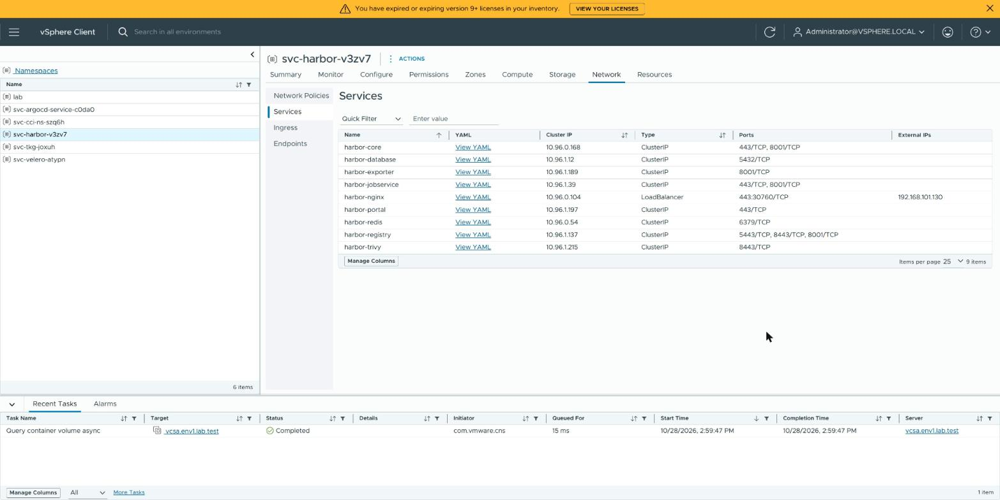
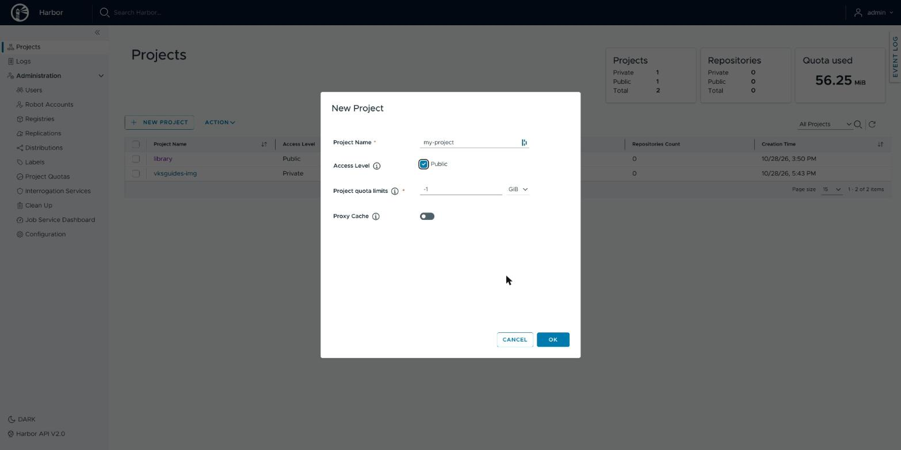
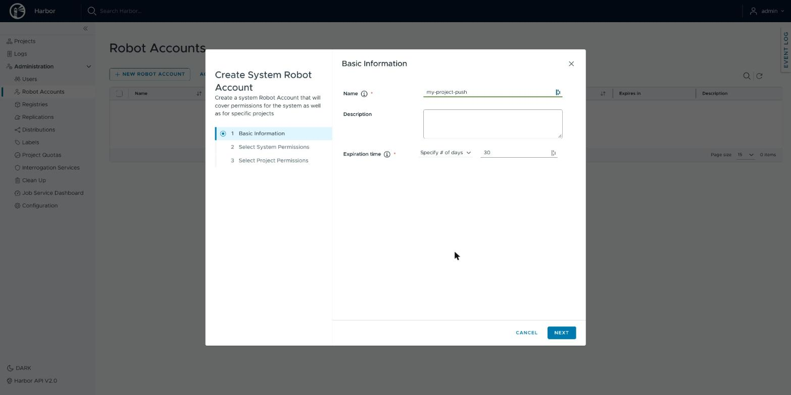
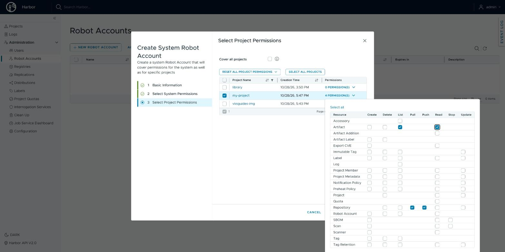
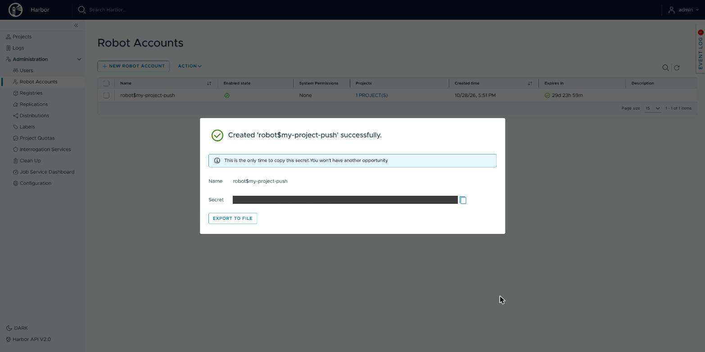

# Install Harbor on the Supervisor

> [!NOTE]
> **Official Broadcom documentation (VCF 9.1) and Harbor documentation for this guide**
>
> - [Install Harbor as a Supervisor Service](https://techdocs.broadcom.com/us/en/vmware-cis/vcf/vcf-service-administration-and-development/9-1/using-harbor-as-vcf-service/installing-and-configuring-harbor-and-contour/install-harbor-as-a-supervisor-service.html)
> - [Supervisor Services: how to find and install them](https://github.com/vsphere-tmm/Supervisor-Services/blob/main/README.md) (the `legacy` manifest)
> - [Add a Supervisor Service to vCenter](https://techdocs.broadcom.com/us/en/vmware-cis/vcf/vcf-service-administration-and-development/9-1/managing-supervisor-services-with-vsphere-iaas-control-plane/supervisor-service-life-cycle-management-and-consumption/add-a-vsphere-services-to-vcenter-server.html)
> - [Map the Harbor FQDN to the Ingress IP Address](https://techdocs.broadcom.com/us/en/vmware-cis/vcf/vcf-service-administration-and-development/9-1/using-harbor-as-vcf-service/installing-and-configuring-harbor-and-contour/map-the-harbor-fqdn-to-the-envoy-ingress-ip-address.html)
> - [Using Harbor as a Private Registry](https://techdocs.broadcom.com/us/en/vmware-cis/vcf/vcf-consumption/latest/managing-vsphere-kuberenetes-service-clusters-and-workloads/using-private-registries-with-tkg-service-clusters/install-the-harbor-supervisor-service.html) (the node update)
> - [Configure a Docker Client with the Harbor Registry Certificate](https://techdocs.broadcom.com/us/en/vmware-cis/vcf/vcf-consumption/latest/managing-vsphere-kuberenetes-service-clusters-and-workloads/using-private-registries-with-tkg-service-clusters/configure-a-docker-client-with-the-harbor-registry-certificate.html) (docker login with Harbor's CA)
> - Harbor 2.15: [Create Projects](https://goharbor.io/docs/2.15.0/working-with-projects/create-projects/), [Create Project Robot Accounts](https://goharbor.io/docs/2.15.0/working-with-projects/project-configuration/create-robot-accounts/), [Garbage Collection](https://goharbor.io/docs/2.15.0/administration/garbage-collection/)
> - [Uninstall a Supervisor Service from a Supervisor](https://techdocs.broadcom.com/us/en/vmware-cis/vcf/vcf-service-administration-and-development/9-1/managing-supervisor-services-with-vsphere-iaas-control-plane/supervisor-service-life-cycle-management-and-consumption/uninstall-a-supervisor-service-version-from-a-supervisor.html)
> - [Delete a Supervisor Service](https://techdocs.broadcom.com/us/en/vmware-cis/vcf/vcf-service-administration-and-development/9-1/managing-supervisor-services-with-vsphere-iaas-control-plane/supervisor-service-life-cycle-management-and-consumption/delete-a-vsphere-service.html)
> - [Supervisor Service Supported Input Parameters and Day 2 Alternations](https://techdocs.broadcom.com/us/en/vmware-cis/vcf/vcf-service-administration-and-development/9-1/using-harbor-as-vcf-service/using-harbor-as-a-vcf-service/supervisor-service-supported-input-parameters-and-day-2-alternations.html) (what each value allows after install)

You install Harbor in the vSphere Client; the blocks before and after need
[kubectl](KUBECTL.md), [jq, curl and openssl](PREREQS.md) and a [Supervisor login](LOGIN.md).
Written for VCF 9.1.1 and Harbor Service 2.15.2 on a Supervisor with vSphere Distributed Switch
networking and the Foundation Load Balancer (not NSX). Upgrading Harbor is not covered.

**Installing or uninstalling Harbor updates every node of every VKS cluster on this
Supervisor**: VKS replaces some nodes and updates others in place, restarting their container
runtimes. Do it before you create VKS clusters, or in a maintenance window.

The blocks keep their files in `~/.config/vks-guides/harbor` (PowerShell:
`$HOME\.config\vks-guides\harbor`). Run them all on the same machine.

## Prerequisites

- a vCenter administrator's SSO user (it may manage Supervisor Services and read Secrets on the
  Supervisor), with a [Supervisor login](LOGIN.md) ([VCF CLI](VCF.md));
- a Broadcom support account that can download **vSphere Supervisor Services**;
- [kubectl](KUBECTL.md), [jq, curl and openssl](PREREQS.md); for step 13 on Windows, `openssl.exe`
  from [Git for Windows](https://git-scm.com/install/);
- for step 10's podman or docker login (optional): [podman or docker](PREREQS.md#podman-and-docker-optional);
- for step 11: a VKS cluster ([CLUSTER.md](CLUSTER.md)) and its kubeconfig
  ([LOGIN.md](LOGIN.md#get-the-vks-clusters-kubeconfig));
- a storage class with room for about 18 GiB, and one free load-balancer address;
- someone who can create a DNS record.

The connections this guide needs, for a firewall (all TCP, besides DNS; for a registry, also
the hosts in [Registry hosts](PREREQS.md#registry-hosts-for-a-firewall)):

| from | to | port | for |
|---|---|---|---|
| your browser | `support.broadcom.com` | 443 | downloading the Harbor files (step 2) |
| your browser | vCenter (the vSphere Client) | 443 | registering, installing, changing and removing Harbor (steps 5, 6, 12 to 14) |
| your machine | the Supervisor's address | 443 | kubectl with the Supervisor kubeconfig (steps 1, 4, 6 to 9, 12 to 14) |
| the Supervisor | `projects.packages.broadcom.com` | 443 | Harbor's images (step 6) |
| the Supervisor | `ghcr.io` | 443 | Harbor's scanner, Trivy: its vulnerability data |
| your machine and your browser | Harbor's address | 443 | checks, API calls, web page, podman or docker login (steps 7, 9, 10) |
| your machine | the VKS cluster's API address (in its kubeconfig) | 6443 | kubectl (step 11) |
| the VKS cluster's nodes | Harbor's address | 443 | pulling images from Harbor (step 11) |

## 1. Check the Supervisor

This checks whether the Supervisor already runs a Harbor. If it does not, the block leaves a small
note on this machine. Step 14 reads that note before you uninstall, so you never remove a Harbor
that someone else installed.

<details>
<summary><b>Linux (Ubuntu, AlmaLinux, Photon OS), macOS, WSL (bash or zsh)</b></summary>

```sh
SUPERVISOR_KUBECONFIG="$HOME/.kube/supervisor.kubeconfig"
HARBOR_DIR="$HOME/.config/vks-guides/harbor"

if ! SUP="$(kubectl --kubeconfig "$SUPERVISOR_KUBECONFIG" get namespace kube-system -o jsonpath='{.metadata.uid}')" || [ -z "$SUP" ]; then
  echo "FAILED: cannot read the Supervisor (see the error above)"
elif ! H="$(kubectl --kubeconfig "$SUPERVISOR_KUBECONFIG" get namespace -l appplatform.vmware.com/serviceId=harbor -o name)"; then
  echo "FAILED: cannot list the Supervisor's namespaces (see the error above)"
else
  MARK="$HARBOR_DIR/none-before-$SUP"
  echo "Harbor on this Supervisor: ${H:-none}"
  if [ -z "$H" ] && [ ! -e "$MARK" ]; then
    mkdir -p "$HARBOR_DIR" && : > "$MARK"
  fi
  if [ -e "$MARK" ]; then
    echo "recorded: this Supervisor had no Harbor when you began"
  else
    echo "recorded: nothing (a Harbor was already here)"
  fi
fi
```

</details>

<details>
<summary><b>Windows (PowerShell)</b></summary>

```powershell
$SUPERVISOR_KUBECONFIG = "$HOME\.kube\supervisor.kubeconfig"
$HARBOR_DIR = "$HOME\.config\vks-guides\harbor"

$global:LASTEXITCODE = $null
$SUP = kubectl --kubeconfig $SUPERVISOR_KUBECONFIG get namespace kube-system -o jsonpath='{.metadata.uid}'
if ($LASTEXITCODE -ne 0 -or -not $SUP) {
  "FAILED: cannot read the Supervisor (see the error above)"
} else {
  $H = kubectl --kubeconfig $SUPERVISOR_KUBECONFIG get namespace -l appplatform.vmware.com/serviceId=harbor -o name
  if ($LASTEXITCODE -ne 0) {
    "FAILED: cannot list the Supervisor's namespaces (see the error above)"
  } else {
    $MARK = "$HARBOR_DIR\none-before-$SUP"
    "Harbor on this Supervisor: $(if ($H) { $H -join ' ' } else { 'none' })"
    if (-not $H -and -not (Test-Path $MARK)) {
      New-Item -ItemType Directory -Force -Path $HARBOR_DIR | Out-Null
      New-Item -ItemType File -Path $MARK | Out-Null
    }
    if (Test-Path $MARK) {
      "recorded: this Supervisor had no Harbor when you began"
    } else {
      "recorded: nothing (a Harbor was already here)"
    }
  }
}
```

</details>

**Expect:** `Harbor on this Supervisor: none`, then
`recorded: this Supervisor had no Harbor when you began`.

**If not:**
- `FAILED: …` above `Unauthorized`: run [Renew the Supervisor login](LOGIN.md#renew-the-supervisor-login).
  Above `Forbidden`: log in as a vCenter administrator.
- `namespace/svc-harbor-…` and `recorded: nothing …`: this Supervisor already runs a Harbor that
  you did not install. Use it, and do not install a second one.

## 2. Download the Harbor files

Download two files from Broadcom into `Downloads`. Tick **"I agree to the Terms and
Conditions"** if the page shows it, or the download icon does nothing.

| file | where to click |
|---|---|
| `supervisor-service-harbor-legacy-v2.15.2+vmware.1-vks.1-25639075.yml` | [Harbor 2.15.2](https://support.broadcom.com/group/ecx/productfiles?subFamily=vSphere%20Supervisor%20Services&displayGroup=Harbor&release=2.15.2&os=&servicePk=545829&language=EN) → *Installation Package Manifest (VCF 9.0 or older and disconnected/airgapped VCF 9.1)* |
| `supervisor-service-harbor-data-values-v2.15.2.yml` | [Harbor 2.15.2](https://support.broadcom.com/group/ecx/productfiles?subFamily=vSphere%20Supervisor%20Services&displayGroup=Harbor&release=2.15.2&os=&servicePk=545829&language=EN) → the row with this file name |

Take the manifest with **legacy** in its name: it downloads Harbor from
`projects.packages.broadcom.com`. The other one needs a VCF Software Depot and is not covered.
Do not put these files into a Git repository; they are licensed to your Broadcom account.

This checks that you downloaded the right two files and that they are not damaged. It prints a
checksum (a fingerprint of the file's content) for each one; compare them with the lines below.

**Linux (Ubuntu, AlmaLinux, Photon OS), macOS, WSL (bash or zsh):**

```sh
HARBOR_MANIFEST="$HOME/Downloads/supervisor-service-harbor-legacy-v2.15.2+vmware.1-vks.1-25639075.yml"
HARBOR_VALUES_TEMPLATE="$HOME/Downloads/supervisor-service-harbor-data-values-v2.15.2.yml"

for f in "$HARBOR_MANIFEST" "$HARBOR_VALUES_TEMPLATE"; do
  if [ -f "$f" ]; then
    printf '%s  %s\n' "$( (sha256sum "$f" 2>/dev/null || shasum -a 256 "$f") | awk '{print $1}')" "$(basename "$f")"
  else
    echo "Not found: $f"
  fi
done
```

**Windows (PowerShell):**

```powershell
$HARBOR_MANIFEST = "$HOME\Downloads\supervisor-service-harbor-legacy-v2.15.2+vmware.1-vks.1-25639075.yml"
$HARBOR_VALUES_TEMPLATE = "$HOME\Downloads\supervisor-service-harbor-data-values-v2.15.2.yml"

foreach ($f in $HARBOR_MANIFEST, $HARBOR_VALUES_TEMPLATE) {
  if (Test-Path -LiteralPath $f) {
    "$((Get-FileHash -Algorithm SHA256 -LiteralPath $f).Hash.ToLower())  $(Split-Path -Leaf $f)"
  } else {
    "Not found: $f"
  }
}
```

**Expect:** these two lines:

```text
77115ad171c571a9e76ad234ca8fc9198aebdfc0db90e5244830603b52914902  supervisor-service-harbor-legacy-v2.15.2+vmware.1-vks.1-25639075.yml
52167e43d58bad377c7f10dde87bb9b8e27faacacd9a3d9e1810cb8815f53805  supervisor-service-harbor-data-values-v2.15.2.yml
```

**If not:**
- `Not found: …`: the file is not in `Downloads` under that name. Set the variable to where it
  is.
- `d26fcbf774df52db4963bd34d43c3ac000c6d537a5cb98c81bf0b504fda4ab6e`: that is the manifest
  without **legacy** in its name; download the other one.
- Any other checksum: a damaged or wrong download. Delete it and download it again.

## 3. Make the secrets file (optional)

Harbor is installed with seven passwords and keys. This block makes seven random ones and saves
them in `secrets.env` (on Linux, macOS and WSL, readable only by you). A file that exists is
kept. Nothing secret is printed. To use your own admin password instead, put it in the file
using only letters, digits and `-`: step 4 refuses any other character.

Skip this step to install Harbor with Broadcom's default values instead (step 4's table lists
them). Step 4 then saves them in `secrets.env`, so the later steps work the same. The defaults are
public: use them for tests only. Decide before step 6, because the admin password, the database
password and `secretKey` cannot be changed after the install. If you change your mind after step 4,
run step 4 again.

<details>
<summary><b>Linux (Ubuntu, AlmaLinux, Photon OS), macOS, WSL (bash or zsh)</b></summary>

```sh
HARBOR_DIR="$HOME/.config/vks-guides/harbor"

SECRETS="$HARBOR_DIR/secrets.env"
mkdir -p "$HARBOR_DIR"
if grep -q "^HARBOR_SECRET_KEY='0123456789ABCDEF'\$" "$SECRETS" 2>/dev/null; then
  echo "kept the existing $SECRETS (Broadcom's default values; for random ones, before step 6 delete it, run this block again, then step 4)"
elif [ -e "$SECRETS" ]; then
  echo "kept the existing $SECRETS"
else
  ( umask 077
    { printf "HARBOR_ADMIN_PASSWORD='A%sz'\n" "$(openssl rand -hex 12)"
      printf "HARBOR_SECRET_KEY='%s'\n" "$(openssl rand -hex 8)"
      printf "HARBOR_DB_PASSWORD='%s'\n" "$(openssl rand -hex 16)"
      printf "HARBOR_CORE_SECRET='%s'\n" "$(openssl rand -hex 16)"
      printf "HARBOR_XSRF_KEY='%s'\n" "$(openssl rand -hex 16)"
      printf "HARBOR_JOBSERVICE_SECRET='%s'\n" "$(openssl rand -hex 16)"
      printf "HARBOR_REGISTRY_SECRET='%s'\n" "$(openssl rand -hex 16)"
    } > "$SECRETS" )
fi
awk -F "'" '/^HARBOR_/ { n++; if ($2 !~ /^[A-Za-z0-9-]+$/) bad++ } /^HARBOR_SECRET_KEY=/ { k = length($2) } /^HARBOR_XSRF_KEY=/ { x = length($2) } END { printf "secrets file: %d values, %d not letters, digits or -, secretKey %d characters, xsrfKey %d characters\n", n, bad, k, x }' "$SECRETS"
```

</details>

<details>
<summary><b>Windows (PowerShell)</b></summary>

```powershell
$HARBOR_DIR = "$HOME\.config\vks-guides\harbor"

$SECRETS = "$HARBOR_DIR\secrets.env"
function New-Hex($n) {
  $b = New-Object byte[] $n
  [Security.Cryptography.RandomNumberGenerator]::Create().GetBytes($b)
  ($b | ForEach-Object { $_.ToString('x2') }) -join ''
}
New-Item -ItemType Directory -Force -Path $HARBOR_DIR | Out-Null
if (Test-Path $SECRETS) {
  if (@(Get-Content $SECRETS) -ccontains "HARBOR_SECRET_KEY='0123456789ABCDEF'") {
    "kept the existing $SECRETS (Broadcom's default values; for random ones, before step 6 delete it, run this block again, then step 4)"
  } else {
    "kept the existing $SECRETS"
  }
} else {
  Set-Content -Encoding ascii -Path $SECRETS -Value @(
    "HARBOR_ADMIN_PASSWORD='A$(New-Hex 12)z'"
    "HARBOR_SECRET_KEY='$(New-Hex 8)'"
    "HARBOR_DB_PASSWORD='$(New-Hex 16)'"
    "HARBOR_CORE_SECRET='$(New-Hex 16)'"
    "HARBOR_XSRF_KEY='$(New-Hex 16)'"
    "HARBOR_JOBSERVICE_SECRET='$(New-Hex 16)'"
    "HARBOR_REGISTRY_SECRET='$(New-Hex 16)'"
  )
}
$S = @{}; $BAD = 0
foreach ($l in Get-Content $SECRETS) {
  if ($l -cmatch "^(HARBOR_[A-Z_]+)='(.*)'$") {
    $k = $Matches[1]; $v = $Matches[2]; $S[$k] = $v
    if ($v -cnotmatch '^[A-Za-z0-9-]+$') { $BAD++ }
  }
}
"secrets file: $($S.Count) values, $BAD not letters, digits or -, secretKey $("$($S['HARBOR_SECRET_KEY'])".Length) characters, xsrfKey $("$($S['HARBOR_XSRF_KEY'])".Length) characters"
```

</details>

**Expect:** `secrets file: 7 values, 0 not letters, digits or -, secretKey 16 characters, xsrfKey 32 characters`,
after `kept the existing …` when the file was there.

**If not:** other numbers: the file was edited or cut short. If no Harbor was installed with it
yet, delete it, run the block again, then step 4.

**Keep this file, and a copy where you keep passwords, for as long as this Harbor exists**: any
later change to its configuration must send the same seven values (with another
`HARBOR_SECRET_KEY` Harbor can no longer read what it encrypted). vCenter shows the configuration
to everyone who may manage Supervisor Services.

## 4. Write the configuration file

### Choose the storage class

Harbor keeps its data on five disks (volumes). A storage class is a kind of vSphere storage that
the Supervisor offers for such disks. This lists them, so you can pick one for
`HARBOR_STORAGE_CLASS` in the next block.

**Linux (Ubuntu, AlmaLinux, Photon OS), macOS, WSL (bash or zsh):**

```sh
SUPERVISOR_KUBECONFIG="$HOME/.kube/supervisor.kubeconfig"

kubectl --kubeconfig "$SUPERVISOR_KUBECONFIG" get storageclass -o custom-columns=NAME:.metadata.name --no-headers
```

**Windows (PowerShell):**

```powershell
$SUPERVISOR_KUBECONFIG = "$HOME\.kube\supervisor.kubeconfig"

kubectl --kubeconfig $SUPERVISOR_KUBECONFIG get storageclass -o custom-columns=NAME:.metadata.name --no-headers
```

**Expect:** one name per line, for example `wcp-vmfs`.

### Write the file

This writes Harbor's configuration file, `harbor-data-values.yml`. You paste this file into the
vSphere Client when you install Harbor in step 6. It starts from Broadcom's file and changes only
these fields:

| field in Broadcom's file | Broadcom's value | set to |
|---|---|---|
| `hostname` | `yourdomain.com` | `HARBOR_FQDN` |
| `enableNginxLoadBalancer`, `enableContourHttpProxy` | `false`, `true` | `true`, `false`: Harbor gets its own load-balancer address |
| `harborAdminPassword` | `Harbor12345` | the value in `secrets.env` (step 3); kept if you skipped step 3 |
| `secretKey` | `0123456789ABCDEF` | the value in `secrets.env`; kept if you skipped step 3 |
| `database.password` | `change-it` | the value in `secrets.env`; kept if you skipped step 3 |
| `core.secret` | `change-it` | the value in `secrets.env`; kept if you skipped step 3 |
| `core.xsrfKey` | `0123456789ABCDEF0123456789ABCDEF` | the value in `secrets.env`; kept if you skipped step 3 |
| `jobservice.secret` | `change-it` | the value in `secrets.env`; kept if you skipped step 3 |
| `registry.secret` | `change-it` | the value in `secrets.env`; kept if you skipped step 3 |
| `storageClass` of the five volumes | `insert-storage-class-name-here` | `HARBOR_STORAGE_CLASS` |
| the registry volume's `size` | `10Gi` | `HARBOR_REGISTRY_SIZE` |

Set at the top:

- `HARBOR_FQDN`: Harbor's DNS name. To change it later, see step 12.
- `HARBOR_STORAGE_CLASS`: a name from the list above.
- `HARBOR_REGISTRY_SIZE`: the volume for your images. `10Gi` fills up in regular use, and this
  guide does not cover growing it.

The block then checks the file, and deletes it if anything came out wrong.

<details>
<summary><b>Linux (Ubuntu, AlmaLinux, Photon OS), macOS, WSL (bash or zsh)</b></summary>

```sh
HARBOR_FQDN="harbor.example.test"
HARBOR_STORAGE_CLASS="my-storage-class"
HARBOR_REGISTRY_SIZE="50Gi"
HARBOR_VALUES_TEMPLATE="$HOME/Downloads/supervisor-service-harbor-data-values-v2.15.2.yml"
HARBOR_DIR="$HOME/.config/vks-guides/harbor"

SECRETS="$HARBOR_DIR/secrets.env"
VALUES="$HARBOR_DIR/harbor-data-values.yml"
WANT=52167e43d58bad377c7f10dde87bb9b8e27faacacd9a3d9e1810cb8815f53805
GOT="$( (sha256sum "$HARBOR_VALUES_TEMPLATE" 2>/dev/null || shasum -a 256 "$HARBOR_VALUES_TEMPLATE" 2>/dev/null) | awk '{print $1}')"
case "$HARBOR_FQDN" in ""|harbor.example.test) BAD_NAME=1 ;; *) BAD_NAME="" ;; esac
[ -z "$(printf '%s' "$HARBOR_FQDN" | LC_ALL=C tr -d 'a-z0-9.-')" ] || BAD_NAME=1
case "$HARBOR_STORAGE_CLASS" in ""|my-storage-class) BAD_SC=1 ;; *) BAD_SC="" ;; esac
[ -z "$(printf '%s' "$HARBOR_STORAGE_CLASS" | LC_ALL=C tr -d 'a-z0-9.-')" ] || BAD_SC=1
case "$HARBOR_REGISTRY_SIZE" in "") BAD_SIZE=1 ;; *) BAD_SIZE="" ;; esac
[ -z "$(printf '%s' "$HARBOR_REGISTRY_SIZE" | LC_ALL=C tr -d '0-9A-Za-z')" ] || BAD_SIZE=1
if [ -n "$BAD_NAME" ]; then
  echo "NOT WRITTEN: set HARBOR_FQDN to this Harbor's DNS name"
elif [ -n "$BAD_SC" ] || [ -n "$BAD_SIZE" ]; then
  echo "NOT WRITTEN: set HARBOR_STORAGE_CLASS to a name from the list, and HARBOR_REGISTRY_SIZE"
elif [ -e "$SECRETS" ] && [ "$(grep -c -E "^HARBOR_[A-Z_]+='[A-Za-z0-9-]+'\$" "$SECRETS")" != 7 ]; then
  echo "NOT WRITTEN: $SECRETS is not as step 3 writes it"
elif [ "$GOT" != "$WANT" ]; then
  echo "NOT WRITTEN: $HARBOR_VALUES_TEMPLATE is missing or not the 2.15.2 file (step 2)"
else
  if [ ! -e "$SECRETS" ]; then
    mkdir -p "$HARBOR_DIR"
    ( umask 077
      printf "%s\n" "HARBOR_ADMIN_PASSWORD='Harbor12345'" "HARBOR_SECRET_KEY='0123456789ABCDEF'" \
        "HARBOR_DB_PASSWORD='change-it'" "HARBOR_CORE_SECRET='change-it'" "HARBOR_XSRF_KEY='0123456789ABCDEF0123456789ABCDEF'" \
        "HARBOR_JOBSERVICE_SECRET='change-it'" "HARBOR_REGISTRY_SECRET='change-it'" > "$SECRETS" )
    echo "no secrets file: Broadcom's default values (admin password Harbor12345), saved in $SECRETS"
  fi
  rm -f "$VALUES"
  ( umask 077
    set -a; . "$SECRETS"; set +a
    awk -v fqdn="$HARBOR_FQDN" -v sc="$HARBOR_STORAGE_CLASS" -v size="$HARBOR_REGISTRY_SIZE" '
      function q(v) { return "\"" v "\"" }
      /^[A-Za-z][A-Za-z0-9_]*:/     { top = $1; sub(/:.*/, "", top); k4 = "" }
      /^    [A-Za-z][A-Za-z0-9_]*:/ { k4 = $1; sub(/:.*/, "", k4) }
      /^hostname:/                { print "hostname: " fqdn; next }
      /^enableNginxLoadBalancer:/ { print "enableNginxLoadBalancer: true"; next }
      /^enableContourHttpProxy:/  { print "enableContourHttpProxy: false"; next }
      /^harborAdminPassword:/     { print "harborAdminPassword: " q(ENVIRON["HARBOR_ADMIN_PASSWORD"]); next }
      /^secretKey:/               { print "secretKey: " q(ENVIRON["HARBOR_SECRET_KEY"]); next }
      /^  password:/ && top == "database"   { print "  password: " q(ENVIRON["HARBOR_DB_PASSWORD"]); next }
      /^  secret:/   && top == "core"       { print "  secret: " q(ENVIRON["HARBOR_CORE_SECRET"]); next }
      /^  xsrfKey:/  && top == "core"       { print "  xsrfKey: " q(ENVIRON["HARBOR_XSRF_KEY"]); next }
      /^  secret:/   && top == "jobservice" { print "  secret: " q(ENVIRON["HARBOR_JOBSERVICE_SECRET"]); next }
      /^  secret:/   && top == "registry"   { print "  secret: " q(ENVIRON["HARBOR_REGISTRY_SECRET"]); next }
      /^ +storageClass:/          { sub(/storageClass:.*/, "storageClass: " q(sc)); print; next }
      /^      size:/ && top == "persistence" && k4 == "registry" { print "      size: " size; next }
      { print }
    ' "$HARBOR_VALUES_TEMPLATE" > "$VALUES" )
  NAME="$(sed -n 's/^hostname: //p' "$VALUES")"
  LEFT="$(grep -c -E 'yourdomain\.com|insert-storage-class-name-here' "$VALUES")"
  SEC="$(grep -c -E '^(harborAdminPassword|secretKey|  password|  secret|  xsrfKey): "[A-Za-z0-9-]+"$' "$VALUES")"
  SC="$(grep -c -F "storageClass: \"$HARBOR_STORAGE_CLASS\"" "$VALUES")"
  SIZE="$(awk '/^[A-Za-z][A-Za-z0-9_]*:/ { top = $1; k4 = "" } /^    [A-Za-z][A-Za-z0-9_]*:/ { k4 = $1 } /^      size:/ && top == "persistence:" && k4 == "registry:" { print $2 }' "$VALUES")"
  grep -E '^(hostname|enableNginxLoadBalancer|enableContourHttpProxy):' "$VALUES"
  echo "storage class fields set: $SC of 5"
  echo "registry volume: ${SIZE:-not found}"
  echo "secret fields set: $SEC of 7"
  echo "placeholders left: $LEFT"
  if [ -z "$NAME" ] || [ "$NAME" != "$HARBOR_FQDN" ] || [ "$LEFT" != 0 ] || [ "$SEC" != 7 ] || [ "$SC" != 5 ] || [ "$SIZE" != "$HARBOR_REGISTRY_SIZE" ]; then
    rm -f "$VALUES"
    echo "FAILED: the file did not come out as expected and was deleted"
  fi
fi
```

</details>

<details>
<summary><b>Windows (PowerShell)</b></summary>

```powershell
$HARBOR_FQDN = "harbor.example.test"
$HARBOR_STORAGE_CLASS = "my-storage-class"
$HARBOR_REGISTRY_SIZE = "50Gi"
$HARBOR_VALUES_TEMPLATE = "$HOME\Downloads\supervisor-service-harbor-data-values-v2.15.2.yml"
$HARBOR_DIR = "$HOME\.config\vks-guides\harbor"

$SECRETS = "$HARBOR_DIR\secrets.env"
$VALUES = "$HARBOR_DIR\harbor-data-values.yml"
$WANT = '52167e43d58bad377c7f10dde87bb9b8e27faacacd9a3d9e1810cb8815f53805'
$GOT = if (Test-Path -LiteralPath $HARBOR_VALUES_TEMPLATE) { (Get-FileHash -Algorithm SHA256 -LiteralPath $HARBOR_VALUES_TEMPLATE).Hash.ToLower() } else { '' }
$S = @{}
if (Test-Path $SECRETS) {
  foreach ($l in Get-Content $SECRETS) { if ($l -cmatch "^(HARBOR_[A-Z_]+)='([A-Za-z0-9-]+)'$") { $S[$Matches[1]] = $Matches[2] } }
}
if ($HARBOR_FQDN -cnotmatch '^[a-z0-9.-]+$' -or $HARBOR_FQDN -eq 'harbor.example.test') {
  "NOT WRITTEN: set HARBOR_FQDN to this Harbor's DNS name"
} elseif ($HARBOR_STORAGE_CLASS -cnotmatch '^[a-z0-9.-]+$' -or $HARBOR_STORAGE_CLASS -eq 'my-storage-class' -or $HARBOR_REGISTRY_SIZE -cnotmatch '^[0-9A-Za-z]+$') {
  "NOT WRITTEN: set HARBOR_STORAGE_CLASS to a name from the list, and HARBOR_REGISTRY_SIZE"
} elseif ((Test-Path $SECRETS) -and $S.Count -ne 7) {
  "NOT WRITTEN: $SECRETS is not as step 3 writes it"
} elseif ($GOT -ne $WANT) {
  "NOT WRITTEN: $HARBOR_VALUES_TEMPLATE is missing or not the 2.15.2 file (step 2)"
} else {
  if (-not (Test-Path $SECRETS)) {
    New-Item -ItemType Directory -Force -Path $HARBOR_DIR | Out-Null
    Set-Content -Encoding ascii -Path $SECRETS -Value @(
      "HARBOR_ADMIN_PASSWORD='Harbor12345'", "HARBOR_SECRET_KEY='0123456789ABCDEF'", "HARBOR_DB_PASSWORD='change-it'",
      "HARBOR_CORE_SECRET='change-it'", "HARBOR_XSRF_KEY='0123456789ABCDEF0123456789ABCDEF'",
      "HARBOR_JOBSERVICE_SECRET='change-it'", "HARBOR_REGISTRY_SECRET='change-it'")
    foreach ($l in Get-Content $SECRETS) { if ($l -cmatch "^(HARBOR_[A-Z_]+)='([A-Za-z0-9-]+)'$") { $S[$Matches[1]] = $Matches[2] } }
    "no secrets file: Broadcom's default values (admin password Harbor12345), saved in $SECRETS"
  }
  $top = ''; $k4 = ''
  $OUT = foreach ($l in [IO.File]::ReadAllLines($HARBOR_VALUES_TEMPLATE)) {
    if ($l -cmatch '^([A-Za-z][A-Za-z0-9_]*):') { $top = $Matches[1]; $k4 = '' }
    if ($l -cmatch '^    ([A-Za-z][A-Za-z0-9_]*):') { $k4 = $Matches[1] }
    if ($l -cmatch '^hostname:') { "hostname: $HARBOR_FQDN" }
    elseif ($l -cmatch '^enableNginxLoadBalancer:') { 'enableNginxLoadBalancer: true' }
    elseif ($l -cmatch '^enableContourHttpProxy:') { 'enableContourHttpProxy: false' }
    elseif ($l -cmatch '^harborAdminPassword:') { "harborAdminPassword: `"$($S['HARBOR_ADMIN_PASSWORD'])`"" }
    elseif ($l -cmatch '^secretKey:') { "secretKey: `"$($S['HARBOR_SECRET_KEY'])`"" }
    elseif ($l -cmatch '^  password:' -and $top -ceq 'database') { "  password: `"$($S['HARBOR_DB_PASSWORD'])`"" }
    elseif ($l -cmatch '^  secret:' -and $top -ceq 'core') { "  secret: `"$($S['HARBOR_CORE_SECRET'])`"" }
    elseif ($l -cmatch '^  xsrfKey:' -and $top -ceq 'core') { "  xsrfKey: `"$($S['HARBOR_XSRF_KEY'])`"" }
    elseif ($l -cmatch '^  secret:' -and $top -ceq 'jobservice') { "  secret: `"$($S['HARBOR_JOBSERVICE_SECRET'])`"" }
    elseif ($l -cmatch '^  secret:' -and $top -ceq 'registry') { "  secret: `"$($S['HARBOR_REGISTRY_SECRET'])`"" }
    elseif ($l -cmatch '^ +storageClass:') { $l.Substring(0, $l.IndexOf('storageClass:')) + "storageClass: `"$HARBOR_STORAGE_CLASS`"" }
    elseif ($l -cmatch '^      size:' -and $top -ceq 'persistence' -and $k4 -ceq 'registry') { "      size: $HARBOR_REGISTRY_SIZE" }
    else { $l }
  }
  [IO.File]::WriteAllText($VALUES, (($OUT -join "`n") + "`n"))
  $TXT = [IO.File]::ReadAllLines($VALUES)
  $NAME = "$(($TXT | Where-Object { $_ -cmatch '^hostname: ' }) -replace '^hostname: ', '')"
  $LEFT = @($TXT | Where-Object { $_ -cmatch 'yourdomain\.com|insert-storage-class-name-here' }).Count
  $SEC = @($TXT | Where-Object { $_ -cmatch '^(harborAdminPassword|secretKey|  password|  secret|  xsrfKey): "[A-Za-z0-9-]+"$' }).Count
  $SC = @($TXT | Where-Object { $_.Contains("storageClass: `"$HARBOR_STORAGE_CLASS`"") }).Count
  $top = ''; $k4 = ''; $SIZE = ''
  foreach ($l in $TXT) {
    if ($l -cmatch '^([A-Za-z][A-Za-z0-9_]*):') { $top = $Matches[1]; $k4 = '' }
    if ($l -cmatch '^    ([A-Za-z][A-Za-z0-9_]*):') { $k4 = $Matches[1] }
    if ($l -cmatch '^      size: (.*)$' -and $top -ceq 'persistence' -and $k4 -ceq 'registry') { $SIZE = $Matches[1] }
  }
  $TXT | Where-Object { $_ -cmatch '^(hostname|enableNginxLoadBalancer|enableContourHttpProxy):' }
  "storage class fields set: $SC of 5"
  "registry volume: $(if ($SIZE) { $SIZE } else { 'not found' })"
  "secret fields set: $SEC of 7"
  "placeholders left: $LEFT"
  if (-not $NAME -or $NAME -cne $HARBOR_FQDN -or $LEFT -ne 0 -or $SEC -ne 7 -or $SC -ne 5 -or $SIZE -cne $HARBOR_REGISTRY_SIZE) {
    Remove-Item -Force $VALUES
    "FAILED: the file did not come out as expected and was deleted"
  }
}
```

</details>

**Expect:** with your own name and size:

```text
hostname: harbor.example.test
enableNginxLoadBalancer: true
enableContourHttpProxy: false
storage class fields set: 5 of 5
registry volume: 50Gi
secret fields set: 7 of 7
placeholders left: 0
```

If you skipped step 3, a `no secrets file: Broadcom's default values …` line comes first.

**If not:**
- `NOT WRITTEN: …`: set the value it names, or do the step it names, then run the block again.
- `FAILED: …`: the data values are laid out differently from the 2.15.2 file. Do not install
  with a file this block refused.

The file holds the secrets in clear text: do not share or commit it.

### Choose each volume's storage class and size (optional)

Skip this unless you want one of Harbor's five disks on another storage class or at another size.
The block in *Write the file* put all five on `HARBOR_STORAGE_CLASS`, with Broadcom's sizes (job
log, database and Redis `1Gi`, Trivy `5Gi`) and the registry at `HARBOR_REGISTRY_SIZE`. This block
changes the disks you set in `harbor-data-values.yml`; leave the others `""`. Do it before step 6:
after the install Harbor cannot change a disk's class, nor the size of the database, Redis or Trivy
disk.

<details>
<summary><b>Linux (Ubuntu, AlmaLinux, Photon OS), macOS, WSL (bash or zsh)</b></summary>

```sh
HARBOR_REGISTRY_STORAGE_CLASS=""
HARBOR_JOBSERVICE_STORAGE_CLASS=""
HARBOR_JOBSERVICE_SIZE=""
HARBOR_DATABASE_STORAGE_CLASS=""
HARBOR_DATABASE_SIZE=""
HARBOR_REDIS_STORAGE_CLASS=""
HARBOR_REDIS_SIZE=""
HARBOR_TRIVY_STORAGE_CLASS=""
HARBOR_TRIVY_SIZE=""
HARBOR_DIR="$HOME/.config/vks-guides/harbor"

VALUES="$HARBOR_DIR/harbor-data-values.yml"
BAD=""
for v in "$HARBOR_REGISTRY_STORAGE_CLASS" "$HARBOR_JOBSERVICE_STORAGE_CLASS" "$HARBOR_DATABASE_STORAGE_CLASS" \
         "$HARBOR_REDIS_STORAGE_CLASS" "$HARBOR_TRIVY_STORAGE_CLASS"; do
  [ -z "$(printf '%s' "$v" | LC_ALL=C tr -d 'a-z0-9.-')" ] || BAD=1
done
for v in "$HARBOR_JOBSERVICE_SIZE" "$HARBOR_DATABASE_SIZE" "$HARBOR_REDIS_SIZE" "$HARBOR_TRIVY_SIZE"; do
  [ -z "$v" ] || printf '%s\n' "$v" | grep -qE '^[1-9][0-9]*(Mi|Gi|Ti)$' || BAD=1
done
if [ ! -s "$VALUES" ]; then
  echo "NOT WRITTEN: $VALUES is missing (Write the file)"
elif [ -n "$BAD" ]; then
  echo "NOT WRITTEN: a storage class is not a name from the list, or a size is not like 2Gi"
else
  rm -f "$VALUES.new"
  ( umask 077
    awk -v c_registry="$HARBOR_REGISTRY_STORAGE_CLASS" \
        -v c_jobservice="$HARBOR_JOBSERVICE_STORAGE_CLASS" -v s_jobservice="$HARBOR_JOBSERVICE_SIZE" \
        -v c_database="$HARBOR_DATABASE_STORAGE_CLASS" -v s_database="$HARBOR_DATABASE_SIZE" \
        -v c_redis="$HARBOR_REDIS_STORAGE_CLASS" -v s_redis="$HARBOR_REDIS_SIZE" \
        -v c_trivy="$HARBOR_TRIVY_STORAGE_CLASS" -v s_trivy="$HARBOR_TRIVY_SIZE" '
      BEGIN { c["registry"] = c_registry; c["jobservice"] = c_jobservice; s["jobservice"] = s_jobservice
              c["database"] = c_database; s["database"] = s_database; c["redis"] = c_redis
              s["redis"] = s_redis; c["trivy"] = c_trivy; s["trivy"] = s_trivy }
      /^[A-Za-z][A-Za-z0-9_]*:/     { top = $1; sub(/:.*/, "", top); k4 = "" }
      /^    [A-Za-z][A-Za-z0-9_]*:/ { k4 = $1; sub(/:.*/, "", k4) }
      top == "persistence" && /^ +storageClass:/ && c[k4] != "" { sub(/storageClass:.*/, "storageClass: \"" c[k4] "\"") }
      top == "persistence" && /^ +size:/ && s[k4] != ""         { sub(/size:.*/, "size: " s[k4]) }
      { print }
    ' "$VALUES" > "$VALUES.new" )
  awk '
    /^[A-Za-z][A-Za-z0-9_]*:/     { top = $1; sub(/:.*/, "", top); k4 = "" }
    /^    [A-Za-z][A-Za-z0-9_]*:/ { k4 = $1; sub(/:.*/, "", k4) }
    top == "persistence" && /^ +storageClass:/ { v = $2; gsub(/"/, "", v); c[k4] = v }
    top == "persistence" && /^ +size:/         { s[k4] = $2 }
    END { n = split("registry jobservice database redis trivy", k, " ")
          for (i = 1; i <= n; i++) printf "%-11s %s %s\n", k[i] ":", c[k[i]], s[k[i]] }
  ' "$VALUES.new"
  N="$(diff "$VALUES" "$VALUES.new" | grep -c '^>')"
  if [ "$(grep -c -E '^ +(storageClass|size):' "$VALUES.new")" != 10 ] || [ "$(wc -l < "$VALUES.new")" != "$(wc -l < "$VALUES")" ]; then
    rm -f "$VALUES.new"
    echo "FAILED: the file did not come out as expected; $VALUES is as it was"
  else
    mv "$VALUES.new" "$VALUES"
    echo "lines changed: $N"
  fi
fi
```

</details>

<details>
<summary><b>Windows (PowerShell)</b></summary>

```powershell
$HARBOR_REGISTRY_STORAGE_CLASS = ""
$HARBOR_JOBSERVICE_STORAGE_CLASS = ""
$HARBOR_JOBSERVICE_SIZE = ""
$HARBOR_DATABASE_STORAGE_CLASS = ""
$HARBOR_DATABASE_SIZE = ""
$HARBOR_REDIS_STORAGE_CLASS = ""
$HARBOR_REDIS_SIZE = ""
$HARBOR_TRIVY_STORAGE_CLASS = ""
$HARBOR_TRIVY_SIZE = ""
$HARBOR_DIR = "$HOME\.config\vks-guides\harbor"

$VALUES = "$HARBOR_DIR\harbor-data-values.yml"
$C = @{ registry = $HARBOR_REGISTRY_STORAGE_CLASS; jobservice = $HARBOR_JOBSERVICE_STORAGE_CLASS
        database = $HARBOR_DATABASE_STORAGE_CLASS; redis = $HARBOR_REDIS_STORAGE_CLASS; trivy = $HARBOR_TRIVY_STORAGE_CLASS }
$S = @{ jobservice = $HARBOR_JOBSERVICE_SIZE; database = $HARBOR_DATABASE_SIZE; redis = $HARBOR_REDIS_SIZE; trivy = $HARBOR_TRIVY_SIZE }
$BAD = @($C.Values | Where-Object { $_ -and $_ -cnotmatch '^[a-z0-9.-]+$' }).Count + @($S.Values | Where-Object { $_ -and $_ -cnotmatch '^[1-9][0-9]*(Mi|Gi|Ti)$' }).Count
if (-not (Test-Path $VALUES)) {
  "NOT WRITTEN: $VALUES is missing (Write the file)"
} elseif ($BAD -gt 0) {
  "NOT WRITTEN: a storage class is not a name from the list, or a size is not like 2Gi"
} else {
  $IN = [IO.File]::ReadAllLines($VALUES); $top = ''; $k4 = ''
  $OUT = foreach ($l in $IN) {
    if ($l -cmatch '^([A-Za-z][A-Za-z0-9_]*):') { $top = $Matches[1]; $k4 = '' }
    if ($l -cmatch '^    ([A-Za-z][A-Za-z0-9_]*):') { $k4 = $Matches[1] }
    if ($top -eq 'persistence' -and $l -cmatch '^( +)storageClass:' -and $C[$k4]) { "$($Matches[1])storageClass: `"$($C[$k4])`"" }
    elseif ($top -eq 'persistence' -and $l -cmatch '^( +)size:' -and $S[$k4]) { "$($Matches[1])size: $($S[$k4])" }
    else { $l }
  }
  $top = ''; $k4 = ''; $GOT = @{}
  foreach ($l in $OUT) {
    if ($l -cmatch '^([A-Za-z][A-Za-z0-9_]*):') { $top = $Matches[1]; $k4 = '' }
    if ($l -cmatch '^    ([A-Za-z][A-Za-z0-9_]*):') { $k4 = $Matches[1] }
    if ($top -eq 'persistence' -and $l -cmatch '^ +(storageClass|size): *"?([^"]*)"?$') { $GOT["$k4 $($Matches[1])"] = $Matches[2] }
  }
  foreach ($k in 'registry', 'jobservice', 'database', 'redis', 'trivy') { "{0,-11} {1} {2}" -f "${k}:", $GOT["$k storageClass"], $GOT["$k size"] }
  $N = @(for ($i = 0; $i -lt $IN.Count; $i++) { if ($IN[$i] -cne $OUT[$i]) { $i } }).Count
  if ($GOT.Count -ne 10 -or $OUT.Count -ne $IN.Count) {
    "FAILED: the file did not come out as expected; $VALUES is as it was"
  } else {
    [IO.File]::WriteAllText($VALUES, ($OUT -join "`n") + "`n")
    "lines changed: $N"
  }
}
```

</details>

**Expect:** one line per volume with its class and size, for example `trivy:      wcp-vmfs 20Gi`,
then `lines changed:` and the number of values you set (`0` when all are `""`).

**If not:**
- `NOT WRITTEN: …`: set the value it names, or do the step it names, then run the block again.
- `FAILED: …`: the file is laid out differently from step 4's; run *Write the file* again first.

To install with your organization's certificate, run step 13's first block now, then go on with
step 5.

## 5. Register the service with vCenter

Done once per vCenter. If a **Harbor** card is already on the page in the first picture, skip to
step 6.

1. Open the vSphere Client. From the menu (☰, top left) choose **Supervisor Management**, then
   the **Services** tab.
2. On the **Add New Service** card click **ADD**.

   

3. In the **New Service** window click **UPLOAD** and choose the manifest with **legacy** in its
   name. The window shows *YAML was uploaded successfully*, name **Harbor**, ID
   `harbor.tanzu.vmware.com`, version `2.15.2+vmware.1-vks.1`.

   

4. Click **FINISH**.

**Expect:** a green line saying the service is registered, and a **Harbor** card with **Active
Versions 1** and **Supervisors 0**.


**If not:** no **ADD** button, or the upload is refused: your user may not manage Supervisor
Services. An error naming the YAML: you chose the wrong file.

## 6. Install the service on your Supervisor

### Record the VKS cluster machines

Installing Harbor makes VKS update every node (machine) of your VKS clusters, so that they trust
Harbor. This saves the current list of machines in one vSphere Namespace. Step 8 compares against
it to show when every node has been updated. Run it for each vSphere Namespace with VKS clusters,
right before you install.

**Linux (Ubuntu, AlmaLinux, Photon OS), macOS, WSL (bash or zsh):**

```sh
VKS_NAMESPACE="my-namespace"
SUPERVISOR_KUBECONFIG="$HOME/.kube/supervisor.kubeconfig"
HARBOR_DIR="$HOME/.config/vks-guides/harbor"

if ! kubectl --kubeconfig "$SUPERVISOR_KUBECONFIG" get namespace "$VKS_NAMESPACE" >/dev/null; then
  echo "FAILED: cannot read the namespace $VKS_NAMESPACE (see the error above)"
elif ! M="$(kubectl --kubeconfig "$SUPERVISOR_KUBECONFIG" -n "$VKS_NAMESPACE" get machines.cluster.x-k8s.io -o jsonpath="{range .items[*]}{.metadata.name} {.status.conditions[?(@.type=='UpToDate')].status} {.status.conditions[?(@.type=='UpToDate')].lastTransitionTime}{'\n'}{end}")"; then
  echo "FAILED: cannot list the machines in $VKS_NAMESPACE (see the error above)"
elif [ -z "$M" ]; then
  echo "no machines in $VKS_NAMESPACE: nothing to record"
else
  mkdir -p "$HARBOR_DIR"
  printf '%s\n' "$M" > "$HARBOR_DIR/machines-$VKS_NAMESPACE.before"
  echo "recorded $(printf '%s\n' "$M" | grep -c .) machines in $VKS_NAMESPACE"
fi
```

**Windows (PowerShell):**

```powershell
$VKS_NAMESPACE = "my-namespace"
$SUPERVISOR_KUBECONFIG = "$HOME\.kube\supervisor.kubeconfig"
$HARBOR_DIR = "$HOME\.config\vks-guides\harbor"

$global:LASTEXITCODE = $null
kubectl --kubeconfig $SUPERVISOR_KUBECONFIG get namespace $VKS_NAMESPACE | Out-Null
if ($LASTEXITCODE -ne 0) { "FAILED: cannot read the namespace $VKS_NAMESPACE (see the error above)" } else {
  $M = kubectl --kubeconfig $SUPERVISOR_KUBECONFIG -n $VKS_NAMESPACE get machines.cluster.x-k8s.io -o jsonpath='{range .items[*]}{.metadata.name} {.status.conditions[?(@.type==''UpToDate'')].status} {.status.conditions[?(@.type==''UpToDate'')].lastTransitionTime}{''\n''}{end}'
  if ($LASTEXITCODE -ne 0) { "FAILED: cannot list the machines in $VKS_NAMESPACE (see the error above)" }
  elseif (-not ($M | Where-Object { $_ })) { "no machines in ${VKS_NAMESPACE}: nothing to record" } else {
    New-Item -ItemType Directory -Force -Path $HARBOR_DIR | Out-Null
    Set-Content -Encoding ascii -Path "$HARBOR_DIR\machines-$VKS_NAMESPACE.before" -Value $M
    "recorded $(@($M | Where-Object { $_ }).Count) machines in $VKS_NAMESPACE"
  }
}
```

**Expect:** `recorded <n> machines in <your namespace>`, one for each node of its VKS clusters.

**If not:** `FAILED: …`: as in [NAMESPACE.md](NAMESPACE.md#8-check-the-namespace) (`NotFound`,
`Forbidden`, `Unauthorized`).

### Copy the configuration

This copies `harbor-data-values.yml` to the clipboard, without showing it, so you can paste it
into the vSphere Client in *Install it*. The file holds Harbor's passwords: if your desktop keeps a
clipboard history, switch it off for this step.

**Linux (Ubuntu, AlmaLinux, Photon OS), macOS, WSL (bash or zsh):**

```sh
VALUES="$HOME/.config/vks-guides/harbor/harbor-data-values.yml"

if [ ! -s "$VALUES" ]; then
  echo "Nothing copied: $VALUES is missing (step 4)"
elif command -v pbcopy >/dev/null 2>&1; then
  pbcopy < "$VALUES" && echo "copied to the clipboard" || echo "FAILED: nothing copied (no desktop session here?)"
elif command -v wl-copy >/dev/null 2>&1 && [ -n "${WAYLAND_DISPLAY:-}" ]; then
  wl-copy --type text/plain < "$VALUES" && echo "copied to the clipboard" || echo "FAILED: nothing copied (no desktop session here?)"
elif command -v xclip >/dev/null 2>&1; then
  xclip -selection clipboard < "$VALUES" && echo "copied to the clipboard" || echo "FAILED: nothing copied (no desktop session here?)"
else
  echo "No clipboard program here: open $VALUES in an editor on the machine with the browser, and copy everything"
fi
```

**Windows (PowerShell):**

```powershell
$VALUES = "$HOME\.config\vks-guides\harbor\harbor-data-values.yml"

if (-not (Test-Path $VALUES)) {
  "Nothing copied: $VALUES is missing (step 4)"
} else {
  try { Set-Clipboard -Value ([IO.File]::ReadAllText($VALUES)) -ErrorAction Stop; "copied to the clipboard" } catch { "FAILED: nothing copied (no desktop session here?)" }
}
```

**Expect:** `copied to the clipboard`.

**If not:**
- `No clipboard program here: …`: on a Debian or Ubuntu desktop install one (`sudo apt-get
  install -y wl-clipboard`, or `xclip` on X11) and run the block again; on AlmaLinux, which ships
  neither, open the file in an editor as below.
- `FAILED: nothing copied …`, or a terminal on another machine than the browser (over `ssh`):
  open the file in an editor on the browser's machine instead; do not send it through chat or
  mail. Keep the editor open until you have pasted (on Linux the copy is lost when it closes).

### Install it

1. On the **Harbor** card click **ACTIONS**, then **Manage Service**.

   

2. **Configure:** leave **Install Version** at `2.15.2+vmware.1-vks.1`, select your Supervisor,
   click **NEXT**.

   

3. **Validate:** wait for *Validation completed successfully*, with **Compatibility Check** and
   **Signature Verification** both **Pass**. Click **NEXT**.

   

4. **Review:** click into the **YAML Service Config** box and paste. Check the `hostname:` line
   near the top against your Harbor name. Click **FINISH**.

   

5. Open the **Supervisors** tab, and in your Supervisor's row click **View** in the **Services**
   column. Wait until the **Harbor** row shows **Configured**: a few minutes. The refresh arrow
   at the top reloads the list.

**Expect:** **Harbor**, **Configured**, `2.15.2+vmware.1-vks.1`, **Trusted**. Step 7 waits until
Harbor answers.


**If not:**
- A failed check in **Validate**: the message beside it says why.
- An error that says the namespace *is in terminating status*: a Harbor uninstalled a moment
  ago is still being removed. Wait some minutes and install again.
- **Configuring** for more than 30 minutes, or an error naming an image: the Supervisor cannot
  reach `projects.packages.broadcom.com`. An error naming `depot.kube-system.svc`: you
  registered the manifest without **legacy** (step 2).

### Empty the clipboard

The clipboard still holds Harbor's passwords. This empties it. Run it whether the install worked
or not.

**Linux (Ubuntu, AlmaLinux, Photon OS), macOS, WSL (bash or zsh):**

```sh
if command -v pbcopy >/dev/null 2>&1; then
  pbcopy < /dev/null && echo "clipboard emptied" || echo "FAILED: clipboard not emptied"
elif command -v wl-copy >/dev/null 2>&1 && [ -n "${WAYLAND_DISPLAY:-}" ]; then
  wl-copy --clear && echo "clipboard emptied" || echo "FAILED: clipboard not emptied"
elif command -v xclip >/dev/null 2>&1; then
  xclip -selection clipboard < /dev/null && echo "clipboard emptied" || echo "FAILED: clipboard not emptied"
else
  echo "No clipboard program here: copy any other text on the machine with the browser"
fi
```

**Windows (PowerShell):**

```powershell
try { Set-Clipboard -Value ' ' -ErrorAction Stop; "clipboard emptied" } catch { "FAILED: clipboard not emptied" }
```

**Expect:** `clipboard emptied`.

**If not:** `FAILED: …` or `No clipboard program here`: copy any other text on the machine with the
browser.

## 7. Find Harbor's address and get a DNS record

### Find the address and wait for Harbor

Harbor gets its own IP address on your network. This finds that address and waits until Harbor
answers on it (it tries every 15 seconds, for up to 20 minutes). It then prints the DNS record to
ask for in the next step. No DNS record is needed yet.

<details>
<summary><b>Linux (Ubuntu, AlmaLinux, Photon OS), macOS, WSL (bash or zsh)</b></summary>

```sh
SUPERVISOR_KUBECONFIG="$HOME/.kube/supervisor.kubeconfig"
HARBOR_DIR="$HOME/.config/vks-guides/harbor"

HARBOR_FQDN="$(sed -n 's/^hostname: //p' "$HARBOR_DIR/harbor-data-values.yml")"
if [ -z "$HARBOR_FQDN" ]; then
  echo "FAILED: no hostname in $HARBOR_DIR/harbor-data-values.yml (step 4)"
elif ! NS="$(kubectl --kubeconfig "$SUPERVISOR_KUBECONFIG" get namespace -l appplatform.vmware.com/serviceId=harbor -o jsonpath='{.items[*].metadata.name}')"; then
  echo "FAILED: cannot list the Supervisor's namespaces (see the error above)"
elif [ -z "$NS" ] || [ "$NS" != "${NS#* }" ]; then
  echo "FAILED: Harbor namespaces on this Supervisor: '${NS}' (expected exactly one)"
else
  IP=""; H=000; n=0
  until [ "$H" = 200 ] || [ "$n" -ge 80 ]; do
    [ "$n" -eq 0 ] || sleep 15
    n=$((n + 1))
    IP="$(kubectl --kubeconfig "$SUPERVISOR_KUBECONFIG" -n "$NS" get service harbor-nginx -o jsonpath='{.status.loadBalancer.ingress[0].ip}' 2>/dev/null)"
    [ -z "$IP" ] || H="$(curl -sk --connect-timeout 10 --max-time 20 --resolve "${HARBOR_FQDN}:443:${IP}" -o /dev/null -w '%{http_code}' "https://${HARBOR_FQDN}/api/v2.0/health")"
  done
  echo "Harbor namespace: $NS"
  echo "Harbor address:   ${IP:-none yet}"
  echo "Harbor answers:   http=$H"
  echo "DNS record to ask for:  $HARBOR_FQDN  A  ${IP:-<no address yet>}"
fi
```

</details>

<details>
<summary><b>Windows (PowerShell)</b></summary>

```powershell
$SUPERVISOR_KUBECONFIG = "$HOME\.kube\supervisor.kubeconfig"
$HARBOR_DIR = "$HOME\.config\vks-guides\harbor"

$global:LASTEXITCODE = $null
$VALUES = "$HARBOR_DIR\harbor-data-values.yml"
$HARBOR_FQDN = if (Test-Path $VALUES) { "$((Get-Content $VALUES | Where-Object { $_ -cmatch '^hostname: ' }) -replace '^hostname: ', '')" } else { '' }
if (-not $HARBOR_FQDN) { "FAILED: no hostname in $VALUES (step 4)" } else {
  $NS = kubectl --kubeconfig $SUPERVISOR_KUBECONFIG get namespace -l appplatform.vmware.com/serviceId=harbor -o name
  if ($LASTEXITCODE -ne 0) { "FAILED: cannot list the Supervisor's namespaces (see the error above)" }
  elseif (@($NS).Count -ne 1) { "FAILED: Harbor namespaces on this Supervisor: '$($NS -join ' ')' (expected exactly one)" }
  else {
    $NS = $NS -replace '^namespace/', ''
    $IP = ''; $H = '000'; $n = 0
    while ($H -ne '200' -and $n -lt 80) {
      if ($n -gt 0) { Start-Sleep -Seconds 15 }
      $n++
      $IP = kubectl --kubeconfig $SUPERVISOR_KUBECONFIG -n $NS get service harbor-nginx -o jsonpath='{.status.loadBalancer.ingress[0].ip}' 2>$null
      if ($IP) { $H = curl.exe -sk --connect-timeout 10 --max-time 20 --resolve "${HARBOR_FQDN}:443:$IP" -o NUL -w '%{http_code}' "https://$HARBOR_FQDN/api/v2.0/health" }
    }
    "Harbor namespace: $NS"
    "Harbor address:   $(if ($IP) { $IP } else { 'none yet' })"
    "Harbor answers:   http=$H"
    "DNS record to ask for:  $HARBOR_FQDN  A  $(if ($IP) { $IP } else { '<no address yet>' })"
  }
}
```

</details>

**Expect:** a namespace such as `svc-harbor-…`, an IP address, `http=200`, and the DNS record to
ask for. The block may take 20 minutes before it gives up; Ctrl+C stops it.

The vSphere Client shows the same address: **Supervisor Management** → **Namespaces** → the
`svc-harbor-…` namespace → **Network** → **Services**, in the **External IPs** column of
`harbor-nginx`.



**If not:**
- `FAILED: Harbor namespaces …: ''`: the service is not installed (step 6).
- `Harbor address:   none yet`: the Supervisor has no free load-balancer address, or Harbor's
  pods never started.
- An address but `http=000` or `http=503`: Harbor's pods are not all running. The block below
  lists them and their volumes; a volume that stays `Pending` means a wrong storage class: uninstall
  (step 14), fix it in step 4, install again.

**Linux (Ubuntu, AlmaLinux, Photon OS), macOS, WSL (bash or zsh):**

```sh
SUPERVISOR_KUBECONFIG="$HOME/.kube/supervisor.kubeconfig"

if ! NS="$(kubectl --kubeconfig "$SUPERVISOR_KUBECONFIG" get namespace -l appplatform.vmware.com/serviceId=harbor -o jsonpath='{.items[*].metadata.name}')"; then
  echo "FAILED: cannot list the Supervisor's namespaces (see the error above)"
elif [ -z "$NS" ] || [ "$NS" != "${NS#* }" ]; then
  echo "FAILED: Harbor namespaces on this Supervisor: '${NS}' (expected exactly one)"
else
  kubectl --kubeconfig "$SUPERVISOR_KUBECONFIG" -n "$NS" get pods,persistentvolumeclaims
fi
```

**Windows (PowerShell):**

```powershell
$SUPERVISOR_KUBECONFIG = "$HOME\.kube\supervisor.kubeconfig"

$global:LASTEXITCODE = $null
$NS = @(kubectl --kubeconfig $SUPERVISOR_KUBECONFIG get namespace -l appplatform.vmware.com/serviceId=harbor -o name)
if ($LASTEXITCODE -ne 0) { "FAILED: cannot list the Supervisor's namespaces (see the error above)" }
elseif ($NS.Count -ne 1) { "FAILED: Harbor namespaces on this Supervisor: '$($NS -join ' ')' (expected exactly one)" }
else { kubectl --kubeconfig $SUPERVISOR_KUBECONFIG -n ($NS[0] -replace '^namespace/', '') get pods,persistentvolumeclaims }
```

**Expect:** every pod `Running` or `Completed`, and five volumes `Bound`.

### Get a DNS record

Ask whoever runs your DNS for the **A record** the block printed, in a zone your machine and the
VKS cluster nodes both use (a `hosts` file line does not reach the nodes).

### Check the DNS record

Once the record exists, this checks that Harbor's name leads to Harbor's address from this machine.

**Linux (Ubuntu, AlmaLinux, Photon OS), macOS, WSL (bash or zsh):**

```sh
SUPERVISOR_KUBECONFIG="$HOME/.kube/supervisor.kubeconfig"
HARBOR_DIR="$HOME/.config/vks-guides/harbor"

HARBOR_FQDN="$(sed -n 's/^hostname: //p' "$HARBOR_DIR/harbor-data-values.yml")"
if ! NS="$(kubectl --kubeconfig "$SUPERVISOR_KUBECONFIG" get namespace -l appplatform.vmware.com/serviceId=harbor -o jsonpath='{.items[*].metadata.name}')"; then
  echo "FAILED: cannot list the Supervisor's namespaces (see the error above)"
elif [ -z "$NS" ] || [ "$NS" != "${NS#* }" ]; then
  echo "FAILED: Harbor namespaces on this Supervisor: '${NS}' (expected exactly one)"
else
  IP="$(kubectl --kubeconfig "$SUPERVISOR_KUBECONFIG" -n "$NS" get service harbor-nginx -o jsonpath='{.status.loadBalancer.ingress[0].ip}')"
  GOT="$(curl -sk --connect-timeout 10 --max-time 20 -o /dev/null -w '%{remote_ip}' "https://${HARBOR_FQDN}/api/v2.0/health")"
  if [ -n "$HARBOR_FQDN" ] && [ -n "$IP" ] && [ "$GOT" = "$IP" ]; then
    echo "DNS is right: $HARBOR_FQDN is $IP"
  else
    echo "DNS is NOT right: '${HARBOR_FQDN}' leads to '${GOT:-nothing}', Harbor is at '${IP:-unknown}'"
  fi
fi
```

**Windows (PowerShell):**

```powershell
$SUPERVISOR_KUBECONFIG = "$HOME\.kube\supervisor.kubeconfig"
$HARBOR_DIR = "$HOME\.config\vks-guides\harbor"

$HARBOR_FQDN = "$((Get-Content "$HARBOR_DIR\harbor-data-values.yml" | Where-Object { $_ -cmatch '^hostname: ' }) -replace '^hostname: ', '')"
$global:LASTEXITCODE = $null
$NS = @(kubectl --kubeconfig $SUPERVISOR_KUBECONFIG get namespace -l appplatform.vmware.com/serviceId=harbor -o name)
if ($LASTEXITCODE -ne 0) { "FAILED: cannot list the Supervisor's namespaces (see the error above)" }
elseif ($NS.Count -ne 1) { "FAILED: Harbor namespaces on this Supervisor: '$($NS -join ' ')' (expected exactly one)" } else {
  $NS = $NS[0] -replace '^namespace/', ''
  $IP = kubectl --kubeconfig $SUPERVISOR_KUBECONFIG -n $NS get service harbor-nginx -o jsonpath='{.status.loadBalancer.ingress[0].ip}'
  $GOT = curl.exe -sk --connect-timeout 10 --max-time 20 -o NUL -w '%{remote_ip}' "https://$HARBOR_FQDN/api/v2.0/health"
  if ($HARBOR_FQDN -and $IP -and $GOT -eq $IP) {
    "DNS is right: $HARBOR_FQDN is $IP"
  } else {
    "DNS is NOT right: '$HARBOR_FQDN' leads to '$GOT', Harbor is at '$IP'"
  }
}
```

**Expect:** `DNS is right: <your Harbor name> is <the address>`.

**If not:** `leads to 'nothing'` (PowerShell: `''`): the name does not resolve yet; a new record
can take some minutes. Another address: the record is wrong or old, or a company proxy is in the
way. `Harbor is at 'unknown'`: Harbor has no load-balancer address (step 7).
`FAILED: cannot list …` under `Unauthorized`: renew the Supervisor login. `FAILED: Harbor
namespaces …: ''`: Harbor is not installed; two names: see *Fix common problems*.

## 8. Check that the VKS cluster nodes were updated

Your VKS cluster nodes can pull images from Harbor only after VKS has updated them to trust Harbor.
This lists the machines (nodes) in one vSphere Namespace and counts how many were updated since
step 6's record. Run it for each vSphere Namespace you recorded, until all are updated.

<details>
<summary><b>Linux (Ubuntu, AlmaLinux, Photon OS), macOS, WSL (bash or zsh)</b></summary>

```sh
VKS_NAMESPACE="my-namespace"
SUPERVISOR_KUBECONFIG="$HOME/.kube/supervisor.kubeconfig"
HARBOR_DIR="$HOME/.config/vks-guides/harbor"

BEFORE="$HARBOR_DIR/machines-$VKS_NAMESPACE.before"
if [ ! -s "$BEFORE" ]; then
  echo "FAILED: no record $BEFORE (Record the VKS cluster machines, step 6)"
elif ! kubectl --kubeconfig "$SUPERVISOR_KUBECONFIG" get namespace "$VKS_NAMESPACE" >/dev/null; then
  echo "FAILED: cannot read the namespace $VKS_NAMESPACE (see the error above)"
elif ! M="$(kubectl --kubeconfig "$SUPERVISOR_KUBECONFIG" -n "$VKS_NAMESPACE" get machines.cluster.x-k8s.io -o jsonpath="{range .items[*]}{.metadata.name} {.status.conditions[?(@.type=='UpToDate')].status} {.status.conditions[?(@.type=='UpToDate')].lastTransitionTime}{'\n'}{end}")"; then
  echo "FAILED: cannot list the machines in $VKS_NAMESPACE (see the error above)"
else
  kubectl --kubeconfig "$SUPERVISOR_KUBECONFIG" -n "$VKS_NAMESPACE" get machines.cluster.x-k8s.io
  echo "machines updated: $(printf '%s\n' "$M" | grep -v -x -F -f "$BEFORE" | grep -c ' True ') of $(printf '%s\n' "$M" | grep -c .)"
fi
```

</details>

<details>
<summary><b>Windows (PowerShell)</b></summary>

```powershell
$VKS_NAMESPACE = "my-namespace"
$SUPERVISOR_KUBECONFIG = "$HOME\.kube\supervisor.kubeconfig"
$HARBOR_DIR = "$HOME\.config\vks-guides\harbor"

$global:LASTEXITCODE = $null
$BEFORE = "$HARBOR_DIR\machines-$VKS_NAMESPACE.before"
if (-not (Test-Path $BEFORE)) { "FAILED: no record $BEFORE (Record the VKS cluster machines, step 6)" } else {
  kubectl --kubeconfig $SUPERVISOR_KUBECONFIG get namespace $VKS_NAMESPACE | Out-Null
  if ($LASTEXITCODE -ne 0) { "FAILED: cannot read the namespace $VKS_NAMESPACE (see the error above)" } else {
    $M = kubectl --kubeconfig $SUPERVISOR_KUBECONFIG -n $VKS_NAMESPACE get machines.cluster.x-k8s.io -o jsonpath='{range .items[*]}{.metadata.name} {.status.conditions[?(@.type==''UpToDate'')].status} {.status.conditions[?(@.type==''UpToDate'')].lastTransitionTime}{''\n''}{end}'
    if ($LASTEXITCODE -ne 0) { "FAILED: cannot list the machines in $VKS_NAMESPACE (see the error above)" } else {
      kubectl --kubeconfig $SUPERVISOR_KUBECONFIG -n $VKS_NAMESPACE get machines.cluster.x-k8s.io
      $OLD = @(Get-Content $BEFORE | Where-Object { $_ })
      $NOW = @($M | Where-Object { $_ })
      "machines updated: $(@($NOW | Where-Object { ($OLD -cnotcontains $_) -and ($_ -cmatch ' True ') }).Count) of $($NOW.Count)"
    }
  }
}
```

</details>

**Expect:** the first number climbs while the nodes are updated; the second moves too, while new
nodes come up and old ones go. At the end: `machines updated: <n> of <n>` with as many machines
as you recorded, each `Running` with `READY` and `UP-TO-DATE` `True`. The total can differ from
the record if the cluster autoscaler added or removed a node.

**If not:**
- The first number stays below the second for more than 30 minutes after Harbor answers (step
  7): those nodes may not trust Harbor's CA. Step 11 shows whether they can pull.
- A machine stays `Provisioning` or `Deleting`: the namespace has no room for one more node
  (**Capacity and Usage**, [NAMESPACE.md](NAMESPACE.md#7-check-the-status)).

## 9. Save Harbor's CA and log in

### Save the CA

Harbor proves who it is with a certificate. Harbor signs that certificate itself, with its own
certificate authority (CA), which no machine trusts yet. `curl`, podman, docker and browsers need
the CA's file to trust Harbor; the next blocks and IMAGE.md use it.

This block:

- reads the CA from the Supervisor, where Harbor keeps it in a Secret (a stored object that also
  holds Harbor's private key, which the block does not print or keep);
- checks that Harbor, at its DNS name, answers with a certificate this CA signed;
- only then saves the CA as `harbor-ca.crt`. It prints the CA's fingerprint, which everyone who
  uses this Harbor can compare.

It needs a user who may read Secrets in Harbor's namespace on the Supervisor.

<details>
<summary><b>Linux (Ubuntu, AlmaLinux, Photon OS), macOS, WSL (bash or zsh)</b></summary>

```sh
SUPERVISOR_KUBECONFIG="$HOME/.kube/supervisor.kubeconfig"
HARBOR_DIR="$HOME/.config/vks-guides/harbor"

HARBOR_FQDN="$(sed -n 's/^hostname: //p' "$HARBOR_DIR/harbor-data-values.yml")"
CA="$HARBOR_DIR/harbor-ca.crt"
if [ -z "$HARBOR_FQDN" ]; then
  echo "FAILED: no hostname in $HARBOR_DIR/harbor-data-values.yml (step 4)"
elif ! NS="$(kubectl --kubeconfig "$SUPERVISOR_KUBECONFIG" get namespace -l appplatform.vmware.com/serviceId=harbor -o jsonpath='{.items[*].metadata.name}')"; then
  echo "FAILED: cannot list the Supervisor's namespaces (see the error above)"
elif [ -z "$NS" ] || [ "$NS" != "${NS#* }" ]; then
  echo "FAILED: Harbor namespaces on this Supervisor: '${NS}' (expected exactly one)"
elif ! S="$(kubectl --kubeconfig "$SUPERVISOR_KUBECONFIG" -n "$NS" get secret -l managed-by=vmware-vRegistry -o name)"; then
  echo "FAILED: no CA certificate read (see the error above)"
elif [ "$(printf '%s\n' "$S" | grep -c .)" != 1 ]; then
  echo "FAILED: expected one Secret labeled managed-by=vmware-vRegistry in $NS, found: ${S:-none}"
elif ! kubectl --kubeconfig "$SUPERVISOR_KUBECONFIG" -n "$NS" get "$S" -o go-template='{{with index .data "ca.crt"}}{{base64decode .}}{{end}}' > "$CA.new" \
     || ! openssl x509 -in "$CA.new" -noout -subject -fingerprint -sha256; then
  rm -f "$CA.new"
  echo "FAILED: no CA certificate read (see the error above)"
else
  H="$(curl -s --cacert "$CA.new" --connect-timeout 20 --max-time 30 -o /dev/null -w '%{http_code}' "https://${HARBOR_FQDN}")"
  echo "Harbor at https://$HARBOR_FQDN with this CA: http=$H"
  if [ "$H" = 200 ]; then mv "$CA.new" "$CA" && echo "kept $CA"; else rm -f "$CA.new"; fi
fi
```

</details>

<details>
<summary><b>Windows (PowerShell)</b></summary>

```powershell
$SUPERVISOR_KUBECONFIG = "$HOME\.kube\supervisor.kubeconfig"
$HARBOR_DIR = "$HOME\.config\vks-guides\harbor"

$global:LASTEXITCODE = $null
$HARBOR_FQDN = "$((Get-Content "$HARBOR_DIR\harbor-data-values.yml" | Where-Object { $_ -cmatch '^hostname: ' }) -replace '^hostname: ', '')"
$CA = "$HARBOR_DIR\harbor-ca.crt"
$NS = @(kubectl --kubeconfig $SUPERVISOR_KUBECONFIG get namespace -l appplatform.vmware.com/serviceId=harbor -o name)
if (-not $HARBOR_FQDN) { "FAILED: no hostname in $HARBOR_DIR\harbor-data-values.yml (step 4)" }
elseif ($LASTEXITCODE -ne 0) { "FAILED: cannot list the Supervisor's namespaces (see the error above)" }
elseif ($NS.Count -ne 1) { "FAILED: Harbor namespaces on this Supervisor: '$($NS -join ' ')' (expected exactly one)" }
else {
  $NS = $NS[0] -replace '^namespace/', ''
  $S = @(kubectl --kubeconfig $SUPERVISOR_KUBECONFIG -n $NS get secret -l managed-by=vmware-vRegistry -o name)
  if ($LASTEXITCODE -ne 0) { "FAILED: no CA certificate read (see the error above)" }
  elseif ($S.Count -ne 1) { "FAILED: expected one Secret labeled managed-by=vmware-vRegistry in $NS, found: $(if ($S.Count) { $S -join ' ' } else { 'none' })" }
  else {
    $B64 = kubectl --kubeconfig $SUPERVISOR_KUBECONFIG -n $NS get $S[0] -o jsonpath='{.data.ca\.crt}'
    try {
      $PEM = [Text.Encoding]::ASCII.GetString([Convert]::FromBase64String("$B64"))
      Set-Content -Encoding ascii -Path "$CA.new" -Value $PEM
      $X = New-Object System.Security.Cryptography.X509Certificates.X509Certificate2 "$CA.new"
      $F = [BitConverter]::ToString([Security.Cryptography.SHA256]::Create().ComputeHash($X.RawData))
      "subject=$($X.Subject)"
      "sha256 Fingerprint=$($F.Replace('-', ':'))"
      $H = curl.exe -s --ssl-no-revoke --cacert "$CA.new" --connect-timeout 20 --max-time 30 -o NUL -w '%{http_code}' "https://$HARBOR_FQDN"
      "Harbor at https://$HARBOR_FQDN with this CA: http=$H"
      if ($H -eq '200') { Move-Item -Force "$CA.new" $CA; "kept $CA" } else { Remove-Item -Force "$CA.new" }
    } catch {
      Remove-Item -Force -ErrorAction SilentlyContinue "$CA.new"
      "FAILED: no CA certificate read (see the error above)"
    }
  }
}
```

</details>

**Expect:** a `subject=` line naming Harbor's CA, `sha256 Fingerprint=…` (`SHA256 Fingerprint=`
on macOS), `Harbor at https://<your Harbor name> with this CA: http=200`, then `kept …`.

**If not:**
- `FAILED: no CA certificate read`, under `Forbidden`: your user may not read Secrets in Harbor's
  namespace; a vCenter administrator must run this block. Under `Could not find certificate`
  (PowerShell: no error above it): the Secret has no `ca.crt`, and VKS clusters cannot trust
  Harbor either
  ([Broadcom KB 441275](https://knowledge.broadcom.com/external/article/441275/error-failed-to-call-extension-handler-g.html)).
- `found: none`: Harbor is still being installed (step 6), or `tlsSecretLabels` was changed in
  `harbor-data-values.yml`. Two or more names: stop; this guide cannot tell which is Harbor's.
- `http=000`: the name does not resolve or answer (step 7, *Check the DNS record*), or Harbor
  answered with a certificate this CA did not sign: the name leads to another server. The `curl`
  error is not shown; nothing was kept.

### Log in as admin

This checks that you can log in to Harbor as `admin` with the password from `secrets.env`, using
`harbor-ca.crt` to trust Harbor. The next blocks log in the same way to create a project and a
robot account.

<details>
<summary><b>Linux (Ubuntu, AlmaLinux, Photon OS), macOS, WSL (bash or zsh)</b></summary>

```sh
HARBOR_DIR="$HOME/.config/vks-guides/harbor"

HARBOR_FQDN="$(sed -n 's/^hostname: //p' "$HARBOR_DIR/harbor-data-values.yml")"
if [ -z "$HARBOR_FQDN" ] || [ ! -s "$HARBOR_DIR/harbor-ca.crt" ] || [ ! -r "$HARBOR_DIR/secrets.env" ]; then
  echo "FAILED: harbor-data-values.yml, harbor-ca.crt or secrets.env is missing in $HARBOR_DIR"
else
  CFG="$(mktemp)"
  ( . "$HARBOR_DIR/secrets.env"
    P="$(printf '%s' "$HARBOR_ADMIN_PASSWORD" | sed 's/\\/\\\\/g; s/"/\\"/g')"
    printf 'user = "admin:%s"\n' "$P" > "$CFG" )
  curl -sS --cacert "$HARBOR_DIR/harbor-ca.crt" --connect-timeout 20 --max-time 30 -K "$CFG" "https://${HARBOR_FQDN}/api/v2.0/users/current" \
    | jq -r 'if .username then "logged in as \(.username), administrator: \(.sysadmin_flag)" else "ERROR \(.errors[0].code): \(.errors[0].message)" end'
  rm -f "$CFG"
fi
```

</details>

<details>
<summary><b>Windows (PowerShell)</b></summary>

```powershell
$HARBOR_DIR = "$HOME\.config\vks-guides\harbor"

$HARBOR_FQDN = "$((Get-Content "$HARBOR_DIR\harbor-data-values.yml" -ErrorAction SilentlyContinue | Where-Object { $_ -cmatch '^hostname: ' }) -replace '^hostname: ', '')"
$S = @{}
foreach ($l in Get-Content "$HARBOR_DIR\secrets.env" -ErrorAction SilentlyContinue) { if ($l -cmatch "^(HARBOR_[A-Z_]+)='(.*)'$") { $S[$Matches[1]] = $Matches[2] } }
if (-not $HARBOR_FQDN -or -not (Test-Path "$HARBOR_DIR\harbor-ca.crt") -or -not $S['HARBOR_ADMIN_PASSWORD']) {
  "FAILED: harbor-data-values.yml, harbor-ca.crt or secrets.env is missing in $HARBOR_DIR"
} else {
  $P = $S['HARBOR_ADMIN_PASSWORD'].Replace('\', '\\').Replace('"', '\"')
  $CFG = [IO.Path]::GetTempFileName()
  try {
    Set-Content -Encoding ascii -Path $CFG -Value "user = `"admin:$P`""
    $R = curl.exe -sS --ssl-no-revoke --cacert "$HARBOR_DIR\harbor-ca.crt" --connect-timeout 20 --max-time 30 -K $CFG "https://$HARBOR_FQDN/api/v2.0/users/current" | Out-String | ConvertFrom-Json
    if ($R.username) { "logged in as $($R.username), administrator: $($R.sysadmin_flag)" } else { "ERROR $($R.errors[0].code): $($R.errors[0].message)" }
  } finally {
    Remove-Item -Force $CFG
  }
}
```

</details>

**Expect:** `logged in as admin, administrator: true` (PowerShell: `True`).

**If not:**
- `FAILED: … is missing`: run the step that writes it (4, 9, or 3 then 4; `secrets.env` comes from step 4 if you skipped step 3).
- `ERROR UNAUTHORIZED`: this Harbor was installed with another admin password than the one in
  `secrets.env`, or someone changed it in Harbor since.
- A `curl:` error that the name does not match (`no alternative certificate subject name
  matches`; PowerShell: `failed to match connection hostname`): the name leads to another
  server (step 7, *Check the DNS record*), or Harbor's hostname is no longer the one in
  `harbor-data-values.yml`.
- Any other `curl:` certificate error: run step 7's *Check the DNS record* first; a name that
  leads to another server can also give this (PowerShell: `UNTRUSTED_ROOT`). If DNS is right,
  `harbor-ca.crt` is not this Harbor's; run *Save the CA* again.

### Log in with a browser (optional)

Harbor's web page is `https://<your Harbor name>`. The browser warns about Harbor's certificate
until Harbor's CA (`harbor-ca.crt` in `~/.config/vks-guides/harbor`, saved in *Save the CA*) is in
its trust store:
- Linux: Firefox: **Settings** → **Privacy & Security** → **View Certificates** → **Authorities**
  → **Import**, tick **Trust this CA to identify websites**. Chrome: **Settings** → **Privacy and
  security** → **Security** → **Manage certificates**, import it as a trusted certificate.
- macOS: Safari and Chrome refuse the page even then: the certificate is valid for ten years, and
  macOS accepts at most 825 days from a private CA. Use your organization's certificate (step 13).
- Windows: double-click `harbor-ca.crt` → **Install Certificate** → **Current User** → **Place all
  certificates in the following store** → **Trusted Root Certification Authorities** → **Finish**
  → **Yes**. Chrome and Edge use it after a restart.

Log in as `admin`. This prints the password **on your screen**: run it only when nobody can see
the screen, then clear the terminal.

**Linux (Ubuntu, AlmaLinux, Photon OS), macOS, WSL (bash or zsh):**

```sh
HARBOR_DIR="$HOME/.config/vks-guides/harbor"

( . "$HARBOR_DIR/secrets.env" && printf '%s\n' "$HARBOR_ADMIN_PASSWORD" )
```

**Windows (PowerShell):**

```powershell
$HARBOR_DIR = "$HOME\.config\vks-guides\harbor"

(Get-Content "$HARBOR_DIR\secrets.env" | Where-Object { $_ -cmatch "^HARBOR_ADMIN_PASSWORD='" }) -creplace "^HARBOR_ADMIN_PASSWORD='(.*)'$", '$1'
```

**Expect:** the password, on a line of its own. After logging in, **Projects** lists `library`
and your projects.

**If not:** the page does not open: run step 7's *Check the DNS record*. `Invalid user name or
password`: see *Log in as admin* above.

## 10. Create a project and a robot account

### Create the project

In Harbor, images live in projects: folders, each with its own access rules. This creates one for
your images. Set:

- `HARBOR_PROJECT`: its name, in lower-case letters, digits and `-`;
- `HARBOR_PROJECT_PUBLIC`: `"false"` for a **private** project, where only logged-in users can
  pull, so a VKS cluster needs a stored login (a pull secret); `"true"` for a **public** one, where
  anyone who reaches Harbor can pull. Pushing always needs a login.

In Harbor's web page the same is **Projects** → **NEW PROJECT**, with **Public** ticked or not
under **Access Level**, then **OK**.



<details>
<summary><b>Linux (Ubuntu, AlmaLinux, Photon OS), macOS, WSL (bash or zsh)</b></summary>

```sh
HARBOR_PROJECT="my-project"
HARBOR_PROJECT_PUBLIC="false"
HARBOR_DIR="$HOME/.config/vks-guides/harbor"

HARBOR_FQDN="$(sed -n 's/^hostname: //p' "$HARBOR_DIR/harbor-data-values.yml")"
if [ -z "$HARBOR_FQDN" ] || [ ! -s "$HARBOR_DIR/harbor-ca.crt" ] || [ ! -r "$HARBOR_DIR/secrets.env" ]; then
  echo "FAILED: harbor-data-values.yml, harbor-ca.crt or secrets.env is missing in $HARBOR_DIR"
elif [ "$HARBOR_PROJECT_PUBLIC" != "true" ] && [ "$HARBOR_PROJECT_PUBLIC" != "false" ]; then
  echo "FAILED: HARBOR_PROJECT_PUBLIC must be true or false"
else
  CFG="$(mktemp)"
  ( . "$HARBOR_DIR/secrets.env"
    P="$(printf '%s' "$HARBOR_ADMIN_PASSWORD" | sed 's/\\/\\\\/g; s/"/\\"/g')"
    printf 'user = "admin:%s"\n' "$P" > "$CFG" )
  jq -nc --arg p "$HARBOR_PROJECT" --arg pub "$HARBOR_PROJECT_PUBLIC" '{project_name: $p, metadata: {public: $pub}}' \
    | curl -sS --cacert "$HARBOR_DIR/harbor-ca.crt" --connect-timeout 20 --max-time 30 -K "$CFG" \
        -X POST -H 'Content-Type: application/json' --data-binary @- \
        -o /dev/null -w 'create project: http=%{http_code}\n' "https://${HARBOR_FQDN}/api/v2.0/projects"
  curl -sS --cacert "$HARBOR_DIR/harbor-ca.crt" --connect-timeout 20 --max-time 30 -K "$CFG" -H 'X-Is-Resource-Name: true' \
      "https://${HARBOR_FQDN}/api/v2.0/projects/${HARBOR_PROJECT}" \
    | jq -r 'if .name then "project \(.name), public: \(.metadata.public)" else "ERROR \(.errors[0].code): \(.errors[0].message)" end'
  rm -f "$CFG"
fi
```

</details>

<details>
<summary><b>Windows (PowerShell)</b></summary>

```powershell
$HARBOR_PROJECT = "my-project"
$HARBOR_PROJECT_PUBLIC = "false"
$HARBOR_DIR = "$HOME\.config\vks-guides\harbor"

$HARBOR_FQDN = "$((Get-Content "$HARBOR_DIR\harbor-data-values.yml" -ErrorAction SilentlyContinue | Where-Object { $_ -cmatch '^hostname: ' }) -replace '^hostname: ', '')"
$S = @{}
foreach ($l in Get-Content "$HARBOR_DIR\secrets.env" -ErrorAction SilentlyContinue) { if ($l -cmatch "^(HARBOR_[A-Z_]+)='(.*)'$") { $S[$Matches[1]] = $Matches[2] } }
if (-not $HARBOR_FQDN -or -not (Test-Path "$HARBOR_DIR\harbor-ca.crt") -or -not $S['HARBOR_ADMIN_PASSWORD']) {
  "FAILED: harbor-data-values.yml, harbor-ca.crt or secrets.env is missing in $HARBOR_DIR"
} elseif ($HARBOR_PROJECT -cnotmatch '^[a-z0-9][a-z0-9._-]*$') {
  "FAILED: HARBOR_PROJECT may hold only lower-case letters, digits, '.', '_' and '-'"
} elseif ($HARBOR_PROJECT_PUBLIC -cnotmatch '^(true|false)$') {
  "FAILED: HARBOR_PROJECT_PUBLIC must be true or false"
} else {
  $P = $S['HARBOR_ADMIN_PASSWORD'].Replace('\', '\\').Replace('"', '\"')
  $CFG = [IO.Path]::GetTempFileName(); $BODY = [IO.Path]::GetTempFileName()
  try {
    Set-Content -Encoding ascii -Path $CFG -Value "user = `"admin:$P`""
    Set-Content -Encoding ascii -Path $BODY -Value ('{"project_name":"' + $HARBOR_PROJECT + '","metadata":{"public":"' + $HARBOR_PROJECT_PUBLIC + '"}}')
    curl.exe -sS --ssl-no-revoke --cacert "$HARBOR_DIR\harbor-ca.crt" --connect-timeout 20 --max-time 30 -K $CFG `
      -X POST -H 'Content-Type: application/json' --data-binary "@$BODY" `
      -o NUL -w 'create project: http=%{http_code}\n' "https://$HARBOR_FQDN/api/v2.0/projects"
    $R = curl.exe -sS --ssl-no-revoke --cacert "$HARBOR_DIR\harbor-ca.crt" --connect-timeout 20 --max-time 30 -K $CFG -H 'X-Is-Resource-Name: true' `
      "https://$HARBOR_FQDN/api/v2.0/projects/$HARBOR_PROJECT" | Out-String | ConvertFrom-Json
    if ($R.name) { "project $($R.name), public: $($R.metadata.public)" } else { "ERROR $($R.errors[0].code): $($R.errors[0].message)" }
  } finally {
    Remove-Item -Force $CFG, $BODY
  }
}
```

</details>

**Expect:** `create project: http=201`, or `http=409` when the project already exists (it is left
as it is), then `project my-project, public: false` (`true` for a public project).

**If not:** `http=401`: see *Log in as admin*. `http=400`: Harbor refused the name; use lower-case
letters and digits.

### Create a robot account

A robot account is a login for tools rather than people. This creates one that may push to and
pull from this project only, for 90 days. Use it instead of `admin` to push images, and for a VKS
cluster's pull secret. The block prints the robot's name and secret; Harbor shows the secret only
once.

<details>
<summary><b>Linux (Ubuntu, AlmaLinux, Photon OS), macOS, WSL (bash or zsh)</b></summary>

```sh
HARBOR_PROJECT="my-project"
HARBOR_DIR="$HOME/.config/vks-guides/harbor"

HARBOR_FQDN="$(sed -n 's/^hostname: //p' "$HARBOR_DIR/harbor-data-values.yml")"
if [ -z "$HARBOR_FQDN" ] || [ ! -s "$HARBOR_DIR/harbor-ca.crt" ] || [ ! -r "$HARBOR_DIR/secrets.env" ]; then
  echo "FAILED: harbor-data-values.yml, harbor-ca.crt or secrets.env is missing in $HARBOR_DIR"
else
  CFG="$(mktemp)"
  ( . "$HARBOR_DIR/secrets.env"
    P="$(printf '%s' "$HARBOR_ADMIN_PASSWORD" | sed 's/\\/\\\\/g; s/"/\\"/g')"
    printf 'user = "admin:%s"\n' "$P" > "$CFG" )
  jq -nc --arg p "$HARBOR_PROJECT" '{name: "push", duration: 90, level: "project",
      permissions: [{kind: "project", namespace: $p,
        access: [{resource: "repository", action: "push"}, {resource: "repository", action: "pull"},
                 {resource: "artifact", action: "read"}, {resource: "artifact", action: "list"}]}]}' \
    | curl -sS --cacert "$HARBOR_DIR/harbor-ca.crt" --connect-timeout 20 --max-time 30 -K "$CFG" \
        -X POST -H 'Content-Type: application/json' --data-binary @- "https://${HARBOR_FQDN}/api/v2.0/robots" \
    | jq -r 'if .errors then "ERROR \(.errors[0].code): \(.errors[0].message)" else "name:   \(.name)\nsecret: \(.secret)" end'
  rm -f "$CFG"
fi
```

</details>

<details>
<summary><b>Windows (PowerShell)</b></summary>

```powershell
$HARBOR_PROJECT = "my-project"
$HARBOR_DIR = "$HOME\.config\vks-guides\harbor"

$HARBOR_FQDN = "$((Get-Content "$HARBOR_DIR\harbor-data-values.yml" -ErrorAction SilentlyContinue | Where-Object { $_ -cmatch '^hostname: ' }) -replace '^hostname: ', '')"
$S = @{}
foreach ($l in Get-Content "$HARBOR_DIR\secrets.env" -ErrorAction SilentlyContinue) { if ($l -cmatch "^(HARBOR_[A-Z_]+)='(.*)'$") { $S[$Matches[1]] = $Matches[2] } }
if (-not $HARBOR_FQDN -or -not (Test-Path "$HARBOR_DIR\harbor-ca.crt") -or -not $S['HARBOR_ADMIN_PASSWORD']) {
  "FAILED: harbor-data-values.yml, harbor-ca.crt or secrets.env is missing in $HARBOR_DIR"
} elseif ($HARBOR_PROJECT -cnotmatch '^[a-z0-9][a-z0-9._-]*$') {
  "FAILED: HARBOR_PROJECT may hold only lower-case letters, digits, '.', '_' and '-'"
} else {
  $P = $S['HARBOR_ADMIN_PASSWORD'].Replace('\', '\\').Replace('"', '\"')
  $CFG = [IO.Path]::GetTempFileName(); $BODY = [IO.Path]::GetTempFileName()
  try {
    Set-Content -Encoding ascii -Path $CFG -Value "user = `"admin:$P`""
    Set-Content -Encoding ascii -Path $BODY -Value ('{"name":"push","duration":90,"level":"project","permissions":[{"kind":"project","namespace":"' + $HARBOR_PROJECT + '","access":[{"resource":"repository","action":"push"},{"resource":"repository","action":"pull"},{"resource":"artifact","action":"read"},{"resource":"artifact","action":"list"}]}]}')
    $R = curl.exe -sS --ssl-no-revoke --cacert "$HARBOR_DIR\harbor-ca.crt" --connect-timeout 20 --max-time 30 -K $CFG `
      -X POST -H 'Content-Type: application/json' --data-binary "@$BODY" "https://$HARBOR_FQDN/api/v2.0/robots" | Out-String | ConvertFrom-Json
    if ($R.errors) { "ERROR $($R.errors[0].code): $($R.errors[0].message)" } else { "name:   $($R.name)"; "secret: $($R.secret)" }
  } finally {
    Remove-Item -Force $CFG, $BODY
  }
}
```

</details>

**Expect:** `name:   robot$<your project>+push` and `secret: …`. Harbor shows the secret only
once: keep both where you keep passwords. The `$` is part of the name.

**If not:**
- `ERROR CONFLICT`: a robot named `push` exists in this project. Use its secret, or delete it in
  Harbor's web page (**Projects** → your project → **Robot Accounts**) and run the block again.
- `ERROR UNAUTHORIZED`: see *Log in as admin*.

**In Harbor's web page** the same is a robot account that you then give permissions on your
project: **Administration** → **Robot Accounts** → **NEW ROBOT ACCOUNT**.

1. **Basic Information**: a name and how many days it lasts, then **NEXT**.

   

2. **Select System Permissions**: tick nothing, then **NEXT**.
3. **Select Project Permissions**: tick your project, open its **PERMISSION(S)** list and tick
   **Repository** → **Pull** and **Push**, and **Artifact** → **List** and **Read** (for a robot
   that only pulls, IMAGE.md step 5: only **Repository** → **Pull**). Click outside the list,
   then **FINISH**.

   

4. Harbor shows the robot's secret once: copy it, or **EXPORT TO FILE**, and keep it where you
   keep passwords.

   

Its name is `robot$` and the name you typed (here `robot$my-project-push`), not
`robot$<your project>+push`.

### Log in with podman or docker (optional)

This checks that podman or docker on this machine can log in to Harbor, as `admin` and as the
robot account, and logs out again. First make your engine trust Harbor's CA:
[IMAGE.md step 2](IMAGE.md#2-trust-harbors-ca). Set `CONTAINER_ENGINE` to `podman` or `docker`.

As `admin`, with the password from the secrets file:

**Linux (Ubuntu, AlmaLinux, Photon OS), macOS, WSL (bash or zsh):**

```sh
CONTAINER_ENGINE="podman"
HARBOR_DIR="$HOME/.config/vks-guides/harbor"

HARBOR_FQDN="$(sed -n 's/^hostname: //p' "$HARBOR_DIR/harbor-data-values.yml")"
if [ -z "$HARBOR_FQDN" ] || [ ! -r "$HARBOR_DIR/secrets.env" ]; then
  echo "FAILED: harbor-data-values.yml or secrets.env is missing in $HARBOR_DIR"
elif ( . "$HARBOR_DIR/secrets.env"; printf '%s\n' "$HARBOR_ADMIN_PASSWORD" ) | "$CONTAINER_ENGINE" login -u admin --password-stdin "$HARBOR_FQDN"; then
  "$CONTAINER_ENGINE" logout "$HARBOR_FQDN"
fi
```

**Windows (PowerShell):**

```powershell
$CONTAINER_ENGINE = "podman"
$HARBOR_DIR = "$HOME\.config\vks-guides\harbor"

$HARBOR_FQDN = "$((Get-Content "$HARBOR_DIR\harbor-data-values.yml" -ErrorAction SilentlyContinue | Where-Object { $_ -cmatch '^hostname: ' }) -replace '^hostname: ', '')"
$S = @{}
foreach ($l in Get-Content "$HARBOR_DIR\secrets.env" -ErrorAction SilentlyContinue) { if ($l -cmatch "^(HARBOR_[A-Z_]+)='(.*)'$") { $S[$Matches[1]] = $Matches[2] } }
if (-not $HARBOR_FQDN -or -not $S['HARBOR_ADMIN_PASSWORD']) { "FAILED: harbor-data-values.yml or secrets.env is missing in $HARBOR_DIR" }
else {
  $S['HARBOR_ADMIN_PASSWORD'] | & $CONTAINER_ENGINE login -u admin --password-stdin $HARBOR_FQDN
  if ($LASTEXITCODE -eq 0) { & $CONTAINER_ENGINE logout $HARBOR_FQDN }
}
```

To check the robot account, run this line and type the robot's secret at its prompt. The secret is
not shown, and it stays only in this terminal, for the next block.

**Linux (Ubuntu, AlmaLinux, Photon OS), macOS, WSL (bash or zsh):**

```sh
printf 'Robot secret: '; IFS= read -rs HARBOR_ROBOT_SECRET; echo
```

**Windows (PowerShell):**

```powershell
$HARBOR_ROBOT_SECRET = Read-Host -AsSecureString 'Robot secret'
```

This logs in to Harbor as the robot, which proves its name and secret work. It then logs out, so
no login stays saved on this machine, and forgets the secret you typed. Keep `HARBOR_ROBOT` in
single quotes: the `$` is part of the name.

**Linux (Ubuntu, AlmaLinux, Photon OS), macOS, WSL (bash or zsh):**

```sh
CONTAINER_ENGINE="podman"
HARBOR_ROBOT='robot$my-project+push'
HARBOR_DIR="$HOME/.config/vks-guides/harbor"

HARBOR_FQDN="$(sed -n 's/^hostname: //p' "$HARBOR_DIR/harbor-data-values.yml")"
if [ -z "$HARBOR_FQDN" ] || [ -z "$HARBOR_ROBOT_SECRET" ]; then
  echo "FAILED: no $HARBOR_DIR/harbor-data-values.yml, or no robot secret in this terminal (run the line above)"
elif printf '%s\n' "$HARBOR_ROBOT_SECRET" | "$CONTAINER_ENGINE" login -u "$HARBOR_ROBOT" --password-stdin "$HARBOR_FQDN"; then
  "$CONTAINER_ENGINE" logout "$HARBOR_FQDN"
fi
unset HARBOR_ROBOT_SECRET
```

**Windows (PowerShell):**

```powershell
$CONTAINER_ENGINE = "podman"
$HARBOR_ROBOT = 'robot$my-project+push'
$HARBOR_DIR = "$HOME\.config\vks-guides\harbor"

$HARBOR_FQDN = "$((Get-Content "$HARBOR_DIR\harbor-data-values.yml" -ErrorAction SilentlyContinue | Where-Object { $_ -cmatch '^hostname: ' }) -replace '^hostname: ', '')"
if (-not $HARBOR_FQDN -or -not $HARBOR_ROBOT_SECRET -or $HARBOR_ROBOT_SECRET.Length -eq 0) { "FAILED: no $HARBOR_DIR\harbor-data-values.yml, or no robot secret in this terminal (run the line above)" }
else {
  $B = [Runtime.InteropServices.Marshal]::SecureStringToBSTR($HARBOR_ROBOT_SECRET)
  try { [Runtime.InteropServices.Marshal]::PtrToStringBSTR($B) | & $CONTAINER_ENGINE login -u $HARBOR_ROBOT --password-stdin $HARBOR_FQDN }
  finally { [Runtime.InteropServices.Marshal]::ZeroFreeBSTR($B) }
  if ($LASTEXITCODE -eq 0) { & $CONTAINER_ENGINE logout $HARBOR_FQDN }
}
Remove-Variable -ErrorAction SilentlyContinue HARBOR_ROBOT_SECRET
```

**Expect:** `Login Succeeded`, then `Removed login credentials for <your Harbor name>` (docker:
`Removing login credentials for …`).

**If not:**
- `x509: certificate signed by unknown authority`: do [IMAGE.md step 2](IMAGE.md#2-trust-harbors-ca)
  for your OS and engine.
- `unauthorized` (podman: `invalid username/password`) as `admin`: see *Log in as admin*. As the
  robot: its name or secret is wrong, or it has expired. A robot made in Harbor's web page is
  `robot$<the name you typed>`.

To build an image, push it to this project and run it in a VKS cluster, see [IMAGE.md](IMAGE.md).

## 11. Check that a VKS cluster can pull from Harbor

This checks that your VKS cluster's nodes can reach Harbor and trust its certificate, before you
run your own images from it. The block:

- starts a small test pod (a running container) from an image that does not exist in your project;
- reads why the cluster could not get the image, then deletes the pod.

An answer such as *not found*, *unauthorized* or *access denied* is the good result: the nodes
reached Harbor and trusted it. Any other answer names the problem. You need the VKS cluster's
kubeconfig (the file that lets kubectl reach it) from
[LOGIN.md](LOGIN.md#get-the-vks-clusters-kubeconfig).

<details>
<summary><b>Linux (Ubuntu, AlmaLinux, Photon OS), macOS, WSL (bash or zsh)</b></summary>

```sh
VKS_CLUSTER="my-vks-cluster"
HARBOR_PROJECT="my-project"
HARBOR_DIR="$HOME/.config/vks-guides/harbor"

VKS_KUBECONFIG="$HOME/.kube/${VKS_CLUSTER}.kubeconfig"
HARBOR_FQDN="$(sed -n 's/^hostname: //p' "$HARBOR_DIR/harbor-data-values.yml")"
if [ -z "$HARBOR_FQDN" ] || [ ! -s "$VKS_KUBECONFIG" ]; then
  echo "FAILED: $HARBOR_DIR/harbor-data-values.yml or $VKS_KUBECONFIG is missing"
else
  kubectl --kubeconfig "$VKS_KUBECONFIG" -n default delete pod harbor-pull-check --ignore-not-found >/dev/null
  kubectl --kubeconfig "$VKS_KUBECONFIG" -n default apply -f - <<EOF
apiVersion: v1
kind: Pod
metadata:
  name: harbor-pull-check
spec:
  restartPolicy: Never
  automountServiceAccountToken: false
  securityContext:
    runAsNonRoot: true
    runAsUser: 65532
    seccompProfile:
      type: RuntimeDefault
  containers:
  - name: check
    image: ${HARBOR_FQDN}/${HARBOR_PROJECT}/pull-check:none
    securityContext:
      allowPrivilegeEscalation: false
      capabilities:
        drop: ["ALL"]
EOF
  M=""; n=0
  until [ -n "$M" ] || [ "$n" -ge 18 ]; do
    n=$((n + 1)); sleep 5
    M="$(kubectl --kubeconfig "$VKS_KUBECONFIG" -n default get events --field-selector involvedObject.name=harbor-pull-check,reason=Failed -o jsonpath='{.items[*].message}')"
  done
  kubectl --kubeconfig "$VKS_KUBECONFIG" -n default delete pod harbor-pull-check --ignore-not-found >/dev/null
  case "$M" in
    "")               echo "NO ANSWER: the cluster reported no pull attempt in 90 seconds" ;;
    *"no such host"*) echo "DNS: the nodes cannot resolve $HARBOR_FQDN" ;;
    *"certificate is valid for"*|*"not valid for any names"*)
                      echo "NAME: the certificate at $HARBOR_FQDN is not for that name" ;;
    *"unknown authority"*) echo "CA: the nodes do not trust the certificate of $HARBOR_FQDN" ;;
    *x509*)           echo "OTHER: $M" ;;
    *"not found"*|*"access denied"*|*nauthorized*|*insufficient_scope*)
                      echo "OK: the nodes resolve $HARBOR_FQDN and trust its certificate" ;;
    *)                echo "OTHER: $M" ;;
  esac
fi
```

</details>

<details>
<summary><b>Windows (PowerShell)</b></summary>

```powershell
$VKS_CLUSTER = "my-vks-cluster"
$HARBOR_PROJECT = "my-project"
$HARBOR_DIR = "$HOME\.config\vks-guides\harbor"

$VKS_KUBECONFIG = "$HOME\.kube\${VKS_CLUSTER}.kubeconfig"
$HARBOR_FQDN = "$((Get-Content "$HARBOR_DIR\harbor-data-values.yml" -ErrorAction SilentlyContinue | Where-Object { $_ -cmatch '^hostname: ' }) -replace '^hostname: ', '')"
if (-not $HARBOR_FQDN -or -not (Test-Path $VKS_KUBECONFIG)) {
  "FAILED: $HARBOR_DIR\harbor-data-values.yml or $VKS_KUBECONFIG is missing"
} else {
  kubectl --kubeconfig $VKS_KUBECONFIG -n default delete pod harbor-pull-check --ignore-not-found | Out-Null
  @"
apiVersion: v1
kind: Pod
metadata:
  name: harbor-pull-check
spec:
  restartPolicy: Never
  automountServiceAccountToken: false
  securityContext:
    runAsNonRoot: true
    runAsUser: 65532
    seccompProfile:
      type: RuntimeDefault
  containers:
  - name: check
    image: $HARBOR_FQDN/$HARBOR_PROJECT/pull-check:none
    securityContext:
      allowPrivilegeEscalation: false
      capabilities:
        drop: ["ALL"]
"@ | kubectl --kubeconfig $VKS_KUBECONFIG -n default apply -f -
  $M = ''; $n = 0
  while (-not $M -and $n -lt 18) {
    $n++; Start-Sleep -Seconds 5
    $M = "$(kubectl --kubeconfig $VKS_KUBECONFIG -n default get events --field-selector involvedObject.name=harbor-pull-check,reason=Failed -o jsonpath='{.items[*].message}')"
  }
  kubectl --kubeconfig $VKS_KUBECONFIG -n default delete pod harbor-pull-check --ignore-not-found | Out-Null
  if (-not $M) { "NO ANSWER: the cluster reported no pull attempt in 90 seconds" }
  elseif ($M -like '*no such host*') { "DNS: the nodes cannot resolve $HARBOR_FQDN" }
  elseif ($M -like '*certificate is valid for*' -or $M -like '*not valid for any names*') {
    "NAME: the certificate at $HARBOR_FQDN is not for that name"
  }
  elseif ($M -like '*unknown authority*') { "CA: the nodes do not trust the certificate of $HARBOR_FQDN" }
  elseif ($M -like '*x509*') { "OTHER: $M" }
  elseif ($M -like '*not found*' -or $M -like '*access denied*' -or $M -like '*nauthorized*' -or $M -like '*insufficient_scope*') {
    "OK: the nodes resolve $HARBOR_FQDN and trust its certificate"
  } else { "OTHER: $M" }
}
```

</details>

**Expect:** `pod/harbor-pull-check created`, then within a minute
`OK: the nodes resolve <your Harbor name> and trust its certificate`.

**If not:**
- `FAILED: … is missing`: run step 4, or LOGIN.md's
  [Get the VKS cluster's kubeconfig](LOGIN.md#get-the-vks-clusters-kubeconfig).
- `DNS: …`: the DNS server the nodes use does not have the record (step 7).
- `NAME: …`: the address answers with a certificate for another name: the DNS server the nodes
  use leads to another server (step 7's check uses your machine's DNS, not theirs), or Harbor's
  hostname is no longer the one in `harbor-data-values.yml`.
- `CA: …`: the nodes are still being updated (step 8): run this again when that is over. Or the
  cluster is under another Supervisor, which this guide does not cover.
- `OTHER: …` with `i/o timeout` or `connection refused`: the nodes resolve the name but cannot
  reach the address: a network or firewall matter.
- `OTHER: …` with `certificate has expired`: Harbor's certificate is out of date, or a node's
  clock is wrong.
- `NO ANSWER: …`: run `kubectl --kubeconfig <the VKS kubeconfig> -n default get events` and read
  the last lines.

## 12. Change Harbor's hostname (optional)

No VKS node is updated: Harbor keeps its CA. But from the restart at the end of this step,
everything that uses the old name fails: image names, pull secrets, `podman login` and
`docker login`, CI and ArgoCD sources. Do this in a maintenance window, and change
them to the new name.

1. Get a DNS record for the new name with Harbor's address (step 7).
2. Write the new name into `harbor-data-values.yml` with the block below. With your
   organization's certificate (step 13), get one for the new name, run step 13's first block
   after this one, and in 3 replace everything with the file instead of the `hostname:` line.
3. In the vSphere Client, select the Supervisor, then **Configure** → **Supervisor Services** →
   **Overview**. Select **Harbor**, click **MANAGE**, keep the installed version, click **NEXT**
   twice. In **YAML Service Config**, change only the `hostname:` line to the new name, then click
   **FINISH**. The box shows Harbor's passwords (and your key with step 13): do not share your
   screen. If you pasted the file, then step 6 *Empty the clipboard*.
4. Restart Harbor's web server with the second block below: until then it serves the
   certificate for the old name.
5. Run step 9 (*Save the CA* checks Harbor at the new name; the CA is unchanged) and step 11
   again.

### Write the new name into the file

This changes the `hostname:` line in `harbor-data-values.yml` to the new name; no other line
changes. The later blocks read Harbor's name from this file.

<details>
<summary><b>Linux (Ubuntu, AlmaLinux, Photon OS), macOS, WSL (bash or zsh)</b></summary>

```sh
HARBOR_NEW_FQDN="harbor2.example.test"
HARBOR_DIR="$HOME/.config/vks-guides/harbor"

VALUES="$HARBOR_DIR/harbor-data-values.yml"
case "$HARBOR_NEW_FQDN" in ""|harbor2.example.test) BAD_NAME=1 ;; *) BAD_NAME="" ;; esac
[ -z "$(printf '%s' "$HARBOR_NEW_FQDN" | LC_ALL=C tr -d 'a-z0-9.-')" ] || BAD_NAME=1
if [ -n "$BAD_NAME" ]; then
  echo "NOT WRITTEN: set HARBOR_NEW_FQDN to Harbor's new DNS name"
elif [ "$(grep -c '^hostname: ' "$VALUES" 2>/dev/null)" != 1 ]; then
  echo "NOT WRITTEN: no single hostname line in $VALUES (step 4)"
elif grep -q -x -F "hostname: $HARBOR_NEW_FQDN" "$VALUES"; then
  echo "NOT CHANGED: $VALUES already has this name"
else
  rm -f "$VALUES.new"
  ( umask 077; sed "s/^hostname: .*/hostname: $HARBOR_NEW_FQDN/" "$VALUES" > "$VALUES.new" )
  N="$(diff "$VALUES" "$VALUES.new" | grep -c '^>')"
  if [ "$N" = 1 ] && grep -q -x -F "hostname: $HARBOR_NEW_FQDN" "$VALUES.new"; then
    mv "$VALUES.new" "$VALUES"
    grep '^hostname: ' "$VALUES"
    echo "lines changed: $N"
  else
    rm -f "$VALUES.new"
    echo "FAILED: the file did not come out as expected and was not changed"
  fi
fi
```

</details>

<details>
<summary><b>Windows (PowerShell)</b></summary>

```powershell
$HARBOR_NEW_FQDN = "harbor2.example.test"
$HARBOR_DIR = "$HOME\.config\vks-guides\harbor"

$VALUES = "$HARBOR_DIR\harbor-data-values.yml"
$TXT = if (Test-Path $VALUES) { [IO.File]::ReadAllLines($VALUES) } else { @() }
$OLD = @($TXT | Where-Object { $_ -cmatch '^hostname: ' })
if ($HARBOR_NEW_FQDN -cnotmatch '^[a-z0-9.-]+$' -or $HARBOR_NEW_FQDN -eq 'harbor2.example.test') {
  "NOT WRITTEN: set HARBOR_NEW_FQDN to Harbor's new DNS name"
} elseif ($OLD.Count -ne 1) {
  "NOT WRITTEN: no single hostname line in $VALUES (step 4)"
} elseif ($OLD[0] -ceq "hostname: $HARBOR_NEW_FQDN") {
  "NOT CHANGED: $VALUES already has this name"
} else {
  $OUT = foreach ($l in $TXT) { if ($l -cmatch '^hostname: ') { "hostname: $HARBOR_NEW_FQDN" } else { $l } }
  [IO.File]::WriteAllText("$VALUES.new", (($OUT -join "`n") + "`n"))
  $NEW = [IO.File]::ReadAllLines("$VALUES.new")
  $N = 0
  for ($i = 0; $i -lt $TXT.Count; $i++) { if ($TXT[$i] -cne $NEW[$i]) { $N++ } }
  if ($NEW.Count -eq $TXT.Count -and $N -eq 1) {
    Move-Item -Force "$VALUES.new" $VALUES
    $NEW | Where-Object { $_ -cmatch '^hostname: ' }
    "lines changed: $N"
  } else {
    Remove-Item -Force "$VALUES.new"
    "FAILED: the file did not come out as expected and was not changed"
  }
}
```

</details>

**Expect:** `hostname: <the new name>` and `lines changed: 1`.

**If not:**
- `NOT WRITTEN: …`: set the value it names, or do the step it names, then run the block again.
- `FAILED: …`: the file is laid out differently from what step 4 writes; it was not changed.

### Restart Harbor's web server

Run this after **FINISH**. It waits until Harbor's certificate is for the new name (a minute or
less), then deletes Harbor's web server pod, which starts again with that certificate.

<details>
<summary><b>Linux (Ubuntu, AlmaLinux, Photon OS), macOS, WSL (bash or zsh)</b></summary>

```sh
SUPERVISOR_KUBECONFIG="$HOME/.kube/supervisor.kubeconfig"
HARBOR_DIR="$HOME/.config/vks-guides/harbor"

HARBOR_FQDN="$(sed -n 's/^hostname: //p' "$HARBOR_DIR/harbor-data-values.yml")"
if [ -z "$HARBOR_FQDN" ]; then
  echo "FAILED: no hostname in $HARBOR_DIR/harbor-data-values.yml (step 4)"
elif ! NS="$(kubectl --kubeconfig "$SUPERVISOR_KUBECONFIG" get namespace -l appplatform.vmware.com/serviceId=harbor -o jsonpath='{.items[*].metadata.name}')"; then
  echo "FAILED: cannot list the Supervisor's namespaces (see the error above)"
elif [ -z "$NS" ] || [ "$NS" != "${NS#* }" ]; then
  echo "FAILED: Harbor namespaces on this Supervisor: '${NS}' (expected exactly one)"
elif ! S="$(kubectl --kubeconfig "$SUPERVISOR_KUBECONFIG" -n "$NS" get secret -l managed-by=vmware-vRegistry -o name)" \
     || [ "$(printf '%s\n' "$S" | grep -c .)" != 1 ]; then
  echo "FAILED: expected one Secret labeled managed-by=vmware-vRegistry in $NS, found: ${S:-none}"
else
  OK=""; n=0
  until [ -n "$OK" ] || [ "$n" -ge 40 ]; do
    [ "$n" -eq 0 ] || sleep 15
    n=$((n + 1))
    kubectl --kubeconfig "$SUPERVISOR_KUBECONFIG" -n "$NS" get "$S" -o go-template='{{with index .data "tls.crt"}}{{base64decode .}}{{end}}' \
      | openssl x509 -noout -text 2>/dev/null | tr ',' '\n' | sed 's/^ *//' | grep -q -x -F -e "DNS:$HARBOR_FQDN" -e "DNS:*.${HARBOR_FQDN#*.}" && OK=1
  done
  if [ -z "$OK" ]; then
    echo "FAILED: after 10 minutes Harbor's certificate is still not for $HARBOR_FQDN"
  else
    echo "certificate for $HARBOR_FQDN: yes"
    kubectl --kubeconfig "$SUPERVISOR_KUBECONFIG" -n "$NS" delete pod -l app=harbor,component=nginx \
      && kubectl --kubeconfig "$SUPERVISOR_KUBECONFIG" -n "$NS" rollout status deployment/harbor-nginx --timeout=300s \
      || echo "FAILED: restart (see the error above)"
  fi
fi
```

</details>

<details>
<summary><b>Windows (PowerShell)</b></summary>

```powershell
$SUPERVISOR_KUBECONFIG = "$HOME\.kube\supervisor.kubeconfig"
$HARBOR_DIR = "$HOME\.config\vks-guides\harbor"

$global:LASTEXITCODE = $null
$HARBOR_FQDN = "$((Get-Content "$HARBOR_DIR\harbor-data-values.yml" | Where-Object { $_ -cmatch '^hostname: ' }) -replace '^hostname: ', '')"
$NS = @(kubectl --kubeconfig $SUPERVISOR_KUBECONFIG get namespace -l appplatform.vmware.com/serviceId=harbor -o name)
if (-not $HARBOR_FQDN) { "FAILED: no hostname in $HARBOR_DIR\harbor-data-values.yml (step 4)" }
elseif ($LASTEXITCODE -ne 0) { "FAILED: cannot list the Supervisor's namespaces (see the error above)" }
elseif ($NS.Count -ne 1) { "FAILED: Harbor namespaces on this Supervisor: '$($NS -join ' ')' (expected exactly one)" }
else {
  $NS = $NS[0] -replace '^namespace/', ''
  $S = @(kubectl --kubeconfig $SUPERVISOR_KUBECONFIG -n $NS get secret -l managed-by=vmware-vRegistry -o name)
  if ($LASTEXITCODE -ne 0 -or $S.Count -ne 1) {
    "FAILED: expected one Secret labeled managed-by=vmware-vRegistry in $NS, found: $(if ($S.Count) { $S -join ' ' } else { 'none' })"
  } else {
    $TMP = [IO.Path]::GetTempFileName()
    $OK = $false; $n = 0
    while (-not $OK -and $n -lt 40) {
      if ($n -gt 0) { Start-Sleep 15 }
      $n++
      $B64 = kubectl --kubeconfig $SUPERVISOR_KUBECONFIG -n $NS get $S[0] -o jsonpath='{.data.tls\.crt}'
      try {
        [IO.File]::WriteAllBytes($TMP, [Convert]::FromBase64String("$B64"))
        $X = New-Object System.Security.Cryptography.X509Certificates.X509Certificate2 $TMP
        $WILD = '*.' + ($HARBOR_FQDN -replace '^[^.]*\.', '')
        $WANT = [BitConverter]::ToString([byte[]](@(0x82, $HARBOR_FQDN.Length) + [Text.Encoding]::ASCII.GetBytes($HARBOR_FQDN)))
        $WANT2 = [BitConverter]::ToString([byte[]](@(0x82, $WILD.Length) + [Text.Encoding]::ASCII.GetBytes($WILD)))
        if ($X.Extensions | Where-Object { $_.Oid.Value -eq '2.5.29.17' -and ([BitConverter]::ToString($_.RawData).Contains($WANT) -or [BitConverter]::ToString($_.RawData).Contains($WANT2)) }) { $OK = $true }
      } catch { }
    }
    Remove-Item -Force -ErrorAction SilentlyContinue $TMP
    if (-not $OK) { "FAILED: after 10 minutes Harbor's certificate is still not for $HARBOR_FQDN" }
    else {
      "certificate for ${HARBOR_FQDN}: yes"
      kubectl --kubeconfig $SUPERVISOR_KUBECONFIG -n $NS delete pod -l app=harbor,component=nginx
      if ($LASTEXITCODE -eq 0) { kubectl --kubeconfig $SUPERVISOR_KUBECONFIG -n $NS rollout status deployment/harbor-nginx --timeout=300s }
      if ($LASTEXITCODE -ne 0) { "FAILED: restart (see the error above)" }
    }
  }
}
```

</details>

**Expect:** `certificate for <the new name>: yes`, `pod "harbor-nginx-…" deleted`, then
`deployment "harbor-nginx" successfully rolled out`.

**If not:**
- `FAILED: after 10 minutes …`: **FINISH** did not apply the new name, or the name in the file is
  not the one you typed in the vSphere Client: compare them and do step 3 again.
- `FAILED: restart` under `Forbidden`: your user may not delete pods in Harbor's namespace; a
  vCenter administrator must run this block.
- Other `FAILED: …` lines: as in step 9's **If not**.
- Step 9 then prints `http=000` although the DNS record is right: Harbor still serves the old
  certificate; run this block again.

## 13. Use your organization's certificate (optional)

Harbor makes its own CA and a ten-year certificate unless you give it yours. Give it yours when
browsers and tools must trust Harbor through your organization's CA. Safari and Chrome on macOS
also need a certificate valid for 825 days or less, which Harbor's own is not.

You need three PEM files from your certificate team:

- the server certificate for `HARBOR_FQDN` (a subject alternative name `DNS:<HARBOR_FQDN>` or a
  wildcard such as `DNS:*.<its domain>`, usage
  *TLS Web Server Authentication*), followed by any intermediate CA certificates;
- its private key, not protected by a passphrase;
- the root CA certificate that signed them. VKS gives it to every VKS cluster's nodes.

Nothing renews this certificate: before it expires, get a new one and do this step again.

- **Before the install:** run the block below after step 4, then go on with step 5.
- **On an installed Harbor:** this replaces Harbor's CA. VKS gives the new CA to every node of
  every VKS cluster on the Supervisor, replacing some nodes and updating others in place, and
  pulls from Harbor fail on some nodes until that ends. Do it in a
  maintenance window:
  1. Step 6 *Record the VKS cluster machines*.
  2. The block below.
  3. In the vSphere Client, select the Supervisor, then **Configure** → **Supervisor Services** →
     **Overview**. Select **Harbor**, click **MANAGE**, keep the installed version, click **NEXT**
     twice. In **YAML Service Config**, replace everything with the file (step 6 *Copy the
     configuration*), then click **FINISH**. The box shows Harbor's passwords and your key: do not
     share your screen. Then step 6 *Empty the clipboard*.
  4. *Restart Harbor's web server* below.
  5. Steps 8, 9 and 11, then give the new `harbor-ca.crt` to whatever uses Harbor.

To go back to Harbor's own certificate, set the three variables to `""` and do the same. Harbor
then serves its earlier CA again.

### Write the certificate into the file

This checks the three files and writes them into `harbor-data-values.yml` only when every check
passes. It needs `openssl`.

<details>
<summary><b>Linux (Ubuntu, AlmaLinux, Photon OS), macOS, WSL (bash or zsh)</b></summary>

```sh
HARBOR_TLS_CRT="$HOME/harbor.crt"
HARBOR_TLS_KEY="$HOME/harbor.key"
HARBOR_CA_CRT="$HOME/harbor-root-ca.crt"
HARBOR_DIR="$HOME/.config/vks-guides/harbor"

VALUES="$HARBOR_DIR/harbor-data-values.yml"
HARBOR_FQDN="$(sed -n 's/^hostname: //p' "$VALUES" 2>/dev/null)"
TMP="$(mktemp -d)"
ERR=""
if [ -z "$HARBOR_FQDN" ]; then
  ERR="no hostname in $VALUES (step 4)"
elif [ -n "$HARBOR_TLS_CRT$HARBOR_TLS_KEY$HARBOR_CA_CRT" ]; then
  for f in "$HARBOR_TLS_CRT" "$HARBOR_TLS_KEY" "$HARBOR_CA_CRT"; do [ -s "$f" ] || ERR="not found: $f"; done
  if [ -z "$ERR" ]; then
    ( umask 077
      tr -d '\r' < "$HARBOR_TLS_CRT" | sed -n '/^-----BEGIN CERTIFICATE-----$/,/^-----END CERTIFICATE-----$/p' > "$TMP/tls.crt"
      tr -d '\r' < "$HARBOR_CA_CRT" | sed -n '/^-----BEGIN CERTIFICATE-----$/,/^-----END CERTIFICATE-----$/p' > "$TMP/ca.crt"
      tr -d '\r' < "$HARBOR_TLS_KEY" | sed -n '/^-----BEGIN .*PRIVATE KEY-----$/,/^-----END .*PRIVATE KEY-----$/p' > "$TMP/tls.key"
      awk '/^-----BEGIN CERTIFICATE-----/ { n++ } { print > (n == 1 ? "'"$TMP"'/leaf.crt" : "'"$TMP"'/chain.crt") }' "$TMP/tls.crt" )
    touch "$TMP/chain.crt"
    if grep -q 'PRIVATE KEY' "$HARBOR_TLS_CRT" "$HARBOR_CA_CRT"; then
      ERR="a private key is in $HARBOR_TLS_CRT or $HARBOR_CA_CRT: give it only in HARBOR_TLS_KEY"
    elif ! grep -q '^-----BEGIN CERTIFICATE-----' "$TMP/leaf.crt" 2>/dev/null; then
      ERR="no PEM certificate in $HARBOR_TLS_CRT"
    elif ! grep -q '^-----BEGIN .*PRIVATE KEY-----' "$TMP/tls.key" || grep -q 'ENCRYPTED' "$TMP/tls.key"; then
      ERR="$HARBOR_TLS_KEY is not a PEM private key without a passphrase"
    elif [ "$(grep -c '^-----BEGIN CERTIFICATE-----' "$TMP/ca.crt")" != 1 ]; then
      ERR="$HARBOR_CA_CRT must hold exactly one PEM certificate, the root CA"
    elif ! openssl x509 -in "$TMP/leaf.crt" -noout -text | tr ',' '\n' | sed 's/^ *//' | grep -q -x -F -e "DNS:$HARBOR_FQDN" -e "DNS:*.${HARBOR_FQDN#*.}"; then
      ERR="the certificate is not for $HARBOR_FQDN (no DNS:$HARBOR_FQDN)"
    elif ! openssl x509 -in "$TMP/leaf.crt" -noout -text | grep -q 'TLS Web Server Authentication'; then
      ERR="the certificate is not for TLS Web Server Authentication"
    elif ! openssl x509 -in "$TMP/leaf.crt" -noout -checkend 0 >/dev/null; then
      ERR="the certificate has expired"
    elif [ "$(openssl x509 -in "$TMP/leaf.crt" -noout -pubkey | openssl sha256)" != "$(openssl pkey -in "$TMP/tls.key" -pubout | openssl sha256)" ]; then
      ERR="$HARBOR_TLS_KEY is not the key of $HARBOR_TLS_CRT"
    elif ! openssl verify -CAfile "$TMP/ca.crt" -untrusted "$TMP/chain.crt" "$TMP/leaf.crt" >/dev/null 2>&1 \
         && ! openssl verify -CAfile "$TMP/ca.crt" "$TMP/leaf.crt" >/dev/null 2>&1; then
      ERR="$HARBOR_CA_CRT and the intermediates in $HARBOR_TLS_CRT do not verify the certificate"
    fi
  fi
fi
if [ -n "$ERR" ]; then
  echo "NOT WRITTEN: $ERR"
else
  [ -s "$TMP/leaf.crt" ] && openssl x509 -in "$TMP/leaf.crt" -noout -subject -enddate
  rm -f "$VALUES.new"
  ( umask 077
    awk -v d="$TMP" '
      /^[A-Za-z][A-Za-z0-9_]*:/ { top = $1; skip = 0 }
      skip && /^    [-A-Za-z0-9+\/= ]+$/ { next }
      { skip = 0 }
      top == "tlsCertificate:" && /^  (tls\.crt|tls\.key|ca\.crt):/ {
        k = $1; sub(/:$/, "", k); f = d "/" k; skip = 1
        if ((getline line < f) > 0) { print "  " k ": |"; do print "    " line; while ((getline line < f) > 0) }
        else print "  " k ":"
        close(f); next }
      { print }
    ' "$VALUES" > "$VALUES.new" )
  N="$(grep -c -E '^  (tls\.crt|tls\.key|ca\.crt):' "$VALUES.new")"
  if [ "$N" != 3 ] || [ "$(grep -c -E '^(hostname|tlsCertificate):' "$VALUES.new")" != 2 ]; then
    rm -f "$VALUES.new"
    echo "FAILED: the file did not come out as expected; $VALUES is as it was"
  else
    mv "$VALUES.new" "$VALUES"
    grep -E '^  (tls\.crt|tls\.key|ca\.crt):' "$VALUES"
  fi
fi
rm -rf "$TMP"
```

</details>

<details>
<summary><b>Windows (PowerShell)</b></summary>

Windows PowerShell 5.1 cannot read PEM keys: this block runs `openssl.exe`, which comes with
[Git for Windows](https://git-scm.com/install/) (`C:\Program Files\Git\usr\bin`).

```powershell
$HARBOR_TLS_CRT = "$HOME\harbor.crt"
$HARBOR_TLS_KEY = "$HOME\harbor.key"
$HARBOR_CA_CRT = "$HOME\harbor-root-ca.crt"
$HARBOR_DIR = "$HOME\.config\vks-guides\harbor"

$VALUES = "$HARBOR_DIR\harbor-data-values.yml"
$HARBOR_FQDN = if (Test-Path $VALUES) { "$((Get-Content $VALUES | Where-Object { $_ -cmatch '^hostname: ' }) -replace '^hostname: ', '')" } else { '' }
if (-not (Get-Command openssl.exe -ErrorAction SilentlyContinue)) { $env:Path += ';C:\Program Files\Git\usr\bin' }
$TMP = Join-Path $env:TEMP ([guid]::NewGuid()); New-Item -ItemType Directory -Path $TMP | Out-Null
$ERR = ''
function Pem($f) { (([IO.File]::ReadAllText($f) -replace "`r", '') | Select-String -AllMatches '(?ms)^-----BEGIN [^\n]*-----\n.*?\n-----END [^\n]*-----$').Matches | ForEach-Object { $_.Value } }
if (-not $HARBOR_FQDN) { $ERR = "no hostname in $VALUES (step 4)" }
elseif (-not (Get-Command openssl.exe -ErrorAction SilentlyContinue)) { $ERR = 'openssl.exe not found (install Git for Windows)' }
elseif ("$HARBOR_TLS_CRT$HARBOR_TLS_KEY$HARBOR_CA_CRT") {
  foreach ($f in $HARBOR_TLS_CRT, $HARBOR_TLS_KEY, $HARBOR_CA_CRT) { if (-not (Test-Path $f)) { $ERR = "not found: $f" } }
  if (-not $ERR) {
    $CRT = @(Pem $HARBOR_TLS_CRT | Where-Object { $_ -clike '-----BEGIN CERTIFICATE-----*' })
    $KEY = @(Pem $HARBOR_TLS_KEY | Where-Object { $_ -cmatch '^-----BEGIN [A-Z ]*PRIVATE KEY-----' })
    $CA = @(Pem $HARBOR_CA_CRT | Where-Object { $_ -clike '-----BEGIN CERTIFICATE-----*' })
    [IO.File]::WriteAllText("$TMP\leaf.crt", "$($CRT[0])`n")
    [IO.File]::WriteAllText("$TMP\chain.crt", (($CRT | Select-Object -Skip 1) -join "`n") + "`n")
    [IO.File]::WriteAllText("$TMP\tls.key", "$($KEY[0])`n")
    [IO.File]::WriteAllText("$TMP\ca.crt", "$($CA[0])`n")
    $TEXT = (openssl.exe x509 -in "$TMP\leaf.crt" -noout -text 2>$null) -join "`n"
    if (([IO.File]::ReadAllText($HARBOR_TLS_CRT) + [IO.File]::ReadAllText($HARBOR_CA_CRT)) -cmatch 'PRIVATE KEY') { $ERR = "a private key is in $HARBOR_TLS_CRT or ${HARBOR_CA_CRT}: give it only in HARBOR_TLS_KEY" }
    elseif ($CRT.Count -lt 1) { $ERR = "no PEM certificate in $HARBOR_TLS_CRT" }
    elseif ($KEY.Count -ne 1 -or $KEY[0] -cmatch 'ENCRYPTED') { $ERR = "$HARBOR_TLS_KEY is not a PEM private key without a passphrase" }
    elseif ($CA.Count -ne 1) { $ERR = "$HARBOR_CA_CRT must hold exactly one PEM certificate, the root CA" }
    elseif (-not (($TEXT -split '[,\n]' | ForEach-Object { $_.Trim() }) -ceq "DNS:$HARBOR_FQDN") -and -not (($TEXT -split '[,\n]' | ForEach-Object { $_.Trim() }) -ceq ('DNS:*.' + ($HARBOR_FQDN -replace '^[^.]*\.', '')))) { $ERR = "the certificate is not for $HARBOR_FQDN (no DNS:$HARBOR_FQDN)" }
    elseif ($TEXT -notmatch 'TLS Web Server Authentication') { $ERR = 'the certificate is not for TLS Web Server Authentication' }
    elseif ($(openssl.exe x509 -in "$TMP\leaf.crt" -noout -checkend 0 | Out-Null; $LASTEXITCODE) -ne 0) { $ERR = 'the certificate has expired' }
    elseif ("$(openssl.exe x509 -in "$TMP\leaf.crt" -noout -pubkey)" -cne "$(openssl.exe pkey -in "$TMP\tls.key" -pubout)") { $ERR = "$HARBOR_TLS_KEY is not the key of $HARBOR_TLS_CRT" }
    elseif ($(openssl.exe verify -CAfile "$TMP\ca.crt" -untrusted "$TMP\chain.crt" "$TMP\leaf.crt" 2>&1 | Out-Null; $LASTEXITCODE) -ne 0 -and
            $(openssl.exe verify -CAfile "$TMP\ca.crt" "$TMP\leaf.crt" 2>&1 | Out-Null; $LASTEXITCODE) -ne 0) {
      $ERR = "$HARBOR_CA_CRT and the intermediates in $HARBOR_TLS_CRT do not verify the certificate" }
  }
}
if ($ERR) { "NOT WRITTEN: $ERR" }
else {
  $NEW = @{ 'tls.crt' = @($CRT); 'tls.key' = @($KEY); 'ca.crt' = @($CA) }
  if (-not "$HARBOR_TLS_CRT$HARBOR_TLS_KEY$HARBOR_CA_CRT") { $NEW = @{ 'tls.crt' = @(); 'tls.key' = @(); 'ca.crt' = @() } }
  else { openssl.exe x509 -in "$TMP\leaf.crt" -noout -subject -enddate }
  $top = ''; $skip = $false
  $OUT = foreach ($l in [IO.File]::ReadAllLines($VALUES)) {
    if ($l -cmatch '^([A-Za-z][A-Za-z0-9_]*):') { $top = $Matches[1]; $skip = $false }
    if ($skip -and $l -cmatch '^    [-A-Za-z0-9+/= ]+$') { continue }
    $skip = $false
    if ($top -eq 'tlsCertificate' -and $l -cmatch '^  (tls\.crt|tls\.key|ca\.crt):') {
      $k = $Matches[1]; $skip = $true
      if ($NEW[$k].Count) { "  ${k}: |"; ($NEW[$k] -join "`n") -split "`n" | ForEach-Object { "    $_" } } else { "  ${k}:" }
    } else { $l }
  }
  if (@($OUT | Where-Object { $_ -cmatch '^  (tls\.crt|tls\.key|ca\.crt):' }).Count -ne 3) {
    "FAILED: the file did not come out as expected; $VALUES is as it was"
  } else {
    [IO.File]::WriteAllText($VALUES, ($OUT -join "`n") + "`n")
    $OUT | Where-Object { $_ -cmatch '^  (tls\.crt|tls\.key|ca\.crt):' }
  }
}
Remove-Item -Recurse -Force -ErrorAction SilentlyContinue $TMP
```

</details>

**Expect:** the certificate's `subject=` and `notAfter=`, then `tls.crt: |`, `tls.key: |` and
`ca.crt: |`. With the three variables `""`: `tls.crt:`, `tls.key:` and `ca.crt:` only.

**If not:** `NOT WRITTEN: …` names the file or check that failed; the file is as it was. Do not
paste a file this block refused into the vSphere Client: a wrong `ca.crt` stops VKS cluster
creation and updates on the whole Supervisor.

### Restart Harbor's web server

Run this after **FINISH** on an installed Harbor. Harbor's web server keeps serving the old
certificate until it restarts. This waits until Harbor has stored the new certificate (a minute or
less): yours, or Harbor's own if you went back. It then restarts the web server, so it serves the
new one.

<details>
<summary><b>Linux (Ubuntu, AlmaLinux, Photon OS), macOS, WSL (bash or zsh)</b></summary>

```sh
SUPERVISOR_KUBECONFIG="$HOME/.kube/supervisor.kubeconfig"
HARBOR_DIR="$HOME/.config/vks-guides/harbor"

VALUES="$HARBOR_DIR/harbor-data-values.yml"
WANT="$(awk '/^  tls\.crt: \|/ { f = 1; next } f && /^    / { sub(/^    /, ""); print; next } { f = 0 }' "$VALUES" 2>/dev/null \
  | openssl x509 -noout -fingerprint -sha256 2>/dev/null)"
if [ ! -r "$VALUES" ]; then
  echo "FAILED: no $VALUES (step 4)"
elif ! NS="$(kubectl --kubeconfig "$SUPERVISOR_KUBECONFIG" get namespace -l appplatform.vmware.com/serviceId=harbor -o jsonpath='{.items[*].metadata.name}')"; then
  echo "FAILED: cannot list the Supervisor's namespaces (see the error above)"
elif [ -z "$NS" ] || [ "$NS" != "${NS#* }" ]; then
  echo "FAILED: Harbor namespaces on this Supervisor: '${NS}' (expected exactly one)"
elif ! S="$(kubectl --kubeconfig "$SUPERVISOR_KUBECONFIG" -n "$NS" get secret -l managed-by=vmware-vRegistry -o name)" \
     || [ "$(printf '%s\n' "$S" | grep -c .)" != 1 ]; then
  echo "FAILED: expected one Secret labeled managed-by=vmware-vRegistry in $NS, found: ${S:-none}"
else
  OK=""; n=0
  until [ -n "$OK" ] || [ "$n" -ge 40 ]; do
    [ "$n" -eq 0 ] || sleep 15
    n=$((n + 1))
    C="$(kubectl --kubeconfig "$SUPERVISOR_KUBECONFIG" -n "$NS" get "$S" -o go-template='{{with index .data "tls.crt"}}{{base64decode .}}{{end}}')"
    GOT="$(printf '%s\n' "$C" | openssl x509 -noout -fingerprint -sha256 2>/dev/null)"
    ISSUER="$(printf '%s\n' "$C" | openssl x509 -noout -issuer 2>/dev/null)"
    if [ -n "$WANT" ]; then
      [ "$GOT" = "$WANT" ] && OK=1
    else
      printf '%s\n' "$ISSUER" | grep -q 'CN *= *Harbor CA$' && OK=1
    fi
  done
  if [ -z "$OK" ]; then
    echo "FAILED: after 10 minutes Harbor's Secret does not hold the certificate from the file"
  else
    echo "Harbor's certificate: $ISSUER"
    kubectl --kubeconfig "$SUPERVISOR_KUBECONFIG" -n "$NS" delete pod -l app=harbor,component=nginx \
      && kubectl --kubeconfig "$SUPERVISOR_KUBECONFIG" -n "$NS" rollout status deployment/harbor-nginx --timeout=300s \
      || echo "FAILED: restart (see the error above)"
  fi
fi
```

</details>

<details>
<summary><b>Windows (PowerShell)</b></summary>

```powershell
$SUPERVISOR_KUBECONFIG = "$HOME\.kube\supervisor.kubeconfig"
$HARBOR_DIR = "$HOME\.config\vks-guides\harbor"

$global:LASTEXITCODE = $null
$VALUES = "$HARBOR_DIR\harbor-data-values.yml"
$WANT = ''; $f = $false
foreach ($l in $(if (Test-Path $VALUES) { [IO.File]::ReadAllLines($VALUES) })) {
  if ($l -ceq '  tls.crt: |') { $f = $true; continue }
  if ($f -and $l -cmatch '^    (.*)$') { $WANT += $Matches[1] + "`n" } else { $f = $false }
}
function Body($t) { if ("$t" -cmatch '(?s)-----BEGIN CERTIFICATE-----(.*?)-----END CERTIFICATE-----') { $Matches[1] -replace '\s', '' } else { '' } }
$WANT = Body $WANT
$NS = @(kubectl --kubeconfig $SUPERVISOR_KUBECONFIG get namespace -l appplatform.vmware.com/serviceId=harbor -o name)
if (-not (Test-Path $VALUES)) { "FAILED: no $VALUES (step 4)" }
elseif ($LASTEXITCODE -ne 0) { "FAILED: cannot list the Supervisor's namespaces (see the error above)" }
elseif ($NS.Count -ne 1) { "FAILED: Harbor namespaces on this Supervisor: '$($NS -join ' ')' (expected exactly one)" }
else {
  $NS = $NS[0] -replace '^namespace/', ''
  $S = @(kubectl --kubeconfig $SUPERVISOR_KUBECONFIG -n $NS get secret -l managed-by=vmware-vRegistry -o name)
  if ($LASTEXITCODE -ne 0 -or $S.Count -ne 1) {
    "FAILED: expected one Secret labeled managed-by=vmware-vRegistry in $NS, found: $(if ($S.Count) { $S -join ' ' } else { 'none' })"
  } else {
    $OK = $false; $n = 0; $ISSUER = ''
    while (-not $OK -and $n -lt 40) {
      if ($n -gt 0) { Start-Sleep 15 }
      $n++
      $B64 = kubectl --kubeconfig $SUPERVISOR_KUBECONFIG -n $NS get $S[0] -o jsonpath='{.data.tls\.crt}'
      try {
        $GOT = Body ([Text.Encoding]::ASCII.GetString([Convert]::FromBase64String("$B64")))
        $ISSUER = (New-Object System.Security.Cryptography.X509Certificates.X509Certificate2 (,[Convert]::FromBase64String($GOT))).Issuer
        if ($WANT) { $OK = ($GOT -ceq $WANT) } else { $OK = ($ISSUER -cmatch 'CN=Harbor CA$') }
      } catch { }
    }
    if (-not $OK) { "FAILED: after 10 minutes Harbor's Secret does not hold the certificate from the file" }
    else {
      "Harbor's certificate: issuer=$ISSUER"
      kubectl --kubeconfig $SUPERVISOR_KUBECONFIG -n $NS delete pod -l app=harbor,component=nginx
      if ($LASTEXITCODE -eq 0) { kubectl --kubeconfig $SUPERVISOR_KUBECONFIG -n $NS rollout status deployment/harbor-nginx --timeout=300s }
      if ($LASTEXITCODE -ne 0) { "FAILED: restart (see the error above)" }
    }
  }
}
```

</details>

**Expect:** `Harbor's certificate:` with your CA as issuer (Harbor's own certificate: `CN = Harbor CA`
/ `CN=Harbor CA`), `pod "harbor-nginx-…" deleted`, then `deployment "harbor-nginx" successfully
rolled out`.

**If not:**
- `FAILED: after 10 minutes …`: **FINISH** did not apply the file: check that you pasted all of
  it, and look at Harbor's state under **Configure** → **Supervisor Services**.
- `FAILED: restart` under `Forbidden`: your user may not delete pods in Harbor's namespace; a
  vCenter administrator must run this block.
- Other `FAILED: …` lines: as in step 9's **If not**.

## 14. Uninstall Harbor (optional)

**Uninstalling destroys everything this Harbor holds**: every image, project and robot account.
A new install starts empty, with a new address and a new CA. **It also updates every node of
every VKS cluster on this Supervisor** again.

### Check that it is yours

**Only uninstall a Harbor you installed.** This looks for the note that step 1 left on this
machine. It says `MAY UNINSTALL` only if this Supervisor had no Harbor when you began.

**Linux (Ubuntu, AlmaLinux, Photon OS), macOS, WSL (bash or zsh):**

```sh
SUPERVISOR_KUBECONFIG="$HOME/.kube/supervisor.kubeconfig"
HARBOR_DIR="$HOME/.config/vks-guides/harbor"

if ! SUP="$(kubectl --kubeconfig "$SUPERVISOR_KUBECONFIG" get namespace kube-system -o jsonpath='{.metadata.uid}')" || [ -z "$SUP" ]; then
  echo "FAILED: cannot read the Supervisor (see the error above)"
elif [ -e "$HARBOR_DIR/none-before-$SUP" ]; then
  echo "MAY UNINSTALL: this Supervisor had no Harbor when you began"
else
  echo "DO NOT UNINSTALL: this machine has no record that this Supervisor had no Harbor before yours"
fi
```

**Windows (PowerShell):**

```powershell
$SUPERVISOR_KUBECONFIG = "$HOME\.kube\supervisor.kubeconfig"
$HARBOR_DIR = "$HOME\.config\vks-guides\harbor"

$global:LASTEXITCODE = $null
$SUP = kubectl --kubeconfig $SUPERVISOR_KUBECONFIG get namespace kube-system -o jsonpath='{.metadata.uid}'
if ($LASTEXITCODE -ne 0 -or -not $SUP) { "FAILED: cannot read the Supervisor (see the error above)" }
elseif (Test-Path "$HARBOR_DIR\none-before-$SUP") { "MAY UNINSTALL: this Supervisor had no Harbor when you began" }
else { "DO NOT UNINSTALL: this machine has no record that this Supervisor had no Harbor before yours" }
```

**Expect:** `MAY UNINSTALL: this Supervisor had no Harbor when you began`.

**If not:** `DO NOT UNINSTALL: …`: stop. A Harbor was there when you began, or you began on
another machine.

The record proves only what step 1 saw, not who installed the Harbor there now: if you are not
sure it is yours, ask before you click.

### Uninstall it

1. Run [Record the VKS cluster machines](#record-the-vks-cluster-machines) for each vSphere
   Namespace with VKS clusters.
2. In the vSphere Client: **Supervisor Management** → **Supervisors** → **View** in your
   Supervisor's **Services** column. Select **Harbor**, click **UNINSTALL**, then **UNINSTALL**
   in the window that asks *Are you sure…*. The row shows **Removing**, then disappears.

   

On the Supervisor, Harbor runs in its own namespace (`svc-harbor-…`). This checks that the
namespace is gone; until then Harbor is still being removed, and a new install fails. Run it again
until it prints `none`: a few minutes.

**Linux (Ubuntu, AlmaLinux, Photon OS), macOS, WSL (bash or zsh):**

```sh
SUPERVISOR_KUBECONFIG="$HOME/.kube/supervisor.kubeconfig"

if H="$(kubectl --kubeconfig "$SUPERVISOR_KUBECONFIG" get namespace -l appplatform.vmware.com/serviceId=harbor -o name)"; then
  echo "Harbor namespaces left: ${H:-none}"
else
  echo "FAILED: cannot list the Supervisor's namespaces (see the error above)"
fi
```

**Windows (PowerShell):**

```powershell
$SUPERVISOR_KUBECONFIG = "$HOME\.kube\supervisor.kubeconfig"

$global:LASTEXITCODE = $null
$H = kubectl --kubeconfig $SUPERVISOR_KUBECONFIG get namespace -l appplatform.vmware.com/serviceId=harbor -o name
if ($LASTEXITCODE -eq 0) { "Harbor namespaces left: $(if ($H) { $H -join ' ' } else { 'none' })" }
else { "FAILED: cannot list the Supervisor's namespaces (see the error above)" }
```

**Expect:** `Harbor namespaces left: none`.

**If not:** a name: the namespace is still being deleted. Wait before you install again. Do not
remove its finalizers by hand.

Then run [step 8](#8-check-that-the-vks-cluster-nodes-were-updated) until it shows
`machines updated: <n> of <n>`. The nodes start to update some minutes after the namespace is
gone. **If not:** still `0` 30 minutes after the namespace is gone: the nodes were not updated;
go on. Stuck above `0` but below the total: see step 8's **If not**.

### Remove the service from vCenter

Only if no Supervisor of this vCenter will run Harbor again, and only for a service you
registered. This removes it for every Supervisor.

1. On the **Services** tab, on the **Harbor** card, click **ACTIONS** → **Delete**. The **Delete
   Harbor** window has three sections and a **DELETE** button that stays grey until they are
   done.

   

2. Check section **2. Uninstall all versions from Supervisors**: it must have a green tick, and
   the table under section 3 must show `0` under **Supervisors**. **Otherwise stop and close the
   window**: Harbor still runs on a Supervisor, and going on uninstalls it there, with
   everything it holds.
3. Click **CONFIRM** under **1. Deactivate service**, then **CONFIRM** under **3. Delete all
   versions of the Service**, then **DELETE**.

**Expect:** *'Harbor' successfully deleted.* The card disappears when the page is
reloaded.

### Delete what this guide wrote

This deletes the files this guide wrote, only when no Harbor is on the Supervisor. Ask for the
DNS record to be removed too.

**Linux (Ubuntu, AlmaLinux, Photon OS), macOS, WSL (bash or zsh):**

```sh
SUPERVISOR_KUBECONFIG="$HOME/.kube/supervisor.kubeconfig"
HARBOR_DIR="$HOME/.config/vks-guides/harbor"

if ! H="$(kubectl --kubeconfig "$SUPERVISOR_KUBECONFIG" get namespace -l appplatform.vmware.com/serviceId=harbor -o name)"; then
  echo "Nothing deleted: cannot list the Supervisor's namespaces (see the error above)"
elif [ -n "$H" ]; then
  echo "Nothing deleted: a Harbor is still on the Supervisor ($H)"
else
  rm -rf "$HARBOR_DIR" && echo "deleted $HARBOR_DIR"
fi
```

**Windows (PowerShell):**

```powershell
$SUPERVISOR_KUBECONFIG = "$HOME\.kube\supervisor.kubeconfig"
$HARBOR_DIR = "$HOME\.config\vks-guides\harbor"

$global:LASTEXITCODE = $null
$H = kubectl --kubeconfig $SUPERVISOR_KUBECONFIG get namespace -l appplatform.vmware.com/serviceId=harbor -o name
if ($LASTEXITCODE -ne 0) { "Nothing deleted: cannot list the Supervisor's namespaces (see the error above)" }
elseif ($H) { "Nothing deleted: a Harbor is still on the Supervisor ($($H -join ' '))" }
else { Remove-Item -Recurse -Force -ErrorAction SilentlyContinue $HARBOR_DIR; "deleted $HARBOR_DIR" }
```

**Expect:** `deleted …`.

**If not:** `Nothing deleted: a Harbor is still …`: these files belong to it; keep them.

If you trusted Harbor's CA for podman or docker, [IMAGE.md step 8](IMAGE.md#8-remove-it-optional)
says how to stop.

## Fix common problems

| symptom | fix |
|---|---|
| `error: You must be logged in to the server (Unauthorized)`, or a block says Harbor is not installed right after it was | Run [Renew the Supervisor login](LOGIN.md#renew-the-supervisor-login), then the block again. |
| `Harbor namespaces on this Supervisor: '<two names>'` | One of them is still being removed after an uninstall: wait, then run the block again. |
| **Validate** shows **Signature Verification** failed | The manifest is not Broadcom's file, or was edited: download it again (step 2). |
| The paste into **YAML Service Config** is one long line, or the install fails with a YAML error | The clipboard lost the line breaks (some remote-desktop programs do that). Open `harbor-data-values.yml` in an editor on the browser's machine and copy from there. |
| Every push and pull fails after Harbor was installed again | A new install has a new address, a new CA and an empty registry: change the DNS record, run steps 9 and 10 again. |
| `blob upload invalid` on push | The registry volume is full. In Harbor's web page delete what you do not need, then **Administration** → **Clean Up** → **Garbage Collection**. |
| Scans fail or never finish | Trivy downloads its data from `ghcr.io`. Without that access scans fail; pushes and pulls still work. |

Back to [README](../README.md).
