# Headlamp: a web console for a VKS cluster

> [!NOTE]
> **Official Broadcom, Headlamp and Kubernetes documentation for this guide**
>
> - Broadcom: [VKS Add-ons Release Notes](https://techdocs.broadcom.com/us/en/vmware-cis/vcf/vcf-service-administration-and-development/9-1/release-notes/vks-addons-release-notes.html) (Headlamp version, support tier), [Install an Add-on Using the VCF CLI](https://techdocs.broadcom.com/us/en/vmware-cis/vcf/vcf-consumption/latest/managing-vsphere-kuberenetes-service-clusters-and-workloads/managing-add-ons-in-vks-clusters/install-an-add-on-using-the-vcf-cli.html), [Configure an Installed Add-on Using the VCF CLI](https://techdocs.broadcom.com/us/en/vmware-cis/vcf/vcf-consumption/latest/managing-vsphere-kuberenetes-service-clusters-and-workloads/managing-add-ons-in-vks-clusters/configure-an-installed-add-on-using-vcf-cli.html)
> - Headlamp: [Installation](https://headlamp.dev/docs/latest/installation/) (service account tokens), [In-cluster](https://headlamp.dev/docs/latest/installation/in-cluster/)
> - Kubernetes: [Using RBAC Authorization](https://kubernetes.io/docs/reference/access-authn-authz/rbac/) (the `view` and `edit` roles), [kubectl create token](https://kubernetes.io/docs/reference/kubectl/generated/kubectl_create/kubectl_create_token/)
> - Contour: [TLS Termination](https://projectcontour.io/docs/1.33/config/tls-termination/) (TLS session passthrough)
> - Kubescape: [Installing in your cluster](https://kubescape.io/docs/install-operator/), [kubescape-operator chart](https://artifacthub.io/packages/helm/kubescape/kubescape-operator)

Headlamp is a web page for looking at and changing what runs in a Kubernetes cluster: workloads,
their logs, configuration, events, a map of how objects connect. This installs Broadcom's Headlamp
add-on ([what add-ons are](ADDONS.md)) in a VKS cluster, gives people accounts with only the
rights they need, and logs in with a token.

Headlamp has no users of its own. Whoever opens it pastes a token, and Headlamp then acts with
exactly that token's rights: someone with a read-only token can look, not change.

## Prerequisites

- a VKS cluster ([CLUSTER.md](CLUSTER.md)) and its administrator kubeconfig
  ([LOGIN.md](LOGIN.md#get-the-vks-clusters-kubeconfig));
- the [VCF CLI](VCF.md) with the context `supervisor` ([LOGIN.md](LOGIN.md)), and the edit or
  owner role on the cluster's vSphere Namespace;
- [kubectl](KUBECTL.md), [jq and openssl](PREREQS.md);
- for the Kubescape plugin only (step 11): [Helm](HELM.md);
- about 250m CPU and 400 MiB of memory free on the workers, for Headlamp and cert-manager.

The connections this guide needs, for a firewall (all TCP, besides DNS; for a registry, also
the hosts in [Registry hosts](PREREQS.md#registry-hosts-for-a-firewall)):

| from | to | port | for |
|---|---|---|---|
| your machine | the Supervisor's address | 443 | the VCF CLI (steps 1, 2, 9 to 12) |
| your machine | the VKS cluster's API address (in its kubeconfig) | 6443 | kubectl (all steps) |
| the cluster's nodes | `projects.packages.broadcom.com`, or your own copy of it ([ADDONS.md](ADDONS.md)) | 443 | the add-ons: Headlamp, cert-manager, and Contour and Prometheus if you use them |
| each person's browser, and your machine | Headlamp's address (step 2), or your DNS name for it with Contour (step 10) | 443 | Headlamp |

Only for the Kubescape plugin (step 11):

| from | to | port | for |
|---|---|---|---|
| Headlamp, in the cluster | `artifacthub.io`, `github.com`, `release-assets.githubusercontent.com` | 443 | downloading the plugin when Headlamp starts |
| your machine | `kubescape.github.io`, `github.com`, `release-assets.githubusercontent.com` | 443 | Kubescape's Helm chart |
| the cluster's nodes | `quay.io` | 443 | Kubescape's images |
| Kubescape, in the cluster | `github.com`, `release-assets.githubusercontent.com` | 443 | its scan rules, at every scan |
| Kubescape, in the cluster | `grype.anchore.io` | 443 | its vulnerability database |

## 1. Choose the Headlamp release

This lists the Headlamp releases your Supervisor offers.

**Linux (Ubuntu, AlmaLinux, Photon OS), macOS, WSL (bash or zsh):**

```sh
vcf context use supervisor </dev/null
vcf addon available-releases list --addon-name headlamp
```

**Windows (PowerShell):**

```powershell
$null | vcf context use supervisor
vcf addon available-releases list --addon-name headlamp
```

**Expect:** rows with `ADDON-RELEASE-NAME`, among them
`headlamp.kubernetes.vmware.com.0.45.0-vmware.2-vks.1`. A `failed to discover plugin sources …`
line from `vcf context use` is harmless ([VCF.md](VCF.md)).

**If not:**
- No `0.45.0` row: VKS on the Supervisor is older than 3.8. Release `0.42.0` does not support
  Kubernetes v1.37; use it only on a cluster with v1.33 to v1.36.
- `Unable to read password from terminal`: [renew the Supervisor login](LOGIN.md#renew-the-supervisor-login)
  and run this again.

## 2. Install cert-manager and Headlamp

Headlamp's add-on gets its HTTPS certificate from cert-manager, another add-on, so this installs
cert-manager first when the cluster does not have it. Set `HEADLAMP_RELEASE` to the release from
step 1. The block waits until Headlamp runs, then shows its address.

<details>
<summary><b>Linux (Ubuntu, AlmaLinux, Photon OS), macOS, WSL (bash or zsh)</b></summary>

```sh
VKS_NAMESPACE="my-namespace"
VKS_CLUSTER="my-vks-cluster"
VKS_KUBECONFIG="$HOME/.kube/${VKS_CLUSTER}.kubeconfig"
HEADLAMP_RELEASE="headlamp.kubernetes.vmware.com.0.45.0-vmware.2-vks.1"

vcf context use supervisor </dev/null
if ! L="$(vcf addon install list --cluster-name "$VKS_CLUSTER" -n "$VKS_NAMESPACE" -o json)"; then
  echo "FAILED: the VCF CLI (see the error above)"
else
  OK=1
  if [ "$(printf '%s' "$L" | jq '[.[]? | select(.addonName == "cert-manager")] | length')" = 1 ]; then
    echo "cert-manager: already installed"
  elif kubectl --kubeconfig "$VKS_KUBECONFIG" get crd certificates.cert-manager.io >/dev/null 2>&1; then
    echo "STOPPED: this cluster has a cert-manager that is not the add-on; this guide does not cover it"
    OK=""
  else
    vcf addon install create cert-manager --cluster-name "$VKS_CLUSTER" -n "$VKS_NAMESPACE" -y || OK=""
  fi
  if [ -z "$OK" ]; then
    echo "FAILED: no cert-manager add-on (see above)"
  elif [ "$(printf '%s' "$L" | jq '[.[]? | select(.addonName == "headlamp")] | length')" = 1 ]; then
    echo "headlamp: already installed"
  elif ! vcf addon install create headlamp --cluster-name "$VKS_CLUSTER" -n "$VKS_NAMESPACE" \
         --addon-release-name "$HEADLAMP_RELEASE" -y; then
    echo "FAILED: the headlamp add-on (see the error above)"
  else
    D=""
    for i in $(seq 120); do
      D="$(kubectl --kubeconfig "$VKS_KUBECONFIG" -n headlamp get deployment headlamp -o name 2>/dev/null)"
      if [ -n "$D" ]; then break; fi
      sleep 5
    done
    if [ -z "$D" ]; then
      echo "FAILED: Headlamp did not reach the cluster in 10 minutes"
    elif kubectl --kubeconfig "$VKS_KUBECONFIG" -n headlamp wait --for=condition=Available deployment/headlamp --timeout=10m; then
      kubectl --kubeconfig "$VKS_KUBECONFIG" -n headlamp get pods,service
    else
      echo "FAILED: Headlamp did not start in 10 minutes"
    fi
  fi
fi
```

</details>

<details>
<summary><b>Windows (PowerShell)</b></summary>

```powershell
$VKS_NAMESPACE = "my-namespace"
$VKS_CLUSTER = "my-vks-cluster"
$VKS_KUBECONFIG = "$HOME\.kube\${VKS_CLUSTER}.kubeconfig"
$HEADLAMP_RELEASE = "headlamp.kubernetes.vmware.com.0.45.0-vmware.2-vks.1"

$null | vcf context use supervisor
$global:LASTEXITCODE = $null
$L = vcf addon install list --cluster-name $VKS_CLUSTER -n $VKS_NAMESPACE -o json | Out-String
if ($LASTEXITCODE -ne 0) {
  "FAILED: the VCF CLI (see the error above)"
} else {
  $A = @(ConvertFrom-Json $L | ForEach-Object { $_ } | ForEach-Object { $_.addonName })
  $OK = $true
  if ($A -contains 'cert-manager') {
    "cert-manager: already installed"
  } elseif ((kubectl --kubeconfig $VKS_KUBECONFIG get crd certificates.cert-manager.io 2>$null) -and $LASTEXITCODE -eq 0) {
    "STOPPED: this cluster has a cert-manager that is not the add-on; this guide does not cover it"
    $OK = $false
  } else {
    vcf addon install create cert-manager --cluster-name $VKS_CLUSTER -n $VKS_NAMESPACE -y
    $OK = $LASTEXITCODE -eq 0
  }
  if (-not $OK) {
    "FAILED: no cert-manager add-on (see above)"
  } elseif ($A -contains 'headlamp') {
    "headlamp: already installed"
  } else {
    vcf addon install create headlamp --cluster-name $VKS_CLUSTER -n $VKS_NAMESPACE --addon-release-name $HEADLAMP_RELEASE -y
    if ($LASTEXITCODE -ne 0) {
      "FAILED: the headlamp add-on (see the error above)"
    } else {
      $D = $null
      foreach ($i in 1..120) {
        $D = kubectl --kubeconfig $VKS_KUBECONFIG -n headlamp get deployment headlamp -o name 2>$null
        if ($D) { break }
        Start-Sleep -Seconds 5
      }
      if (-not $D) {
        "FAILED: Headlamp did not reach the cluster in 10 minutes"
      } else {
        kubectl --kubeconfig $VKS_KUBECONFIG -n headlamp wait --for=condition=Available deployment/headlamp --timeout=10m
        if ($LASTEXITCODE -eq 0) { kubectl --kubeconfig $VKS_KUBECONFIG -n headlamp get pods,service } else { "FAILED: Headlamp did not start in 10 minutes" }
      }
    }
  }
}
```

</details>

**Expect:** `Addon 'cert-manager' is being installed in the cluster …`, `Addon 'headlamp' is being
installed in the cluster …`, `deployment.apps/headlamp condition met`, then the pod
`headlamp-…` `1/1 Running` and the service `headlamp` of type `LoadBalancer` with an
`EXTERNAL-IP` and port `443`. About two minutes in all.

**If not:**
- `STOPPED: … not the add-on`: someone installed cert-manager another way; use another cluster.
- `FAILED: Headlamp did not reach the cluster` or `did not start`: `vcf addon install list --cluster-name <cluster>
  -n <namespace>` shows `READY`; with `False`, `vcf addon install get headlamp --cluster-name
  <cluster> -n <namespace>` says why. `Expected to find kind 'cert-manager.io/v1/Issuer'`:
  cert-manager was not ready yet; the add-on retries by itself within minutes.
- `FAILED: … add-on` with `Forbidden`: you need the edit or owner role on the vSphere Namespace.
- `FAILED: the VCF CLI`: [renew the Supervisor login](LOGIN.md#renew-the-supervisor-login).
- `EXTERNAL-IP` stays `<pending>`: the Supervisor has no free load balancer address; ask your
  vCenter administrator.

## 3. Check what the add-on set up

The add-on gives Headlamp's own account (the ServiceAccount `headlamp`) the cluster's
administrator role, `cluster-admin`, and runs its namespace `headlamp` without pod security
limits (`privileged`). Headlamp itself uses the token each person pastes, never that account, for
what people see and do. This shows the address, those two settings, and that a request without a
token gets nothing.

Anyone who may create pods or tokens in the namespace `headlamp` can use that account and so
controls the cluster. Give no one but cluster administrators rights in `headlamp`.

<details>
<summary><b>Linux (Ubuntu, AlmaLinux, Photon OS), macOS, WSL (bash or zsh)</b></summary>

```sh
VKS_CLUSTER="my-vks-cluster"
VKS_KUBECONFIG="$HOME/.kube/${VKS_CLUSTER}.kubeconfig"

if ! IP="$(kubectl --kubeconfig "$VKS_KUBECONFIG" -n headlamp get service headlamp -o jsonpath='{.status.loadBalancer.ingress[0].ip}')"; then
  echo "FAILED: cannot read Headlamp's service (see the error above)"
else
  CA="$(mktemp)"
  kubectl --kubeconfig "$VKS_KUBECONFIG" -n headlamp get secret headlamp-tls-cert -o jsonpath='{.data.ca\.crt}' | base64 -d > "$CA"
  NAME="$(kubectl --kubeconfig "$VKS_KUBECONFIG" -n headlamp get secret headlamp-tls-cert -o jsonpath='{.metadata.annotations.cert-manager\.io/alt-names}' | cut -d, -f1)"
  echo "address: https://${IP:-none}/"
  echo "pod security of namespace headlamp: $(kubectl --kubeconfig "$VKS_KUBECONFIG" get namespace headlamp -o jsonpath='{.metadata.labels.pod-security\.kubernetes\.io/enforce}')"
  echo "Headlamp's own account has: $(kubectl --kubeconfig "$VKS_KUBECONFIG" get clusterrolebindings -o json | jq -r '[.items[] | select(any(.subjects[]?; .kind == "ServiceAccount" and .namespace == "headlamp" and .name == "headlamp")) | .roleRef.name] | join(", ")')"
  echo "a request without a token: HTTP $(curl -s -o /dev/null -w '%{http_code}' --connect-timeout 10 --max-time 20 --cacert "$CA" --resolve "${NAME}:443:${IP}" "https://${NAME}/clusters/${VKS_CLUSTER}/api/v1/namespaces/kube-system/secrets")"
  rm -f "$CA"
fi
```

</details>

<details>
<summary><b>Windows (PowerShell)</b></summary>

```powershell
$VKS_CLUSTER = "my-vks-cluster"
$VKS_KUBECONFIG = "$HOME\.kube\${VKS_CLUSTER}.kubeconfig"

$global:LASTEXITCODE = $null
$IP = kubectl --kubeconfig $VKS_KUBECONFIG -n headlamp get service headlamp -o jsonpath='{.status.loadBalancer.ingress[0].ip}'
if ($LASTEXITCODE -ne 0) {
  "FAILED: cannot read Headlamp's service (see the error above)"
} else {
  $CA = [IO.Path]::GetTempFileName()
  $S = kubectl --kubeconfig $VKS_KUBECONFIG -n headlamp get secret headlamp-tls-cert -o json | ConvertFrom-Json
  [IO.File]::WriteAllBytes($CA, [Convert]::FromBase64String($S.data.'ca.crt'))
  $NAME = $S.metadata.annotations.'cert-manager.io/alt-names'.Split(',')[0]
  "address: https://$IP/"
  "pod security of namespace headlamp: $(kubectl --kubeconfig $VKS_KUBECONFIG get namespace headlamp -o jsonpath='{.metadata.labels.pod-security\.kubernetes\.io/enforce}')"
  $B = kubectl --kubeconfig $VKS_KUBECONFIG get clusterrolebindings -o json | ConvertFrom-Json
  "Headlamp's own account has: $((@($B.items | Where-Object { @($_.subjects | Where-Object { $_.kind -eq 'ServiceAccount' -and $_.namespace -eq 'headlamp' -and $_.name -eq 'headlamp' }).Count -gt 0 } | ForEach-Object { $_.roleRef.name })) -join ', ')"
  "a request without a token: HTTP $(curl.exe -s -o NUL -w '%{http_code}' --connect-timeout 10 --max-time 20 --cacert $CA --resolve "${NAME}:443:${IP}" "https://$NAME/clusters/$VKS_CLUSTER/api/v1/namespaces/kube-system/secrets")"
  Remove-Item -Force $CA
}
```

</details>

**Expect:** `address: https://<the EXTERNAL-IP>/`, `pod security of namespace headlamp:
privileged`, `Headlamp's own account has: cluster-admin`, and `a request without a token: HTTP
403`: the cluster refused it as `system:anonymous`.

**If not:** `HTTP 200` on the last line: Headlamp answers without a login; remove it (step 12) and
tell Broadcom support. `HTTP 000`: this machine does not reach the address; the people who will
use Headlamp need that address too.

## 4. Make an account for each person or team (cluster administrator)

Headlamp has no users; you make a Kubernetes account (a ServiceAccount) per person or team, with
the least rights they need, and a token for it in step 5. Pick one row:

| `ROLE` | `ACCESS_NAMESPACE` | they see | they can change |
|---|---|---|---|
| `view` | empty | workloads, configuration and events in every namespace | nothing |
| `view` | a namespace | that namespace | nothing |
| `edit` | a namespace | that namespace, Secrets included | create, edit, scale and delete there |

`view` sees no Secrets; none of the three sees nodes or access rules. `edit` can also act as any
ServiceAccount of its namespace, so the block refuses the namespace `headlamp` and the cluster's
system namespaces. An account limited to one namespace also gets the right to list the namespaces'
names (role `headlamp-namespace-lister`), so that Headlamp's namespace list works; it sees nothing
inside the other namespaces. Give no one `admin` or `cluster-admin` through Headlamp.

`ACCOUNT`: the person's or team's name (a-z, 0-9, -). `ROLE`: `view` or `edit`. `ACCESS_NAMESPACE`:
empty for every namespace (view only).

<details>
<summary><b>Linux (Ubuntu, AlmaLinux, Photon OS), macOS, WSL (bash or zsh)</b></summary>

```sh
VKS_CLUSTER="my-vks-cluster"
VKS_KUBECONFIG="$HOME/.kube/${VKS_CLUSTER}.kubeconfig"
ACCOUNT="team-a"
ROLE="edit"
ACCESS_NAMESPACE="team-a"

A="system:serviceaccount:headlamp:${ACCOUNT}"
case "$ROLE/$ACCESS_NAMESPACE" in
  view/|view/?*|edit/?*) OK=1 ;;
  *) OK="" ;;
esac
case "$ACCOUNT/$ACCESS_NAMESPACE" in
  headlamp/*|*/headlamp|*/kube-*|*/tkg-system|*/vmware-system-*|*/tanzu-system-*|*/kubescape|*/cert-manager) OK="" ;;
esac
if [ -z "$OK" ]; then
  echo "STOPPED: ROLE must be view or edit, edit needs ACCESS_NAMESPACE, and neither may be headlamp or a system namespace"
elif ! kubectl --kubeconfig "$VKS_KUBECONFIG" -n headlamp create serviceaccount "$ACCOUNT" --dry-run=client -o yaml | kubectl --kubeconfig "$VKS_KUBECONFIG" apply -f -; then
  echo "FAILED: the account (see the error above)"
elif [ -z "$ACCESS_NAMESPACE" ]; then
  kubectl --kubeconfig "$VKS_KUBECONFIG" create clusterrolebinding "headlamp-${ACCOUNT}" --clusterrole=view --serviceaccount="headlamp:${ACCOUNT}" --dry-run=client -o yaml | kubectl --kubeconfig "$VKS_KUBECONFIG" apply -f -
  echo "may read pods everywhere: $(kubectl --kubeconfig "$VKS_KUBECONFIG" auth can-i list pods -A --as="$A")"
  echo "may read secrets: $(kubectl --kubeconfig "$VKS_KUBECONFIG" auth can-i list secrets -A --as="$A")"
  echo "may change anything: $(kubectl --kubeconfig "$VKS_KUBECONFIG" auth can-i update deployments -A --as="$A")"
else
  kubectl --kubeconfig "$VKS_KUBECONFIG" create namespace "$ACCESS_NAMESPACE" --dry-run=client -o yaml | kubectl --kubeconfig "$VKS_KUBECONFIG" apply -f -
  kubectl --kubeconfig "$VKS_KUBECONFIG" create clusterrole headlamp-namespace-lister --verb=get,list,watch --resource=namespaces --dry-run=client -o yaml | kubectl --kubeconfig "$VKS_KUBECONFIG" apply -f - >/dev/null
  kubectl --kubeconfig "$VKS_KUBECONFIG" create clusterrolebinding "headlamp-${ACCOUNT}-namespaces" --clusterrole=headlamp-namespace-lister --serviceaccount="headlamp:${ACCOUNT}" --dry-run=client -o yaml | kubectl --kubeconfig "$VKS_KUBECONFIG" apply -f -
  kubectl --kubeconfig "$VKS_KUBECONFIG" -n "$ACCESS_NAMESPACE" create rolebinding "headlamp-${ACCOUNT}" --clusterrole="$ROLE" --serviceaccount="headlamp:${ACCOUNT}" --dry-run=client -o yaml | kubectl --kubeconfig "$VKS_KUBECONFIG" apply -f -
  echo "may read pods in ${ACCESS_NAMESPACE}: $(kubectl --kubeconfig "$VKS_KUBECONFIG" -n "$ACCESS_NAMESPACE" auth can-i list pods --as="$A")"
  echo "may change deployments in ${ACCESS_NAMESPACE}: $(kubectl --kubeconfig "$VKS_KUBECONFIG" -n "$ACCESS_NAMESPACE" auth can-i update deployments --as="$A")"
  echo "may read pods in other namespaces: $(kubectl --kubeconfig "$VKS_KUBECONFIG" -n kube-system auth can-i list pods --as="$A")"
fi
```

</details>

<details>
<summary><b>Windows (PowerShell)</b></summary>

```powershell
$VKS_CLUSTER = "my-vks-cluster"
$VKS_KUBECONFIG = "$HOME\.kube\${VKS_CLUSTER}.kubeconfig"
$ACCOUNT = "team-a"                                  # the person's or team's name: a-z, 0-9, -
$ROLE = "edit"                                       # view or edit
$ACCESS_NAMESPACE = "team-a"                         # empty: every namespace (view only)

$A = "system:serviceaccount:headlamp:$ACCOUNT"
function Apply-Yaml { $input | kubectl --kubeconfig $VKS_KUBECONFIG apply -f - }
if (-not (($ROLE -eq 'view') -or ($ROLE -eq 'edit' -and $ACCESS_NAMESPACE)) -or $ACCOUNT -eq 'headlamp' -or
    $ACCESS_NAMESPACE -match '^(headlamp|kube-.*|tkg-system|vmware-system-.*|tanzu-system-.*|kubescape|cert-manager)$') {
  "STOPPED: ROLE must be view or edit, edit needs ACCESS_NAMESPACE, and neither may be headlamp or a system namespace"
} else {
  kubectl --kubeconfig $VKS_KUBECONFIG -n headlamp create serviceaccount $ACCOUNT --dry-run=client -o yaml | Apply-Yaml
  if ($LASTEXITCODE -ne 0) {
    "FAILED: the account (see the error above)"
  } elseif (-not $ACCESS_NAMESPACE) {
    kubectl --kubeconfig $VKS_KUBECONFIG create clusterrolebinding "headlamp-$ACCOUNT" --clusterrole=view "--serviceaccount=headlamp:$ACCOUNT" --dry-run=client -o yaml | Apply-Yaml
    "may read pods everywhere: $(kubectl --kubeconfig $VKS_KUBECONFIG auth can-i list pods -A "--as=$A")"
    "may read secrets: $(kubectl --kubeconfig $VKS_KUBECONFIG auth can-i list secrets -A "--as=$A")"
    "may change anything: $(kubectl --kubeconfig $VKS_KUBECONFIG auth can-i update deployments -A "--as=$A")"
  } else {
    kubectl --kubeconfig $VKS_KUBECONFIG create namespace $ACCESS_NAMESPACE --dry-run=client -o yaml | Apply-Yaml
    kubectl --kubeconfig $VKS_KUBECONFIG create clusterrole headlamp-namespace-lister --verb=get,list,watch --resource=namespaces --dry-run=client -o yaml | Apply-Yaml | Out-Null
    kubectl --kubeconfig $VKS_KUBECONFIG create clusterrolebinding "headlamp-$ACCOUNT-namespaces" --clusterrole=headlamp-namespace-lister "--serviceaccount=headlamp:$ACCOUNT" --dry-run=client -o yaml | Apply-Yaml
    kubectl --kubeconfig $VKS_KUBECONFIG -n $ACCESS_NAMESPACE create rolebinding "headlamp-$ACCOUNT" "--clusterrole=$ROLE" "--serviceaccount=headlamp:$ACCOUNT" --dry-run=client -o yaml | Apply-Yaml
    "may read pods in ${ACCESS_NAMESPACE}: $(kubectl --kubeconfig $VKS_KUBECONFIG -n $ACCESS_NAMESPACE auth can-i list pods "--as=$A")"
    "may change deployments in ${ACCESS_NAMESPACE}: $(kubectl --kubeconfig $VKS_KUBECONFIG -n $ACCESS_NAMESPACE auth can-i update deployments "--as=$A")"
    "may read pods in other namespaces: $(kubectl --kubeconfig $VKS_KUBECONFIG -n kube-system auth can-i list pods "--as=$A")"
  }
}
```

</details>

**Expect:** `serviceaccount/team-a created`, the bindings `created`, and for a namespace that did
not exist yet `namespace/team-a created` (all `unchanged` on a second run; a namespace you did not
expect means a typo). For `edit` in `team-a`: `may read pods in team-a: yes`, `may change deployments in team-a:
yes`, `may read pods in other namespaces: no`. For `view` everywhere: `yes`, `no`, `no`.

**If not:** `STOPPED: …`: fix the three values at the top. A `yes` where you expect `no`: the
account has another binding; `kubectl --kubeconfig <admin file> get rolebindings,clusterrolebindings
-A -o wide | grep headlamp:<account>` lists them.

## 5. Make a token and give it to the person (cluster administrator)

This makes a token for the account, valid for `DAYS`, and prints it once, with the time it ends.
Send it the way you send a password: not in a ticket or a shared chat. Run the block again to
give a new token before the old one ends; each token works until its own end.

<details>
<summary><b>Linux (Ubuntu, AlmaLinux, Photon OS), macOS, WSL (bash or zsh)</b></summary>

```sh
VKS_CLUSTER="my-vks-cluster"
VKS_KUBECONFIG="$HOME/.kube/${VKS_CLUSTER}.kubeconfig"
ACCOUNT="team-a"
DAYS=7

ALL="$(kubectl --kubeconfig "$VKS_KUBECONFIG" auth can-i '*' '*' -A --as="system:serviceaccount:headlamp:${ACCOUNT}" 2>/dev/null)"
if [ "$ALL" != no ]; then
  echo "STOPPED: ${ACCOUNT} may do everything in the cluster, or the cluster did not answer (${ALL:-no answer}); no token"
elif T="$(kubectl --kubeconfig "$VKS_KUBECONFIG" -n headlamp create token "$ACCOUNT" --duration="$((DAYS * 24))h")"; then
  echo "token for ${ACCOUNT}:"
  echo "$T"
  echo "it ends: $(printf '%s' "$T" | jq -Rr 'split(".")[1] | gsub("-"; "+") | gsub("_"; "/") | . + ("=" * ((4 - length % 4) % 4)) | @base64d | fromjson | .exp | todate')"
else
  echo "FAILED: no token (see the error above)"
fi
```

</details>

<details>
<summary><b>Windows (PowerShell)</b></summary>

```powershell
$VKS_CLUSTER = "my-vks-cluster"
$VKS_KUBECONFIG = "$HOME\.kube\${VKS_CLUSTER}.kubeconfig"
$ACCOUNT = "team-a"
$DAYS = 7

$ALL = kubectl --kubeconfig $VKS_KUBECONFIG auth can-i '*' '*' -A "--as=system:serviceaccount:headlamp:$ACCOUNT" 2>$null
if ($ALL -ne 'no') {
  "STOPPED: $ACCOUNT may do everything in the cluster, or the cluster did not answer ($ALL); no token"
} else {
  $global:LASTEXITCODE = $null
  $T = kubectl --kubeconfig $VKS_KUBECONFIG -n headlamp create token $ACCOUNT "--duration=$($DAYS * 24)h"
  if ($LASTEXITCODE -eq 0 -and $T) {
    "token for ${ACCOUNT}:"
    $T
    $P = $T.Split('.')[1].Replace('-', '+').Replace('_', '/'); $P += '=' * ((4 - $P.Length % 4) % 4)
    "it ends: $([DateTimeOffset]::FromUnixTimeSeconds(([Text.Encoding]::UTF8.GetString([Convert]::FromBase64String($P)) | ConvertFrom-Json).exp).UtcDateTime.ToString('yyyy-MM-ddTHH:mm:ssZ'))"
  } else {
    "FAILED: no token (see the error above)"
  }
}
```

</details>

**Expect:** `token for team-a:`, a long line starting `eyJ`, and `it ends:` with a time `DAYS`
days from now (UTC). Clear the terminal afterwards.

**If not:** `STOPPED: …`: the account has more rights than step 4 gives (for example `headlamp`,
the add-on's own); use another. `serviceaccounts "team-a" not found`: step 4 first. An end time sooner than asked: the
cluster limits token lifetimes; give a new token before it ends.

To take access away, delete the account and every binding that names it: every token it was given
stops working within seconds.

**Linux (Ubuntu, AlmaLinux, Photon OS), macOS, WSL (bash or zsh):**

```sh
VKS_KUBECONFIG="$HOME/.kube/my-vks-cluster.kubeconfig"
ACCOUNT="team-a"

kubectl --kubeconfig "$VKS_KUBECONFIG" -n headlamp delete serviceaccount "$ACCOUNT" --ignore-not-found
kubectl --kubeconfig "$VKS_KUBECONFIG" get clusterrolebindings,rolebindings -A -o json \
  | jq -r --arg a "$ACCOUNT" '.items[] | select(any(.subjects[]?; .kind == "ServiceAccount" and .namespace == "headlamp" and .name == $a)) | "\(.kind) \(.metadata.namespace // "-") \(.metadata.name)"' \
  | while read -r KIND NS B; do if [ "$KIND" = ClusterRoleBinding ]; then kubectl --kubeconfig "$VKS_KUBECONFIG" delete clusterrolebinding "$B" </dev/null; else kubectl --kubeconfig "$VKS_KUBECONFIG" -n "$NS" delete rolebinding "$B" </dev/null; fi; done
```

**Windows (PowerShell):**

```powershell
$VKS_KUBECONFIG = "$HOME\.kube\my-vks-cluster.kubeconfig"
$ACCOUNT = "team-a"

kubectl --kubeconfig $VKS_KUBECONFIG -n headlamp delete serviceaccount $ACCOUNT --ignore-not-found
(kubectl --kubeconfig $VKS_KUBECONFIG get clusterrolebindings,rolebindings -A -o json | ConvertFrom-Json).items |
  Where-Object { @($_.subjects | Where-Object { $_.kind -eq 'ServiceAccount' -and $_.namespace -eq 'headlamp' -and $_.name -eq $ACCOUNT }).Count -gt 0 } |
  ForEach-Object { if ($_.kind -eq 'ClusterRoleBinding') { kubectl --kubeconfig $VKS_KUBECONFIG delete clusterrolebinding $_.metadata.name } else { kubectl --kubeconfig $VKS_KUBECONFIG -n $_.metadata.namespace delete rolebinding $_.metadata.name } }
```

**Expect:** a `deleted` line for the account and for each binding it had. Logging out of Headlamp
does not end a token; only deleting the account (or waiting for its end) does.

## 6. Open Headlamp and check its certificate (each person)

The add-on's certificate is self-signed, which no browser trusts, so the browser warns. This
compares the certificate the address shows with the one in the cluster, so you know the warning is
only about that. It needs the cluster's kubeconfig, so the administrator runs it and
sends the address and the fingerprint along with the token.

<details>
<summary><b>Linux (Ubuntu, AlmaLinux, Photon OS), macOS, WSL (bash or zsh)</b></summary>

```sh
VKS_CLUSTER="my-vks-cluster"
VKS_KUBECONFIG="$HOME/.kube/${VKS_CLUSTER}.kubeconfig"

IP="$(kubectl --kubeconfig "$VKS_KUBECONFIG" -n headlamp get service headlamp -o jsonpath='{.status.loadBalancer.ingress[0].ip}')"
WANT="$(kubectl --kubeconfig "$VKS_KUBECONFIG" -n headlamp get secret headlamp-tls-cert -o jsonpath='{.data.tls\.crt}' | base64 -d | openssl x509 -noout -fingerprint -sha256 2>/dev/null | cut -d= -f2)"
GOT="$(openssl s_client -connect "${IP}:443" </dev/null 2>/dev/null | openssl x509 -noout -fingerprint -sha256 2>/dev/null | cut -d= -f2)"
if [ -z "$IP" ] || [ -z "$WANT" ]; then
  echo "FAILED: cannot read Headlamp's address or certificate from the cluster (see the error above)"
elif [ -z "$GOT" ]; then
  echo "FAILED: https://${IP}/ does not answer from this machine"
elif [ "$WANT" = "$GOT" ]; then
  echo "open https://${IP}/"
  echo "its certificate's SHA-256 fingerprint: $WANT (the same as in the cluster)"
else
  echo "DIFFERENT: https://${IP}/ shows $GOT, the cluster's certificate is $WANT. Do not log in."
fi
```

</details>

<details>
<summary><b>Windows (PowerShell)</b></summary>

```powershell
$VKS_CLUSTER = "my-vks-cluster"
$VKS_KUBECONFIG = "$HOME\.kube\${VKS_CLUSTER}.kubeconfig"

function Fingerprint([byte[]]$Der) { (([Security.Cryptography.SHA256]::Create().ComputeHash($Der) | ForEach-Object { $_.ToString('X2') }) -join ':') }
$IP = kubectl --kubeconfig $VKS_KUBECONFIG -n headlamp get service headlamp -o jsonpath='{.status.loadBalancer.ingress[0].ip}'
$CRT = kubectl --kubeconfig $VKS_KUBECONFIG -n headlamp get secret headlamp-tls-cert -o jsonpath='{.data.tls\.crt}'
$WANT = $null; $GOT = $null
if ($CRT) { $WANT = Fingerprint ([Security.Cryptography.X509Certificates.X509Certificate2]::new([Convert]::FromBase64String($CRT))).RawData }
if ($IP) {
  try {
    $TCP = [Net.Sockets.TcpClient]::new($IP, 443)
    $SSL = [Net.Security.SslStream]::new($TCP.GetStream(), $false, { $true })
    $SSL.AuthenticateAsClient($IP)
    $GOT = Fingerprint $SSL.RemoteCertificate.GetRawCertData()
    $SSL.Dispose(); $TCP.Dispose()
  } catch { $_.Exception.Message }
}
if (-not $IP -or -not $WANT) {
  "FAILED: cannot read Headlamp's address or certificate from the cluster (see the error above)"
} elseif (-not $GOT) {
  "FAILED: https://$IP/ does not answer from this machine"
} elseif ($WANT -eq $GOT) {
  "open https://$IP/"
  "its certificate's SHA-256 fingerprint: $WANT (the same as in the cluster)"
} else {
  "DIFFERENT: https://$IP/ shows $GOT, the cluster's certificate is $WANT. Do not log in."
}
```

</details>

**Expect:** `open https://<address>/` and `its certificate's SHA-256 fingerprint: 83:FE:…:F4 (the
same as in the cluster)`.

**If not:** `DIFFERENT: …`: something between you and the cluster shows another certificate; do
not log in, and tell your network team. `does not answer`: this machine does not reach the
address.

Open the address in the browser. It warns that the connection is not private:

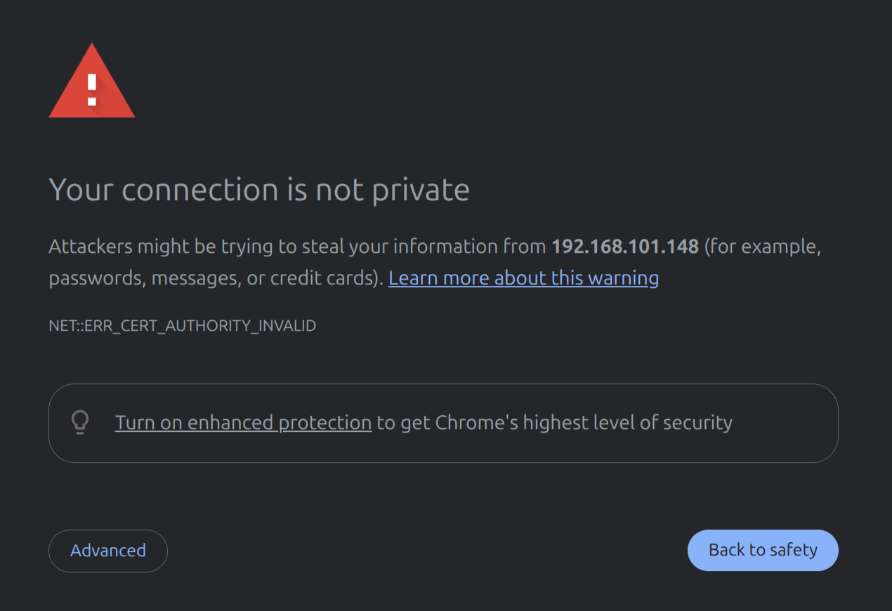

Check the fingerprint: click **Not secure** left of the address, then the certificate details; the
SHA-256 fingerprint must be the one above. Then click **Advanced** and **Proceed to … (unsafe)**:

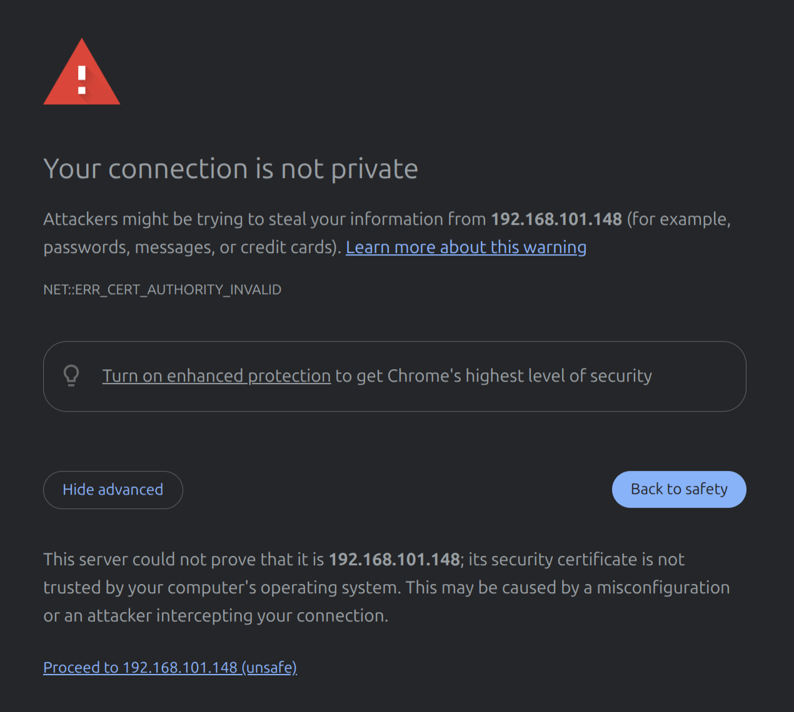

The browser may ask again later, and does when the certificate changes (step 9).

## 7. Log in (each person)

Paste the token into **ID token** and click **Authenticate**:

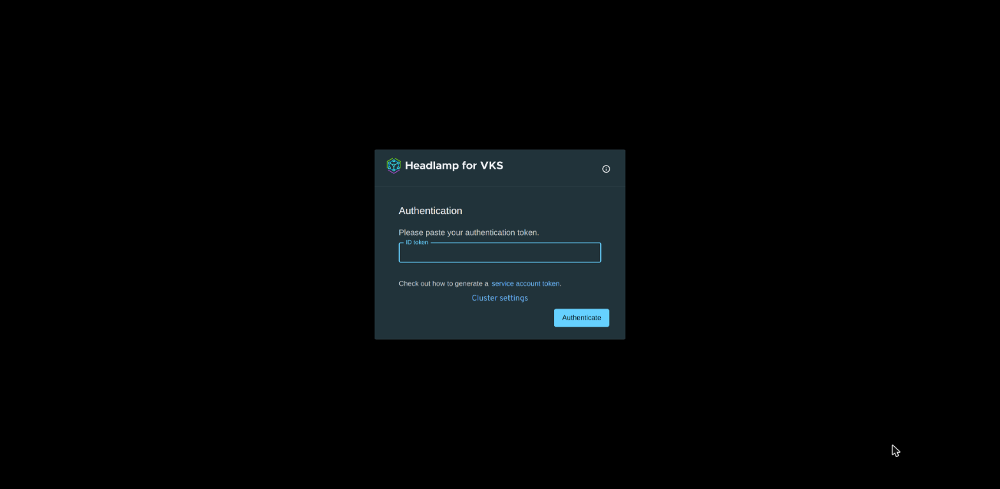

The person icon at the top right shows who you are logged in as, and logs you out:

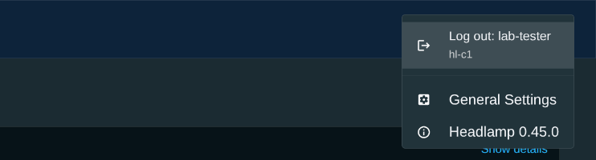

An account limited to one namespace picks it in **Namespaces** at the top right of any list; the
**Map** has its own **Namespaces** box. Headlamp remembers the choice in this browser:

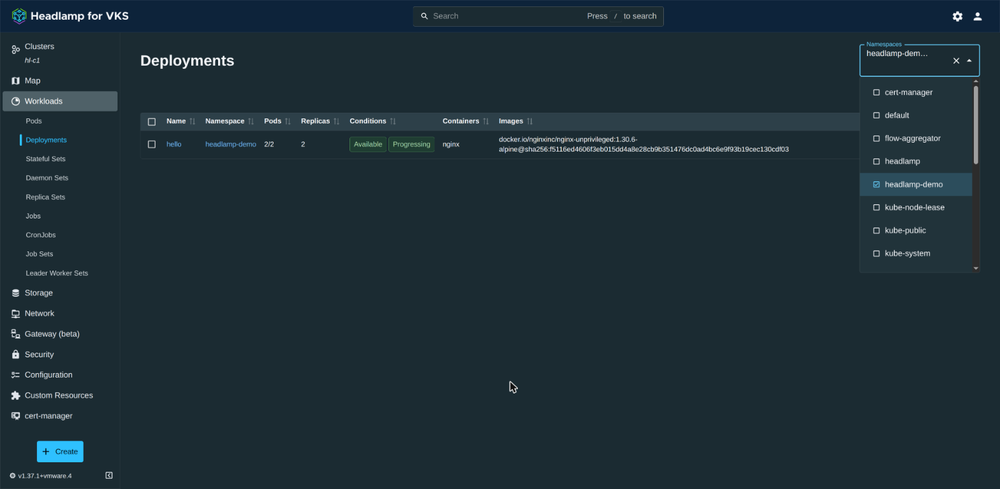

What an `edit` account sees and can do in its namespace:

| | |
|---|---|
| 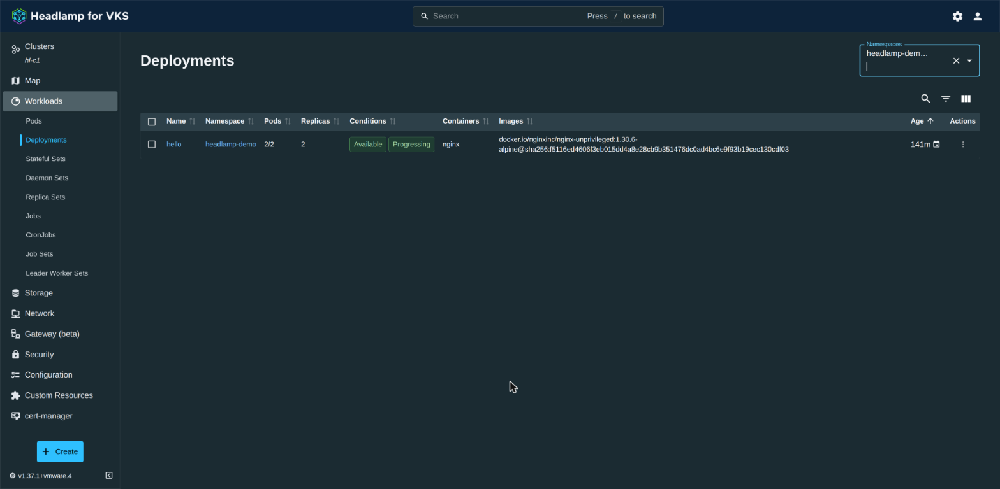 | **Workloads → Deployments**: the namespace's deployments |
| 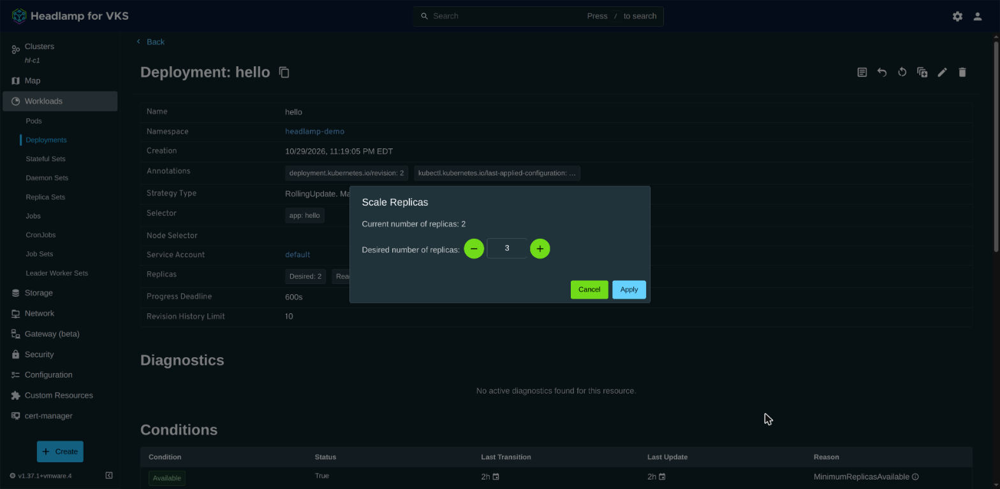 | the **Scale** button on a deployment |
| 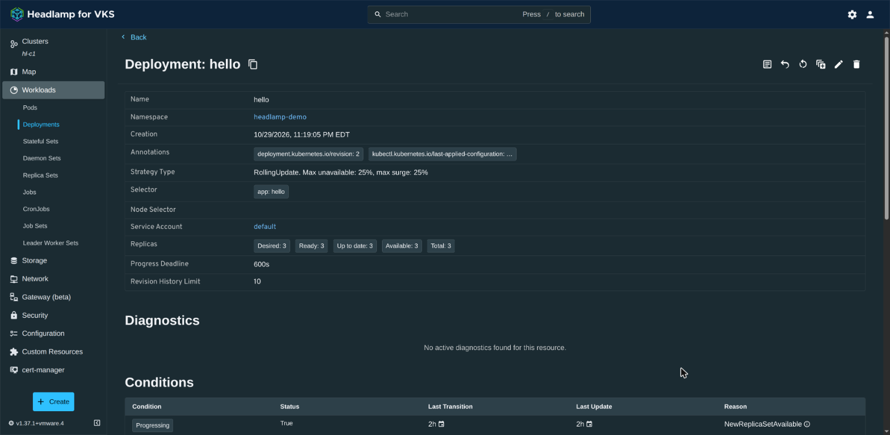 | the result |
| 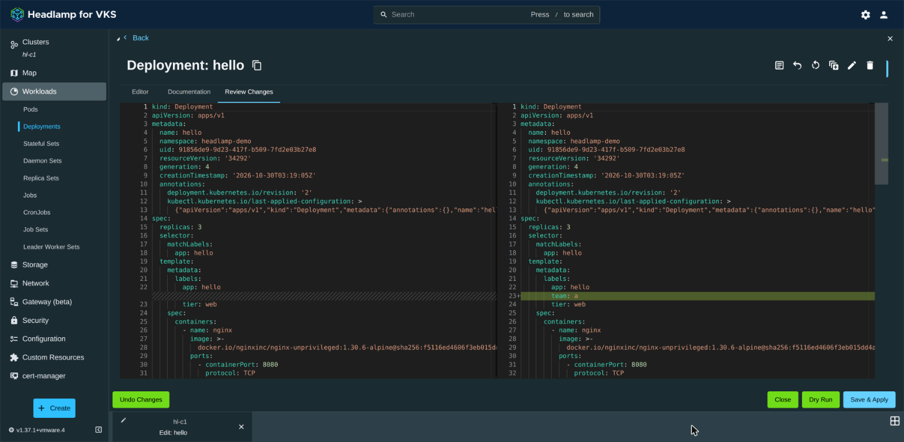 | **Edit** (pencil), then **Review Changes** before **Save & Apply** |
| 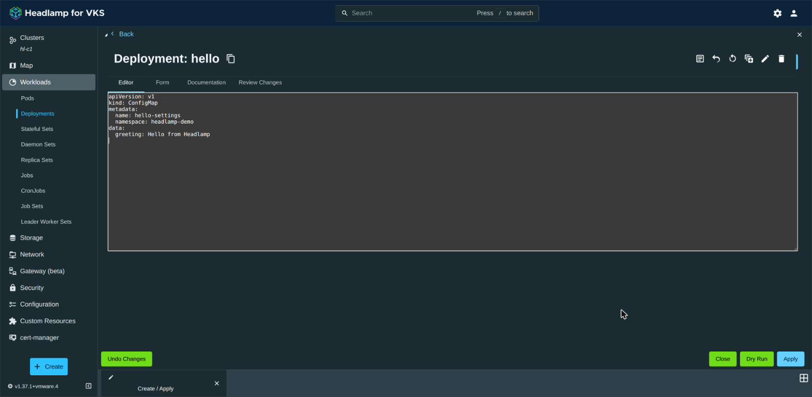 | **Create** (bottom left): paste YAML, **Apply** |
| 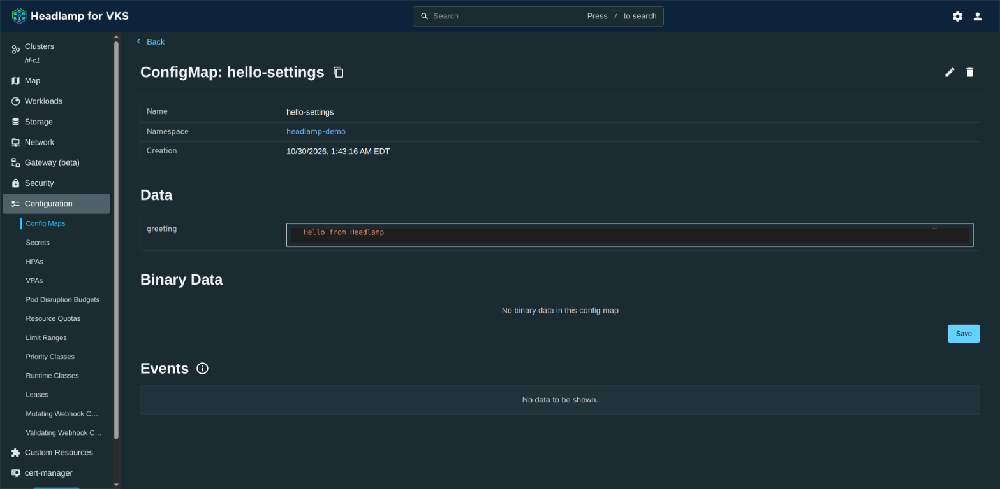 | the new object |
| 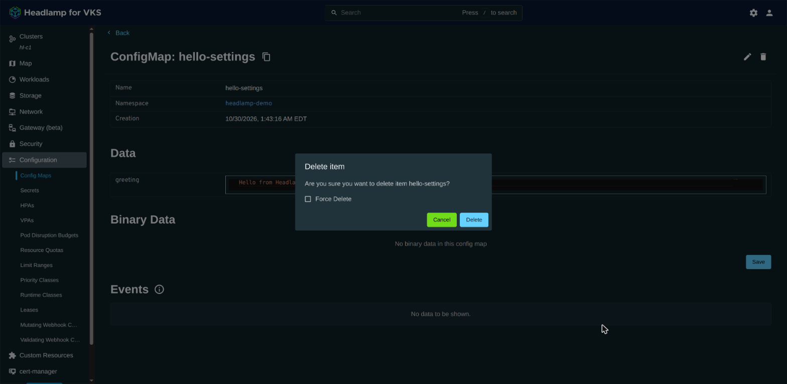 | **Delete** (bin) asks first |
| 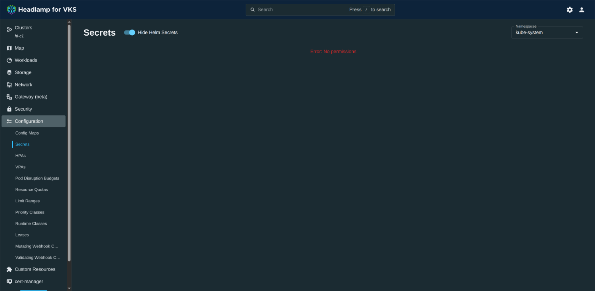 | outside its namespace: **No permissions** |
| 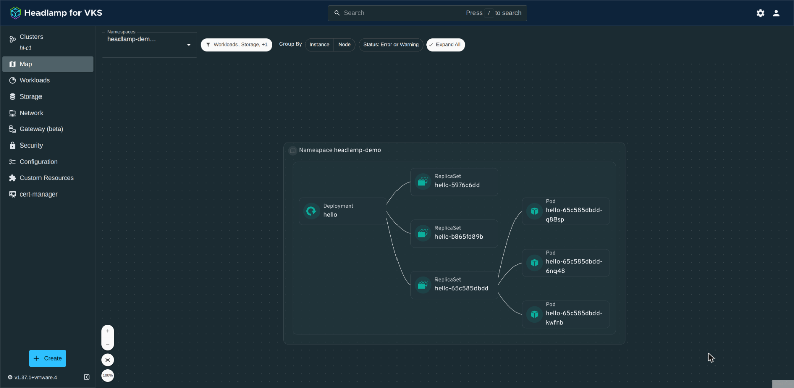 | **Map**: how the objects connect |

Headlamp shows its own text in the browser's language; **Settings** (gear) → **General** →
**Language** changes it.

**If not:**
- `Unauthorized` or back at the login page: the token has ended or its account was deleted; ask for
  a new one (step 5).
- The Namespaces list is empty: the account cannot list namespaces (step 4 gives an account limited
  to one namespace that right). Or set it yourself: **Settings** → **Cluster** → **Allowed
  namespaces**, add your namespace:

  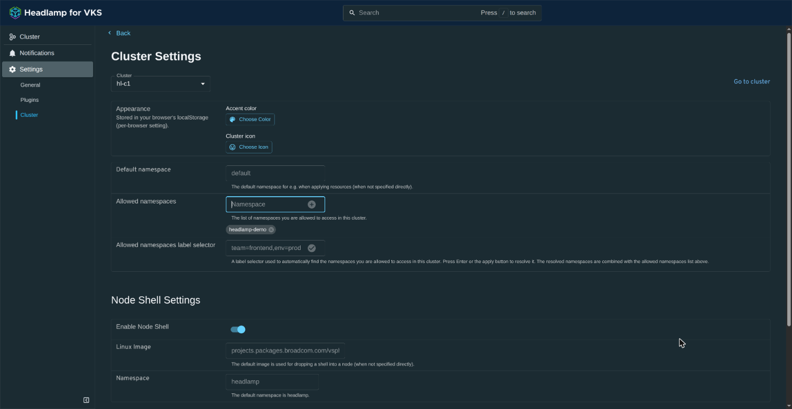

## 8. Log in with your own SSO user instead (optional)

Someone who has a Kubernetes login of their own on the cluster, through the VCF CLI or the kubectl
vSphere plugin ([ACCESS.md, "The person's own SSO account"](ACCESS.md#the-persons-own-sso-account)),
can paste that login's token instead of one from step 5. Headlamp then has exactly that user's
rights. The token is made for this cluster (the Supervisor refuses it) and ends 10 hours after that
login; nobody can end it sooner, only take the user's rights away.

A user with **Can edit** or **Owner** on the vSphere Namespace is an administrator of every
cluster in it, so their token can do anything there. This block stops for such a user; use an
account from step 4 instead.

<details>
<summary><b>Linux (Ubuntu, AlmaLinux, Photon OS), macOS, WSL (bash or zsh)</b></summary>

```sh
VKS_CLUSTER="my-vks-cluster"
VKS_SSO_KUBECONFIG="$HOME/.kube/${VKS_CLUSTER}-sso.kubeconfig"

T="$(kubectl --kubeconfig "$VKS_SSO_KUBECONFIG" config view --raw --minify -o jsonpath='{.users[0].user.token}' 2>/dev/null)"
E="$(printf '%s' "$T" | jq -Rr 'split(".")[1] | gsub("-"; "+") | gsub("_"; "/") | . + ("=" * ((4 - length % 4) % 4)) | @base64d | fromjson | .exp' 2>/dev/null)"
if [ -z "$T" ] || [ -z "$E" ]; then
  echo "FAILED: no SSO login for ${VKS_CLUSTER} in ${VKS_SSO_KUBECONFIG}; log in first (LOGIN.md)"
elif [ "$E" -le "$(date +%s)" ]; then
  echo "ENDED: that login has ended; log in again (LOGIN.md)"
elif [ "$(kubectl --kubeconfig "$VKS_SSO_KUBECONFIG" auth can-i '*' '*' -A 2>/dev/null)" != no ]; then
  echo "STOPPED: this SSO user is an administrator of the cluster, or the cluster did not answer; use an account from step 4 in Headlamp"
else
  echo "token for $(kubectl --kubeconfig "$VKS_SSO_KUBECONFIG" auth whoami -o jsonpath='{.status.userInfo.username}'):"
  echo "$T"
  echo "it ends: $(printf '%s' "$E" | jq -r 'tonumber | todate')"
fi
```

</details>

<details>
<summary><b>Windows (PowerShell)</b></summary>

```powershell
$VKS_CLUSTER = "my-vks-cluster"
$VKS_SSO_KUBECONFIG = "$HOME\.kube\${VKS_CLUSTER}-sso.kubeconfig"

$T = kubectl --kubeconfig $VKS_SSO_KUBECONFIG config view --raw --minify -o jsonpath='{.users[0].user.token}' 2>$null
$E = $null
if ($T) { try { $P = $T.Split('.')[1].Replace('-', '+').Replace('_', '/'); $P += '=' * ((4 - $P.Length % 4) % 4); $E = ([Text.Encoding]::UTF8.GetString([Convert]::FromBase64String($P)) | ConvertFrom-Json).exp } catch { } }
if (-not $T -or -not $E) {
  "FAILED: no SSO login for $VKS_CLUSTER in $VKS_SSO_KUBECONFIG; log in first (LOGIN.md)"
} elseif ($E -le [DateTimeOffset]::UtcNow.ToUnixTimeSeconds()) {
  "ENDED: that login has ended; log in again (LOGIN.md)"
} elseif ((kubectl --kubeconfig $VKS_SSO_KUBECONFIG auth can-i '*' '*' -A 2>$null) -ne 'no') {
  "STOPPED: this SSO user is an administrator of the cluster, or the cluster did not answer; use an account from step 4 in Headlamp"
} else {
  "token for $(kubectl --kubeconfig $VKS_SSO_KUBECONFIG auth whoami -o jsonpath='{.status.userInfo.username}'):"
  $T
  "it ends: $([DateTimeOffset]::FromUnixTimeSeconds($E).UtcDateTime.ToString('yyyy-MM-ddTHH:mm:ssZ'))"
}
```

</details>

**Expect:** `token for sso:<user>@<domain>:`, the token, and `it ends:` 10 hours after the login
(UTC). Paste it in step 7, then clear the terminal.

**If not:** `STOPPED: …`: this user would be an administrator in Headlamp; or, if `kubectl
--kubeconfig <the SSO file> get pods` also fails, the cluster did not answer. `FAILED: …` or
`ENDED: …`: run the login in LOGIN.md again. In Headlamp the user sees nothing: the cluster
administrator has not given that name rights yet
([ACCESS.md](ACCESS.md#the-persons-own-sso-account), step 3; add `headlamp-namespace-lister` as in step 4 so
that the Namespaces list works).

## 9. Change the add-on's settings (optional)

Each change gives the add-on all of its settings at once: a setting left out goes back to its
default. So this block always writes the three this guide uses:

| variable | the add-on's setting | empty or `no` |
|---|---|---|
| `HEADLAMP_HOSTNAME` | `hostname`: the name in Headlamp's certificate (step 10 uses it) | `headlamp.vks.example.com` |
| `CERT_WITH_IP` | `tls.certManager.ipAddresses`: also Headlamp's address in the certificate | name only |
| `KUBESCAPE_PLUGIN` | `pluginsManager`: the Kubescape plugin (step 11) | no plugin |

A new certificate is made when the name or address changes; Headlamp reads it only when it
starts, so the block then restarts it (some seconds away). The browser warns again for the new
certificate: check its new fingerprint (step 6).

`HEADLAMP_HOSTNAME`: empty gives `headlamp.vks.example.com`. `CERT_WITH_IP` and `KUBESCAPE_PLUGIN`:
`yes` or `no`.

<details>
<summary><b>Linux (Ubuntu, AlmaLinux, Photon OS), macOS, WSL (bash or zsh)</b></summary>

```sh
VKS_NAMESPACE="my-namespace"
VKS_CLUSTER="my-vks-cluster"
VKS_KUBECONFIG="$HOME/.kube/${VKS_CLUSTER}.kubeconfig"
HEADLAMP_HOSTNAME="headlamp.example.com"
CERT_WITH_IP="yes"
KUBESCAPE_PLUGIN="no"
DIR="$HOME/.config/vks-guides/headlamp"

vcf context use supervisor </dev/null
mkdir -p "$DIR"
IP="$(kubectl --kubeconfig "$VKS_KUBECONFIG" -n headlamp get service headlamp -o jsonpath='{.status.loadBalancer.ingress[0].ip}')"
{
  [ -z "$HEADLAMP_HOSTNAME" ] || printf 'hostname: %s\n' "$HEADLAMP_HOSTNAME"
  [ "$CERT_WITH_IP" != yes ] || printf 'tls:\n  certManager:\n    ipAddresses:\n      - %s\n' "$IP"
  [ "$KUBESCAPE_PLUGIN" != yes ] || printf '%s\n' 'pluginsManager:' '  enabled: true' '  configContent: |' '    plugins:' \
    '      - name: kubescape' '        source: https://artifacthub.io/packages/headlamp/kubescape-headlamp-plugin/headlamp_kubescape' '        version: 0.11.2'
} > "$DIR/addon-values.yaml"
[ -s "$DIR/addon-values.yaml" ] || echo '{}' > "$DIR/addon-values.yaml"
WANT="${HEADLAMP_HOSTNAME:-headlamp.vks.example.com} "
[ "$CERT_WITH_IP" != yes ] || WANT="${WANT}${IP}"
if [ "$CERT_WITH_IP" = yes ] && [ -z "$IP" ]; then
  echo "FAILED: cannot read Headlamp's address (see the error above)"
elif ! vcf addon install update headlamp --cluster-name "$VKS_CLUSTER" -n "$VKS_NAMESPACE" -f "$DIR/addon-values.yaml" -y; then
  echo "FAILED: the add-on (see the error above)"
else
  SAN=""
  for i in $(seq 24); do
    SAN="$(kubectl --kubeconfig "$VKS_KUBECONFIG" -n headlamp get secret headlamp-tls-cert -o jsonpath='{.metadata.annotations.cert-manager\.io/alt-names} {.metadata.annotations.cert-manager\.io/ip-sans}')"
    if [ "$SAN" = "$WANT" ]; then break; fi
    sleep 5
  done
  F="$(kubectl --kubeconfig "$VKS_KUBECONFIG" -n headlamp get secret headlamp-tls-cert -o jsonpath='{.data.tls\.crt}' | base64 -d | openssl x509 -noout -fingerprint -sha256 | cut -d= -f2)"
  if [ "$SAN" != "$WANT" ]; then
    echo "NOT YET: the certificate is for '${SAN}', not '${WANT}'; run this block again in a minute"
  elif [ "$(openssl s_client -connect "${IP}:443" </dev/null 2>/dev/null | openssl x509 -noout -fingerprint -sha256 | cut -d= -f2)" != "$F" ]; then
    kubectl --kubeconfig "$VKS_KUBECONFIG" -n headlamp rollout restart deployment headlamp \
      && kubectl --kubeconfig "$VKS_KUBECONFIG" -n headlamp rollout status deployment headlamp --timeout=5m \
      && echo "certificate for ${SAN}, SHA-256 fingerprint ${F}"
  else
    echo "certificate for ${SAN}, SHA-256 fingerprint ${F}"
  fi
fi
```

</details>

<details>
<summary><b>Windows (PowerShell)</b></summary>

```powershell
$VKS_NAMESPACE = "my-namespace"
$VKS_CLUSTER = "my-vks-cluster"
$VKS_KUBECONFIG = "$HOME\.kube\${VKS_CLUSTER}.kubeconfig"
$HEADLAMP_HOSTNAME = "headlamp.example.com"           # empty: headlamp.vks.example.com
$CERT_WITH_IP = "yes"                                # yes or no
$KUBESCAPE_PLUGIN = "no"                             # yes or no
$DIR = "$HOME\.config\vks-guides\headlamp"

function Fingerprint([byte[]]$Der) { (([Security.Cryptography.SHA256]::Create().ComputeHash($Der) | ForEach-Object { $_.ToString('X2') }) -join ':') }
function Read-Cert { [Security.Cryptography.X509Certificates.X509Certificate2]::new([Convert]::FromBase64String((kubectl --kubeconfig $VKS_KUBECONFIG -n headlamp get secret headlamp-tls-cert -o jsonpath='{.data.tls\.crt}'))) }
function Served($Ip) {
  try {
    $TCP = [Net.Sockets.TcpClient]::new($Ip, 443); $SSL = [Net.Security.SslStream]::new($TCP.GetStream(), $false, { $true })
    $SSL.AuthenticateAsClient($Ip); $R = Fingerprint $SSL.RemoteCertificate.GetRawCertData(); $SSL.Dispose(); $TCP.Dispose(); $R
  } catch { $null }
}
$null | vcf context use supervisor
New-Item -ItemType Directory -Force -Path $DIR | Out-Null
$IP = kubectl --kubeconfig $VKS_KUBECONFIG -n headlamp get service headlamp -o jsonpath='{.status.loadBalancer.ingress[0].ip}'
$Y = ""
if ($HEADLAMP_HOSTNAME) { $Y += "hostname: $HEADLAMP_HOSTNAME`n" }
if ($CERT_WITH_IP -eq 'yes') { $Y += "tls:`n  certManager:`n    ipAddresses:`n      - $IP`n" }
if ($KUBESCAPE_PLUGIN -eq 'yes') { $Y += "pluginsManager:`n  enabled: true`n  configContent: |`n    plugins:`n      - name: kubescape`n        source: https://artifacthub.io/packages/headlamp/kubescape-headlamp-plugin/headlamp_kubescape`n        version: 0.11.2`n" }
if (-not $Y) { $Y = "{}`n" }
[IO.File]::WriteAllText("$DIR\addon-values.yaml", $Y)
$NAME = if ($HEADLAMP_HOSTNAME) { $HEADLAMP_HOSTNAME } else { 'headlamp.vks.example.com' }
if ($CERT_WITH_IP -eq 'yes' -and -not $IP) {
  "FAILED: cannot read Headlamp's address (see the error above)"
} else {
  vcf addon install update headlamp --cluster-name $VKS_CLUSTER -n $VKS_NAMESPACE -f "$DIR\addon-values.yaml" -y
  if ($LASTEXITCODE -ne 0) {
    "FAILED: the add-on (see the error above)"
  } else {
    $OK = $false
    foreach ($i in 1..24) {
      $SAN = kubectl --kubeconfig $VKS_KUBECONFIG -n headlamp get secret headlamp-tls-cert -o jsonpath='{.metadata.annotations.cert-manager\.io/alt-names} {.metadata.annotations.cert-manager\.io/ip-sans}'
      $OK = $SAN -eq "$NAME $(if ($CERT_WITH_IP -eq 'yes') { $IP })"
      if ($OK) { break }
      Start-Sleep -Seconds 5
    }
    $F = Fingerprint (Read-Cert).RawData
    if (-not $OK) {
      "NOT YET: the certificate is for '$SAN'; run this block again in a minute"
    } elseif ((Served $IP) -ne $F) {
      kubectl --kubeconfig $VKS_KUBECONFIG -n headlamp rollout restart deployment headlamp
      if ($LASTEXITCODE -eq 0) { kubectl --kubeconfig $VKS_KUBECONFIG -n headlamp rollout status deployment headlamp --timeout=5m }
      if ($LASTEXITCODE -eq 0) { "certificate for $SAN, SHA-256 fingerprint $F" }
    } else {
      "certificate for $SAN, SHA-256 fingerprint $F"
    }
  }
}
```

</details>

**Expect:** `Addon 'headlamp' in the cluster … is being updated`, then either
`deployment.apps/headlamp restarted` and `successfully rolled out`, or nothing (the certificate did
not change), and `certificate for headlamp.example.com <address>, SHA-256 fingerprint …`. With `KUBESCAPE_PLUGIN="yes"` the add-on also restarts Headlamp by itself, with a
second container that installs the plugin.

**If not:** `NOT YET: …`: cert-manager has not made the new certificate yet; run the block again.
`FAILED: the add-on`: [renew the Supervisor login](LOGIN.md#renew-the-supervisor-login). The
rollout does not finish, a pod stays `Pending`: the workers lack free CPU (each restart briefly
runs two Headlamp pods).

## 10. Reach Headlamp by a DNS name through Contour (optional)

Instead of its own address, Headlamp can sit behind Contour, an ingress controller add-on that
serves many web apps of the cluster on one address, chosen by name. Contour passes Headlamp's
encrypted traffic through untouched, so Headlamp keeps its own certificate and the fingerprint
check of step 6 still holds. You need a DNS name for Headlamp that your DNS team can point at
Contour's address.

This installs the Contour add-on with its own load balancer address, and turns off the ports it
would otherwise open on every node. A Contour that is already installed is left as it is.

<details>
<summary><b>Linux (Ubuntu, AlmaLinux, Photon OS), macOS, WSL (bash or zsh)</b></summary>

```sh
VKS_NAMESPACE="my-namespace"
VKS_CLUSTER="my-vks-cluster"
VKS_KUBECONFIG="$HOME/.kube/${VKS_CLUSTER}.kubeconfig"
CONTOUR_RELEASE="contour.kubernetes.vmware.com.1.33.7-vmware.1-vks.1"
DIR="$HOME/.config/vks-guides/headlamp"

vcf context use supervisor </dev/null
mkdir -p "$DIR"
printf 'envoy:\n  hostPorts:\n    enable: false\n  service:\n    type: LoadBalancer\n' > "$DIR/contour-values.yaml"
if ! L="$(vcf addon install list --cluster-name "$VKS_CLUSTER" -n "$VKS_NAMESPACE" -o json)"; then
  echo "FAILED: the VCF CLI (see the error above)"
else
  if [ "$(printf '%s' "$L" | jq '[.[]? | select(.addonName == "contour")] | length')" = 1 ]; then
    echo "contour: already installed; its settings are left as they are"
  else
    vcf addon install create contour --cluster-name "$VKS_CLUSTER" -n "$VKS_NAMESPACE" \
      --addon-release-name "$CONTOUR_RELEASE" -f "$DIR/contour-values.yaml" -y
  fi
  IP=""
  for i in $(seq 60); do
    IP="$(kubectl --kubeconfig "$VKS_KUBECONFIG" -n tanzu-system-ingress get service envoy -o jsonpath='{.status.loadBalancer.ingress[0].ip}' 2>/dev/null)"
    if [ -n "$IP" ]; then break; fi
    sleep 5
  done
  if [ -n "$IP" ]; then
    echo "Contour's address: ${IP}"
  else
    echo "FAILED: Contour has no load balancer address after 5 minutes (its service: $(kubectl --kubeconfig "$VKS_KUBECONFIG" -n tanzu-system-ingress get service envoy -o jsonpath='{.spec.type}' 2>/dev/null))"
  fi
fi
```

</details>

<details>
<summary><b>Windows (PowerShell)</b></summary>

```powershell
$VKS_NAMESPACE = "my-namespace"
$VKS_CLUSTER = "my-vks-cluster"
$VKS_KUBECONFIG = "$HOME\.kube\${VKS_CLUSTER}.kubeconfig"
$CONTOUR_RELEASE = "contour.kubernetes.vmware.com.1.33.7-vmware.1-vks.1"
$DIR = "$HOME\.config\vks-guides\headlamp"

$null | vcf context use supervisor
New-Item -ItemType Directory -Force -Path $DIR | Out-Null
[IO.File]::WriteAllText("$DIR\contour-values.yaml", "envoy:`n  hostPorts:`n    enable: false`n  service:`n    type: LoadBalancer`n")
$global:LASTEXITCODE = $null
$L = vcf addon install list --cluster-name $VKS_CLUSTER -n $VKS_NAMESPACE -o json | Out-String
if ($LASTEXITCODE -ne 0) {
  "FAILED: the VCF CLI (see the error above)"
} else {
  if (@(ConvertFrom-Json $L | ForEach-Object { $_ } | Where-Object { $_.addonName -eq 'contour' }).Count -eq 1) {
    "contour: already installed; its settings are left as they are"
  } else {
    vcf addon install create contour --cluster-name $VKS_CLUSTER -n $VKS_NAMESPACE --addon-release-name $CONTOUR_RELEASE -f "$DIR\contour-values.yaml" -y
  }
  $IP = $null
  foreach ($i in 1..60) {
    $IP = kubectl --kubeconfig $VKS_KUBECONFIG -n tanzu-system-ingress get service envoy -o jsonpath='{.status.loadBalancer.ingress[0].ip}' 2>$null
    if ($IP) { break }
    Start-Sleep -Seconds 5
  }
  if ($IP) { "Contour's address: $IP" } else { "FAILED: Contour has no load balancer address after 5 minutes (its service: $(kubectl --kubeconfig $VKS_KUBECONFIG -n tanzu-system-ingress get service envoy -o jsonpath='{.spec.type}' 2>$null))" }
}
```

</details>

**Expect:** `Addon 'contour' is being installed in the cluster …` (or `contour: already
installed …`), then `Contour's address: <address>`.

**If not:** `FAILED: … (its service: NodePort)`: an earlier Contour was installed without a load
balancer; whoever installed it adds `envoy.service.type: LoadBalancer` to its settings (each
`vcf addon install update` replaces all of them). `(its service: LoadBalancer)`: the Supervisor has
no free load balancer address.

Ask your DNS team for a record: your name for Headlamp (for example `headlamp.example.com`) →
Contour's address. Then run step 9 with that name as `HEADLAMP_HOSTNAME`, so that Headlamp's
certificate is for it. This tells Contour to pass that name to Headlamp, and checks that the name
answers with Headlamp's certificate:

<details>
<summary><b>Linux (Ubuntu, AlmaLinux, Photon OS), macOS, WSL (bash or zsh)</b></summary>

```sh
VKS_CLUSTER="my-vks-cluster"
VKS_KUBECONFIG="$HOME/.kube/${VKS_CLUSTER}.kubeconfig"
HEADLAMP_HOSTNAME="headlamp.example.com"

printf '%s\n' 'apiVersion: projectcontour.io/v1' 'kind: HTTPProxy' 'metadata:' '  name: headlamp' '  namespace: headlamp' \
  'spec:' '  virtualhost:' "    fqdn: ${HEADLAMP_HOSTNAME}" '    tls:' '      passthrough: true' \
  '  tcpproxy:' '    services:' '      - name: headlamp' '        port: 443' \
  | kubectl --kubeconfig "$VKS_KUBECONFIG" apply -f -
S=""
for i in $(seq 24); do
  S="$(kubectl --kubeconfig "$VKS_KUBECONFIG" -n headlamp get httpproxy headlamp -o jsonpath='{.status.currentStatus}')"
  if [ "$S" = valid ]; then break; fi
  sleep 5
done
CA="$(mktemp)"
kubectl --kubeconfig "$VKS_KUBECONFIG" -n headlamp get secret headlamp-tls-cert -o jsonpath='{.data.tls\.crt}' | base64 -d > "$CA"
for i in $(seq 12); do
  H="$(curl -s -o /dev/null -w '%{http_code}' --connect-timeout 5 --max-time 10 --cacert "$CA" "https://${HEADLAMP_HOSTNAME}/")"
  if [ "$H" = 200 ]; then break; fi
  sleep 10
done
echo "Contour: ${S:-no status}; https://${HEADLAMP_HOSTNAME}/ with only Headlamp's certificate trusted: HTTP ${H}"
rm -f "$CA"
```

</details>

<details>
<summary><b>Windows (PowerShell)</b></summary>

```powershell
$VKS_CLUSTER = "my-vks-cluster"
$VKS_KUBECONFIG = "$HOME\.kube\${VKS_CLUSTER}.kubeconfig"
$HEADLAMP_HOSTNAME = "headlamp.example.com"

@('apiVersion: projectcontour.io/v1', 'kind: HTTPProxy', 'metadata:', '  name: headlamp', '  namespace: headlamp',
  'spec:', '  virtualhost:', "    fqdn: $HEADLAMP_HOSTNAME", '    tls:', '      passthrough: true',
  '  tcpproxy:', '    services:', '      - name: headlamp', '        port: 443') -join "`n" |
  kubectl --kubeconfig $VKS_KUBECONFIG apply -f -
$S = $null
foreach ($i in 1..24) {
  $S = kubectl --kubeconfig $VKS_KUBECONFIG -n headlamp get httpproxy headlamp -o jsonpath='{.status.currentStatus}'
  if ($S -eq 'valid') { break }
  Start-Sleep -Seconds 5
}
$CA = [IO.Path]::GetTempFileName()
[IO.File]::WriteAllBytes($CA, [Convert]::FromBase64String((kubectl --kubeconfig $VKS_KUBECONFIG -n headlamp get secret headlamp-tls-cert -o jsonpath='{.data.tls\.crt}')))
foreach ($i in 1..12) {
  $H = curl.exe -s -o NUL -w '%{http_code}' --connect-timeout 5 --max-time 10 --cacert $CA "https://$HEADLAMP_HOSTNAME/"
  if ($H -eq '200') { break }
  Start-Sleep -Seconds 10
}
"Contour: $S; https://$HEADLAMP_HOSTNAME/ with only Headlamp's certificate trusted: HTTP $H"
Remove-Item -Force $CA
```

</details>

**Expect:** `httpproxy.projectcontour.io/headlamp created` (`unchanged` on a second run), then
`Contour: valid; https://headlamp.example.com/ with only Headlamp's certificate trusted: HTTP 200`.
Open `https://<your name>/` in the browser; step 6's warning and fingerprint apply.

**If not:**
- `HTTP 000` after two minutes: the name does not lead to Contour yet (`nslookup <your name>` must
  answer Contour's address), or Headlamp's certificate is not for that name (step 9 with that
  `HEADLAMP_HOSTNAME`).
- `Contour: invalid` or no status: `kubectl --kubeconfig <the VKS kubeconfig> -n headlamp describe
  httpproxy headlamp` says why; another HTTPProxy may already use the name.

## 11. Add plugins (optional)

Plugins add pages to Headlamp. Broadcom's Headlamp carries two inside it, which need no download;
a third is downloaded when you turn it on:

| plugin | adds | comes from | on when | an account from step 4 also needs |
|---|---|---|---|---|
| cert-manager | **cert-manager** in the menu: certificates, issuers | inside Headlamp | always (step 2 installs cert-manager) | nothing; it sees the certificates in its namespaces |
| Prometheus | CPU, memory and network charts on pods, nodes, deployments | inside Headlamp | the Prometheus add-on is installed | `headlamp-prometheus-query` (block below): it shows the whole cluster's metrics |
| Kubescape | **Kubescape**: security scan results, vulnerabilities, compliance | downloaded from ArtifactHub when turned on | Kubescape runs in the cluster and step 9 has `KUBESCAPE_PLUGIN="yes"` | an account for every namespace (empty `ACCESS_NAMESPACE`) and `headlamp-kubescape-reports` (block below): its pages read the whole cluster |

The plugins have no rights of their own: each person sees in them what their token may read.

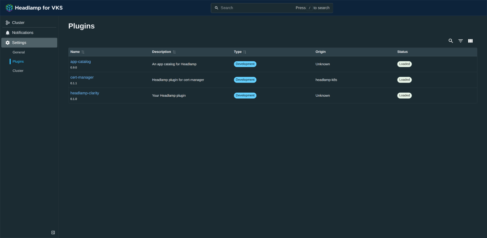

The **cert-manager** page lists the cluster's certificates and their state (its **Expires In**
column shows `<invalid>`, a fault of the plugin; the date is in the certificate's details):

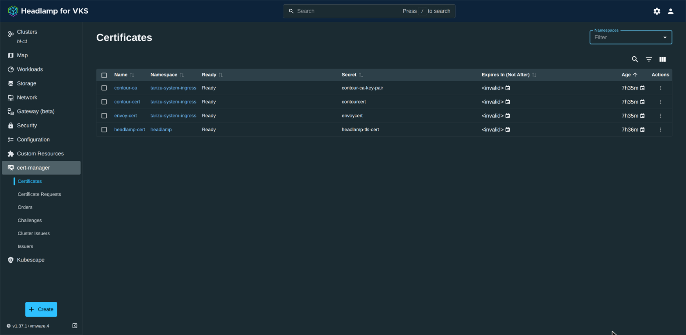

### Prometheus

This installs Broadcom's Prometheus add-on, without its Alertmanager and Pushgateway, which the
plugin does not use. Headlamp notices it and restarts within a minute with the Prometheus plugin;
the plugin finds Prometheus by itself. `PROMETHEUS_STORAGE` is the size of Prometheus's disk (the
add-on's own default is 150Gi).

<details>
<summary><b>Linux (Ubuntu, AlmaLinux, Photon OS), macOS, WSL (bash or zsh)</b></summary>

```sh
VKS_NAMESPACE="my-namespace"
VKS_CLUSTER="my-vks-cluster"
VKS_KUBECONFIG="$HOME/.kube/${VKS_CLUSTER}.kubeconfig"
PROMETHEUS_RELEASE="prometheus.kubernetes.vmware.com.3.13.3-vmware.1-vks.1"
PROMETHEUS_STORAGE="20Gi"
DIR="$HOME/.config/vks-guides/headlamp"

vcf context use supervisor </dev/null
mkdir -p "$DIR"
printf 'deploycomponents:\n  alertmanager: false\n  pushgateway: false\nprometheus:\n  pvc:\n    storage: %s\n' "$PROMETHEUS_STORAGE" > "$DIR/prometheus-values.yaml"
if ! L="$(vcf addon install list --cluster-name "$VKS_CLUSTER" -n "$VKS_NAMESPACE" -o json)"; then
  echo "FAILED: the VCF CLI (see the error above)"
elif [ "$(printf '%s' "$L" | jq '[.[]? | select(.addonName == "prometheus")] | length')" = 1 ]; then
  echo "prometheus: already installed"
elif ! vcf addon install create prometheus --cluster-name "$VKS_CLUSTER" -n "$VKS_NAMESPACE" \
       --addon-release-name "$PROMETHEUS_RELEASE" -f "$DIR/prometheus-values.yaml" -y; then
  echo "FAILED: the prometheus add-on (see the error above)"
else
  for i in $(seq 120); do
    if kubectl --kubeconfig "$VKS_KUBECONFIG" -n tanzu-system-monitoring get deployment prometheus-server >/dev/null 2>&1; then break; fi
    sleep 5
  done
  kubectl --kubeconfig "$VKS_KUBECONFIG" -n tanzu-system-monitoring wait --for=condition=Available deployment --all --timeout=10m \
    && kubectl --kubeconfig "$VKS_KUBECONFIG" -n tanzu-system-monitoring get pods,pvc
fi
```

</details>

<details>
<summary><b>Windows (PowerShell)</b></summary>

```powershell
$VKS_NAMESPACE = "my-namespace"
$VKS_CLUSTER = "my-vks-cluster"
$VKS_KUBECONFIG = "$HOME\.kube\${VKS_CLUSTER}.kubeconfig"
$PROMETHEUS_RELEASE = "prometheus.kubernetes.vmware.com.3.13.3-vmware.1-vks.1"
$PROMETHEUS_STORAGE = "20Gi"
$DIR = "$HOME\.config\vks-guides\headlamp"

$null | vcf context use supervisor
New-Item -ItemType Directory -Force -Path $DIR | Out-Null
[IO.File]::WriteAllText("$DIR\prometheus-values.yaml", "deploycomponents:`n  alertmanager: false`n  pushgateway: false`nprometheus:`n  pvc:`n    storage: $PROMETHEUS_STORAGE`n")
$global:LASTEXITCODE = $null
$L = vcf addon install list --cluster-name $VKS_CLUSTER -n $VKS_NAMESPACE -o json | Out-String
if ($LASTEXITCODE -ne 0) {
  "FAILED: the VCF CLI (see the error above)"
} elseif (@(ConvertFrom-Json $L | ForEach-Object { $_ } | Where-Object { $_.addonName -eq 'prometheus' }).Count -eq 1) {
  "prometheus: already installed"
} else {
  vcf addon install create prometheus --cluster-name $VKS_CLUSTER -n $VKS_NAMESPACE --addon-release-name $PROMETHEUS_RELEASE -f "$DIR\prometheus-values.yaml" -y
  if ($LASTEXITCODE -ne 0) {
    "FAILED: the prometheus add-on (see the error above)"
  } else {
    foreach ($i in 1..120) {
      kubectl --kubeconfig $VKS_KUBECONFIG -n tanzu-system-monitoring get deployment prometheus-server *> $null
      if ($LASTEXITCODE -eq 0) { break }
      Start-Sleep -Seconds 5
    }
    kubectl --kubeconfig $VKS_KUBECONFIG -n tanzu-system-monitoring wait --for=condition=Available deployment --all --timeout=10m
    if ($LASTEXITCODE -eq 0) { kubectl --kubeconfig $VKS_KUBECONFIG -n tanzu-system-monitoring get pods,pvc }
  }
}
```

</details>

**Expect:** `Addon 'prometheus' is being installed in the cluster …`, `condition met` lines, then
the pods `prometheus-server-…` (`2/2`), `prometheus-kube-state-metrics-…` and one
`prometheus-node-exporter-…` per node `Running`, and the volume `prometheus-server` `Bound`. About
two minutes.

In Headlamp, the chart button at the top of a pod's or deployment's page shows its CPU, memory,
network and disk use. For an account limited to one namespace the plugin cannot find Prometheus by
itself ("Error fetching prometheus info"): in that browser, **Settings** → **Plugins** →
**prometheus**, turn off **Auto detect**, enter `tanzu-system-monitoring/prometheus-server:80`,
**Test Connection**, **Save**:

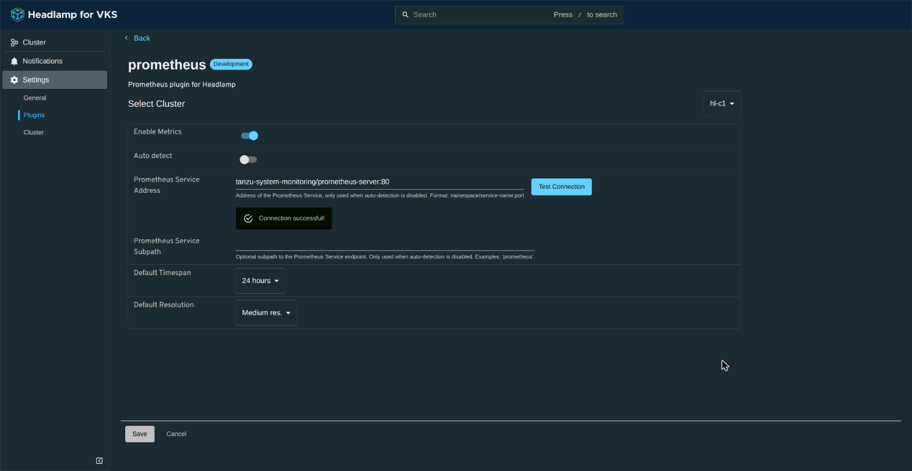

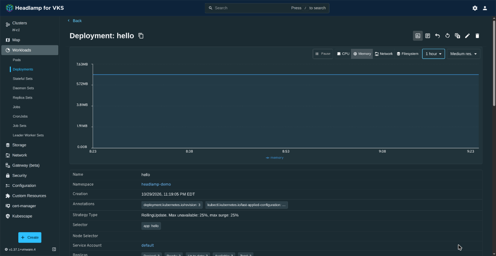

**If not:** a pod `Pending`: the workers lack CPU or memory (about 450m CPU and 800 MiB with
one worker), or the storage class has no room for `PROMETHEUS_STORAGE`. No charts in Headlamp: the account
needs `headlamp-prometheus-query` (the last block of this step, with `PROMETHEUS_QUERY="yes"`).

### Kubescape

Kubescape scans the cluster for weak settings and its images for known vulnerabilities. It is not a
Broadcom add-on: this installs it with Helm ([HELM.md](HELM.md)) from the Kubescape project, into
the namespace `kubescape`. Its node agent needs access to each worker (pod security `privileged`).
It asks for about 450m CPU and 2 GiB of memory with the requests below, lowered from the chart's
own (about 800m), and keeps its results on a 5Gi volume.

<details>
<summary><b>Linux (Ubuntu, AlmaLinux, Photon OS), macOS, WSL (bash or zsh)</b></summary>

```sh
VKS_CLUSTER="my-vks-cluster"
VKS_KUBECONFIG="$HOME/.kube/${VKS_CLUSTER}.kubeconfig"
KUBESCAPE_CHART_VERSION="1.41.0"
DIR="$HOME/.config/vks-guides/headlamp"

mkdir -p "$DIR"
printf '%s\n' "clusterName: ${VKS_CLUSTER}" 'capabilities:' '  continuousScan: enable' \
  'kubescape:' '  resources:' '    requests:' '      cpu: 100m' 'kubevuln:' '  resources:' '    requests:' '      cpu: 100m' \
  'storage:' '  resources:' '    requests:' '      cpu: 50m' 'nodeAgent:' '  resources:' '    requests:' '      cpu: 50m' \
  > "$DIR/kubescape-values.yaml"
if kubectl --kubeconfig "$VKS_KUBECONFIG" create namespace kubescape --dry-run=client -o yaml | kubectl --kubeconfig "$VKS_KUBECONFIG" apply -f - \
   && kubectl --kubeconfig "$VKS_KUBECONFIG" label namespace kubescape pod-security.kubernetes.io/enforce=privileged --overwrite \
   && helm repo add kubescape https://kubescape.github.io/helm-charts/ --force-update \
   && helm --kubeconfig "$VKS_KUBECONFIG" upgrade --install kubescape kubescape/kubescape-operator --version "$KUBESCAPE_CHART_VERSION" \
        -n kubescape -f "$DIR/kubescape-values.yaml" --wait --timeout 10m >/dev/null; then
  kubectl --kubeconfig "$VKS_KUBECONFIG" -n kubescape get pods
else
  echo "FAILED: Kubescape (see the error above)"
fi
```

</details>

<details>
<summary><b>Windows (PowerShell)</b></summary>

```powershell
$VKS_CLUSTER = "my-vks-cluster"
$VKS_KUBECONFIG = "$HOME\.kube\${VKS_CLUSTER}.kubeconfig"
$KUBESCAPE_CHART_VERSION = "1.41.0"
$DIR = "$HOME\.config\vks-guides\headlamp"

New-Item -ItemType Directory -Force -Path $DIR | Out-Null
[IO.File]::WriteAllText("$DIR\kubescape-values.yaml", ((@("clusterName: $VKS_CLUSTER", 'capabilities:', '  continuousScan: enable',
  'kubescape:', '  resources:', '    requests:', '      cpu: 100m', 'kubevuln:', '  resources:', '    requests:', '      cpu: 100m',
  'storage:', '  resources:', '    requests:', '      cpu: 50m', 'nodeAgent:', '  resources:', '    requests:', '      cpu: 50m') -join "`n") + "`n"))
$OK = $false
kubectl --kubeconfig $VKS_KUBECONFIG create namespace kubescape --dry-run=client -o yaml | kubectl --kubeconfig $VKS_KUBECONFIG apply -f -
if ($LASTEXITCODE -eq 0) { kubectl --kubeconfig $VKS_KUBECONFIG label namespace kubescape pod-security.kubernetes.io/enforce=privileged --overwrite }
if ($LASTEXITCODE -eq 0) { helm repo add kubescape https://kubescape.github.io/helm-charts/ --force-update }
if ($LASTEXITCODE -eq 0) {
  helm --kubeconfig $VKS_KUBECONFIG upgrade --install kubescape kubescape/kubescape-operator --version $KUBESCAPE_CHART_VERSION -n kubescape -f "$DIR\kubescape-values.yaml" --wait --timeout 10m | Out-Null
  $OK = $LASTEXITCODE -eq 0
}
if ($OK) { kubectl --kubeconfig $VKS_KUBECONFIG -n kubescape get pods } else { "FAILED: Kubescape (see the error above)" }
```

</details>

**Expect:** `namespace/kubescape created` and `labeled` (`unchanged` and `not labeled` on a second
run), `"kubescape" has been added to your repositories`, then the pods `kubescape-…`,
`kubevuln-…`, `operator-…`, `storage-…` and one `node-agent-…` per worker `1/1 Running`. About two
minutes. While Helm waits it may print lines such as `I1030 … "Warning: event bookmark expired"`
or `"Warning: watch ended with error"`: those are Helm's own messages, and harmless when the pods
then run.

**If not:** `FAILED: Kubescape` with `timed out waiting for the condition`: `kubectl --kubeconfig
<the VKS kubeconfig> -n kubescape get pods`; `Pending` means not enough free CPU or memory;
`ErrImagePull` means the nodes cannot reach `quay.io`.

Then run step 9 with `KUBESCAPE_PLUGIN="yes"`. Vulnerability results appear by themselves within
about 15 minutes. The configuration scan runs once a day (`kubectl --kubeconfig <the VKS kubeconfig>
-n kubescape get cronjob kubescape-scheduler` shows when, in UTC); to run it now:
`kubectl --kubeconfig <the VKS kubeconfig> -n kubescape create job --from=cronjob/kubescape-scheduler kubescape-first-scan`.

Kubescape's pages show the whole cluster: an account limited to one namespace sees them empty.

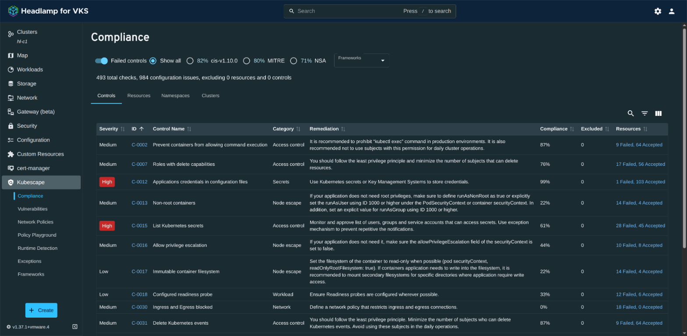

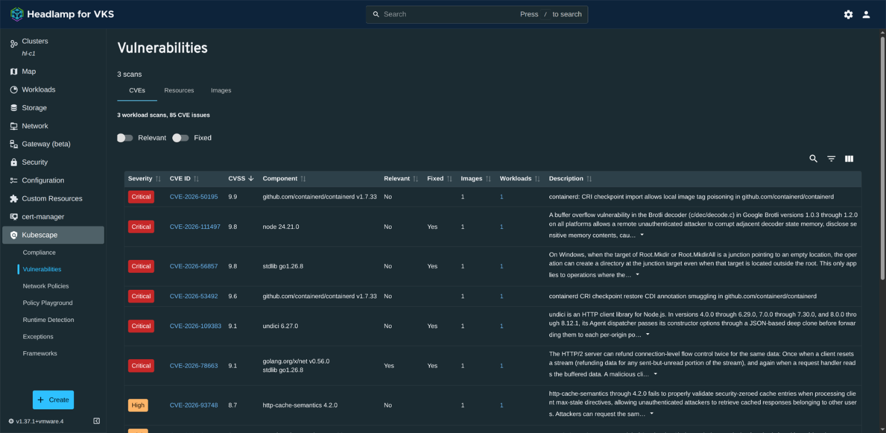

### Let an account read the plugins' data (cluster administrator)

This gives an account from step 4 what the plugins read:

- `headlamp-kubescape-reports`: Kubescape's results in every namespace. Given only to an account
  with an empty `ACCESS_NAMESPACE`, when Kubescape is in the cluster: the plugin's pages read the
  whole cluster and show nothing to an account limited to one namespace.
- `headlamp-prometheus-query`, only with `PROMETHEUS_QUERY="yes"`: asks Prometheus for metrics.
  Prometheus does not follow Kubernetes rights, so the account sees the metrics of every namespace,
  and in them the names of all pods, images and Secrets. Give it only to accounts allowed to see
  that.

`ACCOUNT` and `ACCESS_NAMESPACE`: as in step 4 (empty: every namespace). `PROMETHEUS_QUERY`: `yes`
adds the whole cluster's metrics.

<details>
<summary><b>Linux (Ubuntu, AlmaLinux, Photon OS), macOS, WSL (bash or zsh)</b></summary>

```sh
VKS_CLUSTER="my-vks-cluster"
VKS_KUBECONFIG="$HOME/.kube/${VKS_CLUSTER}.kubeconfig"
ACCOUNT="team-a"
ACCESS_NAMESPACE="team-a"
PROMETHEUS_QUERY="no"

S="headlamp:${ACCOUNT}"
if ! kubectl --kubeconfig "$VKS_KUBECONFIG" -n headlamp get serviceaccount "$ACCOUNT" >/dev/null; then
  echo "STOPPED: no account ${ACCOUNT}; make it in step 4"
else
  if [ "$PROMETHEUS_QUERY" != yes ]; then
    echo "Prometheus plugin: PROMETHEUS_QUERY is not yes; nothing given"
  elif kubectl --kubeconfig "$VKS_KUBECONFIG" -n tanzu-system-monitoring get service prometheus-server >/dev/null 2>&1; then
    kubectl --kubeconfig "$VKS_KUBECONFIG" -n tanzu-system-monitoring create role headlamp-prometheus-query --verb=get --resource=services/proxy --resource-name=prometheus-server:80 --dry-run=client -o yaml | kubectl --kubeconfig "$VKS_KUBECONFIG" apply -f -
    kubectl --kubeconfig "$VKS_KUBECONFIG" -n tanzu-system-monitoring create rolebinding "headlamp-${ACCOUNT}-prometheus" --role=headlamp-prometheus-query --serviceaccount="$S" --dry-run=client -o yaml | kubectl --kubeconfig "$VKS_KUBECONFIG" apply -f -
  else
    echo "Prometheus plugin: no Prometheus add-on in the cluster; nothing given"
  fi
  if kubectl --kubeconfig "$VKS_KUBECONFIG" get apiservice v1beta1.spdx.softwarecomposition.kubescape.io >/dev/null 2>&1; then
    printf '%s\n' 'apiVersion: rbac.authorization.k8s.io/v1' 'kind: ClusterRole' 'metadata:' '  name: headlamp-kubescape-reports' 'rules:' \
      '  - apiGroups: ["spdx.softwarecomposition.kubescape.io"]' '    resources: ["*"]' '    verbs: ["get", "list", "watch"]' \
      | kubectl --kubeconfig "$VKS_KUBECONFIG" apply -f -
    if [ -n "$ACCESS_NAMESPACE" ]; then
      echo "Kubescape plugin: its pages need an account for every namespace; nothing given"
    else
      kubectl --kubeconfig "$VKS_KUBECONFIG" create clusterrolebinding "headlamp-${ACCOUNT}-kubescape" --clusterrole=headlamp-kubescape-reports --serviceaccount="$S" --dry-run=client -o yaml | kubectl --kubeconfig "$VKS_KUBECONFIG" apply -f -
    fi
  else
    echo "Kubescape plugin: no Kubescape in the cluster; nothing given"
  fi
fi
```

</details>

<details>
<summary><b>Windows (PowerShell)</b></summary>

```powershell
$VKS_CLUSTER = "my-vks-cluster"
$VKS_KUBECONFIG = "$HOME\.kube\${VKS_CLUSTER}.kubeconfig"
$ACCOUNT = "team-a"                                  # as in step 4
$ACCESS_NAMESPACE = "team-a"                         # as in step 4; empty: every namespace
$PROMETHEUS_QUERY = "no"                             # yes: the whole cluster's metrics

$S = "headlamp:$ACCOUNT"
function Apply-Yaml { $input | kubectl --kubeconfig $VKS_KUBECONFIG apply -f - }
kubectl --kubeconfig $VKS_KUBECONFIG -n headlamp get serviceaccount $ACCOUNT | Out-Null
if ($LASTEXITCODE -ne 0) {
  "STOPPED: no account $ACCOUNT; make it in step 4"
} else {
  kubectl --kubeconfig $VKS_KUBECONFIG -n tanzu-system-monitoring get service prometheus-server *> $null
  if ($PROMETHEUS_QUERY -ne 'yes') {
    "Prometheus plugin: PROMETHEUS_QUERY is not yes; nothing given"
  } elseif ($LASTEXITCODE -eq 0) {
    kubectl --kubeconfig $VKS_KUBECONFIG -n tanzu-system-monitoring create role headlamp-prometheus-query --verb=get --resource=services/proxy --resource-name=prometheus-server:80 --dry-run=client -o yaml | Apply-Yaml
    kubectl --kubeconfig $VKS_KUBECONFIG -n tanzu-system-monitoring create rolebinding "headlamp-$ACCOUNT-prometheus" --role=headlamp-prometheus-query "--serviceaccount=$S" --dry-run=client -o yaml | Apply-Yaml
  } else {
    "Prometheus plugin: no Prometheus add-on in the cluster; nothing given"
  }
  kubectl --kubeconfig $VKS_KUBECONFIG get apiservice v1beta1.spdx.softwarecomposition.kubescape.io *> $null
  if ($LASTEXITCODE -eq 0) {
    @('apiVersion: rbac.authorization.k8s.io/v1', 'kind: ClusterRole', 'metadata:', '  name: headlamp-kubescape-reports', 'rules:',
      '  - apiGroups: ["spdx.softwarecomposition.kubescape.io"]', '    resources: ["*"]', '    verbs: ["get", "list", "watch"]') -join "`n" | Apply-Yaml
    if ($ACCESS_NAMESPACE) {
      "Kubescape plugin: its pages need an account for every namespace; nothing given"
    } else {
      kubectl --kubeconfig $VKS_KUBECONFIG create clusterrolebinding "headlamp-$ACCOUNT-kubescape" --clusterrole=headlamp-kubescape-reports "--serviceaccount=$S" --dry-run=client -o yaml | Apply-Yaml
    }
  } else {
    "Kubescape plugin: no Kubescape in the cluster; nothing given"
  }
}
```

</details>

**Expect:** for each plugin whose software is in the cluster (and, for Prometheus, with
`PROMETHEUS_QUERY="yes"`), its role and binding `created` (`unchanged` on a second run); for the
others, `… nothing given`. In Headlamp the account then sees, for an account for every namespace,
Kubescape's pages and, with Prometheus, a pod's charts.

**If not:** `STOPPED: …`: run step 4 first. A person still sees no charts: Headlamp asks for
metrics when a page opens; reload the page.

## 12. Remove Headlamp (optional)

This removes the Headlamp add-on, which takes the namespace `headlamp` with it: Headlamp, its
certificate, the accounts of step 4 (their tokens stop working) and step 10's HTTPProxy. It then
deletes what this guide gave those accounts elsewhere: their bindings, and the roles
`headlamp-namespace-lister`, `headlamp-prometheus-query` and `headlamp-kubescape-reports`. cert-manager, Prometheus, Contour
and Kubescape stay; the lines after the block remove them.

<details>
<summary><b>Linux (Ubuntu, AlmaLinux, Photon OS), macOS, WSL (bash or zsh)</b></summary>

```sh
VKS_NAMESPACE="my-namespace"
VKS_CLUSTER="my-vks-cluster"
VKS_KUBECONFIG="$HOME/.kube/${VKS_CLUSTER}.kubeconfig"

vcf context use supervisor </dev/null
vcf addon install delete headlamp --cluster-name "$VKS_CLUSTER" -n "$VKS_NAMESPACE" -y \
  || echo "(not deleted; on a second run the add-on is already gone, so this goes on)"
N=x
for i in $(seq 60); do
  N="$(kubectl --kubeconfig "$VKS_KUBECONFIG" get namespace headlamp --ignore-not-found -o name)" || N=x
  if [ -z "$N" ]; then break; fi
  sleep 5
done
kubectl --kubeconfig "$VKS_KUBECONFIG" get clusterrolebindings -o json \
  | jq -r '.items[] | select((.metadata.name | startswith("headlamp-")) and (.subjects | length > 0) and all(.subjects[]; .kind == "ServiceAccount" and .namespace == "headlamp")) | .metadata.name' \
  | while read -r B; do kubectl --kubeconfig "$VKS_KUBECONFIG" delete clusterrolebinding "$B" </dev/null; done
kubectl --kubeconfig "$VKS_KUBECONFIG" get rolebindings -A -o json \
  | jq -r '.items[] | select((.metadata.name | startswith("headlamp-")) and (.subjects | length > 0) and all(.subjects[]; .kind == "ServiceAccount" and .namespace == "headlamp")) | "\(.metadata.namespace) \(.metadata.name)"' \
  | while read -r NS B; do kubectl --kubeconfig "$VKS_KUBECONFIG" -n "$NS" delete rolebinding "$B" </dev/null; done
USED="$(kubectl --kubeconfig "$VKS_KUBECONFIG" get clusterrolebindings,rolebindings -A -o jsonpath='{range .items[*]}{.roleRef.name}{"\n"}{end}')"
for R in headlamp-namespace-lister headlamp-kubescape-reports; do
  if printf '%s\n' "$USED" | grep -qx "$R"; then echo "kept: clusterrole ${R}, still used"; else kubectl --kubeconfig "$VKS_KUBECONFIG" delete clusterrole "$R" --ignore-not-found; fi
done
if printf '%s\n' "$USED" | grep -qx headlamp-prometheus-query; then echo "kept: role headlamp-prometheus-query, still used"; else kubectl --kubeconfig "$VKS_KUBECONFIG" -n tanzu-system-monitoring delete role headlamp-prometheus-query --ignore-not-found 2>/dev/null; fi
if [ -z "$N" ]; then echo "removed: namespace headlamp is gone"; else echo "NOT YET: namespace headlamp is still there; run this block again in a few minutes"; fi
```

</details>

<details>
<summary><b>Windows (PowerShell)</b></summary>

```powershell
$VKS_NAMESPACE = "my-namespace"
$VKS_CLUSTER = "my-vks-cluster"
$VKS_KUBECONFIG = "$HOME\.kube\${VKS_CLUSTER}.kubeconfig"

$null | vcf context use supervisor
vcf addon install delete headlamp --cluster-name $VKS_CLUSTER -n $VKS_NAMESPACE -y
if ($LASTEXITCODE -ne 0) { "(not deleted; on a second run the add-on is already gone, so this goes on)" }
$N = 'x'
foreach ($i in 1..60) {
  $R = kubectl --kubeconfig $VKS_KUBECONFIG get namespace headlamp --ignore-not-found -o name
  if ($LASTEXITCODE -eq 0) { $N = $R; if (-not $N) { break } }
  Start-Sleep -Seconds 5
}
$HL = { param($o) $o.metadata.name -like 'headlamp-*' -and @($o.subjects).Count -gt 0 -and @($o.subjects | Where-Object { -not ($_.kind -eq 'ServiceAccount' -and $_.namespace -eq 'headlamp') }).Count -eq 0 }
(kubectl --kubeconfig $VKS_KUBECONFIG get clusterrolebindings -o json | ConvertFrom-Json).items | Where-Object { & $HL $_ } |
  ForEach-Object { kubectl --kubeconfig $VKS_KUBECONFIG delete clusterrolebinding $_.metadata.name }
(kubectl --kubeconfig $VKS_KUBECONFIG get rolebindings -A -o json | ConvertFrom-Json).items | Where-Object { & $HL $_ } |
  ForEach-Object { kubectl --kubeconfig $VKS_KUBECONFIG -n $_.metadata.namespace delete rolebinding $_.metadata.name }
$USED = @((kubectl --kubeconfig $VKS_KUBECONFIG get clusterrolebindings,rolebindings -A -o json | ConvertFrom-Json).items | ForEach-Object { $_.roleRef.name })
foreach ($R in 'headlamp-namespace-lister', 'headlamp-kubescape-reports') {
  if ($USED -contains $R) { "kept: clusterrole $R, still used" } else { kubectl --kubeconfig $VKS_KUBECONFIG delete clusterrole $R --ignore-not-found }
}
if ($USED -contains 'headlamp-prometheus-query') { "kept: role headlamp-prometheus-query, still used" } else { kubectl --kubeconfig $VKS_KUBECONFIG -n tanzu-system-monitoring delete role headlamp-prometheus-query --ignore-not-found 2>$null }
if (-not $N) { "removed: namespace headlamp is gone" } else { "NOT YET: namespace headlamp is still there; run this block again in a few minutes" }
```

</details>

**Expect:** `Addon 'headlamp' installed in the cluster … has been deleted`, `… deleted` lines for
each binding and role this guide made, and `removed: namespace headlamp is gone`. The namespaces
step 4 made for the accounts stay, with whatever runs in them. `kept: … still used`: an SSO
user's binding (step 8) still names that role; delete that binding first if you want it gone. A second run prints
`Error: clusterAddon for addon headlamp … not found`, `(not deleted; …)`, and `removed: …` again.

**If not:** `NOT YET: …`: the add-on is still being removed; run the block again. An error about
the login at the first line: [renew the Supervisor login](LOGIN.md#renew-the-supervisor-login).

To remove the rest, each only if nothing else in the cluster uses it:

- Kubescape: `helm --kubeconfig <the VKS kubeconfig> uninstall kubescape -n kubescape`, then
  `kubectl --kubeconfig <the VKS kubeconfig> delete namespace kubescape`, then the definitions Helm
  keeps: `kubectl --kubeconfig <the VKS kubeconfig> delete crd clustersecurityexceptions.kubescape.io
  operatorcommands.kubescape.io rules.kubescape.io runtimerulealertbindings.kubescape.io
  securityexceptions.kubescape.io servicesscanresults.kubescape.io`.
- Prometheus, Contour, cert-manager: `vcf addon install delete <prometheus|contour|cert-manager>
  --cluster-name <cluster> -n <namespace> -y`. Remove cert-manager last.
- The files this guide saved: `~/.config/vks-guides/headlamp` (PowerShell:
  `$HOME\.config\vks-guides\headlamp`).
