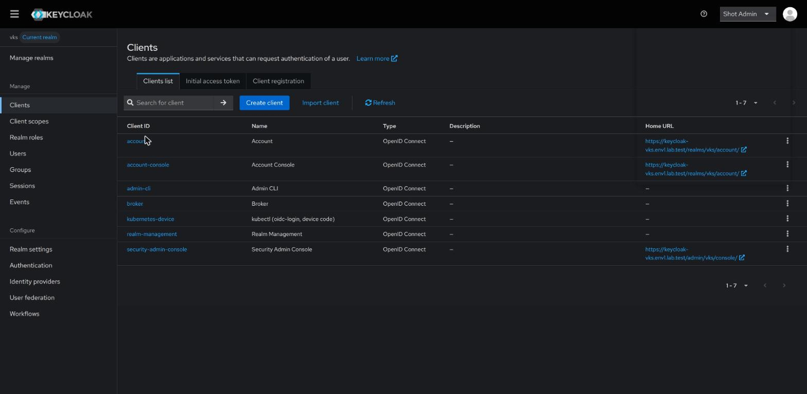
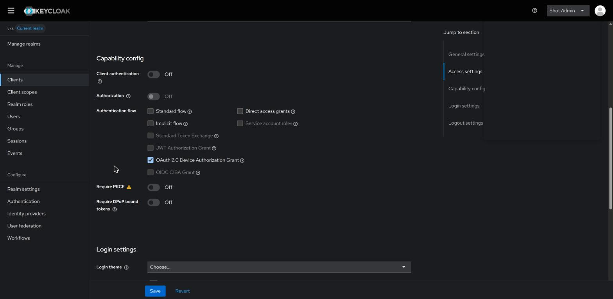
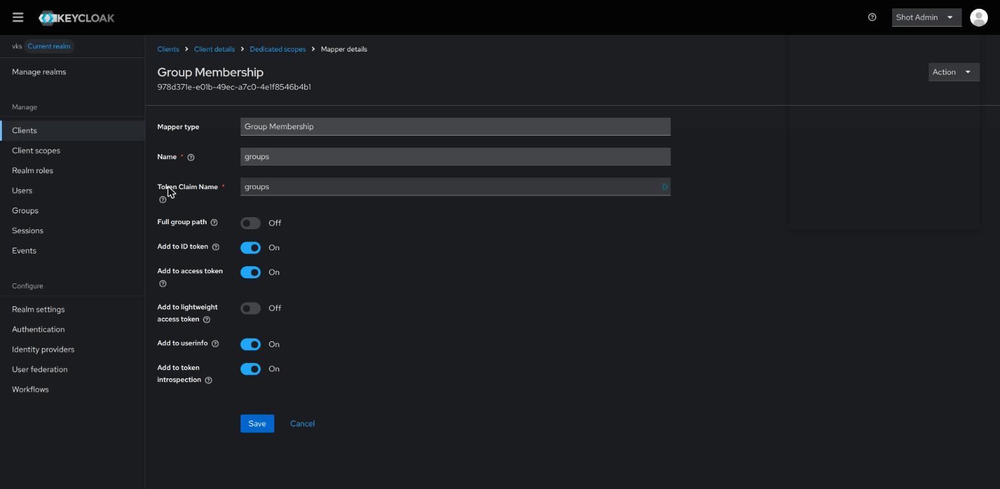
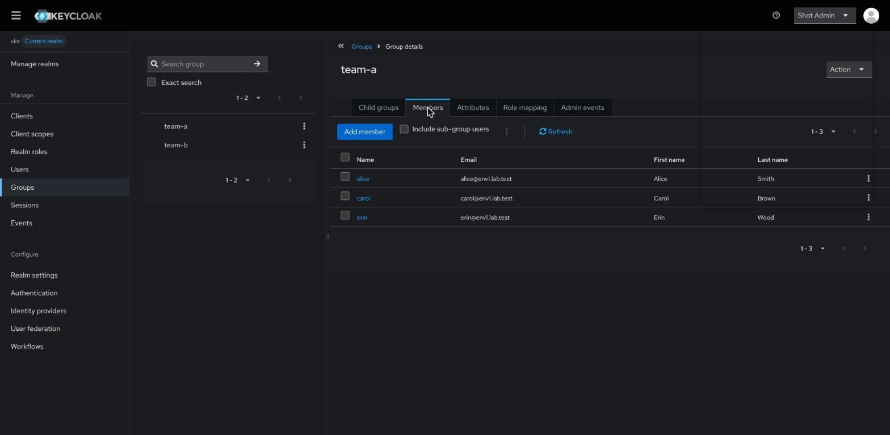
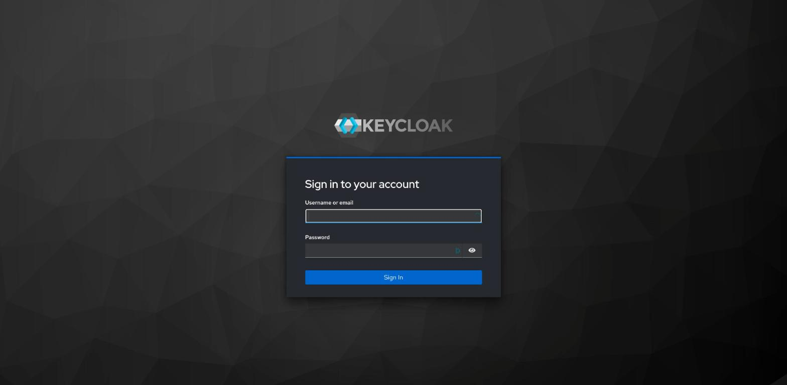

# Run an OIDC identity provider in a VKS cluster (Keycloak example)

> [!NOTE]
> **Official Broadcom, Keycloak, cert-manager and Kubernetes documentation for this guide**
>
> - Broadcom: [Register an External Identity Provider with Supervisor](https://techdocs.broadcom.com/us/en/vmware-cis/vcf/vcf-service-administration-and-development/9-1/managing-vsphere-kubernetes-service/connecting-to-tkg-service-clusters-using-an-external-identity-provider/register-an-external-idp-with-supervisor.html) (step 11), [Install an Add-on Using the VCF CLI](https://techdocs.broadcom.com/us/en/vmware-cis/vcf/vcf-consumption/latest/managing-vsphere-kuberenetes-service-clusters-and-workloads/managing-add-ons-in-vks-clusters/install-an-add-on-using-the-vcf-cli.html) (cert-manager)
> - Keycloak: [Running Keycloak in a container](https://www.keycloak.org/server/containers), [Configuring TLS](https://www.keycloak.org/server/enabletls), [Configuring the hostname](https://www.keycloak.org/server/hostname), [Management interface](https://www.keycloak.org/server/management-interface), [Admin CLI](https://www.keycloak.org/docs/latest/server_admin/index.html#admin-cli), [Sizing CPU and memory](https://www.keycloak.org/high-availability/single-cluster/concepts-memory-and-cpu-sizing)
> - cert-manager: [CA issuer](https://cert-manager.io/docs/configuration/ca/), [SelfSigned issuer](https://cert-manager.io/docs/configuration/selfsigned/)
> - Kubernetes: [Pod Security Standards](https://kubernetes.io/docs/concepts/security/pod-security-standards/) (`restricted`)

Keycloak is an open-source OpenID Connect (OIDC) identity provider: it keeps users and groups and
signs people in. It is the example provider in these guides; with your own OIDC provider, skip this
guide. Keycloak and PostgreSQL are upstream; Broadcom does not support them.
This runs Keycloak, with a PostgreSQL database for its data, in its own VKS cluster, gives it an
HTTPS certificate and a name, and sets up a realm (a set of users and groups with its own sign-in
page) that VKS clusters can use for logins ([KEYCLOAK.md](KEYCLOAK.md)).

> [!NOTE]
> **Why plain manifests, not Helm or the Keycloak Operator.** Keycloak publishes no Helm chart for
> the server; Bitnami's chart is frozen, and the community chart covers no database. The official
> Keycloak Operator's pods set no Pod Security settings, so they need the looser `baseline` level,
> and it adds cluster-wide resources. Plain manifests with Keycloak's official image need only
> kubectl, run under the strict `restricted` level, and show everything they do.

Run the steps in order. Who does what:

- a vCenter administrator: the VM class for the cluster (Prerequisites), and Keycloak's
  registration on the Supervisor (step 11, optional);
- you, the administrator of Keycloak's cluster: steps 1 to 7 and 9 to 14 (in step 11, the client);
- whoever runs your DNS: the record in step 7;
- everyone who signs in to Keycloak, you included: step 8, once.

## Prerequisites

- a VKS cluster for Keycloak alone, made as below;
- the [VCF CLI](VCF.md) with the context `SUPERVISOR_CONTEXT` ([LOGIN.md](LOGIN.md)),
  for the cert-manager add-on;
- [kubectl](KUBECTL.md), [jq, curl and openssl](PREREQS.md);
- a DNS name for Keycloak that you can point at an address (step 7), resolvable by the people who
  sign in, by the control-plane nodes of every VKS cluster that will trust Keycloak, and, for
  step 11, by the Supervisor's DNS servers;
- for step 11 only: a vCenter administrator, who registers Keycloak on the Supervisor.

The cluster for Keycloak:

1. Its vSphere Namespace offers the VM class `best-effort-small` (2 CPUs, 4 GB) or larger
   ([NAMESPACE.md step 8](NAMESPACE.md#8-check-the-namespace) lists them under `VM classes:`; a
   vCenter administrator adds one with [NAMESPACE.md step 6](NAMESPACE.md#6-add-the-vm-classes)).
   Keycloak uses about 0.5 to 0.8 GB and PostgreSQL under 0.1 GB, and they ask for
   1.5 GB of a `best-effort-small` worker's 2.9 GB. Choose `best-effort-medium` (8 GB) for many
   users or other apps in the same cluster.
2. Create the cluster with
   [CLUSTER.md step 9](CLUSTER.md#9-create-the-cluster-with-kubectl-and-a-yaml-file), with that
   `vmClass`, one control-plane node and one worker (`replicas: 1` for both). With
   `best-effort-small` it takes about 50 GB of the namespace's storage (two nodes of 20 GB disk plus
   4 GB memory each, and Keycloak's 2 GB volume),
   and 48 GB more while it updates ([CLUSTER.md step 2](CLUSTER.md#2-choose-a-name-and-the-values)).
   Keep it for Keycloak: the clusters that log in through Keycloak are other clusters
   ([KEYCLOAK.md](KEYCLOAK.md)). To change its size later, see
   [CLUSTER.md step 10](CLUSTER.md#10-resize-the-cluster-optional).
3. Save its kubeconfig as `~/.kube/<cluster name>.kubeconfig`
   ([LOGIN.md](LOGIN.md#get-the-vks-clusters-kubeconfig)); it is `<file>` in the **If not:** lines.

The connections this guide needs, for a firewall (all TCP, besides DNS; for a registry, also
[its other hosts](PREREQS.md#registry-hosts-for-a-firewall)):

| from | to | port | for |
|---|---|---|---|
| your machine (laptop or jump box) | the Supervisor's address | 443 | the VCF CLI (step 2) |
| your machine (laptop or jump box) | the VKS cluster's API address (in its kubeconfig) | 6443 | kubectl (all steps) |
| the cluster's nodes | `projects.packages.broadcom.com` | 443 | the cert-manager add-on (step 2) |
| the cluster's nodes | `quay.io`, `docker.io` | 443 | the Keycloak and PostgreSQL images (step 5) |
| your machine, the people's machines and browsers | Keycloak's address (step 5) | 443 | Keycloak's pages and logins |
| the control-plane nodes of the clusters that trust Keycloak | Keycloak's address | 443 | checking logins ([KEYCLOAK.md](KEYCLOAK.md)) |
| the vCenter administrator's browser | vCenter | 443 | the vSphere Client (step 11) |
| the Supervisor's control plane | Keycloak's address | 443 | the Supervisor's sign-ins (step 11) |

## 1. Check the cluster

Run this first, to see whether the cluster can hold Keycloak before you install anything. It only
reads: it checks that the nodes are ready, that the cluster has a default storage class (the
setting that gives pods, the containers that run in the cluster, their disks from vSphere storage)
and whether the namespace `keycloak` (a namespace inside the VKS cluster) exists already. You get
one line per worker with the memory it can give pods: Keycloak and PostgreSQL ask for about 1.5 GB
of it. Set `VKS_CLUSTER` to the name of Keycloak's cluster.

<details>
<summary><b>Linux, macOS, WSL (bash or zsh)</b></summary>

```sh
VKS_CLUSTER="my-keycloak-cluster"
VKS_KUBECONFIG="$HOME/.kube/${VKS_CLUSTER}.kubeconfig"

if ! command -v kubectl >/dev/null 2>&1; then echo "MISSING: kubectl (KUBECTL.md)"
elif ! command -v jq >/dev/null 2>&1; then echo "MISSING: jq (PREREQS.md)"
elif [ ! -s "$VKS_KUBECONFIG" ]; then echo "MISSING: $VKS_KUBECONFIG (LOGIN.md)"
elif kubectl --kubeconfig "$VKS_KUBECONFIG" get nodes -o wide && J="$(kubectl --kubeconfig "$VKS_KUBECONFIG" get storageclass -o json)"; then
  echo "default storage class: $(printf '%s' "$J" | jq -r '[.items[] | select(.metadata.annotations["storageclass.kubernetes.io/is-default-class"] == "true") | .metadata.name] | if length == 0 then "NONE" else join(" ") end')"
  kubectl --kubeconfig "$VKS_KUBECONFIG" get nodes -l '!node-role.kubernetes.io/control-plane' \
    -o custom-columns='WORKER:.metadata.name,CPU:.status.allocatable.cpu,MEMORY:.status.allocatable.memory'
  kubectl --kubeconfig "$VKS_KUBECONFIG" get namespace keycloak 2>/dev/null && echo "NOTE: namespace keycloak exists already"
else
  echo "FAILED: cannot read the cluster (see the error above)"
fi
```

</details>

<details>
<summary><b>Windows (PowerShell)</b></summary>

```powershell
$VKS_CLUSTER = "my-keycloak-cluster"
$VKS_KUBECONFIG = "$HOME\.kube\${VKS_CLUSTER}.kubeconfig"

$global:LASTEXITCODE = $null
if (-not (Get-Command kubectl -ErrorAction SilentlyContinue)) { "MISSING: kubectl (KUBECTL.md)"; $global:LASTEXITCODE = 1 }
elseif (-not (Test-Path $VKS_KUBECONFIG)) { "MISSING: $VKS_KUBECONFIG (LOGIN.md)"; $global:LASTEXITCODE = 1 }
else { kubectl --kubeconfig $VKS_KUBECONFIG get nodes -o wide }
if ($LASTEXITCODE -eq 0) { $J = kubectl --kubeconfig $VKS_KUBECONFIG get storageclass -o json | Out-String }
if ($LASTEXITCODE -eq 0) {
  $D = @((ConvertFrom-Json $J).items | Where-Object { $_.metadata.annotations.'storageclass.kubernetes.io/is-default-class' -eq 'true' } | ForEach-Object { $_.metadata.name })
  "default storage class: $(if ($D.Count) { $D -join ' ' } else { 'NONE' })"
  kubectl --kubeconfig $VKS_KUBECONFIG get nodes -l '!node-role.kubernetes.io/control-plane' -o 'custom-columns=WORKER:.metadata.name,CPU:.status.allocatable.cpu,MEMORY:.status.allocatable.memory'
  kubectl --kubeconfig $VKS_KUBECONFIG get namespace keycloak 2>$null
  if ($LASTEXITCODE -eq 0) { "NOTE: namespace keycloak exists already" }
} else {
  "FAILED: cannot read the cluster (see the error above)"
}
```

</details>

**Expect:** each node `Ready`, `default storage class:` and a class name, and a worker with
`MEMORY` of about `2908348Ki` for `best-effort-small` (`6197436Ki` for `best-effort-medium`).

**If not:** `default storage class: NONE`: give the cluster a default class as in
[CLUSTER.md](CLUSTER.md), step 9's `defaultStorageClass`. `NOTE: namespace keycloak exists
already`: Keycloak may be installed; steps 3 to 5 keep what exists.

## 2. Install cert-manager

Run this once per cluster, before step 4: Keycloak's HTTPS certificate (step 4) comes from
cert-manager, a Broadcom add-on of the VKS cluster that makes and renews certificates ([what add-ons
are](ADDONS.md)). It makes your Supervisor login (`SUPERVISOR_CONTEXT`) the active one for the VCF
CLI and in its kubeconfig file, and that stays after the block; it installs cert-manager with the
VCF CLI when the cluster does not have it, and waits until it accepts certificate requests. You get
cert-manager ready in the cluster. When the add-on is there already (for example from
[HEADLAMP.md](HEADLAMP.md)), it changes nothing. Set `VKS_NAMESPACE` to the cluster's vSphere
Namespace, `VKS_CLUSTER` to its name, and `SUPERVISOR_CONTEXT` to the name of your Supervisor login
from [LOGIN.md](LOGIN.md) (`supervisor` unless you chose another).

<details>
<summary><b>Linux, macOS, WSL (bash or zsh)</b></summary>

```sh
VKS_NAMESPACE="my-namespace"
VKS_CLUSTER="my-keycloak-cluster"
VKS_KUBECONFIG="$HOME/.kube/${VKS_CLUSTER}.kubeconfig"
SUPERVISOR_CONTEXT="supervisor"

for T in vcf kubectl jq; do command -v "$T" >/dev/null 2>&1 || echo "MISSING: $T (PREREQS.md, KUBECTL.md, VCF.md)"; done
VCF_USE="$(vcf context use "$SUPERVISOR_CONTEXT" </dev/null 2>&1)"
if ! printf '%s\n' "$VCF_USE" | grep -qF "Successfully activated context '${SUPERVISOR_CONTEXT}'"; then
  printf '%s\n' "$VCF_USE"
  echo "FAILED: the VCF CLI is not on context ${SUPERVISOR_CONTEXT}: log in or renew (LOGIN.md), then run this again"
else
  if ! L="$(vcf addon install list --cluster-name "$VKS_CLUSTER" -n "$VKS_NAMESPACE" -o json)" \
     || ! N="$(printf '%s' "$L" | jq '[.[]? | select(.addonName == "cert-manager")] | length')" || [ -z "$N" ]; then
    echo "FAILED: the VCF CLI or jq (see the error above)"
  elif [ "$N" = 1 ]; then
    echo "cert-manager: already installed"
  elif kubectl --kubeconfig "$VKS_KUBECONFIG" get crd certificates.cert-manager.io >/dev/null 2>&1; then
    echo "STOPPED: this cluster has a cert-manager that is not the add-on; this guide does not cover it"
  elif vcf addon install create cert-manager --cluster-name "$VKS_CLUSTER" -n "$VKS_NAMESPACE" -y; then
    OK=""
    for i in $(seq 60); do
      if kubectl --kubeconfig "$VKS_KUBECONFIG" -n cert-manager get deployment cert-manager-webhook >/dev/null 2>&1 \
         && printf 'apiVersion: cert-manager.io/v1\nkind: Issuer\nmetadata:\n  name: check\nspec:\n  selfSigned: {}\n' \
            | kubectl --kubeconfig "$VKS_KUBECONFIG" -n default create --dry-run=server -f - >/dev/null 2>&1; then
        OK=1; break
      fi
      sleep 5
    done
    kubectl --kubeconfig "$VKS_KUBECONFIG" -n cert-manager wait --for=condition=Available deployment --all --timeout=5m
    [ -n "$OK" ] || echo "FAILED: cert-manager does not accept requests yet"
  else
    echo "FAILED: the cert-manager add-on (see the error above)"
  fi
fi
```

</details>

<details>
<summary><b>Windows (PowerShell)</b></summary>

```powershell
$VKS_NAMESPACE = "my-namespace"
$VKS_CLUSTER = "my-keycloak-cluster"
$VKS_KUBECONFIG = "$HOME\.kube\${VKS_CLUSTER}.kubeconfig"
$SUPERVISOR_CONTEXT = "supervisor"

foreach ($T in 'vcf', 'kubectl') { if (-not (Get-Command $T -ErrorAction SilentlyContinue)) { "MISSING: $T (KUBECTL.md, VCF.md)" } }
$VCF_USE = ($null | vcf context use $SUPERVISOR_CONTEXT 2>&1 | ForEach-Object { "$_" }) -join "`n"
if (-not $VCF_USE.Contains("Successfully activated context '${SUPERVISOR_CONTEXT}'")) {
  $VCF_USE
  "FAILED: the VCF CLI is not on context ${SUPERVISOR_CONTEXT}: log in or renew (LOGIN.md), then run this again"
} else {
  $global:LASTEXITCODE = $null
  $L = vcf addon install list --cluster-name $VKS_CLUSTER -n $VKS_NAMESPACE -o json | Out-String
  if ($LASTEXITCODE -ne 0 -or -not $L.Trim()) {
    "FAILED: the VCF CLI (see the error above)"
  } elseif (@(ConvertFrom-Json $L | ForEach-Object { $_ } | ForEach-Object { $_.addonName }) -contains 'cert-manager') {
    "cert-manager: already installed"
  } elseif ((kubectl --kubeconfig $VKS_KUBECONFIG get crd certificates.cert-manager.io 2>$null) -and $LASTEXITCODE -eq 0) {
    "STOPPED: this cluster has a cert-manager that is not the add-on; this guide does not cover it"
  } else {
    vcf addon install create cert-manager --cluster-name $VKS_CLUSTER -n $VKS_NAMESPACE -y
    if ($LASTEXITCODE -ne 0) {
      "FAILED: the cert-manager add-on (see the error above)"
    } else {
      $OK = $false
      foreach ($i in 1..60) {
        kubectl --kubeconfig $VKS_KUBECONFIG -n cert-manager get deployment cert-manager-webhook 2>$null | Out-Null
        if ($LASTEXITCODE -eq 0) {
          "apiVersion: cert-manager.io/v1`nkind: Issuer`nmetadata:`n  name: check`nspec:`n  selfSigned: {}" |
            kubectl --kubeconfig $VKS_KUBECONFIG -n default create --dry-run=server -f - 2>$null | Out-Null
          if ($LASTEXITCODE -eq 0) { $OK = $true; break }
        }
        Start-Sleep 5
      }
      kubectl --kubeconfig $VKS_KUBECONFIG -n cert-manager wait --for=condition=Available deployment --all --timeout=5m
      if (-not $OK) { "FAILED: cert-manager does not accept requests yet" }
    }
  }
}
```

</details>

**Expect:** `Addon 'cert-manager' is being installed in the cluster my-keycloak-cluster`, then
`condition met` for `cert-manager`, `cert-manager-cainjector` and `cert-manager-webhook` (on VKS
3.8 the add-on release is `cert-manager.kubernetes.vmware.com.1.21.2-vmware.1-vks.1`). Or
`cert-manager: already installed`.

**If not:**
- `MISSING: …`: install that tool. `FAILED: the VCF CLI …`: log in to the Supervisor again
  ([LOGIN.md](LOGIN.md#renew-the-supervisor-login)), and check `VKS_NAMESPACE` and `VKS_CLUSTER`.
- `STOPPED: … not the add-on`: someone installed cert-manager another way. Use that cert-manager
  for step 4 at your own judgement, or remove it and run this block again.
- `FAILED: cert-manager does not accept requests yet`: wait a few minutes, then go on with step 4;
  if step 4 says `failed calling webhook`, wait and run step 4 again.
- `timed out waiting for the condition`: the nodes cannot pull from `projects.packages.broadcom.com`
  (see the table above); `kubectl --kubeconfig <file> -n cert-manager get pods` shows the reason.

## 3. Create the namespace and the passwords

Run this once, before PostgreSQL and Keycloak start (step 5): they read their passwords from here.
It creates the namespace `keycloak` (a namespace inside the VKS cluster, not a vSphere Namespace;
it is not listed under Supervisor Management → Namespaces), which allows only pods that follow the
`restricted` Pod Security Standard (Kubernetes' strictest rules for what a container may do), and
two Secrets (a Secret is a store for passwords and keys inside the cluster) with random passwords:
one for PostgreSQL and one for Keycloak's first administrator, `admin`. You get the namespace with
its two passwords; nothing prints a password (step 12 shows `admin`'s). Run again, it keeps a
Secret that exists: PostgreSQL keeps the password it was first given. Set `VKS_CLUSTER` to the
name of Keycloak's cluster.

<details>
<summary><b>Linux, macOS, WSL (bash or zsh)</b></summary>

```sh
VKS_CLUSTER="my-keycloak-cluster"
VKS_KUBECONFIG="$HOME/.kube/${VKS_CLUSTER}.kubeconfig"

kc() { kubectl --kubeconfig "$VKS_KUBECONFIG" "$@"; }
command -v kubectl >/dev/null 2>&1 || echo "MISSING: kubectl (KUBECTL.md)"
kc create namespace keycloak --dry-run=client -o yaml | kc apply -f - >/dev/null \
  && kc label namespace keycloak --overwrite pod-security.kubernetes.io/enforce=restricted \
       pod-security.kubernetes.io/audit=restricted pod-security.kubernetes.io/warn=restricted
for S in keycloak-db:keycloak keycloak-admin:admin; do
  P=
  if kc -n keycloak get secret "${S%%:*}" >/dev/null 2>&1; then
    echo "secret ${S%%:*}: exists, kept"
  elif ! P="$(openssl rand -hex 24)" || [ ${#P} -ne 48 ]; then
    echo "FAILED: no password made for ${S%%:*}: openssl (PREREQS.md)"
  else
    printf 'apiVersion: v1\nkind: Secret\nmetadata:\n  name: %s\nstringData:\n  username: %s\n  password: %s\n' \
      "${S%%:*}" "${S#*:}" "$P" | kc -n keycloak create -f -
  fi
done
unset P
```

</details>

<details>
<summary><b>Windows (PowerShell)</b></summary>

```powershell
$VKS_CLUSTER = "my-keycloak-cluster"
$VKS_KUBECONFIG = "$HOME\.kube\${VKS_CLUSTER}.kubeconfig"

function kc { $input | kubectl --kubeconfig $VKS_KUBECONFIG @args }
if (-not (Get-Command kubectl -ErrorAction SilentlyContinue)) { "MISSING: kubectl (KUBECTL.md)" }
kc create namespace keycloak --dry-run=client -o yaml | kc apply -f - | Out-Null
kc label namespace keycloak --overwrite pod-security.kubernetes.io/enforce=restricted pod-security.kubernetes.io/audit=restricted pod-security.kubernetes.io/warn=restricted
foreach ($S in @(@('keycloak-db', 'keycloak'), @('keycloak-admin', 'admin'))) {
  kc -n keycloak get secret $S[0] 2>$null | Out-Null
  if ($LASTEXITCODE -eq 0) {
    "secret $($S[0]): exists, kept"
  } else {
    $B = New-Object byte[] 24; [Security.Cryptography.RandomNumberGenerator]::Create().GetBytes($B)
    $P = ($B | ForEach-Object { $_.ToString('x2') }) -join ''
    @('apiVersion: v1', 'kind: Secret', 'metadata:', "  name: $($S[0])", 'stringData:', "  username: $($S[1])", "  password: $P") | kc -n keycloak create -f -
    Remove-Variable P
  }
}
```

</details>

**Expect:** `namespace/keycloak labeled` (or `not labeled` when run again), then
`secret/keycloak-db created` and `secret/keycloak-admin created` (or `exists, kept`).

## 4. Make Keycloak's certificate

Run this after steps 2 and 3, so that Keycloak answers over HTTPS with a certificate that browsers
and clusters can trust. It makes a CA (certificate authority: it signs the certificate, and browsers
and clusters that trust it, steps 6 and 8, trust Keycloak) of your own with cert-manager, valid for
10 years, and from it a certificate for `KEYCLOAK_HOST`, the DNS name Keycloak will have (step 7),
and for its name inside the cluster. You get the CA and the certificate in the namespace `keycloak`,
for steps 5 and 6. Run again, it keeps the CA. Set `VKS_CLUSTER` to the name of Keycloak's cluster
and `KEYCLOAK_HOST` to Keycloak's DNS name.

<details>
<summary><b>Linux, macOS, WSL (bash or zsh)</b></summary>

```sh
VKS_CLUSTER="my-keycloak-cluster"
VKS_KUBECONFIG="$HOME/.kube/${VKS_CLUSTER}.kubeconfig"
KEYCLOAK_HOST="keycloak.example.com"

cat <<EOF | kubectl --kubeconfig "$VKS_KUBECONFIG" -n keycloak apply -f - \
  && kubectl --kubeconfig "$VKS_KUBECONFIG" -n keycloak wait --for=condition=Ready certificate --all --timeout=3m
apiVersion: cert-manager.io/v1
kind: Issuer
metadata:
  name: keycloak-selfsigned
spec:
  selfSigned: {}
---
apiVersion: cert-manager.io/v1
kind: Certificate
metadata:
  name: keycloak-ca
spec:
  isCA: true
  commonName: Keycloak CA
  duration: 87600h
  secretName: keycloak-ca
  privateKey:
    algorithm: ECDSA
    size: 256
  issuerRef:
    name: keycloak-selfsigned
    kind: Issuer
---
apiVersion: cert-manager.io/v1
kind: Issuer
metadata:
  name: keycloak-ca
spec:
  ca:
    secretName: keycloak-ca
---
apiVersion: cert-manager.io/v1
kind: Certificate
metadata:
  name: keycloak-tls
spec:
  secretName: keycloak-tls
  commonName: ${KEYCLOAK_HOST}
  dnsNames:
    - ${KEYCLOAK_HOST}
    - keycloak.keycloak.svc
  usages:
    - server auth
  issuerRef:
    name: keycloak-ca
    kind: Issuer
EOF
```

</details>

<details>
<summary><b>Windows (PowerShell)</b></summary>

```powershell
$VKS_CLUSTER = "my-keycloak-cluster"
$VKS_KUBECONFIG = "$HOME\.kube\${VKS_CLUSTER}.kubeconfig"
$KEYCLOAK_HOST = "keycloak.example.com"

$global:LASTEXITCODE = $null
@"
apiVersion: cert-manager.io/v1
kind: Issuer
metadata:
  name: keycloak-selfsigned
spec:
  selfSigned: {}
---
apiVersion: cert-manager.io/v1
kind: Certificate
metadata:
  name: keycloak-ca
spec:
  isCA: true
  commonName: Keycloak CA
  duration: 87600h
  secretName: keycloak-ca
  privateKey:
    algorithm: ECDSA
    size: 256
  issuerRef:
    name: keycloak-selfsigned
    kind: Issuer
---
apiVersion: cert-manager.io/v1
kind: Issuer
metadata:
  name: keycloak-ca
spec:
  ca:
    secretName: keycloak-ca
---
apiVersion: cert-manager.io/v1
kind: Certificate
metadata:
  name: keycloak-tls
spec:
  secretName: keycloak-tls
  commonName: $KEYCLOAK_HOST
  dnsNames:
    - $KEYCLOAK_HOST
    - keycloak.keycloak.svc
  usages:
    - server auth
  issuerRef:
    name: keycloak-ca
    kind: Issuer
"@ | kubectl --kubeconfig $VKS_KUBECONFIG -n keycloak apply -f -
if ($LASTEXITCODE -eq 0) { kubectl --kubeconfig $VKS_KUBECONFIG -n keycloak wait --for=condition=Ready certificate --all --timeout=3m }
```

</details>

**Expect:** four `created` lines (`configured` or `unchanged` when run again), then
`certificate.cert-manager.io/keycloak-ca condition met` and `…/keycloak-tls condition met`.

**If not:**
- `no matches for kind "Issuer"`: step 2 did not finish.
- `failed calling webhook "webhook.cert-manager.io"`: cert-manager is still starting. Wait a minute
  and run this block again.
- `timed out`: `kubectl --kubeconfig <file> -n keycloak describe certificate keycloak-tls` shows
  why.

**Renewal:** cert-manager renews the certificate before it ends; Keycloak picks the new one up
within an hour. The CA itself is renewed with a new key after about 6.5 years: then hand out the
new CA (step 6) again, as for a new Keycloak, and, if Keycloak is registered on the Supervisor
(step 11), have the vCenter administrator edit the provider there and give it the new CA.

## 5. Run PostgreSQL and Keycloak

Run this after step 4 to start Keycloak. It runs PostgreSQL (the database where Keycloak keeps its
users and settings) with a 2 GB volume (a disk from the default storage class), waits until it is
ready, then runs Keycloak in front of it and gives Keycloak a load balancer address on port 443.
It takes about a minute. You get Keycloak's address, printed at the end: step 7's DNS record points
at it. Run again, it keeps PostgreSQL's data. Set `VKS_CLUSTER` and `KEYCLOAK_HOST` as in step 4.

<details>
<summary><b>Linux, macOS, WSL (bash or zsh)</b></summary>

```sh
VKS_CLUSTER="my-keycloak-cluster"
VKS_KUBECONFIG="$HOME/.kube/${VKS_CLUSTER}.kubeconfig"
KEYCLOAK_HOST="keycloak.example.com"
KEYCLOAK_IMAGE="quay.io/keycloak/keycloak:26.8.1@sha256:3f3c5f8e03c614774b4bd9173b88391fefa4153bfc010d8012d59ad825377332"
POSTGRES_IMAGE="docker.io/library/postgres:18.6@sha256:979bccfde35445db618c65107d27d08c6c21339d8dc3ad4c830c6633947be0e4"

cat <<EOF | kubectl --kubeconfig "$VKS_KUBECONFIG" -n keycloak apply -f -
apiVersion: v1
kind: Service
metadata:
  name: postgres
spec:
  selector:
    app: postgres
  ports:
    - port: 5432
---
apiVersion: apps/v1
kind: StatefulSet
metadata:
  name: postgres
spec:
  serviceName: postgres
  replicas: 1
  selector:
    matchLabels:
      app: postgres
  template:
    metadata:
      labels:
        app: postgres
    spec:
      securityContext:
        runAsNonRoot: true
        runAsUser: 999
        runAsGroup: 999
        fsGroup: 999
        seccompProfile:
          type: RuntimeDefault
      containers:
        - name: postgres
          image: ${POSTGRES_IMAGE}
          env:
            - name: POSTGRES_DB
              value: keycloak
            - name: POSTGRES_USER
              valueFrom:
                secretKeyRef:
                  name: keycloak-db
                  key: username
            - name: POSTGRES_PASSWORD
              valueFrom:
                secretKeyRef:
                  name: keycloak-db
                  key: password
          ports:
            - containerPort: 5432
          readinessProbe:
            exec:
              command: ["pg_isready", "-U", "keycloak", "-d", "keycloak"]
          resources:
            requests:
              cpu: 100m
              memory: 256Mi
            limits:
              memory: 512Mi
          securityContext:
            allowPrivilegeEscalation: false
            capabilities:
              drop: ["ALL"]
          volumeMounts:
            - name: data
              mountPath: /var/lib/postgresql
  volumeClaimTemplates:
    - metadata:
        name: data
      spec:
        accessModes: ["ReadWriteOnce"]
        resources:
          requests:
            storage: 2Gi
EOF
if ! kubectl --kubeconfig "$VKS_KUBECONFIG" -n keycloak rollout status statefulset/postgres --timeout=10m; then
  echo "FAILED: PostgreSQL did not start (see above)"
else
cat <<EOF | kubectl --kubeconfig "$VKS_KUBECONFIG" -n keycloak apply -f -
apiVersion: apps/v1
kind: Deployment
metadata:
  name: keycloak
spec:
  replicas: 1
  strategy:
    type: Recreate
  selector:
    matchLabels:
      app: keycloak
  template:
    metadata:
      labels:
        app: keycloak
    spec:
      securityContext:
        runAsNonRoot: true
        runAsUser: 1000
        runAsGroup: 0
        seccompProfile:
          type: RuntimeDefault
      containers:
        - name: keycloak
          image: ${KEYCLOAK_IMAGE}
          args: ["start"]
          env:
            - name: KC_DB
              value: postgres
            - name: KC_DB_URL
              value: jdbc:postgresql://postgres:5432/keycloak
            - name: KC_DB_USERNAME
              valueFrom:
                secretKeyRef:
                  name: keycloak-db
                  key: username
            - name: KC_DB_PASSWORD
              valueFrom:
                secretKeyRef:
                  name: keycloak-db
                  key: password
            - name: KC_BOOTSTRAP_ADMIN_USERNAME
              valueFrom:
                secretKeyRef:
                  name: keycloak-admin
                  key: username
            - name: KC_BOOTSTRAP_ADMIN_PASSWORD
              valueFrom:
                secretKeyRef:
                  name: keycloak-admin
                  key: password
            - name: KC_HOSTNAME
              value: https://${KEYCLOAK_HOST}
            - name: KC_HTTPS_CERTIFICATE_FILE
              value: /etc/keycloak-tls/tls.crt
            - name: KC_HTTPS_CERTIFICATE_KEY_FILE
              value: /etc/keycloak-tls/tls.key
            - name: KC_HEALTH_ENABLED
              value: "true"
          ports:
            - name: https
              containerPort: 8443
            - name: management
              containerPort: 9000
          startupProbe:
            httpGet:
              path: /health/started
              port: 9000
              scheme: HTTPS
            periodSeconds: 5
            failureThreshold: 60
          readinessProbe:
            httpGet:
              path: /health/ready
              port: 9000
              scheme: HTTPS
          livenessProbe:
            httpGet:
              path: /health/live
              port: 9000
              scheme: HTTPS
          resources:
            requests:
              cpu: 500m
              memory: 1250Mi
              ephemeral-storage: 256Mi
            limits:
              memory: 2Gi
          securityContext:
            allowPrivilegeEscalation: false
            capabilities:
              drop: ["ALL"]
          volumeMounts:
            - name: tls
              mountPath: /etc/keycloak-tls
              readOnly: true
      volumes:
        - name: tls
          secret:
            secretName: keycloak-tls
---
apiVersion: v1
kind: Service
metadata:
  name: keycloak
spec:
  type: LoadBalancer
  selector:
    app: keycloak
  ports:
    - name: https
      port: 443
      targetPort: 8443
EOF
kubectl --kubeconfig "$VKS_KUBECONFIG" -n keycloak rollout status deployment/keycloak --timeout=10m \
  && echo "Keycloak's address: $(kubectl --kubeconfig "$VKS_KUBECONFIG" -n keycloak get service keycloak -o jsonpath='{.status.loadBalancer.ingress[0].ip}')"
fi
```

</details>

<details>
<summary><b>Windows (PowerShell)</b></summary>

```powershell
$VKS_CLUSTER = "my-keycloak-cluster"
$VKS_KUBECONFIG = "$HOME\.kube\${VKS_CLUSTER}.kubeconfig"
$KEYCLOAK_HOST = "keycloak.example.com"
$KEYCLOAK_IMAGE = "quay.io/keycloak/keycloak:26.8.1@sha256:3f3c5f8e03c614774b4bd9173b88391fefa4153bfc010d8012d59ad825377332"
$POSTGRES_IMAGE = "docker.io/library/postgres:18.6@sha256:979bccfde35445db618c65107d27d08c6c21339d8dc3ad4c830c6633947be0e4"

$global:LASTEXITCODE = $null
@"
apiVersion: v1
kind: Service
metadata:
  name: postgres
spec:
  selector:
    app: postgres
  ports:
    - port: 5432
---
apiVersion: apps/v1
kind: StatefulSet
metadata:
  name: postgres
spec:
  serviceName: postgres
  replicas: 1
  selector:
    matchLabels:
      app: postgres
  template:
    metadata:
      labels:
        app: postgres
    spec:
      securityContext:
        runAsNonRoot: true
        runAsUser: 999
        runAsGroup: 999
        fsGroup: 999
        seccompProfile:
          type: RuntimeDefault
      containers:
        - name: postgres
          image: $POSTGRES_IMAGE
          env:
            - name: POSTGRES_DB
              value: keycloak
            - name: POSTGRES_USER
              valueFrom:
                secretKeyRef:
                  name: keycloak-db
                  key: username
            - name: POSTGRES_PASSWORD
              valueFrom:
                secretKeyRef:
                  name: keycloak-db
                  key: password
          ports:
            - containerPort: 5432
          readinessProbe:
            exec:
              command: ["pg_isready", "-U", "keycloak", "-d", "keycloak"]
          resources:
            requests:
              cpu: 100m
              memory: 256Mi
            limits:
              memory: 512Mi
          securityContext:
            allowPrivilegeEscalation: false
            capabilities:
              drop: ["ALL"]
          volumeMounts:
            - name: data
              mountPath: /var/lib/postgresql
  volumeClaimTemplates:
    - metadata:
        name: data
      spec:
        accessModes: ["ReadWriteOnce"]
        resources:
          requests:
            storage: 2Gi
"@ | kubectl --kubeconfig $VKS_KUBECONFIG -n keycloak apply -f -
kubectl --kubeconfig $VKS_KUBECONFIG -n keycloak rollout status statefulset/postgres --timeout=10m
if ($LASTEXITCODE -ne 0) { "FAILED: PostgreSQL did not start (see above)" } else {
@"
apiVersion: apps/v1
kind: Deployment
metadata:
  name: keycloak
spec:
  replicas: 1
  strategy:
    type: Recreate
  selector:
    matchLabels:
      app: keycloak
  template:
    metadata:
      labels:
        app: keycloak
    spec:
      securityContext:
        runAsNonRoot: true
        runAsUser: 1000
        runAsGroup: 0
        seccompProfile:
          type: RuntimeDefault
      containers:
        - name: keycloak
          image: $KEYCLOAK_IMAGE
          args: ["start"]
          env:
            - name: KC_DB
              value: postgres
            - name: KC_DB_URL
              value: jdbc:postgresql://postgres:5432/keycloak
            - name: KC_DB_USERNAME
              valueFrom:
                secretKeyRef:
                  name: keycloak-db
                  key: username
            - name: KC_DB_PASSWORD
              valueFrom:
                secretKeyRef:
                  name: keycloak-db
                  key: password
            - name: KC_BOOTSTRAP_ADMIN_USERNAME
              valueFrom:
                secretKeyRef:
                  name: keycloak-admin
                  key: username
            - name: KC_BOOTSTRAP_ADMIN_PASSWORD
              valueFrom:
                secretKeyRef:
                  name: keycloak-admin
                  key: password
            - name: KC_HOSTNAME
              value: https://$KEYCLOAK_HOST
            - name: KC_HTTPS_CERTIFICATE_FILE
              value: /etc/keycloak-tls/tls.crt
            - name: KC_HTTPS_CERTIFICATE_KEY_FILE
              value: /etc/keycloak-tls/tls.key
            - name: KC_HEALTH_ENABLED
              value: "true"
          ports:
            - name: https
              containerPort: 8443
            - name: management
              containerPort: 9000
          startupProbe:
            httpGet:
              path: /health/started
              port: 9000
              scheme: HTTPS
            periodSeconds: 5
            failureThreshold: 60
          readinessProbe:
            httpGet:
              path: /health/ready
              port: 9000
              scheme: HTTPS
          livenessProbe:
            httpGet:
              path: /health/live
              port: 9000
              scheme: HTTPS
          resources:
            requests:
              cpu: 500m
              memory: 1250Mi
              ephemeral-storage: 256Mi
            limits:
              memory: 2Gi
          securityContext:
            allowPrivilegeEscalation: false
            capabilities:
              drop: ["ALL"]
          volumeMounts:
            - name: tls
              mountPath: /etc/keycloak-tls
              readOnly: true
      volumes:
        - name: tls
          secret:
            secretName: keycloak-tls
---
apiVersion: v1
kind: Service
metadata:
  name: keycloak
spec:
  type: LoadBalancer
  selector:
    app: keycloak
  ports:
    - name: https
      port: 443
      targetPort: 8443
"@ | kubectl --kubeconfig $VKS_KUBECONFIG -n keycloak apply -f -
kubectl --kubeconfig $VKS_KUBECONFIG -n keycloak rollout status deployment/keycloak --timeout=10m
if ($LASTEXITCODE -eq 0) { "Keycloak's address: $(kubectl --kubeconfig $VKS_KUBECONFIG -n keycloak get service keycloak -o jsonpath='{.status.loadBalancer.ingress[0].ip}')" }
}
```

</details>

**Expect:** `created` lines, `partitioned roll out complete`, `deployment "keycloak" successfully
rolled out`, then `Keycloak's address:` and an IP address.

**If not:**
- `FAILED: PostgreSQL did not start` or a timeout:
  `kubectl --kubeconfig <file> -n keycloak describe pod -l app=postgres`
  (or `-l app=keycloak`) shows the reason. `ImagePullBackOff`: the nodes cannot reach `quay.io` or
  `docker.io` (see the table above). `Pending` with `Insufficient memory`: the worker is too small
  (see the Prerequisites).
- `secret "keycloak-tls" not found` in `describe pod -l app=keycloak`: step 4 did not finish; run
  it, then this block again.
- `The StatefulSet "postgres" is invalid: spec.volumeClaimTemplates`: your PostgreSQL was made with
  a 5 GB volume by an earlier version of this block. It keeps working, and the rest of the block
  still runs, but no change to PostgreSQL applies until you set `storage: 5Gi` in the block.
- `exceeded its progress deadline` when you run the block again after a failed run: Keycloak was
  still starting. Wait a minute and run the block again.
- `Keycloak's address:` with nothing after it: the cluster has no free load balancer address. With
  the Foundation Load Balancer, the vSphere Client shows the Supervisor's range (not which addresses
  are free): **Supervisor Management** → **Supervisors** → your Supervisor → **Configure** →
  **Supervisor** → **Network** → **Load Balancer** → **Virtual Server Network** → **VIEW DETAILS** →
  **Virtual IP Address Range(s)**. With NSX or Avi, the range is in that load balancer's own
  settings.

**Disk use:** PostgreSQL uses about 70 MB of its volume with a few people in it, and Keycloak about
180 MB of the node's disk.

## 6. Save Keycloak's CA

Run this after step 4, to get the file that browsers and clusters trust Keycloak with. It saves the
CA from step 4 as `keycloak-ca.pem` in your home folder (it holds no secret) and prints its
fingerprint. You get `keycloak-ca.pem`: everyone who signs in needs this file to trust Keycloak
(steps 7 and 8), and [KEYCLOAK.md](KEYCLOAK.md) needs it as `KEYCLOAK_CA`. Run again, it saves the
same CA again. Set `VKS_CLUSTER` to the name of Keycloak's cluster.

<details>
<summary><b>Linux, macOS, WSL (bash or zsh)</b></summary>

```sh
VKS_CLUSTER="my-keycloak-cluster"
VKS_KUBECONFIG="$HOME/.kube/${VKS_CLUSTER}.kubeconfig"
KEYCLOAK_CA="$HOME/keycloak-ca.pem"

if kubectl --kubeconfig "$VKS_KUBECONFIG" -n keycloak get secret keycloak-tls \
     -o go-template='{{index .data "ca.crt" | base64decode}}' > "$KEYCLOAK_CA.new" \
   && openssl x509 -in "$KEYCLOAK_CA.new" -noout -subject -fingerprint -sha256; then
  mv "$KEYCLOAK_CA.new" "$KEYCLOAK_CA" && echo "saved $KEYCLOAK_CA"
else
  rm -f "$KEYCLOAK_CA.new"; echo "FAILED: no CA read (see the error above)"
fi
```

</details>

<details>
<summary><b>Windows (PowerShell)</b></summary>

```powershell
$VKS_CLUSTER = "my-keycloak-cluster"
$VKS_KUBECONFIG = "$HOME\.kube\${VKS_CLUSTER}.kubeconfig"
$KEYCLOAK_CA = "$HOME\keycloak-ca.pem"

$global:LASTEXITCODE = $null
$B = kubectl --kubeconfig $VKS_KUBECONFIG -n keycloak get secret keycloak-tls -o 'jsonpath={.data.ca\.crt}'
if ($LASTEXITCODE -eq 0 -and $B) {
  $PEM = [Text.Encoding]::ASCII.GetString([Convert]::FromBase64String($B))
  $C = New-Object Security.Cryptography.X509Certificates.X509Certificate2 (,[Text.Encoding]::ASCII.GetBytes($PEM))
  "subject=$($C.Subject)"
  "sha256 Fingerprint=$([BitConverter]::ToString([Security.Cryptography.SHA256]::Create().ComputeHash($C.RawData)).Replace('-', ':'))"
  Set-Content -Encoding ascii -NoNewline -Path $KEYCLOAK_CA -Value $PEM
  "saved $KEYCLOAK_CA"
} else {
  "FAILED: no CA read (see the error above)"
}
```

</details>

**Expect:** a `subject=` line with `Keycloak CA`, a `sha256 Fingerprint=…` line, then `saved
…/keycloak-ca.pem`.

## 7. Give Keycloak its name

Create a DNS record (type A) for `KEYCLOAK_HOST` with Keycloak's address from step 5, in the DNS
that the people who sign in, the control-plane nodes of the clusters that trust Keycloak and, for
step 11, the Supervisor use.

Run this once the record exists, to check that Keycloak answers by its name. It asks Keycloak at
`https://<KEYCLOAK_HOST>` for its OpenID Connect settings, checks its certificate with
`keycloak-ca.pem`, and changes nothing. You get Keycloak's issuer (the address that names Keycloak
in every login), which clusters and the Supervisor are given later. Set `KEYCLOAK_HOST` to
Keycloak's DNS name.

**Linux, macOS, WSL (bash or zsh):**

```sh
KEYCLOAK_HOST="keycloak.example.com"
KEYCLOAK_CA="$HOME/keycloak-ca.pem"

curl -fsS --connect-timeout 20 --cacert "$KEYCLOAK_CA" "https://${KEYCLOAK_HOST}/realms/master/.well-known/openid-configuration" \
  | jq -r '"issuer: " + .issuer'
```

**Windows (PowerShell):**

```powershell
$KEYCLOAK_HOST = "keycloak.example.com"
$KEYCLOAK_CA = "$HOME\keycloak-ca.pem"

$global:LASTEXITCODE = $null
$J = curl.exe -fsS --connect-timeout 20 --ssl-no-revoke --cacert $KEYCLOAK_CA "https://$KEYCLOAK_HOST/realms/master/.well-known/openid-configuration"
if ($LASTEXITCODE -eq 0) { "issuer: $((ConvertFrom-Json ($J | Out-String)).issuer)" }
```

**Expect:** `issuer: https://<KEYCLOAK_HOST>/realms/master`.

**If not:**
- `Could not resolve host`: the DNS record is missing, or not yet seen by this machine.
- `SSL certificate problem`: `KEYCLOAK_HOST` is not the name in step 4, or `KEYCLOAK_CA` is not the
  file from step 6.
- `Connection refused` or a timeout: this machine cannot reach Keycloak's address on port 443.
- `CERT_TRUST_REVOCATION_STATUS_UNKNOWN` (Windows): `curl.exe` without `--ssl-no-revoke`; a CA of
  your own publishes no revocation list.

## 8. Trust Keycloak's CA (each person, once)

People sign in to Keycloak in a browser, which must trust Keycloak's CA. Give each person
`keycloak-ca.pem` from step 6 (it holds no secret), and each person adds it once on the machine
whose browser they sign in with. Do it on your own machine too, before step 12.

**Linux:** run this so that Chrome trusts Keycloak; Chrome uses its own certificate database in
your home. This adds the CA to that database (it needs `certutil`:
`sudo apt-get install -y libnss3-tools` on Ubuntu, `sudo dnf install -y nss-tools` on AlmaLinux,
`sudo tdnf install -y nss` on Photon OS). You get Keycloak's pages in Chrome with no certificate
warning.

```sh
mkdir -p "$HOME/.pki/nssdb"
[ -f "$HOME/.pki/nssdb/cert9.db" ] || certutil -d "sql:$HOME/.pki/nssdb" -N --empty-password
certutil -d "sql:$HOME/.pki/nssdb" -A -t "C,," -n "Keycloak CA" -i "$HOME/keycloak-ca.pem" \
  && certutil -d "sql:$HOME/.pki/nssdb" -L | grep 'Keycloak CA'
```

Firefox keeps its own list: **Settings** → **Privacy & Security** → **View Certificates** →
**Authorities** → **Import**, then tick *Trust this CA to identify websites*.

**macOS:** run this so that Safari and Chrome trust Keycloak. It adds the CA to your login
keychain, which they use. You get Keycloak's pages with no certificate warning. macOS asks for
your password:

```sh
security add-trusted-cert -r trustRoot -k "$HOME/Library/Keychains/login.keychain-db" "$HOME/keycloak-ca.pem"
```

**WSL:** run this first, because the browser runs on Windows and the CA must go there. This copies
`keycloak-ca.pem` to your Windows home folder. You get the file where the Windows line below finds
it; then run that line in PowerShell:

```sh
P="$(cmd.exe /c 'echo %USERPROFILE%' 2>/dev/null | tr -d '\r')"
W="$([ -n "$P" ] && wslpath "$P" 2>/dev/null)"
if [ -n "$W" ] && [ -d "$W" ] && cp ~/keycloak-ca.pem "$W/"; then echo "copied to $W"; else echo "FAILED: no Windows home folder found"; fi
```

**Windows (PowerShell):** run this so that Edge and Chrome trust Keycloak. It adds the CA to your
user's trusted root CAs, which they use. You get Keycloak's pages with no certificate warning.
Windows asks you to confirm with **Yes**:

```powershell
Import-Certificate -FilePath "$HOME\keycloak-ca.pem" -CertStoreLocation Cert:\CurrentUser\Root
```

**Expect:** Linux: a `Keycloak CA` line with `C,,`. macOS: no output after your password. WSL:
`copied to /mnt/c/Users/<you>`. Windows: a line with the CA's thumbprint and `CN=Keycloak CA`. Then
the browser opens Keycloak's address with no certificate warning (restart the browser first).

**If not:**
- `certutil: command not found`: install it (the package named above).
- `FAILED: no Windows home folder found` (WSL): copy `keycloak-ca.pem` to Windows by hand, for
  example with Explorer at `\\wsl$`.
- `UI is not allowed in this operation` (Windows): run the line in PowerShell on the desktop, not
  over a remote session, so Windows can ask for **Yes**.

## 9. Create the realm and the client

Run this once to set up Keycloak for VKS cluster logins, and again to add groups. A realm is a set
of users and groups with its own sign-in page; a client is an application that may ask Keycloak to
sign people in. This creates the realm with the client `kubernetes-device`, through which
kubelogin (kubectl's sign-in plugin) signs people in, a groups mapper (so the token Keycloak gives
at sign-in carries the person's groups), and the groups. You get a realm ready for people (step 10)
and for [KEYCLOAK.md](KEYCLOAK.md). It skips what exists. Set `VKS_CLUSTER` to the name of
Keycloak's cluster, `REALM` to your realm's name and `KEYCLOAK_GROUPS` to its groups, separated by
spaces.

<details>
<summary><b>Linux, macOS, WSL (bash or zsh)</b></summary>

```sh
VKS_CLUSTER="my-keycloak-cluster"
VKS_KUBECONFIG="$HOME/.kube/${VKS_CLUSTER}.kubeconfig"
REALM="my-realm"
KEYCLOAK_GROUPS="team-a team-b"

{ printf 'REALM=%s\nKEYCLOAK_GROUPS="%s"\n' "$REALM" "$KEYCLOAK_GROUPS"; cat <<'SCRIPT'
K=/opt/keycloak/bin/kcadm.sh
TS="$(mktemp -d)/truststore.p12"
keytool -importcert -noprompt -alias keycloak-ca -file /etc/keycloak-tls/ca.crt -keystore "$TS" \
  -storetype PKCS12 -storepass truststore >/dev/null 2>&1 || { echo "FAILED: no truststore"; exit 1; }
export KC_CLI_PASSWORD="$KC_BOOTSTRAP_ADMIN_PASSWORD"
"$K" config truststore --trustpass truststore "$TS" >/dev/null \
  && "$K" config credentials --server https://keycloak.keycloak.svc --realm master --user "$KC_BOOTSTRAP_ADMIN_USERNAME" >/dev/null \
  || { echo "FAILED: the admin login (see above)"; exit 1; }
if O="$("$K" get "realms/$REALM" --fields realm 2>&1)"; then
  echo "realm $REALM: exists"
elif printf '%s' "$O" | grep -q 'Resource not found'; then
  printf '{"realm":"%s","enabled":true,"editUsernameAllowed":false,"bruteForceProtected":true,"accessTokenLifespan":300}' "$REALM" \
    | "$K" create realms -f - >/dev/null && echo "realm $REALM: created"
else
  echo "FAILED: $O"; exit 1
fi
if [ -n "$("$K" get clients -r "$REALM" -q clientId=kubernetes-device --fields id --format csv --noquotes)" ]; then
  echo "client kubernetes-device: exists"
else
  "$K" create clients -r "$REALM" -f - >/dev/null <<'JSON' && echo "client kubernetes-device: created"
{"clientId":"kubernetes-device","name":"kubectl (oidc-login, device code)","publicClient":true,
 "standardFlowEnabled":false,"implicitFlowEnabled":false,"directAccessGrantsEnabled":false,"serviceAccountsEnabled":false,
 "attributes":{"oauth2.device.authorization.grant.enabled":"true"},
 "protocolMappers":[{"name":"groups","protocol":"openid-connect","protocolMapper":"oidc-group-membership-mapper",
   "config":{"claim.name":"groups","full.path":"false","id.token.claim":"true","access.token.claim":"true","userinfo.token.claim":"true"}}]}
JSON
fi
for G in $KEYCLOAK_GROUPS; do
  if "$K" get groups -r "$REALM" --fields name --format csv --noquotes | grep -qx "$G"; then
    echo "group $G: exists"
  else
    printf '{"name":"%s"}' "$G" | "$K" create groups -r "$REALM" -f - >/dev/null && echo "group $G: created"
  fi
done
SCRIPT
} | kubectl --kubeconfig "$VKS_KUBECONFIG" -n keycloak exec -i deploy/keycloak -- bash -s
```

</details>

<details>
<summary><b>Windows (PowerShell)</b></summary>

```powershell
$VKS_CLUSTER = "my-keycloak-cluster"
$VKS_KUBECONFIG = "$HOME\.kube\${VKS_CLUSTER}.kubeconfig"
$REALM = "my-realm"
$KEYCLOAK_GROUPS = "team-a team-b"

$SCRIPT = "REALM=$REALM`nKEYCLOAK_GROUPS=`"$KEYCLOAK_GROUPS`"`n" + @'
K=/opt/keycloak/bin/kcadm.sh
TS="$(mktemp -d)/truststore.p12"
keytool -importcert -noprompt -alias keycloak-ca -file /etc/keycloak-tls/ca.crt -keystore "$TS" \
  -storetype PKCS12 -storepass truststore >/dev/null 2>&1 || { echo "FAILED: no truststore"; exit 1; }
export KC_CLI_PASSWORD="$KC_BOOTSTRAP_ADMIN_PASSWORD"
"$K" config truststore --trustpass truststore "$TS" >/dev/null \
  && "$K" config credentials --server https://keycloak.keycloak.svc --realm master --user "$KC_BOOTSTRAP_ADMIN_USERNAME" >/dev/null \
  || { echo "FAILED: the admin login (see above)"; exit 1; }
if O="$("$K" get "realms/$REALM" --fields realm 2>&1)"; then
  echo "realm $REALM: exists"
elif printf '%s' "$O" | grep -q 'Resource not found'; then
  printf '{"realm":"%s","enabled":true,"editUsernameAllowed":false,"bruteForceProtected":true,"accessTokenLifespan":300}' "$REALM" \
    | "$K" create realms -f - >/dev/null && echo "realm $REALM: created"
else
  echo "FAILED: $O"; exit 1
fi
if [ -n "$("$K" get clients -r "$REALM" -q clientId=kubernetes-device --fields id --format csv --noquotes)" ]; then
  echo "client kubernetes-device: exists"
else
  "$K" create clients -r "$REALM" -f - >/dev/null <<'JSON' && echo "client kubernetes-device: created"
{"clientId":"kubernetes-device","name":"kubectl (oidc-login, device code)","publicClient":true,
 "standardFlowEnabled":false,"implicitFlowEnabled":false,"directAccessGrantsEnabled":false,"serviceAccountsEnabled":false,
 "attributes":{"oauth2.device.authorization.grant.enabled":"true"},
 "protocolMappers":[{"name":"groups","protocol":"openid-connect","protocolMapper":"oidc-group-membership-mapper",
   "config":{"claim.name":"groups","full.path":"false","id.token.claim":"true","access.token.claim":"true","userinfo.token.claim":"true"}}]}
JSON
fi
for G in $KEYCLOAK_GROUPS; do
  if "$K" get groups -r "$REALM" --fields name --format csv --noquotes | grep -qx "$G"; then
    echo "group $G: exists"
  else
    printf '{"name":"%s"}' "$G" | "$K" create groups -r "$REALM" -f - >/dev/null && echo "group $G: created"
  fi
done
'@
$B64 = [Convert]::ToBase64String([Text.Encoding]::UTF8.GetBytes($SCRIPT.Replace("`r", '')))
kubectl --kubeconfig $VKS_KUBECONFIG -n keycloak exec deploy/keycloak -- bash -c "echo $B64 | base64 -d | bash"
```

</details>

**Expect:** `Logging into https://keycloak.keycloak.svc as user admin of realm master`, then
`realm my-realm: created`, `client kubernetes-device: created` and a `group …: created` line for
each group (`exists` for what was there), with a `Created new …` line from Keycloak before each.

**If not:** `FAILED: the admin login`: Keycloak is not ready yet (step 5) or the Secret
`keycloak-admin` was changed after Keycloak's first start (Keycloak keeps the first password), or
the administrator `admin` was deleted or got another password in the admin console.

**How it signs in:** it runs Keycloak's admin command line inside the Keycloak pod, as the
administrator from step 3, whose password never leaves the pod.

In the admin console (step 12), the realm's **Clients** list shows `kubernetes-device`; its
**Capability config** has **Client authentication** off and **OAuth 2.0 Device Authorization Grant**
on; and under **Client scopes**, `kubernetes-device-dedicated`, the mapper `groups` has **Full
group path** off and **Add to ID token** on.







## 10. Add a person

Run this for each person who signs in through Keycloak. It adds the person to the realm with their
name, email address and a temporary password, which they change at their first sign in, and puts
them in a group. You get the person's account, ready for their first sign in. In the second block,
set `VKS_CLUSTER` to the name of Keycloak's cluster, `REALM` and the person's username, names, email
address (Keycloak requires them, or stops the first sign in at **Update Account Information**) and
group; `OTP="yes"` adds a one-time-code app (such as Google Authenticator) at the first sign in.
First type the temporary password, on its own:

**Linux, macOS, WSL (bash or zsh):**

```sh
printf 'Temporary password: '; IFS= read -rs KC_USER_PASSWORD; echo
```

**Windows (PowerShell):**

```powershell
$KC_USER_PASSWORD = Read-Host 'Temporary password' -AsSecureString
```

Then:

<details>
<summary><b>Linux, macOS, WSL (bash or zsh)</b></summary>

```sh
VKS_CLUSTER="my-keycloak-cluster"
VKS_KUBECONFIG="$HOME/.kube/${VKS_CLUSTER}.kubeconfig"
REALM="my-realm"
USERNAME="alice"
FIRST_NAME="Alice"
LAST_NAME="Smith"
EMAIL="alice@example.com"
GROUP="team-a"
OTP="no"

if ! command -v jq >/dev/null 2>&1; then
  echo "MISSING: jq (PREREQS.md)"
elif [ -z "${KC_USER_PASSWORD:-}" ]; then
  echo "STOPPED: type the temporary password first (the line above)"
else
  KC_PW="$KC_USER_PASSWORD" jq -n --arg u "$USERNAME" --arg f "$FIRST_NAME" --arg l "$LAST_NAME" --arg e "$EMAIL" --arg g "$GROUP" --arg otp "$OTP" \
    '{username:$u, firstName:$f, lastName:$l, email:$e, emailVerified:true, enabled:true, groups:["/" + $g],
      credentials:[{type:"password", value:env.KC_PW, temporary:true}],
      requiredActions:(if $otp == "yes" then ["CONFIGURE_TOTP"] else [] end)}' \
  | kubectl --kubeconfig "$VKS_KUBECONFIG" -n keycloak exec -i deploy/keycloak -- bash -c '
      K=/opt/keycloak/bin/kcadm.sh; TS="$(mktemp -d)/truststore.p12"
      keytool -importcert -noprompt -alias keycloak-ca -file /etc/keycloak-tls/ca.crt -keystore "$TS" -storetype PKCS12 -storepass truststore >/dev/null 2>&1 \
        && KC_CLI_PASSWORD="$KC_BOOTSTRAP_ADMIN_PASSWORD" "$K" config truststore --trustpass truststore "$TS" >/dev/null \
        && KC_CLI_PASSWORD="$KC_BOOTSTRAP_ADMIN_PASSWORD" "$K" config credentials --server https://keycloak.keycloak.svc --realm master --user "$KC_BOOTSTRAP_ADMIN_USERNAME" >/dev/null \
        && "$K" create users -r '"$REALM"' -f - -i' \
  && echo "added $USERNAME to $GROUP"
  unset KC_USER_PASSWORD
fi
```

</details>

<details>
<summary><b>Windows (PowerShell)</b></summary>

```powershell
$VKS_CLUSTER = "my-keycloak-cluster"
$VKS_KUBECONFIG = "$HOME\.kube\${VKS_CLUSTER}.kubeconfig"
$REALM = "my-realm"
$USERNAME = "alice"
$FIRST_NAME = "Alice"
$LAST_NAME = "Smith"
$EMAIL = "alice@example.com"
$GROUP = "team-a"
$OTP = "no"

if (-not $KC_USER_PASSWORD) {
  "STOPPED: type the temporary password first (the line above)"
} else {
  $U = [ordered]@{ username = $USERNAME; firstName = $FIRST_NAME; lastName = $LAST_NAME; email = $EMAIL; emailVerified = $true; enabled = $true
    groups = @("/$GROUP"); credentials = @(@{ type = 'password'; value = [Net.NetworkCredential]::new('', $KC_USER_PASSWORD).Password; temporary = $true })
    requiredActions = @(if ($OTP -eq 'yes') { 'CONFIGURE_TOTP' }) }
  $IN = @'
K=/opt/keycloak/bin/kcadm.sh; TS="$(mktemp -d)/truststore.p12"
keytool -importcert -noprompt -alias keycloak-ca -file /etc/keycloak-tls/ca.crt -keystore "$TS" -storetype PKCS12 -storepass truststore >/dev/null 2>&1 \
  && KC_CLI_PASSWORD="$KC_BOOTSTRAP_ADMIN_PASSWORD" "$K" config truststore --trustpass truststore "$TS" >/dev/null \
  && KC_CLI_PASSWORD="$KC_BOOTSTRAP_ADMIN_PASSWORD" "$K" config credentials --server https://keycloak.keycloak.svc --realm master --user "$KC_BOOTSTRAP_ADMIN_USERNAME" >/dev/null \
  && "$K" create users -r "$REALM" -f - -i
'@
  $B64 = [Convert]::ToBase64String([Text.Encoding]::UTF8.GetBytes(("REALM=$REALM`n" + $IN).Replace("`r", '')))
  $global:LASTEXITCODE = $null
  $OutputEncoding = New-Object Text.UTF8Encoding $false
  ConvertTo-Json -Depth 5 -Compress $U | kubectl --kubeconfig $VKS_KUBECONFIG -n keycloak exec -i deploy/keycloak -- bash -c "echo $B64 | base64 -d > /tmp/add-user.sh && bash /tmp/add-user.sh"
  if ($LASTEXITCODE -eq 0) { "added $USERNAME to $GROUP" }
  Remove-Variable U, KC_USER_PASSWORD
}
```

</details>

**Expect:** `Logging into …`, an ID, then `added alice to team-a`.

Then give the person their username and the temporary password, through a password manager's
share or another private channel, and the kubeconfig from [KEYCLOAK.md](KEYCLOAK.md) step 3. At
their first sign in (KEYCLOAK.md step 4), Keycloak asks them for a new password.

**If not:**
- `STOPPED: type the temporary password first`: run the one-line block above, then this one, in
  the same terminal.
- `User exists with same email` or `User exists with same username`: the person is there already.
- `Group /team-a not found`: add the group with step 9 first.

Under **Groups**, a group's **Members** tab lists the people added to it.



## 11. Register Keycloak with the Supervisor (optional)

This lets people sign in to every VKS cluster of a Supervisor with their Keycloak account, through
the Supervisor: the group way of
[ACCESS.md](ACCESS.md#a-group-from-an-external-identity-provider-through-the-supervisor). Skip it if
people sign in only to clusters made with [KEYCLOAK.md](KEYCLOAK.md). Who does what:

- you, the Keycloak administrator: the client `supervisor` in the realm (11.2), then you send the
  vCenter administrator its secret, `keycloak-ca.pem` (step 6) and the issuer
  `https://<KEYCLOAK_HOST>/realms/<REALM>`, through a password manager's share or another private
  channel;
- the vCenter administrator: the Callback URL (11.1) and the registration (11.3).

### 11.1 Copy the Callback URL (vCenter administrator)

In the vSphere Client: ☰ → **Supervisor Management** → **Supervisors** → your Supervisor →
**Configure** → **Supervisor** → **Identity Providers**. Copy the **Callback URL** the page shows,
`https://<Supervisor address>/wcp/pinniped/callback`, and send it to the Keycloak administrator.

### 11.2 Make the client (Keycloak administrator)

The Supervisor signs people in through a client of its own, `supervisor`, with a secret (a
confidential client), whose one redirect is the Callback URL.

In the admin console (step 12), in the realm `REALM`:

1. **Clients** → **Create client**: **Client type** `OpenID Connect`, **Client ID** `supervisor` →
   **Next**.
2. **Capability config**: **Client authentication** on; of the flows only **Standard flow** on
   (**Direct access grants**, **Implicit flow**, **Service accounts roles** and **OAuth 2.0 Device
   Authorization Grant** off); **PKCE Method** `S256` → **Next**.
3. **Login settings**: **Valid redirect URIs** the Callback URL from 11.1, nothing else →
   **Save**.
4. **Client scopes** tab: keep `basic`, `email` and `profile` as **Default**, and remove every
   scope whose type is **Optional**. Then open
   `supervisor-dedicated` and add a **Group Membership** mapper as in step 9: **Name** and **Token
   Claim Name** `groups`, **Full group path** off, **Add to ID token** on.
5. **Credentials** tab: copy the **Client Secret** for the vCenter administrator.

Run this instead of the clicks above, to make the client from a terminal with Keycloak's admin
command line, as in step 9. It makes the client `supervisor` with the default client scopes
`basic`, `email` and `profile` only (a client scope decides which details about the person a token
carries), or, when `supervisor` exists, sets its redirect to `CALLBACK` (and prints what it was)
and those default scopes. You get the client ready for the vCenter administrator (11.3). Set
`VKS_CLUSTER` to the name of Keycloak's cluster, `REALM` to step 9's realm and `CALLBACK` to the
Callback URL from 11.1. It prints the secret only with `SHOW_SECRET="yes"`; then clear the
terminal once you have sent it.

<details>
<summary><b>Linux, macOS, WSL (bash or zsh)</b></summary>

```sh
VKS_CLUSTER="my-keycloak-cluster"
VKS_KUBECONFIG="$HOME/.kube/${VKS_CLUSTER}.kubeconfig"
REALM="my-realm"
CALLBACK="https://10.0.0.10/wcp/pinniped/callback"
SHOW_SECRET="no"

if [ -n "$(printf '%s' "$CALLBACK" | tr -d 'A-Za-z0-9.:/-')" ] \
   || ! printf '%s\n' "$CALLBACK" | grep -Eqx 'https://[A-Za-z0-9.-]+(:[0-9]+)?/wcp/pinniped/callback'; then
  echo "STOPPED: CALLBACK is not a Callback URL such as https://<Supervisor address>/wcp/pinniped/callback: $CALLBACK"
else
  { printf 'REALM=%s\nCALLBACK=%s\nSHOW_SECRET=%s\n' "$REALM" "$CALLBACK" "$SHOW_SECRET"; cat <<'SCRIPT'
K=/opt/keycloak/bin/kcadm.sh
TS="$(mktemp -d)/truststore.p12"
keytool -importcert -noprompt -alias keycloak-ca -file /etc/keycloak-tls/ca.crt -keystore "$TS" \
  -storetype PKCS12 -storepass truststore >/dev/null 2>&1 || { echo "FAILED: no truststore"; exit 1; }
export KC_CLI_PASSWORD="$KC_BOOTSTRAP_ADMIN_PASSWORD"
"$K" config truststore --trustpass truststore "$TS" >/dev/null \
  && "$K" config credentials --server https://keycloak.keycloak.svc --realm master --user "$KC_BOOTSTRAP_ADMIN_USERNAME" >/dev/null \
  || { echo "FAILED: the admin login (see above)"; exit 1; }
"$K" get "realms/$REALM" --fields realm >/dev/null || { echo "FAILED: no realm $REALM (step 9)"; exit 1; }
ID="$("$K" get clients -r "$REALM" -q clientId=supervisor --fields id --format csv --noquotes)"
if [ -z "$ID" ]; then
  printf '{"clientId":"supervisor","name":"vSphere Supervisor","publicClient":false,"clientAuthenticatorType":"client-secret",
 "standardFlowEnabled":true,"implicitFlowEnabled":false,"directAccessGrantsEnabled":false,"serviceAccountsEnabled":false,
 "redirectUris":["%s"],"webOrigins":[],"defaultClientScopes":["basic","profile","email"],"optionalClientScopes":[],
 "attributes":{"pkce.code.challenge.method":"S256","oauth2.device.authorization.grant.enabled":"false"},
 "protocolMappers":[{"name":"groups","protocol":"openid-connect","protocolMapper":"oidc-group-membership-mapper",
   "config":{"claim.name":"groups","full.path":"false","id.token.claim":"true","access.token.claim":"true","userinfo.token.claim":"true"}}]}' "$CALLBACK" \
    | "$K" create clients -r "$REALM" -f - >/dev/null || { echo "FAILED: the client (see above)"; exit 1; }
  echo "client supervisor: created, redirect $CALLBACK"
  ID="$("$K" get clients -r "$REALM" -q clientId=supervisor --fields id --format csv --noquotes)"
else
  R="$("$K" get "clients/$ID" -r "$REALM" --fields redirectUris)"; R="${R//[[:space:]]/}"
  if [ "$R" = "{\"redirectUris\":[\"$CALLBACK\"]}" ]; then
    echo "client supervisor: exists, redirect $CALLBACK"
  else
    echo "client supervisor: exists, its redirect was $R"
    "$K" update "clients/$ID" -r "$REALM" -s "redirectUris=[\"$CALLBACK\"]" && echo "client supervisor: redirect now $CALLBACK"
  fi
fi
L="$("$K" get client-scopes -r "$REALM" --fields id,name --format csv --noquotes)"
for S in basic profile email; do
  SID=""
  while IFS=, read -r I N; do if [ "$N" = "$S" ]; then SID="$I"; fi; done <<< "$L"
  if [ -z "$SID" ]; then echo "FAILED: no client scope $S in realm $REALM"; exit 1; fi
  "$K" delete "clients/$ID/optional-client-scopes/$SID" -r "$REALM" >/dev/null 2>&1
  "$K" update "clients/$ID/default-client-scopes/$SID" -r "$REALM" || { echo "FAILED: the client scope $S (see above)"; exit 1; }
done
D="$("$K" get "clients/$ID/default-client-scopes" -r "$REALM" --fields name --format csv --noquotes)"
for S in basic profile email; do
  OK=""
  while IFS= read -r N; do if [ "$N" = "$S" ]; then OK="yes"; fi; done <<< "$D"
  if [ -z "$OK" ]; then echo "FAILED: the client scope $S is not a default scope of supervisor"; exit 1; fi
done
echo "client supervisor: default client scopes basic, profile, email"
if [ "$SHOW_SECRET" = yes ]; then
  echo "client secret: $("$K" get "clients/$ID/client-secret" -r "$REALM" --fields value --format csv --noquotes)"
else
  echo "client secret: not shown (admin console: Clients > supervisor > Credentials, or SHOW_SECRET=\"yes\")"
fi
SCRIPT
  } | kubectl --kubeconfig "$VKS_KUBECONFIG" -n keycloak exec -i deploy/keycloak -- bash -s
fi
```

</details>

<details>
<summary><b>Windows (PowerShell)</b></summary>

```powershell
$VKS_CLUSTER = "my-keycloak-cluster"
$VKS_KUBECONFIG = "$HOME\.kube\${VKS_CLUSTER}.kubeconfig"
$REALM = "my-realm"
$CALLBACK = "https://10.0.0.10/wcp/pinniped/callback"
$SHOW_SECRET = "no"

if ($CALLBACK -cnotmatch '^https://[A-Za-z0-9.-]+(:[0-9]+)?/wcp/pinniped/callback\z') {
  "STOPPED: CALLBACK is not a Callback URL such as https://<Supervisor address>/wcp/pinniped/callback: $CALLBACK"
} else {
  $SCRIPT = "REALM=$REALM`nCALLBACK=$CALLBACK`nSHOW_SECRET=$SHOW_SECRET`n" + @'
K=/opt/keycloak/bin/kcadm.sh
TS="$(mktemp -d)/truststore.p12"
keytool -importcert -noprompt -alias keycloak-ca -file /etc/keycloak-tls/ca.crt -keystore "$TS" \
  -storetype PKCS12 -storepass truststore >/dev/null 2>&1 || { echo "FAILED: no truststore"; exit 1; }
export KC_CLI_PASSWORD="$KC_BOOTSTRAP_ADMIN_PASSWORD"
"$K" config truststore --trustpass truststore "$TS" >/dev/null \
  && "$K" config credentials --server https://keycloak.keycloak.svc --realm master --user "$KC_BOOTSTRAP_ADMIN_USERNAME" >/dev/null \
  || { echo "FAILED: the admin login (see above)"; exit 1; }
"$K" get "realms/$REALM" --fields realm >/dev/null || { echo "FAILED: no realm $REALM (step 9)"; exit 1; }
ID="$("$K" get clients -r "$REALM" -q clientId=supervisor --fields id --format csv --noquotes)"
if [ -z "$ID" ]; then
  printf '{"clientId":"supervisor","name":"vSphere Supervisor","publicClient":false,"clientAuthenticatorType":"client-secret",
 "standardFlowEnabled":true,"implicitFlowEnabled":false,"directAccessGrantsEnabled":false,"serviceAccountsEnabled":false,
 "redirectUris":["%s"],"webOrigins":[],"defaultClientScopes":["basic","profile","email"],"optionalClientScopes":[],
 "attributes":{"pkce.code.challenge.method":"S256","oauth2.device.authorization.grant.enabled":"false"},
 "protocolMappers":[{"name":"groups","protocol":"openid-connect","protocolMapper":"oidc-group-membership-mapper",
   "config":{"claim.name":"groups","full.path":"false","id.token.claim":"true","access.token.claim":"true","userinfo.token.claim":"true"}}]}' "$CALLBACK" \
    | "$K" create clients -r "$REALM" -f - >/dev/null || { echo "FAILED: the client (see above)"; exit 1; }
  echo "client supervisor: created, redirect $CALLBACK"
  ID="$("$K" get clients -r "$REALM" -q clientId=supervisor --fields id --format csv --noquotes)"
else
  R="$("$K" get "clients/$ID" -r "$REALM" --fields redirectUris)"; R="${R//[[:space:]]/}"
  if [ "$R" = "{\"redirectUris\":[\"$CALLBACK\"]}" ]; then
    echo "client supervisor: exists, redirect $CALLBACK"
  else
    echo "client supervisor: exists, its redirect was $R"
    "$K" update "clients/$ID" -r "$REALM" -s "redirectUris=[\"$CALLBACK\"]" && echo "client supervisor: redirect now $CALLBACK"
  fi
fi
L="$("$K" get client-scopes -r "$REALM" --fields id,name --format csv --noquotes)"
for S in basic profile email; do
  SID=""
  while IFS=, read -r I N; do if [ "$N" = "$S" ]; then SID="$I"; fi; done <<< "$L"
  if [ -z "$SID" ]; then echo "FAILED: no client scope $S in realm $REALM"; exit 1; fi
  "$K" delete "clients/$ID/optional-client-scopes/$SID" -r "$REALM" >/dev/null 2>&1
  "$K" update "clients/$ID/default-client-scopes/$SID" -r "$REALM" || { echo "FAILED: the client scope $S (see above)"; exit 1; }
done
D="$("$K" get "clients/$ID/default-client-scopes" -r "$REALM" --fields name --format csv --noquotes)"
for S in basic profile email; do
  OK=""
  while IFS= read -r N; do if [ "$N" = "$S" ]; then OK="yes"; fi; done <<< "$D"
  if [ -z "$OK" ]; then echo "FAILED: the client scope $S is not a default scope of supervisor"; exit 1; fi
done
echo "client supervisor: default client scopes basic, profile, email"
if [ "$SHOW_SECRET" = yes ]; then
  echo "client secret: $("$K" get "clients/$ID/client-secret" -r "$REALM" --fields value --format csv --noquotes)"
else
  echo "client secret: not shown (admin console: Clients > supervisor > Credentials, or SHOW_SECRET=\"yes\")"
fi
'@
  $B64 = [Convert]::ToBase64String([Text.Encoding]::UTF8.GetBytes($SCRIPT.Replace("`r", '')))
  kubectl --kubeconfig $VKS_KUBECONFIG -n keycloak exec deploy/keycloak -- bash -c "echo $B64 | base64 -d | bash"
}
```

</details>

**Expect:** `Logging into https://keycloak.keycloak.svc as user admin of realm master`, then a
`Created new client …` line and `client supervisor: created, redirect
https://…/wcp/pinniped/callback` (or `exists, redirect …`), `client supervisor: default client
scopes basic, profile, email`, then `client secret: not shown …` (the secret with
`SHOW_SECRET="yes"`).

**If not:**
- `STOPPED: CALLBACK is not a Callback URL …`: copy it again from the Identity Providers page
  (11.1), whole and unchanged.
- `FAILED: no realm …`: run step 9 first, with the same `REALM`.
- `FAILED: the admin login`: as in step 9.
- `client supervisor: exists, its redirect was …`: the client had another redirect, and now has
  `CALLBACK`; if another Supervisor used it, give that one a client of its own.
- `FAILED: the client scope …`: kcadm's message above says why; run the block again.
- `FAILED: no client scope …`: the realm lacks one of Keycloak's built-in client scopes `basic`,
  `profile` or `email` (the Keycloak this guide installs has all three): check the realm's
  **Client scopes** in the admin console (step 12).

### 11.3 Register Keycloak (vCenter administrator)

**A Supervisor takes one identity provider.** If its Identity Providers page shows a provider
already, you must remove it first, and then:

- every sign-in through that provider stops at once;
- the roles its groups have on vSphere Namespaces ([ACCESS.md step
  2](ACCESS.md#2-give-the-group-a-role-on-the-vsphere-namespace-vcenter-administrator)) no longer
  apply: after this registration, run that step again for each group;
- every VKS cluster of the Supervisor takes the change;
- vCenter SSO logins keep working, so you can always get back in.

Also: **the Prefix cannot be changed later** (only by removing the provider and registering it
again, with the consequences above), and while Keycloak's cluster is down nobody signs in through
the Supervisor.

On the Identity Providers page (11.1), open the add form and fill it in. The settings below have
the names the provider's **VIEW SETTINGS** shows, or else the vCenter API's name:

| setting | value |
|---|---|
| **Provider Name** (`display_name`) | `keycloak`; ACCESS.md (steps 1, 2 and 5) uses it |
| **Issuer URL** (`issuer_URL`) | `https://<KEYCLOAK_HOST>/realms/<REALM>`, exactly as Keycloak prints it (step 7's check with your realm for `master`), no `/` at the end |
| **Client ID** (`client_ID`) | `supervisor` |
| client secret (`client_secret`) | the secret from 11.2 |
| certificate authority data (`certificate_authority_data`) | the content of `keycloak-ca.pem` (step 6), from `-----BEGIN CERTIFICATE-----` to `-----END CERTIFICATE-----` |
| **Username Claim** (`username_claim`) | `preferred_username` |
| **Groups Claim** (`groups_claim`) | `groups` |
| additional scopes (`additional_scopes`) | exactly `openid`, `email` and `profile`; not `groups` or `offline_access` |
| **Prefix** (`prefix`) | `keycloak-sv`, without `:` (the Supervisor adds it); not `keycloak`, which [KEYCLOAK.md](KEYCLOAK.md)'s clusters use |

**Expect:** the Identity Providers page shows a card **keycloak**, and its **VIEW SETTINGS** the
values above. To check a sign-in, run the
[ACCESS.md group steps](ACCESS.md#a-group-from-an-external-identity-provider-through-the-supervisor)
1 to 5 for one group: the person is `keycloak-sv:<user>`, in `keycloak-sv:<group>`.

**If not:**
- The sign-in never reaches Keycloak's page, or fails after it: the Supervisor cannot resolve
  `KEYCLOAK_HOST` or reach Keycloak's address on port 443. Check the Supervisor's DNS servers and
  the firewall (Prerequisites), then the client secret (11.2) and the certificate authority data
  (step 6).
- `invalid_scope` on Keycloak's page or in the browser's address: the additional scopes are not
  exactly `openid email profile` (edit the provider), or the client `supervisor` lacks the client
  scopes `profile` and `email` (run 11.2 again).
- `Invalid parameter: redirect_uri` on Keycloak's page: the client's redirect is not the Callback
  URL; run 11.2 again with it.
- The wrong prefix: remove the provider and register it again (the consequences above).

## 12. Open the admin console (optional)

Run this when you want to work in Keycloak's admin console, its web page for administrators at
`https://<KEYCLOAK_HOST>/admin` (your browser must trust Keycloak's CA, step 8). It prints the
password of the administrator `admin` from step 3 and changes nothing. You get the password to sign
in with; clear the terminal after you have signed in. Set `VKS_CLUSTER` to the name of Keycloak's
cluster.

**Linux, macOS, WSL (bash or zsh):**

```sh
VKS_CLUSTER="my-keycloak-cluster"
VKS_KUBECONFIG="$HOME/.kube/${VKS_CLUSTER}.kubeconfig"

kubectl --kubeconfig "$VKS_KUBECONFIG" -n keycloak get secret keycloak-admin -o go-template='admin password: {{.data.password | base64decode}}{{"\n"}}'
```

**Windows (PowerShell):**

```powershell
$VKS_CLUSTER = "my-keycloak-cluster"
$VKS_KUBECONFIG = "$HOME\.kube\${VKS_CLUSTER}.kubeconfig"

$global:LASTEXITCODE = $null
$B = kubectl --kubeconfig $VKS_KUBECONFIG -n keycloak get secret keycloak-admin -o 'jsonpath={.data.password}'
if ($LASTEXITCODE -eq 0 -and $B) { "admin password: $([Text.Encoding]::UTF8.GetString([Convert]::FromBase64String($B)))" }
else { "FAILED: no password read (see the error above)" }
```



Sign in as `admin`. Keycloak marks this first administrator as temporary: for lasting use, create
your own administrator under **Users** in the realm `master` and give it the role `admin`.

## 13. Use Keycloak for VKS cluster logins

[KEYCLOAK.md](KEYCLOAK.md) turns Keycloak logins on for another VKS cluster, when you create it,
and hands people a kubeconfig for it. Its values come from this guide:

| KEYCLOAK.md asks for | from this guide |
|---|---|
| the issuer | `https://<KEYCLOAK_HOST>/realms/<REALM>` (steps 7 and 9) |
| `KEYCLOAK_CA` | `keycloak-ca.pem` (step 6) |
| the client `kubernetes-device` and its groups mapper | step 9 |
| a group to give rights to | a name in `KEYCLOAK_GROUPS` (step 9) |

## 14. Remove Keycloak (optional)

Run this when you no longer need Keycloak; to delete Keycloak's cluster too, run this first and
[CLUSTER.md step 8](CLUSTER.md#8-delete-the-cluster-optional) after it: a volume still in use when
the cluster goes is left behind in the vSphere Namespace and stops its removal. It deletes the
namespace `keycloak` with Keycloak, PostgreSQL, the users and the CA, then waits until
PostgreSQL's volume is gone. You get the cluster without Keycloak; cert-manager stays. Clusters
that trust this Keycloak no longer accept its logins, nor does the Supervisor (remove the provider
there, step 11); a new CA made by step 4 is a different CA. Set `VKS_CLUSTER` to the name of
Keycloak's cluster.

**Linux, macOS, WSL (bash or zsh):**

```sh
VKS_CLUSTER="my-keycloak-cluster"
VKS_KUBECONFIG="$HOME/.kube/${VKS_CLUSTER}.kubeconfig"

kubectl --kubeconfig "$VKS_KUBECONFIG" delete namespace keycloak --wait --timeout=10m
V="(not checked)"
for i in $(seq 60); do
  if ! V="$(kubectl --kubeconfig "$VKS_KUBECONFIG" get pv -o jsonpath='{range .items[?(@.spec.claimRef.namespace=="keycloak")]}{.metadata.name}{" "}{end}')"; then
    V="(the check failed, see the error above)"; break
  fi
  [ -z "$V" ] && break
  sleep 5
done
if [ -z "$V" ]; then echo "Keycloak's volume is gone"; else echo "STILL THERE: $V"; fi
```

**Windows (PowerShell):**

```powershell
$VKS_CLUSTER = "my-keycloak-cluster"
$VKS_KUBECONFIG = "$HOME\.kube\${VKS_CLUSTER}.kubeconfig"

kubectl --kubeconfig $VKS_KUBECONFIG delete namespace keycloak --wait --timeout=10m
$V = "(not checked)"
foreach ($i in 1..60) {
  $global:LASTEXITCODE = $null
  $V = kubectl --kubeconfig $VKS_KUBECONFIG get pv -o jsonpath='{range .items[?(@.spec.claimRef.namespace==''keycloak'')]}{.metadata.name}{'' ''}{end}'
  if ($LASTEXITCODE -ne 0) { $V = "(the check failed, see the error above)"; break }
  if (-not $V) { break }
  Start-Sleep 5
}
if (-not $V) { "Keycloak's volume is gone" } else { "STILL THERE: $V" }
```

**Expect:** `namespace "keycloak" deleted`, then `Keycloak's volume is gone`, within about 30
seconds. Run again, it prints `namespaces "keycloak" not found` first.

**If not:** `STILL THERE: …`: `kubectl --kubeconfig <file> describe pv <name>` shows why. Do not
delete the cluster until it is gone. `STILL THERE: (the check failed …)`: kubectl could not read the
cluster; the error above says why (`Unauthorized`: the file has expired, [get it
again](LOGIN.md#get-the-vks-clusters-kubeconfig)). Then run the block again.

Back to [README](../README.md).
