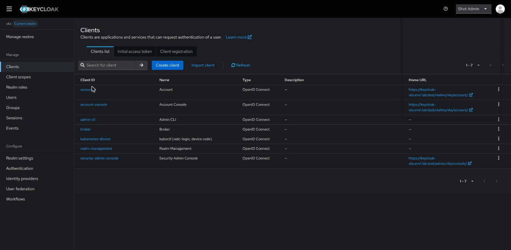
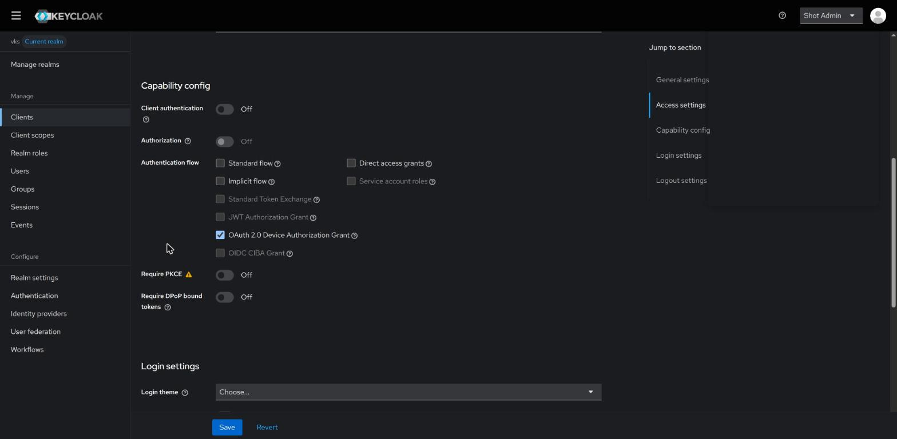
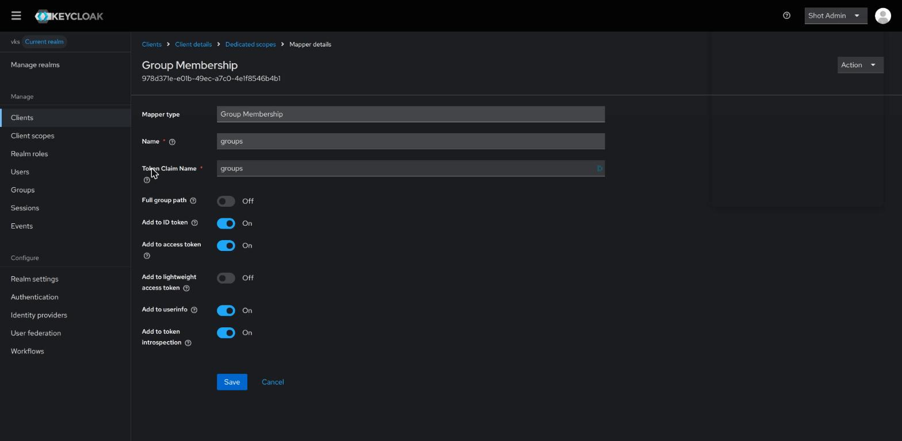
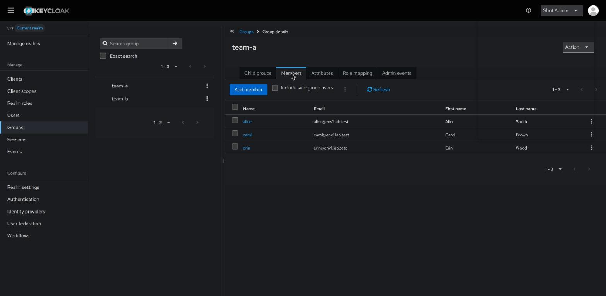
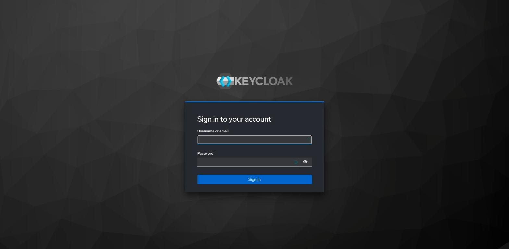

# Run Keycloak in a VKS cluster

> [!NOTE]
> **Official Broadcom, Keycloak, cert-manager and Kubernetes documentation for this guide**
>
> - Broadcom: [Install an Add-on Using the VCF CLI](https://techdocs.broadcom.com/us/en/vmware-cis/vcf/vcf-consumption/latest/managing-vsphere-kuberenetes-service-clusters-and-workloads/managing-add-ons-in-vks-clusters/install-an-add-on-using-the-vcf-cli.html) (cert-manager)
> - Keycloak: [Running Keycloak in a container](https://www.keycloak.org/server/containers), [Configuring TLS](https://www.keycloak.org/server/enabletls), [Configuring the hostname](https://www.keycloak.org/server/hostname), [Management interface](https://www.keycloak.org/server/management-interface), [Admin CLI](https://www.keycloak.org/docs/latest/server_admin/index.html#admin-cli), [Sizing CPU and memory](https://www.keycloak.org/high-availability/single-cluster/concepts-memory-and-cpu-sizing)
> - cert-manager: [CA issuer](https://cert-manager.io/docs/configuration/ca/), [SelfSigned issuer](https://cert-manager.io/docs/configuration/selfsigned/)
> - Kubernetes: [Pod Security Standards](https://kubernetes.io/docs/concepts/security/pod-security-standards/) (`restricted`)

Keycloak is an open-source identity provider: it keeps users and groups and signs people in.
This runs Keycloak, with a PostgreSQL database for its data, in its own VKS cluster, gives it an
HTTPS certificate and a name, and sets up a realm that VKS clusters can use for logins
([KEYCLOAK.md](KEYCLOAK.md)).

> [!NOTE]
> **Why plain manifests, not Helm or the Keycloak Operator.** Keycloak publishes no Helm chart for
> the server; Bitnami's chart is frozen, and the community chart covers no database. The official
> Keycloak Operator needs the looser `baseline` Pod Security level and cluster-wide resources, and
> its realm import cannot set up the groups mapper. Plain manifests with Keycloak's official image
> need only kubectl, run under the strict `restricted` level, and show everything they do.

Run the steps in order. Who does what:

- a vCenter administrator: the VM class for the cluster (Prerequisites);
- you, the administrator of Keycloak's cluster: steps 1 to 7 and 9 to 13;
- whoever runs your DNS: the record in step 7;
- everyone who signs in to Keycloak, you included: step 8, once.

## Prerequisites

- a VKS cluster for Keycloak alone, made as below;
- the [VCF CLI](VCF.md) with the context `supervisor` ([LOGIN.md](LOGIN.md)), for the cert-manager
  add-on;
- [kubectl](KUBECTL.md), [jq, curl and openssl](PREREQS.md);
- a DNS name for Keycloak that you can point at an address (step 7), resolvable by the people who
  sign in and by the control-plane nodes of every VKS cluster that will trust Keycloak.

The cluster for Keycloak:

1. Its vSphere Namespace offers the VM class `best-effort-small` (2 CPUs, 4 GB) or larger
   ([NAMESPACE.md step 8](NAMESPACE.md#8-check-the-namespace) lists them under `VM classes:`; a
   vCenter administrator adds one with [NAMESPACE.md step 6](NAMESPACE.md#6-add-the-vm-classes)).
   Measured: Keycloak uses about 0.5 to 0.8 GB and PostgreSQL under 0.1 GB, and they ask for
   1.5 GB of a `best-effort-small` worker's 2.9 GB. Choose `best-effort-medium` (8 GB) for many
   users or other apps in the same cluster.
2. Create the cluster with
   [CLUSTER.md step 9](CLUSTER.md#9-create-the-cluster-with-kubectl-and-a-yaml-file), with that
   `vmClass` and one worker (`replicas: 1`). With `best-effort-small` it takes about 53 GB of the
   namespace's storage (two nodes of 20 GB disk plus 4 GB memory each, and Keycloak's 5 GB volume),
   and 24 GB more while it updates ([CLUSTER.md step 2](CLUSTER.md#2-choose-a-name-and-the-values)).
   Keep it for Keycloak: the clusters that log in through Keycloak are other clusters
   ([KEYCLOAK.md](KEYCLOAK.md)). To change its size later, see
   [CLUSTER.md step 10](CLUSTER.md#10-resize-the-cluster-optional).
3. Save its kubeconfig as `~/.kube/<cluster name>.kubeconfig`
   ([LOGIN.md](LOGIN.md#get-the-vks-clusters-kubeconfig)).

The connections this guide needs, for a firewall (all TCP, besides DNS; for a registry, also
[its other hosts](PREREQS.md#registry-hosts-for-a-firewall)):

| from | to | port | for |
|---|---|---|---|
| your machine | the Supervisor's address | 443 | the VCF CLI (step 2) |
| your machine | the VKS cluster's API address (in its kubeconfig) | 6443 | kubectl (all steps) |
| the cluster's nodes | `projects.packages.broadcom.com` | 443 | the cert-manager add-on (step 2) |
| the cluster's nodes | `quay.io`, `docker.io` | 443 | the Keycloak and PostgreSQL images (step 5) |
| your machine, the people's machines and browsers | Keycloak's address (step 5) | 443 | Keycloak's pages and logins |
| the control-plane nodes of the clusters that trust Keycloak | Keycloak's address | 443 | checking logins ([KEYCLOAK.md](KEYCLOAK.md)) |

## 1. Check the cluster

This checks that the nodes are ready, that the cluster has a default storage class, and how much
memory the workers can give pods. Keycloak and PostgreSQL ask for about 1.5 GB of it.

<details>
<summary><b>Linux (Ubuntu, AlmaLinux, Photon OS), macOS, WSL (bash or zsh)</b></summary>

```sh
VKS_CLUSTER="my-keycloak-cluster"
VKS_KUBECONFIG="$HOME/.kube/${VKS_CLUSTER}.kubeconfig"

if kubectl --kubeconfig "$VKS_KUBECONFIG" get nodes -o wide && J="$(kubectl --kubeconfig "$VKS_KUBECONFIG" get storageclass -o json)"; then
  echo "default storage class: $(printf '%s' "$J" | jq -r '[.items[] | select(.metadata.annotations["storageclass.kubernetes.io/is-default-class"] == "true") | .metadata.name] | if length == 0 then "NONE" else join(" ") end')"
  kubectl --kubeconfig "$VKS_KUBECONFIG" get nodes -l '!node-role.kubernetes.io/control-plane' \
    -o custom-columns='WORKER:.metadata.name,CPU:.status.allocatable.cpu,MEMORY:.status.allocatable.memory'
  kubectl --kubeconfig "$VKS_KUBECONFIG" get namespace keycloak 2>/dev/null && echo "NOTE: namespace keycloak exists already"
else
  echo "FAILED: cannot read the cluster (see the error above)"
fi
```

</details>

<details>
<summary><b>Windows (PowerShell)</b></summary>

```powershell
$VKS_CLUSTER = "my-keycloak-cluster"
$VKS_KUBECONFIG = "$HOME\.kube\${VKS_CLUSTER}.kubeconfig"

$global:LASTEXITCODE = $null
kubectl --kubeconfig $VKS_KUBECONFIG get nodes -o wide
if ($LASTEXITCODE -eq 0) { $J = kubectl --kubeconfig $VKS_KUBECONFIG get storageclass -o json | Out-String }
if ($LASTEXITCODE -eq 0) {
  $D = @((ConvertFrom-Json $J).items | Where-Object { $_.metadata.annotations.'storageclass.kubernetes.io/is-default-class' -eq 'true' } | ForEach-Object { $_.metadata.name })
  "default storage class: $(if ($D.Count) { $D -join ' ' } else { 'NONE' })"
  kubectl --kubeconfig $VKS_KUBECONFIG get nodes -l '!node-role.kubernetes.io/control-plane' -o 'custom-columns=WORKER:.metadata.name,CPU:.status.allocatable.cpu,MEMORY:.status.allocatable.memory'
  kubectl --kubeconfig $VKS_KUBECONFIG get namespace keycloak 2>$null
  if ($LASTEXITCODE -eq 0) { "NOTE: namespace keycloak exists already" }
} else {
  "FAILED: cannot read the cluster (see the error above)"
}
```

</details>

**Expect:** each node `Ready`, `default storage class:` and a class name, and a worker with
`MEMORY` of about `2908348Ki` for `best-effort-small` (`6197436Ki` for `best-effort-medium`).

**If not:** `default storage class: NONE`: give the cluster a default class as in
[CLUSTER.md](CLUSTER.md), step 9's `defaultStorageClass`. `NOTE: namespace keycloak exists
already`: Keycloak may be installed; steps 3 to 5 keep what exists.

## 2. Install cert-manager

Keycloak's HTTPS certificate (step 4) comes from cert-manager, a Broadcom add-on of the VKS
cluster ([what add-ons are](ADDONS.md)). Run this once per cluster, before step 4: it installs
cert-manager with the VCF CLI when the cluster does not have it, and waits until it runs. When
the add-on is there already (for example from [HEADLAMP.md](HEADLAMP.md)), it changes nothing.

<details>
<summary><b>Linux (Ubuntu, AlmaLinux, Photon OS), macOS, WSL (bash or zsh)</b></summary>

```sh
VKS_NAMESPACE="my-namespace"
VKS_CLUSTER="my-keycloak-cluster"
VKS_KUBECONFIG="$HOME/.kube/${VKS_CLUSTER}.kubeconfig"

vcf context use supervisor </dev/null
if ! L="$(vcf addon install list --cluster-name "$VKS_CLUSTER" -n "$VKS_NAMESPACE" -o json)"; then
  echo "FAILED: the VCF CLI (see the error above)"
elif [ "$(printf '%s' "$L" | jq '[.[]? | select(.addonName == "cert-manager")] | length')" = 1 ]; then
  echo "cert-manager: already installed"
elif kubectl --kubeconfig "$VKS_KUBECONFIG" get crd certificates.cert-manager.io >/dev/null 2>&1; then
  echo "STOPPED: this cluster has a cert-manager that is not the add-on; this guide does not cover it"
elif vcf addon install create cert-manager --cluster-name "$VKS_CLUSTER" -n "$VKS_NAMESPACE" -y; then
  for i in $(seq 60); do
    kubectl --kubeconfig "$VKS_KUBECONFIG" get crd certificates.cert-manager.io >/dev/null 2>&1 && break
    sleep 5
  done
  kubectl --kubeconfig "$VKS_KUBECONFIG" -n cert-manager wait --for=condition=Available deployment --all --timeout=5m
else
  echo "FAILED: the cert-manager add-on (see the error above)"
fi
```

</details>

<details>
<summary><b>Windows (PowerShell)</b></summary>

```powershell
$VKS_NAMESPACE = "my-namespace"
$VKS_CLUSTER = "my-keycloak-cluster"
$VKS_KUBECONFIG = "$HOME\.kube\${VKS_CLUSTER}.kubeconfig"

$null | vcf context use supervisor
$global:LASTEXITCODE = $null
$L = vcf addon install list --cluster-name $VKS_CLUSTER -n $VKS_NAMESPACE -o json | Out-String
if ($LASTEXITCODE -ne 0) {
  "FAILED: the VCF CLI (see the error above)"
} elseif (@(ConvertFrom-Json $L | ForEach-Object { $_ } | ForEach-Object { $_.addonName }) -contains 'cert-manager') {
  "cert-manager: already installed"
} elseif ((kubectl --kubeconfig $VKS_KUBECONFIG get crd certificates.cert-manager.io 2>$null) -and $LASTEXITCODE -eq 0) {
  "STOPPED: this cluster has a cert-manager that is not the add-on; this guide does not cover it"
} else {
  vcf addon install create cert-manager --cluster-name $VKS_CLUSTER -n $VKS_NAMESPACE -y
  if ($LASTEXITCODE -ne 0) {
    "FAILED: the cert-manager add-on (see the error above)"
  } else {
    foreach ($i in 1..60) {
      kubectl --kubeconfig $VKS_KUBECONFIG get crd certificates.cert-manager.io 2>$null | Out-Null
      if ($LASTEXITCODE -eq 0) { break }
      Start-Sleep 5
    }
    kubectl --kubeconfig $VKS_KUBECONFIG -n cert-manager wait --for=condition=Available deployment --all --timeout=5m
  }
}
```

</details>

**Expect:** `Addon 'cert-manager' is being installed in the cluster my-keycloak-cluster`, then
`condition met` for `cert-manager`, `cert-manager-cainjector` and `cert-manager-webhook` (on VKS
3.8 the add-on release is `cert-manager.kubernetes.vmware.com.1.21.2-vmware.1-vks.1`). Or
`cert-manager: already installed`.

**If not:**
- `FAILED: the VCF CLI`: log in to the Supervisor again ([LOGIN.md](LOGIN.md#renew-the-supervisor-login)),
  and check `VKS_NAMESPACE` and `VKS_CLUSTER`.
- `STOPPED: … not the add-on`: someone installed cert-manager another way. Use that cert-manager
  for step 4 at your own judgement, or remove it and run this block again.
- `timed out waiting for the condition`: the nodes cannot pull from `projects.packages.broadcom.com`
  (see the table above); `kubectl -n cert-manager get pods` shows the reason.

## 3. Create the namespace and the passwords

This creates the namespace `keycloak`, which allows only pods that follow the `restricted` Pod
Security Standard, and two Secrets with random passwords: one for PostgreSQL and one for
Keycloak's first administrator, `admin`. Nothing prints a password. A Secret that exists is kept:
PostgreSQL keeps the password it was first given.

<details>
<summary><b>Linux (Ubuntu, AlmaLinux, Photon OS), macOS, WSL (bash or zsh)</b></summary>

```sh
VKS_CLUSTER="my-keycloak-cluster"
VKS_KUBECONFIG="$HOME/.kube/${VKS_CLUSTER}.kubeconfig"

kc() { kubectl --kubeconfig "$VKS_KUBECONFIG" "$@"; }
kc create namespace keycloak --dry-run=client -o yaml | kc apply -f - >/dev/null \
  && kc label namespace keycloak --overwrite pod-security.kubernetes.io/enforce=restricted \
       pod-security.kubernetes.io/audit=restricted pod-security.kubernetes.io/warn=restricted
for S in keycloak-db:keycloak keycloak-admin:admin; do
  if kc -n keycloak get secret "${S%%:*}" >/dev/null 2>&1; then
    echo "secret ${S%%:*}: exists, kept"
  else
    printf 'apiVersion: v1\nkind: Secret\nmetadata:\n  name: %s\nstringData:\n  username: %s\n  password: %s\n' \
      "${S%%:*}" "${S#*:}" "$(openssl rand -hex 24)" | kc -n keycloak create -f -
  fi
done
```

</details>

<details>
<summary><b>Windows (PowerShell)</b></summary>

```powershell
$VKS_CLUSTER = "my-keycloak-cluster"
$VKS_KUBECONFIG = "$HOME\.kube\${VKS_CLUSTER}.kubeconfig"

function kc { $input | kubectl --kubeconfig $VKS_KUBECONFIG @args }
kc create namespace keycloak --dry-run=client -o yaml | kc apply -f - | Out-Null
kc label namespace keycloak --overwrite pod-security.kubernetes.io/enforce=restricted pod-security.kubernetes.io/audit=restricted pod-security.kubernetes.io/warn=restricted
foreach ($S in @(@('keycloak-db', 'keycloak'), @('keycloak-admin', 'admin'))) {
  kc -n keycloak get secret $S[0] 2>$null | Out-Null
  if ($LASTEXITCODE -eq 0) {
    "secret $($S[0]): exists, kept"
  } else {
    $B = New-Object byte[] 24; [Security.Cryptography.RandomNumberGenerator]::Create().GetBytes($B)
    $P = ($B | ForEach-Object { $_.ToString('x2') }) -join ''
    @('apiVersion: v1', 'kind: Secret', 'metadata:', "  name: $($S[0])", 'stringData:', "  username: $($S[1])", "  password: $P") | kc -n keycloak create -f -
    Remove-Variable P
  }
}
```

</details>

**Expect:** `namespace/keycloak labeled` (or `not labeled` when run again), then
`secret/keycloak-db created` and `secret/keycloak-admin created` (or `exists, kept`).

## 4. Make Keycloak's certificate

This makes a CA (certificate authority) of your own with cert-manager, valid for 10 years, and from
it a certificate for `KEYCLOAK_HOST`, the DNS name Keycloak will have (step 7), and for its name
inside the cluster. cert-manager renews the certificate before it ends; Keycloak picks the new one
up within an hour.

<details>
<summary><b>Linux (Ubuntu, AlmaLinux, Photon OS), macOS, WSL (bash or zsh)</b></summary>

```sh
VKS_CLUSTER="my-keycloak-cluster"
VKS_KUBECONFIG="$HOME/.kube/${VKS_CLUSTER}.kubeconfig"
KEYCLOAK_HOST="keycloak.example.com"

cat <<EOF | kubectl --kubeconfig "$VKS_KUBECONFIG" -n keycloak apply -f - \
  && kubectl --kubeconfig "$VKS_KUBECONFIG" -n keycloak wait --for=condition=Ready certificate --all --timeout=3m
apiVersion: cert-manager.io/v1
kind: Issuer
metadata:
  name: keycloak-selfsigned
spec:
  selfSigned: {}
---
apiVersion: cert-manager.io/v1
kind: Certificate
metadata:
  name: keycloak-ca
spec:
  isCA: true
  commonName: Keycloak CA
  duration: 87600h
  secretName: keycloak-ca
  privateKey:
    algorithm: ECDSA
    size: 256
  issuerRef:
    name: keycloak-selfsigned
    kind: Issuer
---
apiVersion: cert-manager.io/v1
kind: Issuer
metadata:
  name: keycloak-ca
spec:
  ca:
    secretName: keycloak-ca
---
apiVersion: cert-manager.io/v1
kind: Certificate
metadata:
  name: keycloak-tls
spec:
  secretName: keycloak-tls
  commonName: ${KEYCLOAK_HOST}
  dnsNames:
    - ${KEYCLOAK_HOST}
    - keycloak.keycloak.svc
  usages:
    - server auth
  issuerRef:
    name: keycloak-ca
    kind: Issuer
EOF
```

</details>

<details>
<summary><b>Windows (PowerShell)</b></summary>

```powershell
$VKS_CLUSTER = "my-keycloak-cluster"
$VKS_KUBECONFIG = "$HOME\.kube\${VKS_CLUSTER}.kubeconfig"
$KEYCLOAK_HOST = "keycloak.example.com"

$global:LASTEXITCODE = $null
@"
apiVersion: cert-manager.io/v1
kind: Issuer
metadata:
  name: keycloak-selfsigned
spec:
  selfSigned: {}
---
apiVersion: cert-manager.io/v1
kind: Certificate
metadata:
  name: keycloak-ca
spec:
  isCA: true
  commonName: Keycloak CA
  duration: 87600h
  secretName: keycloak-ca
  privateKey:
    algorithm: ECDSA
    size: 256
  issuerRef:
    name: keycloak-selfsigned
    kind: Issuer
---
apiVersion: cert-manager.io/v1
kind: Issuer
metadata:
  name: keycloak-ca
spec:
  ca:
    secretName: keycloak-ca
---
apiVersion: cert-manager.io/v1
kind: Certificate
metadata:
  name: keycloak-tls
spec:
  secretName: keycloak-tls
  commonName: $KEYCLOAK_HOST
  dnsNames:
    - $KEYCLOAK_HOST
    - keycloak.keycloak.svc
  usages:
    - server auth
  issuerRef:
    name: keycloak-ca
    kind: Issuer
"@ | kubectl --kubeconfig $VKS_KUBECONFIG -n keycloak apply -f -
if ($LASTEXITCODE -eq 0) { kubectl --kubeconfig $VKS_KUBECONFIG -n keycloak wait --for=condition=Ready certificate --all --timeout=3m }
```

</details>

**Expect:** four `created` lines (`configured` or `unchanged` when run again), then
`certificate.cert-manager.io/keycloak-ca condition met` and `…/keycloak-tls condition met`.

**If not:** `no matches for kind "Issuer"`: step 2 did not finish. `timed out`:
`kubectl -n keycloak describe certificate keycloak-tls` shows why.

## 5. Run PostgreSQL and Keycloak

This runs PostgreSQL with a 5 GB volume, waits until it is ready, then runs Keycloak in front of it
and gives Keycloak a load balancer address on port 443. It takes about a minute.

<details>
<summary><b>Linux (Ubuntu, AlmaLinux, Photon OS), macOS, WSL (bash or zsh)</b></summary>

```sh
VKS_CLUSTER="my-keycloak-cluster"
VKS_KUBECONFIG="$HOME/.kube/${VKS_CLUSTER}.kubeconfig"
KEYCLOAK_HOST="keycloak.example.com"
KEYCLOAK_IMAGE="quay.io/keycloak/keycloak:26.8.1@sha256:3f3c5f8e03c614774b4bd9173b88391fefa4153bfc010d8012d59ad825377332"
POSTGRES_IMAGE="docker.io/library/postgres:18.6@sha256:979bccfde35445db618c65107d27d08c6c21339d8dc3ad4c830c6633947be0e4"

cat <<EOF | kubectl --kubeconfig "$VKS_KUBECONFIG" -n keycloak apply -f -
apiVersion: v1
kind: Service
metadata:
  name: postgres
spec:
  selector:
    app: postgres
  ports:
    - port: 5432
---
apiVersion: apps/v1
kind: StatefulSet
metadata:
  name: postgres
spec:
  serviceName: postgres
  replicas: 1
  selector:
    matchLabels:
      app: postgres
  template:
    metadata:
      labels:
        app: postgres
    spec:
      securityContext:
        runAsNonRoot: true
        runAsUser: 999
        runAsGroup: 999
        fsGroup: 999
        seccompProfile:
          type: RuntimeDefault
      containers:
        - name: postgres
          image: ${POSTGRES_IMAGE}
          env:
            - name: POSTGRES_DB
              value: keycloak
            - name: POSTGRES_USER
              valueFrom:
                secretKeyRef:
                  name: keycloak-db
                  key: username
            - name: POSTGRES_PASSWORD
              valueFrom:
                secretKeyRef:
                  name: keycloak-db
                  key: password
          ports:
            - containerPort: 5432
          readinessProbe:
            exec:
              command: ["pg_isready", "-U", "keycloak", "-d", "keycloak"]
          resources:
            requests:
              cpu: 100m
              memory: 256Mi
            limits:
              memory: 512Mi
          securityContext:
            allowPrivilegeEscalation: false
            capabilities:
              drop: ["ALL"]
          volumeMounts:
            - name: data
              mountPath: /var/lib/postgresql
  volumeClaimTemplates:
    - metadata:
        name: data
      spec:
        accessModes: ["ReadWriteOnce"]
        resources:
          requests:
            storage: 5Gi
EOF
kubectl --kubeconfig "$VKS_KUBECONFIG" -n keycloak rollout status statefulset/postgres --timeout=10m || echo "FAILED: PostgreSQL did not start (see above)"
cat <<EOF | kubectl --kubeconfig "$VKS_KUBECONFIG" -n keycloak apply -f -
apiVersion: apps/v1
kind: Deployment
metadata:
  name: keycloak
spec:
  replicas: 1
  strategy:
    type: Recreate
  selector:
    matchLabels:
      app: keycloak
  template:
    metadata:
      labels:
        app: keycloak
    spec:
      securityContext:
        runAsNonRoot: true
        runAsUser: 1000
        runAsGroup: 0
        seccompProfile:
          type: RuntimeDefault
      containers:
        - name: keycloak
          image: ${KEYCLOAK_IMAGE}
          args: ["start"]
          env:
            - name: KC_DB
              value: postgres
            - name: KC_DB_URL
              value: jdbc:postgresql://postgres:5432/keycloak
            - name: KC_DB_USERNAME
              valueFrom:
                secretKeyRef:
                  name: keycloak-db
                  key: username
            - name: KC_DB_PASSWORD
              valueFrom:
                secretKeyRef:
                  name: keycloak-db
                  key: password
            - name: KC_BOOTSTRAP_ADMIN_USERNAME
              valueFrom:
                secretKeyRef:
                  name: keycloak-admin
                  key: username
            - name: KC_BOOTSTRAP_ADMIN_PASSWORD
              valueFrom:
                secretKeyRef:
                  name: keycloak-admin
                  key: password
            - name: KC_HOSTNAME
              value: https://${KEYCLOAK_HOST}
            - name: KC_HTTPS_CERTIFICATE_FILE
              value: /etc/keycloak-tls/tls.crt
            - name: KC_HTTPS_CERTIFICATE_KEY_FILE
              value: /etc/keycloak-tls/tls.key
            - name: KC_HEALTH_ENABLED
              value: "true"
          ports:
            - name: https
              containerPort: 8443
            - name: management
              containerPort: 9000
          startupProbe:
            httpGet:
              path: /health/started
              port: 9000
              scheme: HTTPS
            periodSeconds: 5
            failureThreshold: 60
          readinessProbe:
            httpGet:
              path: /health/ready
              port: 9000
              scheme: HTTPS
          livenessProbe:
            httpGet:
              path: /health/live
              port: 9000
              scheme: HTTPS
          resources:
            requests:
              cpu: 500m
              memory: 1250Mi
            limits:
              memory: 2Gi
          securityContext:
            allowPrivilegeEscalation: false
            capabilities:
              drop: ["ALL"]
          volumeMounts:
            - name: tls
              mountPath: /etc/keycloak-tls
              readOnly: true
      volumes:
        - name: tls
          secret:
            secretName: keycloak-tls
---
apiVersion: v1
kind: Service
metadata:
  name: keycloak
spec:
  type: LoadBalancer
  selector:
    app: keycloak
  ports:
    - name: https
      port: 443
      targetPort: 8443
EOF
kubectl --kubeconfig "$VKS_KUBECONFIG" -n keycloak rollout status deployment/keycloak --timeout=10m \
  && echo "Keycloak's address: $(kubectl --kubeconfig "$VKS_KUBECONFIG" -n keycloak get service keycloak -o jsonpath='{.status.loadBalancer.ingress[0].ip}')"
```

</details>

<details>
<summary><b>Windows (PowerShell)</b></summary>

```powershell
$VKS_CLUSTER = "my-keycloak-cluster"
$VKS_KUBECONFIG = "$HOME\.kube\${VKS_CLUSTER}.kubeconfig"
$KEYCLOAK_HOST = "keycloak.example.com"
$KEYCLOAK_IMAGE = "quay.io/keycloak/keycloak:26.8.1@sha256:3f3c5f8e03c614774b4bd9173b88391fefa4153bfc010d8012d59ad825377332"
$POSTGRES_IMAGE = "docker.io/library/postgres:18.6@sha256:979bccfde35445db618c65107d27d08c6c21339d8dc3ad4c830c6633947be0e4"

$global:LASTEXITCODE = $null
@"
apiVersion: v1
kind: Service
metadata:
  name: postgres
spec:
  selector:
    app: postgres
  ports:
    - port: 5432
---
apiVersion: apps/v1
kind: StatefulSet
metadata:
  name: postgres
spec:
  serviceName: postgres
  replicas: 1
  selector:
    matchLabels:
      app: postgres
  template:
    metadata:
      labels:
        app: postgres
    spec:
      securityContext:
        runAsNonRoot: true
        runAsUser: 999
        runAsGroup: 999
        fsGroup: 999
        seccompProfile:
          type: RuntimeDefault
      containers:
        - name: postgres
          image: $POSTGRES_IMAGE
          env:
            - name: POSTGRES_DB
              value: keycloak
            - name: POSTGRES_USER
              valueFrom:
                secretKeyRef:
                  name: keycloak-db
                  key: username
            - name: POSTGRES_PASSWORD
              valueFrom:
                secretKeyRef:
                  name: keycloak-db
                  key: password
          ports:
            - containerPort: 5432
          readinessProbe:
            exec:
              command: ["pg_isready", "-U", "keycloak", "-d", "keycloak"]
          resources:
            requests:
              cpu: 100m
              memory: 256Mi
            limits:
              memory: 512Mi
          securityContext:
            allowPrivilegeEscalation: false
            capabilities:
              drop: ["ALL"]
          volumeMounts:
            - name: data
              mountPath: /var/lib/postgresql
  volumeClaimTemplates:
    - metadata:
        name: data
      spec:
        accessModes: ["ReadWriteOnce"]
        resources:
          requests:
            storage: 5Gi
"@ | kubectl --kubeconfig $VKS_KUBECONFIG -n keycloak apply -f -
kubectl --kubeconfig $VKS_KUBECONFIG -n keycloak rollout status statefulset/postgres --timeout=10m
if ($LASTEXITCODE -ne 0) { "FAILED: PostgreSQL did not start (see above)" }
@"
apiVersion: apps/v1
kind: Deployment
metadata:
  name: keycloak
spec:
  replicas: 1
  strategy:
    type: Recreate
  selector:
    matchLabels:
      app: keycloak
  template:
    metadata:
      labels:
        app: keycloak
    spec:
      securityContext:
        runAsNonRoot: true
        runAsUser: 1000
        runAsGroup: 0
        seccompProfile:
          type: RuntimeDefault
      containers:
        - name: keycloak
          image: $KEYCLOAK_IMAGE
          args: ["start"]
          env:
            - name: KC_DB
              value: postgres
            - name: KC_DB_URL
              value: jdbc:postgresql://postgres:5432/keycloak
            - name: KC_DB_USERNAME
              valueFrom:
                secretKeyRef:
                  name: keycloak-db
                  key: username
            - name: KC_DB_PASSWORD
              valueFrom:
                secretKeyRef:
                  name: keycloak-db
                  key: password
            - name: KC_BOOTSTRAP_ADMIN_USERNAME
              valueFrom:
                secretKeyRef:
                  name: keycloak-admin
                  key: username
            - name: KC_BOOTSTRAP_ADMIN_PASSWORD
              valueFrom:
                secretKeyRef:
                  name: keycloak-admin
                  key: password
            - name: KC_HOSTNAME
              value: https://$KEYCLOAK_HOST
            - name: KC_HTTPS_CERTIFICATE_FILE
              value: /etc/keycloak-tls/tls.crt
            - name: KC_HTTPS_CERTIFICATE_KEY_FILE
              value: /etc/keycloak-tls/tls.key
            - name: KC_HEALTH_ENABLED
              value: "true"
          ports:
            - name: https
              containerPort: 8443
            - name: management
              containerPort: 9000
          startupProbe:
            httpGet:
              path: /health/started
              port: 9000
              scheme: HTTPS
            periodSeconds: 5
            failureThreshold: 60
          readinessProbe:
            httpGet:
              path: /health/ready
              port: 9000
              scheme: HTTPS
          livenessProbe:
            httpGet:
              path: /health/live
              port: 9000
              scheme: HTTPS
          resources:
            requests:
              cpu: 500m
              memory: 1250Mi
            limits:
              memory: 2Gi
          securityContext:
            allowPrivilegeEscalation: false
            capabilities:
              drop: ["ALL"]
          volumeMounts:
            - name: tls
              mountPath: /etc/keycloak-tls
              readOnly: true
      volumes:
        - name: tls
          secret:
            secretName: keycloak-tls
---
apiVersion: v1
kind: Service
metadata:
  name: keycloak
spec:
  type: LoadBalancer
  selector:
    app: keycloak
  ports:
    - name: https
      port: 443
      targetPort: 8443
"@ | kubectl --kubeconfig $VKS_KUBECONFIG -n keycloak apply -f -
kubectl --kubeconfig $VKS_KUBECONFIG -n keycloak rollout status deployment/keycloak --timeout=10m
if ($LASTEXITCODE -eq 0) { "Keycloak's address: $(kubectl --kubeconfig $VKS_KUBECONFIG -n keycloak get service keycloak -o jsonpath='{.status.loadBalancer.ingress[0].ip}')" }
```

</details>

**Expect:** `created` lines, `partitioned roll out complete`, `deployment "keycloak" successfully
rolled out`, then `Keycloak's address:` and an IP address.

**If not:**
- `FAILED: PostgreSQL did not start` or a timeout: `kubectl -n keycloak describe pod -l app=postgres`
  (or `-l app=keycloak`) shows the reason. `ImagePullBackOff`: the nodes cannot reach `quay.io` or
  `docker.io` (see the table above). `Pending` with `Insufficient memory`: the worker is too small
  (see the Prerequisites).
- `Keycloak's address:` with nothing after it: the cluster has no free load balancer address; ask
  your vSphere administrator.

## 6. Save Keycloak's CA

This saves the CA from step 4 as `keycloak-ca.pem` in your home folder and prints its fingerprint.
Everyone who signs in needs this file to trust Keycloak (step 7), and [KEYCLOAK.md](KEYCLOAK.md)
needs it as `KEYCLOAK_CA`.

<details>
<summary><b>Linux (Ubuntu, AlmaLinux, Photon OS), macOS, WSL (bash or zsh)</b></summary>

```sh
VKS_CLUSTER="my-keycloak-cluster"
VKS_KUBECONFIG="$HOME/.kube/${VKS_CLUSTER}.kubeconfig"
KEYCLOAK_CA="$HOME/keycloak-ca.pem"

if kubectl --kubeconfig "$VKS_KUBECONFIG" -n keycloak get secret keycloak-tls \
     -o go-template='{{index .data "ca.crt" | base64decode}}' > "$KEYCLOAK_CA.new" \
   && openssl x509 -in "$KEYCLOAK_CA.new" -noout -subject -fingerprint -sha256; then
  mv "$KEYCLOAK_CA.new" "$KEYCLOAK_CA" && echo "saved $KEYCLOAK_CA"
else
  rm -f "$KEYCLOAK_CA.new"; echo "FAILED: no CA read (see the error above)"
fi
```

</details>

<details>
<summary><b>Windows (PowerShell)</b></summary>

```powershell
$VKS_CLUSTER = "my-keycloak-cluster"
$VKS_KUBECONFIG = "$HOME\.kube\${VKS_CLUSTER}.kubeconfig"
$KEYCLOAK_CA = "$HOME\keycloak-ca.pem"

$global:LASTEXITCODE = $null
$B = kubectl --kubeconfig $VKS_KUBECONFIG -n keycloak get secret keycloak-tls -o 'jsonpath={.data.ca\.crt}'
if ($LASTEXITCODE -eq 0 -and $B) {
  $PEM = [Text.Encoding]::ASCII.GetString([Convert]::FromBase64String($B))
  $C = New-Object Security.Cryptography.X509Certificates.X509Certificate2 (,[Text.Encoding]::ASCII.GetBytes($PEM))
  "subject=$($C.Subject)"
  "sha256 Fingerprint=$([BitConverter]::ToString([Security.Cryptography.SHA256]::Create().ComputeHash($C.RawData)).Replace('-', ':'))"
  Set-Content -Encoding ascii -NoNewline -Path $KEYCLOAK_CA -Value $PEM
  "saved $KEYCLOAK_CA"
} else {
  "FAILED: no CA read (see the error above)"
}
```

</details>

**Expect:** a `subject=` line with `Keycloak CA`, a `sha256 Fingerprint=…` line, then `saved …/keycloak-ca.pem`.

## 7. Give Keycloak its name

Create a DNS record (type A) for `KEYCLOAK_HOST` with Keycloak's address from step 5, in the DNS
that the people who sign in and the control-plane nodes of the clusters that trust Keycloak use.
Then this checks the name, the certificate and the address it answers with (its issuer).

**Linux (Ubuntu, AlmaLinux, Photon OS), macOS, WSL (bash or zsh):**

```sh
KEYCLOAK_HOST="keycloak.example.com"
KEYCLOAK_CA="$HOME/keycloak-ca.pem"

curl -fsS --connect-timeout 20 --cacert "$KEYCLOAK_CA" "https://${KEYCLOAK_HOST}/realms/master/.well-known/openid-configuration" \
  | jq -r '"issuer: " + .issuer'
```

**Windows (PowerShell):**

```powershell
$KEYCLOAK_HOST = "keycloak.example.com"
$KEYCLOAK_CA = "$HOME\keycloak-ca.pem"

$global:LASTEXITCODE = $null
$J = curl.exe -fsS --connect-timeout 20 --ssl-no-revoke --cacert $KEYCLOAK_CA "https://$KEYCLOAK_HOST/realms/master/.well-known/openid-configuration"
if ($LASTEXITCODE -eq 0) { "issuer: $((ConvertFrom-Json ($J | Out-String)).issuer)" }
```

**Expect:** `issuer: https://<KEYCLOAK_HOST>/realms/master`.

**If not:**
- `Could not resolve host`: the DNS record is missing, or not yet seen by this machine.
- `SSL certificate problem`: `KEYCLOAK_HOST` is not the name in step 4, or `KEYCLOAK_CA` is not the
  file from step 6.
- `Connection refused` or a timeout: this machine cannot reach Keycloak's address on port 443.
- `CERT_TRUST_REVOCATION_STATUS_UNKNOWN` (Windows): `curl.exe` without `--ssl-no-revoke`; a CA of your
  own publishes no revocation list.

## 8. Trust Keycloak's CA (each person, once)

People sign in to Keycloak in a browser, which must trust Keycloak's CA. Give each person
`keycloak-ca.pem` from step 6 (it holds no secret), and each person adds it once on the machine
whose browser they sign in with. Do it on your own machine too, before step 11.

**Linux (Ubuntu, AlmaLinux, Photon OS):** Chrome uses its own certificate database in your home.
This adds the CA there (it needs `certutil`: `sudo apt-get install -y libnss3-tools` on Ubuntu,
`sudo dnf install -y nss-tools` on AlmaLinux):

```sh
mkdir -p "$HOME/.pki/nssdb"
[ -f "$HOME/.pki/nssdb/cert9.db" ] || certutil -d "sql:$HOME/.pki/nssdb" -N --empty-password
certutil -d "sql:$HOME/.pki/nssdb" -A -t "C,," -n "Keycloak CA" -i "$HOME/keycloak-ca.pem" \
  && certutil -d "sql:$HOME/.pki/nssdb" -L | grep 'Keycloak CA'
```

Firefox keeps its own list: **Settings** → **Privacy & Security** → **View Certificates** →
**Authorities** → **Import**, then tick *Trust this CA to identify websites*.

**macOS:** Safari and Chrome use your login keychain. macOS asks for your password:

```sh
security add-trusted-cert -r trustRoot -k "$HOME/Library/Keychains/login.keychain-db" "$HOME/keycloak-ca.pem"
```

**Windows (PowerShell):** Edge and Chrome use your user's trusted root CAs. Windows asks you to
confirm with **Yes**:

```powershell
Import-Certificate -FilePath "$HOME\keycloak-ca.pem" -CertStoreLocation Cert:\CurrentUser\Root
```

## 9. Create the realm and the client

A realm is a set of users and groups with its own sign-in page. This creates the realm `REALM`
with the client `kubernetes-device` that kubelogin signs in through, a groups mapper (so tokens
carry the person's groups), and the groups in `KEYCLOAK_GROUPS`. It runs Keycloak's admin command line
inside the Keycloak pod, as the administrator from step 3, whose password never leaves the pod.
It skips what exists, so you can run it again to add groups.

<details>
<summary><b>Linux (Ubuntu, AlmaLinux, Photon OS), macOS, WSL (bash or zsh)</b></summary>

```sh
VKS_CLUSTER="my-keycloak-cluster"
VKS_KUBECONFIG="$HOME/.kube/${VKS_CLUSTER}.kubeconfig"
REALM="my-realm"
KEYCLOAK_GROUPS="team-a team-b"

{ printf 'REALM=%s\nKEYCLOAK_GROUPS="%s"\n' "$REALM" "$KEYCLOAK_GROUPS"; cat <<'SCRIPT'
K=/opt/keycloak/bin/kcadm.sh
TS="$(mktemp -d)/truststore.p12"
keytool -importcert -noprompt -alias keycloak-ca -file /etc/keycloak-tls/ca.crt -keystore "$TS" \
  -storetype PKCS12 -storepass truststore >/dev/null 2>&1 || { echo "FAILED: no truststore"; exit 1; }
export KC_CLI_PASSWORD="$KC_BOOTSTRAP_ADMIN_PASSWORD"
"$K" config truststore --trustpass truststore "$TS" >/dev/null \
  && "$K" config credentials --server https://keycloak.keycloak.svc --realm master --user "$KC_BOOTSTRAP_ADMIN_USERNAME" >/dev/null \
  || { echo "FAILED: the admin login (see above)"; exit 1; }
if O="$("$K" get "realms/$REALM" --fields realm 2>&1)"; then
  echo "realm $REALM: exists"
elif printf '%s' "$O" | grep -q 'Resource not found'; then
  printf '{"realm":"%s","enabled":true,"editUsernameAllowed":false,"bruteForceProtected":true,"accessTokenLifespan":300}' "$REALM" \
    | "$K" create realms -f - >/dev/null && echo "realm $REALM: created"
else
  echo "FAILED: $O"; exit 1
fi
if [ -n "$("$K" get clients -r "$REALM" -q clientId=kubernetes-device --fields id --format csv --noquotes)" ]; then
  echo "client kubernetes-device: exists"
else
  "$K" create clients -r "$REALM" -f - >/dev/null <<'JSON' && echo "client kubernetes-device: created"
{"clientId":"kubernetes-device","name":"kubectl (oidc-login, device code)","publicClient":true,
 "standardFlowEnabled":false,"implicitFlowEnabled":false,"directAccessGrantsEnabled":false,"serviceAccountsEnabled":false,
 "attributes":{"oauth2.device.authorization.grant.enabled":"true"},
 "protocolMappers":[{"name":"groups","protocol":"openid-connect","protocolMapper":"oidc-group-membership-mapper",
   "config":{"claim.name":"groups","full.path":"false","id.token.claim":"true","access.token.claim":"true","userinfo.token.claim":"true"}}]}
JSON
fi
for G in $KEYCLOAK_GROUPS; do
  if "$K" get groups -r "$REALM" --fields name --format csv --noquotes | grep -qx "$G"; then
    echo "group $G: exists"
  else
    printf '{"name":"%s"}' "$G" | "$K" create groups -r "$REALM" -f - >/dev/null && echo "group $G: created"
  fi
done
SCRIPT
} | kubectl --kubeconfig "$VKS_KUBECONFIG" -n keycloak exec -i deploy/keycloak -- bash -s
```

</details>

<details>
<summary><b>Windows (PowerShell)</b></summary>

```powershell
$VKS_CLUSTER = "my-keycloak-cluster"
$VKS_KUBECONFIG = "$HOME\.kube\${VKS_CLUSTER}.kubeconfig"
$REALM = "my-realm"
$KEYCLOAK_GROUPS = "team-a team-b"

$SCRIPT = "REALM=$REALM`nKEYCLOAK_GROUPS=`"$KEYCLOAK_GROUPS`"`n" + @'
K=/opt/keycloak/bin/kcadm.sh
TS="$(mktemp -d)/truststore.p12"
keytool -importcert -noprompt -alias keycloak-ca -file /etc/keycloak-tls/ca.crt -keystore "$TS" \
  -storetype PKCS12 -storepass truststore >/dev/null 2>&1 || { echo "FAILED: no truststore"; exit 1; }
export KC_CLI_PASSWORD="$KC_BOOTSTRAP_ADMIN_PASSWORD"
"$K" config truststore --trustpass truststore "$TS" >/dev/null \
  && "$K" config credentials --server https://keycloak.keycloak.svc --realm master --user "$KC_BOOTSTRAP_ADMIN_USERNAME" >/dev/null \
  || { echo "FAILED: the admin login (see above)"; exit 1; }
if O="$("$K" get "realms/$REALM" --fields realm 2>&1)"; then
  echo "realm $REALM: exists"
elif printf '%s' "$O" | grep -q 'Resource not found'; then
  printf '{"realm":"%s","enabled":true,"editUsernameAllowed":false,"bruteForceProtected":true,"accessTokenLifespan":300}' "$REALM" \
    | "$K" create realms -f - >/dev/null && echo "realm $REALM: created"
else
  echo "FAILED: $O"; exit 1
fi
if [ -n "$("$K" get clients -r "$REALM" -q clientId=kubernetes-device --fields id --format csv --noquotes)" ]; then
  echo "client kubernetes-device: exists"
else
  "$K" create clients -r "$REALM" -f - >/dev/null <<'JSON' && echo "client kubernetes-device: created"
{"clientId":"kubernetes-device","name":"kubectl (oidc-login, device code)","publicClient":true,
 "standardFlowEnabled":false,"implicitFlowEnabled":false,"directAccessGrantsEnabled":false,"serviceAccountsEnabled":false,
 "attributes":{"oauth2.device.authorization.grant.enabled":"true"},
 "protocolMappers":[{"name":"groups","protocol":"openid-connect","protocolMapper":"oidc-group-membership-mapper",
   "config":{"claim.name":"groups","full.path":"false","id.token.claim":"true","access.token.claim":"true","userinfo.token.claim":"true"}}]}
JSON
fi
for G in $KEYCLOAK_GROUPS; do
  if "$K" get groups -r "$REALM" --fields name --format csv --noquotes | grep -qx "$G"; then
    echo "group $G: exists"
  else
    printf '{"name":"%s"}' "$G" | "$K" create groups -r "$REALM" -f - >/dev/null && echo "group $G: created"
  fi
done
'@
$B64 = [Convert]::ToBase64String([Text.Encoding]::UTF8.GetBytes($SCRIPT.Replace("`r", '')))
kubectl --kubeconfig $VKS_KUBECONFIG -n keycloak exec deploy/keycloak -- bash -c "echo $B64 | base64 -d | bash"
```

</details>

**Expect:** `Logging into https://keycloak.keycloak.svc as user admin of realm master`, then
`realm my-realm: created`, `client kubernetes-device: created` and a `group …: created` line for
each group (`exists` for what was there), with a `Created new …` line from Keycloak before each.

**If not:** `FAILED: the admin login`: Keycloak is not ready yet (step 5) or the Secret
`keycloak-admin` was changed after Keycloak's first start; Keycloak keeps the first password.

In the admin console (step 11), the realm's **Clients** list shows `kubernetes-device`; its
**Capability config** has **Client authentication** off and **OAuth 2.0 Device Authorization Grant**
on; and under **Client scopes**, `kubernetes-device-dedicated`, the mapper `groups` has **Full
group path** off and **Add to ID token** on.







## 10. Add a person

This adds a person to the realm with their name, email address and a temporary password, which
they change at their first sign in, and puts them in a group. Keycloak requires the first name,
last name and email address; without them it stops the person's first sign in at **Update Account
Information**. With `OTP="yes"` they also set up a one-time-code app (such as
Google Authenticator) at their first sign in. First type the temporary password, on its own:

**Linux (Ubuntu, AlmaLinux, Photon OS), macOS, WSL (bash or zsh):**

```sh
printf 'Temporary password: '; read -rs KC_USER_PASSWORD; echo
```

**Windows (PowerShell):**

```powershell
$KC_USER_PASSWORD = Read-Host 'Temporary password' -AsSecureString
```

Then:

<details>
<summary><b>Linux (Ubuntu, AlmaLinux, Photon OS), macOS, WSL (bash or zsh)</b></summary>

```sh
VKS_CLUSTER="my-keycloak-cluster"
VKS_KUBECONFIG="$HOME/.kube/${VKS_CLUSTER}.kubeconfig"
REALM="my-realm"
USERNAME="alice"
FIRST_NAME="Alice"
LAST_NAME="Smith"
EMAIL="alice@example.com"
GROUP="team-a"
OTP="no"

if [ -z "${KC_USER_PASSWORD:-}" ]; then
  echo "STOPPED: type the temporary password first (the line above)"
else
  KC_PW="$KC_USER_PASSWORD" jq -n --arg u "$USERNAME" --arg f "$FIRST_NAME" --arg l "$LAST_NAME" --arg e "$EMAIL" --arg g "$GROUP" --arg otp "$OTP" \
    '{username:$u, firstName:$f, lastName:$l, email:$e, emailVerified:true, enabled:true, groups:["/" + $g],
      credentials:[{type:"password", value:env.KC_PW, temporary:true}],
      requiredActions:(if $otp == "yes" then ["CONFIGURE_TOTP"] else [] end)}' \
  | kubectl --kubeconfig "$VKS_KUBECONFIG" -n keycloak exec -i deploy/keycloak -- bash -c '
      K=/opt/keycloak/bin/kcadm.sh; TS="$(mktemp -d)/truststore.p12"
      keytool -importcert -noprompt -alias keycloak-ca -file /etc/keycloak-tls/ca.crt -keystore "$TS" -storetype PKCS12 -storepass truststore >/dev/null 2>&1 \
        && KC_CLI_PASSWORD="$KC_BOOTSTRAP_ADMIN_PASSWORD" "$K" config truststore --trustpass truststore "$TS" >/dev/null \
        && KC_CLI_PASSWORD="$KC_BOOTSTRAP_ADMIN_PASSWORD" "$K" config credentials --server https://keycloak.keycloak.svc --realm master --user "$KC_BOOTSTRAP_ADMIN_USERNAME" >/dev/null \
        && "$K" create users -r '"$REALM"' -f - -i' \
  && echo "added $USERNAME to $GROUP"
  unset KC_USER_PASSWORD
fi
```

</details>

<details>
<summary><b>Windows (PowerShell)</b></summary>

```powershell
$VKS_CLUSTER = "my-keycloak-cluster"
$VKS_KUBECONFIG = "$HOME\.kube\${VKS_CLUSTER}.kubeconfig"
$REALM = "my-realm"
$USERNAME = "alice"
$FIRST_NAME = "Alice"
$LAST_NAME = "Smith"
$EMAIL = "alice@example.com"
$GROUP = "team-a"
$OTP = "no"

if (-not $KC_USER_PASSWORD) {
  "STOPPED: type the temporary password first (the line above)"
} else {
  $U = [ordered]@{ username = $USERNAME; firstName = $FIRST_NAME; lastName = $LAST_NAME; email = $EMAIL; emailVerified = $true; enabled = $true
    groups = @("/$GROUP"); credentials = @(@{ type = 'password'; value = [Net.NetworkCredential]::new('', $KC_USER_PASSWORD).Password; temporary = $true })
    requiredActions = @(if ($OTP -eq 'yes') { 'CONFIGURE_TOTP' }) }
  $IN = @'
K=/opt/keycloak/bin/kcadm.sh; TS="$(mktemp -d)/truststore.p12"
keytool -importcert -noprompt -alias keycloak-ca -file /etc/keycloak-tls/ca.crt -keystore "$TS" -storetype PKCS12 -storepass truststore >/dev/null 2>&1 \
  && KC_CLI_PASSWORD="$KC_BOOTSTRAP_ADMIN_PASSWORD" "$K" config truststore --trustpass truststore "$TS" >/dev/null \
  && KC_CLI_PASSWORD="$KC_BOOTSTRAP_ADMIN_PASSWORD" "$K" config credentials --server https://keycloak.keycloak.svc --realm master --user "$KC_BOOTSTRAP_ADMIN_USERNAME" >/dev/null \
  && "$K" create users -r "$REALM" -f - -i
'@
  $B64 = [Convert]::ToBase64String([Text.Encoding]::UTF8.GetBytes(("REALM=$REALM`n" + $IN).Replace("`r", '')))
  $global:LASTEXITCODE = $null
  ConvertTo-Json -Depth 5 -Compress $U | kubectl --kubeconfig $VKS_KUBECONFIG -n keycloak exec -i deploy/keycloak -- bash -c "echo $B64 | base64 -d > /tmp/add-user.sh && bash /tmp/add-user.sh"
  if ($LASTEXITCODE -eq 0) { "added $USERNAME to $GROUP" }
  Remove-Variable U, KC_USER_PASSWORD
}
```

</details>

**Expect:** `Logging into …`, an ID, then `added alice to team-a`.

Then give the person their username and the temporary password, through a password manager's
share or another private channel, and the kubeconfig from [KEYCLOAK.md](KEYCLOAK.md) step 3. At
their first sign in (KEYCLOAK.md step 4), Keycloak asks them for a new password.

**If not:**
- `STOPPED: type the temporary password first`: run the one-line block above, then this one, in
  the same terminal.
- `User exists with same email` or `User exists with same username`: the person is there already.
- `Group /team-a not found`: add the group with step 9 first.

Under **Groups**, a group's **Members** tab lists the people added to it.



## 11. Open the admin console (optional)

Keycloak's web page for administrators is `https://<KEYCLOAK_HOST>/admin`; your browser must trust
Keycloak's CA (step 8). This prints the password of the administrator `admin` from step 3. Clear
the terminal after you have signed in.

**Linux (Ubuntu, AlmaLinux, Photon OS), macOS, WSL (bash or zsh):**

```sh
VKS_CLUSTER="my-keycloak-cluster"
VKS_KUBECONFIG="$HOME/.kube/${VKS_CLUSTER}.kubeconfig"

kubectl --kubeconfig "$VKS_KUBECONFIG" -n keycloak get secret keycloak-admin -o go-template='admin password: {{.data.password | base64decode}}{{"\n"}}'
```

**Windows (PowerShell):**

```powershell
$VKS_CLUSTER = "my-keycloak-cluster"
$VKS_KUBECONFIG = "$HOME\.kube\${VKS_CLUSTER}.kubeconfig"

$B = kubectl --kubeconfig $VKS_KUBECONFIG -n keycloak get secret keycloak-admin -o 'jsonpath={.data.password}'
"admin password: $([Text.Encoding]::UTF8.GetString([Convert]::FromBase64String($B)))"
```



Sign in as `admin`. Keycloak marks this first administrator as temporary: for lasting use, create
your own administrator under **Users** in the realm `master` and give it the role `admin`.

## 12. Use Keycloak for VKS cluster logins

[KEYCLOAK.md](KEYCLOAK.md) turns Keycloak logins on for another VKS cluster, when you create it,
and hands people a kubeconfig for it. Its values come from this guide:

| KEYCLOAK.md asks for | from this guide |
|---|---|
| the issuer | `https://<KEYCLOAK_HOST>/realms/<REALM>` (steps 7 and 9) |
| `KEYCLOAK_CA` | `keycloak-ca.pem` (step 6) |
| the client `kubernetes-device` and its groups mapper | step 9 |
| a group to give rights to | a name in `KEYCLOAK_GROUPS` (step 9) |

## 13. Remove Keycloak (optional)

This deletes the namespace `keycloak` with Keycloak, PostgreSQL and its volume, the users and the
CA. Clusters that trust this Keycloak no longer accept its logins; a new CA made by step 4 is a
different CA. cert-manager stays.

**Linux (Ubuntu, AlmaLinux, Photon OS), macOS, WSL (bash or zsh):**

```sh
VKS_CLUSTER="my-keycloak-cluster"
VKS_KUBECONFIG="$HOME/.kube/${VKS_CLUSTER}.kubeconfig"

kubectl --kubeconfig "$VKS_KUBECONFIG" delete namespace keycloak --wait --timeout=10m
```

**Windows (PowerShell):**

```powershell
$VKS_CLUSTER = "my-keycloak-cluster"
$VKS_KUBECONFIG = "$HOME\.kube\${VKS_CLUSTER}.kubeconfig"

kubectl --kubeconfig $VKS_KUBECONFIG delete namespace keycloak --wait --timeout=10m
```

Back to [README](../README.md).
