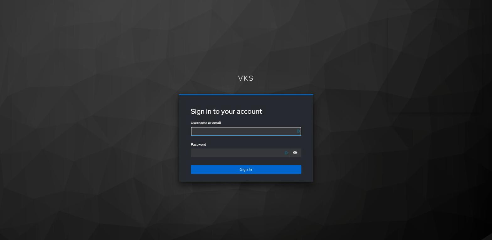
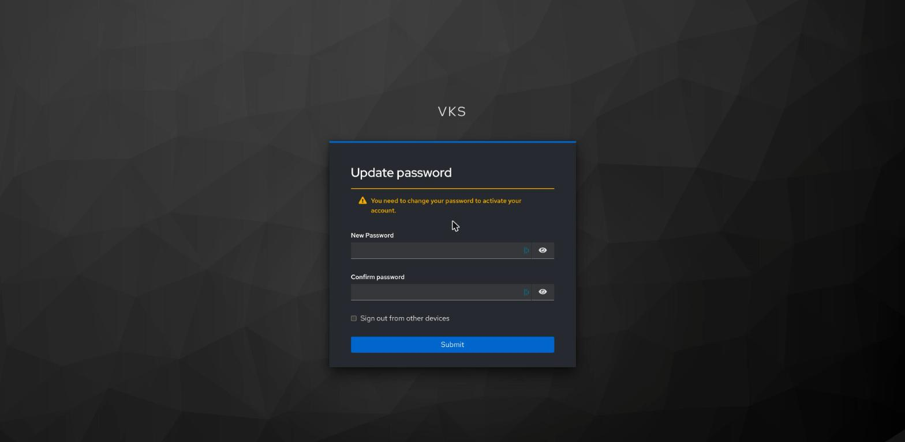
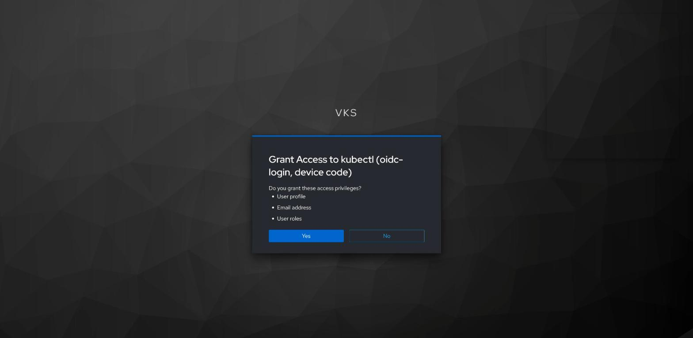
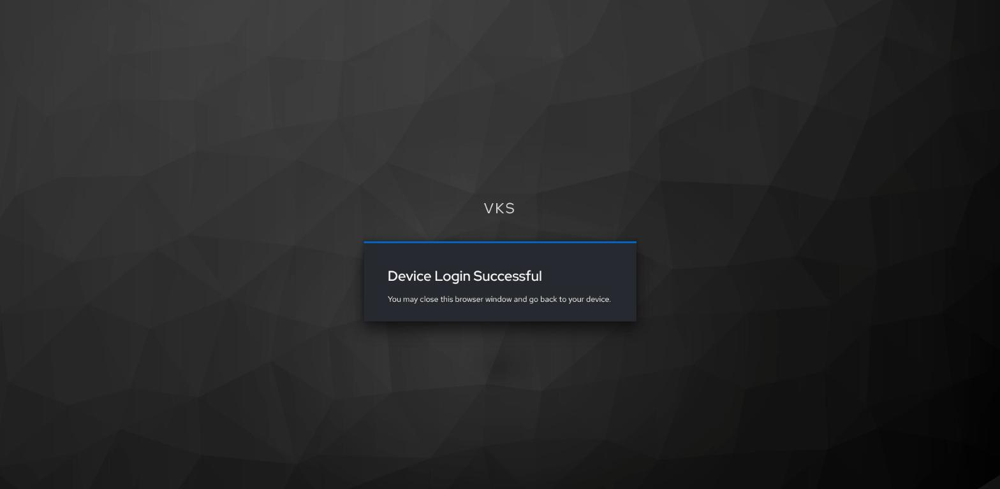

# OIDC sign-in on one VKS cluster, without the Supervisor (Keycloak example)

> [!NOTE]
> **Official Broadcom, Kubernetes, kubelogin and Keycloak documentation for this guide**
>
> - Broadcom: [VKS 3.8.0 cluster class variables](https://developer.broadcom.com/xapis/vmware-vsphere-kubernetes-service/3.8.0/variable-docs.html) (`kubernetes.apiServerConfiguration.extraAuthentication`)
> - Kubernetes: [Authenticating](https://kubernetes.io/docs/reference/access-authn-authz/authentication/) (structured authentication configuration), [Using RBAC Authorization](https://kubernetes.io/docs/reference/access-authn-authz/rbac/) (the `edit` role)
> - kubelogin: [README](https://github.com/int128/kubelogin), [Usage](https://github.com/int128/kubelogin/blob/master/docs/usage.md)
> - Keycloak: [Device Authorization Grant](https://www.keycloak.org/docs/latest/server_admin/index.html#device-authorization-grant)

The VKS cluster itself trusts an OpenID Connect (OIDC) identity provider; Keycloak is the example
provider here. A person logs in to one VKS cluster with their Keycloak user, in a browser on any machine, and needs
only kubectl and kubelogin; they need no vCenter account and no VCF CLI. The cluster administrator
turns this on when creating the cluster, gives Keycloak groups rights, and hands out a kubeconfig
that holds no secret. Tested on VKS 3.8 (Kubernetes v1.37.1) with Keycloak 26.8.

## Prerequisites

- VKS 3.8, and a new cluster made with kubectl and a YAML file
  ([CLUSTER.md step 9](CLUSTER.md#9-create-the-cluster-with-kubectl-and-a-yaml-file)); its
  administrator kubeconfig ([LOGIN.md](LOGIN.md#get-the-vks-clusters-kubeconfig));
- [kubectl](KUBECTL.md) for the administrator; [kubectl](KUBECTL.md) and
  [kubelogin](PREREQS.md#kubelogin-optional) for each person;
- a Keycloak realm, set up by its administrator as below (no Keycloak yet:
  [KEYCLOAK-VKS.md](KEYCLOAK-VKS.md) runs one in a VKS cluster and sets the realm up); the
  Keycloak name must resolve from the people's machines and from the cluster's control-plane
  nodes.

What the Keycloak administrator sets up in the realm (the issuer is
`https://<keycloak>/realms/<realm>`):

- a client `kubernetes-device`: **Client authentication** off, **OAuth 2.0 Device Authorization
  Grant** on, **Standard flow** off;
- on that client, a **Group Membership** mapper: **Token Claim Name** `groups`, **Full group path**
  off, **Add to ID token** on. Group names must be unique in the realm;
- users with an email address (Keycloak otherwise stops their sign-in at **Update profile**), who
  may not change their username;
- an HTTPS certificate from a CA that the people's browsers trust, and that CA as a PEM file for
  you.

The connections this guide needs, for a firewall (all TCP, besides DNS):

| from | to | port | for |
|---|---|---|---|
| your machine | the VKS cluster's API address (in its kubeconfig) | 6443 | kubectl to the cluster (steps 2 and 3) |
| the person's machine | the VKS cluster's API address | 6443 | the person's kubectl (step 4) |
| the person's machine, and the browser they sign in with | Keycloak | its HTTPS port (443) | the code and the sign-in (step 4) |
| the VKS cluster's control-plane nodes | Keycloak | its HTTPS port (443) | checking the person's Keycloak login |

The file you hand over holds no secret, so it may be sent openly; the person's token cache
(`~/.kube/cache/oidc-login`) must not be shared.

## 1. Turn Keycloak login on (when you create the cluster)

Create the cluster with kubectl and a YAML file, as in
[CLUSTER.md step 9](CLUSTER.md#9-create-the-cluster-with-kubectl-and-a-yaml-file). In `cluster.yaml`,
add the entry below at the end of `spec.topology.variables`, after the `vsphereOptions` entry, with
the same indentation as `- name: vsphereOptions`. Change the issuer and the CA (from the Keycloak
administrator, each line indented as shown), then apply the file as step 9 says. A cluster that
already exists is not covered here: it has a `kubernetes` entry of its own, and changing it replaces
the control-plane nodes.

```yaml
    variables:
      # ... vmClass, storageClass, as in CLUSTER.md step 9
      - name: vsphereOptions
        value:
          persistentVolumes:
            defaultStorageClass: wcp-vmfs
      - name: kubernetes                                                # <-- from here to the end: new
        value:
          apiServerConfiguration:
            extraAuthentication:
              jwt:
                - issuer:
                    url: https://keycloak.example.com/realms/my-realm   # <-- the issuer
                    audiences:
                      - kubernetes-device
                    certificateAuthority: |                             # <-- the CA, indented
                      -----BEGIN CERTIFICATE-----
                      MIIBwTCCAWegAwIBAgIU...
                      -----END CERTIFICATE-----
                  claimMappings:
                    username:
                      claim: preferred_username
                      prefix: 'keycloak:'
                    groups:
                      claim: groups
                      prefix: 'keycloak:'
                    uid:
                      claim: sub
```

**Expect:** the cluster comes up as in CLUSTER.md step 9. People are then known to it as
`keycloak:<username>`, in groups `keycloak:<group>`.

## 2. Give the group rights (cluster administrator)

This gives the Keycloak group `KEYCLOAK_GROUP` the `edit` role in `TEAM_NAMESPACE`, then shows what
a member may do. Bind groups, never `system:authenticated`: every user of the realm is in it.

**Linux (Ubuntu, AlmaLinux, Photon OS), macOS, WSL (bash or zsh):**

```sh
ADMIN_KUBECONFIG="$HOME/.kube/my-vks-cluster.kubeconfig"
KEYCLOAK_GROUP="team-a"
TEAM_NAMESPACE="team-a"

adm() { kubectl --kubeconfig "$ADMIN_KUBECONFIG" "$@"; }
if ! command -v kubectl >/dev/null 2>&1; then echo "MISSING: kubectl (KUBECTL.md)"
elif [ ! -s "$ADMIN_KUBECONFIG" ]; then echo "MISSING: $ADMIN_KUBECONFIG"
else
  adm create namespace "$TEAM_NAMESPACE" --dry-run=client -o yaml | adm apply -f - >/dev/null
  adm -n "$TEAM_NAMESPACE" create rolebinding "keycloak-${KEYCLOAK_GROUP}-edit" --clusterrole=edit \
    --group="keycloak:${KEYCLOAK_GROUP}" --dry-run=client -o yaml | adm apply -f -
  echo "create deployments in $TEAM_NAMESPACE: $(adm auth can-i create deployments -n "$TEAM_NAMESPACE" --as=keycloak:test --as-group="keycloak:${KEYCLOAK_GROUP}")"
  echo "list pods in kube-system: $(adm auth can-i list pods -n kube-system --as=keycloak:test --as-group="keycloak:${KEYCLOAK_GROUP}")"
fi
```

**Windows (PowerShell):**

```powershell
$ADMIN_KUBECONFIG = "$HOME\.kube\my-vks-cluster.kubeconfig"
$KEYCLOAK_GROUP = "team-a"
$TEAM_NAMESPACE = "team-a"

function adm { $input | kubectl --kubeconfig $ADMIN_KUBECONFIG @args }
if (-not (Get-Command kubectl -ErrorAction SilentlyContinue)) { "MISSING: kubectl (KUBECTL.md)" }
elseif (-not (Test-Path $ADMIN_KUBECONFIG)) { "MISSING: $ADMIN_KUBECONFIG" }
else {
  adm create namespace $TEAM_NAMESPACE --dry-run=client -o yaml | adm apply -f - | Out-Null
  adm -n $TEAM_NAMESPACE create rolebinding "keycloak-$KEYCLOAK_GROUP-edit" --clusterrole=edit "--group=keycloak:$KEYCLOAK_GROUP" --dry-run=client -o yaml | adm apply -f -
  "create deployments in ${TEAM_NAMESPACE}: $(adm auth can-i create deployments -n $TEAM_NAMESPACE --as=keycloak:test "--as-group=keycloak:$KEYCLOAK_GROUP")"
  "list pods in kube-system: $(adm auth can-i list pods -n kube-system --as=keycloak:test "--as-group=keycloak:$KEYCLOAK_GROUP")"
}
```

**Expect:** `rolebinding.rbac.authorization.k8s.io/keycloak-team-a-edit created` (`configured` or
`unchanged` when run again), then
`create deployments in team-a: yes` and `list pods in kube-system: no`.

**If not:** `Forbidden` or `Unauthorized`: `ADMIN_KUBECONFIG` is not the cluster's administrator
file, or it has expired; get it again.

## 3. Make the person's kubeconfig (cluster administrator)

This writes `KEYCLOAK_KUBECONFIG`: the cluster's address and CA from your administrator file, and a
login through kubelogin with a device code, checking Keycloak against `KEYCLOAK_CA`. Its context
starts in `TEAM_NAMESPACE`. Send the file to the person; one file serves the whole group.

<details>
<summary><b>Linux (Ubuntu, AlmaLinux, Photon OS), macOS, WSL (bash or zsh)</b></summary>

```sh
ADMIN_KUBECONFIG="$HOME/.kube/my-vks-cluster.kubeconfig"
KEYCLOAK_ISSUER="https://keycloak.example.com/realms/my-realm"
KEYCLOAK_CA="$HOME/keycloak-ca.pem"
TEAM_NAMESPACE="team-a"
NAME="my-vks-cluster-keycloak"
KEYCLOAK_KUBECONFIG="$HOME/.kube/${NAME}.kubeconfig"

if ! command -v kubectl >/dev/null 2>&1; then echo "MISSING: kubectl (KUBECTL.md)"
elif [ ! -s "$ADMIN_KUBECONFIG" ]; then echo "MISSING: $ADMIN_KUBECONFIG"
elif ! grep -q 'BEGIN CERTIFICATE' "$KEYCLOAK_CA" 2>/dev/null; then echo "NOT A PEM FILE: $KEYCLOAK_CA (the CA from the Keycloak administrator)"
elif SERVER="$(kubectl --kubeconfig "$ADMIN_KUBECONFIG" config view --minify -o jsonpath='{.clusters[0].cluster.server}')" \
  && CA="$(kubectl --kubeconfig "$ADMIN_KUBECONFIG" config view --minify --raw -o jsonpath='{.clusters[0].cluster.certificate-authority-data}')" \
  && KC_CA="$(base64 < "$KEYCLOAK_CA" | tr -d '\n')" && [ -n "$SERVER" ] && [ -n "$CA" ] && [ -n "$KC_CA" ]; then
  mkdir -p "$(dirname "$KEYCLOAK_KUBECONFIG")" && rm -f "$KEYCLOAK_KUBECONFIG"
  kcfg() { kubectl config --kubeconfig "$KEYCLOAK_KUBECONFIG" "$@" >/dev/null; }
  kcfg set-cluster "$NAME" --server="$SERVER" && kcfg set "clusters.${NAME}.certificate-authority-data" "$CA" \
    && kcfg set-credentials keycloak --exec-api-version=client.authentication.k8s.io/v1 --exec-command=kubectl \
      --exec-arg=oidc-login --exec-arg=get-token --exec-arg=--oidc-issuer-url="$KEYCLOAK_ISSUER" \
      --exec-arg=--oidc-client-id=kubernetes-device --exec-arg=--grant-type=device-code \
      --exec-arg=--skip-open-browser --exec-arg=--certificate-authority-data="$KC_CA" --exec-interactive-mode=IfAvailable \
    && kcfg set-context "$NAME" --cluster="$NAME" --user=keycloak --namespace="$TEAM_NAMESPACE" && kcfg use-context "$NAME" \
    && echo "send this file: $KEYCLOAK_KUBECONFIG" || echo "FAILED: see the kubectl error above"
else
  echo "FAILED: no server or CA read from $ADMIN_KUBECONFIG"
fi
```

</details>

<details>
<summary><b>Windows (PowerShell)</b></summary>

```powershell
$ADMIN_KUBECONFIG = "$HOME\.kube\my-vks-cluster.kubeconfig"
$KEYCLOAK_ISSUER = "https://keycloak.example.com/realms/my-realm"
$KEYCLOAK_CA = "$HOME\keycloak-ca.pem"
$TEAM_NAMESPACE = "team-a"
$NAME = "my-vks-cluster-keycloak"
$KEYCLOAK_KUBECONFIG = "$HOME\.kube\$NAME.kubeconfig"

if (-not (Get-Command kubectl -ErrorAction SilentlyContinue)) { "MISSING: kubectl (KUBECTL.md)" }
elseif (-not (Test-Path $ADMIN_KUBECONFIG)) { "MISSING: $ADMIN_KUBECONFIG" }
elseif (-not (Select-String -Quiet -Path $KEYCLOAK_CA -Pattern 'BEGIN CERTIFICATE' -ErrorAction SilentlyContinue)) { "NOT A PEM FILE: $KEYCLOAK_CA (the CA from the Keycloak administrator)" }
else {
  $SERVER = kubectl --kubeconfig $ADMIN_KUBECONFIG config view --minify -o jsonpath='{.clusters[0].cluster.server}'
  $CA = kubectl --kubeconfig $ADMIN_KUBECONFIG config view --minify --raw -o jsonpath='{.clusters[0].cluster.certificate-authority-data}'
  $KC_CA = [Convert]::ToBase64String([IO.File]::ReadAllBytes($KEYCLOAK_CA))
  if ($SERVER -and $CA -and $KC_CA) {
    New-Item -ItemType Directory -Force -Path (Split-Path $KEYCLOAK_KUBECONFIG) | Out-Null
    Remove-Item -Force $KEYCLOAK_KUBECONFIG -ErrorAction SilentlyContinue
    $K = @('config', "--kubeconfig=$KEYCLOAK_KUBECONFIG"); $OK = $true
    kubectl @K set-cluster $NAME "--server=$SERVER" | Out-Null; if ($LASTEXITCODE) { $OK = $false }
    kubectl @K set "clusters.$NAME.certificate-authority-data" $CA | Out-Null; if ($LASTEXITCODE) { $OK = $false }
    kubectl @K set-credentials keycloak --exec-api-version=client.authentication.k8s.io/v1 --exec-command=kubectl `
      --exec-arg=oidc-login --exec-arg=get-token "--exec-arg=--oidc-issuer-url=$KEYCLOAK_ISSUER" `
      --exec-arg=--oidc-client-id=kubernetes-device --exec-arg=--grant-type=device-code `
      --exec-arg=--skip-open-browser "--exec-arg=--certificate-authority-data=$KC_CA" --exec-interactive-mode=IfAvailable | Out-Null
    if ($LASTEXITCODE) { $OK = $false }
    kubectl @K set-context $NAME "--cluster=$NAME" --user=keycloak "--namespace=$TEAM_NAMESPACE" | Out-Null; if ($LASTEXITCODE) { $OK = $false }
    kubectl @K use-context $NAME | Out-Null; if ($LASTEXITCODE) { $OK = $false }
    if ($OK) { "send this file: $KEYCLOAK_KUBECONFIG" } else { "FAILED: see the kubectl error above" }
  } else {
    "FAILED: no server or CA read from $ADMIN_KUBECONFIG"
  }
}
```

</details>

**Expect:** `send this file: …/my-vks-cluster-keycloak.kubeconfig`.

**If not:**
- `unknown flag: --exec-interactive-mode`, then `FAILED`: kubectl is too old; update it
  ([KUBECTL.md](KUBECTL.md)).
- `FAILED: no server or CA read …`: `ADMIN_KUBECONFIG` is not the cluster's administrator kubeconfig.

## 4. Log in (the person)

Install [kubectl](KUBECTL.md) and [kubelogin](PREREQS.md#kubelogin-optional), and save the file as
`KEYCLOAK_KUBECONFIG`. This checks both tools and the file, then asks the cluster who you are.

**Linux (Ubuntu, AlmaLinux, Photon OS), macOS, WSL (bash or zsh):**

```sh
KEYCLOAK_KUBECONFIG="$HOME/.kube/my-vks-cluster-keycloak.kubeconfig"

if ! command -v kubectl >/dev/null 2>&1; then echo "MISSING: kubectl (KUBECTL.md)"
elif ! kubectl oidc-login version >/dev/null 2>&1; then echo "MISSING: kubelogin (PREREQS.md, kubelogin)"
elif [ ! -s "$KEYCLOAK_KUBECONFIG" ]; then echo "MISSING: $KEYCLOAK_KUBECONFIG (the file from your administrator)"
else kubectl --kubeconfig "$KEYCLOAK_KUBECONFIG" auth whoami
fi
```

**Windows (PowerShell):**

```powershell
$KEYCLOAK_KUBECONFIG = "$HOME\.kube\my-vks-cluster-keycloak.kubeconfig"

if (-not (Get-Command kubectl -ErrorAction SilentlyContinue)) { "MISSING: kubectl (KUBECTL.md)" }
elseif (-not (Get-Command kubectl-oidc_login -ErrorAction SilentlyContinue)) { "MISSING: kubelogin (PREREQS.md, kubelogin)" }
elseif (-not (Test-Path $KEYCLOAK_KUBECONFIG)) { "MISSING: $KEYCLOAK_KUBECONFIG (the file from your administrator)" }
else { kubectl --kubeconfig $KEYCLOAK_KUBECONFIG auth whoami }
```

kubelogin prints `Please visit the following URL in your browser:` and a Keycloak address that
ends in `user_code=XXXX-XXXX`. Open it in a browser on any machine, and open only an address your own
kubectl printed. Sign in to Keycloak:



At your first sign in with a temporary password, Keycloak asks for a new one:



Answer **Grant Access to kubectl (oidc-login, device code)** with **Yes**:



The page then says **Device Login Successful**, and kubectl answers. Later commands renew the login
by themselves while your Keycloak session lasts.



**Expect:** `Username  keycloak:<you>`, a `UID` line, and `Groups` that include `keycloak:team-a`;
`kubectl --kubeconfig "$KEYCLOAK_KUBECONFIG" get pods` then answers for `team-a`.

**If not:**
- `MISSING: …`: install that tool, or save the file under that name.
- `x509: certificate signed by unknown authority` from kubelogin: `KEYCLOAK_CA` in step 3 is not the
  CA of Keycloak's certificate, or Keycloak's certificate changed; ask for a new file.
- `could not load the certificate`: `KEYCLOAK_CA` in step 3 was not a certificate; ask for a new
  file.
- `Unauthorized`: the cluster does not accept the login. Its control-plane nodes cannot reach
  Keycloak (its name and port, see the table), or the issuer, CA or client name in step 1 differs
  from Keycloak's.
- `Forbidden`: your groups are not the one given rights in step 2. A group shown as
  `keycloak:/team-a` means **Full group path** is on in Keycloak.

## 5. Log out (the person)

This deletes the person's cached Keycloak tokens on this machine:

**Linux (Ubuntu, AlmaLinux, Photon OS), macOS, WSL (bash or zsh):**

```sh
kubectl oidc-login clean
```

**Windows (PowerShell):**

```powershell
kubectl oidc-login clean
```

**Expect:** `Deleted the token cache from …/.kube/cache/oidc-login`, then a line about the keyring
(`Could not delete the token cache from the keyring: …` where there is none). The next command asks
for a new code.

## 6. Take access away (cluster administrator)

Delete the group's RoleBinding (`kubectl --kubeconfig <admin file> -n team-a delete rolebinding
keycloak-team-a-edit`): access ends at once. Removing a person from the group, or disabling them in
Keycloak, stops their next login; a token they already have works until it expires (Keycloak's
**Access Token Lifespan**, 5 minutes by default).

Back to [README](../README.md).
