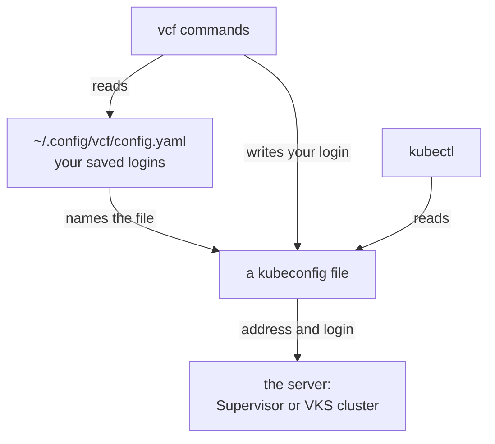
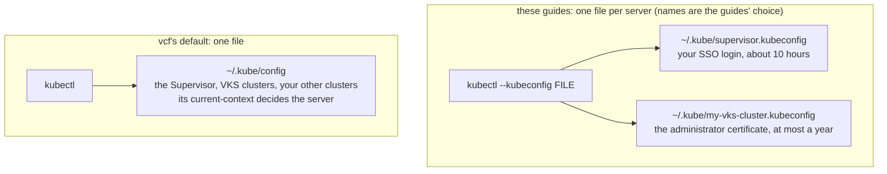

# Kubeconfig files: what they hold, use, hand over, merge

> [!NOTE]
> **Official Kubernetes and Broadcom documentation (VCF 9.1) for this guide**
>
> - Kubernetes: [Organizing Cluster Access Using kubeconfig Files](https://kubernetes.io/docs/concepts/configuration/organize-cluster-access-kubeconfig/) (the `KUBECONFIG` list and how files merge), [Configure Access to Multiple Clusters](https://kubernetes.io/docs/tasks/access-application-cluster/configure-access-multiple-clusters/)
> - Broadcom: [VCF CLI command reference: context](https://techdocs.broadcom.com/us/en/vmware-cis/vcf/vcf-consumption/latest/consumer-interfaces-in-vcf/installing-and-using-vcf-cli-v9/command-reference2/system-commands%281%29/context2.html) (`vcf context create`), [VCF CLI command reference: cluster](https://techdocs.broadcom.com/us/en/vmware-cis/vcf/vcf-consumption/latest/consumer-interfaces-in-vcf/installing-and-using-vcf-cli-v9/command-reference2/cluster2.html) (`vcf cluster kubeconfig get --export-file`), [Connect to the VKS Cluster Control Plane as a Kubernetes Administrator](https://techdocs.broadcom.com/us/en/vmware-cis/vcf/vcf-consumption/latest/managing-vsphere-kuberenetes-service-clusters-and-workloads/configuring-identity-and-access-for-tkg-service-clusters/connect-to-the-tkg-service-cluster-control-plane-as-a-kubernetes-administrator.html) and [Log in to a VKS Cluster Using vCenter Single Sign-On Credentials](https://techdocs.broadcom.com/us/en/vmware-cis/vcf/vcf-consumption/latest/managing-vsphere-kuberenetes-service-clusters-and-workloads/configuring-identity-and-access-for-tkg-service-clusters/connecting-to-vsphere-with-tanzu-clusters/connect-to-a-tkg-service-cluster-as-a-vcenter-single-sign-on-user-with-kubectl/log-in-using-credentials.html) (the two ways to log in to a VKS cluster)

A kubeconfig is the file kubectl reads to find a cluster and log in to it: the cluster's address,
its CA (so kubectl knows it is the real server), and a login. The login decides what the file is
worth: some files carry a key that works for anyone holding a copy, others only tell kubectl which
program to run for a sign-in. [The files the guides make](#the-files-the-guides-make) lists each file
and whether it may be sent. The steps:

1. [See what a file holds](#1-see-what-a-file-holds): you, before you use or send a file.
2. [Use a file](#2-use-a-file): you, or the person you gave it to.
3. [Hand a file over](#3-hand-a-file-over): you send it; the person saves it.
4. [Merge files into `~/.kube/config`](#4-merge-files-into-kubeconfig-optional): optional, on your
   machine.

[How `vcf` and `kubectl` keep your logins](#how-vcf-and-kubectl-keep-your-logins) explains the
files a login writes, and how to clean up a login that went into your own `~/.kube/config`.

## Prerequisites

- [kubectl](KUBECTL.md);
- for [If you already use kubectl with other clusters](#if-you-already-use-kubectl-with-other-clusters)
  and [the check of your contexts](#what-a-login-creates-and-when-it-matters) only: the
  [VCF CLI](VCF.md), and for the check also [jq](PREREQS.md);
- at least one kubeconfig from the table below, for example from
  [Get the VKS cluster's kubeconfig](LOGIN.md#get-the-vks-clusters-kubeconfig).

The connections this guide needs, for a firewall (all TCP, besides DNS):

| from | to | port | for |
|---|---|---|---|
| your machine (laptop or jump box) | the VKS cluster's API address (in its kubeconfig) | 6443 | kubectl to a VKS cluster ([Use a file](#2-use-a-file), [Merge files](#4-merge-files-into-kubeconfig-optional)) |
| your machine (laptop or jump box) | the Supervisor's address | 443 | kubectl to the Supervisor, and the sign-in of files that run `vcf` |
| your browser (kubelogin: your machine) | Keycloak | 443 | the sign-in of files that run `vcf` or kubelogin |

## The files the guides make

| file | made by | its login | a copy lets anyone | works for | when it expires | send it? |
|---|---|---|---|---|---|---|
| `~/.kube/<SUPERVISOR_CONTEXT>.kubeconfig` | [LOGIN.md](LOGIN.md#create-supervisor-context-with-ca) (`vcf context create`) | your SSO token | act as you on the Supervisor | 10 hours | `Unauthorized` (logged in at 08:00: from 18:00); [renew the login](LOGIN.md#renew-the-supervisor-login) | no |
| `~/.kube/<cluster>.kubeconfig` | [Get the VKS cluster's kubeconfig](LOGIN.md#get-the-vks-clusters-kubeconfig), or [Download it](LOGIN.md#download-the-vks-clusters-kubeconfig-from-the-vsphere-client) | the cluster's administrator certificate and key | be the cluster's administrator | until the date in its certificate, at most a year, or until the cluster is deleted; a copy cannot be withdrawn | `Unauthorized` (a cluster made on 2026-11-04: from 2027-11-04); [get it again](LOGIN.md#get-the-vks-clusters-kubeconfig) | no |
| `~/<cluster>-<team>.kubeconfig` | [A ServiceAccount token](ACCESS.md#a-serviceaccount-token) | a ServiceAccount token | act as that ServiceAccount | `DAYS` (30 by default), or until the ServiceAccount is deleted | `Unauthorized` (made on 2026-11-04 with `DAYS=30`: from 2026-12-04); before then, [renew it](ACCESS.md#3-renew-the-teams-token-cluster-administrator) and send the team the new file | to the team only |
| `~/<cluster>-<SA_NAME>.kubeconfig` | [An administrator ServiceAccount token](ACCESS.md#an-administrator-serviceaccount-token-whole-cluster) | a ServiceAccount token, no password | everything in the cluster, as that ServiceAccount | `DAYS` (365 for a year), or never; until you take it away | with `DAYS=365` made on 2026-11-04: `Unauthorized` from 2027-11-04; before then, [renew it](ACCESS.md#3-renew-the-administrator-token-cluster-administrator); with `never`: it does not expire | to that tool or person only |
| `~/<cluster>-<person>.kubeconfig` | [A personal certificate](ACCESS.md#a-personal-certificate) | a certificate and key | act as that person | `DAYS` (30 by default); cannot be withdrawn | `Unauthorized` (made on 2026-11-04 with `DAYS=30`: from 2026-12-04); before then, [renew it](ACCESS.md#3-renew-the-certificate-cluster-administrator): a new file, and the old name's rights taken away | to that person only |
| `~/.kube/<cluster>-<SSO_USER>.kubeconfig` | [The person's own SSO account](ACCESS.md#the-persons-own-sso-account) | the person's SSO token | act as that person | 10 hours | `Unauthorized` (logged in at 08:00: from 18:00); the person logs in again ([step 2a](ACCESS.md#2a-log-in-with-the-vcf-cli-the-person), or [2d](ACCESS.md#2d-log-in-with-the-plugin-the-person)) | no |
| `~/.kube/<cluster>-keycloak.kubeconfig` | [KEYCLOAK.md](KEYCLOAK.md#3-make-the-persons-kubeconfig-cluster-administrator) | none: runs kubelogin, which asks for a Keycloak sign-in | nothing without a Keycloak account | as long as the cluster's address and CA stay | no error: kubelogin renews it by itself while the person's Keycloak session lasts, then asks for a new sign-in; the person signs in again | yes |
| `~/<cluster>-keycloak-sv.kubeconfig` | [A group from an external identity provider, through the Supervisor](ACCESS.md#4-make-the-groups-kubeconfig-and-hand-it-over-cluster-administrator) | none: runs `vcf pinniped-auth login`, which asks for a sign-in | nothing without an account | as long as the address and CA stay | no error: `vcf` renews it by itself while the person's session at the identity provider lasts, then opens the browser (without one: `Log in by visiting this link`); the person signs in again | yes |

Once its login has ended, kubectl answers for each file with `Unauthorized` in that column:
`error: You must be logged in to the server (Unauthorized)`. The same answer comes when a
ServiceAccount was deleted, and it does not say which login it was: the file's name and
[step 1](#1-see-what-a-file-holds) tell you.

The last six rows exist only after [ACCESS.md](ACCESS.md) or [KEYCLOAK.md](KEYCLOAK.md). A
ServiceAccount is a login for a tool or a team rather than a person; kubelogin is a kubectl add-on
that asks for a sign-in in a browser.

Every file the guides write is readable only by you (Linux, macOS: `-rw-------`; Windows: your
user, `SYSTEM` and `Administrators`, until [step 3](#3-hand-a-file-over) leaves only your user).
The sign-ins of the last two rows are kept elsewhere, also readable only by you: kubelogin's in
`~/.kube/cache/oidc-login`, `vcf`'s in `~/.config/vcf/pinniped`. Those folders are never sent.

## 1. See what a file holds

Run this before you use a kubeconfig you were given, or before you send one, to know what it is
worth. It lists the file's permissions and the lines that show its server and its kind of login,
without printing any secret, and changes nothing. You then know who may read the file and whether
it holds a key, a token or a sign-in command, and can use it (step 2) or send it (step 3). Set
`KUBECONFIG_FILE` to the file.

**Linux, macOS, WSL (bash or zsh):**

```sh
KUBECONFIG_FILE="$HOME/.kube/my-vks-cluster.kubeconfig"

ls -l "$KUBECONFIG_FILE" && kubectl --kubeconfig "$KUBECONFIG_FILE" config view | grep -E 'server:|token:|client-key-data:|command:|current-context:'
```

**Windows (PowerShell):**

```powershell
$KUBECONFIG_FILE = "$HOME\.kube\my-vks-cluster.kubeconfig"

icacls $KUBECONFIG_FILE
kubectl --kubeconfig $KUBECONFIG_FILE config view | Select-String -Pattern 'server:|token:|client-key-data:|command:|current-context:'
```

**Expect:** `-rw-------` and your user (Windows: only your user, `SYSTEM` and `Administrators`),
then the `server:` line and one of:
- `client-key-data: DATA+OMITTED`: a key; whoever has the file is that user;
- `token: REDACTED`: a token; whoever has the file is that user until the token ends;
- `command: vcf` or `command: kubectl`: no secret; the file asks for a sign-in. Before the first
  use of such a file from someone else, check that `server:` is the address you were told and the
  command is `vcf` or `kubectl`: a file can run any program.

**If not:** `-rw-r--r--` or more: run `chmod 600` on the file (Windows: see
[Hand a file over](#3-hand-a-file-over)). `No such file`: set `KUBECONFIG_FILE` to the file.

## 2. Use a file

Name the file with `--kubeconfig` in each command, or make it the default in this terminal, as in
[Use the VKS cluster](LOGIN.md#use-the-vks-cluster), with any file from the table.

A file with several contexts (a *context* is a saved "this cluster, as this user"), such as
`~/.kube/supervisor.kubeconfig` (`supervisor` and one `supervisor:<namespace>` per vSphere
Namespace; the names follow `SUPERVISOR_CONTEXT`) or a merged `~/.kube/config`, uses its current
context. Pick another for one command with `--context <name>`, or make it the current one with
`kubectl config use-context <name>`, which changes the file. `KUBECONFIG` may also list several
files, separated by `:` (Windows: `;`); kubectl then reads them together, the first file wins where
two use the same name, and `use-context` changes the first file.

## 3. Hand a file over

Send only a file whose *send it?* column in [the table](#the-files-the-guides-make) is not `no`. A
file with no secret (`yes`) may go by email or chat. A file with a token or a key (`to the team
only`, `to that person only`) goes only through a password manager's share or as an encrypted
file, never by email, chat or a shared folder; then delete your copy. The person saves it in their
`.kube` folder.

The person who received the file runs this once after saving it, so that no other user of their
machine can read it. It makes the file readable and writable only by them (Windows: only their user
stays on the file) and changes nothing else. Afterwards it is ready for [Use a file](#2-use-a-file).
Set `HANDOUT` to the saved file:

**Linux, macOS, WSL (bash or zsh):**

```sh
HANDOUT="$HOME/.kube/my-vks-cluster-team-a.kubeconfig"

chmod 600 "$HANDOUT" && ls -l "$HANDOUT"
```

**Windows (PowerShell):**

```powershell
$HANDOUT = "$HOME\.kube\my-vks-cluster-team-a.kubeconfig"

icacls $HANDOUT /inheritance:r /grant:r "${env:USERNAME}:F"
icacls $HANDOUT
```

**Expect:** `-rw-------` and your user (Windows: `processed file: …`, `Successfully processed 1
files`, then only your user with `(F)`).

**If not:** `No such file` (Windows: `The system cannot find the file specified`): set `HANDOUT` to
the saved file.

A file that runs `vcf` needs the [VCF CLI](VCF.md) on the person's machine; one that runs
kubelogin needs [kubelogin](PREREQS.md#kubelogin-optional).

## 4. Merge files into `~/.kube/config` (optional)

Run this, if you want to, when a tool reads only `~/.kube/config` and should see every cluster at
once. It copies the files in `FILES`, after your `~/.kube/config` if you have one, into a new file
readable only by you and lists its contexts; only then does it replace `~/.kube/config`, keeping
the old one as `~/.kube/config.before-merge`. It stops, changing nothing, when a file is missing or
two files hold a context, cluster or user of the same name with different content. Afterwards
`kubectl --context <name>` reaches each merged cluster. Set `FILES` to VKS cluster files and
hand-outs only, not `~/.kube/<SUPERVISOR_CONTEXT>.kubeconfig` or any file a `vcf` login writes
(`vcf context list`): `vcf` renews only its own file, so the copy stops working.

<details>
<summary><b>Linux, macOS, WSL (bash or zsh)</b></summary>

```sh
FILES="$HOME/.kube/my-vks-cluster.kubeconfig:$HOME/.kube/my-other-cluster.kubeconfig"
KUBE_CONFIG="$HOME/.kube/config"

MISSING="$(printf '%s\n' "$FILES" | tr ':' '\n' | while IFS= read -r F; do if [ ! -s "$F" ]; then printf '%s ' "$F"; fi; done)"
if [ -f "$KUBE_CONFIG" ]; then LIST="$KUBE_CONFIG:$FILES"; else LIST="$FILES"; fi
SAME="$(printf '%s\n' "$LIST" | tr ':' '\n' | while IFS= read -r F; do kubectl --kubeconfig "$F" config view --flatten -o jsonpath='{range .contexts[*]}context {.name}{"\t"}{.context}{"\n"}{end}{range .clusters[*]}cluster {.name}{"\t"}{.cluster}{"\n"}{end}{range .users[*]}user {.name}{"\t"}{.user}{"\n"}{end}' 2>/dev/null \
  || kubectl --kubeconfig "$F" config view --raw -o jsonpath='{range .contexts[*]}context {.name}{"\t"}{.context}{"\n"}{end}{range .clusters[*]}cluster {.name}{"\t"}{.cluster}{"\n"}{end}{range .users[*]}user {.name}{"\t"}{.user}{"\n"}{end}' 2>/dev/null; done | sort -u | cut -f1 | sort | uniq -d | tr '\n' ' ')"
rm -f "$KUBE_CONFIG.new"
if [ -n "$MISSING" ]; then
  echo "MISSING: $MISSING"
elif [ -n "$SAME" ]; then
  echo "SAME NAME, DIFFERENT CONTENT IN TWO FILES: $SAME"
elif mkdir -p "$HOME/.kube" && ( umask 077; KUBECONFIG="$LIST" kubectl config view --flatten > "$KUBE_CONFIG.new" ) \
     && kubectl --kubeconfig "$KUBE_CONFIG.new" config get-contexts; then
  if [ -f "$KUBE_CONFIG" ]; then cp -p "$KUBE_CONFIG" "$KUBE_CONFIG.before-merge"; fi
  mv "$KUBE_CONFIG.new" "$KUBE_CONFIG" && echo "merged into $KUBE_CONFIG"
else
  rm -f "$KUBE_CONFIG.new"
  echo "FAILED: $KUBE_CONFIG is as it was (see the kubectl error above)"
fi
```

</details>

<details>
<summary><b>Windows (PowerShell)</b></summary>

```powershell
$FILES = "$HOME\.kube\my-vks-cluster.kubeconfig;$HOME\.kube\my-other-cluster.kubeconfig"
$KUBE_CONFIG = "$HOME\.kube\config"

$MISSING = @($FILES.Split(';') | Where-Object { -not (Test-Path $_ -PathType Leaf) })
if (Test-Path $KUBE_CONFIG) { $LIST = "$KUBE_CONFIG;$FILES" } else { $LIST = $FILES }
$SAME = @($LIST.Split(';') | Where-Object { Test-Path $_ -PathType Leaf } | ForEach-Object {
    $o = kubectl --kubeconfig $_ config view --flatten -o json 2>$null
    if ($LASTEXITCODE -ne 0) { $o = kubectl --kubeconfig $_ config view --raw -o json 2>$null }
    if ($LASTEXITCODE -eq 0) {
      $j = ($o | Out-String) | ConvertFrom-Json
      foreach ($e in @($j.contexts)) { "context $($e.name)`t$($e.context | ConvertTo-Json -Compress -Depth 20)" }
      foreach ($e in @($j.clusters)) { "cluster $($e.name)`t$($e.cluster | ConvertTo-Json -Compress -Depth 20)" }
      foreach ($e in @($j.users)) { "user $($e.name)`t$($e.user | ConvertTo-Json -Compress -Depth 20)" }
    }
  } | Sort-Object -Unique -CaseSensitive | ForEach-Object { $_.Split("`t")[0] } |
  Group-Object -CaseSensitive | Where-Object { $_.Count -gt 1 } | ForEach-Object { $_.Name })
Remove-Item -Force -ErrorAction SilentlyContinue "$KUBE_CONFIG.new"
if ($MISSING.Count -gt 0) { "MISSING: $MISSING" }
elseif ($SAME.Count -gt 0) { "SAME NAME, DIFFERENT CONTENT IN TWO FILES: $SAME" }
else {
  New-Item -ItemType Directory -Force -Path (Split-Path $KUBE_CONFIG) | Out-Null
  $OLD_KUBECONFIG = $env:KUBECONFIG; $env:KUBECONFIG = $LIST
  $MERGED = kubectl config view --flatten; $OK = ($LASTEXITCODE -eq 0)
  $env:KUBECONFIG = $OLD_KUBECONFIG
  if ($OK) {
    Set-Content -Encoding ascii -Path "$KUBE_CONFIG.new" -Value $MERGED
    kubectl --kubeconfig "$KUBE_CONFIG.new" config get-contexts; $OK = ($LASTEXITCODE -eq 0)
  }
  if ($OK) {
    if (Test-Path $KUBE_CONFIG) { Copy-Item -Force $KUBE_CONFIG "$KUBE_CONFIG.before-merge" }
    Move-Item -Force "$KUBE_CONFIG.new" $KUBE_CONFIG
    "merged into $KUBE_CONFIG"
  } else {
    Remove-Item -Force -ErrorAction SilentlyContinue "$KUBE_CONFIG.new"
    "FAILED: $KUBE_CONFIG is as it was (see the kubectl error above)"
  }
}
```

</details>

**Expect:** the merged contexts, your old current context still marked `*` (the first file's wins),
then `merged into …/.kube/config`. Then `kubectl --context <name> get nodes` answers for each
cluster.

**If not:**
- `MISSING: …`: set `FILES` to files that exist (kubectl itself would skip a missing file without
  a word).
- `SAME NAME, DIFFERENT CONTENT IN TWO FILES: …` (a context, cluster or user): the first file's entry
  would be used for both, so a context could reach the wrong cluster or sign-in. Keep that file on its
  own and use it with `--kubeconfig` (renaming the context does not help: its cluster and user keep
  their names). If the entry is an old one already in `~/.kube/config`, delete it there as in
  **A new file for a merged cluster** below and run this again.
- To undo: `mv ~/.kube/config.before-merge ~/.kube/config` (Windows:
  `Move-Item -Force $HOME\.kube\config.before-merge $HOME\.kube\config`); if you had no
  `~/.kube/config` before, delete it instead. A second merge replaces `config.before-merge`.

**A new file for a merged cluster:** `~/.kube/config` does not follow later changes to a merged
file. After a new file for the same cluster, delete the old entries the block names
(`kubectl config delete-context <name>`, `delete-cluster`, `delete-user`;
`kubectl config get-contexts` shows which contexts use them) and merge again.

## How `vcf` and `kubectl` keep your logins

**In short:** run the blocks as written. They use file and context names these guides chose, not
names `vcf` requires (see [what `vcf` does by
default](#what-vcf-does-by-default-and-what-these-guides-do)). Keep a VKS cluster's administrator
kubeconfig private: anyone with a copy administers that cluster.

### The words used here

| word | what it is |
|---|---|
| kubeconfig | a file that tells `kubectl` (the Kubernetes command-line tool, [KUBECTL.md](KUBECTL.md)) and other Kubernetes tools which server to talk to and how to log in: the server's address and certificate, and your login (for the Supervisor a *token*, a temporary key) |
| cluster, user (in a kubeconfig) | two kinds of entry in a kubeconfig: a *cluster* is a server's address and certificate, a *user* is a stored login (a token or a certificate). Not a vSphere cluster and not an SSO user |
| context | an entry in a kubeconfig that pairs one cluster with one user: "this server, as this login". One kubeconfig can hold several; its *current-context* is the one `kubectl` uses when a command does not name one |
| `~/.kube/config` | the kubeconfig `kubectl` uses when nothing else is named (Windows: `%USERPROFILE%\.kube\config`) |
| `KUBECONFIG` | an environment variable naming the kubeconfig to use instead (several files: separated by `:`, on Windows `;`). A command's `--kubeconfig <file>` overrides it |
| `config.yaml` | the VCF CLI's own list of your saved logins (`~/.config/vcf/config.yaml`; Windows: `%USERPROFILE%\.config\vcf\config.yaml`). `kubectl` never reads it, and you never edit it |
| `vcf` context | an entry in `config.yaml`: a name, the kubeconfig file it uses and a context in that file. Its *currentContext* is the one `vcf` commands use. `vcf context use` sets both that and the kubeconfig's current-context |



When you log in, `vcf` writes your login into a kubeconfig, so `kubectl` works afterwards, and
saves in `config.yaml` which file it used. `kubectl` reads only the kubeconfig.

<a id="why-the-supervisor-and-each-vks-cluster-have-their-own-kubeconfig"></a>

### Two servers, two logins

The Supervisor and a VKS cluster are two different Kubernetes servers (each an address `kubectl`
sends commands to), each with its own logins. This is how VKS works:

| | Supervisor | VKS cluster |
|---|---|---|
| what you work with there | what is in your vSphere Namespace: VKS clusters, VMs, and Supervisor Services such as ArgoCD (add-ons a vCenter administrator installs on the Supervisor) | your apps |
| how you can log in | your vCenter SSO account, with your role on each vSphere Namespace (**Namespaces View**, **Namespaces Edit** or **Namespaces Owner**; Broadcom's documentation: Can view, Can edit, Owner) | your vCenter SSO account through the Supervisor, or the cluster's administrator certificate, which the cluster keeps on the Supervisor |
| how long the login lasts | about 10 hours; then you renew it (log in again: [Renew the Supervisor login](LOGIN.md#renew-the-supervisor-login)) | the administrator certificate: as [The files the guides make](#the-files-the-guides-make) says, whatever happens to your SSO account |

These guides use the administrator certificate for VKS clusters
([Get the VKS cluster's kubeconfig](LOGIN.md#get-the-vks-clusters-kubeconfig)): it needs no extra
login and does not end in the middle of a block. Anyone with a copy of that file is the cluster's
administrator, and anyone with **Namespaces Edit** (Can edit) on the vSphere Namespace can read
it. A copy works as long as [The files the guides make](#the-files-the-guides-make) says, even after
its holder loses their permission on the vSphere Namespace. Keep it private.

To log in to a VKS cluster as your own SSO user instead, see Broadcom's
[Log in to a VKS Cluster Using vCenter SSO Credentials](https://techdocs.broadcom.com/us/en/vmware-cis/vcf/vcf-consumption/latest/managing-vsphere-kuberenetes-service-clusters-and-workloads/configuring-identity-and-access-for-tkg-service-clusters/connecting-to-vsphere-with-tanzu-clusters/connect-to-a-tkg-service-cluster-as-a-vcenter-single-sign-on-user-with-kubectl/log-in-using-credentials.html)
and the steps in [ACCESS.md](ACCESS.md#the-persons-own-sso-account). That login loses its rights
when your permission is removed.

### What `vcf` does by default, and what these guides do

Where `vcf` writes a login is how `vcf` itself works. The file names, the context names and the
separate files are these guides' choice:

| | `vcf` and `kubectl` by default | these guides |
|---|---|---|
| where a Supervisor login is written | into the file `KUBECONFIG` names (with several files, the first one that exists), or into `~/.kube/config` when it is not set | `~/.kube/<SUPERVISOR_CONTEXT>.kubeconfig` (`supervisor.kubeconfig` by default): [LOGIN.md](LOGIN.md) sets `KUBECONFIG` to it for the login and for each renewal |
| the login to a VKS cluster | your SSO account: `vcf cluster kubeconfig get` adds entries to your default kubeconfig that sign you in through the Supervisor | the cluster's administrator certificate, read from the Supervisor with `kubectl`, in `~/.kube/<cluster>.kubeconfig`, a file of its own for each cluster |
| the `vcf` context names | no default: you choose a name when you log in (`vcf context create <name>`), and `vcf` adds `<name>:<namespace>` for each vSphere Namespace you can see | `SUPERVISOR_CONTEXT` (`supervisor` by default; one name per Supervisor), and `<SUPERVISOR_CONTEXT>:<namespace>` |
| which file `kubectl` uses | `KUBECONFIG`, or `~/.kube/config` | the file named on each command with `kubectl`'s standard `--kubeconfig <file>` option, or `KUBECONFIG` set for one terminal ([Make it the default in this terminal](LOGIN.md#make-it-the-default-in-this-terminal)) |



Why separate files:

- each command names the server it acts on, so an app meant for the VKS cluster does not end up on
  the Supervisor by mistake (with **Namespaces Edit** on the vSphere Namespace you can run apps
  there too, as vSphere Pods, containers that run directly on the ESXi hosts, if your
  Supervisor's setup supports them);
- renewing or ending the Supervisor login leaves the VKS cluster files as they are, and deleting a
  VKS cluster file changes nothing else;
- your own `~/.kube/config`, if you have one, is not changed.

The cost: every `kubectl` command carries `--kubeconfig <file>`, or you set `KUBECONFIG` for one
terminal. If you use other file names, change them in every block. Do not copy the Supervisor's
contexts, cluster and user into another file (for example with `kubectl config view --flatten`):
renewing updates only `~/.kube/<SUPERVISOR_CONTEXT>.kubeconfig`, so a copy answers `Unauthorized`
after about 10 hours. Adding the guides' files at the end of your own `KUBECONFIG` list is fine for
`kubectl`.

Two rules keep these separate files working:

- Log in and renew with `KUBECONFIG="$SUPERVISOR_KUBECONFIG"` in front of the command,
  as LOGIN.md does. A renewal (`vcf context refresh`) writes into the file `KUBECONFIG` names and
  uses that file from then on; without `KUBECONFIG=…` in front, the Supervisor's file keeps the old
  token.
- That applies in every terminal: where you ran *Make it the default in this terminal*,
  `KUBECONFIG` names a VKS cluster's file, and where your own `KUBECONFIG` lists several files, a
  login or renewal goes into one of them.

### If you already use kubectl with other clusters

Skip this section if `~/.kube/config` does not exist (`ls ~/.kube/config` reports that it does not
exist), or if you logged in only as LOGIN.md shows: this block would delete that login. Tools that
create other Kubernetes clusters, such as kind, minikube, Docker Desktop and
`aws eks update-kubeconfig`, create it even if you never ran `kubectl` yourself. If that file
exists, it holds your other clusters, and a `vcf` login made without `KUBECONFIG` set goes into it:

| | `KUBECONFIG` not set (`vcf`'s default) | `KUBECONFIG` names a file of its own (these guides) |
|---|---|---|
| log in (`vcf context create`) | adds the Supervisor's contexts, one cluster and one user to `~/.kube/config`; your current-context stays; the whole file is written again (its comments are lost) | writes that file, creating it; `~/.kube/config` is not touched |
| switch (`vcf context use`) | makes the Supervisor the current-context of `~/.kube/config`: `kubectl` without `--kubeconfig`, and your other tools, now talk to the Supervisor | changes only that file |
| renew (`vcf context refresh`) | writes the new login into `~/.kube/config` again | writes only that file |
| log out (`vcf context delete -y`) | removes the Supervisor's contexts, cluster and user; your other clusters stay | changes only that file |

Run the block below only if you logged in with `KUBECONFIG` not set: `kubectl` without
`--kubeconfig` may then talk to the Supervisor instead of your own clusters. It saves a copy of
`~/.kube/config` as `~/.kube/config.before-cleanup`, makes your own context the current one again,
and removes the Supervisor's contexts, cluster and user from the file. Afterwards `kubectl` without
`--kubeconfig` talks to your own cluster again, and you log in again as [LOGIN.md](LOGIN.md)
shows. Run it in a new terminal (not one where you ran *Make it the default in this terminal*: there
`KUBECONFIG` names a VKS cluster's file), unchanged first: it lists your contexts and stops at the
switch (`my-old-context` does not exist), removing nothing. Then set `MY_CONTEXT` to your old
context from that list and `SUPERVISOR_CONTEXT` to the name you logged in with, and run it again.

**Linux, macOS, WSL (bash or zsh):**

```sh
SUPERVISOR_CONTEXT="supervisor"
MY_CONTEXT="my-old-context"

[ ! -f "$HOME/.kube/config" ] || cp -p "$HOME/.kube/config" "$HOME/.kube/config.before-cleanup"
kubectl config get-contexts -o name
kubectl config use-context "$MY_CONTEXT" && vcf context delete "$SUPERVISOR_CONTEXT" -y </dev/null
```

**Windows (PowerShell):**

```powershell
$SUPERVISOR_CONTEXT = "supervisor"
$MY_CONTEXT = "my-old-context"

if (Test-Path "$HOME\.kube\config") { Copy-Item "$HOME\.kube\config" "$HOME\.kube\config.before-cleanup" }
kubectl config get-contexts -o name
kubectl config use-context $MY_CONTEXT
if ($LASTEXITCODE -eq 0) { $null | vcf context delete $SUPERVISOR_CONTEXT -y }
```

**Expect:** your contexts and the Supervisor's, then `Switched to context "<yours>".`, one
`[i] Deleting kubeconfig context …` line per Supervisor context, and
`[ok] Successfully deleted context "<SUPERVISOR_CONTEXT>"`. `~/.kube/config.before-cleanup` is
your file before this block; the comments it lost at the login are not restored.

**If not:** `no context exists with the name`: set `MY_CONTEXT` to a name from the list (the
Supervisor's are not removed then). `context <SUPERVISOR_CONTEXT> not found`: set
`SUPERVISOR_CONTEXT` to the name you logged in with (`vcf context list`).

<a id="what-a-login-creates-and-when-it-matters"></a>

### Messages after a login, and checking your contexts

A Supervisor login as LOGIN.md runs it creates a `vcf` context for the Supervisor and one for each
vSphere Namespace you can see, named `<name>:<namespace>` with the vSphere Namespace's name
(LOGIN.md with the default `SUPERVISOR_CONTEXT`: `supervisor` and `supervisor:my-namespace`). An
administrator also gets one for each Supervisor Service's own namespace (`svc-…`). All of them are
in the same kubeconfig. Messages you may see:

- `no current context set for type "kubernetes"` from a command such as `vcf cluster list`: a login
  as LOGIN.md runs it does not make a context active; `vcf context use <name>` does.
- `context "<name>" already exists` at login: run [Log out](LOGIN.md#log-out), then log in again
  (LOGIN.md stops before that with `FAILED: … exists` while the file is there).
- The current `vcf` context is one for your user, shared by every terminal: `vcf context use` in one
  terminal switches the others too. Work on one Supervisor at a time.
- `failed to discover plugin sources …` from `vcf context use`, with an error exit: `vcf` looks for
  plugins in the Supervisor's registry after it switched, and the switch is done all the same. The
  guides check for `Successfully activated context '<name>'` in its output, not the exit code.
- `Unable to read password from terminal` (Windows: `The handle is invalid`) from `vcf context use`:
  the login has expired, so it asked for the password; the guides run it with `</dev/null`
  (PowerShell: `$null | vcf context use $SUPERVISOR_CONTEXT`) so that it stops instead, and print
  `FAILED: the VCF CLI is not on context …`. Renew the login, then run the block again.

Run the block below when `vcf` or `kubectl` acts on a server or file you did not expect, or after
one of the messages above. It shows your `vcf` contexts, the kubeconfig file each one uses, and the
current-context of each file, and changes nothing. You then see which `vcf` context is active and
which context `kubectl` uses in each file. It needs `jq` ([PREREQS.md](PREREQS.md)) and `kubectl`
([KUBECTL.md](KUBECTL.md)).

**Linux, macOS, WSL (bash or zsh):**

```sh
vcf context list --wide
vcf context list --wide -o json | jq -r '.[].kubeconfigpath // empty' | sort -u | while IFS= read -r F; do
  if [ -f "$F" ]; then
    echo "$F: current-context $(kubectl --kubeconfig "$F" config current-context 2>&1)"
  else
    echo "$F: missing"
  fi
done
```

**Windows (PowerShell):**

```powershell
vcf context list --wide
$L = vcf context list --wide -o json | Out-String | ConvertFrom-Json
foreach ($F in @($L | Where-Object { $_.kubeconfigpath } | ForEach-Object { $_.kubeconfigpath } | Sort-Object -Unique)) {
  if (Test-Path $F) { "${F}: current-context $(kubectl --kubeconfig $F config current-context 2>&1)" } else { "${F}: missing" }
}
```

**Expect:** a table with the columns `NAME`, `CURRENT`, `TYPE`, `ENDPOINT`, `KUBECONFIGPATH` and
`KUBECONTEXT`, `true` under `CURRENT` for the active context if there is one (all `false` until
`vcf context use`), then one line per kubeconfig file with its current-context.

**If not:** `error: current-context is not set` for a file: no context is selected in it; `vcf
context use <name>` sets one. `missing` for a file: it was deleted; `vcf context delete <name> -y
--skip-delete-kubeconfig-context` removes the contexts that use it, and you can log in again.

### What each `vcf context` command changes

Use this when a kubeconfig changed and you did not expect it.

| command | what changes for you | `config.yaml` (read by `vcf`) | kubeconfig (read by `kubectl`) |
|---|---|---|---|
| `vcf context create <name> --endpoint …` (log in) | you are logged in; no context is active yet | adds `<name>` and its `<name>:<namespace>` contexts, recording the kubeconfig file; does not make one active (unless you add `--set-current`) | adds their contexts, cluster and user to the file `KUBECONFIG` names (with several files, the first one that exists; `~/.kube/config` when it is not set), creating it if missing, and writes that whole file again (its comments are lost); its current-context stays |
| `vcf context refresh <name>` (renew) | the login is renewed | records the file `KUBECONFIG` names as the login's file from then on | writes the new login into the file `KUBECONFIG` names, not into the file recorded before |
| `vcf context create <name> --kubeconfig F --kubecontext C` | `vcf` can use a context that already exists in a kubeconfig; no login | adds `<name>`, recording `F` and `C` (give `F` as a full path) | none |
| `vcf context use <name>` | `<name>` becomes the active context for `vcf`, and for `kubectl` with the recorded file | sets `currentContext` | sets the recorded file's current-context to the recorded context, and writes that whole file again (its comments are lost); `KUBECONFIG` is ignored |
| `vcf context list`, `get` | nothing; they only show | none | none |
| `vcf context unset <name>` | no context is active for `vcf`; `kubectl` is unchanged | clears `currentContext` (the active context only) | none |
| `vcf context delete <name> -y`, for a login or a `--kubeconfig` context | the login and its namespace contexts are gone, from both files | removes `<name>` and its `<name>:<namespace>` contexts | removes their contexts, cluster and user from the recorded file (other entries stay), and clears its current-context if it was one of them |
| `vcf context delete <name>:<namespace> -y` | one namespace context is gone | removes that context | removes only that context |
| `vcf context delete <name> -y --skip-delete-kubeconfig-context` | `vcf` forgets the login; the kubeconfig keeps it (the guides' Log out in LOGIN.md then deletes that file; `vcf` itself does not) | removes `<name>` and its `<name>:<namespace>` contexts | none |

To stop `vcf context use` from changing the kubeconfig, set
`VCF_CLI_SKIP_UPDATE_KUBECONFIG_ON_CONTEXT_USE=true`. Broadcom does not document this variable.

Back to [README](../README.md).
