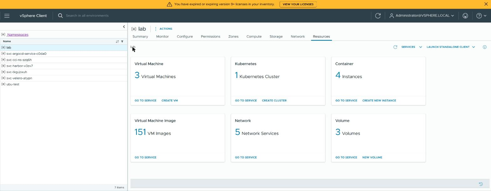
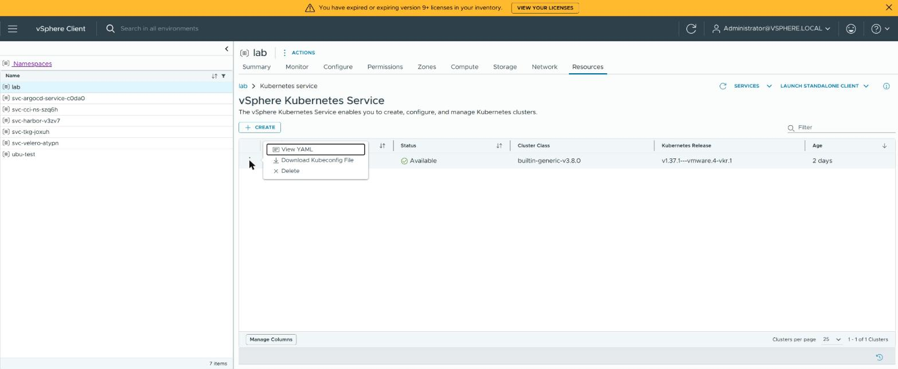
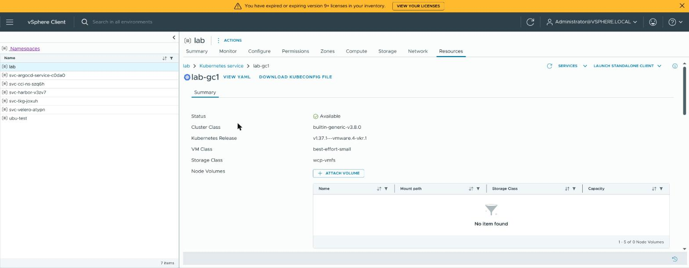

# Log in to the Supervisor and a VKS cluster

> [!NOTE]
> **Official Broadcom documentation (VCF 9.1) and Kubernetes documentation for this guide**
>
> - [Connect to the Supervisor as a vCenter Single Sign-On User](https://techdocs.broadcom.com/us/en/vmware-cis/vcf/vcf-9-0-and-later/9-1/vsphere-supervisor-installation-and-configuration/connecting-to-vsphere-with-tanzu-clusters/connect-to-the-supervisor-cluster-as-a-vcenter-single-sign-on-user.html)
> - [Configure Secure Login for vSphere Supervisor](https://techdocs.broadcom.com/us/en/vmware-cis/vcf/vcf-9-0-and-later/9-1/vsphere-supervisor-installation-and-configuration/connecting-to-vsphere-with-tanzu-clusters/configure-secure-login-for-vsphere-with-kubernetes-clusters.html) (the vCenter CA)
> - [Download and install vCenter Server root certificates to avoid web browser certificate warnings](https://knowledge.broadcom.com/external/article/330833/download-and-install-vcenter-server-root.html) (Broadcom KB 330833)
> - [Configure vSphere Namespace Permissions for vCenter Single Sign-On Users and Groups](https://techdocs.broadcom.com/us/en/vmware-cis/vcf/vcf-service-administration-and-development/9-1/managing-vsphere-kubernetes-service/configuring-vsphere-namespaces-for-hosting-tkg-service-clusters/configure-vsphere-namespace-persmissions-for-vcenter-sso-users-and-groups.html)
> - [Connect to the VKS Cluster Control Plane as a Kubernetes Administrator](https://techdocs.broadcom.com/us/en/vmware-cis/vcf/vcf-consumption/latest/managing-vsphere-kuberenetes-service-clusters-and-workloads/configuring-identity-and-access-for-tkg-service-clusters/connect-to-the-tkg-service-cluster-control-plane-as-a-kubernetes-administrator.html)
> - [VCF CLI command reference: context](https://techdocs.broadcom.com/us/en/vmware-cis/vcf/vcf-consumption/latest/consumer-interfaces-in-vcf/installing-and-using-vcf-cli-v9/command-reference2/system-commands%281%29/context2.html) (create, refresh, delete)
> - Kubernetes: [Version Skew Policy](https://kubernetes.io/releases/version-skew-policy/)

You log in to the Supervisor with the VCF CLI and your vCenter SSO user, then read your VKS
cluster's kubeconfig from it.

Run the sections in order, in one terminal, doing **one** of
[Create Supervisor context with CA](#create-supervisor-context-with-ca) or
[Create Supervisor context without CA](#create-supervisor-context-without-ca). After that, you
need only [Renew the Supervisor login](#renew-the-supervisor-login) when the login ends, and
[Log out](#log-out) when you are done.

## Prerequisites

- [kubectl](KUBECTL.md), the [VCF CLI](VCF.md), and [curl, unzip, openssl and jq](PREREQS.md);
- the Supervisor's IP address or DNS name, and vCenter's DNS name
  ([NAMESPACE.md](NAMESPACE.md#1-find-the-supervisors-address-and-vcenters-ca), step 1);
- an SSO user with a role on your vSphere Namespace (for example `administrator@vsphere.local`),
  and its password (a login through a web page, Okta or Entra ID is not covered); to read a VKS
  cluster's kubeconfig, the **Edit** role;
- the vSphere Namespace's name and, once you see it in
  [Check your vSphere Namespace](#check-your-vsphere-namespace), the VKS cluster's name.

The connections this guide needs, for a firewall (all TCP, besides DNS):

| from | to | port | for |
|---|---|---|---|
| your machine | vCenter | 443 | the vCenter CA ([Create Supervisor context with CA](#create-supervisor-context-with-ca), step 1) |
| your machine | the Supervisor's address | 443 | the VCF CLI and kubectl to the Supervisor (create the context, check the namespace, get the kubeconfig, renew) |
| your machine | the VKS cluster's API address (in its kubeconfig) | 6443 | kubectl to the VKS cluster |
| your browser | vCenter (the vSphere Client) | 443 | [Download the VKS cluster's kubeconfig from the vSphere Client](#download-the-vks-clusters-kubeconfig-from-the-vsphere-client) |
| the person's machine | the Supervisor's address | 443 | [The person's own SSO account](#the-persons-own-sso-account): the plugin and its login |
| the person's machine | the VKS cluster's API address | 6443 | the person's kubeconfig ([Give a person or team a kubeconfig](#give-a-person-or-team-a-kubeconfig-without-the-vcf-cli-optional)) |

## Create Supervisor context with CA

The login checks that it talks to your real Supervisor, using vCenter's CA.

<details>
<summary><b>Steps</b></summary>

**1. Get the vCenter CA**

The Supervisor proves who it is with a certificate, by default signed by vCenter's own CA
(certificate authority), which this machine does not know yet. This downloads vCenter's CAs, so
that the login can check that it talks to your real Supervisor. It saves them as
`vcenter-ca.pem.new` and prints each CA's fingerprint, a short code that identifies it. Nothing
checks the download itself: keep the file (next block) only when the fingerprints match the ones
your vCenter administrator gives you. Set `VCENTER_FQDN` to vCenter's DNS name.

<details>
<summary><b>Linux (Ubuntu, AlmaLinux, Photon OS), macOS, WSL (bash or zsh)</b></summary>

```sh
VCENTER_FQDN="vcsa.example.test"
CA_FILE="$HOME/.kube/vcenter-ca.pem"

TMP="$(mktemp -d)"
if ! curl -fsSk --connect-timeout 20 --speed-time 60 -o "$TMP/certs.zip" "https://${VCENTER_FQDN}/certs/download.zip"; then
  echo "FAILED: download from https://${VCENTER_FQDN}"
elif ! unzip -oqj "$TMP/certs.zip" 'certs/lin/*' -d "$TMP/certs" || [ -z "$(find "$TMP/certs" -name '*.0')" ]; then
  echo "FAILED: no CA certificate in the download from https://${VCENTER_FQDN}"
else
  mkdir -p "$(dirname "$CA_FILE")"
  find "$TMP/certs" -name '*.0' -exec cat {} + > "$CA_FILE.new"
  find "$TMP/certs" -name '*.0' -exec openssl x509 -in {} -noout -subject -fingerprint -sha256 \;
  echo "saved as $CA_FILE.new"
fi
rm -rf "$TMP"
```

</details>

<details>
<summary><b>Windows (PowerShell)</b></summary>

```powershell
$VCENTER_FQDN = "vcsa.example.test"      # vCenter DNS name
$CA_FILE = "$HOME\.kube\vcenter-ca.pem"

$global:LASTEXITCODE = $null
$TMP = Join-Path $env:TEMP ([guid]::NewGuid()); New-Item -ItemType Directory -Path $TMP | Out-Null
curl.exe -fsSk --connect-timeout 20 --speed-time 60 -o "$TMP\certs.zip" "https://$VCENTER_FQDN/certs/download.zip"
if ($LASTEXITCODE -ne 0) {
  "FAILED: download from https://$VCENTER_FQDN"
} else {
  Expand-Archive -Force -Path "$TMP\certs.zip" -DestinationPath "$TMP\certs" -ErrorAction SilentlyContinue
  $CERTS = Get-ChildItem -Path "$TMP\certs\certs\lin" -Filter '*.0' -ErrorAction SilentlyContinue
  if (-not $CERTS) {
    "FAILED: no CA certificate in the download from https://$VCENTER_FQDN"
  } else {
    New-Item -ItemType Directory -Force -Path (Split-Path $CA_FILE) | Out-Null
    $CERTS | Get-Content | Set-Content -Encoding ascii -Path "$CA_FILE.new"
    foreach ($C in $CERTS) {
      $X = New-Object System.Security.Cryptography.X509Certificates.X509Certificate2 $C.FullName
      $H = [BitConverter]::ToString([Security.Cryptography.SHA256]::Create().ComputeHash($X.RawData))
      "subject=$($X.Subject)"
      "sha256 Fingerprint=$($H.Replace('-', ':'))"
    }
    "saved as $CA_FILE.new"
  }
}
Remove-Item -Recurse -Force $TMP
```

</details>

**Expect:** for each CA, a `subject=` line (vCenter's own contains `CN=CA` and `DC=vsphere`) and a
`sha256 Fingerprint=…` line (`SHA256 Fingerprint=` on macOS), then `saved as …`. Every CA listed
will be trusted for the login, so each fingerprint must match one from your administrator,
ignoring colons and upper/lower case.

**If not:**
- `FAILED: download …`: `VCENTER_FQDN` is wrong, or this machine cannot reach vCenter. The
  `curl:` line above it says which.
- `FAILED: no CA certificate …`: the address answered, but it is not vCenter. Check
  `VCENTER_FQDN`.
- A fingerprint that matches none of your administrator's: do not keep the file. Check
  `VCENTER_FQDN`. A company proxy that replaces HTTPS certificates also causes this.

When every fingerprint matches, keep the file:

**Linux (Ubuntu, AlmaLinux, Photon OS), macOS, WSL (bash or zsh):**

```sh
CA_FILE="$HOME/.kube/vcenter-ca.pem"

mv "$CA_FILE.new" "$CA_FILE" && echo "kept $CA_FILE"
```

**Windows (PowerShell):**

```powershell
$CA_FILE = "$HOME\.kube\vcenter-ca.pem"

Move-Item -Force "$CA_FILE.new" $CA_FILE; if ($?) { "kept $CA_FILE" }
```

**Expect:** `kept …`.

**2. Type your SSO password**

The login reads the password from this terminal, so it is never on a command line or in your
shell history. Paste this line on its own, then type the password; nothing is shown as you type
(PowerShell shows `*`).

**Linux (Ubuntu, AlmaLinux, Photon OS), macOS, WSL (bash or zsh):**

```sh
printf 'SSO password: '; IFS= read -rs SSO_PASSWORD; echo
```

**Windows (PowerShell):**

```powershell
$SSO_PASSWORD = Read-Host 'SSO password' -AsSecureString
```

**Expect:** a new prompt. The password stays in this terminal until you close it or run
[Log out](#log-out); in a new terminal, run this line again.

<a id="create-the-context"></a>**3. Create the context**

This logs you in to the Supervisor with the VCF CLI, as your SSO user with the password from step
2, and checks the Supervisor's certificate against `SUPERVISOR_CA` (step 1's vCenter CA, or
`supervisor.crt` from the Alternative below). The login is saved in
`~/.kube/supervisor.kubeconfig`, a kubeconfig of its own (the file kubectl reads to find a cluster
and log in to it), as the context `supervisor`. Your other kubeconfigs are not
changed. **A few failed logins in a row lock the SSO user for some minutes**, so type the password
carefully. Set `SUPERVISOR_ENDPOINT` to the Supervisor's IP address or DNS name.

<details>
<summary><b>Linux (Ubuntu, AlmaLinux, Photon OS), macOS, WSL (bash or zsh)</b></summary>

```sh
SUPERVISOR_ENDPOINT="10.0.0.10"
SSO_USERNAME="administrator@vsphere.local"
SUPERVISOR_CA="$HOME/.kube/vcenter-ca.pem"
SUPERVISOR_KUBECONFIG="$HOME/.kube/supervisor.kubeconfig"

if [ -z "$SSO_PASSWORD" ]; then
  echo "FAILED: no password in this terminal; run the line under Type your SSO password"
elif [ ! -s "$SUPERVISOR_CA" ]; then
  echo "FAILED: not found: $SUPERVISOR_CA"
elif mkdir -p "$(dirname "$SUPERVISOR_KUBECONFIG")" \
     && KUBECONFIG="$SUPERVISOR_KUBECONFIG" VCF_CLI_VSPHERE_PASSWORD="$SSO_PASSWORD" \
        vcf context create supervisor --type k8s --endpoint "https://${SUPERVISOR_ENDPOINT}" \
          --username "$SSO_USERNAME" --auth-type basic --ca-certificate="$SUPERVISOR_CA"; then
  kubectl --kubeconfig "$SUPERVISOR_KUBECONFIG" config use-context supervisor
else
  echo "FAILED: login (see the vcf error above)"
fi
```

</details>

<details>
<summary><b>Windows (PowerShell)</b></summary>

```powershell
$SUPERVISOR_ENDPOINT = "10.0.0.10"                    # Supervisor IP or FQDN
$SSO_USERNAME = "administrator@vsphere.local"
$SUPERVISOR_CA = "$HOME\.kube\vcenter-ca.pem"
$SUPERVISOR_KUBECONFIG = "$HOME\.kube\supervisor.kubeconfig"

$global:LASTEXITCODE = $null
if (-not $SSO_PASSWORD) {
  "FAILED: no password in this terminal; run the line under Type your SSO password"
} elseif (-not (Test-Path $SUPERVISOR_CA)) {
  "FAILED: not found: $SUPERVISOR_CA"
} else {
  New-Item -ItemType Directory -Force -Path (Split-Path $SUPERVISOR_KUBECONFIG) | Out-Null
  $OLD_KUBECONFIG = $env:KUBECONFIG; $env:KUBECONFIG = $SUPERVISOR_KUBECONFIG
  $env:VCF_CLI_VSPHERE_PASSWORD = [Net.NetworkCredential]::new('', $SSO_PASSWORD).Password
  vcf context create supervisor --type k8s --endpoint "https://$SUPERVISOR_ENDPOINT" `
    --username $SSO_USERNAME --auth-type basic "--ca-certificate=$SUPERVISOR_CA"
  $RC = $LASTEXITCODE
  Remove-Item Env:VCF_CLI_VSPHERE_PASSWORD; $env:KUBECONFIG = $OLD_KUBECONFIG
  if ($RC -eq 0) {
    kubectl --kubeconfig $SUPERVISOR_KUBECONFIG config use-context supervisor
  } else {
    "FAILED: login (see the vcf error above)"
  }
}
```

</details>

**Expect:** `Logged in successfully`, a list of contexts, then
`Switched to context "supervisor"`. The login lasts about 10 hours. The first login after
[Log out](#log-out) prints `Initialization done!` lines first.

**If not:**
- `FAILED: no password in this terminal`: run step 2, then this block again.
- `FAILED: not found: …`: run step 1, including its `mv` block.
- `context "supervisor" already exists`: run [Log out](#log-out), then the password line and this
  block again.
- A connection error: check `SUPERVISOR_ENDPOINT`.
- `x509: certificate is valid for …, not …`: the certificate is not issued for the address in
  `SUPERVISOR_ENDPOINT`. Use the Supervisor's DNS name or IP address as the message lists it.
- `x509: cannot validate certificate for <IP> because it doesn't contain any IP SANs`: the
  certificate lists only DNS names. Set `SUPERVISOR_ENDPOINT` to the Supervisor's DNS name.
- `x509: certificate signed by unknown authority`: that CA did not issue the Supervisor's
  certificate. Check `VCENTER_FQDN` in step 1. If it is right, your administrator replaced the
  Supervisor's certificate: ask them for its CA and set `SUPERVISOR_CA` to that file.
- A login error: check `SSO_USERNAME`, and run the password line again. Mind the lock-out.
- `Failed to install plugin 'telemetry:…'` before the output: harmless; the command still runs.

</details>

## Create Supervisor context without CA

Use this only when you cannot get the CA. The login does not check the Supervisor's certificate:
someone between you and the Supervisor could capture your password, and `vcf` keeps skipping the
check for this login.

<details>
<summary><b>Steps</b></summary>

**1. Type your SSO password**

The login reads the password from this terminal, so it is never on a command line or in your
shell history. Paste this line on its own, then type the password; nothing is shown as you type
(PowerShell shows `*`).

**Linux (Ubuntu, AlmaLinux, Photon OS), macOS, WSL (bash or zsh):**

```sh
printf 'SSO password: '; IFS= read -rs SSO_PASSWORD; echo
```

**Windows (PowerShell):**

```powershell
$SSO_PASSWORD = Read-Host 'SSO password' -AsSecureString
```

**Expect:** a new prompt. The password stays in this terminal until you close it or run
[Log out](#log-out); in a new terminal, run this line again.

**2. Create the context**

This logs you in to the Supervisor with the VCF CLI, as your SSO user with the password from step
1, without checking the Supervisor's certificate. The login is saved in
`~/.kube/supervisor.kubeconfig`, a kubeconfig of its own (the file kubectl reads to find a cluster
and log in to it), as the context `supervisor`. Your other kubeconfigs are not changed. **A few
failed logins in a row lock the SSO user for some minutes**, so type the password carefully. Set
`SUPERVISOR_ENDPOINT` to the Supervisor's IP address or DNS name.

<details>
<summary><b>Linux (Ubuntu, AlmaLinux, Photon OS), macOS, WSL (bash or zsh)</b></summary>

```sh
SUPERVISOR_ENDPOINT="10.0.0.10"
SSO_USERNAME="administrator@vsphere.local"
SUPERVISOR_KUBECONFIG="$HOME/.kube/supervisor.kubeconfig"

if [ -z "$SSO_PASSWORD" ]; then
  echo "FAILED: no password in this terminal; run the line under Type your SSO password"
elif mkdir -p "$(dirname "$SUPERVISOR_KUBECONFIG")" \
     && KUBECONFIG="$SUPERVISOR_KUBECONFIG" VCF_CLI_VSPHERE_PASSWORD="$SSO_PASSWORD" \
        vcf context create supervisor --type k8s --endpoint "https://${SUPERVISOR_ENDPOINT}" \
          --username "$SSO_USERNAME" --auth-type basic --insecure-skip-tls-verify; then
  kubectl --kubeconfig "$SUPERVISOR_KUBECONFIG" config use-context supervisor
else
  echo "FAILED: login (see the vcf error above)"
fi
```

</details>

<details>
<summary><b>Windows (PowerShell)</b></summary>

```powershell
$SUPERVISOR_ENDPOINT = "10.0.0.10"                    # Supervisor IP or FQDN
$SSO_USERNAME = "administrator@vsphere.local"
$SUPERVISOR_KUBECONFIG = "$HOME\.kube\supervisor.kubeconfig"

$global:LASTEXITCODE = $null
if (-not $SSO_PASSWORD) {
  "FAILED: no password in this terminal; run the line under Type your SSO password"
} else {
  New-Item -ItemType Directory -Force -Path (Split-Path $SUPERVISOR_KUBECONFIG) | Out-Null
  $OLD_KUBECONFIG = $env:KUBECONFIG; $env:KUBECONFIG = $SUPERVISOR_KUBECONFIG
  $env:VCF_CLI_VSPHERE_PASSWORD = [Net.NetworkCredential]::new('', $SSO_PASSWORD).Password
  vcf context create supervisor --type k8s --endpoint "https://$SUPERVISOR_ENDPOINT" `
    --username $SSO_USERNAME --auth-type basic --insecure-skip-tls-verify
  $RC = $LASTEXITCODE
  Remove-Item Env:VCF_CLI_VSPHERE_PASSWORD; $env:KUBECONFIG = $OLD_KUBECONFIG
  if ($RC -eq 0) {
    kubectl --kubeconfig $SUPERVISOR_KUBECONFIG config use-context supervisor
  } else {
    "FAILED: login (see the vcf error above)"
  }
}
```

</details>

**Expect:** `Logged in successfully`, a list of contexts, then
`Switched to context "supervisor"`. The login lasts about 10 hours. The first login after
[Log out](#log-out) prints `Initialization done!` lines first.

**If not:**
- `FAILED: no password in this terminal`: run step 1, then this block again.
- `context "supervisor" already exists`: run [Log out](#log-out), then the password line and this
  block again.
- A connection error: check `SUPERVISOR_ENDPOINT`.
- A login error: check `SSO_USERNAME`, and run the password line again. Mind the lock-out.
- `Failed to install plugin 'telemetry:…'` before the output: harmless; the command still runs.

</details>

### Alternative: trust the Supervisor's own certificate

Later logins are checked against the Supervisor's certificate, fetched once. Its limits:
- The fetch itself is not checked: compare the printed fingerprint with one from your vCenter
  administrator, or it is no safer than logging in without a check.
- It stops working when the Supervisor's certificate is renewed: fetch it again.

<details>
<summary><b>Steps</b></summary>

**1. Type your SSO password** (step 1 above).

**2. Fetch the certificate**

This downloads the Supervisor's own certificate, saves it as `~/.kube/supervisor.crt` and prints
its fingerprint. Compare the fingerprint with your vCenter administrator's before you log in with
it. Set `SUPERVISOR_ENDPOINT` to the Supervisor's IP address or DNS name.

<details>
<summary><b>Linux (Ubuntu, AlmaLinux, Photon OS), macOS, WSL (bash or zsh)</b></summary>

```sh
SUPERVISOR_ENDPOINT="10.0.0.10"
SUPERVISOR_CERT="$HOME/.kube/supervisor.crt"

mkdir -p "$(dirname "$SUPERVISOR_CERT")"
openssl s_client -connect "${SUPERVISOR_ENDPOINT}:443" </dev/null 2>/dev/null \
  | openssl x509 -outform PEM > "$SUPERVISOR_CERT" \
  && openssl x509 -in "$SUPERVISOR_CERT" -noout -subject -fingerprint -sha256 \
  || { rm -f "$SUPERVISOR_CERT"; echo "FAILED: no certificate from ${SUPERVISOR_ENDPOINT}:443"; }
```

</details>

<details>
<summary><b>Windows (PowerShell)</b></summary>

```powershell
$SUPERVISOR_ENDPOINT = "10.0.0.10"                    # Supervisor IP or FQDN
$SUPERVISOR_CERT = "$HOME\.kube\supervisor.crt"

try {
  $TCP = New-Object Net.Sockets.TcpClient($SUPERVISOR_ENDPOINT, 443)
  $SSL = New-Object Net.Security.SslStream($TCP.GetStream(), $false, ([Net.Security.RemoteCertificateValidationCallback] { $true }))
  $SSL.AuthenticateAsClient($SUPERVISOR_ENDPOINT, $null, [Security.Authentication.SslProtocols]::Tls12, $false)
  $X = New-Object System.Security.Cryptography.X509Certificates.X509Certificate2 $SSL.RemoteCertificate
  $TCP.Close()
  New-Item -ItemType Directory -Force -Path (Split-Path $SUPERVISOR_CERT) | Out-Null
  $B64 = [Convert]::ToBase64String($X.RawData, 'InsertLineBreaks')
  Set-Content -Encoding ascii -Path $SUPERVISOR_CERT -Value "-----BEGIN CERTIFICATE-----`r`n$B64`r`n-----END CERTIFICATE-----"
  $H = [BitConverter]::ToString([Security.Cryptography.SHA256]::Create().ComputeHash($X.RawData))
  "subject=$($X.Subject)"
  "sha256 Fingerprint=$($H.Replace('-', ':'))"
} catch {
  "FAILED: no certificate from ${SUPERVISOR_ENDPOINT}:443"
}
```

</details>

**Expect:** a `subject=` line and a `sha256 Fingerprint=…` line (`SHA256 Fingerprint=` on macOS)
that matches the one from your administrator, ignoring colons and upper/lower case.

**If not:**
- `FAILED: no certificate …`: check `SUPERVISOR_ENDPOINT`, or this machine cannot reach the
  Supervisor.
- A fingerprint that does not match: delete the file and do not log in with it.

**3. Create the context:** run
[step 3, *Create the context*, of Create Supervisor context with CA](#create-the-context) with
`SUPERVISOR_CA="$HOME/.kube/supervisor.crt"` (PowerShell: `"$HOME\.kube\supervisor.crt"`).
`x509: certificate is valid for …, not …` there means the certificate does not list the address
in `SUPERVISOR_ENDPOINT`: use the DNS name or IP address the message lists.
`x509: cannot validate certificate for <IP> because it doesn't contain any IP SANs` means it lists
only DNS names: use the Supervisor's DNS name.
`x509: certificate signed by unknown authority` means the Supervisor's certificate changed since
you fetched it: fetch it again (step 2 above).

</details>

## Check your vSphere Namespace

This checks that your SSO user can see your vSphere Namespace, and lists the VKS clusters in
it.

**Linux (Ubuntu, AlmaLinux, Photon OS), macOS, WSL (bash or zsh):**

```sh
VKS_NAMESPACE="my-namespace"
SUPERVISOR_KUBECONFIG="$HOME/.kube/supervisor.kubeconfig"

kubectl --kubeconfig "$SUPERVISOR_KUBECONFIG" get namespace "$VKS_NAMESPACE" \
  && kubectl --kubeconfig "$SUPERVISOR_KUBECONFIG" -n "$VKS_NAMESPACE" get clusters.cluster.x-k8s.io
```

**Windows (PowerShell):**

```powershell
$VKS_NAMESPACE = "my-namespace"
$SUPERVISOR_KUBECONFIG = "$HOME\.kube\supervisor.kubeconfig"

$global:LASTEXITCODE = $null
kubectl --kubeconfig $SUPERVISOR_KUBECONFIG get namespace $VKS_NAMESPACE
if ($LASTEXITCODE -eq 0) { kubectl --kubeconfig $SUPERVISOR_KUBECONFIG -n $VKS_NAMESPACE get clusters.cluster.x-k8s.io }
```

**Expect:** your namespace, `Active`, then a table whose `NAME` column holds your VKS cluster.

**If not:**
- `… supervisor.kubeconfig: no such file or directory`: you are not logged in. Create the
  Supervisor context first.
- `NotFound`: check `VKS_NAMESPACE`, or [create the namespace](NAMESPACE.md).
- `Forbidden`: check `VKS_NAMESPACE` (a user who is not a vCenter administrator gets `Forbidden`
  for a name that does not exist). Otherwise your SSO user has no role on this namespace, or got
  it after you logged in. Ask a vCenter administrator for the role, then [Log out](#log-out) and
  log in again.
- `Unauthorized`: the login has ended. Run
  [Renew the Supervisor login](#renew-the-supervisor-login).
- `No resources found`: the namespace has no VKS cluster yet: [create one](CLUSTER.md).

## Get the VKS cluster's kubeconfig

kubectl needs a kubeconfig, a file with the cluster's address and a login, to work with your VKS
cluster. This reads that file from the Supervisor, saves it as `~/.kube/<cluster>.kubeconfig`
(on Linux, macOS and WSL, readable only by you), then lists the cluster's nodes to show it works.
It is the cluster's shared administrator login: anyone with the file controls the cluster, and it
keeps working after your Supervisor login ends, for up to a year, and cannot be withdrawn.
Keep it private
([why it is a kubeconfig of its own](VCF.md#why-the-supervisor-and-each-vks-cluster-have-their-own-kubeconfig)).
Set `VKS_CLUSTER` to a name from the `NAME` column above.

<details>
<summary><b>Linux (Ubuntu, AlmaLinux, Photon OS), macOS, WSL (bash or zsh)</b></summary>

```sh
VKS_NAMESPACE="my-namespace"
VKS_CLUSTER="my-vks-cluster"
SUPERVISOR_KUBECONFIG="$HOME/.kube/supervisor.kubeconfig"
VKS_KUBECONFIG="$HOME/.kube/${VKS_CLUSTER}.kubeconfig"

rm -f "$VKS_KUBECONFIG.new"
if ( umask 077
     kubectl --kubeconfig "$SUPERVISOR_KUBECONFIG" -n "$VKS_NAMESPACE" get secret "${VKS_CLUSTER}-kubeconfig" \
       -o go-template='{{.data.value | base64decode}}' > "$VKS_KUBECONFIG.new" ) \
   && kubectl --kubeconfig "$VKS_KUBECONFIG.new" config view >/dev/null 2>&1; then
  mv "$VKS_KUBECONFIG.new" "$VKS_KUBECONFIG"
  kubectl --kubeconfig "$VKS_KUBECONFIG" get nodes
else
  rm -f "$VKS_KUBECONFIG.new"
  echo "FAILED: no kubeconfig read (see the kubectl error above); $VKS_KUBECONFIG is as it was"
fi
```

</details>

<details>
<summary><b>Windows (PowerShell)</b></summary>

```powershell
$VKS_NAMESPACE = "my-namespace"
$VKS_CLUSTER = "my-vks-cluster"                     # from the NAME column above
$SUPERVISOR_KUBECONFIG = "$HOME\.kube\supervisor.kubeconfig"
$VKS_KUBECONFIG = "$HOME\.kube\${VKS_CLUSTER}.kubeconfig"

$global:LASTEXITCODE = $null
$KC = kubectl --kubeconfig $SUPERVISOR_KUBECONFIG -n $VKS_NAMESPACE get secret "${VKS_CLUSTER}-kubeconfig" `
  -o go-template='{{.data.value | base64decode}}'
if ($LASTEXITCODE -eq 0 -and $KC) {
  Set-Content -Encoding ascii -Path "$VKS_KUBECONFIG.new" -Value $KC
  kubectl --kubeconfig "$VKS_KUBECONFIG.new" config view *> $null
}
if ($LASTEXITCODE -eq 0 -and $KC) {
  Move-Item -Force "$VKS_KUBECONFIG.new" $VKS_KUBECONFIG
  kubectl --kubeconfig $VKS_KUBECONFIG get nodes
} else {
  Remove-Item -Force -ErrorAction SilentlyContinue "$VKS_KUBECONFIG.new"
  "FAILED: no kubeconfig read (see the kubectl error above); $VKS_KUBECONFIG is as it was"
}
```

</details>

**Expect:** the cluster's nodes, each `Ready`.

**If not:**
- `FAILED: no kubeconfig read`, under `secrets "<name>-kubeconfig" not found`: check
  `VKS_CLUSTER`, or the cluster is still being created.
- … under `Forbidden`: your role on the namespace cannot read the kubeconfig; ask for the
  **Edit** role, then [Log out](#log-out) and log in again.
- … under `Unauthorized`: run [Renew the Supervisor login](#renew-the-supervisor-login).
- A node `NotReady`: the cluster is still starting, or a node has a problem; ask its
  administrator.

## Download the VKS cluster's kubeconfig from the vSphere Client

The vSphere Client gives the same file as
[Get the VKS cluster's kubeconfig](#get-the-vks-clusters-kubeconfig), byte for byte, without the
VCF CLI or a Supervisor login on this machine; you need only kubectl afterwards. What the file is:

- **The cluster's administrator login.** Whoever has the file is an administrator of the whole
  cluster; it is not limited to a vSphere Namespace or to one person.
- **It cannot be withdrawn from one holder.** Only replacing the cluster's certificate authority
  ends it, and that ends every copy at once.
- **It stops working about a year after the cluster made it.** Every copy stops on that date,
  wherever it was given; download it again then.
- **It does not depend on an SSO login.** It keeps working after any vCenter login ends.

1. In the vSphere Client, from the menu (☰) choose **Supervisor Management**, the **Namespaces**
   tab, and your namespace. Open its **Resources** tab and, on the **Kubernetes** card, click
   **GO TO SERVICE**.

   

2. Click **⋮** at the start of your cluster's row, then **Download Kubeconfig File**.

   

   Or click the cluster's name and, on its page, **DOWNLOAD KUBECONFIG FILE**: the same file.

   

The browser saves it as `<cluster>-kubeconfig.yaml` in your downloads folder, readable by other
users of this machine. This moves it to `~/.kube/<cluster>.kubeconfig`, readable only by you,
then lists the cluster's nodes to show it works. Set `DOWNLOADED` to where the browser saved it;
on WSL, a browser on Windows saves it under `/mnt/c/Users/<you>/Downloads`.

**Linux (Ubuntu, AlmaLinux, Photon OS), macOS, WSL (bash or zsh):**

```sh
VKS_CLUSTER="my-vks-cluster"
DOWNLOADED="$HOME/Downloads/${VKS_CLUSTER}-kubeconfig.yaml"
VKS_KUBECONFIG="$HOME/.kube/${VKS_CLUSTER}.kubeconfig"

mkdir -p "$HOME/.kube"
if [ -f "$DOWNLOADED" ] && kubectl --kubeconfig "$DOWNLOADED" config view >/dev/null 2>&1; then
  install -m 600 "$DOWNLOADED" "$VKS_KUBECONFIG" && rm -f "$DOWNLOADED"
  kubectl --kubeconfig "$VKS_KUBECONFIG" get nodes
else
  echo "FAILED: no kubeconfig at $DOWNLOADED"
fi
```

**Windows (PowerShell):**

```powershell
$VKS_CLUSTER = "my-vks-cluster"
$DOWNLOADED = "$HOME\Downloads\${VKS_CLUSTER}-kubeconfig.yaml"
$VKS_KUBECONFIG = "$HOME\.kube\${VKS_CLUSTER}.kubeconfig"

New-Item -ItemType Directory -Force "$HOME\.kube" | Out-Null
$global:LASTEXITCODE = $null
if (Test-Path $DOWNLOADED) { kubectl --kubeconfig $DOWNLOADED config view *> $null }
if ((Test-Path $DOWNLOADED) -and $LASTEXITCODE -eq 0) {
  Move-Item -Force $DOWNLOADED $VKS_KUBECONFIG
  kubectl --kubeconfig $VKS_KUBECONFIG get nodes
} else {
  "FAILED: no kubeconfig at $DOWNLOADED"
}
```

**Expect:** the cluster's nodes, each `Ready`.

**If not:**
- `FAILED: no kubeconfig at …`: set `DOWNLOADED` to the file the browser saved (a second
  download of the same name may be saved as `<cluster>-kubeconfig (1).yaml`).
- `error: You must be logged in to the server (Unauthorized)`: the file has expired; download it
  again.

## Give a person or team a kubeconfig without the VCF CLI (optional)

As the cluster's administrator (with the file from
[Get the VKS cluster's kubeconfig](#get-the-vks-clusters-kubeconfig)), you can give someone access
to one namespace of the VKS cluster that needs only kubectl on their machine. Three ways:

| way | for | lasts | to take it away |
|---|---|---|---|
| [A ServiceAccount token](#a-serviceaccount-token) | a team or a person | the days you set | delete the ServiceAccount: every copy stops |
| [A personal certificate](#a-personal-certificate) | one person | the days you set | it cannot be withdrawn: delete its RoleBinding and never bind its name again |
| [The person's own SSO account](#the-persons-own-sso-account) | one SSO user | 10 hours per login | delete the person's RoleBinding, and disable the SSO user |

Whoever has the file from the first two has that access. Give it through a password manager's
share or as an encrypted file, never by email, chat or a shared folder, then delete your copy.
The person saves it as `~/.kube/<name>.kubeconfig` (PowerShell: `$HOME\.kube\<name>.kubeconfig`),
readable only by them, and uses it with `kubectl --kubeconfig ~/.kube/<name>.kubeconfig`.

### A ServiceAccount token

This makes the namespace `TEAM_NAMESPACE`, a ServiceAccount for the team in a separate namespace
`ACCESS_NAMESPACE` (so the team cannot make tokens for it), the role `ROLE` for it in
`TEAM_NAMESPACE` (`edit` to deploy, `view` to read only), and a token valid for `DAYS` days. It
writes the kubeconfig to `TEAM_KUBECONFIG`, readable only by you, then shows when the token ends
and what it may do. Run it again for a new file before the token ends.

<details>
<summary><b>Linux (Ubuntu, AlmaLinux, Photon OS), macOS, WSL (bash or zsh)</b></summary>

```sh
ADMIN_KUBECONFIG="$HOME/.kube/my-vks-cluster.kubeconfig"
TEAM="team-a"
TEAM_NAMESPACE="team-a"
ACCESS_NAMESPACE="kubeconfig-access"
ROLE="edit"
DAYS="30"
TEAM_KUBECONFIG="$HOME/${TEAM}.kubeconfig"

adm() { kubectl --kubeconfig "$ADMIN_KUBECONFIG" "$@"; }
for NS in "$ACCESS_NAMESPACE" "$TEAM_NAMESPACE"; do
  adm create namespace "$NS" --dry-run=client -o yaml | adm apply -f - >/dev/null
done
adm -n "$ACCESS_NAMESPACE" create serviceaccount "$TEAM" --dry-run=client -o yaml | adm apply -f - >/dev/null
adm -n "$TEAM_NAMESPACE" create rolebinding "${TEAM}-${ROLE}" --clusterrole="$ROLE" \
  --serviceaccount="${ACCESS_NAMESPACE}:${TEAM}" --dry-run=client -o yaml | adm apply -f - >/dev/null
TOKEN="$(adm -n "$ACCESS_NAMESPACE" create token "$TEAM" --duration="$((DAYS * 24))h")"
SERVER="$(adm config view --minify -o jsonpath='{.clusters[0].cluster.server}')"
CA="$(adm config view --minify --raw -o jsonpath='{.clusters[0].cluster.certificate-authority-data}')"
if [ -n "$TOKEN" ] && [ -n "$SERVER" ] && [ -n "$CA" ]; then
  rm -f "$TEAM_KUBECONFIG"
  ( umask 077
    printf 'apiVersion: v1\nkind: Config\nclusters:\n- name: %s\n  cluster:\n    server: %s\n    certificate-authority-data: %s\nusers:\n- name: %s\n  user:\n    token: %s\ncontexts:\n- name: %s\n  context:\n    cluster: %s\n    user: %s\n    namespace: %s\ncurrent-context: %s\n' \
      "$TEAM" "$SERVER" "$CA" "$TEAM" "$TOKEN" "$TEAM" "$TEAM" "$TEAM" "$TEAM_NAMESPACE" "$TEAM" > "$TEAM_KUBECONFIG" )
  P="$(printf '%s' "$TOKEN" | cut -d. -f2 | tr '_-' '/+')"
  while [ $(( ${#P} % 4 )) -ne 0 ]; do P="$P="; done
  EXP="$(printf '%s' "$P" | base64 -d 2>/dev/null | sed -n 's/.*"exp":\([0-9]*\).*/\1/p')"
  if [ -n "$EXP" ]; then echo "token ends in: $(( (EXP - $(date +%s)) / 86400 )) days"; else echo "token ends in: unknown"; fi
  echo "create deployments in $TEAM_NAMESPACE: $(kubectl --kubeconfig "$TEAM_KUBECONFIG" auth can-i create deployments)"
  echo "list pods in kube-system: $(kubectl --kubeconfig "$TEAM_KUBECONFIG" auth can-i list pods -n kube-system)"
else
  echo "FAILED: no token, server or CA read (see the kubectl errors above)"
fi
unset TOKEN
```

</details>

<details>
<summary><b>Windows (PowerShell)</b></summary>

```powershell
$ADMIN_KUBECONFIG = "$HOME\.kube\my-vks-cluster.kubeconfig"
$TEAM = "team-a"
$TEAM_NAMESPACE = "team-a"
$ACCESS_NAMESPACE = "kubeconfig-access"
$ROLE = "edit"
$DAYS = 30
$TEAM_KUBECONFIG = "$HOME\${TEAM}.kubeconfig"

function adm { $input | kubectl --kubeconfig $ADMIN_KUBECONFIG @args }
foreach ($NS in $ACCESS_NAMESPACE, $TEAM_NAMESPACE) { adm create namespace $NS --dry-run=client -o yaml | adm apply -f - | Out-Null }
adm -n $ACCESS_NAMESPACE create serviceaccount $TEAM --dry-run=client -o yaml | adm apply -f - | Out-Null
adm -n $TEAM_NAMESPACE create rolebinding "$TEAM-$ROLE" "--clusterrole=$ROLE" "--serviceaccount=${ACCESS_NAMESPACE}:$TEAM" --dry-run=client -o yaml | adm apply -f - | Out-Null
$TOKEN = adm -n $ACCESS_NAMESPACE create token $TEAM "--duration=$($DAYS * 24)h"
$SERVER = adm config view --minify -o jsonpath='{.clusters[0].cluster.server}'
$CA = adm config view --minify --raw -o jsonpath='{.clusters[0].cluster.certificate-authority-data}'
if ($TOKEN -and $SERVER -and $CA) {
  Set-Content -Encoding ascii -Path $TEAM_KUBECONFIG -Value @(
    'apiVersion: v1', 'kind: Config', 'clusters:', "- name: $TEAM", '  cluster:', "    server: $SERVER",
    "    certificate-authority-data: $CA", 'users:', "- name: $TEAM", '  user:', "    token: $TOKEN",
    'contexts:', "- name: $TEAM", '  context:', "    cluster: $TEAM", "    user: $TEAM", "    namespace: $TEAM_NAMESPACE",
    "current-context: $TEAM")
  $P = $TOKEN.Split('.')[1].Replace('-', '+').Replace('_', '/'); while ($P.Length % 4) { $P += '=' }
  $EXP = ([Text.Encoding]::UTF8.GetString([Convert]::FromBase64String($P)) | ConvertFrom-Json).exp
  "token ends in: $([math]::Floor(($EXP - [DateTimeOffset]::UtcNow.ToUnixTimeSeconds()) / 86400)) days"
  "create deployments in ${TEAM_NAMESPACE}: $(kubectl --kubeconfig $TEAM_KUBECONFIG auth can-i create deployments)"
  "list pods in kube-system: $(kubectl --kubeconfig $TEAM_KUBECONFIG auth can-i list pods -n kube-system)"
} else {
  "FAILED: no token, server or CA read (see the kubectl errors above)"
}
Remove-Variable TOKEN
```

</details>

**Expect:** `token ends in: 29 days` or `30 days` (for `DAYS="30"`), `create deployments in team-a: yes`
(`no` with `ROLE="view"`) and `list pods in kube-system: no`.

**If not:**
- `FAILED: …` with `Forbidden` or `Unauthorized` above it: `ADMIN_KUBECONFIG` is not the cluster's
  administrator file, or it has expired; get it again.
- Fewer days than asked: the cluster limits token lifetimes; give the team a new file sooner.

To take it away, delete the ServiceAccount: every copy of the file answers `Unauthorized` within
about 15 seconds. `edit` also lets the team act as any other ServiceAccount in its namespace, so
this deletes the token Secrets there too, yours included. Tokens the team made that way, and
workloads it started, keep working: delete the team's workloads, and delete and re-create any
ServiceAccount in that namespace that has rights. So never give `edit` on a namespace that holds
software with wider rights. Running the block above again makes a new ServiceAccount, whose file
the old copies cannot use.

**Linux (Ubuntu, AlmaLinux, Photon OS), macOS, WSL (bash or zsh):**

```sh
ADMIN_KUBECONFIG="$HOME/.kube/my-vks-cluster.kubeconfig"
TEAM="team-a"
TEAM_NAMESPACE="team-a"
ACCESS_NAMESPACE="kubeconfig-access"

kubectl --kubeconfig "$ADMIN_KUBECONFIG" -n "$ACCESS_NAMESPACE" delete serviceaccount "$TEAM"
kubectl --kubeconfig "$ADMIN_KUBECONFIG" -n "$TEAM_NAMESPACE" delete secret --field-selector type=kubernetes.io/service-account-token
```

**Windows (PowerShell):**

```powershell
$ADMIN_KUBECONFIG = "$HOME\.kube\my-vks-cluster.kubeconfig"
$TEAM = "team-a"
$TEAM_NAMESPACE = "team-a"
$ACCESS_NAMESPACE = "kubeconfig-access"

kubectl --kubeconfig $ADMIN_KUBECONFIG -n $ACCESS_NAMESPACE delete serviceaccount $TEAM
kubectl --kubeconfig $ADMIN_KUBECONFIG -n $TEAM_NAMESPACE delete secret --field-selector type=kubernetes.io/service-account-token
```

**Expect:** `serviceaccount "team-a" deleted` (newer kubectl: `… deleted from kubeconfig-access
namespace`), then a `deleted` line for each token Secret in `team-a`, or `No resources found`.

### A personal certificate

This makes a key and a certificate for a new name, `PERSON` plus the date and time (for example
`alice-20261029223015`), valid for `DAYS` days and signed by the cluster. It gives that name the
`edit` role in `TEAM_NAMESPACE` and writes the kubeconfig, key included, to `PERSON_KUBECONFIG`,
readable only by you. A certificate cannot be withdrawn before it ends, so each one gets its own
name, and that name is never given rights again. It needs openssl: on Windows, run it in WSL.

<details>
<summary><b>Linux (Ubuntu, AlmaLinux, Photon OS), macOS, WSL (bash or zsh)</b></summary>

```sh
ADMIN_KUBECONFIG="$HOME/.kube/my-vks-cluster.kubeconfig"
PERSON="alice"
TEAM_NAMESPACE="team-a"
DAYS="30"
PERSON_KUBECONFIG="$HOME/${PERSON}.kubeconfig"

adm() { kubectl --kubeconfig "$ADMIN_KUBECONFIG" "$@"; }
NAME="${PERSON}-$(date +%Y%m%d%H%M%S)"
CSR="kubeconfig-${NAME}"
adm delete csr "$CSR" --ignore-not-found >/dev/null
TMP="$(mktemp -d)"
openssl req -new -newkey rsa:2048 -nodes -keyout "$TMP/key.pem" -subj "/CN=${NAME}" -out "$TMP/csr.pem" 2>/dev/null
REQ="$(base64 < "$TMP/csr.pem" | tr -d '\n')"
printf 'apiVersion: certificates.k8s.io/v1\nkind: CertificateSigningRequest\nmetadata:\n  name: %s\nspec:\n  request: %s\n  signerName: kubernetes.io/kube-apiserver-client\n  expirationSeconds: %s\n  usages: [client auth]\n' \
  "$CSR" "$REQ" "$((DAYS * 86400))" | adm create -f - >/dev/null
if [ "$(adm get csr "$CSR" -o jsonpath='{.spec.request}')" = "$REQ" ]; then adm certificate approve "$CSR" >/dev/null; fi
CERT=""
for i in 1 2 3 4 5 6 7 8 9 10; do
  CERT="$(adm get csr "$CSR" -o jsonpath='{.status.certificate}')"
  [ -n "$CERT" ] && break
  sleep 2
done
SERVER="$(adm config view --minify -o jsonpath='{.clusters[0].cluster.server}')"
CA="$(adm config view --minify --raw -o jsonpath='{.clusters[0].cluster.certificate-authority-data}')"
adm get csr "$CSR" -o go-template='{{.status.certificate | base64decode}}' > "$TMP/cert.pem" 2>/dev/null
if [ -n "$CERT" ] && [ -n "$SERVER" ] && [ -n "$CA" ] \
   && [ "$(openssl x509 -in "$TMP/cert.pem" -noout -pubkey)" = "$(openssl pkey -in "$TMP/key.pem" -pubout)" ]; then
  adm create namespace "$TEAM_NAMESPACE" --dry-run=client -o yaml | adm apply -f - >/dev/null
  adm -n "$TEAM_NAMESPACE" create rolebinding "${NAME}-edit" --clusterrole=edit --user="$NAME" >/dev/null
  rm -f "$PERSON_KUBECONFIG"
  ( umask 077
    printf 'apiVersion: v1\nkind: Config\nclusters:\n- name: %s\n  cluster:\n    server: %s\n    certificate-authority-data: %s\nusers:\n- name: %s\n  user:\n    client-certificate-data: %s\n    client-key-data: %s\ncontexts:\n- name: %s\n  context:\n    cluster: %s\n    user: %s\n    namespace: %s\ncurrent-context: %s\n' \
      "$NAME" "$SERVER" "$CA" "$NAME" "$CERT" "$(base64 < "$TMP/key.pem" | tr -d '\n')" \
      "$NAME" "$NAME" "$NAME" "$TEAM_NAMESPACE" "$NAME" > "$PERSON_KUBECONFIG" )
  openssl x509 -in "$TMP/cert.pem" -noout -subject -enddate
  echo "create deployments in $TEAM_NAMESPACE: $(kubectl --kubeconfig "$PERSON_KUBECONFIG" auth can-i create deployments)"
else
  echo "FAILED: no matching certificate, server or CA (see the kubectl errors above)"
fi
adm delete csr "$CSR" --ignore-not-found >/dev/null; rm -rf "$TMP"
```

</details>

**Expect:** `subject=CN=alice-…` (or `subject=CN = alice-…`, `subject= /CN=alice-…`), `notAfter=` about `DAYS` days from
now (the cluster signs for at most a year), and `create deployments in team-a: yes`. Write down the
name.

**If not:** `FAILED: …` with `Forbidden` or `Unauthorized` above it: `ADMIN_KUBECONFIG` is not the
cluster's administrator file, or it has expired.

To take its rights away, delete its RoleBinding. The certificate keeps proving its name until
`notAfter`, so never give that name rights again; for new access, run the block above again.

**Linux (Ubuntu, AlmaLinux, Photon OS), macOS, WSL (bash or zsh):**

```sh
ADMIN_KUBECONFIG="$HOME/.kube/my-vks-cluster.kubeconfig"
NAME="alice-20261029223015"                          # from the subject= line above
TEAM_NAMESPACE="team-a"

kubectl --kubeconfig "$ADMIN_KUBECONFIG" -n "$TEAM_NAMESPACE" delete rolebinding "${NAME}-edit"
```

**Windows (PowerShell):**

```powershell
$ADMIN_KUBECONFIG = "$HOME\.kube\my-vks-cluster.kubeconfig"
$NAME = "alice-20261029223015"                          # from the subject= line above
$TEAM_NAMESPACE = "team-a"

kubectl --kubeconfig $ADMIN_KUBECONFIG -n $TEAM_NAMESPACE delete rolebinding "$NAME-edit"
```

**Expect:** `rolebinding.rbac.authorization.k8s.io "alice-20261029223015-edit" deleted` (newer
kubectl: `… deleted from team-a namespace`).

### The person's own SSO account

The person logs in with their own SSO user and the kubectl vSphere plugin, which the Supervisor
serves for Linux, macOS and Windows on amd64 (Apple silicon would need Rosetta; not tested). No file is
handed over.

1. A vCenter administrator gives the person's SSO user the **Can view** role on the vSphere
   Namespace ([NAMESPACE.md](NAMESPACE.md) step 4). Not **Can edit** or **Owner**: those make them
   an administrator of every VKS cluster in the namespace.
2. The person installs the plugin, logs in, and sends you the name it prints.
3. You give that name the `edit` role in `TEAM_NAMESPACE`.

<a id="trust-the-vcenter-ca"></a>**Windows and macOS: first trust the vCenter CA (the person, once).** There the plugin (and on
Windows the download below) checks the Supervisor's certificate against your user's trusted CAs,
not `SUPERVISOR_CA`. Windows asks you to confirm with **Yes**:

```powershell
Import-Certificate -FilePath "$HOME\.kube\vcenter-ca.pem" -CertStoreLocation Cert:\CurrentUser\Root
```

On macOS (not tested): `security add-trusted-cert -r trustRoot -k ~/Library/Keychains/login.keychain-db ~/.kube/vcenter-ca.pem`.

**Expect:** a line with the CA's thumbprint and its name (`CN=CA` for vCenter's own CA).

**If not:** `UI is not allowed in this operation`: this PowerShell has no desktop to ask on (for
example over SSH). Run the line in Windows PowerShell on the desktop.

**2a. Install the plugin (the person, once).** This downloads it from the Supervisor, checking
the Supervisor's certificate against the vCenter CA
([Create Supervisor context with CA](#create-supervisor-context-with-ca), step 1; on Windows,
the trusted CA from the step above), runs it, and only then installs it.

<details>
<summary><b>Linux (Ubuntu, AlmaLinux, Photon OS), macOS, WSL (bash or zsh)</b></summary>

```sh
SUPERVISOR_ENDPOINT="10.0.0.10"                    # Supervisor IP or FQDN
SUPERVISOR_CA="$HOME/.kube/vcenter-ca.pem"
INSTALL_DIR="$HOME/.local/bin"

case "$(uname -s)" in Darwin) OS=darwin ;; *) OS=linux ;; esac
TMP="$(mktemp -d)"
if curl -fsS --connect-timeout 20 --speed-time 60 --cacert "$SUPERVISOR_CA" -o "$TMP/plugin.zip" \
     "https://${SUPERVISOR_ENDPOINT}/wcp/plugin/${OS}-amd64/vsphere-plugin.zip" \
   && unzip -q -o "$TMP/plugin.zip" -d "$TMP" && "$TMP/bin/kubectl-vsphere" version; then
  mkdir -p "$INSTALL_DIR" && install -m 755 "$TMP/bin/kubectl-vsphere" "$INSTALL_DIR/kubectl-vsphere" \
    && echo "installed $INSTALL_DIR/kubectl-vsphere"
else
  echo "FAILED: no working plugin from https://${SUPERVISOR_ENDPOINT} (see the error above)"
fi
rm -rf "$TMP"
```

</details>

<details>
<summary><b>Windows (PowerShell)</b></summary>

```powershell
$SUPERVISOR_ENDPOINT = "10.0.0.10"                    # Supervisor IP or FQDN
$INSTALL_DIR = "$env:LOCALAPPDATA\Programs\vks-tools"

$ProgressPreference = 'SilentlyContinue'
if ([Net.ServicePointManager]::SecurityProtocol -ne 'SystemDefault') { [Net.ServicePointManager]::SecurityProtocol = [Net.ServicePointManager]::SecurityProtocol -bor 'Tls12' }
$TMP = Join-Path $env:TEMP ([guid]::NewGuid()); New-Item -ItemType Directory -Path $TMP | Out-Null
$global:LASTEXITCODE = 1
try {
  Invoke-WebRequest -UseBasicParsing -TimeoutSec 300 -Uri "https://$SUPERVISOR_ENDPOINT/wcp/plugin/windows-amd64/vsphere-plugin.zip" -OutFile "$TMP\plugin.zip"
  Expand-Archive -Path "$TMP\plugin.zip" -DestinationPath $TMP; & "$TMP\bin\kubectl-vsphere.exe" version
} catch { $_.Exception.Message }
if ($LASTEXITCODE -eq 0) {
  New-Item -ItemType Directory -Force -Path $INSTALL_DIR | Out-Null
  Copy-Item -Force "$TMP\bin\kubectl-vsphere.exe" "$INSTALL_DIR\kubectl-vsphere.exe"
  "installed $INSTALL_DIR\kubectl-vsphere.exe"
} else {
  "FAILED: no working plugin from https://$SUPERVISOR_ENDPOINT (see the error above)"
}
Remove-Item -Recurse -Force $TMP
```

</details>

**Expect:** `kubectl-vsphere: version …`, then `installed …`.

**If not:** `FAILED: …` after `curl: (60)` (Windows: `Could not establish trust relationship`):
`SUPERVISOR_CA` is not the vCenter CA, or on Windows the step above was not done; after
`curl: (22) … 404` (Windows: `(404) Not Found`): there is no build for this machine.

**2b. Log in (the person).** This logs in to the VKS cluster as `SSO_USER` into its own kubeconfig,
readable only by you, and prints the name the cluster knows you by. Send that name, exactly as
printed, to the cluster's administrator. Run it again when kubectl answers `Unauthorized`, 10
hours after a login.

<details>
<summary><b>Linux (Ubuntu, AlmaLinux, Photon OS), macOS, WSL (bash or zsh)</b></summary>

```sh
SUPERVISOR_ENDPOINT="10.0.0.10"                    # Supervisor IP or FQDN
SUPERVISOR_CA="$HOME/.kube/vcenter-ca.pem"
SSO_USER="alice@vsphere.local"
VKS_NAMESPACE="my-namespace"
VKS_CLUSTER="my-vks-cluster"
VKS_SSO_KUBECONFIG="$HOME/.kube/${VKS_CLUSTER}-sso.kubeconfig"

mkdir -p "$HOME/.kube" && ( umask 077; : >> "$VKS_SSO_KUBECONFIG" ) && chmod 600 "$VKS_SSO_KUBECONFIG"
( printf 'SSO password: '; IFS= read -rs P; echo
  KUBECONFIG="$VKS_SSO_KUBECONFIG" SSL_CERT_FILE="$SUPERVISOR_CA" KUBECTL_VSPHERE_PASSWORD="$P" \
    "$HOME/.local/bin/kubectl-vsphere" login --server "$SUPERVISOR_ENDPOINT" --vsphere-username "$SSO_USER" \
    --tanzu-kubernetes-cluster-namespace "$VKS_NAMESPACE" --tanzu-kubernetes-cluster-name "$VKS_CLUSTER" ); chmod 600 "$VKS_SSO_KUBECONFIG"; echo "send this name: $(kubectl --kubeconfig "$VKS_SSO_KUBECONFIG" --context "$VKS_CLUSTER" auth whoami -o jsonpath='{.status.userInfo.username}')"
```

</details>

On Windows, type the password first, on its own (it stays in this PowerShell until the next block
uses and removes it):

```powershell
$SSO_PASSWORD = Read-Host 'SSO password' -AsSecureString
```

<details>
<summary><b>Windows (PowerShell)</b></summary>

```powershell
$SUPERVISOR_ENDPOINT = "10.0.0.10"                    # Supervisor IP or FQDN
$SSO_USER = "alice@vsphere.local"
$VKS_NAMESPACE = "my-namespace"
$VKS_CLUSTER = "my-vks-cluster"
$VKS_SSO_KUBECONFIG = "$HOME\.kube\${VKS_CLUSTER}-sso.kubeconfig"

New-Item -ItemType Directory -Force -Path "$HOME\.kube" | Out-Null
$OLD_KUBECONFIG = $env:KUBECONFIG; $env:KUBECONFIG = $VKS_SSO_KUBECONFIG
try {
  $env:KUBECTL_VSPHERE_PASSWORD = [Net.NetworkCredential]::new('', $SSO_PASSWORD).Password
  kubectl-vsphere login --server $SUPERVISOR_ENDPOINT --vsphere-username $SSO_USER `
    --tanzu-kubernetes-cluster-namespace $VKS_NAMESPACE --tanzu-kubernetes-cluster-name $VKS_CLUSTER
} finally {
  Remove-Item Env:KUBECTL_VSPHERE_PASSWORD -ErrorAction SilentlyContinue; $env:KUBECONFIG = $OLD_KUBECONFIG
}
Remove-Variable SSO_PASSWORD
"send this name: $(kubectl --kubeconfig $VKS_SSO_KUBECONFIG --context $VKS_CLUSTER auth whoami -o jsonpath='{.status.userInfo.username}')"
```

</details>

**Expect:** `Logged in successfully.`, the contexts it made, and `send this name: sso:…` (SSO
writes the name in its own letter case, for example `sso:Alice@vsphere.local`).

**If not:**
- `x509: certificate signed by unknown authority`: `SUPERVISOR_CA` is not the vCenter CA (Windows
  and macOS: the CA step above was not done).
- `… Forbidden`, or no context named `VKS_CLUSTER`: step 1 was not done for this SSO user or this
  vSphere Namespace. A cluster with the same name as its vSphere Namespace can also hide one of
  the two contexts ([Broadcom KB 435635](https://knowledge.broadcom.com/external/article/435635)).
- `send this name:` with `Unauthorized`: the login did not work; see the error above it.

**3. Give that name rights (cluster administrator).** Set `SSO_NAME` to the name the person sent,
letter for letter: a name in other letter case gets no rights.

**Linux (Ubuntu, AlmaLinux, Photon OS), macOS, WSL (bash or zsh):**

```sh
ADMIN_KUBECONFIG="$HOME/.kube/my-vks-cluster.kubeconfig"
SSO_NAME="sso:Alice@vsphere.local"                 # exactly as the person sent it
TEAM_NAMESPACE="team-a"

B="$(printf '%s' "$SSO_NAME" | tr 'A-Z' 'a-z' | tr -c 'a-z0-9.\n' '-')-edit"
kubectl --kubeconfig "$ADMIN_KUBECONFIG" create namespace "$TEAM_NAMESPACE" --dry-run=client -o yaml | kubectl --kubeconfig "$ADMIN_KUBECONFIG" apply -f - >/dev/null
kubectl --kubeconfig "$ADMIN_KUBECONFIG" -n "$TEAM_NAMESPACE" create rolebinding "$B" --clusterrole=edit --user="$SSO_NAME"
```

**Windows (PowerShell):**

```powershell
$ADMIN_KUBECONFIG = "$HOME\.kube\my-vks-cluster.kubeconfig"
$SSO_NAME = "sso:Alice@vsphere.local"                 # exactly as the person sent it
$TEAM_NAMESPACE = "team-a"

$B = ($SSO_NAME.ToLower() -replace '[^a-z0-9.]', '-') + '-edit'
kubectl --kubeconfig $ADMIN_KUBECONFIG create namespace $TEAM_NAMESPACE --dry-run=client -o yaml | kubectl --kubeconfig $ADMIN_KUBECONFIG apply -f - | Out-Null
kubectl --kubeconfig $ADMIN_KUBECONFIG -n $TEAM_NAMESPACE create rolebinding $B --clusterrole=edit "--user=$SSO_NAME"
```

**Expect:** `rolebinding.rbac.authorization.k8s.io/sso-alice-vsphere.local-edit created`. The
person then gets `yes` from `kubectl --kubeconfig ~/.kube/<cluster>-sso.kubeconfig --context
<cluster> -n team-a auth can-i create deployments`.

**If not:** `already exists`: a binding of that name is there, perhaps for the name in other letter
case. `kubectl --kubeconfig <admin file> -n team-a get rolebinding <name> -o
jsonpath='{.subjects[0].name}'` must print `SSO_NAME` letter for letter; if not, delete that
binding and run this again.

To take it away, delete that RoleBinding (`kubectl --kubeconfig <admin file> -n team-a delete
rolebinding sso-alice-vsphere.local-edit`) and disable the SSO user in vCenter; a login already
made keeps working until its 10 hours end.

## Use the VKS cluster

Pick one of the two ways.

### Make it the default in this terminal

Every `kubectl` command in this terminal then goes to the VKS cluster.

**Linux (Ubuntu, AlmaLinux, Photon OS), macOS, WSL (bash or zsh):**

```sh
VKS_CLUSTER="my-vks-cluster"

export KUBECONFIG="$HOME/.kube/${VKS_CLUSTER}.kubeconfig"
kubectl config current-context
```

**Windows (PowerShell):**

```powershell
$VKS_CLUSTER = "my-vks-cluster"

$env:KUBECONFIG = "$HOME\.kube\${VKS_CLUSTER}.kubeconfig"
kubectl config current-context
```

**Expect:** a context named after your cluster. In a new terminal, run this block again. In this
terminal your other kubeconfigs (`~/.kube/config`, or the files your `KUBECONFIG` listed) are not
read; a new terminal has them back.

### Name the kubeconfig in each command

Add `--kubeconfig` with the VKS cluster's kubeconfig to every `kubectl` command; nothing else
changes, in any terminal. For example:

**Linux (Ubuntu, AlmaLinux, Photon OS), macOS, WSL (bash or zsh):**

```sh
VKS_CLUSTER="my-vks-cluster"

kubectl --kubeconfig "$HOME/.kube/${VKS_CLUSTER}.kubeconfig" get nodes
```

**Windows (PowerShell):**

```powershell
$VKS_CLUSTER = "my-vks-cluster"

kubectl --kubeconfig "$HOME\.kube\${VKS_CLUSTER}.kubeconfig" get nodes
```

**Expect:** the cluster's nodes, each `Ready`.

**If not:** `error: You must be logged in to the server (Unauthorized)`: the VKS cluster's file has
expired (about a year after the cluster made it); run
[Get the VKS cluster's kubeconfig](#get-the-vks-clusters-kubeconfig) again.

## Match kubectl to the cluster's version (optional)

Optional: kubectl must be within one minor version of the cluster to be supported. This prints both
versions, so you can tell:

**Linux (Ubuntu, AlmaLinux, Photon OS), macOS, WSL (bash or zsh):**

```sh
VKS_CLUSTER="my-vks-cluster"

kubectl --kubeconfig "$HOME/.kube/${VKS_CLUSTER}.kubeconfig" version -o json \
  | jq -r '"client " + .clientVersion.gitVersion, "server " + (.serverVersion.gitVersion // "unreachable")'
```

**Windows (PowerShell):**

```powershell
$VKS_CLUSTER = "my-vks-cluster"

$V = kubectl --kubeconfig "$HOME\.kube\${VKS_CLUSTER}.kubeconfig" version -o json | Out-String | ConvertFrom-Json
"client $($V.clientVersion.gitVersion)"
"server $(if ($V.serverVersion) { $V.serverVersion.gitVersion } else { 'unreachable' })"
```

**Expect:** `client v1.…` and `server v1.…`, at most one minor version apart.

**If not:**
- kubectl also prints `WARNING: version difference between client … and server …` (the
  Supervisor's kubectl usually does): run [From dl.k8s.io](KUBECTL.md#from-dlk8sio) again with
  `KUBECTL_VERSION` set to the server version; a `+vmware.N` suffix is dropped for you. Where
  dl.k8s.io is blocked, you stay on the Supervisor's kubectl, outside the supported range.
- `server unreachable`: `VKS_CLUSTER` is wrong, or the cluster cannot be reached from here. The
  `kubectl` error above it says which.
- Only `error: … .kubeconfig: no such file or directory`: `VKS_CLUSTER` is wrong, or you have not
  run [Get the VKS cluster's kubeconfig](#get-the-vks-clusters-kubeconfig) yet.

## Renew the Supervisor login

The Supervisor login lasts about 10 hours. This logs you in again with the password in this
terminal and keeps the context `supervisor`. Run it only when a `kubectl` command to the
Supervisor answers `error: You must be logged in to the server (Unauthorized)`, or a `vcf` command
answers `Unable to read password from terminal` or `the server has asked for the client to provide
credentials`. The VKS cluster's kubeconfig does not need it. In a new terminal, first run the
password step of the Create section you used, and mind the lock-out. Set `SUPERVISOR_CA` to the
file you created the context with (the vCenter CA, or `supervisor.crt`), or to `""` if you created
it without CA.

**Linux (Ubuntu, AlmaLinux, Photon OS), macOS, WSL (bash or zsh):**

```sh
SUPERVISOR_CA="$HOME/.kube/vcenter-ca.pem"
SUPERVISOR_KUBECONFIG="$HOME/.kube/supervisor.kubeconfig"

if [ -n "$SUPERVISOR_CA" ]; then TLS="--ca-certificate=$SUPERVISOR_CA"; else TLS="--insecure-skip-tls-verify"; fi
if [ -z "$SSO_PASSWORD" ]; then
  echo "FAILED: no password in this terminal; run the line under Type your SSO password"
elif [ -n "$SUPERVISOR_CA" ] && [ ! -s "$SUPERVISOR_CA" ]; then
  echo "FAILED: not found: $SUPERVISOR_CA"
else
  KUBECONFIG="$SUPERVISOR_KUBECONFIG" VCF_CLI_VSPHERE_PASSWORD="$SSO_PASSWORD" \
    vcf context refresh supervisor "$TLS"
fi
```

**Windows (PowerShell):**

```powershell
$SUPERVISOR_CA = "$HOME\.kube\vcenter-ca.pem"         # or supervisor.crt; "" if without CA
$SUPERVISOR_KUBECONFIG = "$HOME\.kube\supervisor.kubeconfig"

$TLS = if ($SUPERVISOR_CA) { "--ca-certificate=$SUPERVISOR_CA" } else { "--insecure-skip-tls-verify" }
if (-not $SSO_PASSWORD) {
  "FAILED: no password in this terminal; run the line under Type your SSO password"
} elseif ($SUPERVISOR_CA -and -not (Test-Path $SUPERVISOR_CA)) {
  "FAILED: not found: $SUPERVISOR_CA"
} else {
  $OLD_KUBECONFIG = $env:KUBECONFIG; $env:KUBECONFIG = $SUPERVISOR_KUBECONFIG
  $env:VCF_CLI_VSPHERE_PASSWORD = [Net.NetworkCredential]::new('', $SSO_PASSWORD).Password
  vcf context refresh supervisor $TLS
  Remove-Item Env:VCF_CLI_VSPHERE_PASSWORD; $env:KUBECONFIG = $OLD_KUBECONFIG
}
```

**Expect:** `Successful re-authentication completed for context "supervisor"`, or
`Token is still active. Skipped the token refresh …` when the login had not ended. Then run the
command that answered `Unauthorized` again.

**If not:**
- `FAILED: no password in this terminal`: run the password step of the Create section you used,
  then this block again.
- `FAILED: not found: …`: set `SUPERVISOR_CA` to the file you created the context with, or `""`.
- `context supervisor not found`: you are not logged in. Run
  [Create Supervisor context with CA](#create-supervisor-context-with-ca) or
  [without CA](#create-supervisor-context-without-ca).
- `Token is still active`, and the command still answers `Unauthorized`: the login is not the
  cause. Check that the command uses `--kubeconfig "$HOME/.kube/supervisor.kubeconfig"`.
- A login error: check the password, and mind the lock-out.

## Log out

This deletes the Supervisor login with its namespace contexts, its kubeconfig, `vcf`'s log files
(they hold a copy of the login token) and the password in this terminal. The VKS cluster's
kubeconfig is kept; delete it with `rm` if you no longer need it.

**Linux (Ubuntu, AlmaLinux, Photon OS), macOS, WSL (bash or zsh):**

```sh
SUPERVISOR_KUBECONFIG="$HOME/.kube/supervisor.kubeconfig"

KUBECONFIG="$SUPERVISOR_KUBECONFIG" vcf context delete supervisor -y --skip-delete-kubeconfig-context
KUBECONFIG="$SUPERVISOR_KUBECONFIG" vcf context list
unset SSO_PASSWORD
rm -f "$SUPERVISOR_KUBECONFIG"
rm -rf "$HOME/.config/vcf/logs"
```

**Windows (PowerShell):**

```powershell
$SUPERVISOR_KUBECONFIG = "$HOME\.kube\supervisor.kubeconfig"

$OLD_KUBECONFIG = $env:KUBECONFIG; $env:KUBECONFIG = $SUPERVISOR_KUBECONFIG
vcf context delete supervisor -y --skip-delete-kubeconfig-context
vcf context list
$env:KUBECONFIG = $OLD_KUBECONFIG
Remove-Variable SSO_PASSWORD -ErrorAction SilentlyContinue
Remove-Item -Force -ErrorAction SilentlyContinue $SUPERVISOR_KUBECONFIG
Remove-Item -Recurse -Force -ErrorAction SilentlyContinue "$HOME\.config\vcf\logs"
```

**Expect:** `[!] Skipping to delete the kubeconfig context …` lines (harmless: the block deletes
that file itself), `Successfully deleted context "supervisor"`, and a list with no `supervisor`
context. `context supervisor not found` means you were already logged out.

Back to [README](../README.md).
