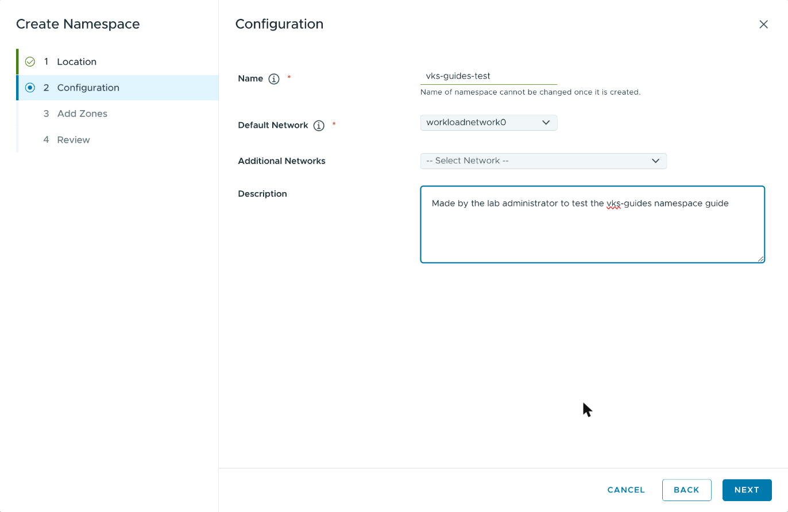
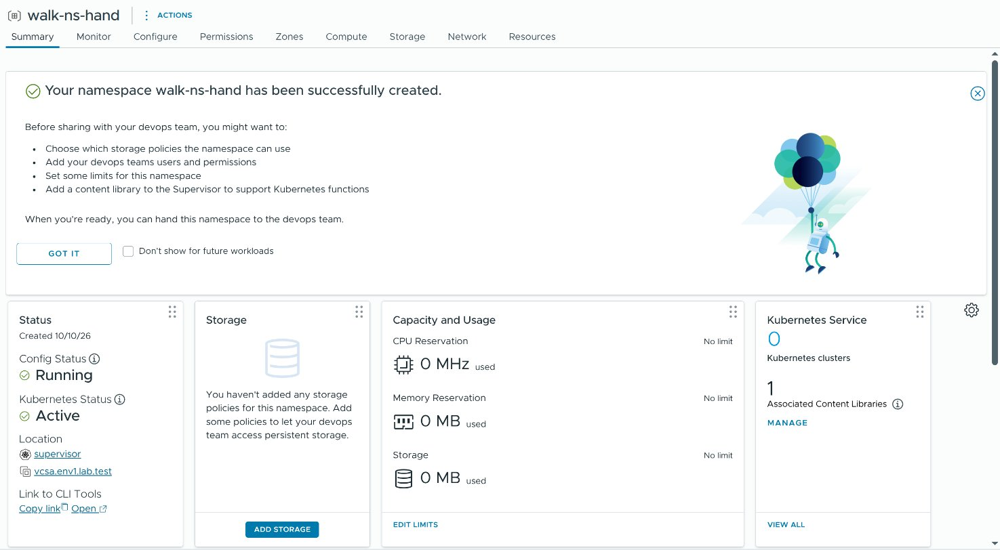
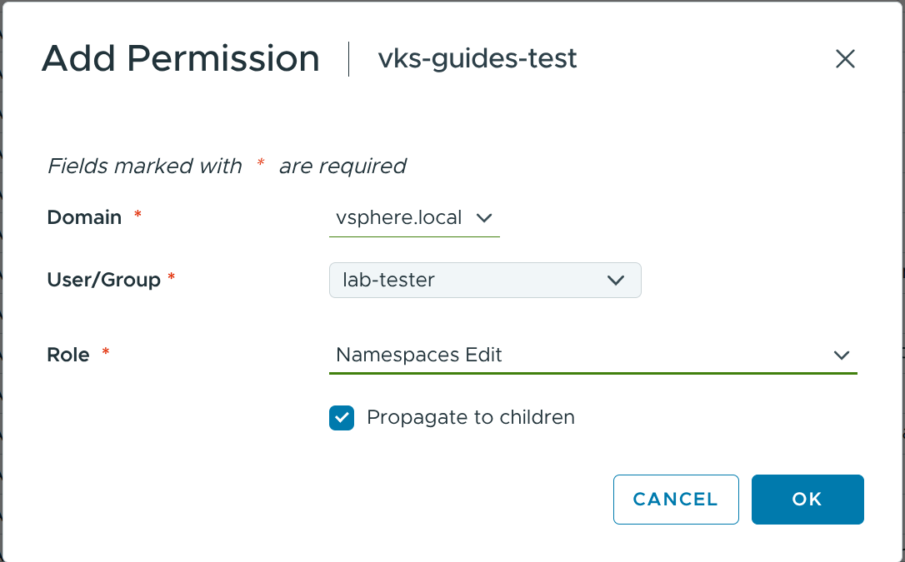
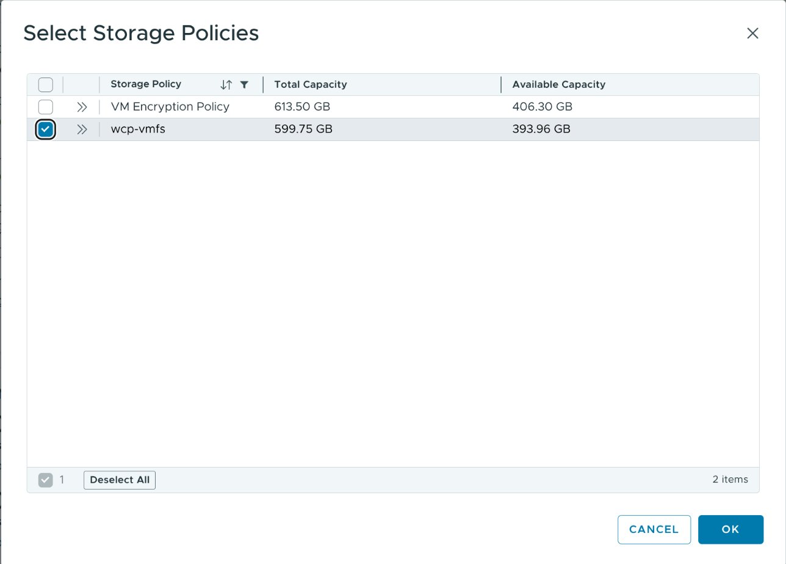
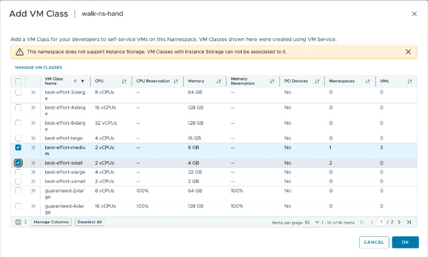
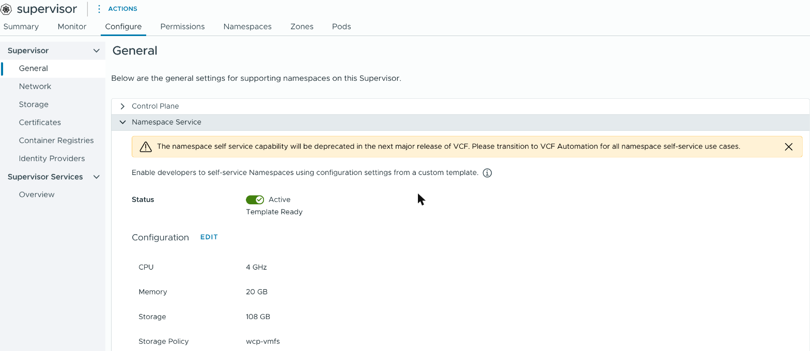
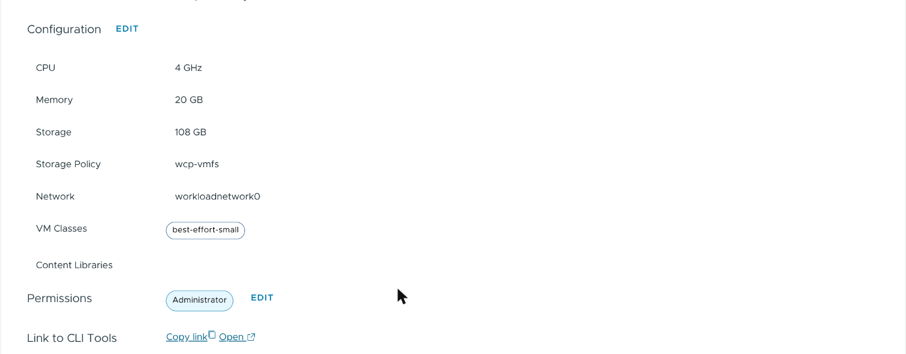
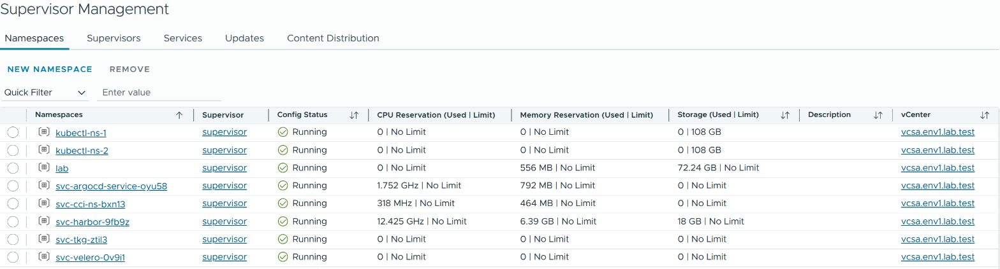

# Create a vSphere Namespace

> [!NOTE]
> **Official Broadcom documentation (VCF 9.1) for this guide**
>
> - [Create and Configure a vSphere Namespace on the Supervisor](https://techdocs.broadcom.com/us/en/vmware-cis/vcf/vcf-9-0-and-later/9-1/vsphere-supervisor-installation-and-configuration/configuring-and-managing-vsphere-namespaces/create-and-configure-a-vsphere-namespace.html)
> - [Configure a vSphere Namespace for VKS Clusters](https://techdocs.broadcom.com/us/en/vmware-cis/vcf/vcf-service-administration-and-development/9-1/managing-vsphere-kubernetes-service/configuring-vsphere-namespaces-for-hosting-tkg-service-clusters/configure-a-vsphere-namespace-for-hosting-tkg-service-clusters.html) (storage, VM classes)
> - [Configure vSphere Namespace Permissions for vCenter Single Sign-On Users and Groups](https://techdocs.broadcom.com/us/en/vmware-cis/vcf/vcf-service-administration-and-development/9-1/managing-vsphere-kubernetes-service/configuring-vsphere-namespaces-for-hosting-tkg-service-clusters/configure-vsphere-namespace-persmissions-for-vcenter-sso-users-and-groups.html)
> - [Using VM Classes with VKS Clusters](https://techdocs.broadcom.com/us/en/vmware-cis/vcf/vcf-service-administration-and-development/9-1/managing-vsphere-kubernetes-service/configuring-vsphere-namespaces-for-hosting-tkg-service-clusters/using-vm-classes-with-tkg-service-clusters.html)
> - [Using Storage Classes for Persistent Volumes](https://techdocs.broadcom.com/us/en/vmware-cis/vcf/vcf-consumption/latest/managing-vsphere-kuberenetes-service-clusters-and-workloads/deploying-workloads-on-tkg-service-clusters/storage-concepts-for-tkg-service-clusters/using-storage-classes-for-persistent-volumes.html) (the `-latebinding` class)
> - [Verify vSphere Namespace Readiness for Hosting VKS Clusters](https://techdocs.broadcom.com/us/en/vmware-cis/vcf/vcf-service-administration-and-development/9-1/managing-vsphere-kubernetes-service/configuring-vsphere-namespaces-for-hosting-tkg-service-clusters/verify-vsphere-namespace-readiness-for-hosting-tkg-service-clusters.html)
> - [Remove a vSphere Namespace from Supervisor](https://techdocs.broadcom.com/us/en/vmware-cis/vcf/vcf-9-0-and-later/9-1/vsphere-supervisor-installation-and-configuration/configuring-and-managing-vsphere-namespaces/services-and-workloads-remove-a-vsphere-namespace.html)
> - [Download and install vCenter Server root certificates to avoid web browser certificate warnings](https://knowledge.broadcom.com/external/article/330833/download-and-install-vcenter-server-root.html) (Broadcom KB 330833)
> - [Create and Configure a Self-Service Namespace Template](https://techdocs.broadcom.com/us/en/vmware-cis/vcf/vcf-9-0-and-later/9-1/vsphere-supervisor-installation-and-configuration/configuring-and-managing-vsphere-namespaces/provision-a-self-service-namespace/create-and-configure-a-self-service-namespace.html) (step 10, the Namespace Service)
> - [Create a Self-Service Namespace](https://techdocs.broadcom.com/us/en/vmware-cis/vcf/vcf-9-0-and-later/9-1/vsphere-supervisor-installation-and-configuration/configuring-and-managing-vsphere-namespaces/provision-a-self-service-namespace/create-a-self-service-namespace.html) and [Delete a Self-Service Namespace](https://techdocs.broadcom.com/us/en/vmware-cis/vcf/vcf-9-0-and-later/9-1/vsphere-supervisor-installation-and-configuration/configuring-and-managing-vsphere-namespaces/provision-a-self-service-namespace/delete-a-self-service-namespace.html) (step 10, kubectl)

You create the namespace in the vSphere Client, give users a role in it, and add a storage
policy and VM classes. Steps 2 to 7 are clicks. The names are those of the vSphere Client for
VCF 9.1.1, on a Supervisor with vSphere Distributed Switch networking. The screenshots show example
names; yours differ.

If you only use a namespace someone else made, go to
[Check the namespace](#8-check-the-namespace). If the Supervisor's Namespace Service is on, you
can instead create the namespace from a YAML file with kubectl:
[step 10](#10-create-a-namespace-with-kubectl-and-a-yaml-file).

## Prerequisites

- a vCenter user who may create vSphere Namespaces (a vCenter administrator), and a Supervisor
  that is running;
- for step 1: [unzip and openssl](PREREQS.md);
- for steps 8 to 10: [kubectl](KUBECTL.md), [jq](PREREQS.md) and a [Supervisor login](LOGIN.md).

The connections this guide needs, for a firewall (all TCP):

| from | to | port | for |
|---|---|---|---|
| your browser | vCenter (`https://<your vCenter>/ui`) | 443 | the vSphere Client (steps 1 to 7, 9) |
| your machine | the Supervisor's address | 443 | kubectl (steps 8 to 10) |

## 1. Find the Supervisor's address and vCenter's CA

1. Open the vSphere Client (`https://<your vCenter>/ui`) and log in. From the menu (☰, top
   left) choose **Supervisor Management**, then the **Supervisors** tab.
2. Find your Supervisor's row. **Config Status** must show **Running**. The **Control Plane Node
   Address** column holds the Supervisor's address: that is `SUPERVISOR_ENDPOINT` in
   [LOGIN.md](LOGIN.md).

   

3. Open `https://<your vCenter>/` (without `/ui`). In the grey box on the right, under **For
   Developers**, click **Download trusted root CA certificates**. The browser saves
   `download.zip`.

   

The file holds vCenter's CAs (certificate authorities). LOGIN.md uses them to check that a login
reaches your real Supervisor. This prints each CA's fingerprint, a short code that identifies it.
Give them to your users: LOGIN.md's
[Create Supervisor context with CA](LOGIN.md#create-supervisor-context-with-ca) asks them to
compare their download with them. Trust them only if your browser showed no certificate warning
for vCenter.

<details>
<summary><b>Linux (Ubuntu, AlmaLinux, Photon OS), macOS, WSL (bash or zsh)</b></summary>

```sh
CA_ZIP="$HOME/Downloads/download.zip"

TMP="$(mktemp -d)"
if ! unzip -oqj "$CA_ZIP" 'certs/lin/*.0' -d "$TMP"; then
  echo "FAILED: no CA certificate in $CA_ZIP"
else
  for f in "$TMP"/*.0; do openssl x509 -in "$f" -noout -subject -fingerprint -sha256; done
fi
rm -rf "$TMP"
```

</details>

<details>
<summary><b>Windows (PowerShell)</b></summary>

```powershell
$CA_ZIP = "$HOME\Downloads\download.zip"

$TMP = Join-Path $env:TEMP ([guid]::NewGuid()); New-Item -ItemType Directory -Path $TMP | Out-Null
Expand-Archive -Force -Path $CA_ZIP -DestinationPath $TMP -ErrorAction SilentlyContinue
$CERTS = Get-ChildItem -Path "$TMP\certs\win" -Filter '*.0.crt' -ErrorAction SilentlyContinue
if (-not $CERTS) {
  "FAILED: no CA certificate in $CA_ZIP"
} else {
  foreach ($C in $CERTS) {
    $X = New-Object System.Security.Cryptography.X509Certificates.X509Certificate2 $C.FullName
    $H = [BitConverter]::ToString([Security.Cryptography.SHA256]::Create().ComputeHash($X.RawData))
    "subject=$($X.Subject)"
    "sha256 Fingerprint=$($H.Replace('-', ':'))"
  }
}
Remove-Item -Recurse -Force $TMP
```

</details>

**Expect:** for each CA, a `subject=` line and a `sha256 Fingerprint=…` line
(`SHA256 Fingerprint=` on macOS).

**If not:**
- **Config Status** is not **Running**: the Supervisor is not ready, and no namespace can be
  created on it yet.
- `FAILED: no CA certificate …` or `cannot find …`: the file is not in `Downloads` under that
  name. Set `CA_ZIP` to where the browser saved it. Under `unzip: command not found`: install
  unzip ([PREREQS.md](PREREQS.md)).

## 2. Find the storage policies and the VM classes

A namespace needs one storage policy and at least one VM class (a node size).

1. From the menu (☰) choose **Policies and Profiles**, then **VM Storage Policies**. Note the
   name of one policy. Do not choose one with **Encryption** in its name unless vCenter has a
   key provider.

   

2. From the menu (☰) choose **Supervisor Management**, then the **Services** tab. On the **VM
   Service** card click **MANAGE**, then **VM Classes**. Each card shows a class's name, CPUs
   and memory. Note the classes your VKS clusters' nodes will use. `best-effort-small` (2 CPUs,
   4 GB) is the smallest that runs a VKS cluster's control plane.

   

**Expect:** one storage policy name and one or more VM class names.

**If not:** no **VM Service** card: the Supervisor has no VM Service, and no VKS cluster can be
built on it.

## 3. Create the namespace

To create it from a YAML file with kubectl instead of steps 3, 5 and 6, see
[step 10](#10-create-a-namespace-with-kubectl-and-a-yaml-file).

1. From the menu (☰) choose **Supervisor Management**. On the **Namespaces** tab click **NEW
   NAMESPACE**.

   

2. **1 Location:** click your Supervisor, then **NEXT**.
3. **2 Configuration:**
   - **Name:** lower-case letters, digits and `-`, not used by another namespace. It cannot be
     changed later.
   - **Default Network:** leave the network that is already chosen.
   - **Additional Networks:** leave it at *-- Select Network --*.
   - **Description:** who made the namespace and why. Step 9 reads it before anything is
     deleted.

   Click **NEXT**.

   

4. **3 Add Zones:** leave the zone that is ticked, click **NEXT**.
5. **4 Review:** check the values, click **FINISH**.

**Expect:** the namespace's **Summary** page, with *Your namespace <name> has been successfully
created.* The **Status** card shows **Config Status** **Running** and **Kubernetes Status**
**Active**; the **Storage** card has the button **ADD STORAGE**; the **VM Service** card shows
*0 Associated VM Classes* and the link **ADD VM CLASS**.



**If not:**
- **NEW NAMESPACE** is missing or grey: your user may not create namespaces, or no Supervisor
  is running (step 1).
- An error about the name: a namespace has that name, or it has a character that is not
  allowed.
- On a Supervisor with NSX, **2 Configuration** asks for more network values: take what your
  network administrator names.

## 4. Give users a role

You need nothing here for yourself as a vCenter administrator: the **Permissions** tab already
lists your user. Do this to let another SSO user work in the namespace.

1. Open the namespace's **Permissions** tab and click **ADD**.
2. Choose the **Domain** (`vsphere.local` for a user made in vCenter) and type the user's name
   in **User/Group**.
3. Choose the **Role**: **Namespaces View**, **Namespaces Edit** or **Namespaces Owner**. A user
   who creates VKS clusters needs **Namespaces Edit**.
4. Leave **Propagate to children** ticked and click **OK**.

   

**Expect:** a new row on the **Permissions** tab with the user and the role.

**If not:** the user is not found: it is in another **Domain**.

## 5. Add a storage policy

1. On the **Summary** page, in the **Storage** card, click **ADD STORAGE**.
2. Tick the policy from step 2, one with room for the disks of every node of your VKS clusters,
   and click **OK**.

   

**Expect:** after a few seconds, the **Storage** card shows *Storage Policies 1* and the policy's name, and its link
reads **EDIT STORAGE**. The namespace now offers a storage class named after the policy, and a
second one ending in `-latebinding`.

## 6. Add the VM classes

1. In the **VM Service** card click **ADD VM CLASS**.
2. Tick the classes from step 2 and click **OK**. The table shows ten classes per page.

   

   The yellow line about *Instance Storage* is a note, not an error.

**Expect:** the **VM Service** card shows the number of classes you ticked (*2 Associated VM
Classes*, for example), and its link reads **MANAGE VM CLASSES**.

A VKS cluster needs no content library in the namespace: do not click **ADD CONTENT LIBRARY**.

## 7. Check the status

Leave **Capacity and Usage** at *No limit*, or click **EDIT LIMITS**, expand **Storage**, and set
a limit on your storage policy that leaves room for every node of the VKS clusters you will
create.


**Expect:** **Config Status** **Running** and **Kubernetes Status** **Active**, the policy's
name in **Storage**, and your VM classes counted in **VM Service**.

**If not:** a status other than **Running** after some minutes: the card's message says why.

## 8. Check the namespace

Log in to the Supervisor first ([LOGIN.md](LOGIN.md)). If you were logged in before the
namespace existed, or before your user got its role, [log out](LOGIN.md#log-out) and log in
again.

This checks that the namespace exists and that your user may create VKS clusters in it.

**Linux (Ubuntu, AlmaLinux, Photon OS), macOS, WSL (bash or zsh):**

```sh
VKS_NAMESPACE="my-namespace"
SUPERVISOR_KUBECONFIG="$HOME/.kube/supervisor.kubeconfig"

kubectl --kubeconfig "$SUPERVISOR_KUBECONFIG" get namespace "$VKS_NAMESPACE" \
  && kubectl --kubeconfig "$SUPERVISOR_KUBECONFIG" -n "$VKS_NAMESPACE" auth can-i create clusters.cluster.x-k8s.io
```

**Windows (PowerShell):**

```powershell
$VKS_NAMESPACE = "my-namespace"
$SUPERVISOR_KUBECONFIG = "$HOME\.kube\supervisor.kubeconfig"

$global:LASTEXITCODE = $null
kubectl --kubeconfig $SUPERVISOR_KUBECONFIG get namespace $VKS_NAMESPACE
if ($LASTEXITCODE -eq 0) { kubectl --kubeconfig $SUPERVISOR_KUBECONFIG -n $VKS_NAMESPACE auth can-i create clusters.cluster.x-k8s.io }
```

**Expect:** your namespace, `Active`, then `yes`.

**If not:**
- `NotFound`: check `VKS_NAMESPACE`.
- `Forbidden`, or `no`: check `VKS_NAMESPACE` (a user who is not a vCenter administrator gets
  `Forbidden` for a name that does not exist); if it is right, your SSO user has no
  **Namespaces Edit** role on the namespace (step 4).
- `Unauthorized`: run [Renew the Supervisor login](LOGIN.md#renew-the-supervisor-login).

This lists what the namespace offers a VKS cluster: VM classes, storage classes, Kubernetes
releases and cluster classes.

<details>
<summary><b>Linux (Ubuntu, AlmaLinux, Photon OS), macOS, WSL (bash or zsh)</b></summary>

```sh
VKS_NAMESPACE="my-namespace"
SUPERVISOR_KUBECONFIG="$HOME/.kube/supervisor.kubeconfig"

if ! kubectl --kubeconfig "$SUPERVISOR_KUBECONFIG" get namespace "$VKS_NAMESPACE" >/dev/null; then
  echo "FAILED: cannot read the namespace $VKS_NAMESPACE (see the error above)"
else
  echo "VM classes:"
  kubectl --kubeconfig "$SUPERVISOR_KUBECONFIG" -n "$VKS_NAMESPACE" get virtualmachineclass --no-headers
  echo "Storage classes:"
  kubectl --kubeconfig "$SUPERVISOR_KUBECONFIG" -n "$VKS_NAMESPACE" get storagepolicyquota \
    -o jsonpath='{range .items[*].status.total[*]}{.storageClassName}{"\n"}{end}' | sort -u
  if J="$(kubectl --kubeconfig "$SUPERVISOR_KUBECONFIG" get kr -o json)"; then
    echo "Kubernetes releases ready to use: $(printf '%s' "$J" | jq '[.items[] | select([.status.conditions[]? | select(.type == "Ready" or .type == "Compatible") | .status] | length == 2 and all(. == "True"))] | length')"
  else
    echo "Kubernetes releases ready to use: unknown (see the error above)"
  fi
  if J="$(kubectl --kubeconfig "$SUPERVISOR_KUBECONFIG" -n vmware-system-vks-public get clusterclass -o name)"; then
    echo "Cluster classes: $(printf '%s\n' "$J" | grep -c .)"
  else
    echo "Cluster classes: unknown (see the error above)"
  fi
fi
```

</details>

<details>
<summary><b>Windows (PowerShell)</b></summary>

```powershell
$VKS_NAMESPACE = "my-namespace"
$SUPERVISOR_KUBECONFIG = "$HOME\.kube\supervisor.kubeconfig"

$global:LASTEXITCODE = $null
kubectl --kubeconfig $SUPERVISOR_KUBECONFIG get namespace $VKS_NAMESPACE | Out-Null
if ($LASTEXITCODE -ne 0) {
  "FAILED: cannot read the namespace $VKS_NAMESPACE (see the error above)"
} else {
  "VM classes:"
  kubectl --kubeconfig $SUPERVISOR_KUBECONFIG -n $VKS_NAMESPACE get virtualmachineclass --no-headers
  "Storage classes:"
  $J = kubectl --kubeconfig $SUPERVISOR_KUBECONFIG -n $VKS_NAMESPACE get storagepolicyquota -o json
  if ($LASTEXITCODE -eq 0) {
    ($J | Out-String | ConvertFrom-Json).items | ForEach-Object { $_.status.total } |
      ForEach-Object { $_.storageClassName } | Sort-Object -Unique
  }
  $J = kubectl --kubeconfig $SUPERVISOR_KUBECONFIG get kr -o json
  if ($LASTEXITCODE -eq 0) {
    $READY = ($J | Out-String | ConvertFrom-Json).items | Where-Object {
      @($_.status.conditions | Where-Object { ($_.type -eq 'Ready' -or $_.type -eq 'Compatible') -and $_.status -eq 'True' }).Count -eq 2
    }
    "Kubernetes releases ready to use: $(@($READY).Count)"
  } else {
    "Kubernetes releases ready to use: unknown (see the error above)"
  }
  $J = kubectl --kubeconfig $SUPERVISOR_KUBECONFIG -n vmware-system-vks-public get clusterclass -o name
  if ($LASTEXITCODE -eq 0) {
    "Cluster classes: $(@($J | Where-Object { $_ }).Count)"
  } else {
    "Cluster classes: unknown (see the error above)"
  }
}
```

</details>

**Expect:** at least one line under `VM classes:` (a name with its CPUs and memory), at least
one name under `Storage classes:`, then `Kubernetes releases ready to use:` and
`Cluster classes:`, each with a number above 0.

**If not:**
- `FAILED: cannot read the namespace …`: as in the block above (`NotFound`, `Forbidden`,
  `Unauthorized`).
- An error with `Forbidden` above a line, or `unknown`: your user may not read that. Ask a
  vCenter administrator for the **Namespaces Edit** role (step 4); the number is not the cause.
- Nothing after `Kubernetes releases ready to use:`, under `jq: command not found`: install jq
  ([PREREQS.md](PREREQS.md)).
- `No resources found` under `VM classes:`: add a VM class (step 6).
- Nothing under `Storage classes:`, with no error: add a storage policy (step 5).
- `Kubernetes releases ready to use: 0`: on a Supervisor switched on minutes ago, wait ten
  minutes and run the block again. If it stays 0, the Supervisor's Kubernetes content library
  has not synchronized, or holds no release this Supervisor can use.
- `Cluster classes: 0`: the **Kubernetes Service** is not running on this Supervisor: your
  Supervisor → **Configure** → **Supervisor Services** → **Overview**.

## 9. Remove the namespace (optional)

**Remove only a namespace you created, and only when it holds nothing you want to keep.**
Broadcom asks you to delete its VKS clusters, VMs and vSphere Pods first; the window that asks
you to confirm says the same.

This lists the VKS clusters, VMs, volumes and pods left in it:

**Linux (Ubuntu, AlmaLinux, Photon OS), macOS, WSL (bash or zsh):**

```sh
VKS_NAMESPACE="my-namespace"
SUPERVISOR_KUBECONFIG="$HOME/.kube/supervisor.kubeconfig"

kubectl --kubeconfig "$SUPERVISOR_KUBECONFIG" get namespace "$VKS_NAMESPACE" \
  && kubectl --kubeconfig "$SUPERVISOR_KUBECONFIG" -n "$VKS_NAMESPACE" get clusters.cluster.x-k8s.io,virtualmachines,persistentvolumeclaims,pods
```

**Windows (PowerShell):**

```powershell
$VKS_NAMESPACE = "my-namespace"
$SUPERVISOR_KUBECONFIG = "$HOME\.kube\supervisor.kubeconfig"

$global:LASTEXITCODE = $null
kubectl --kubeconfig $SUPERVISOR_KUBECONFIG get namespace $VKS_NAMESPACE
if ($LASTEXITCODE -eq 0) { kubectl --kubeconfig $SUPERVISOR_KUBECONFIG -n $VKS_NAMESPACE get clusters.cluster.x-k8s.io,virtualmachines,persistentvolumeclaims,pods }
```

**Expect:** your namespace, `Active`, then `No resources found in <your namespace> namespace.`

**If not:**
- `NotFound`: check `VKS_NAMESPACE`. Do not remove a namespace you cannot see here.
- A VKS cluster, VM, volume or pod is listed: delete it first ([CLUSTER.md](CLUSTER.md) deletes a
  VKS cluster). A deleted cluster leaves its apps' volumes here; see
  [Delete the cluster](CLUSTER.md#8-delete-the-cluster-optional).

Then, in the vSphere Client:

1. **Supervisor Management** → **Namespaces**. Read the namespace's **Description**: it must be
   the text you typed in step 3. If it is not, stop.
2. Select the row with the round button at its left and click **REMOVE**.

   

3. The window **Delete | <your namespace>** opens. Read the name in its title, then click the red
   **DELETE**.

   

**Expect:** the row's **Config Status** shows **Removing**, then the row disappears.

**If not:** the row stays **Removing** for more than 15 minutes: something in the namespace does
not end. Do not create a namespace of the same name meanwhile.

## 10. Create a namespace with kubectl and a YAML file

This replaces steps 3, 5 and 6. The namespace takes its storage policy, network and VM classes
from the Supervisor's **Namespace Service** template, so you add none yourself. You get a role on
the namespace; other users get one only from a vCenter administrator
([step 4](#4-give-users-a-role)). Tested as a vCenter administrator only.

Broadcom is retiring the Namespace Service: the vSphere Client says it *will be deprecated in
the next major release of VCF* and points to VCF Automation. If VCF Automation creates your
namespaces, do not use this step.

1. A vCenter administrator checks, once per Supervisor: your Supervisor → **Configure** →
   **General** → **Namespace Service**. **Status** must read **Active** and **Template Ready**.

   

   **Configuration** lists what every new namespace gets: **Storage Policy**, **Network** and
   **VM Classes**. **Permissions** lists who may create namespaces.

   

   If the service is off, the administrator turns it on and fills in the template:
   [Create and Configure a Self-Service Namespace Template](https://techdocs.broadcom.com/us/en/vmware-cis/vcf/vcf-9-0-and-later/9-1/vsphere-supervisor-installation-and-configuration/configuring-and-managing-vsphere-namespaces/provision-a-self-service-namespace/create-and-configure-a-self-service-namespace.html).

2. Log in to the Supervisor ([LOGIN.md](LOGIN.md)). This checks that you may create namespaces.

**Linux (Ubuntu, AlmaLinux, Photon OS), macOS, WSL (bash or zsh):**

```sh
SUPERVISOR_KUBECONFIG="$HOME/.kube/supervisor.kubeconfig"

kubectl --kubeconfig "$SUPERVISOR_KUBECONFIG" auth can-i create namespaces
```

**Windows (PowerShell):**

```powershell
$SUPERVISOR_KUBECONFIG = "$HOME\.kube\supervisor.kubeconfig"

kubectl --kubeconfig $SUPERVISOR_KUBECONFIG auth can-i create namespaces
```

**Expect:** `yes`, under the line `Warning: resource 'namespaces' is not namespace scoped`.

**If not:** `no`: your user is not under the template's **Permissions**, or the Namespace Service
is off. Ask a vCenter administrator.

3. Save this as `namespace.yaml` in your home folder (Windows: `C:\Users\<you>`). Change only
   the name.

```yaml
apiVersion: v1
kind: Namespace
metadata:
  name: my-namespace   # <-- change: the new namespace's name
```

The name: lower-case letters, digits and `-`, not used by another namespace, and not starting
with `vmware-system-` or `svc-`. It cannot be changed later.

4. This checks the file on the Supervisor without creating anything (`--dry-run=server`), then
   creates the namespace.

**Linux (Ubuntu, AlmaLinux, Photon OS), macOS, WSL (bash or zsh):**

```sh
NAMESPACE_YAML="$HOME/namespace.yaml"
SUPERVISOR_KUBECONFIG="$HOME/.kube/supervisor.kubeconfig"

kubectl --kubeconfig "$SUPERVISOR_KUBECONFIG" create --dry-run=server -f "$NAMESPACE_YAML" \
  && kubectl --kubeconfig "$SUPERVISOR_KUBECONFIG" create -f "$NAMESPACE_YAML"
```

**Windows (PowerShell):**

```powershell
$NAMESPACE_YAML = "$HOME\namespace.yaml"
$SUPERVISOR_KUBECONFIG = "$HOME\.kube\supervisor.kubeconfig"

$global:LASTEXITCODE = $null
kubectl --kubeconfig $SUPERVISOR_KUBECONFIG create --dry-run=server -f $NAMESPACE_YAML
if ($LASTEXITCODE -eq 0) { kubectl --kubeconfig $SUPERVISOR_KUBECONFIG create -f $NAMESPACE_YAML }
```

**Expect:** `namespace/<name> created (server dry run)`, then `namespace/<name> created`.

**If not:**
- `AlreadyExists`: another namespace has that name; change it in the file.
- `Forbidden`: see step 2; with `reserved 'svc-' prefix`, change the name.
- `the path "…" does not exist`: the file is not where `NAMESPACE_YAML` says.

5. Run both blocks of [Check the namespace](#8-check-the-namespace) with your namespace's name.

**Expect:** as in step 8: the template's VM classes under `VM classes:`, and under `Storage
classes:` a class named after the template's storage policy plus one ending in `-latebinding`.
In the vSphere Client the namespace is listed under **Supervisor Management** → **Namespaces**,
**Config Status** **Running**, with the template's **Storage** as its storage limit.



To remove the namespace, first run the block in step 9 to check that it is empty. Then this
deletes the namespace from the Supervisor:

**Linux (Ubuntu, AlmaLinux, Photon OS), macOS, WSL (bash or zsh):**

```sh
VKS_NAMESPACE="my-namespace"
SUPERVISOR_KUBECONFIG="$HOME/.kube/supervisor.kubeconfig"

kubectl --kubeconfig "$SUPERVISOR_KUBECONFIG" delete namespace "$VKS_NAMESPACE"
```

**Windows (PowerShell):**

```powershell
$VKS_NAMESPACE = "my-namespace"
$SUPERVISOR_KUBECONFIG = "$HOME\.kube\supervisor.kubeconfig"

kubectl --kubeconfig $SUPERVISOR_KUBECONFIG delete namespace $VKS_NAMESPACE
```

**Expect:** `namespace "<name>" deleted`. In the vSphere Client's **Namespaces** tab the row shows
**Config Status** **Removing**, then disappears.

Back to [README](../README.md).
