# See a VKS cluster's logs and traces in Grafana

> [!NOTE]
> **Official chart, tool and Broadcom documentation for this guide**
>
> - [Loki Helm chart](https://github.com/grafana-community/helm-charts/tree/main/charts/loki) and [Install the monolithic Helm chart](https://grafana.com/docs/loki/latest/setup/install/helm/install-monolithic/) (Loki)
> - [Jaeger Helm chart](https://github.com/jaegertracing/helm-charts/tree/main/charts/jaeger) and [Jaeger configuration](https://www.jaegertracing.io/docs/2.20/deployment/configuration/) (traces)
> - [Fluent Bit Loki output](https://docs.fluentbit.io/manual/pipeline/outputs/loki) and Broadcom's [Fluent Bit Package Reference](https://techdocs.broadcom.com/us/en/vmware-cis/vcf/vcf-service-administration-and-development/9-0/managing-vsphere-kuberenetes-service-clusters-and-workloads/installing-standard-packages-on-tkg-service-clusters/standard-package-reference/fluent-bit-package-reference.html) (VCF 9.0 page; there is no 9.1 copy)
> - Grafana: [Provision data sources](https://grafana.com/docs/grafana/latest/administration/provisioning/#data-sources), [Loki data source](https://grafana.com/docs/grafana/latest/datasources/loki/configure/), [Jaeger data source](https://grafana.com/docs/grafana/latest/datasources/jaeger/configure/)
> - [podinfo](https://github.com/stefanprodan/podinfo) (the sample app)
> - VCF Operations 9.1: [What is vSphere Supervisor Monitoring](https://techdocs.broadcom.com/us/en/vmware-cis/vcf/vcf-9-0-and-later/9-1/infrastructure-operations/connect-to-data-sources/vsphere-supervisor-monitoring/what-is-vsphere-supervisor-monitoring.html), [Enabling Monitoring for VKS Clusters](https://techdocs.broadcom.com/us/en/vmware-cis/vcf/vcf-9-0-and-later/9-1/infrastructure-operations/connect-to-data-sources/vsphere-supervisor-monitoring/steps-to-monitor-vsphere-supervisor-clusters-and-resources/prerequisites-for-vsphere-supervisor-monitoring.html), [Enabling Monitoring for vSphere Supervisor](https://techdocs.broadcom.com/us/en/vmware-cis/vcf/vcf-9-0-and-later/9-1/infrastructure-operations/connect-to-data-sources/vsphere-supervisor-monitoring/steps-to-monitor-vsphere-supervisor-clusters-and-resources/enabling-the-vsphere-supervisor-collection.html) (step 10), [Getting Started with Log Management](https://techdocs.broadcom.com/us/en/vmware-cis/vcf/vcf-9-0-and-later/9-1/infrastructure-operations/log-analysis/getting-started-with-log-management.html), [What's New in VCF Operations 9.1](https://techdocs.broadcom.com/us/en/vmware-cis/vcf/vcf-9-0-and-later/9-1/release-notes/vmware-cloud-foundation-9-1-0-0-release-notes/what-s-new/whats-new-vcf-ops.html)
> - [Monitoring VKS Clusters Using VCF Operations](https://techdocs.broadcom.com/us/en/vmware-cis/vcf/vcf-consumption/latest/managing-vsphere-kuberenetes-service-clusters-and-workloads/operating-tkg-service-clusters/monitoring-vks-clusters-using-vcf-operations.html) (VKS documentation; there is no 9.1-numbered copy)
> - Supervisor Services 9.1 (step 11): [Add a Supervisor Service to vCenter](https://techdocs.broadcom.com/us/en/vmware-cis/vcf/vcf-service-administration-and-development/9-1/managing-supervisor-services-with-vsphere-iaas-control-plane/supervisor-service-life-cycle-management-and-consumption/add-a-vsphere-services-to-vcenter-server.html), [Install a Supervisor Service on a Supervisor](https://techdocs.broadcom.com/us/en/vmware-cis/vcf/vcf-service-administration-and-development/9-1/managing-supervisor-services-with-vsphere-iaas-control-plane/supervisor-service-life-cycle-management-and-consumption/install-a-supervisor-service-on-supervisors.html), [Uninstall a Supervisor Service from a Supervisor](https://techdocs.broadcom.com/us/en/vmware-cis/vcf/vcf-service-administration-and-development/9-1/managing-supervisor-services-with-vsphere-iaas-control-plane/supervisor-service-life-cycle-management-and-consumption/uninstall-a-supervisor-service-version-from-a-supervisor.html), [Delete a Supervisor Service](https://techdocs.broadcom.com/us/en/vmware-cis/vcf/vcf-service-administration-and-development/9-1/managing-supervisor-services-with-vsphere-iaas-control-plane/supervisor-service-life-cycle-management-and-consumption/delete-a-vsphere-service.html), [Disable Monitoring on VKS Clusters Using VCF CLI](https://techdocs.broadcom.com/us/en/vmware-cis/vcf/vcf-consumption/latest/managing-vsphere-kuberenetes-service-clusters-and-workloads/operating-tkg-service-clusters/disable-automated-monitoring-on-vks-clusters-using-vcf-a/disable-monitoring-on-vks-clusters-using-vcf-cli.html) (the label)
> - [Observability on VKS](https://blogs.vmware.com/cloud-foundation/2026/04/17/observability-on-vks/) (VMware's blog, with diagrams of this design), the [white paper](https://www.vmware.com/docs/observability-vks) (VCF 9.0; the versions and VCF Operations steps differ in 9.1) and its [examples](https://github.com/vmware/vks-consumption-models/tree/main/observability-consumption-model)

This adds logs and traces to the Grafana of [MONITORING.md](MONITORING.md) and runs a sample app
that produces all three signals:

| signal | collected by | stored in | where you look |
|---|---|---|---|
| metrics | Prometheus (MONITORING.md) | Prometheus | Grafana |
| logs | Broadcom's Fluent Bit add-on | Loki 3.7.9 | Grafana, with a link to the trace |
| traces | the app, over OTLP | Jaeger 2.20.0 | Grafana, with a link to the logs |
| the cluster and its node VMs | the vSphere Supervisor integration | VCF Operations | VCF Operations |

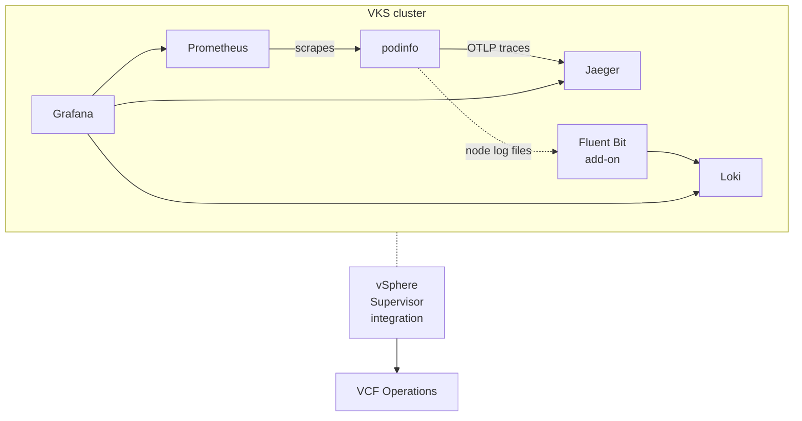

Loki and Jaeger keep their data inside the cluster. The Loki and Jaeger charts are upstream;
Broadcom does not support them.

What VCF 9.1 itself offers:

- **Metrics:** Telegraf and Prometheus add-ons in the cluster send metrics through the Metrics
  Aggregator Supervisor service to a Cloud Proxy. The Metrics Aggregator is installed by default
  with VCF Automation. On a Supervisor without it, VCF Operations shows only the cluster and its
  node VMs (step 10); step 11 installs it by hand.
- **Logs:** Log Management in VCF Operations; [LOGGING.md](LOGGING.md) sends a cluster's logs
  there.
- **Traces:** none of these Broadcom pages describes a view of an app's traces; this guide keeps
  them in Jaeger.

You need:

- MONITORING.md steps 1 to 7, or steps 1 to 3 and 9, and [Helm](HELM.md);
- the [VCF CLI](VCF.md) with its plugins and a [Supervisor login](LOGIN.md), for the Fluent Bit
  add-on;
- 10 GiB more storage for Loki, inside the vSphere Namespace's storage limit, if one is set;
- nodes that reach `docker.io` and `ghcr.io`, and a machine that reaches `github.com` and
  `release-assets.githubusercontent.com`.

The blocks keep their files in `~/.config/vks-guides/observability` (PowerShell:
`$HOME\.config\vks-guides\observability`).

## 1. Check the cluster

This checks that Grafana from MONITORING.md runs with its data source loader, and whether the
Fluent Bit add-on is already installed.

**Linux, macOS, WSL (bash or zsh):**

```sh
VKS_CLUSTER="my-vks-cluster"
VKS_KUBECONFIG="$HOME/.kube/${VKS_CLUSTER}.kubeconfig"

echo "Grafana data source loader: $(kubectl --kubeconfig "$VKS_KUBECONFIG" -n monitoring get deployment prometheus-grafana \
  -o jsonpath='{.spec.template.spec.containers[?(@.name=="grafana-sc-datasources")].name}')"
echo "Fluent Bit add-on: $(kubectl --kubeconfig "$VKS_KUBECONFIG" -n tanzu-system-logging get daemonset fluent-bit -o name 2>/dev/null)"
```

**Windows (PowerShell):**

```powershell
$VKS_CLUSTER = "my-vks-cluster"
$VKS_KUBECONFIG = "$HOME\.kube\${VKS_CLUSTER}.kubeconfig"

"Grafana data source loader: $(kubectl --kubeconfig $VKS_KUBECONFIG -n monitoring get deployment prometheus-grafana -o jsonpath='{.spec.template.spec.containers[?(@.name==\"grafana-sc-datasources\")].name}')"
"Fluent Bit add-on: $(kubectl --kubeconfig $VKS_KUBECONFIG -n tanzu-system-logging get daemonset fluent-bit -o name 2>$null)"
```

**Expect:** `Grafana data source loader: grafana-sc-datasources`, and `Fluent Bit add-on:` with
nothing after it, or `daemonset.apps/fluent-bit` if you did [LOGGING.md](LOGGING.md).

**If not:** `deployments.apps "prometheus-grafana" not found`: do MONITORING.md first.

## 2. Create the namespaces

`observability` holds Loki and Jaeger, `podinfo` the sample app. Both keep the cluster's default
pod security, `restricted`.

**Linux, macOS, WSL (bash or zsh):**

```sh
VKS_CLUSTER="my-vks-cluster"
VKS_KUBECONFIG="$HOME/.kube/${VKS_CLUSTER}.kubeconfig"

kubectl --kubeconfig "$VKS_KUBECONFIG" create namespace observability
kubectl --kubeconfig "$VKS_KUBECONFIG" create namespace podinfo
```

**Windows (PowerShell):**

```powershell
$VKS_CLUSTER = "my-vks-cluster"
$VKS_KUBECONFIG = "$HOME\.kube\${VKS_CLUSTER}.kubeconfig"

kubectl --kubeconfig $VKS_KUBECONFIG create namespace observability
kubectl --kubeconfig $VKS_KUBECONFIG create namespace podinfo
```

**Expect:** `namespace/observability created` and `namespace/podinfo created`.

**If not:** `AlreadyExists`: the namespace is there from an earlier run; go on.

## 3. Install Loki

This downloads the chart, checks its SHA-256, writes `loki-values.yaml` and installs Loki as one
pod with a volume of `LOKI_STORAGE` from the default storage class. Loki deletes logs older than
`LOKI_RETENTION`.

<details>
<summary><b>Linux, macOS, WSL (bash or zsh)</b></summary>

```sh
VKS_CLUSTER="my-vks-cluster"
CHART_VERSION="19.3.0"
CHART_SHA256="585d12a053a00851728e01382f59724e40237008874ae3d4939bd27a2c749b0a"
LOKI_STORAGE="10Gi"
LOKI_RETENTION="168h"
VKS_KUBECONFIG="$HOME/.kube/${VKS_CLUSTER}.kubeconfig"
OBSERVABILITY_DIR="$HOME/.config/vks-guides/observability"

CHART="$OBSERVABILITY_DIR/loki-${CHART_VERSION}.tgz"
URL="https://github.com/grafana-community/helm-charts/releases/download/loki-${CHART_VERSION}/loki-${CHART_VERSION}.tgz"
mkdir -p "$OBSERVABILITY_DIR"
if ! curl -fsSL --connect-timeout 20 --speed-time 60 -o "$CHART.new" "$URL"; then
  echo "FAILED: download of $URL"
elif [ "$( (sha256sum "$CHART.new" 2>/dev/null || shasum -a 256 "$CHART.new") | cut -d' ' -f1)" != "$CHART_SHA256" ]; then
  echo "FAILED: checksum mismatch for $URL"
else
  mv "$CHART.new" "$CHART"
  cat > "$OBSERVABILITY_DIR/loki-values.yaml" <<EOF
deploymentMode: Monolithic
loki:
  auth_enabled: false
  commonConfig:
    replication_factor: 1
  storage:
    type: filesystem
  schemaConfig:
    configs:
      - from: "2024-04-01"
        store: tsdb
        object_store: filesystem
        schema: v13
        index:
          prefix: loki_index_
          period: 24h
  limits_config:
    retention_period: ${LOKI_RETENTION}
  compactor:
    retention_enabled: true
    delete_request_store: filesystem
singleBinary:
  replicas: 1
  persistence:
    size: ${LOKI_STORAGE}
  resources:
    requests:
      cpu: 100m
      memory: 256Mi
    limits:
      memory: 1Gi
gateway:
  enabled: false
chunksCache:
  enabled: false
resultsCache:
  enabled: false
lokiCanary:
  enabled: false
test:
  enabled: false
backend:
  replicas: 0
read:
  replicas: 0
write:
  replicas: 0
sidecar:
  rules:
    enabled: false
rbac:
  namespaced: true
EOF
  if helm upgrade --install loki "$CHART" --kubeconfig "$VKS_KUBECONFIG" -n observability \
       -f "$OBSERVABILITY_DIR/loki-values.yaml" --wait --timeout 10m; then
    kubectl --kubeconfig "$VKS_KUBECONFIG" -n observability get pods,pvc
  else
    echo "FAILED: helm install (see the error above)"
  fi
fi
rm -f "$CHART.new"
```

</details>

<details>
<summary><b>Windows (PowerShell)</b></summary>

```powershell
$VKS_CLUSTER = "my-vks-cluster"
$CHART_VERSION = "19.3.0"
$CHART_SHA256 = "585d12a053a00851728e01382f59724e40237008874ae3d4939bd27a2c749b0a"
$LOKI_STORAGE = "10Gi"
$LOKI_RETENTION = "168h"
$VKS_KUBECONFIG = "$HOME\.kube\${VKS_CLUSTER}.kubeconfig"
$OBSERVABILITY_DIR = "$HOME\.config\vks-guides\observability"

$global:LASTEXITCODE = $null
$CHART = "$OBSERVABILITY_DIR\loki-$CHART_VERSION.tgz"
$URL = "https://github.com/grafana-community/helm-charts/releases/download/loki-$CHART_VERSION/loki-$CHART_VERSION.tgz"
New-Item -ItemType Directory -Force -Path $OBSERVABILITY_DIR | Out-Null
curl.exe -fsSL --connect-timeout 20 --speed-time 60 -o "$CHART.new" $URL
if ($LASTEXITCODE -ne 0) {
  "FAILED: download of $URL"
} elseif ((Get-FileHash -Algorithm SHA256 "$CHART.new").Hash -ne $CHART_SHA256) {
  "FAILED: checksum mismatch for $URL"
} else {
  Move-Item -Force "$CHART.new" $CHART
  $V = @"
deploymentMode: Monolithic
loki:
  auth_enabled: false
  commonConfig:
    replication_factor: 1
  storage:
    type: filesystem
  schemaConfig:
    configs:
      - from: "2024-04-01"
        store: tsdb
        object_store: filesystem
        schema: v13
        index:
          prefix: loki_index_
          period: 24h
  limits_config:
    retention_period: $LOKI_RETENTION
  compactor:
    retention_enabled: true
    delete_request_store: filesystem
singleBinary:
  replicas: 1
  persistence:
    size: $LOKI_STORAGE
  resources:
    requests:
      cpu: 100m
      memory: 256Mi
    limits:
      memory: 1Gi
gateway:
  enabled: false
chunksCache:
  enabled: false
resultsCache:
  enabled: false
lokiCanary:
  enabled: false
test:
  enabled: false
backend:
  replicas: 0
read:
  replicas: 0
write:
  replicas: 0
sidecar:
  rules:
    enabled: false
rbac:
  namespaced: true
"@
  [IO.File]::WriteAllText("$OBSERVABILITY_DIR\loki-values.yaml", ($V -replace "`r`n", "`n") + "`n")
  helm upgrade --install loki $CHART --kubeconfig $VKS_KUBECONFIG -n observability -f "$OBSERVABILITY_DIR\loki-values.yaml" --wait --timeout 10m
  if ($LASTEXITCODE -eq 0) {
    kubectl --kubeconfig $VKS_KUBECONFIG -n observability get pods,pvc
  } else {
    "FAILED: helm install (see the error above)"
  }
}
Remove-Item -Force -ErrorAction SilentlyContinue "$CHART.new"
```

</details>

**Expect:** `STATUS: deployed`, pod `loki-0` `1/1 Running` and its volume `storage-loki-0`
`Bound`.

**If not:**
- `FAILED: download …`: this machine cannot reach `github.com` or
  `release-assets.githubusercontent.com`.
- `FAILED: checksum mismatch …`: the download arrived damaged, or that release was rebuilt. Do
  not install it; run the block again.
- `FAILED: helm install` after `namespaces "observability" not found`: run step 2.
- `FAILED: helm install` after `client connection lost` and lines ending in `not ready`: the
  connection to the cluster dropped while Helm waited. Run the block again.
- The volume stays `Pending`: no default storage class, or no room under the vSphere
  Namespace's storage limit ([NAMESPACE.md](NAMESPACE.md) step 7).

## 4. Install Jaeger

This downloads the chart, checks its SHA-256, writes `jaeger-values.yaml` and installs Jaeger
2.20.0 as one pod. It keeps up to 10,000 traces in memory, so a restart empties it. Grafana's
Jaeger data source needs Jaeger 2.20 or earlier.

<details>
<summary><b>Linux, macOS, WSL (bash or zsh)</b></summary>

```sh
VKS_CLUSTER="my-vks-cluster"
CHART_VERSION="4.13.1"
CHART_SHA256="fc16f5b68572ccd0f9164219759f1102834cee6145d754ba5718596f81a5170b"
VKS_KUBECONFIG="$HOME/.kube/${VKS_CLUSTER}.kubeconfig"
OBSERVABILITY_DIR="$HOME/.config/vks-guides/observability"

CHART="$OBSERVABILITY_DIR/jaeger-${CHART_VERSION}.tgz"
URL="https://github.com/jaegertracing/helm-charts/releases/download/jaeger-${CHART_VERSION}/jaeger-${CHART_VERSION}.tgz"
mkdir -p "$OBSERVABILITY_DIR"
if ! curl -fsSL --connect-timeout 20 --speed-time 60 -o "$CHART.new" "$URL"; then
  echo "FAILED: download of $URL"
elif [ "$( (sha256sum "$CHART.new" 2>/dev/null || shasum -a 256 "$CHART.new") | cut -d' ' -f1)" != "$CHART_SHA256" ]; then
  echo "FAILED: checksum mismatch for $URL"
else
  mv "$CHART.new" "$CHART"
  cat > "$OBSERVABILITY_DIR/jaeger-values.yaml" <<'EOF'
jaeger:
  podSecurityContext:
    runAsNonRoot: true
    runAsUser: 10001
    runAsGroup: 10001
    fsGroup: 10001
    seccompProfile:
      type: RuntimeDefault
  securityContext:
    allowPrivilegeEscalation: false
    capabilities:
      drop:
        - ALL
  resources:
    requests:
      cpu: 50m
      memory: 128Mi
    limits:
      memory: 512Mi
userconfig:
  service:
    extensions: [jaeger_storage, jaeger_query, healthcheckv2]
    pipelines:
      traces:
        receivers: [otlp]
        processors: [batch]
        exporters: [jaeger_storage_exporter]
      logs:
        receivers: [otlp]
        exporters: [nop]
  extensions:
    jaeger_query:
      storage:
        traces: memstore
    jaeger_storage:
      backends:
        memstore:
          memory:
            max_traces: 10000
    healthcheckv2:
      use_v2: true
      http:
        endpoint: 0.0.0.0:13133
  receivers:
    otlp:
      protocols:
        grpc:
          endpoint: 0.0.0.0:4317
        http:
          endpoint: 0.0.0.0:4318
  processors:
    batch:
  exporters:
    jaeger_storage_exporter:
      trace_storage: memstore
    nop:
EOF
  if helm upgrade --install jaeger "$CHART" --kubeconfig "$VKS_KUBECONFIG" -n observability \
       -f "$OBSERVABILITY_DIR/jaeger-values.yaml" --wait --timeout 10m; then
    kubectl --kubeconfig "$VKS_KUBECONFIG" -n observability get pods
  else
    echo "FAILED: helm install (see the error above)"
  fi
fi
rm -f "$CHART.new"
```

</details>

<details>
<summary><b>Windows (PowerShell)</b></summary>

```powershell
$VKS_CLUSTER = "my-vks-cluster"
$CHART_VERSION = "4.13.1"
$CHART_SHA256 = "fc16f5b68572ccd0f9164219759f1102834cee6145d754ba5718596f81a5170b"
$VKS_KUBECONFIG = "$HOME\.kube\${VKS_CLUSTER}.kubeconfig"
$OBSERVABILITY_DIR = "$HOME\.config\vks-guides\observability"

$global:LASTEXITCODE = $null
$CHART = "$OBSERVABILITY_DIR\jaeger-$CHART_VERSION.tgz"
$URL = "https://github.com/jaegertracing/helm-charts/releases/download/jaeger-$CHART_VERSION/jaeger-$CHART_VERSION.tgz"
New-Item -ItemType Directory -Force -Path $OBSERVABILITY_DIR | Out-Null
curl.exe -fsSL --connect-timeout 20 --speed-time 60 -o "$CHART.new" $URL
if ($LASTEXITCODE -ne 0) {
  "FAILED: download of $URL"
} elseif ((Get-FileHash -Algorithm SHA256 "$CHART.new").Hash -ne $CHART_SHA256) {
  "FAILED: checksum mismatch for $URL"
} else {
  Move-Item -Force "$CHART.new" $CHART
  $V = @'
jaeger:
  podSecurityContext:
    runAsNonRoot: true
    runAsUser: 10001
    runAsGroup: 10001
    fsGroup: 10001
    seccompProfile:
      type: RuntimeDefault
  securityContext:
    allowPrivilegeEscalation: false
    capabilities:
      drop:
        - ALL
  resources:
    requests:
      cpu: 50m
      memory: 128Mi
    limits:
      memory: 512Mi
userconfig:
  service:
    extensions: [jaeger_storage, jaeger_query, healthcheckv2]
    pipelines:
      traces:
        receivers: [otlp]
        processors: [batch]
        exporters: [jaeger_storage_exporter]
      logs:
        receivers: [otlp]
        exporters: [nop]
  extensions:
    jaeger_query:
      storage:
        traces: memstore
    jaeger_storage:
      backends:
        memstore:
          memory:
            max_traces: 10000
    healthcheckv2:
      use_v2: true
      http:
        endpoint: 0.0.0.0:13133
  receivers:
    otlp:
      protocols:
        grpc:
          endpoint: 0.0.0.0:4317
        http:
          endpoint: 0.0.0.0:4318
  processors:
    batch:
  exporters:
    jaeger_storage_exporter:
      trace_storage: memstore
    nop:
'@
  [IO.File]::WriteAllText("$OBSERVABILITY_DIR\jaeger-values.yaml", ($V -replace "`r`n", "`n") + "`n")
  helm upgrade --install jaeger $CHART --kubeconfig $VKS_KUBECONFIG -n observability -f "$OBSERVABILITY_DIR\jaeger-values.yaml" --wait --timeout 10m
  if ($LASTEXITCODE -eq 0) {
    kubectl --kubeconfig $VKS_KUBECONFIG -n observability get pods
  } else {
    "FAILED: helm install (see the error above)"
  }
}
Remove-Item -Force -ErrorAction SilentlyContinue "$CHART.new"
```

</details>

**Expect:** `STATUS: deployed`, and pods `jaeger-…` and `loki-0` `1/1 Running`.

**If not:** as in step 3.

## 5. Send the logs to Loki

This writes `fluent-bit-values.yaml` and installs Broadcom's Fluent Bit add-on, or updates it
if you did [LOGGING.md](LOGGING.md). Fluent Bit sends every container's log lines to Loki,
labelled `namespace`, `pod`, `container` and `node`. If you did LOGGING.md, set `LOGS_FQDN` to
Log Management's DNS name from its step 3, and Fluent Bit keeps sending everything there too;
otherwise leave it empty. Set `FLUENT_BIT_RELEASE` as in LOGGING.md step 1.

<details>
<summary><b>Linux, macOS, WSL (bash or zsh)</b></summary>

```sh
VKS_NAMESPACE="my-namespace"
VKS_CLUSTER="my-vks-cluster"
FLUENT_BIT_RELEASE="fluent-bit.kubernetes.vmware.com.5.0.9-vmware.1-vks.1"
LOGS_FQDN=""
VKS_KUBECONFIG="$HOME/.kube/${VKS_CLUSTER}.kubeconfig"
OBSERVABILITY_DIR="$HOME/.config/vks-guides/observability"

V="$OBSERVABILITY_DIR/fluent-bit-values.yaml"
BAD_NAME=""
case "$LOGS_FQDN" in logs.example.test) BAD_NAME=1 ;; esac
[ -z "$(printf '%s' "$LOGS_FQDN" | LC_ALL=C tr -d 'a-z0-9.-')" ] || BAD_NAME=1
mkdir -p "$OBSERVABILITY_DIR"
{
  cat <<'EOF'
fluent_bit:
  config:
    outputs: |
      [OUTPUT]
        Name        loki
        Match       kube.*
        Host        loki.observability.svc.cluster.local
        Port        3100
        Labels      job=fluent-bit, namespace=$namespace_name, pod=$pod_name, container=$container_name, node=$host
        Line_Format json
        Remove_Keys k8s, text
EOF
  if [ -n "$LOGS_FQDN" ]; then
    cat <<EOF
      [OUTPUT]
        Name             http
        Match            *
        Host             ${LOGS_FQDN}
        Port             9543
        URI              /api/v2/events
        Format           json
        Json_date_key    timestamp
        Json_date_format epoch_ms
        Header           Content-Type application/json
        tls              On
        tls.verify       On
        tls.ca_file      /etc/ssl/certs/tls_http.crt
  daemonset:
    secretName: tls-ca-cert
EOF
  fi
} > "$V"
vcf context use supervisor
if [ -n "$BAD_NAME" ]; then
  echo "FAILED: set LOGS_FQDN to Log Management's DNS name (LOGGING.md step 3), or leave it empty"
elif ! kubectl --kubeconfig "$VKS_KUBECONFIG" get --raw /version >/dev/null; then
  echo "FAILED: cannot reach the VKS cluster; get its kubeconfig again (LOGIN.md)"
elif kubectl --kubeconfig "$VKS_KUBECONFIG" -n tanzu-system-logging get daemonset fluent-bit >/dev/null 2>&1; then
  MOUNTS="$(kubectl --kubeconfig "$VKS_KUBECONFIG" -n tanzu-system-logging get daemonset fluent-bit \
    -o jsonpath='{.spec.template.spec.volumes[*].secret.secretName}' 2>/dev/null || true)"
  case " $MOUNTS " in *" tls-ca-cert "*) TO_OPS=1 ;; *) TO_OPS="" ;; esac
  if [ -z "$LOGS_FQDN" ] && [ -n "$TO_OPS" ]; then
    echo "FAILED: the add-on also sends to Log Management (LOGGING.md); set LOGS_FQDN to its name"
  elif vcf addon install update fluent-bit --cluster-name "$VKS_CLUSTER" -n "$VKS_NAMESPACE" -f "$V" -y; then
    sleep 30
    kubectl --kubeconfig "$VKS_KUBECONFIG" -n tanzu-system-logging rollout restart daemonset/fluent-bit
    kubectl --kubeconfig "$VKS_KUBECONFIG" -n tanzu-system-logging rollout status daemonset/fluent-bit --timeout=10m
  else
    echo "FAILED: add-on update (see the error above)"
  fi
elif [ -n "$LOGS_FQDN" ]; then
  echo "FAILED: LOGS_FQDN is set but the add-on is not installed; do LOGGING.md first, or leave LOGS_FQDN empty"
elif vcf addon install create fluent-bit --cluster-name "$VKS_CLUSTER" -n "$VKS_NAMESPACE" \
       --addon-release-name "$FLUENT_BIT_RELEASE" -f "$V" -y; then
  n=0
  until kubectl --kubeconfig "$VKS_KUBECONFIG" -n tanzu-system-logging get daemonset fluent-bit >/dev/null 2>&1 || [ "$n" -ge 40 ]; do
    sleep 15; n=$((n + 1))
  done
  kubectl --kubeconfig "$VKS_KUBECONFIG" -n tanzu-system-logging rollout status daemonset/fluent-bit --timeout=10m
else
  echo "FAILED: add-on install (see the error above)"
fi
```

</details>

<details>
<summary><b>Windows (PowerShell)</b></summary>

```powershell
$VKS_NAMESPACE = "my-namespace"
$VKS_CLUSTER = "my-vks-cluster"
$FLUENT_BIT_RELEASE = "fluent-bit.kubernetes.vmware.com.5.0.9-vmware.1-vks.1"
$LOGS_FQDN = ""
$VKS_KUBECONFIG = "$HOME\.kube\${VKS_CLUSTER}.kubeconfig"
$OBSERVABILITY_DIR = "$HOME\.config\vks-guides\observability"

$global:LASTEXITCODE = $null
$V = "$OBSERVABILITY_DIR\fluent-bit-values.yaml"
New-Item -ItemType Directory -Force -Path $OBSERVABILITY_DIR | Out-Null
$T = @'
fluent_bit:
  config:
    outputs: |
      [OUTPUT]
        Name        loki
        Match       kube.*
        Host        loki.observability.svc.cluster.local
        Port        3100
        Labels      job=fluent-bit, namespace=$namespace_name, pod=$pod_name, container=$container_name, node=$host
        Line_Format json
        Remove_Keys k8s, text
'@
if ($LOGS_FQDN) {
  $T += "`n" + @"
      [OUTPUT]
        Name             http
        Match            *
        Host             $LOGS_FQDN
        Port             9543
        URI              /api/v2/events
        Format           json
        Json_date_key    timestamp
        Json_date_format epoch_ms
        Header           Content-Type application/json
        tls              On
        tls.verify       On
        tls.ca_file      /etc/ssl/certs/tls_http.crt
  daemonset:
    secretName: tls-ca-cert
"@
}
[IO.File]::WriteAllText($V, ($T -replace "`r`n", "`n") + "`n")
vcf context use supervisor
$OK = $true
if ($LOGS_FQDN -and ($LOGS_FQDN -cnotmatch '^[a-z0-9.-]+$' -or $LOGS_FQDN -eq 'logs.example.test')) {
  "FAILED: set LOGS_FQDN to Log Management's DNS name (LOGGING.md step 3), or leave it empty"
  $OK = $false
}
if ($OK) {
  kubectl --kubeconfig $VKS_KUBECONFIG get --raw /version | Out-Null
  if ($LASTEXITCODE -ne 0) { "FAILED: cannot reach the VKS cluster; get its kubeconfig again (LOGIN.md)"; $OK = $false }
}
if ($OK) {
  kubectl --kubeconfig $VKS_KUBECONFIG -n tanzu-system-logging get daemonset fluent-bit 2>$null | Out-Null
  $INSTALLED = $LASTEXITCODE -eq 0
  $MOUNTS = kubectl --kubeconfig $VKS_KUBECONFIG -n tanzu-system-logging get daemonset fluent-bit -o jsonpath='{.spec.template.spec.volumes[*].secret.secretName}' 2>$null
  $TO_OPS = @("$MOUNTS" -split ' ') -contains 'tls-ca-cert'
  if ($INSTALLED -and $TO_OPS -and -not $LOGS_FQDN) {
    "FAILED: the add-on also sends to Log Management (LOGGING.md); set LOGS_FQDN to its name"
  } elseif ($INSTALLED) {
    vcf addon install update fluent-bit --cluster-name $VKS_CLUSTER -n $VKS_NAMESPACE -f $V -y
    if ($LASTEXITCODE -eq 0) {
      Start-Sleep 30
      kubectl --kubeconfig $VKS_KUBECONFIG -n tanzu-system-logging rollout restart daemonset/fluent-bit
      kubectl --kubeconfig $VKS_KUBECONFIG -n tanzu-system-logging rollout status daemonset/fluent-bit --timeout=10m
    } else {
      "FAILED: add-on update (see the error above)"
    }
  } elseif ($LOGS_FQDN) {
    "FAILED: LOGS_FQDN is set but the add-on is not installed; do LOGGING.md first, or leave LOGS_FQDN empty"
  } else {
    vcf addon install create fluent-bit --cluster-name $VKS_CLUSTER -n $VKS_NAMESPACE --addon-release-name $FLUENT_BIT_RELEASE -f $V -y
    if ($LASTEXITCODE -eq 0) {
      $n = 0
      do {
        if ($n -gt 0) { Start-Sleep 15 }
        kubectl --kubeconfig $VKS_KUBECONFIG -n tanzu-system-logging get daemonset fluent-bit 2>$null | Out-Null
        $n++
      } until ($LASTEXITCODE -eq 0 -or $n -gt 40)
      kubectl --kubeconfig $VKS_KUBECONFIG -n tanzu-system-logging rollout status daemonset/fluent-bit --timeout=10m
    } else {
      "FAILED: add-on install (see the error above)"
    }
  }
}
```

</details>

**Expect:** the context lines from LOGGING.md step 1, then `Addon 'fluent-bit' is being
installed in the cluster …` (on an update: `Addon 'fluent-bit' in the cluster … is being updated`
and `daemonset.apps/fluent-bit restarted`), then `daemon set "fluent-bit" successfully rolled out`.

**If not:**
- `not found` for the release: copy its name again from LOGGING.md step 1.
- `Unauthorized` or `context supervisor not found`: as in LOGGING.md step 1.
- `FAILED: the add-on also sends to Log Management`: you did LOGGING.md; set `LOGS_FQDN` to Log
  Management's name, so this step keeps that output.
- `FAILED: add-on update` or `FAILED: add-on install`: the line above it says why.
- The rollout times out: run
  `kubectl --kubeconfig <the VKS kubeconfig> -n tanzu-system-logging get pods` and `describe` the
  one that is not `Running`.

Fluent Bit's own log shows `error opening plugin /path/to/out_gstdout.so` and, right after it
starts, `paused (mem buf overlimit …)`. Both come with the add-on and do no harm.

If you run LOGGING.md step 7 later, it sends logs only to Log Management again; run this step
after it, with `LOGS_FQDN` set.

## 6. Run the sample app

This runs podinfo 6.15.0 with a ServiceMonitor, so Prometheus scrapes it, and a second pod that
calls podinfo every two seconds, half the calls ending in an error. podinfo writes a JSON log
line with a trace ID for each call and sends the trace to Jaeger.

<details>
<summary><b>Linux, macOS, WSL (bash or zsh)</b></summary>

```sh
VKS_CLUSTER="my-vks-cluster"
VKS_KUBECONFIG="$HOME/.kube/${VKS_CLUSTER}.kubeconfig"

kubectl --kubeconfig "$VKS_KUBECONFIG" apply -f - <<'EOF'
apiVersion: apps/v1
kind: Deployment
metadata:
  name: podinfo
  namespace: podinfo
spec:
  replicas: 1
  selector:
    matchLabels:
      app: podinfo
  template:
    metadata:
      labels:
        app: podinfo
    spec:
      securityContext:
        runAsNonRoot: true
        runAsUser: 100
        runAsGroup: 101
        seccompProfile:
          type: RuntimeDefault
      containers:
        - name: podinfo
          image: ghcr.io/stefanprodan/podinfo:6.15.0@sha256:ec73780a8425f59ea49f5bc8cdff0d598805a224fbaa1f86c67a244f250fa9da
          command: ["./podinfo", "--port=9898", "--level=debug", "--otel-service-name=podinfo"]
          env:
            - name: OTEL_EXPORTER_OTLP_ENDPOINT
              value: http://jaeger.observability.svc.cluster.local:4317
          ports:
            - name: http
              containerPort: 9898
          resources:
            requests:
              cpu: 10m
              memory: 32Mi
            limits:
              memory: 128Mi
          securityContext:
            allowPrivilegeEscalation: false
            capabilities:
              drop: ["ALL"]
---
apiVersion: v1
kind: Service
metadata:
  name: podinfo
  namespace: podinfo
  labels:
    app: podinfo
spec:
  selector:
    app: podinfo
  ports:
    - name: http
      port: 9898
---
apiVersion: apps/v1
kind: Deployment
metadata:
  name: loadgen
  namespace: podinfo
spec:
  replicas: 1
  selector:
    matchLabels:
      app: loadgen
  template:
    metadata:
      labels:
        app: loadgen
    spec:
      securityContext:
        runAsNonRoot: true
        runAsUser: 100
        runAsGroup: 101
        seccompProfile:
          type: RuntimeDefault
      containers:
        - name: loadgen
          image: ghcr.io/stefanprodan/podinfo:6.15.0@sha256:ec73780a8425f59ea49f5bc8cdff0d598805a224fbaa1f86c67a244f250fa9da
          command: ["sh", "-c", "while true; do curl -s -o /dev/null http://podinfo.podinfo:9898/; curl -s -o /dev/null http://podinfo.podinfo:9898/status/500; sleep 2; done"]
          resources:
            requests:
              cpu: 5m
              memory: 16Mi
            limits:
              memory: 64Mi
          securityContext:
            allowPrivilegeEscalation: false
            capabilities:
              drop: ["ALL"]
---
apiVersion: monitoring.coreos.com/v1
kind: ServiceMonitor
metadata:
  name: podinfo
  namespace: podinfo
  labels:
    release: prometheus
spec:
  selector:
    matchLabels:
      app: podinfo
  endpoints:
    - port: http
      path: /metrics
EOF
kubectl --kubeconfig "$VKS_KUBECONFIG" -n podinfo rollout status deployment/podinfo deployment/loadgen --timeout=5m
```

</details>

<details>
<summary><b>Windows (PowerShell)</b></summary>

```powershell
$VKS_CLUSTER = "my-vks-cluster"
$VKS_KUBECONFIG = "$HOME\.kube\${VKS_CLUSTER}.kubeconfig"

@'
apiVersion: apps/v1
kind: Deployment
metadata:
  name: podinfo
  namespace: podinfo
spec:
  replicas: 1
  selector:
    matchLabels:
      app: podinfo
  template:
    metadata:
      labels:
        app: podinfo
    spec:
      securityContext:
        runAsNonRoot: true
        runAsUser: 100
        runAsGroup: 101
        seccompProfile:
          type: RuntimeDefault
      containers:
        - name: podinfo
          image: ghcr.io/stefanprodan/podinfo:6.15.0@sha256:ec73780a8425f59ea49f5bc8cdff0d598805a224fbaa1f86c67a244f250fa9da
          command: ["./podinfo", "--port=9898", "--level=debug", "--otel-service-name=podinfo"]
          env:
            - name: OTEL_EXPORTER_OTLP_ENDPOINT
              value: http://jaeger.observability.svc.cluster.local:4317
          ports:
            - name: http
              containerPort: 9898
          resources:
            requests:
              cpu: 10m
              memory: 32Mi
            limits:
              memory: 128Mi
          securityContext:
            allowPrivilegeEscalation: false
            capabilities:
              drop: ["ALL"]
---
apiVersion: v1
kind: Service
metadata:
  name: podinfo
  namespace: podinfo
  labels:
    app: podinfo
spec:
  selector:
    app: podinfo
  ports:
    - name: http
      port: 9898
---
apiVersion: apps/v1
kind: Deployment
metadata:
  name: loadgen
  namespace: podinfo
spec:
  replicas: 1
  selector:
    matchLabels:
      app: loadgen
  template:
    metadata:
      labels:
        app: loadgen
    spec:
      securityContext:
        runAsNonRoot: true
        runAsUser: 100
        runAsGroup: 101
        seccompProfile:
          type: RuntimeDefault
      containers:
        - name: loadgen
          image: ghcr.io/stefanprodan/podinfo:6.15.0@sha256:ec73780a8425f59ea49f5bc8cdff0d598805a224fbaa1f86c67a244f250fa9da
          command: ["sh", "-c", "while true; do curl -s -o /dev/null http://podinfo.podinfo:9898/; curl -s -o /dev/null http://podinfo.podinfo:9898/status/500; sleep 2; done"]
          resources:
            requests:
              cpu: 5m
              memory: 16Mi
            limits:
              memory: 64Mi
          securityContext:
            allowPrivilegeEscalation: false
            capabilities:
              drop: ["ALL"]
---
apiVersion: monitoring.coreos.com/v1
kind: ServiceMonitor
metadata:
  name: podinfo
  namespace: podinfo
  labels:
    release: prometheus
spec:
  selector:
    matchLabels:
      app: podinfo
  endpoints:
    - port: http
      path: /metrics
'@ | kubectl --kubeconfig $VKS_KUBECONFIG apply -f -
kubectl --kubeconfig $VKS_KUBECONFIG -n podinfo rollout status deployment/podinfo deployment/loadgen --timeout=5m
```

</details>

**Expect:** `deployment.apps/podinfo created`, `service/podinfo created`,
`deployment.apps/loadgen created`, `servicemonitor.monitoring.coreos.com/podinfo created`, then
both deployments `successfully rolled out`.

**If not:**
- `namespaces "podinfo" not found`: run step 2.
- `no matches for kind "ServiceMonitor"`: do MONITORING.md first.
- A pod in `ImagePullBackOff`: the nodes cannot reach `ghcr.io`.

## 7. Check that the signals arrive

Wait two minutes after step 6. This asks Prometheus, Loki and Jaeger, through the cluster's API
server, what they have from podinfo.

**Linux, macOS, WSL (bash or zsh):**

```sh
VKS_CLUSTER="my-vks-cluster"
VKS_KUBECONFIG="$HOME/.kube/${VKS_CLUSTER}.kubeconfig"

P=/api/v1/namespaces
echo "Prometheus targets up: $(kubectl --kubeconfig "$VKS_KUBECONFIG" get --raw "$P/monitoring/services/prometheus-kube-prometheus-prometheus:9090/proxy/api/v1/query?query=up%7Bnamespace%3D%22podinfo%22%7D" | jq -r '[.data.result[] | select(.value[1] == "1")] | length')"
echo "Loki log streams: $(kubectl --kubeconfig "$VKS_KUBECONFIG" get --raw "$P/observability/services/loki:3100/proxy/loki/api/v1/series?match%5B%5D=%7Bnamespace%3D%22podinfo%22%7D" | jq -r '.data | length')"
echo "Jaeger services: $(kubectl --kubeconfig "$VKS_KUBECONFIG" get --raw "$P/observability/services/jaeger:16686/proxy/api/services" | jq -r '.data | join(" ")')"
```

**Windows (PowerShell):**

```powershell
$VKS_CLUSTER = "my-vks-cluster"
$VKS_KUBECONFIG = "$HOME\.kube\${VKS_CLUSTER}.kubeconfig"

$P = "/api/v1/namespaces"
$R = kubectl --kubeconfig $VKS_KUBECONFIG get --raw "$P/monitoring/services/prometheus-kube-prometheus-prometheus:9090/proxy/api/v1/query?query=up%7Bnamespace%3D%22podinfo%22%7D" | Out-String | ConvertFrom-Json
"Prometheus targets up: $(@($R.data.result | Where-Object { $_.value[1] -eq '1' }).Count)"
$R = kubectl --kubeconfig $VKS_KUBECONFIG get --raw "$P/observability/services/loki:3100/proxy/loki/api/v1/series?match%5B%5D=%7Bnamespace%3D%22podinfo%22%7D" | Out-String | ConvertFrom-Json
"Loki log streams: $(@($R.data).Count)"
$R = kubectl --kubeconfig $VKS_KUBECONFIG get --raw "$P/observability/services/jaeger:16686/proxy/api/services" | Out-String | ConvertFrom-Json
"Jaeger services: $($R.data -join ' ')"
```

**Expect:** `Prometheus targets up: 1`, `Loki log streams:` 1 or more, and `Jaeger services:` with
`podinfo` in the list.

**If not:**
- `Prometheus targets up: 0`: wait a minute and run it again.
- `Loki log streams: 0`: step 5 did not finish; run its `rollout status` line again.
- `Jaeger services:` without `podinfo`: check podinfo's log for `failed to export`
  (`kubectl --kubeconfig <the VKS kubeconfig> -n podinfo logs deployment/podinfo`).

## 8. Add Loki and Jaeger to Grafana

This adds the data sources `Loki` and `Jaeger` to Grafana. A ConfigMap carries them; Grafana
loads it within a minute, without a restart. Each log line with a trace ID links to its trace,
and each trace links to its log lines.

<details>
<summary><b>Linux, macOS, WSL (bash or zsh)</b></summary>

```sh
VKS_CLUSTER="my-vks-cluster"
VKS_KUBECONFIG="$HOME/.kube/${VKS_CLUSTER}.kubeconfig"

kubectl --kubeconfig "$VKS_KUBECONFIG" apply -f - <<'EOF'
apiVersion: v1
kind: ConfigMap
metadata:
  name: observability-datasources
  namespace: monitoring
  labels:
    grafana_datasource: "1"
data:
  observability.yaml: |
    apiVersion: 1
    datasources:
      - name: Loki
        type: loki
        uid: loki
        access: proxy
        url: http://loki.observability.svc.cluster.local:3100
        jsonData:
          derivedFields:
            - name: TraceID
              datasourceUid: jaeger
              matcherRegex: 'trace_id\\?":\\?"(\w+)'
              url: '$${__value.raw}'
              urlDisplayLabel: View trace
      - name: Jaeger
        type: jaeger
        uid: jaeger
        access: proxy
        url: http://jaeger.observability.svc.cluster.local:16686
        jsonData:
          tracesToLogsV2:
            datasourceUid: loki
            spanStartTimeShift: '-5m'
            spanEndTimeShift: '5m'
            customQuery: true
            query: '{job="fluent-bit"} |= "$${__trace.traceId}"'
EOF
```

</details>

<details>
<summary><b>Windows (PowerShell)</b></summary>

```powershell
$VKS_CLUSTER = "my-vks-cluster"
$VKS_KUBECONFIG = "$HOME\.kube\${VKS_CLUSTER}.kubeconfig"

@'
apiVersion: v1
kind: ConfigMap
metadata:
  name: observability-datasources
  namespace: monitoring
  labels:
    grafana_datasource: "1"
data:
  observability.yaml: |
    apiVersion: 1
    datasources:
      - name: Loki
        type: loki
        uid: loki
        access: proxy
        url: http://loki.observability.svc.cluster.local:3100
        jsonData:
          derivedFields:
            - name: TraceID
              datasourceUid: jaeger
              matcherRegex: 'trace_id\\?":\\?"(\w+)'
              url: '$${__value.raw}'
              urlDisplayLabel: View trace
      - name: Jaeger
        type: jaeger
        uid: jaeger
        access: proxy
        url: http://jaeger.observability.svc.cluster.local:16686
        jsonData:
          tracesToLogsV2:
            datasourceUid: loki
            spanStartTimeShift: '-5m'
            spanEndTimeShift: '5m'
            customQuery: true
            query: '{job="fluent-bit"} |= "$${__trace.traceId}"'
'@ | kubectl --kubeconfig $VKS_KUBECONFIG apply -f -
```

</details>

**Expect:** `configmap/observability-datasources created`.

**If not:** `namespaces "monitoring" not found`: do MONITORING.md first.

## 9. Look in Grafana

Run MONITORING.md step 7 to open Grafana, then:

1. **Connections** → **Data sources** lists `Loki` and `Jaeger`. Open each and click **Test**.

   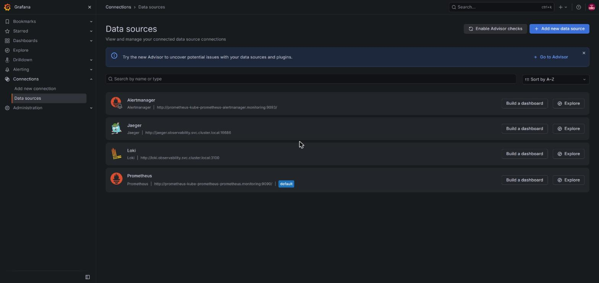

2. **Explore**, data source **Loki**, query `{container="podinfo"}`, **Run query**. Click a line,
   then under **Links** click **View trace**.

   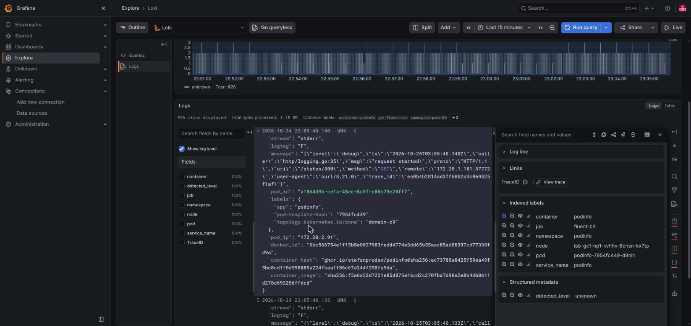

   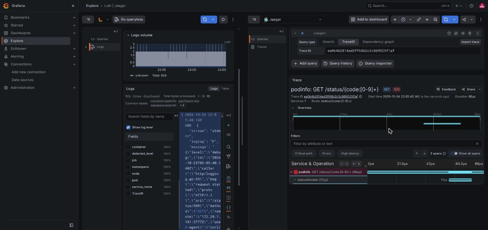

3. In the trace, click the `podinfo` span, then **Related logs**.

   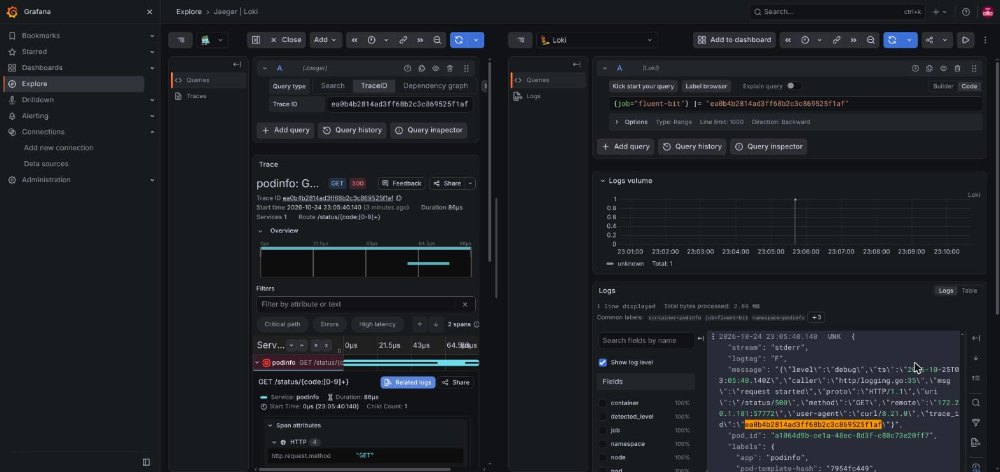

4. **Explore**, data source **Prometheus**, query
   `sum by (status) (rate(http_requests_total{namespace="podinfo"}[5m]))`, **Run query**.

   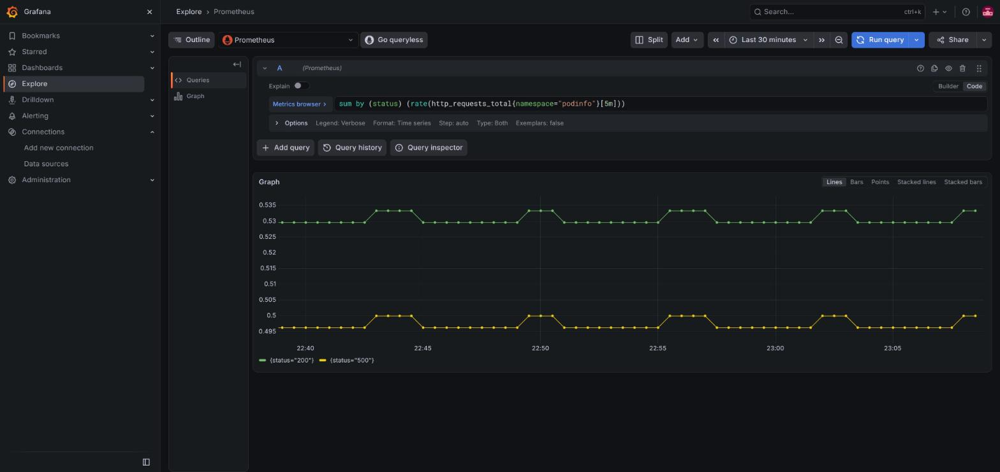

**Expect:** Loki `Data source successfully connected` and Jaeger `Data source is working`; log
lines from podinfo whose **View trace** opens a trace of two spans; **Related logs** shows the line
with that trace ID; and two series, `200` and `500`.

**If not:**
- `Loki` or `Jaeger` missing: wait a minute after step 8, then reload the page.
- Jaeger's test says `404 Not Found`: Jaeger is 2.21 or later; install the chart version from
  step 4.

## 10. See the cluster in VCF Operations

VCF Operations shows the VKS cluster and its node VMs through its vSphere Supervisor
integration, and the cluster's Kubernetes counts once step 11 is done. In VCF Operations:

1. In the search box at the top, type the cluster's name; under **VKS Cluster**, click it. This
   opens **Operate** → **Inventory** on the cluster's **Summary**.

   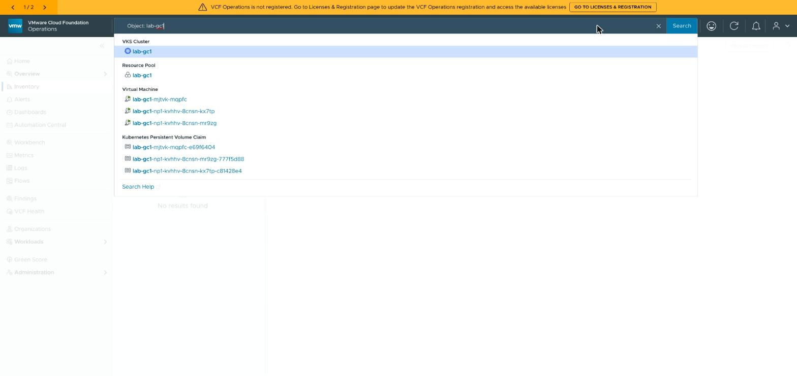

   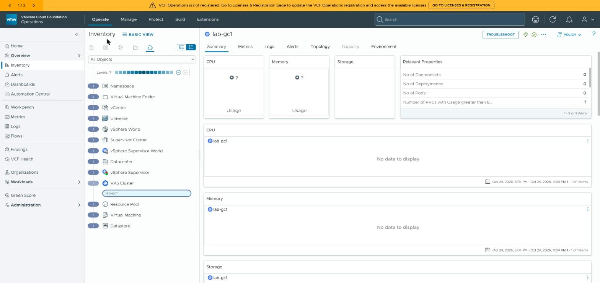

2. In the tree on the left, expand **Virtual Machine**, click a node, then **Details**.

   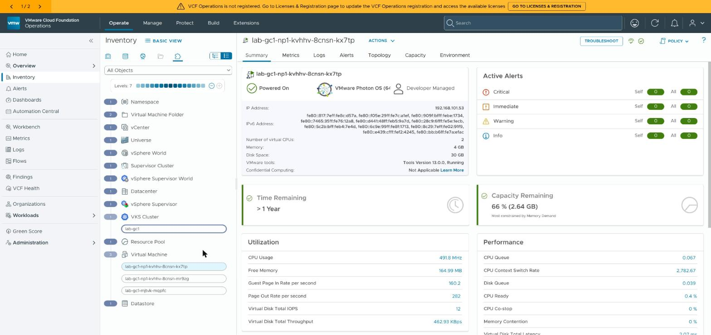

3. Open **Metrics**, type `Usage` in the metric search, and double-click **CPU** →
   **Usage (MHz)** and **Memory** → **Usage (%)**.

   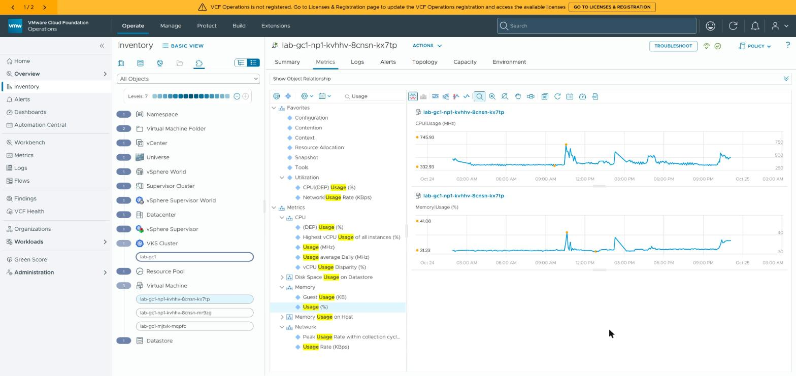

**Expect:** the search lists the cluster under **VKS Cluster**, its resource pool, its node VMs
and the nodes' volumes; each node VM `Powered On` with its CPU and memory use, and both charts.
Unless it sends metrics now (step 11), its own CPU and memory show `No data to display`; its
counts are `0` unless it ever sent them.

**If not:**
- **Home** and the **Inventory** tree show nothing (`No results found`): use the search box.
- The search finds no **VKS Cluster**: ask your VCF Operations administrator to turn on
  **Enable vSphere Supervisor Collection** on the vCenter account (**Administration** →
  **Integrations** → **Accounts**).

## 11. Let VCF Operations collect the cluster's Kubernetes metrics (optional)

This installs Broadcom's Metrics Aggregator Supervisor Service by hand and turns it on for your
VKS cluster. VCF Operations then shows the cluster's node, deployment, DaemonSet and namespace
counts and its CPU and memory (step 10). Broadcom documents this service only with VCF
Automation, which installs it by default; check with Broadcom that your licence covers it.

Once it is installed, the Supervisor labels every new VKS cluster `enabled`, and Broadcom's
Telegraf and Prometheus add-ons run in it (about 100 MiB per node; about 400 MiB on a 3-node
cluster), unless the cluster's label is `disabled`. On `best-effort-small` nodes the control
plane already uses about all its allocatable memory; the add-ons add about 80 MiB to it.

For this step you need:

- a vCenter administrator for steps 11.1 to 11.4, and for step 11.5 the Supervisor's kubeconfig
  of a user with the Edit role on the vSphere Namespace (or of a vCenter administrator)
  ([LOGIN.md](LOGIN.md)), saved as `~/.kube/supervisor.kubeconfig` (PowerShell:
  `$HOME\.kube\supervisor.kubeconfig`);
- a Broadcom support portal account for the download;
- a Supervisor that reaches `projects.packages.broadcom.com`;
- in VCF Operations, the vCenter account with **Enable vSphere Supervisor Collection** on (the
  default);
- about 100 MiB of memory to spare on each of the cluster's nodes, for the add-ons.

### 11.1 Check the Supervisor

This tells you whether the Supervisor already runs the Metrics Aggregator, records that it did
not, for step 12, and lists the VKS clusters with their monitoring label.

<details>
<summary><b>Linux, macOS, WSL (bash or zsh)</b></summary>

```sh
SUPERVISOR_KUBECONFIG="$HOME/.kube/supervisor.kubeconfig"
OBSERVABILITY_DIR="$HOME/.config/vks-guides/observability"

if ! SUP="$(kubectl --kubeconfig "$SUPERVISOR_KUBECONFIG" get namespace kube-system -o jsonpath='{.metadata.uid}')" || [ -z "$SUP" ]; then
  echo "FAILED: cannot read the Supervisor (see the error above)"
elif ! M="$(kubectl --kubeconfig "$SUPERVISOR_KUBECONFIG" get namespace -l appplatform.vmware.com/serviceId=metrics-aggregator -o name)"; then
  echo "FAILED: cannot list the Supervisor's namespaces (see the error above)"
else
  MARK="$OBSERVABILITY_DIR/metrics-aggregator-none-before-$SUP"
  echo "Metrics Aggregator on this Supervisor: ${M:-none}"
  if [ -z "$M" ] && [ ! -e "$MARK" ]; then
    mkdir -p "$OBSERVABILITY_DIR" && : > "$MARK"
  fi
  if [ -e "$MARK" ]; then
    echo "recorded: this Supervisor had no Metrics Aggregator when you began"
  else
    echo "recorded: nothing (a Metrics Aggregator was already here)"
  fi
  kubectl --kubeconfig "$SUPERVISOR_KUBECONFIG" get clusters.cluster.x-k8s.io -A \
    -L addons.kubernetes.vmware.com/automated-monitoring
fi
```

</details>

<details>
<summary><b>Windows (PowerShell)</b></summary>

```powershell
$SUPERVISOR_KUBECONFIG = "$HOME\.kube\supervisor.kubeconfig"
$OBSERVABILITY_DIR = "$HOME\.config\vks-guides\observability"

$global:LASTEXITCODE = $null
$SUP = kubectl --kubeconfig $SUPERVISOR_KUBECONFIG get namespace kube-system -o jsonpath='{.metadata.uid}'
if ($LASTEXITCODE -ne 0 -or -not $SUP) {
  "FAILED: cannot read the Supervisor (see the error above)"
} else {
  $M = kubectl --kubeconfig $SUPERVISOR_KUBECONFIG get namespace -l appplatform.vmware.com/serviceId=metrics-aggregator -o name
  if ($LASTEXITCODE -ne 0) {
    "FAILED: cannot list the Supervisor's namespaces (see the error above)"
  } else {
    $MARK = "$OBSERVABILITY_DIR\metrics-aggregator-none-before-$SUP"
    "Metrics Aggregator on this Supervisor: $(if ($M) { $M -join ' ' } else { 'none' })"
    if (-not $M -and -not (Test-Path $MARK)) {
      New-Item -ItemType Directory -Force -Path $OBSERVABILITY_DIR | Out-Null
      New-Item -ItemType File -Path $MARK | Out-Null
    }
    if (Test-Path $MARK) {
      "recorded: this Supervisor had no Metrics Aggregator when you began"
    } else {
      "recorded: nothing (a Metrics Aggregator was already here)"
    }
    kubectl --kubeconfig $SUPERVISOR_KUBECONFIG get clusters.cluster.x-k8s.io -A -L addons.kubernetes.vmware.com/automated-monitoring
  }
}
```

</details>

**Expect:** `Metrics Aggregator on this Supervisor: none`, then
`recorded: this Supervisor had no Metrics Aggregator when you began`, then each VKS cluster
with an empty `AUTOMATED-MONITORING` column, or `disabled`.

**If not:**
- `FAILED: …` above `Unauthorized`: run [Renew the Supervisor login](LOGIN.md#renew-the-supervisor-login).
  Above `Forbidden`: log in as a vCenter administrator.
- `namespace/svc-metrics-aggregator-…` and `recorded: nothing …`: the service is already
  installed. Skip to step 11.5.

### 11.2 Download the manifest

Download this file from Broadcom into `Downloads`. Tick **"I agree to the Terms and
Conditions"** if the page shows it, or the download icon does nothing.

| file | where to click |
|---|---|
| `metrics-aggregator-9.1.1-25665407-legacy.yml` | [Metrics Aggregator 9.1.1](https://support.broadcom.com/group/ecx/productfiles?subFamily=vSphere%20Supervisor%20Services&displayGroup=Metrics%20Aggregator&release=9.1.1&os=&language=EN) → *Installation Package Manifest (packages.broadcom.com will reach EOS at the end of 2027)* |

Take the manifest with **legacy** in its name: it downloads the service from
`projects.packages.broadcom.com`. The other one needs a VCF Software Depot. Do not put the file
into a Git repository; it is licensed to your Broadcom account.

**Linux, macOS, WSL (bash or zsh):**

```sh
METRICS_AGGREGATOR_MANIFEST="$HOME/Downloads/metrics-aggregator-9.1.1-25665407-legacy.yml"

if [ -f "$METRICS_AGGREGATOR_MANIFEST" ]; then
  printf '%s  %s\n' "$( (sha256sum "$METRICS_AGGREGATOR_MANIFEST" 2>/dev/null || shasum -a 256 "$METRICS_AGGREGATOR_MANIFEST") | awk '{print $1}')" "$(basename "$METRICS_AGGREGATOR_MANIFEST")"
else
  echo "Not found: $METRICS_AGGREGATOR_MANIFEST"
fi
```

**Windows (PowerShell):**

```powershell
$METRICS_AGGREGATOR_MANIFEST = "$HOME\Downloads\metrics-aggregator-9.1.1-25665407-legacy.yml"

if (Test-Path -LiteralPath $METRICS_AGGREGATOR_MANIFEST) {
  "$((Get-FileHash -Algorithm SHA256 -LiteralPath $METRICS_AGGREGATOR_MANIFEST).Hash.ToLower())  $(Split-Path -Leaf $METRICS_AGGREGATOR_MANIFEST)"
} else {
  "Not found: $METRICS_AGGREGATOR_MANIFEST"
}
```

**Expect:**

```text
685fda099d8150f0a63b83673bfeab2e81d748e04e604b26b2a541d1b59826d7  metrics-aggregator-9.1.1-25665407-legacy.yml
```

**If not:**
- `Not found: …`: the file is not in `Downloads` under that name. Set the variable to where it
  is.
- `bb05a178a86aa109e4956835d56aaf56f16934c4cbb4bd88f09d65530950623f`: that is the manifest
  without **legacy** in its name; download the other one.
- Any other checksum: a damaged or wrong download. Delete it and download it again.

### 11.3 Register the service with vCenter

Done once per vCenter. If a **Metrics Aggregator** card is already on the page in the first
picture, skip to step 11.4.

1. Open the vSphere Client. From the menu (☰, top left) choose **Supervisor Management**, then
   the **Services** tab.
2. On the **Add New Service** card click **ADD**.

   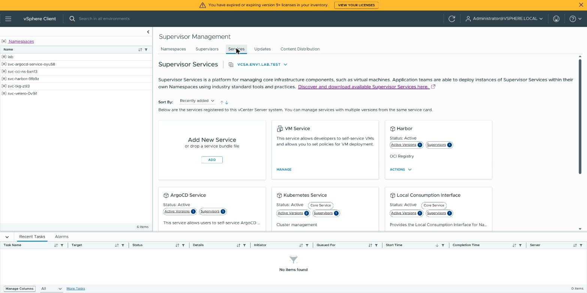

3. In the **New Service** window click **UPLOAD** and choose the manifest from step 11.2. The
   window shows *YAML was uploaded successfully*, name **Metrics Aggregator**, ID
   `metrics-aggregator.vmware.com`, version `9.1.1`.

   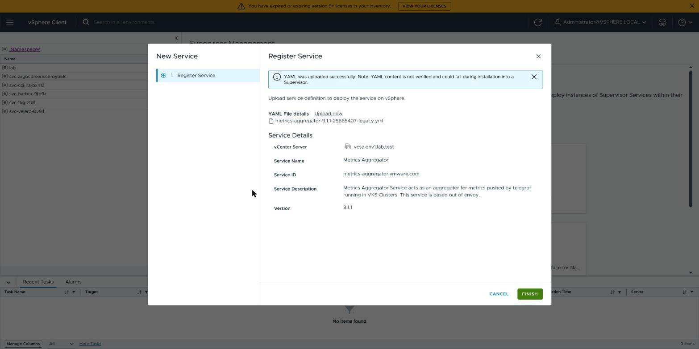

4. Click **FINISH**.

**Expect:** *Service 'Metrics Aggregator' is successfully registered*, and a **Metrics
Aggregator** card with **Active Versions 1** and **Supervisors 0**.

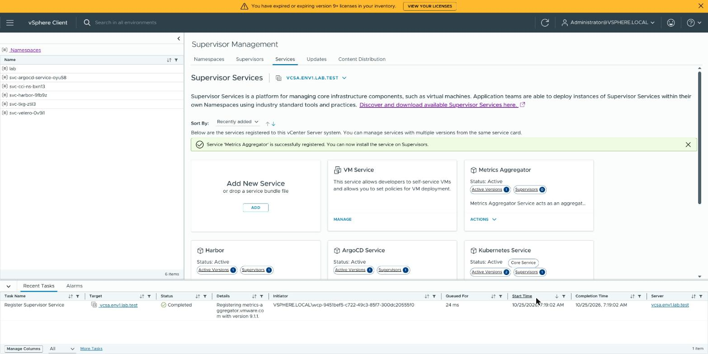

**If not:** no **ADD** button, or the upload is refused: your user may not manage Supervisor
Services. An error naming the YAML: you chose the wrong file.

### 11.4 Install the service on your Supervisor

1. On the **Metrics Aggregator** card click **ACTIONS**, then **Manage Service**.

   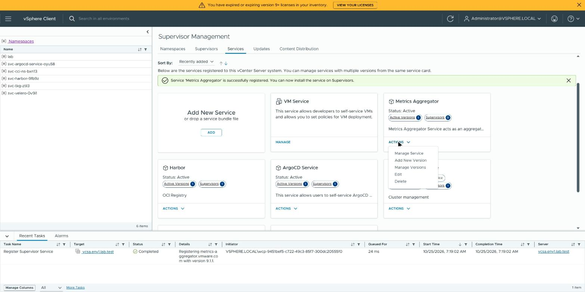

2. **Configure:** leave **Install Version** at `9.1.1`, select your Supervisor, click **NEXT**.

   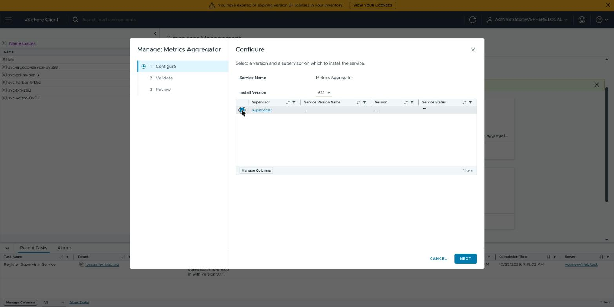

3. **Validate:** wait for *Validation completed successfully*, with **Compatibility Check** and
   **Signature Verification** both **Pass**. Click **NEXT**.

   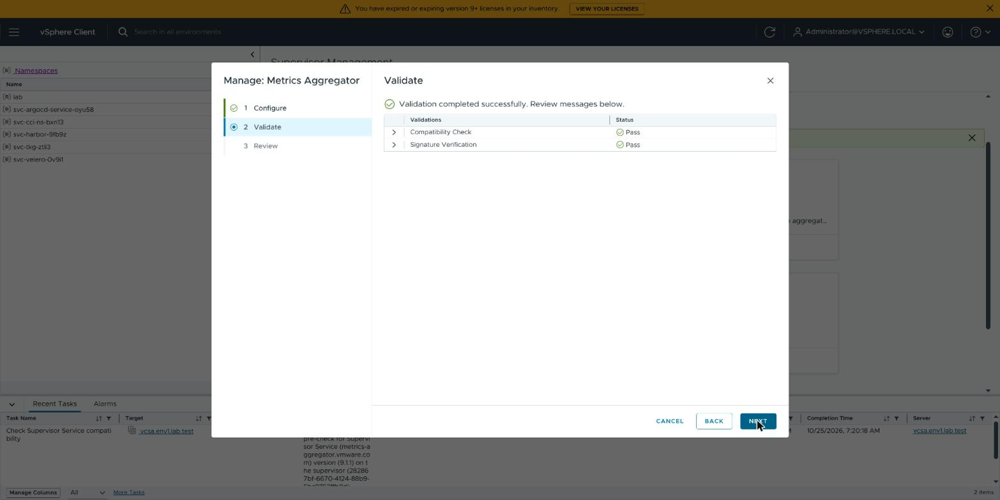

4. **Review:** leave **YAML Service Config (optional)** empty. Click **FINISH**.

   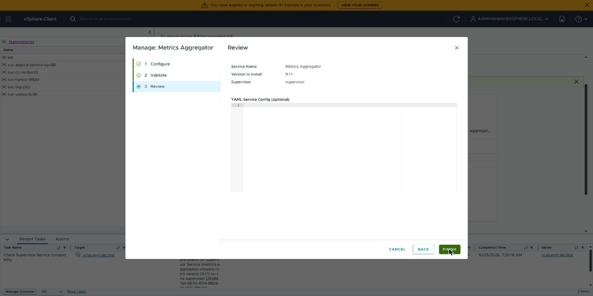

5. Open the **Supervisors** tab, and in your Supervisor's row click **View** in the **Services**
   column. Wait until the **Metrics Aggregator** row shows **Configured**: about a minute.

**Expect:** **Metrics Aggregator**, `svc-metrics-aggregator-…`, **Configured**, `9.1.1`,
**Trusted**.

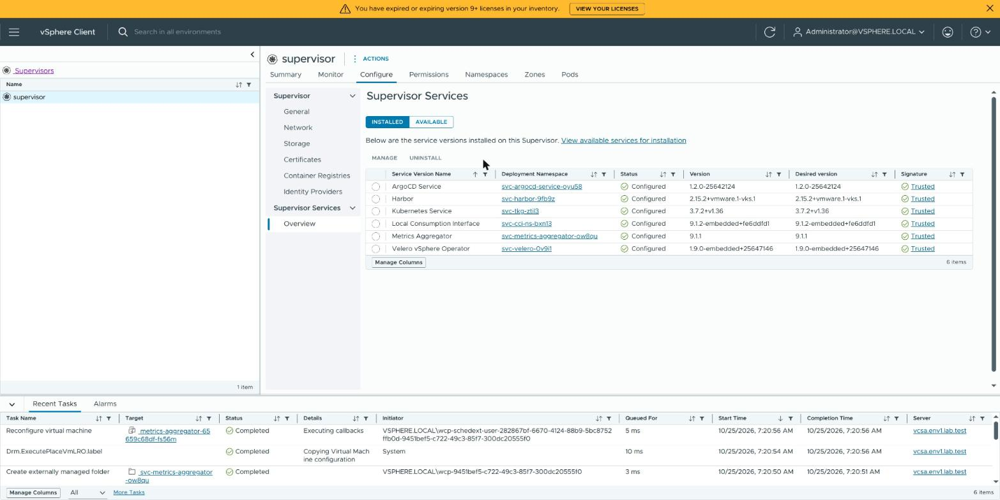

**If not:**
- A failed check in **Validate**: the message beside it says why.
- **Configuring** for more than 30 minutes, or an error naming an image: the Supervisor cannot
  reach `projects.packages.broadcom.com`. An error naming `depot.kube-system.svc`: you
  registered the manifest without **legacy** (step 11.2).

### 11.5 Turn it on for your VKS cluster

This sets your cluster's label to `enabled` on the Supervisor, then waits until the add-ons run
in the VKS cluster.

<details>
<summary><b>Linux, macOS, WSL (bash or zsh)</b></summary>

```sh
VKS_NAMESPACE="my-namespace"
VKS_CLUSTER="my-vks-cluster"
SUPERVISOR_KUBECONFIG="$HOME/.kube/supervisor.kubeconfig"
VKS_KUBECONFIG="$HOME/.kube/${VKS_CLUSTER}.kubeconfig"

addons() {
  kubectl --kubeconfig "$VKS_KUBECONFIG" -n tanzu-system-telegraf get daemonset telegraf >/dev/null 2>&1 \
    && kubectl --kubeconfig "$VKS_KUBECONFIG" -n tanzu-system-monitoring get daemonset prometheus-node-exporter >/dev/null 2>&1
}
if ! OLD="$(kubectl --kubeconfig "$VKS_KUBECONFIG" -n monitoring get deployment prometheus-kube-state-metrics \
     --ignore-not-found -o name)"; then
  echo "FAILED: cannot read the VKS cluster (see the error above)"
elif [ -n "$OLD" ]; then
  echo "FAILED: this cluster runs MONITORING.md from before kube-state-metrics was renamed; run its steps 4 and 5 (or step 9) again first"
elif kubectl --kubeconfig "$SUPERVISOR_KUBECONFIG" -n "$VKS_NAMESPACE" label clusters.cluster.x-k8s.io "$VKS_CLUSTER" \
       addons.kubernetes.vmware.com/automated-monitoring=enabled --overwrite; then
  n=0
  until addons || [ "$n" -ge 40 ]; do
    sleep 15; n=$((n + 1))
  done
  if addons; then
    kubectl --kubeconfig "$VKS_KUBECONFIG" -n tanzu-system-telegraf rollout status daemonset/telegraf --timeout=10m
    kubectl --kubeconfig "$VKS_KUBECONFIG" -n tanzu-system-monitoring rollout status daemonset/prometheus-node-exporter --timeout=10m
  else
    echo "FAILED: the add-ons did not appear in 10 minutes"
  fi
else
  echo "FAILED: label not set (see the error above)"
fi
```

</details>

<details>
<summary><b>Windows (PowerShell)</b></summary>

```powershell
$VKS_NAMESPACE = "my-namespace"
$VKS_CLUSTER = "my-vks-cluster"
$SUPERVISOR_KUBECONFIG = "$HOME\.kube\supervisor.kubeconfig"
$VKS_KUBECONFIG = "$HOME\.kube\${VKS_CLUSTER}.kubeconfig"

function Test-Addons {
  kubectl --kubeconfig $VKS_KUBECONFIG -n tanzu-system-telegraf get daemonset telegraf 2>$null | Out-Null
  if ($LASTEXITCODE -ne 0) { return $false }
  kubectl --kubeconfig $VKS_KUBECONFIG -n tanzu-system-monitoring get daemonset prometheus-node-exporter 2>$null | Out-Null
  return ($LASTEXITCODE -eq 0)
}
$global:LASTEXITCODE = $null
$OLD = kubectl --kubeconfig $VKS_KUBECONFIG -n monitoring get deployment prometheus-kube-state-metrics --ignore-not-found -o name
if ($LASTEXITCODE -ne 0) {
  "FAILED: cannot read the VKS cluster (see the error above)"
} elseif ($OLD) {
  "FAILED: this cluster runs MONITORING.md from before kube-state-metrics was renamed; run its steps 4 and 5 (or step 9) again first"
} else {
  kubectl --kubeconfig $SUPERVISOR_KUBECONFIG -n $VKS_NAMESPACE label clusters.cluster.x-k8s.io $VKS_CLUSTER addons.kubernetes.vmware.com/automated-monitoring=enabled --overwrite
  if ($LASTEXITCODE -ne 0) {
    "FAILED: label not set (see the error above)"
  } else {
    $n = 0
    while (-not (Test-Addons) -and $n -lt 40) { Start-Sleep 15; $n++ }
    if (Test-Addons) {
      kubectl --kubeconfig $VKS_KUBECONFIG -n tanzu-system-telegraf rollout status daemonset/telegraf --timeout=10m
      kubectl --kubeconfig $VKS_KUBECONFIG -n tanzu-system-monitoring rollout status daemonset/prometheus-node-exporter --timeout=10m
    } else {
      "FAILED: the add-ons did not appear in 10 minutes"
    }
  }
}
```

</details>

**Expect:** `cluster.cluster.x-k8s.io/<your cluster> labeled` (or `not labeled`, for a cluster
the Supervisor already labelled), then both `successfully rolled out`.

**If not:**
- `FAILED: cannot read the VKS cluster`: run
  [Get the VKS cluster's kubeconfig](LOGIN.md#get-the-vks-clusters-kubeconfig) first.
- `FAILED: this cluster runs MONITORING.md from before …`: do what it says, then run this again.
- `must have value 'enabled' or 'disabled'`: the label value is lowercase only.
- `Forbidden`: log in to the Supervisor as a user with the Edit role on the vSphere Namespace, or
  as a vCenter administrator.
- `FAILED: the add-ons did not appear in 10 minutes`: the service is not installed (step 11.4),
  or the Supervisor cannot reach `projects.packages.broadcom.com`.

### 11.6 Check in VCF Operations

Wait 10 minutes after step 11.5. In VCF Operations:

1. In the search box at the top, type the cluster's name; under **VKS Cluster**, click it.
2. Open **Metrics**, type `Usage` in the metric search, and double-click **CPU** →
   **Usage (Cores)** and **Memory** → **Usage (GB)**.

   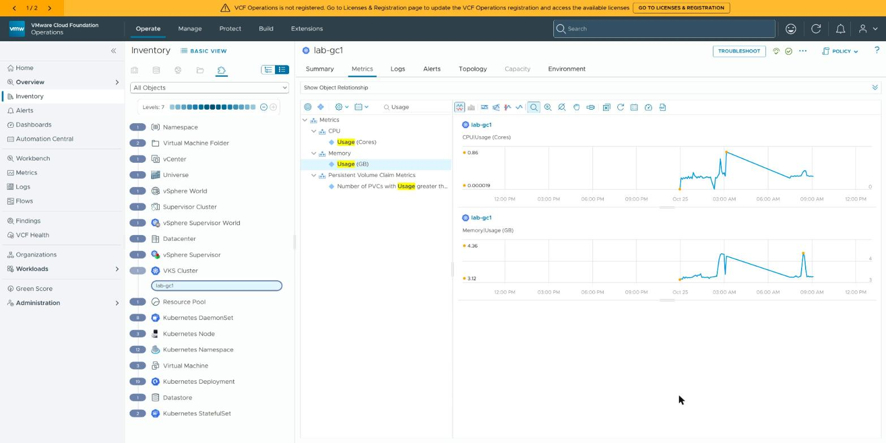

**Expect:** both charts have values from the last few minutes; a new one comes every 5 minutes.
Within an hour the **Summary** shows the cluster's DaemonSet and deployment counts and, under
**VKS Cluster** in the tree, its Kubernetes nodes, namespaces, deployments, DaemonSets and
StatefulSets. **No of Pods** stays `0`.

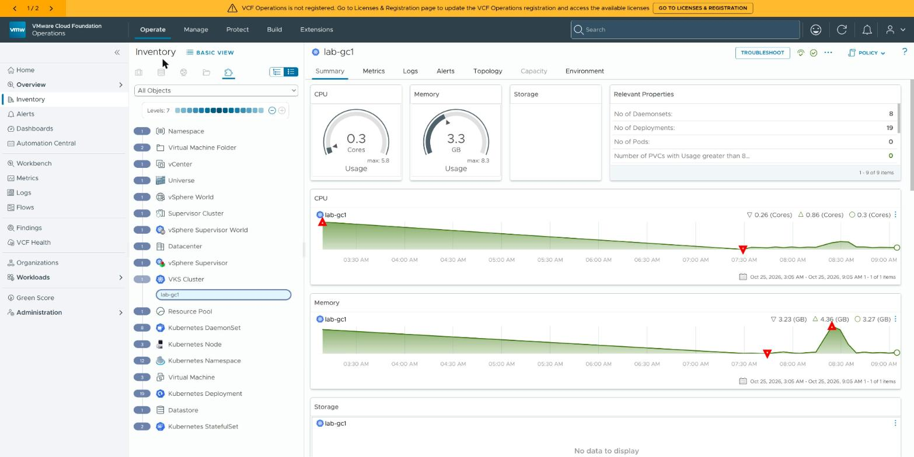

**If not:** no CPU or memory values after 20 minutes: check that step 11.4 shows **Configured**,
and that the vCenter account in VCF Operations has **Enable vSphere Supervisor Collection** on.

The counts keep their last values after collection stops; only fresh CPU and memory values show
that it works.

## 12. Uninstall (optional)

**This deletes the logs in Loki and the traces in Jaeger.** It removes the sample app, the data
sources (Grafana restarts to drop them), Jaeger, Loki and its volume, and the namespaces.

**Linux, macOS, WSL (bash or zsh):**

```sh
VKS_CLUSTER="my-vks-cluster"
VKS_KUBECONFIG="$HOME/.kube/${VKS_CLUSTER}.kubeconfig"

kubectl --kubeconfig "$VKS_KUBECONFIG" delete namespace podinfo --ignore-not-found
kubectl --kubeconfig "$VKS_KUBECONFIG" -n monitoring delete configmap observability-datasources --ignore-not-found
kubectl --kubeconfig "$VKS_KUBECONFIG" -n monitoring rollout restart deployment/prometheus-grafana
helm uninstall jaeger loki --kubeconfig "$VKS_KUBECONFIG" -n observability
kubectl --kubeconfig "$VKS_KUBECONFIG" delete namespace observability --ignore-not-found
```

**Windows (PowerShell):**

```powershell
$VKS_CLUSTER = "my-vks-cluster"
$VKS_KUBECONFIG = "$HOME\.kube\${VKS_CLUSTER}.kubeconfig"

kubectl --kubeconfig $VKS_KUBECONFIG delete namespace podinfo --ignore-not-found
kubectl --kubeconfig $VKS_KUBECONFIG -n monitoring delete configmap observability-datasources --ignore-not-found
kubectl --kubeconfig $VKS_KUBECONFIG -n monitoring rollout restart deployment/prometheus-grafana
helm uninstall jaeger loki --kubeconfig $VKS_KUBECONFIG -n observability
kubectl --kubeconfig $VKS_KUBECONFIG delete namespace observability --ignore-not-found
```

**Expect:** `namespace "podinfo" deleted`, `configmap "observability-datasources" deleted …`,
`deployment.apps/prometheus-grafana restarted`, `release "jaeger" uninstalled`, `release "loki" uninstalled` and
`namespace "observability" deleted`.

**If not:** `Release not loaded`: it was already uninstalled.

Then, for Fluent Bit: if you did LOGGING.md, run the block of its step 7 and skip its note about
this guide's step 5 (Loki is gone), so logs go only to Log Management again; otherwise remove the
add-on with LOGGING.md step 8.

### Turn off VCF Operations' collection (if you did step 11)

This sets your cluster's label to `disabled`, waits a minute, and checks that the add-ons left
the cluster.

**Linux, macOS, WSL (bash or zsh):**

```sh
VKS_NAMESPACE="my-namespace"
VKS_CLUSTER="my-vks-cluster"
SUPERVISOR_KUBECONFIG="$HOME/.kube/supervisor.kubeconfig"
VKS_KUBECONFIG="$HOME/.kube/${VKS_CLUSTER}.kubeconfig"

kubectl --kubeconfig "$SUPERVISOR_KUBECONFIG" -n "$VKS_NAMESPACE" label clusters.cluster.x-k8s.io "$VKS_CLUSTER" \
  addons.kubernetes.vmware.com/automated-monitoring=disabled --overwrite \
  && sleep 60 \
  && kubectl --kubeconfig "$VKS_KUBECONFIG" get namespace tanzu-system-telegraf tanzu-system-monitoring
```

**Windows (PowerShell):**

```powershell
$VKS_NAMESPACE = "my-namespace"
$VKS_CLUSTER = "my-vks-cluster"
$SUPERVISOR_KUBECONFIG = "$HOME\.kube\supervisor.kubeconfig"
$VKS_KUBECONFIG = "$HOME\.kube\${VKS_CLUSTER}.kubeconfig"

kubectl --kubeconfig $SUPERVISOR_KUBECONFIG -n $VKS_NAMESPACE label clusters.cluster.x-k8s.io $VKS_CLUSTER addons.kubernetes.vmware.com/automated-monitoring=disabled --overwrite
if ($LASTEXITCODE -eq 0) {
  Start-Sleep 60
  kubectl --kubeconfig $VKS_KUBECONFIG get namespace tanzu-system-telegraf tanzu-system-monitoring
}
```

**Expect:** `cluster.cluster.x-k8s.io/<your cluster> labeled` (`not labeled` if it already
was `disabled`), then `namespaces "tanzu-system-telegraf" not found` and the same for
`tanzu-system-monitoring`.

**If not:** a namespace is still listed: wait a minute and run the last command again.

### Remove the Metrics Aggregator (vCenter administrator)

**Only remove a Metrics Aggregator you installed, once no VKS cluster uses it.** This reads
step 11.1's record, on the machine that ran it, and lists the clusters still `enabled`.

<details>
<summary><b>Linux, macOS, WSL (bash or zsh)</b></summary>

```sh
SUPERVISOR_KUBECONFIG="$HOME/.kube/supervisor.kubeconfig"
OBSERVABILITY_DIR="$HOME/.config/vks-guides/observability"

if ! SUP="$(kubectl --kubeconfig "$SUPERVISOR_KUBECONFIG" get namespace kube-system -o jsonpath='{.metadata.uid}')" || [ -z "$SUP" ]; then
  echo "FAILED: cannot read the Supervisor (see the error above)"
elif ! ON="$(kubectl --kubeconfig "$SUPERVISOR_KUBECONFIG" get clusters.cluster.x-k8s.io -A \
       -l addons.kubernetes.vmware.com/automated-monitoring=enabled \
       -o jsonpath='{range .items[*]}{.metadata.namespace}/{.metadata.name}{"\n"}{end}')"; then
  echo "FAILED: cannot list the VKS clusters (see the error above)"
elif [ ! -e "$OBSERVABILITY_DIR/metrics-aggregator-none-before-$SUP" ]; then
  echo "DO NOT UNINSTALL: this machine has no record that this Supervisor had no Metrics Aggregator before yours"
elif [ -n "$ON" ]; then
  printf '%s\n' "$ON" | sed 's/^/still enabled: /'
  echo "DO NOT UNINSTALL yet: set these clusters to disabled first (ask their owners)"
else
  echo "MAY UNINSTALL: you installed it, and no VKS cluster is enabled"
fi
```

</details>

<details>
<summary><b>Windows (PowerShell)</b></summary>

```powershell
$SUPERVISOR_KUBECONFIG = "$HOME\.kube\supervisor.kubeconfig"
$OBSERVABILITY_DIR = "$HOME\.config\vks-guides\observability"

$global:LASTEXITCODE = $null
$SUP = kubectl --kubeconfig $SUPERVISOR_KUBECONFIG get namespace kube-system -o jsonpath='{.metadata.uid}'
if ($LASTEXITCODE -ne 0 -or -not $SUP) {
  "FAILED: cannot read the Supervisor (see the error above)"
} else {
  $ON = @(kubectl --kubeconfig $SUPERVISOR_KUBECONFIG get clusters.cluster.x-k8s.io -A -l addons.kubernetes.vmware.com/automated-monitoring=enabled -o jsonpath='{range .items[*]}{.metadata.namespace}/{.metadata.name}{''\n''}{end}' | Where-Object { $_ })
  if ($LASTEXITCODE -ne 0) {
    "FAILED: cannot list the VKS clusters (see the error above)"
  } elseif (-not (Test-Path "$OBSERVABILITY_DIR\metrics-aggregator-none-before-$SUP")) {
    "DO NOT UNINSTALL: this machine has no record that this Supervisor had no Metrics Aggregator before yours"
  } elseif ($ON.Count) {
    $ON | ForEach-Object { "still enabled: $_" }
    "DO NOT UNINSTALL yet: set these clusters to disabled first (ask their owners)"
  } else {
    "MAY UNINSTALL: you installed it, and no VKS cluster is enabled"
  }
}
```

</details>

**Expect:** `MAY UNINSTALL: you installed it, and no VKS cluster is enabled`. The record proves
only what step 11.1 saw, not who installed the Metrics Aggregator there now; if you are not sure
it is yours, ask the other vCenter administrators first.

**If not:**
- `DO NOT UNINSTALL: this machine has no record …`: stop. It was there when you began, or you
  ran step 11.1 on another machine.
- `DO NOT UNINSTALL yet` with `still enabled:` lines: those clusters still send to VCF
  Operations. Set each one to `disabled` (block above), then run this again.

Then, in the vSphere Client:

1. From the menu (☰) choose **Supervisor Management**, open the **Supervisors** tab, click your
   Supervisor, then **Configure** → **Supervisor Services** → **Overview** → **INSTALLED**.
   Select **Metrics Aggregator** and click **UNINSTALL**.

   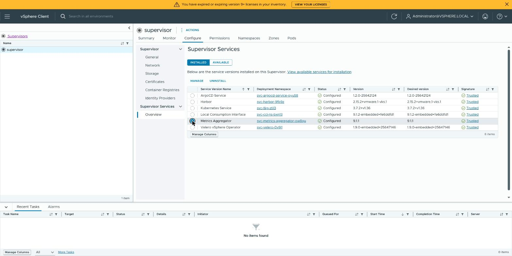

2. In **Uninstall Service on supervisor** click **UNINSTALL**. The row shows **Removing**, then
   disappears within a minute (click the refresh arrow at the top).

   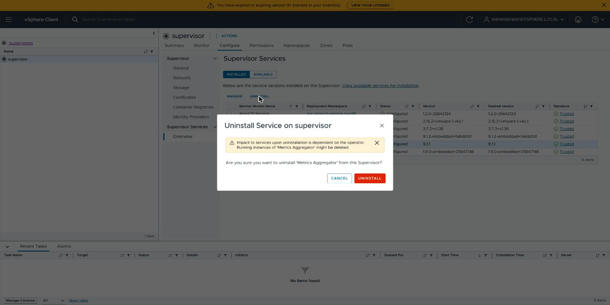

3. Only if no Supervisor of this vCenter runs it and you registered it in step 11.3: open
   **Supervisor Management** → **Services**. The **Metrics Aggregator** card must show
   **Supervisors 0**; click **ACTIONS** → **Delete**. In **Delete Metrics Aggregator**, check
   that **2. Uninstall all versions from Supervisors** has a ✓; otherwise stop and close the
   window. Click **CONFIRM** under **1. Deactivate service**, then **CONFIRM** under **3. Delete
   all versions of the Service**, then **DELETE**.

   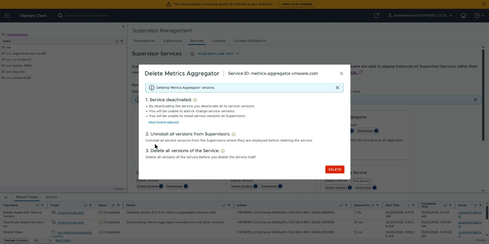

**Expect:** *'Metrics Aggregator' successfully deleted*, and no **Metrics Aggregator** card.

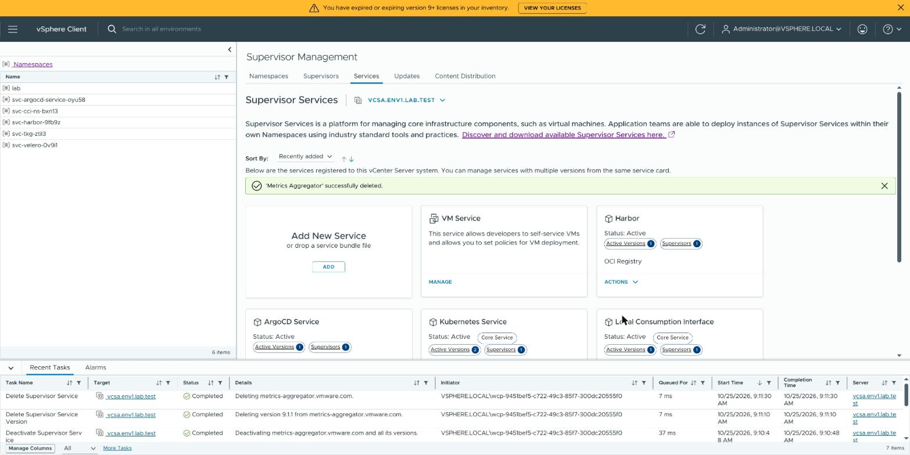

**If not:** **DELETE** stays grey: click the **CONFIRM** you missed under 1 or 3. If 2 has no ✓,
stop (see above).

**Remove step 11.1's record**, so a later run does not take a new install for yours:

**Linux, macOS, WSL (bash or zsh):**

```sh
SUPERVISOR_KUBECONFIG="$HOME/.kube/supervisor.kubeconfig"
OBSERVABILITY_DIR="$HOME/.config/vks-guides/observability"

if SUP="$(kubectl --kubeconfig "$SUPERVISOR_KUBECONFIG" get namespace kube-system -o jsonpath='{.metadata.uid}')" && [ -n "$SUP" ]; then
  rm -f "$OBSERVABILITY_DIR/metrics-aggregator-none-before-$SUP" && echo "record removed"
else
  echo "FAILED: cannot read the Supervisor (see the error above)"
fi
```

**Windows (PowerShell):**

```powershell
$SUPERVISOR_KUBECONFIG = "$HOME\.kube\supervisor.kubeconfig"
$OBSERVABILITY_DIR = "$HOME\.config\vks-guides\observability"

$global:LASTEXITCODE = $null
$SUP = kubectl --kubeconfig $SUPERVISOR_KUBECONFIG get namespace kube-system -o jsonpath='{.metadata.uid}'
if ($LASTEXITCODE -eq 0 -and $SUP) {
  Remove-Item -Force -ErrorAction SilentlyContinue "$OBSERVABILITY_DIR\metrics-aggregator-none-before-$SUP"
  "record removed"
} else {
  "FAILED: cannot read the Supervisor (see the error above)"
}
```

**Expect:** `record removed`.

What stays behind: the AddonInstalls in `vmware-system-vks-public` on the Supervisor, the
`telegraf-<cluster>` Secrets and Certificate in each vSphere Namespace, and the Service
`default/metrics-aggregator` in each VKS cluster. Leave every cluster at `disabled` once the
service is gone.

Back to [README](../README.md).
