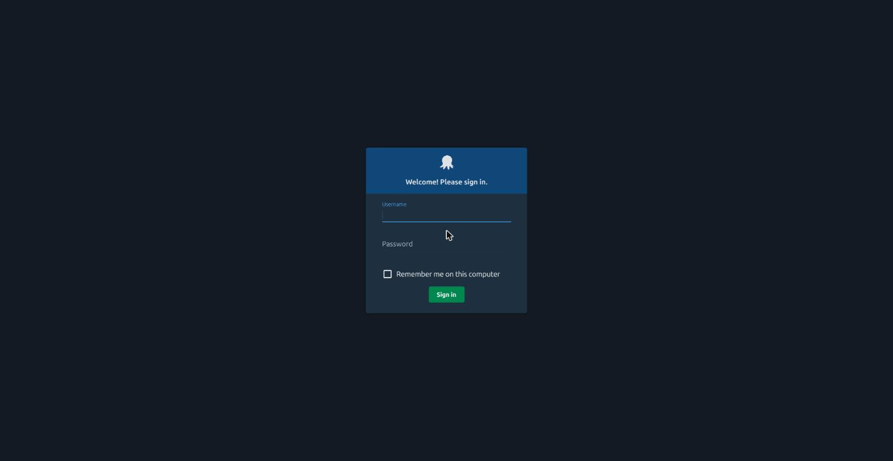
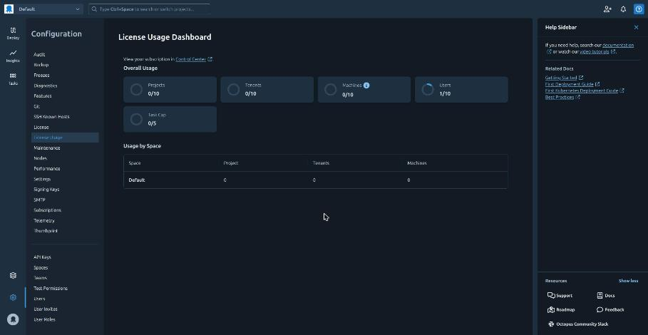
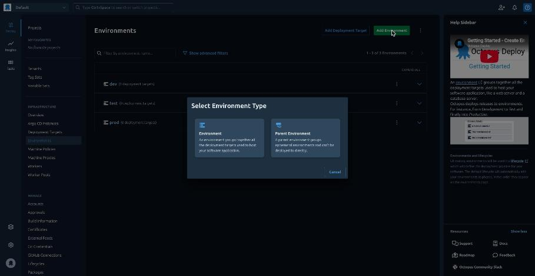
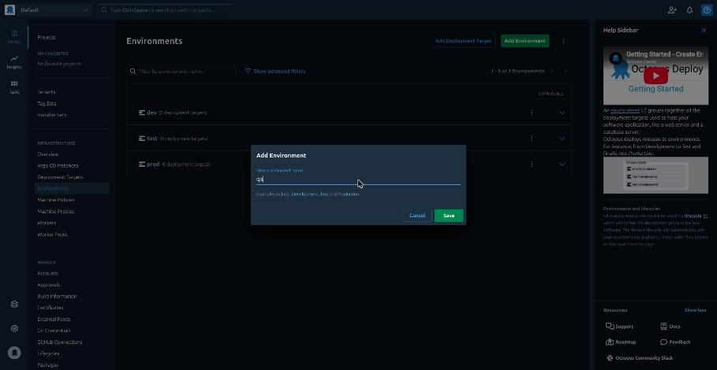
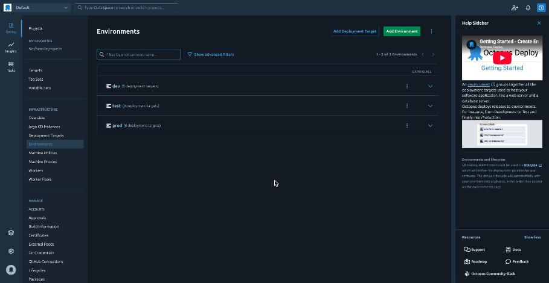
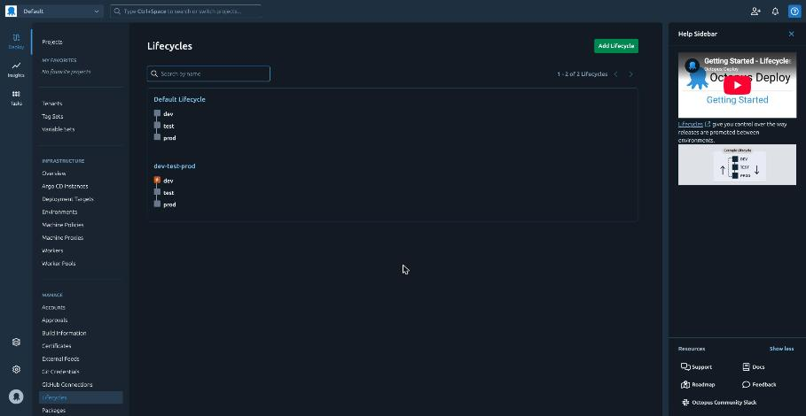

# Run Octopus Deploy in a VKS cluster

> [!NOTE]
> **Official Broadcom, Octopus, Microsoft, cert-manager and Kubernetes documentation for this guide**
>
> - Broadcom: [Install an Add-on Using the VCF CLI](https://techdocs.broadcom.com/us/en/vmware-cis/vcf/vcf-consumption/latest/managing-vsphere-kuberenetes-service-clusters-and-workloads/managing-add-ons-in-vks-clusters/install-an-add-on-using-the-vcf-cli.html) (cert-manager)
> - Octopus: [Octopus Deploy Helm chart](https://github.com/OctopusDeploy/helm-charts/blob/main/charts/octopus-deploy/README.md), [SQL Server database](https://octopus.com/docs/installation/sql-database), [Performance](https://octopus.com/docs/administration/managing-infrastructure/performance) (sizing), [Master key](https://octopus.com/docs/security/data-encryption), [Environments](https://octopus.com/docs/infrastructure/environments), [Lifecycles](https://octopus.com/docs/releases/lifecycles), [Docker feeds](https://octopus.com/docs/packaging-applications/package-repositories/docker-registries)
> - Microsoft: [SQL Server on Linux containers](https://learn.microsoft.com/en-us/sql/linux/sql-server-linux-docker-container-deployment), [Editions of SQL Server 2025](https://learn.microsoft.com/en-us/sql/sql-server/editions-and-components-of-sql-server-2025), [BACKUP](https://learn.microsoft.com/en-us/sql/t-sql/statements/backup-transact-sql)
> - cert-manager: [CA issuer](https://cert-manager.io/docs/configuration/ca/), [SelfSigned issuer](https://cert-manager.io/docs/configuration/selfsigned/)
> - Kubernetes: [Pod Security Standards](https://kubernetes.io/docs/concepts/security/pod-security-standards/) (`restricted`)

Octopus Deploy is a server that releases software to environments such as dev, test and prod, in
order and with approvals. This runs Octopus Server, with Microsoft SQL Server Express for its
data, in a VKS cluster, gives its web page an HTTPS certificate and an address, and creates the
environments dev, test and prod with a lifecycle that promotes releases through them.

Octopus has two addresses: its web page and REST API on port 443 (`octopus-web`, behind a small
nginx that holds the certificate), and its gRPC port 8443 (`octopus-grpc`), which keeps Octopus's
own certificate and is used by Octopus agents such as the Argo CD gateway. Port 80 (plain HTTP) is
on neither.

Every password and key goes into a Kubernetes Secret through a pipe: none is shown or put on a
command line, and none is saved in a file you did not ask for (on Windows, the sign-in in steps 9
and 10 uses a temporary file that the block deletes). Nothing secret goes into Helm. You keep one
thing yourself: the master key, which Octopus needs to read its own database (step 8).

Run the steps in order. Steps 11 to 14 are for later.

## Prerequisites

- a VKS cluster for Octopus, made as below;
- the [VCF CLI](VCF.md) with the context `supervisor` ([LOGIN.md](LOGIN.md)), for the cert-manager
  add-on (step 2);
- [kubectl](KUBECTL.md), [Helm](HELM.md), and [jq, curl and openssl](PREREQS.md);
- two free load-balancer addresses, one for each Service (step 4);
- an Octopus licence key, saved as a file: sign up for the free licence
  ([Octopus pricing](https://octopus.com/pricing): 10 projects, 10 deployment targets, 5 tasks at a
  time, 1 space) and save the licence key text (it starts with `<License`) as
  `octopus-license.xml` in your home folder;
- for step 11 only: Nexus from [NEXUS.md](NEXUS.md) and its `nexus-ca.pem`
  ([NEXUS.md step 7](NEXUS.md#7-save-nexuss-ca-and-check-its-address)).

Sizing. Octopus recommends, for a trial, 2 cores and 4 GB of memory for Octopus Server and 2 cores
and 4 GB for SQL Server Express
([Performance](https://octopus.com/docs/administration/managing-infrastructure/performance)). This
guide's manifests ask for 0.5 CPU and 2 GiB for Octopus (at most 4 GiB), 0.5 CPU and 2 GiB for SQL
Server (at most 3 GiB, of which SQL Server uses 2 GB) and a little for nginx: by those requests,
the smallest worker they fit on is the VM class `best-effort-medium` (2 CPUs, 8 GB). The images are
for amd64 nodes only, and need about 8 GiB of the worker's image disk.
<!-- TODO-MEASURE: VKS lab numbers (kubectl top, worker allocatable, image disk used, esxi host memory) -->

The cluster for Octopus:

1. Its vSphere Namespace offers the VM class `best-effort-medium` or larger
   ([NAMESPACE.md step 8](NAMESPACE.md#8-check-the-namespace) lists them under `VM classes:`; a
   vCenter administrator adds one with [NAMESPACE.md step 6](NAMESPACE.md#6-add-the-vm-classes)).
2. Create the cluster with
   [CLUSTER.md step 9](CLUSTER.md#9-create-the-cluster-with-kubectl-and-a-yaml-file), with that
   `vmClass`, one control-plane node and one worker (`replicas: 1` for both). Octopus's volumes take
   about 15 GB (SQL Server 10 GiB, and Octopus's `package-repository-claim`, `artifacts-claim`,
   `task-log-claim` and `audit-log-claim` of 1 GiB each and its server log of 200 MiB) on top of
   the nodes ([CLUSTER.md step 2](CLUSTER.md#2-choose-a-name-and-the-values)). A worker's image disk
   is about 15 GiB; when other applications share the worker, give it its own disk for container
   images with the `workers:` part in [CICD.md's Prerequisites](CICD.md#prerequisites).
   <!-- TODO-MEASURE: namespace storage used by the cluster plus volumes -->
3. Save its kubeconfig as `~/.kube/<cluster name>.kubeconfig`
   ([LOGIN.md](LOGIN.md#get-the-vks-clusters-kubeconfig)).

SQL Server. Octopus supports SQL Server versions that have at least two years of support left
([SQL Server database](https://octopus.com/docs/installation/sql-database)), and the free Express
edition. This guide runs SQL Server 2025 Express (a database of up to 50 GB), in the cluster, with
its own volume.

The connections this guide needs, for a firewall (all TCP, besides DNS; for a registry, also
[its other hosts](PREREQS.md#registry-hosts-for-a-firewall)):

| from | to | port | for |
|---|---|---|---|
| your machine | the Supervisor's address | 443 | the VCF CLI (step 2) |
| your machine | the VKS cluster's API address (in its kubeconfig) | 6443 | kubectl and Helm (all steps) |
| your machine | `ghcr.io` | 443 | the Octopus Helm chart (step 7) |
| the cluster's nodes | `projects.packages.broadcom.com` | 443 | the cert-manager add-on (step 2) |
| the cluster's nodes | `mcr.microsoft.com` | 443 | the SQL Server image (step 6) |
| the cluster's nodes | `docker.io` | 443 | the Octopus and nginx images (step 7) |
| your machine and your browser | `octopus-web`'s address (step 4) | 443 | Octopus's web page and REST API (steps 8 to 11) |
| Octopus agents (the Argo CD gateway) | `octopus-web`'s address and `octopus-grpc`'s address (step 4) | 443 and 8443 | Octopus's REST API and gRPC |
| the cluster's nodes | Nexus's address | 443 | the Docker feed (step 11) |
| the cluster's nodes | the hosts in [Octopus's outbound requests](https://octopus.com/docs/security/outbound-requests) | 443 | updates, step templates, telemetry (optional) |

## 1. Check the cluster

This checks that the nodes are ready, the free memory and image disk on each worker, that the
cluster has a default storage class, and that no `octopus` namespace exists yet. Octopus, SQL Server
and nginx ask for about 4.1 GiB of memory.

<details>
<summary><b>Linux, macOS, WSL (bash or zsh)</b></summary>

```sh
VKS_CLUSTER="my-octopus-cluster"
VKS_KUBECONFIG="$HOME/.kube/${VKS_CLUSTER}.kubeconfig"

if ! command -v kubectl >/dev/null 2>&1; then echo "MISSING: kubectl (KUBECTL.md)"
elif ! command -v jq >/dev/null 2>&1; then echo "MISSING: jq (PREREQS.md)"
elif ! command -v helm >/dev/null 2>&1; then echo "MISSING: helm (HELM.md)"
elif [ ! -s "$VKS_KUBECONFIG" ]; then echo "MISSING: $VKS_KUBECONFIG (LOGIN.md)"
elif kubectl --kubeconfig "$VKS_KUBECONFIG" get nodes -o wide \
     && N="$(kubectl --kubeconfig "$VKS_KUBECONFIG" get nodes -l '!node-role.kubernetes.io/control-plane' --no-headers -o 'custom-columns=NAME:.metadata.name,MEM:.status.allocatable.memory')" \
     && P="$(kubectl --kubeconfig "$VKS_KUBECONFIG" get pods -A --field-selector=status.phase!=Succeeded,status.phase!=Failed --no-headers -o 'custom-columns=NODE:.spec.nodeName,MEM:.spec.containers[*].resources.requests.memory')" \
     && J="$(kubectl --kubeconfig "$VKS_KUBECONFIG" get storageclass -o json)"; then
  { printf '%s\n' "$P" | sed 's/^/P /'; printf '%s\n' "$N" | sed 's/^/N /'; } | awk '
    function b(v) { if (v ~ /Ki$/) return v * 1024; if (v ~ /Mi$/) return v * 1048576; if (v ~ /Gi$/) return v * 1073741824
      if (v ~ /k$/) return v * 1000; if (v ~ /M$/) return v * 1000000; if (v ~ /G$/) return v * 1000000000; return v + 0 }
    $1 == "P" { n = split($3, a, ","); for (i = 1; i <= n; i++) if (a[i] != "<none>") r[$2] += b(a[i]) }
    $1 == "N" && NF == 3 { printf "%s %.1f\n", $2, (b($3) - r[$2]) / 1073741824 }' \
  | while read -r W M; do
      D="$(kubectl --kubeconfig "$VKS_KUBECONFIG" get --raw "/api/v1/nodes/$W/proxy/stats/summary" </dev/null | jq '.node.runtime.imageFs.availableBytes / 1073741824 | floor')"
      echo "worker $W: $M GiB memory free, ${D:-?} GiB image disk free"
    done
  echo "default storage class: $(printf '%s' "$J" | jq -r '[.items[] | select(.metadata.annotations["storageclass.kubernetes.io/is-default-class"] == "true") | .metadata.name] | if length == 0 then "NONE" else join(" ") end')"
  kubectl --kubeconfig "$VKS_KUBECONFIG" get namespace octopus 2>/dev/null && echo "NOTE: namespace octopus exists already"
else
  echo "FAILED: cannot read the cluster (see the error above)"
fi
```

</details>

<details>
<summary><b>Windows (PowerShell)</b></summary>

```powershell
$VKS_CLUSTER = "my-octopus-cluster"
$VKS_KUBECONFIG = "$HOME\.kube\${VKS_CLUSTER}.kubeconfig"

$global:LASTEXITCODE = $null
if (-not (Get-Command kubectl -ErrorAction SilentlyContinue)) { "MISSING: kubectl (KUBECTL.md)"; $global:LASTEXITCODE = 1 }
elseif (-not (Get-Command helm -ErrorAction SilentlyContinue)) { "MISSING: helm (HELM.md)"; $global:LASTEXITCODE = 1 }
elseif (-not (Test-Path $VKS_KUBECONFIG)) { "MISSING: $VKS_KUBECONFIG (LOGIN.md)"; $global:LASTEXITCODE = 1 }
else { kubectl --kubeconfig $VKS_KUBECONFIG get nodes -o wide }
if ($LASTEXITCODE -eq 0) { $N = @(kubectl --kubeconfig $VKS_KUBECONFIG get nodes -l '!node-role.kubernetes.io/control-plane' --no-headers -o 'custom-columns=NAME:.metadata.name,MEM:.status.allocatable.memory') }
if ($LASTEXITCODE -eq 0) { $P = @(kubectl --kubeconfig $VKS_KUBECONFIG get pods -A --field-selector=status.phase!=Succeeded,status.phase!=Failed --no-headers -o 'custom-columns=NODE:.spec.nodeName,MEM:.spec.containers[*].resources.requests.memory') }
if ($LASTEXITCODE -eq 0) { $J = kubectl --kubeconfig $VKS_KUBECONFIG get storageclass -o json | Out-String }
if ($LASTEXITCODE -eq 0) {
  function B($v) { if ($v -cmatch '^([\d.]+)(Ki|Mi|Gi|k|M|G)?$') { [double]$Matches[1] * @{ '' = 1; 'Ki' = 1KB; 'Mi' = 1MB; 'Gi' = 1GB; 'k' = 1e3; 'M' = 1e6; 'G' = 1e9 }[[string]$Matches[2]] } else { 0 } }
  $R = @{}
  foreach ($l in $P) { $f = -split $l; foreach ($c in ($f[1] -split ',')) { if ($c -and $c -ne '<none>') { $R[$f[0]] += (B $c) } } }
  foreach ($l in $N) {
    $f = -split $l
    $S = kubectl --kubeconfig $VKS_KUBECONFIG get --raw "/api/v1/nodes/$($f[0])/proxy/stats/summary" | Out-String | ConvertFrom-Json
    $A = if ($S) { $S.node.runtime.imageFs.availableBytes }
    $DISK = if ($null -ne $A) { [math]::Floor($A / 1GB) } else { '?' }
    "worker $($f[0]): $([math]::Round(((B $f[1]) - $R[$f[0]]) / 1GB, 1)) GiB memory free, $DISK GiB image disk free"
  }
  $D = @((ConvertFrom-Json $J).items | Where-Object { $_.metadata.annotations.'storageclass.kubernetes.io/is-default-class' -eq 'true' } | ForEach-Object { $_.metadata.name })
  "default storage class: $(if ($D.Count) { $D -join ' ' } else { 'NONE' })"
  kubectl --kubeconfig $VKS_KUBECONFIG get namespace octopus 2>$null
  if ($LASTEXITCODE -eq 0) { "NOTE: namespace octopus exists already" }
} else {
  "FAILED: cannot read the cluster (see the error above)"
}
```

</details>

**Expect:** each node `Ready`, a `worker …: … GiB memory free, … GiB image disk free` line per
worker, and `default storage class:` and a class name. Octopus, SQL Server and nginx need a worker
with at least 4.1 GiB memory and 8 GiB image disk free.
<!-- TODO-MEASURE: the image disk Octopus and SQL Server use on a VKS worker -->

**If not:**
- No worker with that much free: add a node pool with a larger VM class, or a worker with its own
  image disk (see "The cluster for Octopus" above).
- `? GiB image disk free`: your kubeconfig cannot read the node's statistics; ask the cluster's
  administrator whether a worker has 8 GiB free.
- `default storage class: NONE`: see [CLUSTER.md](CLUSTER.md) step 7.
- `NOTE: namespace octopus exists already`: Octopus may be installed; steps 3 to 7 keep what exists.

## 2. Install cert-manager

The certificate for Octopus's web page (step 5) comes from cert-manager, a Broadcom add-on of the
VKS cluster ([what add-ons are](ADDONS.md)). Run
[KEYCLOAK-VKS.md step 2](KEYCLOAK-VKS.md#2-install-cert-manager) once, with `VKS_CLUSTER` set to
Octopus's cluster and `VKS_NAMESPACE` to its vSphere Namespace. When the add-on is there already,
it changes nothing.

**Expect:** as in that step: `condition met` for the three cert-manager deployments, or
`cert-manager: already installed`.

## 3. Create the namespace and the Secrets

This creates the namespace `octopus`, which allows only pods that follow the `restricted` Pod
Security Standard, and these Secrets:

- `sql-sa` and `sql-octopus`: random passwords for SQL Server's administrator `sa` and for the
  login `octopus` that Octopus uses (step 6);
- `octopus-masterkey`: Octopus's random master key, which encrypts the secrets in its database;
- `octopus-adminusername` and `octopus-adminpassword`: Octopus's first user, `admin`, with the
  password you type;
- `octopus-licensekey`: your licence;
- `octopus-connectionstring`: how Octopus reaches its database, with the `octopus` login.

A Secret that exists is kept: SQL Server keeps the passwords it was first given, and Octopus cannot
read its database with another master key. Nothing prints a password or the key.

Type the password for Octopus's user `admin`, on its own (it is not shown):

**Linux, macOS, WSL (bash or zsh):**

```sh
printf 'Octopus admin password: '; IFS= read -rs OCTOPUS_ADMIN_PASSWORD; echo
```

**Windows (PowerShell):**

```powershell
$OCTOPUS_ADMIN_PASSWORD = Read-Host 'Octopus admin password' -AsSecureString
```

Then:

<details>
<summary><b>Linux, macOS, WSL (bash or zsh)</b></summary>

```sh
VKS_CLUSTER="my-octopus-cluster"
VKS_KUBECONFIG="$HOME/.kube/${VKS_CLUSTER}.kubeconfig"
OCTOPUS_LICENSE_FILE="$HOME/octopus-license.xml"

kc() { kubectl --kubeconfig "$VKS_KUBECONFIG" -n octopus "$@"; }
mk() { if kc get secret "$1" >/dev/null 2>&1; then echo "secret $1: exists, kept"; else kc create secret generic "$1" --from-file="$2=/dev/stdin" >/dev/null && echo "secret $1: created"; fi; }
pw() { printf 'A%sz' "$(openssl rand -hex 16)"; }
if ! command -v openssl >/dev/null 2>&1; then
  echo "MISSING: openssl (PREREQS.md)"
elif [ -z "${OCTOPUS_ADMIN_PASSWORD:-}" ]; then
  echo "STOPPED: type the admin password first (the line above)"
elif [ ! -s "$OCTOPUS_LICENSE_FILE" ] || ! grep -q '<License' "$OCTOPUS_LICENSE_FILE"; then
  echo "FAILED: $OCTOPUS_LICENSE_FILE is not an Octopus licence (it starts with <License)"
elif ! kubectl --kubeconfig "$VKS_KUBECONFIG" create namespace octopus --dry-run=client -o yaml \
       | kubectl --kubeconfig "$VKS_KUBECONFIG" apply -f - >/dev/null \
     || ! kubectl --kubeconfig "$VKS_KUBECONFIG" label namespace octopus --overwrite \
       pod-security.kubernetes.io/enforce=restricted pod-security.kubernetes.io/audit=restricted \
       pod-security.kubernetes.io/warn=restricted; then
  echo "FAILED: no namespace octopus (see the error above)"
else
  pw | mk sql-sa password
  pw | mk sql-octopus password
  openssl rand -base64 16 | tr -d '\n' | mk octopus-masterkey secret
  printf '%s' admin | mk octopus-adminusername secret
  printf '%s' "$OCTOPUS_ADMIN_PASSWORD" | mk octopus-adminpassword secret
  base64 < "$OCTOPUS_LICENSE_FILE" | tr -d '\n' | mk octopus-licensekey secret
  if kc get secret octopus-connectionstring >/dev/null 2>&1; then
    echo "secret octopus-connectionstring: exists, kept"
  elif P="$(kc get secret sql-octopus -o jsonpath='{.data.password}' | base64 -d)" && [ -n "$P" ]; then
    printf 'Server=sql;Initial Catalog=OctopusDeploy;Persist Security Info=False;User ID=octopus;Password=%s;Encrypt=True;TrustServerCertificate=True;Connection Timeout=30;' "$P" \
      | mk octopus-connectionstring secret
  else
    echo "FAILED: no secret sql-octopus (see the error above)"
  fi
fi
unset P OCTOPUS_ADMIN_PASSWORD
```

</details>

<details>
<summary><b>Windows (PowerShell)</b></summary>

```powershell
$VKS_CLUSTER = "my-octopus-cluster"
$VKS_KUBECONFIG = "$HOME\.kube\${VKS_CLUSTER}.kubeconfig"
$OCTOPUS_LICENSE_FILE = "$HOME\octopus-license.xml"

function kc { $input | kubectl --kubeconfig $VKS_KUBECONFIG -n octopus @args }
function b64($s) { [Convert]::ToBase64String([Text.Encoding]::UTF8.GetBytes($s)) }
function mk($name, $key, $value) {
  kc get secret $name 2>$null | Out-Null
  if ($LASTEXITCODE -eq 0) { "secret ${name}: exists, kept"; return }
  @('apiVersion: v1', 'kind: Secret', 'metadata:', "  name: $name", 'data:', "  ${key}: $(b64 $value)") | kc create -f - | Out-Null
  if ($LASTEXITCODE -eq 0) { "secret ${name}: created" }
}
function rnd($n) { $B = New-Object byte[] $n; [Security.Cryptography.RandomNumberGenerator]::Create().GetBytes($B); $B }
function pw { 'A' + ((rnd 16 | ForEach-Object { $_.ToString('x2') }) -join '') + 'z' }
$global:LASTEXITCODE = $null
if (-not $OCTOPUS_ADMIN_PASSWORD -or $OCTOPUS_ADMIN_PASSWORD.Length -eq 0) { "STOPPED: type the admin password first (the line above)" }
elseif (-not (Test-Path $OCTOPUS_LICENSE_FILE) -or -not (Select-String -Quiet -SimpleMatch '<License' $OCTOPUS_LICENSE_FILE)) { "FAILED: $OCTOPUS_LICENSE_FILE is not an Octopus licence (it starts with <License)" }
else {
  kubectl --kubeconfig $VKS_KUBECONFIG create namespace octopus --dry-run=client -o yaml | kubectl --kubeconfig $VKS_KUBECONFIG apply -f - | Out-Null
  kubectl --kubeconfig $VKS_KUBECONFIG label namespace octopus --overwrite pod-security.kubernetes.io/enforce=restricted pod-security.kubernetes.io/audit=restricted pod-security.kubernetes.io/warn=restricted
  if ($LASTEXITCODE -ne 0) { "FAILED: no namespace octopus (see the error above)" }
  else {
    mk sql-sa password (pw)
    mk sql-octopus password (pw)
    mk octopus-masterkey secret ([Convert]::ToBase64String((rnd 16)))
    mk octopus-adminusername secret 'admin'
    mk octopus-adminpassword secret ([Net.NetworkCredential]::new('', $OCTOPUS_ADMIN_PASSWORD).Password)
    mk octopus-licensekey secret ([Convert]::ToBase64String([IO.File]::ReadAllBytes($OCTOPUS_LICENSE_FILE)))
    $B = kc get secret sql-octopus -o 'jsonpath={.data.password}'
    if ($LASTEXITCODE -eq 0 -and $B) {
      $P = [Text.Encoding]::UTF8.GetString([Convert]::FromBase64String($B))
      mk octopus-connectionstring secret "Server=sql;Initial Catalog=OctopusDeploy;Persist Security Info=False;User ID=octopus;Password=$P;Encrypt=True;TrustServerCertificate=True;Connection Timeout=30;"
      $P = $null
    } else { "FAILED: no secret sql-octopus (see the error above)" }
    $B = $null
  }
}
Remove-Variable -ErrorAction SilentlyContinue OCTOPUS_ADMIN_PASSWORD
```

</details>

**Expect:** `namespace/octopus labeled`, then seven `secret …: created` lines
(`namespace/octopus not labeled` and `exists, kept` when run again).

**If not:**
- `STOPPED: type the admin password first`: run the one-line block above, then this one, in the
  same terminal.
- `FAILED: … is not an Octopus licence`: save the licence key text from Octopus (it starts with
  `<License`) as that file.
- `Error from server (Forbidden)`: the kubeconfig is not the cluster's administrator file.
- To change the admin password later, use step 13; this step keeps the Secret that exists.

## 4. Create the Services and get Octopus's addresses

This creates Octopus's two Services, which get addresses from the Supervisor's load balancer:
`octopus-web` on port 443 for the web page and REST API, and `octopus-grpc` on port 8443 for gRPC.
Octopus itself starts in step 7. An address stays while its Service exists; deleting a Service
gives its address back, and a new Service can get another one: then step 5, step 8 and every
bookmark and agent that uses the old address must change.

<details>
<summary><b>Linux, macOS, WSL (bash or zsh)</b></summary>

```sh
VKS_CLUSTER="my-octopus-cluster"
VKS_KUBECONFIG="$HOME/.kube/${VKS_CLUSTER}.kubeconfig"

cat <<'EOF' | kubectl --kubeconfig "$VKS_KUBECONFIG" -n octopus apply -f -
apiVersion: v1
kind: Service
metadata:
  name: octopus-web
spec:
  type: LoadBalancer
  selector:
    app: octopus-proxy
  ports:
    - name: https
      port: 443
      targetPort: 8443
---
apiVersion: v1
kind: Service
metadata:
  name: octopus-grpc
spec:
  type: LoadBalancer
  selector:
    app.kubernetes.io/component: octopus-server
    app.kubernetes.io/instance: octopus
    app.kubernetes.io/name: octopus-deploy
  ports:
    - name: grpc
      port: 8443
      targetPort: 8443
EOF
W=""; G=""
for i in $(seq 60); do
  W="$(kubectl --kubeconfig "$VKS_KUBECONFIG" -n octopus get service octopus-web -o jsonpath='{.status.loadBalancer.ingress[0].ip}')"
  G="$(kubectl --kubeconfig "$VKS_KUBECONFIG" -n octopus get service octopus-grpc -o jsonpath='{.status.loadBalancer.ingress[0].ip}')"
  [ -n "$W" ] && [ -n "$G" ] && break
  sleep 5
done
if [ -n "$W" ] && [ -n "$G" ]; then
  echo "Octopus's web address: $W"
  echo "Octopus's gRPC address: $G"
else
  echo "FAILED: no load balancer address in 5 minutes"
fi
```

</details>

<details>
<summary><b>Windows (PowerShell)</b></summary>

```powershell
$VKS_CLUSTER = "my-octopus-cluster"
$VKS_KUBECONFIG = "$HOME\.kube\${VKS_CLUSTER}.kubeconfig"

@'
apiVersion: v1
kind: Service
metadata:
  name: octopus-web
spec:
  type: LoadBalancer
  selector:
    app: octopus-proxy
  ports:
    - name: https
      port: 443
      targetPort: 8443
---
apiVersion: v1
kind: Service
metadata:
  name: octopus-grpc
spec:
  type: LoadBalancer
  selector:
    app.kubernetes.io/component: octopus-server
    app.kubernetes.io/instance: octopus
    app.kubernetes.io/name: octopus-deploy
  ports:
    - name: grpc
      port: 8443
      targetPort: 8443
'@ | kubectl --kubeconfig $VKS_KUBECONFIG -n octopus apply -f -
$W = ''; $G = ''
foreach ($i in 1..60) {
  $W = kubectl --kubeconfig $VKS_KUBECONFIG -n octopus get service octopus-web -o 'jsonpath={.status.loadBalancer.ingress[0].ip}'
  $G = kubectl --kubeconfig $VKS_KUBECONFIG -n octopus get service octopus-grpc -o 'jsonpath={.status.loadBalancer.ingress[0].ip}'
  if ($W -and $G) { break }
  Start-Sleep 5
}
if ($W -and $G) { "Octopus's web address: $W"; "Octopus's gRPC address: $G" } else { "FAILED: no load balancer address in 5 minutes" }
```

</details>

**Expect:** `service/octopus-web created` and `service/octopus-grpc created` (`unchanged` when run
again), then `Octopus's web address:` and `Octopus's gRPC address:`, each with an IP address. Use
the web address as `OCTOPUS_ADDRESS` from here on.

**If not:** `FAILED: no load balancer address`: the cluster has no two free load balancer
addresses; ask your vSphere administrator.

## 5. Make the web page's certificate

This makes a CA (certificate authority) of your own with cert-manager, valid for 10 years, and from
it a certificate for Octopus's web address from step 4. cert-manager renews the certificate before
it ends; nginx picks the new one up within about 6 minutes. The gRPC port keeps Octopus's own
certificate.

<details>
<summary><b>Linux, macOS, WSL (bash or zsh)</b></summary>

```sh
VKS_CLUSTER="my-octopus-cluster"
VKS_KUBECONFIG="$HOME/.kube/${VKS_CLUSTER}.kubeconfig"

IP="$(kubectl --kubeconfig "$VKS_KUBECONFIG" -n octopus get service octopus-web -o jsonpath='{.status.loadBalancer.ingress[0].ip}')"
if [ -z "$IP" ]; then
  echo "FAILED: the Service octopus-web has no address (step 4)"
else
cat <<EOF | kubectl --kubeconfig "$VKS_KUBECONFIG" -n octopus apply -f - \
  && kubectl --kubeconfig "$VKS_KUBECONFIG" -n octopus wait --for=condition=Ready certificate --all --timeout=3m
apiVersion: cert-manager.io/v1
kind: Issuer
metadata:
  name: octopus-selfsigned
spec:
  selfSigned: {}
---
apiVersion: cert-manager.io/v1
kind: Certificate
metadata:
  name: octopus-ca
spec:
  isCA: true
  commonName: Octopus CA
  duration: 87600h
  secretName: octopus-ca
  privateKey:
    algorithm: ECDSA
    size: 256
  issuerRef:
    name: octopus-selfsigned
    kind: Issuer
---
apiVersion: cert-manager.io/v1
kind: Issuer
metadata:
  name: octopus-ca
spec:
  ca:
    secretName: octopus-ca
---
apiVersion: cert-manager.io/v1
kind: Certificate
metadata:
  name: octopus-tls
spec:
  secretName: octopus-tls
  commonName: ${IP}
  ipAddresses:
    - ${IP}
  usages:
    - server auth
  issuerRef:
    name: octopus-ca
    kind: Issuer
EOF
fi
```

</details>

<details>
<summary><b>Windows (PowerShell)</b></summary>

```powershell
$VKS_CLUSTER = "my-octopus-cluster"
$VKS_KUBECONFIG = "$HOME\.kube\${VKS_CLUSTER}.kubeconfig"

$global:LASTEXITCODE = $null
$IP = kubectl --kubeconfig $VKS_KUBECONFIG -n octopus get service octopus-web -o 'jsonpath={.status.loadBalancer.ingress[0].ip}'
if (-not $IP) { "FAILED: the Service octopus-web has no address (step 4)" }
else {
@"
apiVersion: cert-manager.io/v1
kind: Issuer
metadata:
  name: octopus-selfsigned
spec:
  selfSigned: {}
---
apiVersion: cert-manager.io/v1
kind: Certificate
metadata:
  name: octopus-ca
spec:
  isCA: true
  commonName: Octopus CA
  duration: 87600h
  secretName: octopus-ca
  privateKey:
    algorithm: ECDSA
    size: 256
  issuerRef:
    name: octopus-selfsigned
    kind: Issuer
---
apiVersion: cert-manager.io/v1
kind: Issuer
metadata:
  name: octopus-ca
spec:
  ca:
    secretName: octopus-ca
---
apiVersion: cert-manager.io/v1
kind: Certificate
metadata:
  name: octopus-tls
spec:
  secretName: octopus-tls
  commonName: $IP
  ipAddresses:
    - $IP
  usages:
    - server auth
  issuerRef:
    name: octopus-ca
    kind: Issuer
"@ | kubectl --kubeconfig $VKS_KUBECONFIG -n octopus apply -f -
if ($LASTEXITCODE -eq 0) { kubectl --kubeconfig $VKS_KUBECONFIG -n octopus wait --for=condition=Ready certificate --all --timeout=3m }
}
```

</details>

**Expect:** four `created` lines (`unchanged` when run again), then
`certificate.cert-manager.io/octopus-ca condition met` and `…/octopus-tls condition met`.

**If not:**
- `no matches for kind "Issuer"`: step 2 did not finish.
- `failed calling webhook "webhook.cert-manager.io"`: cert-manager is still starting. Wait a minute
  and run this block again.
- `timed out`: `kubectl -n octopus describe certificate octopus-tls` shows why.

## 6. Run SQL Server and create Octopus's database

This runs SQL Server 2025 Express with a 10 GB volume, waits until it accepts logins, then creates
the database `OctopusDeploy` and the login `octopus` that owns it. Octopus uses that login, not
`sa`. The SQL statements go to `sqlcmd` in the pod on its input, and `sqlcmd` reads the `sa`
password from the pod's own environment: no password is on a command line.

<details>
<summary><b>Linux, macOS, WSL (bash or zsh)</b></summary>

```sh
VKS_CLUSTER="my-octopus-cluster"
VKS_KUBECONFIG="$HOME/.kube/${VKS_CLUSTER}.kubeconfig"
SQL_IMAGE="mcr.microsoft.com/mssql/server:2025-CU10-ubuntu-22.04@sha256:6972fb831759433def6a34e107fa32a85230bff5af8014c6263fe4633ea9cc0f"

kc() { kubectl --kubeconfig "$VKS_KUBECONFIG" -n octopus "$@"; }
sq() { kc exec -i sql-0 -- sh -c 'SQLCMDPASSWORD="$MSSQL_SA_PASSWORD" /opt/mssql-tools18/bin/sqlcmd -S localhost -U sa -C -b -h -1 -W'; }
cat <<EOF | kc apply -f -
apiVersion: v1
kind: Service
metadata:
  name: sql
spec:
  selector:
    app: sql
  ports:
    - name: sql
      port: 1433
      targetPort: 1433
---
apiVersion: apps/v1
kind: StatefulSet
metadata:
  name: sql
spec:
  serviceName: sql
  replicas: 1
  selector:
    matchLabels:
      app: sql
  template:
    metadata:
      labels:
        app: sql
    spec:
      automountServiceAccountToken: false
      securityContext:
        runAsNonRoot: true
        runAsUser: 10001
        runAsGroup: 10001
        fsGroup: 10001
        fsGroupChangePolicy: OnRootMismatch
        seccompProfile:
          type: RuntimeDefault
      containers:
        - name: sql
          image: ${SQL_IMAGE}
          env:
            - name: ACCEPT_EULA
              value: "Y"
            - name: MSSQL_PID
              value: Express
            - name: MSSQL_MEMORY_LIMIT_MB
              value: "2048"
            - name: MSSQL_SA_PASSWORD
              valueFrom:
                secretKeyRef:
                  name: sql-sa
                  key: password
          ports:
            - containerPort: 1433
          readinessProbe:
            tcpSocket:
              port: 1433
            periodSeconds: 10
          resources:
            requests:
              cpu: 500m
              memory: 2Gi
            limits:
              memory: 3Gi
          securityContext:
            allowPrivilegeEscalation: false
            readOnlyRootFilesystem: true
            capabilities:
              drop: ["ALL"]
              add: ["NET_BIND_SERVICE"]
          volumeMounts:
            - name: data
              mountPath: /var/opt/mssql
            - name: tmp
              mountPath: /tmp
      volumes:
        - name: tmp
          emptyDir:
            sizeLimit: 1Gi
  volumeClaimTemplates:
    - metadata:
        name: data
      spec:
        accessModes: ["ReadWriteOnce"]
        resources:
          requests:
            storage: 10Gi
EOF
V=""
if kc rollout status statefulset/sql --timeout=10m; then
  for i in $(seq 30); do
    V="$(printf "SET NOCOUNT ON;\nSELECT CONVERT(varchar(60), SERVERPROPERTY('Edition')) + ' ' + CONVERT(varchar(30), SERVERPROPERTY('ProductVersion'));\nGO\n" | sq 2>/dev/null)" && break
    sleep 5
  done
fi
if [ -z "$V" ]; then
  echo "FAILED: SQL Server does not accept logins (see kubectl -n octopus logs sql-0)"
elif ! P="$(kc get secret sql-octopus -o jsonpath='{.data.password}' | base64 -d)" || [ -z "$P" ]; then
  echo "FAILED: no secret sql-octopus (step 3)"
else
  echo "SQL Server: $V"
  printf "SET NOCOUNT ON;\nIF DB_ID('OctopusDeploy') IS NULL CREATE DATABASE OctopusDeploy;\nIF SUSER_ID('octopus') IS NULL CREATE LOGIN octopus WITH PASSWORD = '%s';\nALTER AUTHORIZATION ON DATABASE::OctopusDeploy TO octopus;\nSELECT 'database owner: ' + SUSER_SNAME(owner_sid) FROM sys.databases WHERE name = 'OctopusDeploy';\nGO\n" "$P" | sq
fi
unset P
```

</details>

<details>
<summary><b>Windows (PowerShell)</b></summary>

```powershell
$VKS_CLUSTER = "my-octopus-cluster"
$VKS_KUBECONFIG = "$HOME\.kube\${VKS_CLUSTER}.kubeconfig"
$SQL_IMAGE = "mcr.microsoft.com/mssql/server:2025-CU10-ubuntu-22.04@sha256:6972fb831759433def6a34e107fa32a85230bff5af8014c6263fe4633ea9cc0f"

function kc { $input | kubectl --kubeconfig $VKS_KUBECONFIG -n octopus @args }
function sq { $input | kc exec -i sql-0 -- sh -c 'SQLCMDPASSWORD="$MSSQL_SA_PASSWORD" /opt/mssql-tools18/bin/sqlcmd -S localhost -U sa -C -b -h -1 -W' }
$global:LASTEXITCODE = $null
@"
apiVersion: v1
kind: Service
metadata:
  name: sql
spec:
  selector:
    app: sql
  ports:
    - name: sql
      port: 1433
      targetPort: 1433
---
apiVersion: apps/v1
kind: StatefulSet
metadata:
  name: sql
spec:
  serviceName: sql
  replicas: 1
  selector:
    matchLabels:
      app: sql
  template:
    metadata:
      labels:
        app: sql
    spec:
      automountServiceAccountToken: false
      securityContext:
        runAsNonRoot: true
        runAsUser: 10001
        runAsGroup: 10001
        fsGroup: 10001
        fsGroupChangePolicy: OnRootMismatch
        seccompProfile:
          type: RuntimeDefault
      containers:
        - name: sql
          image: $SQL_IMAGE
          env:
            - name: ACCEPT_EULA
              value: "Y"
            - name: MSSQL_PID
              value: Express
            - name: MSSQL_MEMORY_LIMIT_MB
              value: "2048"
            - name: MSSQL_SA_PASSWORD
              valueFrom:
                secretKeyRef:
                  name: sql-sa
                  key: password
          ports:
            - containerPort: 1433
          readinessProbe:
            tcpSocket:
              port: 1433
            periodSeconds: 10
          resources:
            requests:
              cpu: 500m
              memory: 2Gi
            limits:
              memory: 3Gi
          securityContext:
            allowPrivilegeEscalation: false
            readOnlyRootFilesystem: true
            capabilities:
              drop: ["ALL"]
              add: ["NET_BIND_SERVICE"]
          volumeMounts:
            - name: data
              mountPath: /var/opt/mssql
            - name: tmp
              mountPath: /tmp
      volumes:
        - name: tmp
          emptyDir:
            sizeLimit: 1Gi
  volumeClaimTemplates:
    - metadata:
        name: data
      spec:
        accessModes: ["ReadWriteOnce"]
        resources:
          requests:
            storage: 10Gi
"@ | kc apply -f -
$V = ''
kc rollout status statefulset/sql --timeout=10m
if ($LASTEXITCODE -eq 0) {
  foreach ($i in 1..30) {
    $V = "SET NOCOUNT ON;`nSELECT CONVERT(varchar(60), SERVERPROPERTY('Edition')) + ' ' + CONVERT(varchar(30), SERVERPROPERTY('ProductVersion'));`nGO`n" | sq 2>$null
    if ($LASTEXITCODE -eq 0 -and $V) { break }
    $V = ''; Start-Sleep 5
  }
}
$B = kc get secret sql-octopus -o 'jsonpath={.data.password}'
if (-not $V) { "FAILED: SQL Server does not accept logins (see kubectl -n octopus logs sql-0)" }
elseif (-not $B) { "FAILED: no secret sql-octopus (step 3)" }
else {
  "SQL Server: $V"
  $P = [Text.Encoding]::UTF8.GetString([Convert]::FromBase64String($B))
  "SET NOCOUNT ON;`nIF DB_ID('OctopusDeploy') IS NULL CREATE DATABASE OctopusDeploy;`nIF SUSER_ID('octopus') IS NULL CREATE LOGIN octopus WITH PASSWORD = '$P';`nALTER AUTHORIZATION ON DATABASE::OctopusDeploy TO octopus;`nSELECT 'database owner: ' + SUSER_SNAME(owner_sid) FROM sys.databases WHERE name = 'OctopusDeploy';`nGO`n" | sq
  $P = $null
}
$B = $null
```

</details>

**Expect:** `service/sql created`, `statefulset.apps/sql created`, `partitioned roll out complete`,
then `SQL Server: Express Edition (64-bit) 17.0.…` and `database owner: octopus`. A second run
prints `service/sql unchanged`, `statefulset.apps/sql configured` (nothing changes; the pod keeps
running) and the same two lines.

**If not:**
- `CrashLoopBackOff` with `sqlservr: Operation not permitted` in `kubectl -n octopus logs sql-0`:
  the container lacks `NET_BIND_SERVICE`; run this block as it is.
- `ImagePullBackOff`: the nodes cannot reach `mcr.microsoft.com` (see the table above).
- `Pending` with `Insufficient memory`: the worker is too small (see the Prerequisites).
- `FAILED: SQL Server does not accept logins`: the log shows why; a `sa` password SQL Server
  refuses stops it at start (step 3 makes one it accepts).

## 7. Run Octopus

This writes a values file for Octopus's Helm chart 1.18.0 (no secrets in it: Octopus reads them
from step 3's Secrets), installs or updates Octopus with it, waits until Octopus is ready, then runs
nginx in front of Octopus's web page with step 5's certificate. Octopus runs as a non-root user
with a read-only file system, and without Docker-in-Docker (so steps cannot run in containers on
Octopus's built-in worker). The first start takes several minutes: the nodes download a 1.6 GB
image and Octopus creates its database tables.

<details>
<summary><b>Linux, macOS, WSL (bash or zsh)</b></summary>

```sh
VKS_CLUSTER="my-octopus-cluster"
VKS_KUBECONFIG="$HOME/.kube/${VKS_CLUSTER}.kubeconfig"
OCTOPUS_DIR="$HOME/.config/vks-guides/octopus"
CHART_VERSION="1.18.0"
OCTOPUS_TAG="2026.3.16049@sha256:63a4d70d3011e546e7950671c2cee16a4737a8617748d931719c3fa114ce559d"
PROXY_IMAGE="docker.io/nginxinc/nginx-unprivileged:1.30.6-alpine@sha256:f5116ed4606f3eb015dd4a8e28cb9b351476dc0ad4bc6e9f93b19cec130cdf03"

kc() { kubectl --kubeconfig "$VKS_KUBECONFIG" -n octopus "$@"; }
mkdir -p "$OCTOPUS_DIR"
cat > "$OCTOPUS_DIR/values.yaml" <<EOF
octopus:
  acceptEula: "Y"
  createSecrets: false
  image:
    repository: docker.io/octopusdeploy/octopusdeploy
    tag: "${OCTOPUS_TAG}"
  email: admin@example.com
  enableDockerInDocker: false
  service:
    type: ClusterIP
  resources:
    requests:
      cpu: 500m
      memory: 2Gi
    limits:
      memory: 4Gi
  podSecurityContext:
    runAsNonRoot: true
    runAsUser: 999
    runAsGroup: 999
    fsGroup: 999
    seccompProfile:
      type: RuntimeDefault
  containerSecurityContext:
    readOnlyRootFilesystem: true
    allowPrivilegeEscalation: false
    capabilities:
      drop:
        - ALL
  serverConfigurationDirectory: /etc/octopus
  extraVolumes:
    tmp:
      type: emptyDir
      mountPath: /tmp
      sizeLimit: 1Gi
    homeoctopus:
      type: emptyDir
      mountPath: /home/octopus
      sizeLimit: 2Gi
    etcoctopus:
      type: emptyDir
      mountPath: /etc/octopus
      sizeLimit: 10Mi
    octopuslogs:
      type: emptyDir
      mountPath: /Octopus/Octopus/Logs
      sizeLimit: 500Mi
    octopusdiagnostics:
      type: emptyDir
      mountPath: /Octopus/.diagnostics
      sizeLimit: 100Mi
hooks:
  enableSelectorLabelsFix: false
EOF
h() { helm upgrade --install octopus oci://ghcr.io/octopusdeploy/octopusdeploy-helm --version "$CHART_VERSION" \
        --kubeconfig "$VKS_KUBECONFIG" -n octopus -f "$OCTOPUS_DIR/values.yaml" "$@" >/dev/null; }
R=""
if [ -s "$OCTOPUS_DIR/values-ca.yaml" ]; then h -f "$OCTOPUS_DIR/values-ca.yaml"; else h; fi
if [ $? -eq 0 ] && kc rollout status statefulset/octopus-octopus-deploy --timeout=15m; then R=true; fi
if [ "$R" != true ]; then
  echo "FAILED: Octopus is not ready (see kubectl -n octopus describe pod octopus-octopus-deploy-0)"
elif ! M="$(helm get manifest octopus --kubeconfig "$VKS_KUBECONFIG" -n octopus)"; then
  echo "FAILED: cannot read the Helm release (see the error above)"
else
  echo "Octopus is ready; Secrets in the Helm release: $(printf '%s\n' "$M" | grep -c '^kind: Secret') of $(printf '%s\n' "$M" | grep -c '^kind: ') objects"
  C="$(cat <<'EOF' | kc apply -f -
apiVersion: v1
kind: ConfigMap
metadata:
  name: octopus-proxy
data:
  default.conf: |
    map $http_upgrade $connection_upgrade {
      default upgrade;
      '' close;
    }
    server {
      listen 8443 ssl;
      ssl_certificate /etc/octopus-tls/tls.crt;
      ssl_certificate_key /etc/octopus-tls/tls.key;
      client_max_body_size 0;
      location / {
        proxy_pass http://octopus-octopus-deploy.octopus.svc:80;
        proxy_http_version 1.1;
        proxy_set_header Host $http_host;
        proxy_set_header X-Forwarded-Proto https;
        proxy_set_header Upgrade $http_upgrade;
        proxy_set_header Connection $connection_upgrade;
        proxy_cookie_flags ~ secure;
        proxy_read_timeout 900s;
      }
    }
  start.sh: |
    s="$(sha256sum /etc/octopus-tls/tls.crt)"
    (while sleep 300; do n="$(sha256sum /etc/octopus-tls/tls.crt)"; if [ "$n" = "$s" ]; then :; else nginx -t && nginx -s reload && s="$n"; fi; done) &
    exec nginx -g 'daemon off;'
EOF
)"
  echo "$C"
  cat <<EOF | kc apply -f -
apiVersion: apps/v1
kind: Deployment
metadata:
  name: octopus-proxy
spec:
  replicas: 1
  selector:
    matchLabels:
      app: octopus-proxy
  template:
    metadata:
      labels:
        app: octopus-proxy
    spec:
      automountServiceAccountToken: false
      securityContext:
        runAsNonRoot: true
        runAsUser: 101
        runAsGroup: 101
        seccompProfile:
          type: RuntimeDefault
      containers:
        - name: proxy
          image: ${PROXY_IMAGE}
          command: ["/bin/sh", "/etc/nginx/conf.d/start.sh"]
          ports:
            - containerPort: 8443
          readinessProbe:
            tcpSocket:
              port: 8443
          resources:
            requests:
              cpu: 50m
              memory: 32Mi
            limits:
              memory: 128Mi
          securityContext:
            allowPrivilegeEscalation: false
            capabilities:
              drop: ["ALL"]
          volumeMounts:
            - name: conf
              mountPath: /etc/nginx/conf.d
            - name: tls
              mountPath: /etc/octopus-tls
              readOnly: true
      volumes:
        - name: conf
          configMap:
            name: octopus-proxy
        - name: tls
          secret:
            secretName: octopus-tls
EOF
  case "$C" in *configured*) kc rollout restart deployment/octopus-proxy ;; esac
  kc rollout status deployment/octopus-proxy --timeout=5m
fi
```

</details>

<details>
<summary><b>Windows (PowerShell)</b></summary>

```powershell
$VKS_CLUSTER = "my-octopus-cluster"
$VKS_KUBECONFIG = "$HOME\.kube\${VKS_CLUSTER}.kubeconfig"
$OCTOPUS_DIR = "$HOME\.config\vks-guides\octopus"
$CHART_VERSION = "1.18.0"
$OCTOPUS_TAG = "2026.3.16049@sha256:63a4d70d3011e546e7950671c2cee16a4737a8617748d931719c3fa114ce559d"
$PROXY_IMAGE = "docker.io/nginxinc/nginx-unprivileged:1.30.6-alpine@sha256:f5116ed4606f3eb015dd4a8e28cb9b351476dc0ad4bc6e9f93b19cec130cdf03"

function kc { $input | kubectl --kubeconfig $VKS_KUBECONFIG -n octopus @args }
New-Item -ItemType Directory -Force -Path $OCTOPUS_DIR | Out-Null
[IO.File]::WriteAllText("$OCTOPUS_DIR\values.yaml", @"
octopus:
  acceptEula: "Y"
  createSecrets: false
  image:
    repository: docker.io/octopusdeploy/octopusdeploy
    tag: "$OCTOPUS_TAG"
  email: admin@example.com
  enableDockerInDocker: false
  service:
    type: ClusterIP
  resources:
    requests:
      cpu: 500m
      memory: 2Gi
    limits:
      memory: 4Gi
  podSecurityContext:
    runAsNonRoot: true
    runAsUser: 999
    runAsGroup: 999
    fsGroup: 999
    seccompProfile:
      type: RuntimeDefault
  containerSecurityContext:
    readOnlyRootFilesystem: true
    allowPrivilegeEscalation: false
    capabilities:
      drop:
        - ALL
  serverConfigurationDirectory: /etc/octopus
  extraVolumes:
    tmp:
      type: emptyDir
      mountPath: /tmp
      sizeLimit: 1Gi
    homeoctopus:
      type: emptyDir
      mountPath: /home/octopus
      sizeLimit: 2Gi
    etcoctopus:
      type: emptyDir
      mountPath: /etc/octopus
      sizeLimit: 10Mi
    octopuslogs:
      type: emptyDir
      mountPath: /Octopus/Octopus/Logs
      sizeLimit: 500Mi
    octopusdiagnostics:
      type: emptyDir
      mountPath: /Octopus/.diagnostics
      sizeLimit: 100Mi
hooks:
  enableSelectorLabelsFix: false
"@)
$F = @('-f', "$OCTOPUS_DIR\values.yaml")
if (Test-Path "$OCTOPUS_DIR\values-ca.yaml") { $F += @('-f', "$OCTOPUS_DIR\values-ca.yaml") }
$R = ''
helm upgrade --install octopus oci://ghcr.io/octopusdeploy/octopusdeploy-helm --version $CHART_VERSION --kubeconfig $VKS_KUBECONFIG -n octopus @F | Out-Null
if ($LASTEXITCODE -eq 0) {
  kc rollout status statefulset/octopus-octopus-deploy --timeout=15m
  if ($LASTEXITCODE -eq 0) { $R = 'true' }
}
if ($R -eq 'true') { $M = helm get manifest octopus --kubeconfig $VKS_KUBECONFIG -n octopus; if ($LASTEXITCODE -ne 0) { $R = 'manifest' } }
if ($R -eq 'manifest') { "FAILED: cannot read the Helm release (see the error above)" }
elseif ($R -ne 'true') { "FAILED: Octopus is not ready (see kubectl -n octopus describe pod octopus-octopus-deploy-0)" }
else {
  "Octopus is ready; Secrets in the Helm release: $(@($M | Select-String '^kind: Secret').Count) of $(@($M | Select-String '^kind: ').Count) objects"
  $C = @'
apiVersion: v1
kind: ConfigMap
metadata:
  name: octopus-proxy
data:
  default.conf: |
    map $http_upgrade $connection_upgrade {
      default upgrade;
      '' close;
    }
    server {
      listen 8443 ssl;
      ssl_certificate /etc/octopus-tls/tls.crt;
      ssl_certificate_key /etc/octopus-tls/tls.key;
      client_max_body_size 0;
      location / {
        proxy_pass http://octopus-octopus-deploy.octopus.svc:80;
        proxy_http_version 1.1;
        proxy_set_header Host $http_host;
        proxy_set_header X-Forwarded-Proto https;
        proxy_set_header Upgrade $http_upgrade;
        proxy_set_header Connection $connection_upgrade;
        proxy_cookie_flags ~ secure;
        proxy_read_timeout 900s;
      }
    }
  start.sh: |
    s="$(sha256sum /etc/octopus-tls/tls.crt)"
    (while sleep 300; do n="$(sha256sum /etc/octopus-tls/tls.crt)"; if [ "$n" = "$s" ]; then :; else nginx -t && nginx -s reload && s="$n"; fi; done) &
    exec nginx -g 'daemon off;'
'@ | kc apply -f -
  $C
@"
apiVersion: apps/v1
kind: Deployment
metadata:
  name: octopus-proxy
spec:
  replicas: 1
  selector:
    matchLabels:
      app: octopus-proxy
  template:
    metadata:
      labels:
        app: octopus-proxy
    spec:
      automountServiceAccountToken: false
      securityContext:
        runAsNonRoot: true
        runAsUser: 101
        runAsGroup: 101
        seccompProfile:
          type: RuntimeDefault
      containers:
        - name: proxy
          image: $PROXY_IMAGE
          command: ["/bin/sh", "/etc/nginx/conf.d/start.sh"]
          ports:
            - containerPort: 8443
          readinessProbe:
            tcpSocket:
              port: 8443
          resources:
            requests:
              cpu: 50m
              memory: 32Mi
            limits:
              memory: 128Mi
          securityContext:
            allowPrivilegeEscalation: false
            capabilities:
              drop: ["ALL"]
          volumeMounts:
            - name: conf
              mountPath: /etc/nginx/conf.d
            - name: tls
              mountPath: /etc/octopus-tls
              readOnly: true
      volumes:
        - name: conf
          configMap:
            name: octopus-proxy
        - name: tls
          secret:
            secretName: octopus-tls
"@ | kc apply -f -
  if ("$C" -match 'configured') { kc rollout restart deployment/octopus-proxy }
  kc rollout status deployment/octopus-proxy --timeout=5m
}
```

</details>

**Expect:** `partitioned roll out complete`, `Octopus is ready; Secrets in the Helm release: 0 of 6
objects`, then `configmap/octopus-proxy created`, `deployment.apps/octopus-proxy created` and
`successfully rolled out`. Run again, it
prints `unchanged` for nginx and keeps Octopus's data and keys.

**If not:**
- `FAILED: Octopus is not ready`: `kubectl -n octopus describe pod octopus-octopus-deploy-0` and
  `kubectl -n octopus logs octopus-octopus-deploy-0` show why. `ImagePullBackOff`: the nodes cannot
  reach `docker.io`. `CreateContainerConfigError`: a Secret of step 3 is missing; run step 3.
  A log line about the database: step 6 did not finish.
- `Error: … oci://ghcr.io/…`: this machine cannot reach `ghcr.io`.
- `secret "octopus-tls" not found` in `kubectl -n octopus describe pod -l app=octopus-proxy`:
  step 5 did not finish.

## 8. Save the CA and the master key

This saves step 5's CA as `octopus-ca.pem` in your home folder and prints its fingerprint (it
holds no secret; your browser and agents trust Octopus's web page with it), checks that Octopus
answers on its web address, and saves Octopus's master key as `octopus-masterkey.txt` in your home
folder, readable only by you. The key is not shown. Keep it somewhere safe and apart from the
backups (step 12): with a backup of the database it opens every secret Octopus holds, and without it
a backup cannot be used. Step 14 refuses to remove Octopus while this file is missing or holds
another install's key.

<details>
<summary><b>Linux, macOS, WSL (bash or zsh)</b></summary>

```sh
VKS_CLUSTER="my-octopus-cluster"
VKS_KUBECONFIG="$HOME/.kube/${VKS_CLUSTER}.kubeconfig"
OCTOPUS_CA="$HOME/octopus-ca.pem"
OCTOPUS_KEY="$HOME/octopus-masterkey.txt"

kc() { kubectl --kubeconfig "$VKS_KUBECONFIG" -n octopus "$@"; }
IP="$(kc get service octopus-web -o jsonpath='{.status.loadBalancer.ingress[0].ip}')"
if kc get secret octopus-tls -o go-template='{{index .data "ca.crt" | base64decode}}' > "$OCTOPUS_CA.new" \
   && openssl x509 -in "$OCTOPUS_CA.new" -noout -subject -fingerprint -sha256; then
  mv "$OCTOPUS_CA.new" "$OCTOPUS_CA" && echo "saved $OCTOPUS_CA"
  curl -fsS --connect-timeout 20 --cacert "$OCTOPUS_CA" "https://${IP}/api" | grep -o '"Version": *"[^"]*"' \
    && echo "Octopus answers at https://${IP}"
  G="$(kc get service octopus-grpc -o jsonpath='{.status.loadBalancer.ingress[0].ip}')"
  openssl s_client -connect "${G}:8443" -alpn h2 </dev/null 2>/dev/null | sed -n 's/^subject=/gRPC certificate: /p; /^ALPN protocol/p'
else
  rm -f "$OCTOPUS_CA.new"; echo "FAILED: no CA read (see the error above)"
fi
if ( umask 077 && rm -f "$OCTOPUS_KEY.new" && kc get secret octopus-masterkey -o jsonpath='{.data.secret}' | base64 -d > "$OCTOPUS_KEY.new" ) \
   && [ -s "$OCTOPUS_KEY.new" ]; then
  if [ -s "$OCTOPUS_KEY" ] && ! cmp -s "$OCTOPUS_KEY.new" "$OCTOPUS_KEY"; then
    O="$OCTOPUS_KEY.$(date +%Y%m%d-%H%M%S)"; mv "$OCTOPUS_KEY" "$O" && echo "kept the older key as $O"
  fi
  mv "$OCTOPUS_KEY.new" "$OCTOPUS_KEY" && ls -l "$OCTOPUS_KEY"
else
  rm -f "$OCTOPUS_KEY.new"; echo "FAILED: the master key is not saved (see the error above)"
fi
```

</details>

<details>
<summary><b>Windows (PowerShell)</b></summary>

```powershell
$VKS_CLUSTER = "my-octopus-cluster"
$VKS_KUBECONFIG = "$HOME\.kube\${VKS_CLUSTER}.kubeconfig"
$OCTOPUS_CA = "$HOME\octopus-ca.pem"
$OCTOPUS_KEY = "$HOME\octopus-masterkey.txt"

function kc { kubectl --kubeconfig $VKS_KUBECONFIG -n octopus @args }
$global:LASTEXITCODE = $null
$IP = kc get service octopus-web -o 'jsonpath={.status.loadBalancer.ingress[0].ip}'
$B = kc get secret octopus-tls -o 'jsonpath={.data.ca\.crt}'
if ($LASTEXITCODE -eq 0 -and $B) {
  $PEM = [Text.Encoding]::ASCII.GetString([Convert]::FromBase64String($B))
  $C = New-Object Security.Cryptography.X509Certificates.X509Certificate2 (,[Text.Encoding]::ASCII.GetBytes($PEM))
  "subject=$($C.Subject)"
  "sha256 Fingerprint=$([BitConverter]::ToString([Security.Cryptography.SHA256]::Create().ComputeHash($C.RawData)).Replace('-', ':'))"
  Set-Content -Encoding ascii -NoNewline -Path $OCTOPUS_CA -Value $PEM
  "saved $OCTOPUS_CA"
  $A = curl.exe -fsS --connect-timeout 20 --ssl-no-revoke --cacert $OCTOPUS_CA "https://$IP/api"
  if ($LASTEXITCODE -eq 0) { "Version: $((($A | Out-String) | ConvertFrom-Json).Version)"; "Octopus answers at https://$IP" }
  $G = kc get service octopus-grpc -o 'jsonpath={.status.loadBalancer.ingress[0].ip}'
  try {
    $T = New-Object Net.Sockets.TcpClient($G, 8443)
    $S = New-Object Net.Security.SslStream($T.GetStream(), $false, { $true })
    $S.AuthenticateAsClient($G)
    "gRPC certificate: $($S.RemoteCertificate.Subject)"
    $T.Close()
  } catch { "FAILED: no TLS answer on ${G}:8443" }
} else { "FAILED: no CA read (see the error above)" }
$K = kc get secret octopus-masterkey -o 'jsonpath={.data.secret}'
if ($LASTEXITCODE -eq 0 -and $K) {
  $N = [Text.Encoding]::ASCII.GetString([Convert]::FromBase64String($K)); $K = $null
  if ((Test-Path $OCTOPUS_KEY) -and ([IO.File]::ReadAllText($OCTOPUS_KEY) -ne $N)) {
    $O = "$OCTOPUS_KEY.$(Get-Date -Format yyyyMMdd-HHmmss)"; Move-Item $OCTOPUS_KEY $O; "kept the older key as $O"
  } else { Remove-Item -Force -ErrorAction SilentlyContinue $OCTOPUS_KEY }
  New-Item -ItemType File -Path $OCTOPUS_KEY | Out-Null
  $SID = [Security.Principal.WindowsIdentity]::GetCurrent().User.Value
  icacls $OCTOPUS_KEY /inheritance:r /grant:r "*${SID}:F" | Out-Null
  if ($LASTEXITCODE -ne 0) { Remove-Item -Force $OCTOPUS_KEY; "FAILED: cannot make $OCTOPUS_KEY readable only by you" }
  else { [IO.File]::WriteAllText($OCTOPUS_KEY, $N); Get-Item $OCTOPUS_KEY | Select-Object Name, Length }
  $N = $null
} else { "FAILED: the master key is not saved (see the error above)" }
```

</details>

**Expect:** a `subject=` line with `Octopus CA`, a `sha256 Fingerprint=…` line, `saved
…/octopus-ca.pem`, a `"Version"` line with `2026.3.16049`, `Octopus answers at https://<address>`,
`gRPC certificate: CN=Octopus gRPC` and `ALPN protocol: h2` (Windows: no ALPN line), then a line
for `octopus-masterkey.txt` with `-rw-------` (Windows: its name and a length of 24). The gRPC port
keeps Octopus's own certificate; the Argo CD gateway trusts it by itself, when Argo CD is connected.
When the file held another install's key, `kept the older key as …` names where it went.

**If not:**
- `Connection refused` or a timeout: this machine cannot reach the web address on port 443, or nginx
  is not ready yet (step 7).
- `SSL certificate problem`: step 5 ran with another address; run steps 5 and 8 again.
- `FAILED: the master key is not saved`: step 3 did not finish.
- No `gRPC certificate:` line: this machine cannot reach `octopus-grpc`'s address on port 8443.

## 9. Sign in

Open `https://<OCTOPUS_ADDRESS>` in your browser. It warns that the connection is not private until
it trusts your CA: either trust `octopus-ca.pem` as below, or check the fingerprint (click **Not
secure** left of the address, then the certificate details: the issuer's SHA-256 fingerprint is the
one step 8 printed) and click **Advanced** and **Proceed to … (unsafe)**, as in
[HEADLAMP.md](HEADLAMP.md).

**macOS** (macOS asks for your password):

```sh
security add-trusted-cert -r trustRoot -k "$HOME/Library/Keychains/login.keychain-db" "$HOME/octopus-ca.pem"
```

**Windows (PowerShell)** (Windows asks you to confirm with **Yes**):

```powershell
Import-Certificate -FilePath "$HOME\octopus-ca.pem" -CertStoreLocation Cert:\CurrentUser\Root
```

Sign in as `admin` with the password you typed in step 3:



Octopus opens on **Projects**. To see your licence's limits, click the gear (**Configuration**) at
the bottom left, then **License Usage**:



To check from a terminal instead, this signs in with the password in step 3's Secret (it is not
shown) and prints Octopus's version and the licence's limits:

<details>
<summary><b>Linux, macOS, WSL (bash or zsh)</b></summary>

```sh
VKS_CLUSTER="my-octopus-cluster"
VKS_KUBECONFIG="$HOME/.kube/${VKS_CLUSTER}.kubeconfig"
OCTOPUS_CA="$HOME/octopus-ca.pem"

kc() { kubectl --kubeconfig "$VKS_KUBECONFIG" -n octopus "$@"; }
IP="$(kc get service octopus-web -o jsonpath='{.status.loadBalancer.ingress[0].ip}')"
U="https://${IP}/api"
if ! command -v jq >/dev/null 2>&1; then
  echo "MISSING: jq (PREREQS.md)"
elif [ ! -s "$OCTOPUS_CA" ]; then
  echo "MISSING: $OCTOPUS_CA (step 8)"
elif T="$(umask 077 && mktemp -d)"; then
  if kc get secret octopus-adminpassword -o jsonpath='{.data.secret}' | base64 -d \
       | jq -Rc '{Username: "admin", Password: ., RememberMe: false}' \
       | curl -fsS --connect-timeout 20 --cacert "$OCTOPUS_CA" -c "$T/jar" -o /dev/null \
           -H 'Content-Type: application/json' --data-binary @- "$U/users/login"; then
    X="$(awk '$6 ~ /^Octopus-Csrf-Token/ {print $7}' "$T/jar")"
    echo "version: $(curl -fsS --cacert "$OCTOPUS_CA" "$U" | jq -r .Version)"
    curl -fsS --cacert "$OCTOPUS_CA" -b "$T/jar" -H "X-Octopus-Csrf-Token: $X" "$U/licenses/licenses-current-status" \
      | jq -r '"licence compliant: \(.IsCompliant)", "limits: " + ([.Limits[] | "\(.Name) \(.EffectiveLimit)"] | join(", "))'
  else
    echo "FAILED: sign-in refused (see the error above)"
  fi
  rm -rf "$T"
fi
```

</details>

<details>
<summary><b>Windows (PowerShell)</b></summary>

```powershell
$VKS_CLUSTER = "my-octopus-cluster"
$VKS_KUBECONFIG = "$HOME\.kube\${VKS_CLUSTER}.kubeconfig"
$OCTOPUS_CA = "$HOME\octopus-ca.pem"

function kc { kubectl --kubeconfig $VKS_KUBECONFIG -n octopus @args }
$IP = kc get service octopus-web -o 'jsonpath={.status.loadBalancer.ingress[0].ip}'
$U = "https://$IP/api"
$T = Join-Path $env:TEMP ([IO.Path]::GetRandomFileName())
if (-not (Test-Path $OCTOPUS_CA)) { "MISSING: $OCTOPUS_CA (step 8)" }
else {
  New-Item -ItemType Directory -Path $T | Out-Null
  try {
    $B = kc get secret octopus-adminpassword -o 'jsonpath={.data.secret}'
    $P = [Text.Encoding]::UTF8.GetString([Convert]::FromBase64String($B))
    [IO.File]::WriteAllText("$T\login.json", (@{ Username = 'admin'; Password = $P; RememberMe = $false } | ConvertTo-Json -Compress))
    $P = $null; $B = $null
    curl.exe -fsS --connect-timeout 20 --ssl-no-revoke --cacert $OCTOPUS_CA -c "$T\jar" -o NUL -H 'Content-Type: application/json' --data-binary "@$T\login.json" "$U/users/login"
    if ($LASTEXITCODE -eq 0) {
      $X = (Select-String -Path "$T\jar" -Pattern 'Octopus-Csrf-Token\S*\s+(\S+)$').Matches[0].Groups[1].Value
      "version: $(((curl.exe -fsS --ssl-no-revoke --cacert $OCTOPUS_CA $U) | Out-String | ConvertFrom-Json).Version)"
      $L = (curl.exe -fsS --ssl-no-revoke --cacert $OCTOPUS_CA -b "$T\jar" -H "X-Octopus-Csrf-Token: $X" "$U/licenses/licenses-current-status") | Out-String | ConvertFrom-Json
      "licence compliant: $($L.IsCompliant)"
      "limits: " + (($L.Limits | ForEach-Object { "$($_.Name) $($_.EffectiveLimit)" }) -join ', ')
    } else { "FAILED: sign-in refused (see the error above)" }
  } finally { Remove-Item -Recurse -Force -ErrorAction SilentlyContinue $T }
}
```

</details>

**Expect:** in the browser, **Projects** after signing in, and on **License Usage** `Projects 0/10`
and `Users 1/10`; from the terminal, `version: 2026.3.16049`, `licence compliant: true` and
`limits: Spaces 1, Projects 10, Targets 10, Tasks 5, Tenants 10, Users 10, …`.

**If not:**
- `Projects 0` (or `Projects 0/0`): Octopus started without a licence; check
  `octopus-license.xml`, delete the Secret with `kubectl -n octopus delete secret
  octopus-licensekey`, run step 3 again, then restart Octopus with `kubectl -n octopus delete pod
  octopus-octopus-deploy-0`.
- `Invalid username or password` (browser) or `FAILED: sign-in refused`: the password is the one in
  step 3's Secret; a password changed in Octopus's web page goes back to it when the pod restarts.
  Change it with step 13.

## 10. Create the environments and a lifecycle

An environment is where releases go (here dev, test and prod); a lifecycle is the order a release
moves through them. This creates the three environments, and a lifecycle `dev-test-prod` that
deploys each release to dev at once and to test and prod when someone promotes it.

In the web page, for each of `dev`, `test` and `prod`: **Infrastructure** → **Environments** →
**Add Environment** → **Environment**:



Type the name, then **Save**:



Then **Lifecycles** (under **Manage**) → **Add Lifecycle**: name it `dev-test-prod`, add a phase
`dev` with the environment dev deployed automatically, then phases `test` and `prod` with their
environments, and **Save**. The lists then show:





<!-- TODO-MEASURE: the Add Lifecycle page in the web UI (the screenshots above were made after the REST block) -->

To do the same from a terminal (it skips what exists):

<details>
<summary><b>Linux, macOS, WSL (bash or zsh)</b></summary>

```sh
VKS_CLUSTER="my-octopus-cluster"
VKS_KUBECONFIG="$HOME/.kube/${VKS_CLUSTER}.kubeconfig"
OCTOPUS_CA="$HOME/octopus-ca.pem"

kc() { kubectl --kubeconfig "$VKS_KUBECONFIG" -n octopus "$@"; }
IP="$(kc get service octopus-web -o jsonpath='{.status.loadBalancer.ingress[0].ip}')"
U="https://${IP}/api"
api() { curl -fsS --connect-timeout 20 --cacert "$OCTOPUS_CA" -b "$T/jar" -H "X-Octopus-Csrf-Token: $X" -H 'Content-Type: application/json' "$@"; }
if ! command -v jq >/dev/null 2>&1; then
  echo "MISSING: jq (PREREQS.md)"
elif [ ! -s "$OCTOPUS_CA" ]; then
  echo "MISSING: $OCTOPUS_CA (step 8)"
elif T="$(umask 077 && mktemp -d)"; then
  if kc get secret octopus-adminpassword -o jsonpath='{.data.secret}' | base64 -d \
       | jq -Rc '{Username: "admin", Password: .}' \
       | curl -fsS --connect-timeout 20 --cacert "$OCTOPUS_CA" -c "$T/jar" -o /dev/null \
           -H 'Content-Type: application/json' --data-binary @- "$U/users/login"; then
    X="$(awk '$6 ~ /^Octopus-Csrf-Token/ {print $7}' "$T/jar")"
    for E in dev test prod; do
      if api "$U/Spaces-1/environments/all" | jq -e --arg n "$E" 'any(.[]; .Name == $n)' >/dev/null; then
        echo "environment $E: exists"
      else
        jq -nc --arg n "$E" '{Name: $n}' | api --data-binary @- "$U/Spaces-1/environments" | jq -r '"environment \(.Name): created"'
      fi
    done
    if api "$U/Spaces-1/lifecycles/all" | jq -e 'any(.[]; .Name == "dev-test-prod")' >/dev/null; then
      echo "lifecycle dev-test-prod: exists"
    elif ENV="$(api "$U/Spaces-1/environments/all" | jq -c 'map({(.Name): .Id}) | add')"; then
      jq -nc --argjson e "$ENV" '{Name: "dev-test-prod", Phases: [
          {Name: "dev", AutomaticDeploymentTargets: [$e.dev], OptionalDeploymentTargets: [], MinimumEnvironmentsBeforePromotion: 0},
          {Name: "test", AutomaticDeploymentTargets: [], OptionalDeploymentTargets: [$e.test], MinimumEnvironmentsBeforePromotion: 0},
          {Name: "prod", AutomaticDeploymentTargets: [], OptionalDeploymentTargets: [$e.prod], MinimumEnvironmentsBeforePromotion: 0}]}' \
        | api --data-binary @- "$U/Spaces-1/lifecycles" | jq -r '"lifecycle \(.Name): created, phases " + ([.Phases[].Name] | join(","))'
    fi
  else
    echo "FAILED: sign-in refused (see the error above)"
  fi
  rm -rf "$T"
fi
```

</details>

<details>
<summary><b>Windows (PowerShell)</b></summary>

```powershell
$VKS_CLUSTER = "my-octopus-cluster"
$VKS_KUBECONFIG = "$HOME\.kube\${VKS_CLUSTER}.kubeconfig"
$OCTOPUS_CA = "$HOME\octopus-ca.pem"

function kc { kubectl --kubeconfig $VKS_KUBECONFIG -n octopus @args }
$IP = kc get service octopus-web -o 'jsonpath={.status.loadBalancer.ingress[0].ip}'
$U = "https://$IP/api"
$T = Join-Path $env:TEMP ([IO.Path]::GetRandomFileName())
function api($path, $body) {
  $a = @('-fsS', '--connect-timeout', '20', '--ssl-no-revoke', '--cacert', $OCTOPUS_CA, '-b', "$T\jar", '-H', "X-Octopus-Csrf-Token: $X", '-H', 'Content-Type: application/json')
  if ($body) { [IO.File]::WriteAllText("$T\body.json", $body); $a += @('--data-binary', "@$T\body.json") }
  (curl.exe @a "$U/$path") | Out-String | ConvertFrom-Json
}
if (-not (Test-Path $OCTOPUS_CA)) { "MISSING: $OCTOPUS_CA (step 8)" }
else {
  New-Item -ItemType Directory -Path $T | Out-Null
  try {
    $B = kc get secret octopus-adminpassword -o 'jsonpath={.data.secret}'
    $P = [Text.Encoding]::UTF8.GetString([Convert]::FromBase64String($B))
    [IO.File]::WriteAllText("$T\login.json", (@{ Username = 'admin'; Password = $P } | ConvertTo-Json -Compress))
    $P = $null; $B = $null
    curl.exe -fsS --connect-timeout 20 --ssl-no-revoke --cacert $OCTOPUS_CA -c "$T\jar" -o NUL -H 'Content-Type: application/json' --data-binary "@$T\login.json" "$U/users/login"
    if ($LASTEXITCODE -ne 0) { "FAILED: sign-in refused (see the error above)" }
    else {
      $X = (Select-String -Path "$T\jar" -Pattern 'Octopus-Csrf-Token\S*\s+(\S+)$').Matches[0].Groups[1].Value
      foreach ($E in 'dev', 'test', 'prod') {
        if (@(api 'Spaces-1/environments/all') | Where-Object { $_.Name -eq $E }) { "environment ${E}: exists" }
        else { $R = api 'Spaces-1/environments' (@{ Name = $E } | ConvertTo-Json -Compress); "environment $($R.Name): created" }
      }
      if (@(api 'Spaces-1/lifecycles/all') | Where-Object { $_.Name -eq 'dev-test-prod' }) { "lifecycle dev-test-prod: exists" }
      else {
        $ID = @{}; api 'Spaces-1/environments/all' | ForEach-Object { $ID[$_.Name] = $_.Id }
        $L = @{ Name = 'dev-test-prod'; Phases = @(
          @{ Name = 'dev'; AutomaticDeploymentTargets = @($ID['dev']); OptionalDeploymentTargets = @(); MinimumEnvironmentsBeforePromotion = 0 },
          @{ Name = 'test'; AutomaticDeploymentTargets = @(); OptionalDeploymentTargets = @($ID['test']); MinimumEnvironmentsBeforePromotion = 0 },
          @{ Name = 'prod'; AutomaticDeploymentTargets = @(); OptionalDeploymentTargets = @($ID['prod']); MinimumEnvironmentsBeforePromotion = 0 }) }
        $R = api 'Spaces-1/lifecycles' ($L | ConvertTo-Json -Depth 5 -Compress)
        "lifecycle $($R.Name): created, phases $(($R.Phases | ForEach-Object { $_.Name }) -join ',')"
      }
    }
  } finally { Remove-Item -Recurse -Force -ErrorAction SilentlyContinue $T }
}
```

</details>

**Expect:** `environment dev: created`, the same for `test` and `prod`, then `lifecycle
dev-test-prod: created, phases dev,test,prod` (`exists` when run again).

**If not:** `FAILED: sign-in refused`: see step 9.

## 11. Trust Nexus and add it as a Docker feed (optional)

Octopus checks Nexus's certificate when it lists image tags. This gives Octopus Nexus's CA: it
saves `nexus-ca.pem` from [NEXUS.md step 7](NEXUS.md#7-save-nexuss-ca-and-check-its-address) as a ConfigMap
(the certificate only, no key), writes a second values file that builds a CA bundle for Octopus
when it starts, and runs step 7 again, which uses both files. Octopus restarts once.

<details>
<summary><b>Linux, macOS, WSL (bash or zsh)</b></summary>

```sh
VKS_CLUSTER="my-octopus-cluster"
VKS_KUBECONFIG="$HOME/.kube/${VKS_CLUSTER}.kubeconfig"
OCTOPUS_DIR="$HOME/.config/vks-guides/octopus"
OCTOPUS_TAG="2026.3.16049@sha256:63a4d70d3011e546e7950671c2cee16a4737a8617748d931719c3fa114ce559d"
NEXUS_CA="$HOME/nexus-ca.pem"

if [ ! -s "$NEXUS_CA" ]; then
  echo "MISSING: $NEXUS_CA (NEXUS.md step 7)"
elif kubectl --kubeconfig "$VKS_KUBECONFIG" -n octopus create configmap nexus-ca --from-file=ca.crt="$NEXUS_CA" \
       --dry-run=client -o yaml | kubectl --kubeconfig "$VKS_KUBECONFIG" -n octopus apply -f - && mkdir -p "$OCTOPUS_DIR"; then
  cat > "$OCTOPUS_DIR/values-ca.yaml" <<EOF
octopus:
  extraVolumes:
    cabundle:
      type: emptyDir
      mountPath: /etc/octopus-ca
      sizeLimit: 10Mi
  containers:
    octopus:
      env:
        - name: SSL_CERT_FILE
          value: /etc/octopus-ca/bundle.pem
  spec:
    initContainers:
      - name: ca-bundle
        image: docker.io/octopusdeploy/octopusdeploy:${OCTOPUS_TAG}
        command:
          - sh
          - -c
          - cat /etc/ssl/certs/ca-certificates.crt > /etc/octopus-ca/bundle.pem && printf '%s\n' "\$EXTRA_CA" >> /etc/octopus-ca/bundle.pem && grep -c BEGIN /etc/octopus-ca/bundle.pem
        env:
          - name: EXTRA_CA
            valueFrom:
              configMapKeyRef:
                name: nexus-ca
                key: ca.crt
        securityContext:
          runAsNonRoot: true
          runAsUser: 999
          runAsGroup: 999
          readOnlyRootFilesystem: true
          allowPrivilegeEscalation: false
          capabilities:
            drop:
              - ALL
          seccompProfile:
            type: RuntimeDefault
        volumeMounts:
          - name: cabundle-volume
            mountPath: /etc/octopus-ca
EOF
  echo "wrote $OCTOPUS_DIR/values-ca.yaml: now run step 7 again"
fi
```

</details>

<details>
<summary><b>Windows (PowerShell)</b></summary>

```powershell
$VKS_CLUSTER = "my-octopus-cluster"
$VKS_KUBECONFIG = "$HOME\.kube\${VKS_CLUSTER}.kubeconfig"
$OCTOPUS_DIR = "$HOME\.config\vks-guides\octopus"
$OCTOPUS_TAG = "2026.3.16049@sha256:63a4d70d3011e546e7950671c2cee16a4737a8617748d931719c3fa114ce559d"
$NEXUS_CA = "$HOME\nexus-ca.pem"

$global:LASTEXITCODE = $null
if (-not (Test-Path $NEXUS_CA)) { "MISSING: $NEXUS_CA (NEXUS.md step 7)" }
else {
  kubectl --kubeconfig $VKS_KUBECONFIG -n octopus create configmap nexus-ca --from-file=ca.crt=$NEXUS_CA --dry-run=client -o yaml | kubectl --kubeconfig $VKS_KUBECONFIG -n octopus apply -f -
  if ($LASTEXITCODE -eq 0) {
    New-Item -ItemType Directory -Force -Path $OCTOPUS_DIR | Out-Null
    [IO.File]::WriteAllText("$OCTOPUS_DIR\values-ca.yaml", @"
octopus:
  extraVolumes:
    cabundle:
      type: emptyDir
      mountPath: /etc/octopus-ca
      sizeLimit: 10Mi
  containers:
    octopus:
      env:
        - name: SSL_CERT_FILE
          value: /etc/octopus-ca/bundle.pem
  spec:
    initContainers:
      - name: ca-bundle
        image: docker.io/octopusdeploy/octopusdeploy:$OCTOPUS_TAG
        command:
          - sh
          - -c
          - cat /etc/ssl/certs/ca-certificates.crt > /etc/octopus-ca/bundle.pem && printf '%s\n' "`$EXTRA_CA" >> /etc/octopus-ca/bundle.pem && grep -c BEGIN /etc/octopus-ca/bundle.pem
        env:
          - name: EXTRA_CA
            valueFrom:
              configMapKeyRef:
                name: nexus-ca
                key: ca.crt
        securityContext:
          runAsNonRoot: true
          runAsUser: 999
          runAsGroup: 999
          readOnlyRootFilesystem: true
          allowPrivilegeEscalation: false
          capabilities:
            drop:
              - ALL
          seccompProfile:
            type: RuntimeDefault
        volumeMounts:
          - name: cabundle-volume
            mountPath: /etc/octopus-ca
"@)
    "wrote $OCTOPUS_DIR\values-ca.yaml: now run step 7 again"
  }
}
```

</details>

**Expect:** `configmap/nexus-ca created` and `wrote …/values-ca.yaml: now run step 7 again`; after
step 7, `Octopus is ready`, and `kubectl -n octopus logs octopus-octopus-deploy-0 -c ca-bundle`
prints the number of CAs in the bundle (about 150).

Then add Nexus in the web page as a Docker feed (**External Feeds**), with the URL
`https://<NEXUS_REGISTRY>` and the pull user's name and password from
[NEXUS.md step 9](NEXUS.md#9-create-the-docker-repository-a-push-user-and-a-pull-user). Octopus reads image tags as versions, so tag images with versions such
as `1.0.0`.
<!-- TODO-MEASURE: the Add Feed page in the web UI, and the feed's search and versions against NEXUS.md's path-based routing -->

**If not:**
- `The remote certificate is invalid because of errors in the certificate chain: PartialChain`
  when Octopus lists tags: Octopus does not trust Nexus's CA yet; run this step and step 7.
- `MISSING: …nexus-ca.pem`: run NEXUS.md step 7 on this machine first.

## 12. Back up Octopus

Octopus keeps its data in its SQL database; its master key (step 8) is needed to read the secrets
in it. This backs up the database inside SQL Server, checks the backup, and copies it to a new
folder in your home that only you can read. Keep the backups and `octopus-masterkey.txt` in
different places. Octopus's task logs, artifacts and uploaded packages are in its own volumes and
are not in this backup.

<details>
<summary><b>Linux, macOS, WSL (bash or zsh)</b></summary>

```sh
VKS_CLUSTER="my-octopus-cluster"
VKS_KUBECONFIG="$HOME/.kube/${VKS_CLUSTER}.kubeconfig"

D="$HOME/octopus-backup-$(date +%Y%m%d-%H%M%S)"
kc() { kubectl --kubeconfig "$VKS_KUBECONFIG" -n octopus "$@"; }
sq() { kc exec -i sql-0 -- sh -c 'SQLCMDPASSWORD="$MSSQL_SA_PASSWORD" /opt/mssql-tools18/bin/sqlcmd -S localhost -U sa -C -b -h -1 -W'; }
if kc exec sql-0 -- mkdir -p /var/opt/mssql/backup \
   && printf "SET NOCOUNT ON;\nBACKUP DATABASE OctopusDeploy TO DISK = N'/var/opt/mssql/backup/OctopusDeploy.bak' WITH COPY_ONLY, INIT, CHECKSUM;\nRESTORE VERIFYONLY FROM DISK = N'/var/opt/mssql/backup/OctopusDeploy.bak' WITH CHECKSUM;\nGO\n" | sq \
   && ( umask 077 && mkdir -p "$D" && kc cp sql-0:/var/opt/mssql/backup/OctopusDeploy.bak "$D/OctopusDeploy.bak" ) \
   && [ -s "$D/OctopusDeploy.bak" ]; then
  ls -l "$D/OctopusDeploy.bak" && echo "backed up to $D"
else
  echo "FAILED: no backup in $D (see the error above)"
fi
kc exec sql-0 -- rm -f /var/opt/mssql/backup/OctopusDeploy.bak
```

</details>

<details>
<summary><b>Windows (PowerShell)</b></summary>

```powershell
$VKS_CLUSTER = "my-octopus-cluster"
$VKS_KUBECONFIG = "$HOME\.kube\${VKS_CLUSTER}.kubeconfig"

$D = "$HOME\octopus-backup-$(Get-Date -Format yyyyMMdd-HHmmss)"
function kc { $input | kubectl --kubeconfig $VKS_KUBECONFIG -n octopus @args }
function sq { $input | kc exec -i sql-0 -- sh -c 'SQLCMDPASSWORD="$MSSQL_SA_PASSWORD" /opt/mssql-tools18/bin/sqlcmd -S localhost -U sa -C -b -h -1 -W' }
$global:LASTEXITCODE = $null
kc exec sql-0 -- mkdir -p /var/opt/mssql/backup
if ($LASTEXITCODE -eq 0) { "SET NOCOUNT ON;`nBACKUP DATABASE OctopusDeploy TO DISK = N'/var/opt/mssql/backup/OctopusDeploy.bak' WITH COPY_ONLY, INIT, CHECKSUM;`nRESTORE VERIFYONLY FROM DISK = N'/var/opt/mssql/backup/OctopusDeploy.bak' WITH CHECKSUM;`nGO`n" | sq }
if ($LASTEXITCODE -eq 0) {
  New-Item -ItemType Directory -Path $D | Out-Null
  $SID = [Security.Principal.WindowsIdentity]::GetCurrent().User.Value
  icacls $D /inheritance:r /grant:r "*${SID}:(OI)(CI)F" | Out-Null
  if ($LASTEXITCODE -eq 0) { Push-Location $D; kc cp sql-0:/var/opt/mssql/backup/OctopusDeploy.bak OctopusDeploy.bak; Pop-Location }
  else { Remove-Item -Recurse -Force $D; "FAILED: cannot make $D readable only by you" }
}
if ($LASTEXITCODE -eq 0 -and (Test-Path "$D\OctopusDeploy.bak") -and (Get-Item "$D\OctopusDeploy.bak").Length -gt 0) {
  Get-Item "$D\OctopusDeploy.bak" | Select-Object Name, Length; "backed up to $D"
} else { "FAILED: no backup in $D (see the error above)" }
kc exec sql-0 -- rm -f /var/opt/mssql/backup/OctopusDeploy.bak
```

</details>

**Expect:** `BACKUP DATABASE successfully processed … pages`, `The backup set on file 1 is valid.`,
a `tar: Removing leading` line from kubectl (harmless), then the file `OctopusDeploy.bak` (tens of
MB, `-rw-------`) and `backed up to …`. Move `octopus-masterkey.txt` off this machine (for example
into a password manager), apart from the backups: a copy of both opens every secret Octopus holds.

**If not:** `FAILED: no backup …`: run the block again; a folder from a failed run is not a backup.

A restore needs the backup and the master key; this guide does not cover it.

## 13. Change the admin password

Octopus sets `admin`'s password from step 3's Secret each time it starts, so a password changed in
the web page goes back at the next restart. This replaces the Secret with the password you type and
restarts Octopus (about a minute). Type the new password, on its own (it is not shown):

**Linux, macOS, WSL (bash or zsh):**

```sh
printf 'New Octopus admin password: '; IFS= read -rs OCTOPUS_ADMIN_PASSWORD; echo
```

**Windows (PowerShell):**

```powershell
$OCTOPUS_ADMIN_PASSWORD = Read-Host 'New Octopus admin password' -AsSecureString
```

Then:

<details>
<summary><b>Linux, macOS, WSL (bash or zsh)</b></summary>

```sh
VKS_CLUSTER="my-octopus-cluster"
VKS_KUBECONFIG="$HOME/.kube/${VKS_CLUSTER}.kubeconfig"

kc() { kubectl --kubeconfig "$VKS_KUBECONFIG" -n octopus "$@"; }
if [ -z "${OCTOPUS_ADMIN_PASSWORD:-}" ]; then
  echo "STOPPED: type the new password first (the line above)"
elif printf '%s' "$OCTOPUS_ADMIN_PASSWORD" | kc create secret generic octopus-adminpassword --from-file=secret=/dev/stdin --dry-run=client -o yaml \
       | kc replace -f - \
     && kc delete pod octopus-octopus-deploy-0 && sleep 10 \
     && kc wait --for=condition=Ready pod/octopus-octopus-deploy-0 --timeout=10m; then
  echo "admin password: changed"
else
  echo "FAILED: see the error above"
fi
unset OCTOPUS_ADMIN_PASSWORD
```

</details>

<details>
<summary><b>Windows (PowerShell)</b></summary>

```powershell
$VKS_CLUSTER = "my-octopus-cluster"
$VKS_KUBECONFIG = "$HOME\.kube\${VKS_CLUSTER}.kubeconfig"

function kc { $input | kubectl --kubeconfig $VKS_KUBECONFIG -n octopus @args }
$global:LASTEXITCODE = $null
if (-not $OCTOPUS_ADMIN_PASSWORD -or $OCTOPUS_ADMIN_PASSWORD.Length -eq 0) { "STOPPED: type the new password first (the line above)" }
else {
  $B = [Convert]::ToBase64String([Text.Encoding]::UTF8.GetBytes([Net.NetworkCredential]::new('', $OCTOPUS_ADMIN_PASSWORD).Password))
  @('apiVersion: v1', 'kind: Secret', 'metadata:', '  name: octopus-adminpassword', 'data:', "  secret: $B") | kc replace -f -
  $B = $null
  if ($LASTEXITCODE -eq 0) { kc delete pod octopus-octopus-deploy-0; Start-Sleep 10 }
  if ($LASTEXITCODE -eq 0) { kc wait --for=condition=Ready pod/octopus-octopus-deploy-0 --timeout=10m }
  if ($LASTEXITCODE -eq 0) { "admin password: changed" } else { "FAILED: see the error above" }
}
Remove-Variable -ErrorAction SilentlyContinue OCTOPUS_ADMIN_PASSWORD
```

</details>

**Expect:** `secret/octopus-adminpassword replaced`, `pod "octopus-octopus-deploy-0" deleted`,
`condition met`, then `admin password: changed`. Sign in with the new password.

**If not:**
- `STOPPED: type the new password first`: run the one-line block above, then this one, in the same
  terminal.
- `NotFound`: the Secret is not there; run step 3.
- `502 Bad Gateway` from the web page right after: Octopus is still starting; wait a few seconds.

## 14. Remove Octopus (optional)

This removes Octopus and SQL Server and deletes the namespace `octopus` with every Secret, the CA
and the database, then waits until the volumes are gone (SQL Server's, and Octopus's
`package-repository-claim`, `artifacts-claim`, `task-log-claim`, `audit-log-claim` and server log).
It refuses while `octopus-masterkey.txt` (step 8) is missing or holds another install's key,
because without the key no backup can be used again.
cert-manager stays; so do `octopus-ca.pem`, the master key file, the backups, the values files in
`~/.config/vks-guides/octopus` and the CA you trusted in step 9.

<details>
<summary><b>Linux, macOS, WSL (bash or zsh)</b></summary>

```sh
VKS_CLUSTER="my-octopus-cluster"
VKS_KUBECONFIG="$HOME/.kube/${VKS_CLUSTER}.kubeconfig"
OCTOPUS_KEY="$HOME/octopus-masterkey.txt"

V="(not checked)"
if [ ! -s "$OCTOPUS_KEY" ]; then
  echo "STOPPED: $OCTOPUS_KEY is missing; save the master key first (step 8)"
elif ! S="$(kubectl --kubeconfig "$VKS_KUBECONFIG" -n octopus get secret octopus-masterkey -o jsonpath='{.data.secret}' 2>/dev/null | base64 -d)"; then
  echo "STOPPED: cannot read the master key Secret"
elif [ -n "$S" ] && [ "$S" != "$(cat "$OCTOPUS_KEY")" ]; then
  unset S; echo "STOPPED: $OCTOPUS_KEY holds another install's key; run step 8 first"
else
  unset S
  helm uninstall octopus --kubeconfig "$VKS_KUBECONFIG" -n octopus
  kubectl --kubeconfig "$VKS_KUBECONFIG" delete namespace octopus --wait --timeout=10m
  for i in $(seq 60); do
    if ! V="$(kubectl --kubeconfig "$VKS_KUBECONFIG" get pv -o jsonpath='{range .items[?(@.spec.claimRef.namespace=="octopus")]}{.metadata.name}{" "}{end}')"; then
      V="(the check failed, see the error above)"; break
    fi
    [ -z "$V" ] && break
    sleep 5
  done
  if [ -z "$V" ]; then echo "Octopus's volumes are gone"; else echo "STILL THERE: $V"; fi
fi
```

</details>

<details>
<summary><b>Windows (PowerShell)</b></summary>

```powershell
$VKS_CLUSTER = "my-octopus-cluster"
$VKS_KUBECONFIG = "$HOME\.kube\${VKS_CLUSTER}.kubeconfig"
$OCTOPUS_KEY = "$HOME\octopus-masterkey.txt"

$V = "(not checked)"
$S = $null
if (-not (Test-Path $OCTOPUS_KEY) -or (Get-Item $OCTOPUS_KEY).Length -eq 0) { "STOPPED: $OCTOPUS_KEY is missing; save the master key first (step 8)" }
elseif (($S = kubectl --kubeconfig $VKS_KUBECONFIG -n octopus get secret octopus-masterkey -o 'jsonpath={.data.secret}' 2>$null) -and ([Text.Encoding]::ASCII.GetString([Convert]::FromBase64String($S)) -ne [IO.File]::ReadAllText($OCTOPUS_KEY))) { $S = $null; "STOPPED: $OCTOPUS_KEY holds another install's key; run step 8 first" }
else {
  $S = $null
  helm uninstall octopus --kubeconfig $VKS_KUBECONFIG -n octopus
  kubectl --kubeconfig $VKS_KUBECONFIG delete namespace octopus --wait --timeout=10m
  foreach ($i in 1..60) {
    $global:LASTEXITCODE = $null
    $V = kubectl --kubeconfig $VKS_KUBECONFIG get pv -o jsonpath='{range .items[?(@.spec.claimRef.namespace==''octopus'')]}{.metadata.name}{'' ''}{end}'
    if ($LASTEXITCODE -ne 0) { $V = "(the check failed, see the error above)"; break }
    if (-not $V) { break }
    Start-Sleep 5
  }
  if (-not $V) { "Octopus's volumes are gone" } else { "STILL THERE: $V" }
}
```

</details>

**Expect:** `release "octopus" uninstalled`, `namespace "octopus" deleted`, then `Octopus's volumes
are gone`. Run again, it prints `release: not found` and `namespaces "octopus" not found` first.

**If not:**
- `STOPPED: … holds another install's key`: run step 8 for this install (it keeps the older key
  under another name), then this step.
- `STILL THERE: …`: `kubectl --kubeconfig <file> describe pv <name>` shows why. Do not delete the
  cluster until it is gone.

Back to [README](../README.md).
