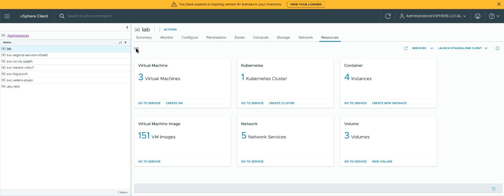
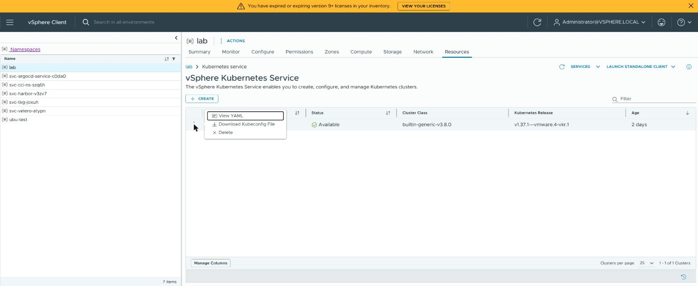
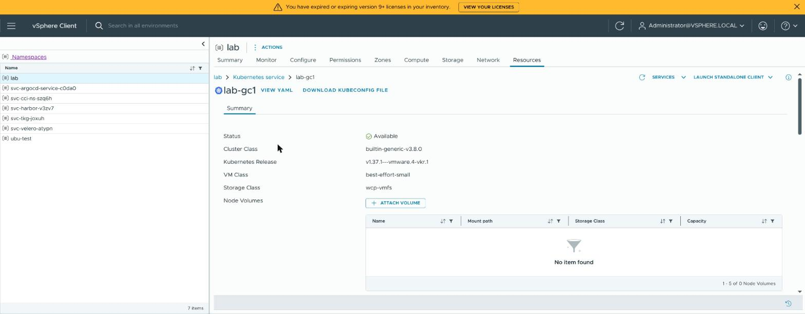

# Log in to the Supervisor and a VKS cluster

You log in to the Supervisor with the VCF CLI and your vCenter SSO user, then read your VKS
cluster's kubeconfig from it. The guide has two chapters: [Supervisor](#supervisor), your SSO login
to the Supervisor, and [VKS cluster](#vks-cluster), the cluster's administrator kubeconfig. Given
access to one VKS cluster by its administrator, log in with [USER-LOGIN.md](USER-LOGIN.md) instead.

Do these in this order; the commands run in one terminal (the vSphere Client way in item 3 needs no
login on this machine):

1. Log in to the Supervisor, one of
   [Create Supervisor context with CA](#create-supervisor-context-with-ca) or
   [Create Supervisor context without CA](#create-supervisor-context-without-ca).
2. [Check your vSphere Namespace](#check-your-vsphere-namespace).
3. Get the VKS cluster's kubeconfig, one of [Download the VKS cluster's kubeconfig from the vSphere
   Client](#download-the-vks-clusters-kubeconfig-from-the-vsphere-client) or [Get the VKS cluster's
   kubeconfig](#get-the-vks-clusters-kubeconfig).
4. [Use the VKS cluster](#use-the-vks-cluster).

Later, run [Renew the Supervisor login](#renew-the-supervisor-login) when the login ends, and
[Log out](#log-out) when you are done.

## Prerequisites

- [kubectl](KUBECTL.md), the [VCF CLI](VCF.md), and [curl, unzip (Photon OS: bsdtar), openssl and
  jq](PREREQS.md);
- the Supervisor's IP address or DNS name, and vCenter's DNS name
  ([NAMESPACE.md](NAMESPACE.md#1-find-the-supervisors-address-and-vcenters-ca), step 1);
- an SSO user with a role on the vSphere Namespace, or a vCenter administrator (for example
  `administrator@vsphere.local`), and its password (a login through a web page, Okta or Entra ID is
  not covered); for a VKS cluster's administrator kubeconfig, **Can edit** or **Owner** (yourself or
  through a group);
- the vSphere Namespace's name and, once you see it in
  [Check your vSphere Namespace](#check-your-vsphere-namespace), the VKS cluster's name.

The connections this guide needs, for a firewall (all TCP, besides DNS):

| from | to | port | for |
|---|---|---|---|
| your machine (laptop or jump box) | vCenter | 443 | the vCenter CA ([Create Supervisor context with CA](#create-supervisor-context-with-ca), step 1) |
| your machine (laptop or jump box) | the Supervisor's address | 443 | the VCF CLI and kubectl to the Supervisor (create the context, check the namespace, get the kubeconfig, renew) |
| your machine (laptop or jump box) | the VKS cluster's API address (in its kubeconfig) | 6443 | kubectl to the VKS cluster |
| your browser | vCenter (the vSphere Client) | 443 | [Download the VKS cluster's kubeconfig from the vSphere Client](#download-the-vks-clusters-kubeconfig-from-the-vsphere-client) |

## Supervisor

For anyone with a role on the vSphere Namespace who works with the Supervisor, **Can view**
included: you log in with your SSO user, see the namespace and list its VKS clusters, renew the
login when it ends, and log out. A person given access to one VKS cluster logs in with
[USER-LOGIN.md](USER-LOGIN.md) instead.

### Create Supervisor context with CA

The login checks that it talks to your real Supervisor, using vCenter's CA.

<details>
<summary><b>Steps</b></summary>

**1. Get the vCenter CA**

Run this before your first login to a Supervisor of this vCenter: the Supervisor proves who it is
with a certificate, by default signed by vCenter's own CA (certificate authority), which this
machine does not know yet. This downloads vCenter's CAs, so that the login can check that it talks
to your real Supervisor. It saves them as `~/.kube/vcenter-ca.pem.new` and prints each CA's
fingerprint, a short code that identifies it; run it again and it replaces that file. Nothing
checks the download itself: keep the file (next block) only when the fingerprints match the ones
your vCenter administrator gives you; they come from
[NAMESPACE.md](NAMESPACE.md#1-find-the-supervisors-address-and-vcenters-ca) step 1, and if that is
you, run it yourself. Set `VCENTER_FQDN` to vCenter's DNS name.

<details>
<summary><b>Linux, macOS, WSL (bash or zsh)</b></summary>

<!-- lab-step: supervisor-ca-get -->
```sh
VCENTER_FQDN="vcsa.example.test"
CA_FILE="$HOME/.kube/vcenter-ca.pem"

TMP="$(mktemp -d)"
if ! curl -fsSk --connect-timeout 20 --speed-time 60 -o "$TMP/certs.zip" "https://${VCENTER_FQDN}/certs/download.zip"; then
  echo "FAILED: download from https://${VCENTER_FQDN}"
elif ! { if command -v unzip >/dev/null 2>&1 || ! command -v bsdtar >/dev/null 2>&1; then unzip -oqj "$TMP/certs.zip" 'certs/lin/*' -d "$TMP/certs"
          else mkdir -p "$TMP/certs" && bsdtar -xf "$TMP/certs.zip" -C "$TMP/certs" --strip-components 2 'certs/lin/*'; fi; } \
     || [ -z "$(find "$TMP/certs" -name '*.0')" ]; then
  echo "FAILED: no CA certificate in the download from https://${VCENTER_FQDN}"
else
  mkdir -p "$(dirname "$CA_FILE")"
  find "$TMP/certs" -name '*.0' -exec cat {} + > "$CA_FILE.new"
  find "$TMP/certs" -name '*.0' -exec openssl x509 -in {} -noout -subject -fingerprint -sha256 \;
  echo "saved as $CA_FILE.new"
fi
rm -rf "$TMP"
```

</details>

<details>
<summary><b>Windows (PowerShell)</b></summary>

```powershell
$VCENTER_FQDN = "vcsa.example.test"      # vCenter DNS name
$CA_FILE = "$HOME\.kube\vcenter-ca.pem"

$global:LASTEXITCODE = $null
$TMP = Join-Path $env:TEMP ([guid]::NewGuid()); New-Item -ItemType Directory -Path $TMP | Out-Null
curl.exe -fsSk --connect-timeout 20 --speed-time 60 -o "$TMP\certs.zip" "https://$VCENTER_FQDN/certs/download.zip"
if ($LASTEXITCODE -ne 0) {
  "FAILED: download from https://$VCENTER_FQDN"
} else {
  Expand-Archive -Force -Path "$TMP\certs.zip" -DestinationPath "$TMP\certs" -ErrorAction SilentlyContinue
  $CERTS = Get-ChildItem -Path "$TMP\certs\certs\lin" -Filter '*.0' -ErrorAction SilentlyContinue
  if (-not $CERTS) {
    "FAILED: no CA certificate in the download from https://$VCENTER_FQDN"
  } else {
    New-Item -ItemType Directory -Force -Path (Split-Path $CA_FILE) | Out-Null
    $CERTS | Get-Content | Set-Content -Encoding ascii -Path "$CA_FILE.new"
    foreach ($C in $CERTS) {
      $X = New-Object System.Security.Cryptography.X509Certificates.X509Certificate2 $C.FullName
      $H = [BitConverter]::ToString([Security.Cryptography.SHA256]::Create().ComputeHash($X.RawData))
      "subject=$($X.Subject)"
      "sha256 Fingerprint=$($H.Replace('-', ':'))"
    }
    "saved as $CA_FILE.new"
  }
}
Remove-Item -Recurse -Force $TMP
```

</details>

**Expect:** for each CA, a `subject=` line (vCenter's own contains `CN=CA` and `DC=vsphere`) and a
`sha256 Fingerprint=…` line (`SHA256 Fingerprint=` on macOS), then `saved as …`. Every CA listed
will be trusted for the login, so each fingerprint must match one from your administrator,
ignoring colons and upper/lower case.

**If not:**
- `FAILED: download …`: `VCENTER_FQDN` is wrong, or this machine cannot reach vCenter. The
  `curl:` line above it says which.
- `FAILED: no CA certificate …`: the address answered, but it is not vCenter. Check
  `VCENTER_FQDN`. After `unzip: command not found`: do [PREREQS.md](PREREQS.md).
- A fingerprint that matches none of your administrator's: do not keep the file. Check
  `VCENTER_FQDN`. A company proxy that replaces HTTPS certificates also causes this.

When every fingerprint matches one from your administrator, run this to keep the file. It renames
`vcenter-ca.pem.new` to `vcenter-ca.pem` (an earlier `vcenter-ca.pem` is replaced), the file the
login in step 3 reads as `SUPERVISOR_CA`. Then go on to step 2.

**Linux, macOS, WSL (bash or zsh):**

<!-- lab-step: supervisor-ca-keep -->
```sh
CA_FILE="$HOME/.kube/vcenter-ca.pem"

mv "$CA_FILE.new" "$CA_FILE" && echo "kept $CA_FILE"
```

**Windows (PowerShell):**

```powershell
$CA_FILE = "$HOME\.kube\vcenter-ca.pem"

Move-Item -Force "$CA_FILE.new" $CA_FILE; if ($?) { "kept $CA_FILE" }
```

**Expect:** `kept …`.

**If not:** an error naming `….pem.new`: there is no file to keep. Run the first block of this step
again (it ends with `saved as …`).

With a second vCenter, run step 1 again with `CA_FILE` set in both blocks to a file of its own
(such as `$HOME/.kube/vcenter2-ca.pem`), and use that file as `SUPERVISOR_CA` when you log in to
its Supervisor.

**2. Type your SSO password**

Run this right before you create the context (or, in a new terminal, before a renewal): the login
reads the password from this terminal, so it is never on a command line or in your shell history.
Paste this line on its own, then type the password; nothing is shown as you type (PowerShell shows
`*`). Afterwards the password waits in this terminal for the block that creates the context (or
renews it).

**Linux, macOS, WSL (bash or zsh):**

```sh
printf 'SSO password: '; IFS= read -rs SSO_PASSWORD; echo
```

**Windows (PowerShell):**

```powershell
$SSO_PASSWORD = Read-Host 'SSO password' -AsSecureString
```

**Expect:** a new prompt. The password stays in this terminal until you close it or run
[Log out](#log-out); in a new terminal, run this line again.

**If not:** the next block prints `FAILED: no password in this terminal`: run this line again, in
the terminal where you run that block.

<a id="create-the-context"></a>**3. Create the context**

Run this once per Supervisor on this machine, after steps 1 and 2, to log in; the later blocks of
this guide work through this login. It logs you in to the Supervisor with the VCF CLI, as your SSO
user with the password from step 2, and checks the Supervisor's certificate against
`SUPERVISOR_CA` (step 1's vCenter CA, or `<SUPERVISOR_CONTEXT>.crt` from the Alternative below).
The login is saved in `~/.kube/<SUPERVISOR_CONTEXT>.kubeconfig`, a kubeconfig of its own (the file
kubectl reads to find a cluster and log in to it), as the context (a saved "this server, as this
user" entry) named `SUPERVISOR_CONTEXT` (`supervisor`). Your other kubeconfigs are not changed.
Next: [Check your vSphere Namespace](#check-your-vsphere-namespace). Run it again with the same
name and it stops: [Log out](#log-out) first. Set `SUPERVISOR_ENDPOINT` to the Supervisor's IP
address or DNS name, and `SSO_USERNAME` to your SSO user. **A few failed logins in a row lock the
SSO user for some minutes**, so type the password carefully.

<details>
<summary><b>Linux, macOS, WSL (bash or zsh)</b></summary>

```sh
SUPERVISOR_ENDPOINT="10.0.0.10"
SSO_USERNAME="administrator@vsphere.local"
SUPERVISOR_CA="$HOME/.kube/vcenter-ca.pem"
SUPERVISOR_CONTEXT="supervisor"
SUPERVISOR_KUBECONFIG="$HOME/.kube/${SUPERVISOR_CONTEXT}.kubeconfig"

if [ -z "$SSO_PASSWORD" ]; then
  echo "FAILED: no password in this terminal; run the line under Type your SSO password"
elif [ "$(printf '%s\n' "$SUPERVISOR_CONTEXT" | LC_ALL=C grep -Ecx '[a-z0-9]([a-z0-9-]*[a-z0-9])?')" != 1 ] \
     || [ "$(printf '%s\n' "$SUPERVISOR_CONTEXT" | wc -l | tr -d ' ')" != 1 ] \
     || printf '%s\n' "$SUPERVISOR_CONTEXT" | grep -q -e '-keycloak$'; then
  echo "FAILED: SUPERVISOR_CONTEXT may hold only a-z, 0-9 and - (not at the ends), and may not end in -keycloak"
elif [ -e "$SUPERVISOR_KUBECONFIG" ]; then
  echo "FAILED: $SUPERVISOR_KUBECONFIG exists: run Log out first, or set another SUPERVISOR_CONTEXT"
elif [ ! -f "$SUPERVISOR_CA" ] || [ ! -s "$SUPERVISOR_CA" ]; then
  echo "FAILED: not found: $SUPERVISOR_CA"
elif mkdir -p "$(dirname "$SUPERVISOR_KUBECONFIG")" \
     && KUBECONFIG="$SUPERVISOR_KUBECONFIG" VCF_CLI_VSPHERE_PASSWORD="$SSO_PASSWORD" \
        vcf context create "$SUPERVISOR_CONTEXT" --type k8s --endpoint "https://${SUPERVISOR_ENDPOINT}" \
          --username "$SSO_USERNAME" --auth-type basic --ca-certificate="$SUPERVISOR_CA"; then
  kubectl --kubeconfig "$SUPERVISOR_KUBECONFIG" config use-context "$SUPERVISOR_CONTEXT"
else
  echo "FAILED: login (see the vcf error above)"
fi
```

</details>

<details>
<summary><b>Windows (PowerShell)</b></summary>

```powershell
$SUPERVISOR_ENDPOINT = "10.0.0.10"                    # Supervisor IP or FQDN
$SSO_USERNAME = "administrator@vsphere.local"
$SUPERVISOR_CA = "$HOME\.kube\vcenter-ca.pem"
$SUPERVISOR_CONTEXT = "supervisor"
$SUPERVISOR_KUBECONFIG = "$HOME\.kube\${SUPERVISOR_CONTEXT}.kubeconfig"

$global:LASTEXITCODE = $null
if (-not $SSO_PASSWORD -or $SSO_PASSWORD.Length -eq 0) {
  "FAILED: no password in this terminal; run the line under Type your SSO password"
} elseif ($SUPERVISOR_CONTEXT -cnotmatch '^[a-z0-9]([a-z0-9-]*[a-z0-9])?\z' -or $SUPERVISOR_CONTEXT.EndsWith('-keycloak')) {
  "FAILED: SUPERVISOR_CONTEXT may hold only a-z, 0-9 and - (not at the ends), and may not end in -keycloak"
} elseif (Test-Path $SUPERVISOR_KUBECONFIG) {
  "FAILED: $SUPERVISOR_KUBECONFIG exists: run Log out first, or set another SUPERVISOR_CONTEXT"
} elseif (-not (Test-Path $SUPERVISOR_CA -PathType Leaf) -or (Get-Item $SUPERVISOR_CA).Length -eq 0) {
  "FAILED: not found: $SUPERVISOR_CA"
} else {
  New-Item -ItemType Directory -Force -Path (Split-Path $SUPERVISOR_KUBECONFIG) | Out-Null
  $OLD_KUBECONFIG = $env:KUBECONFIG; $env:KUBECONFIG = $SUPERVISOR_KUBECONFIG
  $env:VCF_CLI_VSPHERE_PASSWORD = [Net.NetworkCredential]::new('', $SSO_PASSWORD).Password
  vcf context create $SUPERVISOR_CONTEXT --type k8s --endpoint "https://$SUPERVISOR_ENDPOINT" `
    --username $SSO_USERNAME --auth-type basic "--ca-certificate=$SUPERVISOR_CA"
  $RC = $LASTEXITCODE
  Remove-Item Env:VCF_CLI_VSPHERE_PASSWORD; $env:KUBECONFIG = $OLD_KUBECONFIG
  if ($RC -eq 0) {
    kubectl --kubeconfig $SUPERVISOR_KUBECONFIG config use-context $SUPERVISOR_CONTEXT
  } else {
    "FAILED: login (see the vcf error above)"
  }
}
```

</details>

**Expect:** `Logged in successfully`, a list of contexts, then
`Switched to context "supervisor"` (your `SUPERVISOR_CONTEXT`). The login lasts about 10 hours.
The first login after [Log out](#log-out) prints `Initialization done!` lines first.

**If not:**
- `FAILED: no password in this terminal`: run step 2, then this block again.
- `FAILED: not found: …`: run step 1, including its `mv` block.
- `FAILED: SUPERVISOR_CONTEXT may hold only …`: change `SUPERVISOR_CONTEXT` (not the name of
  a VKS cluster), then run this block again.
- `FAILED: … exists`: you are logged in with this name already. Run [Log out](#log-out) first, or
  set another `SUPERVISOR_CONTEXT` for another Supervisor.
- `context "…" already exists`: the file is gone, but `vcf` still has the context. Run
  [Log out](#log-out), then the password line and this block again.
- A connection error: check `SUPERVISOR_ENDPOINT`.
- `x509: certificate is valid for …, not …`: the certificate is not issued for the address in
  `SUPERVISOR_ENDPOINT`. Use the Supervisor's DNS name or IP address as the message lists it.
- `x509: cannot validate certificate for <IP> because it doesn't contain any IP SANs`: the
  certificate lists only DNS names. Set `SUPERVISOR_ENDPOINT` to the Supervisor's DNS name.
- `x509: certificate signed by unknown authority`: that CA did not issue the Supervisor's
  certificate. Check `VCENTER_FQDN` in step 1. If it is right, your administrator replaced the
  Supervisor's certificate: ask them for its CA and set `SUPERVISOR_CA` to that file.
- A login error: check `SSO_USERNAME`, and run the password line again. Mind the lock-out.
- `Failed to install plugin 'telemetry:…'` before the output: harmless; the command still runs.

**Several Supervisors:** give each its own `SUPERVISOR_CONTEXT` (lower-case letters, digits and
`-`; not the name of a VKS cluster or of another file in `~/.kube`), and set that name in every
block you run for that Supervisor. Before each login or renewal, run step 2 again when that
Supervisor's SSO password differs; for a Supervisor of another vCenter, use that vCenter's CA as
`SUPERVISOR_CA` (step 1). Your VKS clusters also need different names across Supervisors, because
each cluster's file is `~/.kube/<cluster>.kubeconfig`
([Get the VKS cluster's kubeconfig](#get-the-vks-clusters-kubeconfig)).

</details>

### Create Supervisor context without CA

Use this only when you cannot get the CA. The login does not check the Supervisor's certificate:
someone between you and the Supervisor could capture your password, and `vcf` keeps skipping the
check for this login.

<details>
<summary><b>Steps</b></summary>

**1. Type your SSO password**

Run this right before you create the context (or, in a new terminal, before a renewal): the login
reads the password from this terminal, so it is never on a command line or in your shell history.
Paste this line on its own, then type the password; nothing is shown as you type (PowerShell shows
`*`). Afterwards the password waits in this terminal for the block that creates the context (or
renews it).

**Linux, macOS, WSL (bash or zsh):**

```sh
printf 'SSO password: '; IFS= read -rs SSO_PASSWORD; echo
```

**Windows (PowerShell):**

```powershell
$SSO_PASSWORD = Read-Host 'SSO password' -AsSecureString
```

**Expect:** a new prompt. The password stays in this terminal until you close it or run
[Log out](#log-out); in a new terminal, run this line again.

**If not:** the next block prints `FAILED: no password in this terminal`: run this line again, in
the terminal where you run that block.

**2. Create the context**

Run this once per Supervisor on this machine, after step 1, to log in when you have no CA; the
later blocks of this guide work through this login. It logs you in to the Supervisor with the VCF
CLI, as your SSO user with the password from step 1, without checking the Supervisor's
certificate. The login is saved in `~/.kube/<SUPERVISOR_CONTEXT>.kubeconfig`, a kubeconfig of its
own (the file kubectl reads to find a cluster and log in to it), as the context (a saved "this
server, as this user" entry) named `SUPERVISOR_CONTEXT` (`supervisor`). Your other kubeconfigs are
not changed. Next: [Check your vSphere Namespace](#check-your-vsphere-namespace). Run it again
with the same name and it stops: [Log out](#log-out) first. Set `SUPERVISOR_ENDPOINT` to the
Supervisor's IP address or DNS name, and `SSO_USERNAME` to your SSO user. **A few failed logins in
a row lock the SSO user for some minutes**, so type the password carefully.

<details>
<summary><b>Linux, macOS, WSL (bash or zsh)</b></summary>

```sh
SUPERVISOR_ENDPOINT="10.0.0.10"
SSO_USERNAME="administrator@vsphere.local"
SUPERVISOR_CONTEXT="supervisor"
SUPERVISOR_KUBECONFIG="$HOME/.kube/${SUPERVISOR_CONTEXT}.kubeconfig"

if [ -z "$SSO_PASSWORD" ]; then
  echo "FAILED: no password in this terminal; run the line under Type your SSO password"
elif [ "$(printf '%s\n' "$SUPERVISOR_CONTEXT" | LC_ALL=C grep -Ecx '[a-z0-9]([a-z0-9-]*[a-z0-9])?')" != 1 ] \
     || [ "$(printf '%s\n' "$SUPERVISOR_CONTEXT" | wc -l | tr -d ' ')" != 1 ] \
     || printf '%s\n' "$SUPERVISOR_CONTEXT" | grep -q -e '-keycloak$'; then
  echo "FAILED: SUPERVISOR_CONTEXT may hold only a-z, 0-9 and - (not at the ends), and may not end in -keycloak"
elif [ -e "$SUPERVISOR_KUBECONFIG" ]; then
  echo "FAILED: $SUPERVISOR_KUBECONFIG exists: run Log out first, or set another SUPERVISOR_CONTEXT"
elif mkdir -p "$(dirname "$SUPERVISOR_KUBECONFIG")" \
     && KUBECONFIG="$SUPERVISOR_KUBECONFIG" VCF_CLI_VSPHERE_PASSWORD="$SSO_PASSWORD" \
        vcf context create "$SUPERVISOR_CONTEXT" --type k8s --endpoint "https://${SUPERVISOR_ENDPOINT}" \
          --username "$SSO_USERNAME" --auth-type basic --insecure-skip-tls-verify; then
  kubectl --kubeconfig "$SUPERVISOR_KUBECONFIG" config use-context "$SUPERVISOR_CONTEXT"
else
  echo "FAILED: login (see the vcf error above)"
fi
```

</details>

<details>
<summary><b>Windows (PowerShell)</b></summary>

```powershell
$SUPERVISOR_ENDPOINT = "10.0.0.10"                    # Supervisor IP or FQDN
$SSO_USERNAME = "administrator@vsphere.local"
$SUPERVISOR_CONTEXT = "supervisor"
$SUPERVISOR_KUBECONFIG = "$HOME\.kube\${SUPERVISOR_CONTEXT}.kubeconfig"

$global:LASTEXITCODE = $null
if (-not $SSO_PASSWORD -or $SSO_PASSWORD.Length -eq 0) {
  "FAILED: no password in this terminal; run the line under Type your SSO password"
} elseif ($SUPERVISOR_CONTEXT -cnotmatch '^[a-z0-9]([a-z0-9-]*[a-z0-9])?\z' -or $SUPERVISOR_CONTEXT.EndsWith('-keycloak')) {
  "FAILED: SUPERVISOR_CONTEXT may hold only a-z, 0-9 and - (not at the ends), and may not end in -keycloak"
} elseif (Test-Path $SUPERVISOR_KUBECONFIG) {
  "FAILED: $SUPERVISOR_KUBECONFIG exists: run Log out first, or set another SUPERVISOR_CONTEXT"
} else {
  New-Item -ItemType Directory -Force -Path (Split-Path $SUPERVISOR_KUBECONFIG) | Out-Null
  $OLD_KUBECONFIG = $env:KUBECONFIG; $env:KUBECONFIG = $SUPERVISOR_KUBECONFIG
  $env:VCF_CLI_VSPHERE_PASSWORD = [Net.NetworkCredential]::new('', $SSO_PASSWORD).Password
  vcf context create $SUPERVISOR_CONTEXT --type k8s --endpoint "https://$SUPERVISOR_ENDPOINT" `
    --username $SSO_USERNAME --auth-type basic --insecure-skip-tls-verify
  $RC = $LASTEXITCODE
  Remove-Item Env:VCF_CLI_VSPHERE_PASSWORD; $env:KUBECONFIG = $OLD_KUBECONFIG
  if ($RC -eq 0) {
    kubectl --kubeconfig $SUPERVISOR_KUBECONFIG config use-context $SUPERVISOR_CONTEXT
  } else {
    "FAILED: login (see the vcf error above)"
  }
}
```

</details>

**Expect:** `Logged in successfully`, a list of contexts, then
`Switched to context "supervisor"` (your `SUPERVISOR_CONTEXT`). The login lasts about 10 hours.
The first login after [Log out](#log-out) prints `Initialization done!` lines first.

**If not:**
- `FAILED: no password in this terminal`: run step 1, then this block again.
- `FAILED: SUPERVISOR_CONTEXT may hold only …`: change `SUPERVISOR_CONTEXT` (not the name of
  a VKS cluster), then run this block again.
- `FAILED: … exists`: you are logged in with this name already. Run [Log out](#log-out) first, or
  set another `SUPERVISOR_CONTEXT` for another Supervisor.
- `context "…" already exists`: the file is gone, but `vcf` still has the context. Run
  [Log out](#log-out), then the password line and this block again.
- A connection error: check `SUPERVISOR_ENDPOINT`.
- A login error: check `SSO_USERNAME`, and run the password line again. Mind the lock-out.
- `Failed to install plugin 'telemetry:…'` before the output: harmless; the command still runs.

**Several Supervisors:** give each its own `SUPERVISOR_CONTEXT` (lower-case letters, digits and
`-`; not the name of a VKS cluster or of another file in `~/.kube`), and set that name in every
block you run for that Supervisor. Before each login or renewal, run step 1 again when that
Supervisor's SSO password differs. Your VKS clusters also need different names across Supervisors,
because each cluster's file is `~/.kube/<cluster>.kubeconfig`
([Get the VKS cluster's kubeconfig](#get-the-vks-clusters-kubeconfig)).

</details>

#### Alternative: trust the Supervisor's own certificate

Later logins are checked against the Supervisor's certificate, fetched once. Its limits:
- The fetch itself is not checked: compare the printed fingerprint with one from your vCenter
  administrator, or it is no safer than logging in without a check.
- It stops working when the Supervisor's certificate is renewed: fetch it again.

<details>
<summary><b>Steps</b></summary>

**1. Type your SSO password** (step 1 of
[Create Supervisor context without CA](#create-supervisor-context-without-ca)).

**2. Fetch the certificate**

Run this when you cannot get vCenter's CA but your vCenter administrator can give you the
Supervisor certificate's fingerprint. It downloads the Supervisor's own certificate, saves it as
`~/.kube/<SUPERVISOR_CONTEXT>.crt` and prints its fingerprint; run it again (after the certificate
is renewed) and it replaces that file. Compare the fingerprint with your vCenter administrator's
before you log in with it in step 3 below. Set `SUPERVISOR_ENDPOINT` to the Supervisor's IP address
or DNS name.

<details>
<summary><b>Linux, macOS, WSL (bash or zsh)</b></summary>

```sh
SUPERVISOR_ENDPOINT="10.0.0.10"
SUPERVISOR_CONTEXT="supervisor"
SUPERVISOR_CERT="$HOME/.kube/${SUPERVISOR_CONTEXT}.crt"

mkdir -p "$(dirname "$SUPERVISOR_CERT")"
openssl s_client -connect "${SUPERVISOR_ENDPOINT}:443" </dev/null 2>/dev/null \
  | openssl x509 -outform PEM > "$SUPERVISOR_CERT" \
  && openssl x509 -in "$SUPERVISOR_CERT" -noout -subject -fingerprint -sha256 \
  || { rm -f "$SUPERVISOR_CERT"; echo "FAILED: no certificate from ${SUPERVISOR_ENDPOINT}:443"; }
```

</details>

<details>
<summary><b>Windows (PowerShell)</b></summary>

```powershell
$SUPERVISOR_ENDPOINT = "10.0.0.10"                    # Supervisor IP or FQDN
$SUPERVISOR_CONTEXT = "supervisor"
$SUPERVISOR_CERT = "$HOME\.kube\${SUPERVISOR_CONTEXT}.crt"

try {
  $TCP = New-Object Net.Sockets.TcpClient($SUPERVISOR_ENDPOINT, 443)
  $SSL = New-Object Net.Security.SslStream($TCP.GetStream(), $false, ([Net.Security.RemoteCertificateValidationCallback] { $true }))
  $SSL.AuthenticateAsClient($SUPERVISOR_ENDPOINT, $null, [Security.Authentication.SslProtocols]::Tls12, $false)
  $X = New-Object System.Security.Cryptography.X509Certificates.X509Certificate2 $SSL.RemoteCertificate
  $TCP.Close()
  New-Item -ItemType Directory -Force -Path (Split-Path $SUPERVISOR_CERT) | Out-Null
  $B64 = [Convert]::ToBase64String($X.RawData, 'InsertLineBreaks')
  Set-Content -Encoding ascii -Path $SUPERVISOR_CERT -Value "-----BEGIN CERTIFICATE-----`r`n$B64`r`n-----END CERTIFICATE-----"
  $H = [BitConverter]::ToString([Security.Cryptography.SHA256]::Create().ComputeHash($X.RawData))
  "subject=$($X.Subject)"
  "sha256 Fingerprint=$($H.Replace('-', ':'))"
} catch {
  "FAILED: no certificate from ${SUPERVISOR_ENDPOINT}:443"
}
```

</details>

**Expect:** a `subject=` line and a `sha256 Fingerprint=…` line (`SHA256 Fingerprint=` on macOS)
that matches the one from your administrator, ignoring colons and upper/lower case.

**If not:**
- `FAILED: no certificate …`: check `SUPERVISOR_ENDPOINT`, or this machine cannot reach the
  Supervisor.
- A fingerprint that does not match: delete the file and do not log in with it.

**3. Create the context:** run [step 3, *Create the context*, of Create Supervisor context with
CA](#create-the-context) with `SUPERVISOR_CA="$HOME/.kube/${SUPERVISOR_CONTEXT}.crt"` (PowerShell:
`"$HOME\.kube\${SUPERVISOR_CONTEXT}.crt"`). `x509: certificate is valid for …, not …` there means
the certificate does not list the address in `SUPERVISOR_ENDPOINT`: use the DNS name or IP address
the message lists. `x509: cannot validate certificate for <IP> because it doesn't contain any IP
SANs` means it lists only DNS names: use the Supervisor's DNS name. `x509: certificate signed by
unknown authority` means the Supervisor's certificate changed since you fetched it: fetch it again
(step 2 above).

</details>

### Check your vSphere Namespace

In the vSphere Client, the namespace's **Resources** tab shows its VKS clusters: the **Kubernetes**
card counts them, and **GO TO SERVICE** lists them (see [Download the VKS cluster's kubeconfig from
the vSphere Client](#download-the-vks-clusters-kubeconfig-from-the-vsphere-client), step 1).

Run this block right after you log in, to check that your Supervisor login works: it checks that
your SSO user can see your vSphere Namespace, and lists the VKS clusters in it
(`clusters.cluster.x-k8s.io`, the Supervisor's list of VKS clusters). It changes nothing, so you
may run it again at any time. The `NAME` column gives the cluster name that the next steps ask for
as `VKS_CLUSTER`; next, get that cluster's kubeconfig ([VKS cluster](#vks-cluster)). Set
`VSPHERE_NAMESPACE` to your vSphere Namespace's name.

**Linux, macOS, WSL (bash or zsh):**

```sh
VSPHERE_NAMESPACE="my-namespace"
SUPERVISOR_CONTEXT="supervisor"
SUPERVISOR_KUBECONFIG="$HOME/.kube/${SUPERVISOR_CONTEXT}.kubeconfig"

kubectl --kubeconfig "$SUPERVISOR_KUBECONFIG" get namespace "$VSPHERE_NAMESPACE" \
  && kubectl --kubeconfig "$SUPERVISOR_KUBECONFIG" -n "$VSPHERE_NAMESPACE" get clusters.cluster.x-k8s.io
```

**Windows (PowerShell):**

```powershell
$VSPHERE_NAMESPACE = "my-namespace"
$SUPERVISOR_CONTEXT = "supervisor"
$SUPERVISOR_KUBECONFIG = "$HOME\.kube\${SUPERVISOR_CONTEXT}.kubeconfig"

$global:LASTEXITCODE = $null
kubectl --kubeconfig $SUPERVISOR_KUBECONFIG get namespace $VSPHERE_NAMESPACE
if ($LASTEXITCODE -eq 0) { kubectl --kubeconfig $SUPERVISOR_KUBECONFIG -n $VSPHERE_NAMESPACE get clusters.cluster.x-k8s.io }
```

**Expect:** your namespace, `Active`, then a table whose `NAME` column holds your VKS cluster.

**If not:**
- `… .kubeconfig: no such file or directory`: you are not logged in. Create the
  Supervisor context first.
- `NotFound`: check `VSPHERE_NAMESPACE`, or [create the namespace](NAMESPACE.md).
- `Forbidden`: check `VSPHERE_NAMESPACE` (a user who is not a vCenter administrator gets `Forbidden`
  for a name that does not exist). Otherwise your SSO user has no role on this namespace, or got
  it after you logged in. Ask a vCenter administrator for the role, then [Log out](#log-out) and
  log in again.
- `Unauthorized`: the login has ended. Run
  [Renew the Supervisor login](#renew-the-supervisor-login).
- `No resources found`: the namespace has no VKS cluster yet: [create one](CLUSTER.md).

### Renew the Supervisor login

Run this when a `kubectl` command to the Supervisor answers `error: You must be logged in to the
server (Unauthorized)` or `… (the server has asked for the client to provide credentials)`, or a
`vcf` command answers `Unable to read password from terminal` or `the server has asked for the
client to provide credentials`: the Supervisor login lasts about 10 hours. It logs you in again
with the password in this terminal and keeps the context `SUPERVISOR_CONTEXT`; afterwards the
contexts in its kubeconfig work again, with a new token (the temporary key from your SSO login).
While the login still lasts, it skips the renewal. In a new terminal, first run the password
step of the Create section you used, and mind the lock-out. Set `SUPERVISOR_CA` to the file you
created the context with (the vCenter CA, or `<SUPERVISOR_CONTEXT>.crt`), or to `""` if you
created it without CA.

<details>
<summary><b>Linux, macOS, WSL (bash or zsh)</b></summary>

```sh
SUPERVISOR_CA="$HOME/.kube/vcenter-ca.pem"
SUPERVISOR_CONTEXT="supervisor"
SUPERVISOR_KUBECONFIG="$HOME/.kube/${SUPERVISOR_CONTEXT}.kubeconfig"

if [ -n "$SUPERVISOR_CA" ]; then TLS="--ca-certificate=$SUPERVISOR_CA"; else TLS="--insecure-skip-tls-verify"; fi
if [ -z "$SSO_PASSWORD" ]; then
  echo "FAILED: no password in this terminal; run the line under Type your SSO password"
elif [ "$(printf '%s\n' "$SUPERVISOR_CONTEXT" | LC_ALL=C grep -Ecx '[a-z0-9]([a-z0-9-]*[a-z0-9])?')" != 1 ] \
     || [ "$(printf '%s\n' "$SUPERVISOR_CONTEXT" | wc -l | tr -d ' ')" != 1 ] \
     || printf '%s\n' "$SUPERVISOR_CONTEXT" | grep -q -e '-keycloak$'; then
  echo "FAILED: SUPERVISOR_CONTEXT may hold only a-z, 0-9 and - (not at the ends), and may not end in -keycloak"
elif [ ! -f "$SUPERVISOR_KUBECONFIG" ]; then
  echo "FAILED: not found: $SUPERVISOR_KUBECONFIG; create the context first"
elif [ -n "$SUPERVISOR_CA" ] && { [ ! -f "$SUPERVISOR_CA" ] || [ ! -s "$SUPERVISOR_CA" ]; }; then
  echo "FAILED: not found: $SUPERVISOR_CA"
else
  KUBECONFIG="$SUPERVISOR_KUBECONFIG" VCF_CLI_VSPHERE_PASSWORD="$SSO_PASSWORD" \
    vcf context refresh "$SUPERVISOR_CONTEXT" "$TLS"
fi
```

</details>

<details>
<summary><b>Windows (PowerShell)</b></summary>

```powershell
$SUPERVISOR_CA = "$HOME\.kube\vcenter-ca.pem"         # or <context>.crt; "" if without CA
$SUPERVISOR_CONTEXT = "supervisor"
$SUPERVISOR_KUBECONFIG = "$HOME\.kube\${SUPERVISOR_CONTEXT}.kubeconfig"

$TLS = if ($SUPERVISOR_CA) { "--ca-certificate=$SUPERVISOR_CA" } else { "--insecure-skip-tls-verify" }
if (-not $SSO_PASSWORD -or $SSO_PASSWORD.Length -eq 0) {
  "FAILED: no password in this terminal; run the line under Type your SSO password"
} elseif ($SUPERVISOR_CONTEXT -cnotmatch '^[a-z0-9]([a-z0-9-]*[a-z0-9])?\z' -or $SUPERVISOR_CONTEXT.EndsWith('-keycloak')) {
  "FAILED: SUPERVISOR_CONTEXT may hold only a-z, 0-9 and - (not at the ends), and may not end in -keycloak"
} elseif (-not (Test-Path $SUPERVISOR_KUBECONFIG -PathType Leaf)) {
  "FAILED: not found: $SUPERVISOR_KUBECONFIG; create the context first"
} elseif ($SUPERVISOR_CA -and (-not (Test-Path $SUPERVISOR_CA -PathType Leaf) -or (Get-Item $SUPERVISOR_CA).Length -eq 0)) {
  "FAILED: not found: $SUPERVISOR_CA"
} else {
  $OLD_KUBECONFIG = $env:KUBECONFIG; $env:KUBECONFIG = $SUPERVISOR_KUBECONFIG
  $env:VCF_CLI_VSPHERE_PASSWORD = [Net.NetworkCredential]::new('', $SSO_PASSWORD).Password
  vcf context refresh $SUPERVISOR_CONTEXT $TLS
  Remove-Item Env:VCF_CLI_VSPHERE_PASSWORD; $env:KUBECONFIG = $OLD_KUBECONFIG
}
```

</details>

**Expect:** `Successful re-authentication completed for context "supervisor"` (your
`SUPERVISOR_CONTEXT`), or
`Token is still active. Skipped the token refresh …` when the login had not ended. Then run the
command that answered `Unauthorized` again.

**If not:**
- `FAILED: no password in this terminal`: run the password step of the Create section you used,
  then this block again.
- `FAILED: SUPERVISOR_CONTEXT may hold only …`: set it to the name you created the context with.
- `FAILED: not found: …kubeconfig`: you are not logged in with this `SUPERVISOR_CONTEXT`. Run
  [Create Supervisor context with CA](#create-supervisor-context-with-ca) or
  [without CA](#create-supervisor-context-without-ca).
- `FAILED: not found: …`: set `SUPERVISOR_CA` to the file you created the context with, or `""`.
- `context … not found`: you are not logged in. Run
  [Create Supervisor context with CA](#create-supervisor-context-with-ca) or
  [without CA](#create-supervisor-context-without-ca).
- `Token is still active`, and the command still answers `Unauthorized`: the login is not the
  cause. Check that the command uses `--kubeconfig "$SUPERVISOR_KUBECONFIG"`.
- A login error: check the password, and mind the lock-out.

Why a new login and not a new file: the Supervisor's kubeconfig holds only a token (a temporary key
from your SSO login). When the token ends, every context in that file fails at once, while `vcf
context list` still shows them as before. The VKS cluster's kubeconfig does not need this renewal:
it is a login of its own ([two servers, two
logins](KUBECONFIG.md#why-the-supervisor-and-each-vks-cluster-have-their-own-kubeconfig)).

### Log out

Run this when you are done with the Supervisor on this machine, or before you create the context
of the same `SUPERVISOR_CONTEXT` again (an ended login needs only the renewal above). It deletes
the Supervisor login with its contexts for your vSphere Namespaces, its kubeconfig, `vcf`'s log
files (they hold a copy of the login token) and the password in this terminal. The VKS cluster's
kubeconfig is kept; delete it with `rm` if you no longer need it.
Afterwards `vcf context list` no longer shows the login; to log in again, create the context again.

<details>
<summary><b>Linux, macOS, WSL (bash or zsh)</b></summary>

```sh
SUPERVISOR_CONTEXT="supervisor"
SUPERVISOR_KUBECONFIG="$HOME/.kube/${SUPERVISOR_CONTEXT}.kubeconfig"

unset SSO_PASSWORD
if [ "$(printf '%s\n' "$SUPERVISOR_CONTEXT" | LC_ALL=C grep -Ecx '[a-z0-9]([a-z0-9-]*[a-z0-9])?')" != 1 ] \
   || [ "$(printf '%s\n' "$SUPERVISOR_CONTEXT" | wc -l | tr -d ' ')" != 1 ] \
   || printf '%s\n' "$SUPERVISOR_CONTEXT" | grep -q -e '-keycloak$'; then
  echo "FAILED: SUPERVISOR_CONTEXT may hold only a-z, 0-9 and - (not at the ends), and may not end in -keycloak"
elif KUBECONFIG="$SUPERVISOR_KUBECONFIG" vcf context delete "$SUPERVISOR_CONTEXT" -y --skip-delete-kubeconfig-context </dev/null; then
  if [ ! -e "$SUPERVISOR_KUBECONFIG" ] \
     || kubectl --kubeconfig "$SUPERVISOR_KUBECONFIG" config get-contexts -o name 2>/dev/null | grep -qxF -- "$SUPERVISOR_CONTEXT"; then
    rm -f "$SUPERVISOR_KUBECONFIG"
    rm -rf "$HOME/.config/vcf/logs"
  else
    echo "kept ${SUPERVISOR_KUBECONFIG}: it is not a Supervisor login"
  fi
  vcf context list </dev/null
else
  echo "FAILED: context $SUPERVISOR_CONTEXT not deleted, so this block deleted no file (see the vcf error above)"
fi
```

</details>

<details>
<summary><b>Windows (PowerShell)</b></summary>

```powershell
$SUPERVISOR_CONTEXT = "supervisor"
$SUPERVISOR_KUBECONFIG = "$HOME\.kube\${SUPERVISOR_CONTEXT}.kubeconfig"

Remove-Variable SSO_PASSWORD -ErrorAction SilentlyContinue
if ($SUPERVISOR_CONTEXT -cnotmatch '^[a-z0-9]([a-z0-9-]*[a-z0-9])?\z' -or $SUPERVISOR_CONTEXT.EndsWith('-keycloak')) {
  "FAILED: SUPERVISOR_CONTEXT may hold only a-z, 0-9 and - (not at the ends), and may not end in -keycloak"
} else {
  $OLD_KUBECONFIG = $env:KUBECONFIG; $env:KUBECONFIG = $SUPERVISOR_KUBECONFIG
  $null | vcf context delete $SUPERVISOR_CONTEXT -y --skip-delete-kubeconfig-context
  $RC = $LASTEXITCODE
  $env:KUBECONFIG = $OLD_KUBECONFIG
  if ($RC -eq 0) {
    if (-not (Test-Path $SUPERVISOR_KUBECONFIG) -or (@(kubectl --kubeconfig $SUPERVISOR_KUBECONFIG config get-contexts -o name 2>$null) -ccontains $SUPERVISOR_CONTEXT)) {
      Remove-Item -Force -ErrorAction SilentlyContinue $SUPERVISOR_KUBECONFIG
      Remove-Item -Recurse -Force -ErrorAction SilentlyContinue "$HOME\.config\vcf\logs"
    } else {
      "kept ${SUPERVISOR_KUBECONFIG}: it is not a Supervisor login"
    }
    $null | vcf context list
  } else {
    "FAILED: context $SUPERVISOR_CONTEXT not deleted, so this block deleted no file (see the vcf error above)"
  }
}
```

</details>

**Expect:** `[!] Skipping to delete the kubeconfig context …` lines (harmless: the block deletes
that file itself), `Successfully deleted context "supervisor"` (your `SUPERVISOR_CONTEXT`), and a
list without that context.

**If not:**
- `FAILED: SUPERVISOR_CONTEXT may hold only …`: set it to the name you created the context with.
- `context … not found`, then `FAILED: context … not deleted`: you were already logged out. If
  [Create](#create-the-context) still answers `FAILED: … exists` and
  `kubectl --kubeconfig <that file> config get-contexts -o name` lists `SUPERVISOR_CONTEXT`'s
  name, the file is an old Supervisor login: delete it with `rm`. Otherwise keep it and set
  another `SUPERVISOR_CONTEXT`.
- `kept …: it is not a Supervisor login`: the context is deleted; the file of that name is another
  login (a VKS cluster's or a hand-out) and stays. If it is a damaged file, move it aside.

## VKS cluster

The cluster's administrator kubeconfig, for **Can edit** or **Owner** on the vSphere Namespace
(yourself or through a group); with **Can view**, reading it answers `Forbidden`. A **Can view**
person has no rights inside a VKS cluster until its administrator gives them
([ADMIN-GRANT-ACCESS.md step 2](ADMIN-GRANT-ACCESS.md#2-give-the-person-rights-inside-the-cluster-cluster-administrator)).
(Measured on VCF 9.1.1 with VKS 3.8.0.) The vSphere Client download needs no Supervisor login;
[Get the VKS cluster's kubeconfig](#get-the-vks-clusters-kubeconfig) needs the Supervisor login.

### Download the VKS cluster's kubeconfig from the vSphere Client

kubectl needs a kubeconfig, a file with the cluster's address and a login, to work with your VKS
cluster. What the file is, whichever way you get it:

- **The cluster's administrator login.** Whoever has the file is an administrator of the whole
  cluster; it is not limited to a vSphere Namespace or to one person.
- **It cannot be withdrawn.** It stops working on the date in its certificate
  ([how long it works](KUBECONFIG.md#the-files-the-guides-make)); download it again then.
- **It does not depend on an SSO login.** It keeps working after any vCenter login ends.

The vSphere Client gives the same file as
[Get the VKS cluster's kubeconfig](#get-the-vks-clusters-kubeconfig) below, byte for byte, without
the VCF CLI or a Supervisor login on this machine; you need only kubectl afterwards.

1. In the vSphere Client, from the menu (☰) choose **Supervisor Management**, the **Namespaces**
   tab, and your namespace. Open its **Resources** tab and, on the **Kubernetes** card, click
   **GO TO SERVICE**.

   

2. Click **⋮** at the start of your cluster's row, then **Download Kubeconfig File**.

   

   Or click the cluster's name and, on its page, **DOWNLOAD KUBECONFIG FILE**: the same file.

   

Run this after the download, because the browser saves the file as `<cluster>-kubeconfig.yaml`
in your downloads folder, readable by other users of this machine. It moves the file to
`~/.kube/<cluster>.kubeconfig`, readable only by you, then lists the cluster's nodes (its VMs:
control plane and workers) to show it works. When the file expires, download it again and run
this again: it replaces the old file. Next: [Use the VKS cluster](#use-the-vks-cluster). Set
`VKS_CLUSTER` to the cluster's name and `DOWNLOADED` to where the browser saved the file; on WSL, a
browser on Windows saves it under `/mnt/c/Users/<you>/Downloads`.

<details>
<summary><b>Linux, macOS, WSL (bash or zsh)</b></summary>

```sh
VKS_CLUSTER="my-vks-cluster"
DOWNLOADED="$HOME/Downloads/${VKS_CLUSTER}-kubeconfig.yaml"
VKS_KUBECONFIG="$HOME/.kube/${VKS_CLUSTER}.kubeconfig"

mkdir -p "$HOME/.kube"
if [ -e "$VKS_KUBECONFIG" ] \
   && ! kubectl --kubeconfig "$VKS_KUBECONFIG" config get-contexts -o name 2>/dev/null | grep -qxF -- "${VKS_CLUSTER}-admin@${VKS_CLUSTER}"; then
  echo "FAILED: $VKS_KUBECONFIG holds another login, not this cluster's; it is kept"
elif [ -f "$DOWNLOADED" ] && kubectl --kubeconfig "$DOWNLOADED" config view >/dev/null 2>&1; then
  install -m 600 "$DOWNLOADED" "$VKS_KUBECONFIG" && rm -f "$DOWNLOADED"
  kubectl --kubeconfig "$VKS_KUBECONFIG" get nodes
else
  echo "FAILED: no kubeconfig at $DOWNLOADED"
fi
```

</details>

<details>
<summary><b>Windows (PowerShell)</b></summary>

```powershell
$VKS_CLUSTER = "my-vks-cluster"
$DOWNLOADED = "$HOME\Downloads\${VKS_CLUSTER}-kubeconfig.yaml"
$VKS_KUBECONFIG = "$HOME\.kube\${VKS_CLUSTER}.kubeconfig"

New-Item -ItemType Directory -Force "$HOME\.kube" | Out-Null
$global:LASTEXITCODE = $null
if ((Test-Path $VKS_KUBECONFIG) -and -not (@(kubectl --kubeconfig $VKS_KUBECONFIG config get-contexts -o name 2>$null) -ccontains "${VKS_CLUSTER}-admin@${VKS_CLUSTER}")) {
  "FAILED: $VKS_KUBECONFIG holds another login, not this cluster's; it is kept"
} else {
  if (Test-Path $DOWNLOADED) { kubectl --kubeconfig $DOWNLOADED config view *> $null }
  if ((Test-Path $DOWNLOADED) -and $LASTEXITCODE -eq 0) {
    Move-Item -Force $DOWNLOADED $VKS_KUBECONFIG
    kubectl --kubeconfig $VKS_KUBECONFIG get nodes
  } else {
    "FAILED: no kubeconfig at $DOWNLOADED"
  }
}
```

</details>

**Expect:** the cluster's nodes, each `Ready`.

**If not:**
- `FAILED: … holds another login, not this cluster's`: a file of that name is another login (a
  Supervisor login whose `SUPERVISOR_CONTEXT` is this cluster's name, a hand-out, or a damaged
  file). It is kept;
  move it aside, or log out of that Supervisor and log in again with another `SUPERVISOR_CONTEXT`.
- `FAILED: no kubeconfig at …`: set `DOWNLOADED` to the file the browser saved (a second
  download of the same name may be saved as `<cluster>-kubeconfig (1).yaml`).
- `error: You must be logged in to the server (Unauthorized)`: the file has expired; download it
  again.

### Get the VKS cluster's kubeconfig

Or, with kubectl and your Supervisor login: run this instead of the vSphere Client download when
you are logged in to the Supervisor on this machine. It reads the same file from the Supervisor,
saves it as `~/.kube/<cluster>.kubeconfig` (on Linux, macOS and WSL, readable only by you), then
lists the cluster's nodes (its VMs: control plane and workers) to show it works. It is the
cluster's shared administrator login
([what the file is](#download-the-vks-clusters-kubeconfig-from-the-vsphere-client)): keep it
private. When the file expires, run this again: it replaces the old file. Next:
[Use the VKS cluster](#use-the-vks-cluster).
Set `VSPHERE_NAMESPACE` to your vSphere Namespace's name, and `VKS_CLUSTER` to a name from the `NAME`
column of [Check your vSphere Namespace](#check-your-vsphere-namespace).

<details>
<summary><b>Linux, macOS, WSL (bash or zsh)</b></summary>

```sh
VSPHERE_NAMESPACE="my-namespace"
VKS_CLUSTER="my-vks-cluster"
SUPERVISOR_CONTEXT="supervisor"
SUPERVISOR_KUBECONFIG="$HOME/.kube/${SUPERVISOR_CONTEXT}.kubeconfig"
VKS_KUBECONFIG="$HOME/.kube/${VKS_CLUSTER}.kubeconfig"

rm -f "$VKS_KUBECONFIG.new"
if [ -e "$VKS_KUBECONFIG" ] \
   && ! kubectl --kubeconfig "$VKS_KUBECONFIG" config get-contexts -o name 2>/dev/null | grep -qxF -- "${VKS_CLUSTER}-admin@${VKS_CLUSTER}"; then
  echo "FAILED: $VKS_KUBECONFIG holds another login, not this cluster's; it is kept"
elif ( umask 077
     kubectl --kubeconfig "$SUPERVISOR_KUBECONFIG" -n "$VSPHERE_NAMESPACE" get secret "${VKS_CLUSTER}-kubeconfig" \
       -o go-template='{{.data.value | base64decode}}' > "$VKS_KUBECONFIG.new" ) \
   && kubectl --kubeconfig "$VKS_KUBECONFIG.new" config view >/dev/null 2>&1; then
  mv "$VKS_KUBECONFIG.new" "$VKS_KUBECONFIG"
  kubectl --kubeconfig "$VKS_KUBECONFIG" get nodes
else
  rm -f "$VKS_KUBECONFIG.new"
  echo "FAILED: no kubeconfig read (see the kubectl error above); $VKS_KUBECONFIG is as it was"
fi
```

</details>

<details>
<summary><b>Windows (PowerShell)</b></summary>

```powershell
$VSPHERE_NAMESPACE = "my-namespace"
$VKS_CLUSTER = "my-vks-cluster"                     # from the NAME column above
$SUPERVISOR_CONTEXT = "supervisor"
$SUPERVISOR_KUBECONFIG = "$HOME\.kube\${SUPERVISOR_CONTEXT}.kubeconfig"
$VKS_KUBECONFIG = "$HOME\.kube\${VKS_CLUSTER}.kubeconfig"

if ((Test-Path $VKS_KUBECONFIG) -and -not (@(kubectl --kubeconfig $VKS_KUBECONFIG config get-contexts -o name 2>$null) -ccontains "${VKS_CLUSTER}-admin@${VKS_CLUSTER}")) {
  "FAILED: $VKS_KUBECONFIG holds another login, not this cluster's; it is kept"
} else {
  $global:LASTEXITCODE = $null
  $KC = kubectl --kubeconfig $SUPERVISOR_KUBECONFIG -n $VSPHERE_NAMESPACE get secret "${VKS_CLUSTER}-kubeconfig" `
    -o go-template='{{.data.value | base64decode}}'
  if ($LASTEXITCODE -eq 0 -and $KC) {
    Set-Content -Encoding ascii -Path "$VKS_KUBECONFIG.new" -Value $KC
    kubectl --kubeconfig "$VKS_KUBECONFIG.new" config view *> $null
  }
  if ($LASTEXITCODE -eq 0 -and $KC) {
    Move-Item -Force "$VKS_KUBECONFIG.new" $VKS_KUBECONFIG
    kubectl --kubeconfig $VKS_KUBECONFIG get nodes
  } else {
    Remove-Item -Force -ErrorAction SilentlyContinue "$VKS_KUBECONFIG.new"
    "FAILED: no kubeconfig read (see the kubectl error above); $VKS_KUBECONFIG is as it was"
  }
}
```

</details>

**Expect:** the cluster's nodes, each `Ready`.

**If not:**
- `FAILED: … holds another login, not this cluster's`: a file of that name is another login (a
  Supervisor login whose `SUPERVISOR_CONTEXT` is this cluster's name, a hand-out, or a damaged
  file). It is kept;
  move it aside, or log out of that Supervisor and log in again with another `SUPERVISOR_CONTEXT`.
- `FAILED: no kubeconfig read`, under `secrets "<name>-kubeconfig" not found`: check
  `VKS_CLUSTER`, or the cluster is still being created.
- … under `Forbidden`: your role on the namespace cannot read the kubeconfig; ask for the
  **Namespaces Edit** role, then [Log out](#log-out) and log in again.
- … under `Unauthorized`: run [Renew the Supervisor login](#renew-the-supervisor-login).
- A node `NotReady`: the cluster is still starting, or a node has a problem; ask its
  administrator.

### Use the VKS cluster

Pick one of the two ways.

#### Make it the default in this terminal

Run this when you will work with this one VKS cluster in this terminal: it points `KUBECONFIG` at
the cluster's kubeconfig for this terminal only, and changes no file. It prints the name of the
context it uses. Every `kubectl` command in this terminal then goes to the VKS cluster. Set
`VKS_CLUSTER` to the cluster's name.

**Linux, macOS, WSL (bash or zsh):**

```sh
VKS_CLUSTER="my-vks-cluster"

export KUBECONFIG="$HOME/.kube/${VKS_CLUSTER}.kubeconfig"
kubectl config current-context
```

**Windows (PowerShell):**

```powershell
$VKS_CLUSTER = "my-vks-cluster"

$env:KUBECONFIG = "$HOME\.kube\${VKS_CLUSTER}.kubeconfig"
kubectl config current-context
```

**Expect:** a context named after your cluster. In a new terminal, run this block again. In this
terminal your other kubeconfigs (`~/.kube/config`, or the files your `KUBECONFIG` listed) are not
read; a new terminal has them back.

**If not:** `error: current-context is not set`: `~/.kube/<VKS_CLUSTER>.kubeconfig` is missing or
has no context. Check `VKS_CLUSTER`, or run
[Get the VKS cluster's kubeconfig](#get-the-vks-clusters-kubeconfig) again.

#### Name the kubeconfig in each command

Use this way when this terminal should keep reading your other kubeconfigs: add `--kubeconfig`
with the VKS cluster's kubeconfig to every `kubectl` command; nothing else changes, in any
terminal. For example, this lists the cluster's nodes (set `VKS_CLUSTER` to the cluster's name):

**Linux, macOS, WSL (bash or zsh):**

```sh
VKS_CLUSTER="my-vks-cluster"

kubectl --kubeconfig "$HOME/.kube/${VKS_CLUSTER}.kubeconfig" get nodes
```

**Windows (PowerShell):**

```powershell
$VKS_CLUSTER = "my-vks-cluster"

kubectl --kubeconfig "$HOME\.kube\${VKS_CLUSTER}.kubeconfig" get nodes
```

**Expect:** the cluster's nodes, each `Ready`.

**If not:** `error: You must be logged in to the server (Unauthorized)`: the VKS cluster's file has
expired ([how long it works](KUBECONFIG.md#the-files-the-guides-make)); download it again from the
[vSphere Client](#download-the-vks-clusters-kubeconfig-from-the-vsphere-client), or run
[Get the VKS cluster's kubeconfig](#get-the-vks-clusters-kubeconfig) again.

### Match kubectl to the cluster's version (optional)

Optional: run this once after you get the kubeconfig, because kubectl must be within one minor
version of the cluster to be supported (the middle number: 1.36, 1.37 and 1.38 for a 1.37
cluster). It asks the cluster for its version and changes nothing. It prints both versions, so
you can tell whether to install another kubectl. Set `VKS_CLUSTER` to the cluster's name:

**Linux, macOS, WSL (bash or zsh):**

```sh
VKS_CLUSTER="my-vks-cluster"

kubectl --kubeconfig "$HOME/.kube/${VKS_CLUSTER}.kubeconfig" version -o json \
  | jq -r '"client " + .clientVersion.gitVersion, "server " + (.serverVersion.gitVersion // "unreachable")'
```

**Windows (PowerShell):**

```powershell
$VKS_CLUSTER = "my-vks-cluster"

$V = kubectl --kubeconfig "$HOME\.kube\${VKS_CLUSTER}.kubeconfig" version -o json | Out-String | ConvertFrom-Json
"client $($V.clientVersion.gitVersion)"
"server $(if ($V.serverVersion) { $V.serverVersion.gitVersion } else { 'unreachable' })"
```

**Expect:** `client v1.…` and `server v1.…`, at most one minor version apart.

**If not:**
- kubectl also prints `WARNING: version difference between client … and server …` (the
  Supervisor's kubectl usually does): run [From dl.k8s.io](KUBECTL.md#from-dlk8sio) again with
  `KUBECTL_VERSION` set to the server version; a `+vmware.N` suffix is dropped for you. Where
  dl.k8s.io is blocked, you stay on the Supervisor's kubectl, outside the supported range.
- `server unreachable`: `VKS_CLUSTER` is wrong, or the cluster cannot be reached from here. The
  `kubectl` error above it says which.
- Only `error: … .kubeconfig: no such file or directory`: `VKS_CLUSTER` is wrong, or you have not
  run [Get the VKS cluster's kubeconfig](#get-the-vks-clusters-kubeconfig) yet.

### Access for other people (optional)

To let someone else work in the VKS cluster without its administrator file, give them access
with [ADMIN-GRANT-ACCESS.md](ADMIN-GRANT-ACCESS.md); they log in with
[USER-LOGIN.md](USER-LOGIN.md). Which kubeconfig files may be handed over:
[KUBECONFIG.md](KUBECONFIG.md#3-hand-a-file-over).

## References

**Official Broadcom documentation (VCF 9.1) and Kubernetes documentation for this guide**

- [Connect to the Supervisor as a vCenter Single Sign-On User](https://techdocs.broadcom.com/us/en/vmware-cis/vcf/vcf-9-0-and-later/9-1/vsphere-supervisor-installation-and-configuration/connecting-to-vsphere-with-tanzu-clusters/connect-to-the-supervisor-cluster-as-a-vcenter-single-sign-on-user.html)
- [Configure Secure Login for vSphere Supervisor](https://techdocs.broadcom.com/us/en/vmware-cis/vcf/vcf-9-0-and-later/9-1/vsphere-supervisor-installation-and-configuration/connecting-to-vsphere-with-tanzu-clusters/configure-secure-login-for-vsphere-with-kubernetes-clusters.html) (the vCenter CA)
- [Download and install vCenter Server root certificates to avoid web browser certificate warnings](https://knowledge.broadcom.com/external/article/330833/download-and-install-vcenter-server-root.html) (Broadcom KB 330833)
- [Configure vSphere Namespace Permissions for vCenter Single Sign-On Users and Groups](https://techdocs.broadcom.com/us/en/vmware-cis/vcf/vcf-service-administration-and-development/9-1/managing-vsphere-kubernetes-service/configuring-vsphere-namespaces-for-hosting-tkg-service-clusters/configure-vsphere-namespace-persmissions-for-vcenter-sso-users-and-groups.html)
- [Connect to the VKS Cluster Control Plane as a Kubernetes Administrator](https://techdocs.broadcom.com/us/en/vmware-cis/vcf/vcf-consumption/latest/managing-vsphere-kuberenetes-service-clusters-and-workloads/configuring-identity-and-access-for-tkg-service-clusters/connect-to-the-tkg-service-cluster-control-plane-as-a-kubernetes-administrator.html)
- [VCF CLI command reference: context](https://techdocs.broadcom.com/us/en/vmware-cis/vcf/vcf-consumption/latest/consumer-interfaces-in-vcf/installing-and-using-vcf-cli-v9/command-reference2/system-commands%281%29/context2.html) (create, refresh, delete)
- Kubernetes: [Version Skew Policy](https://kubernetes.io/releases/version-skew-policy/)

Back to [README](../README.md).
