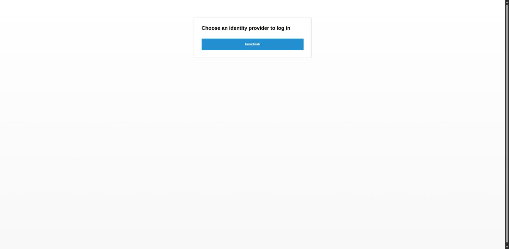
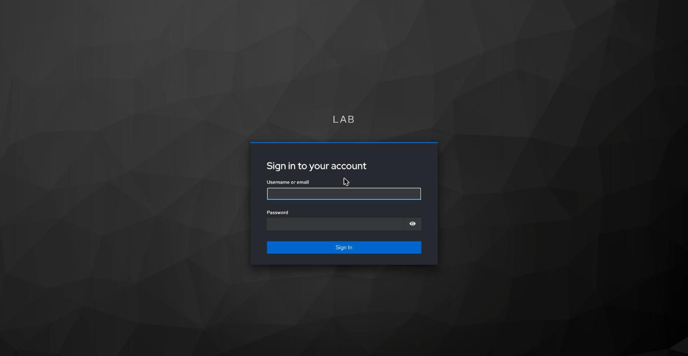
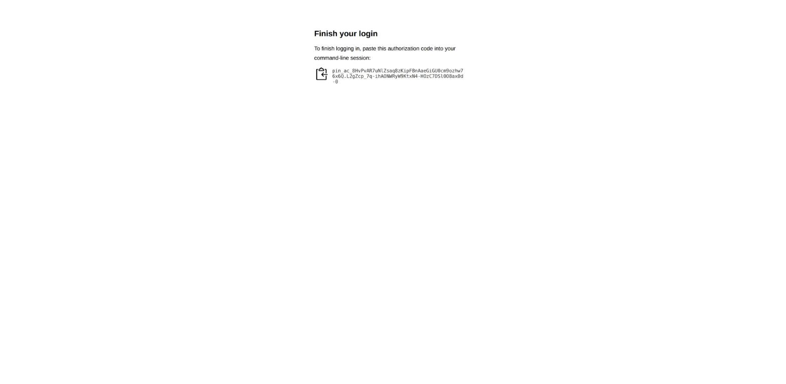
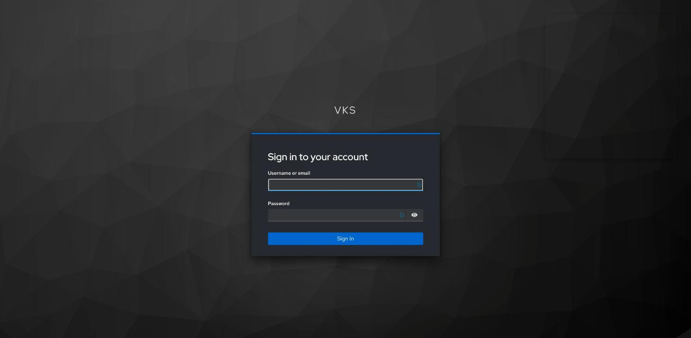
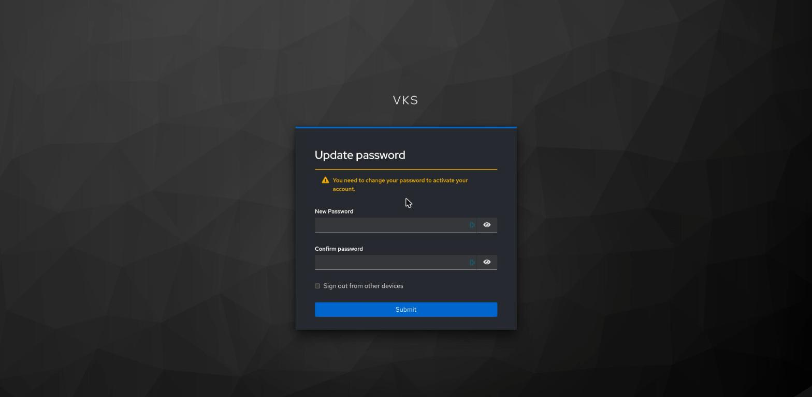
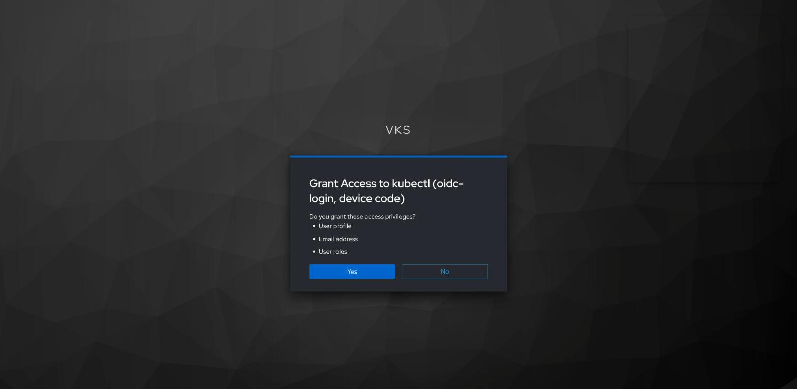
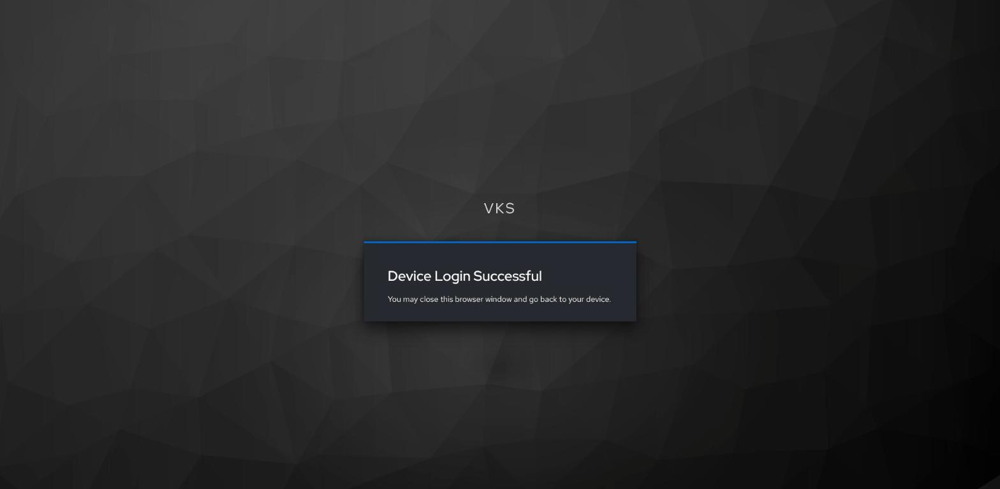

# Sign in with your organization's identity provider

Your administrator gave your group in your organization's identity provider (Keycloak in these
guides) access to a VKS cluster, and sent you a kubeconfig file with no secret in it. When you use
the file, kubectl opens a sign-in at the identity provider in a browser, with your own account. You
need no vCenter account.

Not your case? Your own vCenter SSO account: [USER-LOGIN.md](USER-LOGIN.md). A file with a token or
a certificate: [USER-KUBECONFIG.md](USER-KUBECONFIG.md).

The steps:

- 1 [Which file you have](#1-which-file-you-have): it decides part A or part B
- 2 [Trust the CAs](#2-trust-the-cas-once-on-the-machine-whose-browser-you-sign-in-with)
- Part A, the file runs `vcf`: 3 [sign in](#3-sign-in-through-the-supervisor), 4 [log out](#4-log-out-part-a)
- Part B, the file runs `kubectl`: 5 [sign in](#5-sign-in-with-kubelogin), 6 [log out](#6-log-out-part-b)
- 7 [Forbidden, or no sign-in](#7-forbidden-or-no-sign-in)

## Prerequisites

- [Prerequisites](PREREQS.md) for your OS, [kubectl](KUBECTL.md) and a browser;
- part A also the [VCF CLI](VCF.md) (its download needs a Broadcom account: if you have none, ask
  your administrator for the two files, [VCF.md step 1](VCF.md#1-download-the-two-files)), and the
  vCenter CA file from your administrator
  ([USER-LOGIN.md step 1](USER-LOGIN.md#1-what-to-ask-your-administrator-for)), saved as
  `~/.kube/vcenter-ca.pem`;
- part B also [kubelogin](PREREQS.md#kubelogin-optional);
- from your administrator: the file, your namespace inside the VKS cluster (or that you have the
  whole cluster), the cluster's address (the file's `server:` line), and, if the identity provider's
  pages use your organization's own CA (Keycloak in these guides does), that CA file, saved as
  `~/.kube/keycloak-ca.pem` ([KEYCLOAK-VKS.md](KEYCLOAK-VKS.md#6-save-keycloaks-ca) hands it out as
  `$HOME/keycloak-ca.pem`; this guide keeps it in `~/.kube`).

The connections this guide needs, for a firewall (all TCP, besides DNS):

| from | to | port | for |
|---|---|---|---|
| your machine (laptop or jump box) | the VKS cluster's API address (the file's `server:` line) | 6443 | kubectl with the file (steps 3 and 5) |
| your machine (laptop or jump box) | the Supervisor's address | 443 | part A: the sign-in through the Supervisor ([step 3](#3-sign-in-through-the-supervisor)) |
| your machine (laptop or jump box) | the identity provider | its HTTPS port (443) | part B: kubelogin's code ([step 5](#5-sign-in-with-kubelogin)) |
| the browser you sign in with | the identity provider, and for part A the Supervisor's address | 443 | the sign-in (steps 3 and 5) |

The connections of the cluster and the Supervisor to the identity provider are your administrator's
([ADMIN-GRANT-ACCESS-IDP.md](ADMIN-GRANT-ACCESS-IDP.md#prerequisites), [KEYCLOAK.md](KEYCLOAK.md#prerequisites)).

## 1. Which file you have

Save the file in your `.kube` folder. Run this once after saving it: it makes the file readable
only by you, then shows which program it runs to sign in and which server it reaches. It changes
nothing else. Set `KUBECONFIG_FILE` to the saved file (a part B file is often named
`my-vks-cluster-keycloak.kubeconfig`); steps 3 and 5 use the same file.

**Linux, macOS, WSL (bash or zsh):**

```sh
KUBECONFIG_FILE="$HOME/.kube/my-vks-cluster-keycloak-sv.kubeconfig"

chmod 600 "$KUBECONFIG_FILE"
echo "runs: $(kubectl --kubeconfig "$KUBECONFIG_FILE" config view -o jsonpath='{.users[0].user.exec.command} {.users[0].user.exec.args[0]}')"
echo "server: $(kubectl --kubeconfig "$KUBECONFIG_FILE" config view -o jsonpath='{.clusters[0].cluster.server}')"
```

**Windows (PowerShell):**

```powershell
$KUBECONFIG_FILE = "$HOME\.kube\my-vks-cluster-keycloak-sv.kubeconfig"

icacls $KUBECONFIG_FILE /inheritance:r /grant:r "${env:USERNAME}:F" | Out-Null
"runs: $(kubectl --kubeconfig $KUBECONFIG_FILE config view -o jsonpath='{.users[0].user.exec.command} {.users[0].user.exec.args[0]}')"
"server: $(kubectl --kubeconfig $KUBECONFIG_FILE config view -o jsonpath='{.clusters[0].cluster.server}')"
```

**Expect:** `server:` with the address you were sent, and one of:
- `runs: vcf pinniped-auth`: through the Supervisor; do part A (steps 3 and 4);
- `runs: kubectl oidc-login`: on one cluster that trusts the identity provider; do part B (steps 5
  and 6).

**If not:**
- `runs:` with nothing after it: the file holds a token or a certificate:
  [USER-KUBECONFIG.md](USER-KUBECONFIG.md).
- Another program, or another `server:`: do not use the file (a file can run any program); ask your
  administrator.
- `No such file` (Windows: `cannot find`): set `KUBECONFIG_FILE` to the saved file.

## 2. Trust the CAs (once, on the machine whose browser you sign in with)

The browser must trust the CA of each page it signs in on: for part A the Supervisor's (the vCenter
CA, `~/.kube/vcenter-ca.pem`); for both parts the identity provider's (`~/.kube/keycloak-ca.pem`), if
its pages use your organization's own CA (Keycloak in these guides does). Run the lines for your OS
once for each CA file you have: on macOS, WSL and Windows set `CA_FILE` to that file. A CA file holds
no secret. On Windows and macOS the vCenter CA is the same step as
[USER-LOGIN.md plugin step 1](USER-LOGIN.md#1-windows-and-macos-trust-the-vcenter-ca-the-person-once):
done once, it serves both.

**Linux:** run this so that Chrome trusts the CA; Chrome uses its own certificate database in your
home. This adds the CA to that database under the name `CA_NAME` (it needs `certutil`:
`sudo apt-get install -y libnss3-tools` on Ubuntu, `sudo dnf install -y nss-tools` on AlmaLinux,
`sudo tdnf install -y nss` on Photon OS). The identity provider's CA:

```sh
CA_FILE="$HOME/.kube/keycloak-ca.pem"
CA_NAME="Keycloak CA"

mkdir -p "$HOME/.pki/nssdb"
[ -f "$HOME/.pki/nssdb/cert9.db" ] || certutil -d "sql:$HOME/.pki/nssdb" -N --empty-password
certutil -d "sql:$HOME/.pki/nssdb" -A -t "C,," -n "$CA_NAME" -i "$CA_FILE" \
  && certutil -d "sql:$HOME/.pki/nssdb" -L | grep "$CA_NAME"
```

For part A, also the vCenter CA, under its own name:

```sh
CA_FILE="$HOME/.kube/vcenter-ca.pem"
CA_NAME="vCenter CA"

mkdir -p "$HOME/.pki/nssdb"
[ -f "$HOME/.pki/nssdb/cert9.db" ] || certutil -d "sql:$HOME/.pki/nssdb" -N --empty-password
certutil -d "sql:$HOME/.pki/nssdb" -A -t "C,," -n "$CA_NAME" -i "$CA_FILE" \
  && certutil -d "sql:$HOME/.pki/nssdb" -L | grep "$CA_NAME"
```

Firefox keeps its own list: **Settings** → **Privacy & Security** → **View Certificates** →
**Authorities** → **Import**, then tick *Trust this CA to identify websites*.

**macOS:** run this so that Safari and Chrome trust the CA. It adds the CA to your login keychain,
which they use. macOS asks for your password:

```sh
CA_FILE="$HOME/.kube/keycloak-ca.pem"

security add-trusted-cert -r trustRoot -k "$HOME/Library/Keychains/login.keychain-db" "$CA_FILE"
```

**WSL:** run this first, because the browser runs on Windows and the CA must go there. This copies
the CA file to your Windows home folder, where the Windows line below finds it; then run that line
in PowerShell:

```sh
CA_FILE="$HOME/.kube/keycloak-ca.pem"

P="$(cmd.exe /c 'echo %USERPROFILE%' 2>/dev/null | tr -d '\r')"
W="$([ -n "$P" ] && wslpath "$P" 2>/dev/null)"
if [ -n "$W" ] && [ -d "$W" ] && cp "$CA_FILE" "$W/"; then echo "copied to $W"; else echo "FAILED: no Windows home folder found"; fi
```

**Windows (PowerShell):** run this so that Edge and Chrome trust the CA. It adds the CA to your
user's trusted root CAs, which they use. Windows asks you to confirm with **Yes**, so run it in
PowerShell on the desktop (after WSL: set `CA_FILE` to `$HOME\keycloak-ca.pem`):

```powershell
$CA_FILE = "$HOME\.kube\keycloak-ca.pem"

Import-Certificate -FilePath $CA_FILE -CertStoreLocation Cert:\CurrentUser\Root
```

**Expect:** Linux: a line with `Keycloak CA` (or `vCenter CA`) and `C,,`. macOS: no output after your password. WSL:
`copied to /mnt/c/Users/<you>`. Windows: a line with the CA's thumbprint and its name (`CN=CA` for
vCenter's own CA). Then the browser opens the page with no certificate warning (restart the browser
first).

**If not:**
- `certutil: command not found`: install it (the package named above).
- `SEC_ERROR_ADDING_CERT` (Linux): the database already holds another CA under that `CA_NAME`; run the
  block again with a name of its own (`certutil -d "sql:$HOME/.pki/nssdb" -L` lists the names).
- `FAILED: no Windows home folder found` (WSL): copy the CA file to Windows by hand, for example
  with Explorer at `\\wsl$`.
- `UI is not allowed in this operation` (Windows): this PowerShell has no desktop to ask on (for
  example over SSH); run the line in Windows PowerShell on the desktop.
- No vCenter CA file (part A): ask your administrator for it. No CA file for the identity provider:
  open its sign-in page; with no certificate warning, the browser already trusts it and you skip that
  CA; with a warning, ask your administrator for the CA file.

## Part A: through the Supervisor (the file runs vcf)

### 3. Sign in through the Supervisor

You need kubectl and the [VCF CLI](VCF.md) (the file runs `vcf`; you do not log in with it), and a
browser that trusts the identity provider's CA and the vCenter CA
([step 2](#2-trust-the-cas-once-on-the-machine-whose-browser-you-sign-in-with)). Save the file in
your `.kube` folder, readable only by you, and check that it runs `vcf pinniped-auth` and that its
`server:` is the cluster address you were sent ([step 1](#1-which-file-you-have)).

The first command opens the browser: choose the provider (here **keycloak**), sign in with your
account (in Keycloak: password, and one-time code if asked), and kubectl goes on. Later commands
sign in again by themselves until your session at the identity provider ends.

On a machine without a browser (over SSH, a jump box), the command prints a link instead: open it
in the browser on your own computer, sign in, copy the code the last page shows, and paste it at
`Optionally, paste your authorization code:`.







Run this the first time you use the file, and whenever you want to check your rights. It asks the
cluster who you are and whether you may deploy in `VKS_CLUSTER_NAMESPACE`, signing you in first when
needed; it changes nothing on the cluster. You then have a sign-in saved on this machine (step 4
removes it), and see your name, your groups and your rights.

Set `KC_KUBECONFIG` to the same file as `KUBECONFIG_FILE` in step 1 and `VKS_CLUSTER_NAMESPACE` to the namespace inside the VKS
cluster that you were sent (if you were given the whole cluster, any namespace, for example `default`).

**Linux, macOS, WSL (bash or zsh):**

```sh
KC_KUBECONFIG="$HOME/.kube/my-vks-cluster-keycloak-sv.kubeconfig"
VKS_CLUSTER_NAMESPACE="team-a"

kubectl --kubeconfig "$KC_KUBECONFIG" auth whoami && kubectl --kubeconfig "$KC_KUBECONFIG" -n "$VKS_CLUSTER_NAMESPACE" auth can-i create deployments
```

**Windows (PowerShell):**

```powershell
$KC_KUBECONFIG = "$HOME\.kube\my-vks-cluster-keycloak-sv.kubeconfig"
$VKS_CLUSTER_NAMESPACE = "team-a"

kubectl --kubeconfig $KC_KUBECONFIG auth whoami
if ($LASTEXITCODE -eq 0) { kubectl --kubeconfig $KC_KUBECONFIG -n $VKS_CLUSTER_NAMESPACE auth can-i create deployments }
```

**Expect:** `Username  <prefix>:<you>`, `Groups  [<prefix>:<group> system:authenticated]`, then
`yes` (`no` with the `view` role).

**If not:**
- `executable file not found` or `"vcf": not found`: install the [VCF CLI](VCF.md).
- `could not open browser` and a link: you are on a machine without a browser; see above.
- `no` or `Forbidden`: [step 7](#7-forbidden-or-no-sign-in).
- The browser warns about the certificate: it does not trust the CA of that page; do
  [step 2](#2-trust-the-cas-once-on-the-machine-whose-browser-you-sign-in-with) for it (the
  Supervisor's page: the vCenter CA; the identity provider's page: its CA), restart the browser and
  run this again.

### 4. Log out (part A)

Do this when you are done on a shared machine. It deletes the VCF CLI's saved sign-in on this
machine; nothing changes on the cluster. The next command then asks for a sign-in again. Also sign
out of the identity provider in the browser.

**Linux, macOS, WSL (bash or zsh):**

```sh
rm -f "$HOME/.config/vcf/pinniped/sessions.yaml" "$HOME/.config/vcf/pinniped/credentials.yaml"
```

**Windows (PowerShell):**

```powershell
Remove-Item -ErrorAction SilentlyContinue "$HOME\.config\vcf\pinniped\sessions.yaml", "$HOME\.config\vcf\pinniped\credentials.yaml"
```

**Expect:** no output; the next `kubectl --kubeconfig <your file> …` opens the sign-in (or prints
the link).

**If not:** the next command still answers without a sign-in: you ran it in another account than
the one that signed in.

## Part B: on one cluster, with kubelogin (the file runs kubectl)

### 5. Sign in with kubelogin

Set `KEYCLOAK_KUBECONFIG` to the same file as `KUBECONFIG_FILE` in step 1.

Run this on your machine, once your administrator has sent you the file, to log in to the cluster
with your Keycloak user. Install [kubectl](KUBECTL.md) and
[kubelogin](PREREQS.md#kubelogin-optional) first, and save the file where `KEYCLOAK_KUBECONFIG`
points. It checks both tools and the file, then asks the cluster who you are; that first command
starts the Keycloak sign-in below. You get a login that later kubectl commands with this file use.
Run it again while your Keycloak session lasts and it only prints who you are; after that, it asks
for a new code.

**Linux, macOS, WSL (bash or zsh):**

```sh
KEYCLOAK_KUBECONFIG="$HOME/.kube/my-vks-cluster-keycloak.kubeconfig"

if ! command -v kubectl >/dev/null 2>&1; then echo "MISSING: kubectl (KUBECTL.md)"
elif ! kubectl oidc-login version >/dev/null 2>&1; then echo "MISSING: kubelogin (PREREQS.md, kubelogin)"
elif [ ! -s "$KEYCLOAK_KUBECONFIG" ]; then echo "MISSING: $KEYCLOAK_KUBECONFIG (the file from your administrator)"
else kubectl --kubeconfig "$KEYCLOAK_KUBECONFIG" auth whoami
fi
```

**Windows (PowerShell):**

```powershell
$KEYCLOAK_KUBECONFIG = "$HOME\.kube\my-vks-cluster-keycloak.kubeconfig"

if (-not (Get-Command kubectl -ErrorAction SilentlyContinue)) { "MISSING: kubectl (KUBECTL.md)" } elseif (-not (Get-Command kubectl-oidc_login -ErrorAction SilentlyContinue)) { "MISSING: kubelogin (PREREQS.md, kubelogin)" } elseif (-not (Test-Path $KEYCLOAK_KUBECONFIG)) { "MISSING: $KEYCLOAK_KUBECONFIG (the file from your administrator)" } else { kubectl --kubeconfig $KEYCLOAK_KUBECONFIG auth whoami }
```

kubelogin prints `Please visit the following URL in your browser:` and a Keycloak address that ends
in `user_code=XXXX-XXXX`. Open it in a browser on any machine, and open only an address your own
kubectl printed. Sign in to Keycloak:



At your first sign in with a temporary password, Keycloak asks for a new one:



Answer **Grant Access to kubectl (oidc-login, device code)** with **Yes**:



The page then says **Device Login Successful**, and kubectl answers. Later commands renew the login
by themselves while your Keycloak session lasts.



**Expect:** `Username  keycloak:<you>`, a `UID` line, and `Groups` that include `keycloak:team-a`;
`kubectl --kubeconfig "$KEYCLOAK_KUBECONFIG" get pods` then answers for `team-a`.

**If not:**
- `MISSING: …`: install that tool, or save the file under that name.
- `x509: certificate signed by unknown authority` from kubelogin: the Keycloak CA in your file is
  not the CA of Keycloak's certificate, or Keycloak's certificate changed; ask your administrator
  for a new file.
- `could not load the certificate`: the Keycloak CA in your file is not a certificate; ask your
  administrator for a new file.
- `Unauthorized`: the cluster does not accept the sign-in; send your administrator the message in
  [step 7](#7-forbidden-or-no-sign-in).
- `Forbidden`: [step 7](#7-forbidden-or-no-sign-in).

### 6. Log out (part B)

Run this to log out on this machine, for example on a shared jump box. It deletes your cached
Keycloak tokens (`~/.kube/cache/oidc-login`); the kubeconfig file stays. The next kubectl command
with that file asks for a new code, as in step 5.

**Linux, macOS, WSL (bash or zsh):**

```sh
kubectl oidc-login clean
```

**Windows (PowerShell):**

```powershell
kubectl oidc-login clean
```

**Expect:** `Deleted the token cache from …/.kube/cache/oidc-login`, then a line about the keyring
(`Could not delete the token cache from the keyring: …` where there is none). The next command asks
for a new code.

**If not:** `Error: unknown command "oidc-login" for "kubectl"`: kubelogin is not installed on
this machine ([PREREQS.md](PREREQS.md#kubelogin-optional)).

## 7. Forbidden, or no sign-in

| you see | it means | who fixes it |
|---|---|---|
| `no` or `Forbidden`, and `Groups` lacks your group | you are not in the group at the identity provider | the identity provider's administrator adds you |
| `no` or `Forbidden`, with your group in `Groups` | the group has no rights in that namespace | the cluster's administrator |
| a group shown as `keycloak:/team-a` (part B) | Keycloak sends the full group path | the identity provider's administrator |
| `Unauthorized` (part B) | the cluster does not accept the sign-in | the cluster's administrator |
| `Forbidden` only in another namespace | your rights are in your own namespace | name it with `-n` |

Send the administrator who fixes it this message, with your own values:

> I cannot use the VKS cluster at `<the server: line from step 1>` in namespace `<namespace>`. My
> file runs `<vcf pinniped-auth or kubectl oidc-login>`. kubectl answers `<the error line>`.
> `kubectl auth whoami` shows `Username <…>` and `Groups [<…>]`. It began at `<date and time>`.

## References

- Broadcom: [Configure an External Identity Provider for VKS Clusters](https://techdocs.broadcom.com/us/en/vmware-cis/vcf/vcf-service-administration-and-development/9-1/managing-vsphere-kubernetes-service/connecting-to-tkg-service-clusters-using-an-external-identity-provider/configure-an-external-idp-for-use-with-tkg-service-clusters.html) (part A)
- Kubernetes: [Authenticating](https://kubernetes.io/docs/reference/access-authn-authz/authentication/) (`Unauthorized`), [Using RBAC Authorization](https://kubernetes.io/docs/reference/access-authn-authz/rbac/) (`Forbidden`: the `edit` and `view` roles)
- kubelogin: [README](https://github.com/int128/kubelogin), [Usage](https://github.com/int128/kubelogin/blob/master/docs/usage.md) (part B)
- Keycloak: [Device Authorization Grant](https://www.keycloak.org/docs/latest/server_admin/index.html#device-authorization-grant) (part B)

Back to [README](../README.md).
