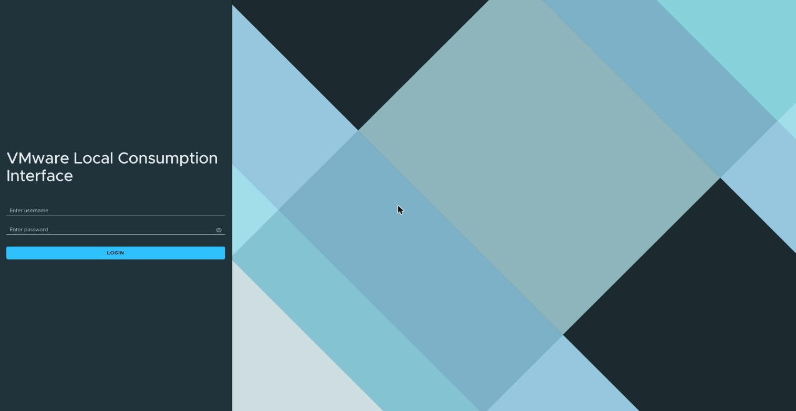
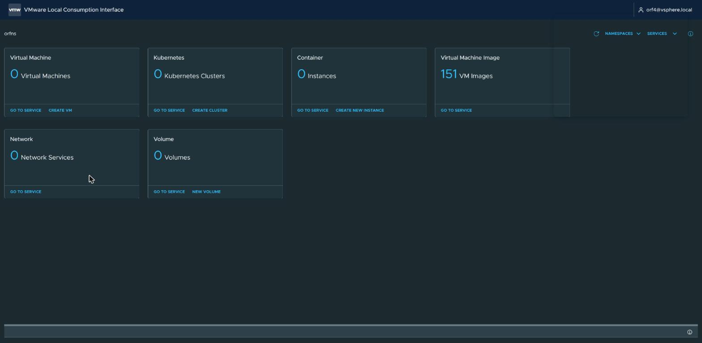
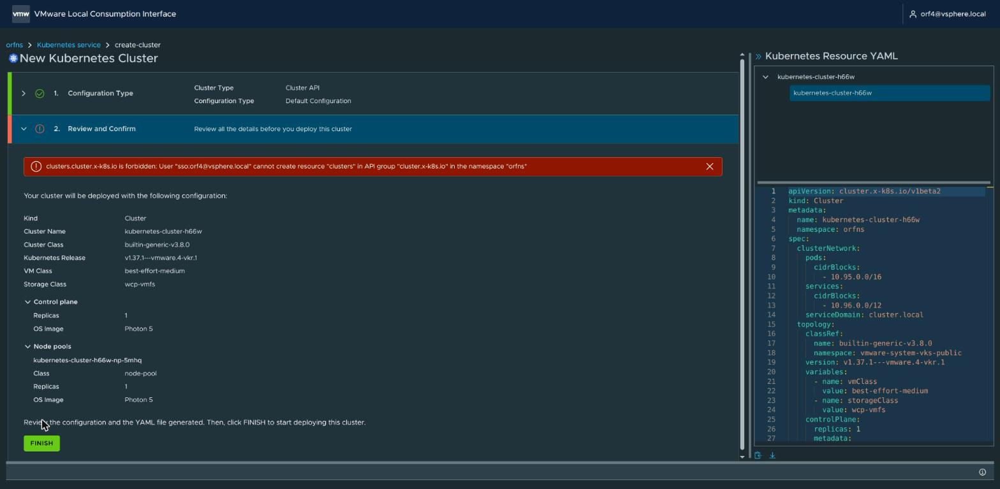

# Use your vSphere Namespace in the web page

Your vCenter administrator gave your own vCenter SSO user a role on a vSphere Namespace. You open
the Local Consumption Interface, a web page on the Supervisor, with the link they send you, sign in,
and see what the namespace holds: VMs, VKS clusters, VM images, network services and volumes. With
**Can edit** you also create and delete VKS clusters there and download their kubeconfig; with
**Can view** you only look. Nothing to install besides, on Linux, `certutil` for step 2, and kubectl
to use a kubeconfig you download there. The
screenshots are from VCF 9.1.1 and show a test lab's names; yours differ.

Not an SSO user? [Who are you? Start here](LOGIN.md#who-are-you-start-here) sends you to the guide
for your way in.

The steps:

1. [What to ask your administrator for](#1-what-to-ask-your-administrator-for)
2. [Trust the vCenter CA in your browser (once)](#2-trust-the-vcenter-ca-in-your-browser-once)
3. [Open the link and sign in](#3-open-the-link-and-sign-in)
4. [What you see](#4-what-you-see)
5. [Create, use and delete a VKS cluster (Can edit)](#5-create-use-and-delete-a-vks-cluster-can-edit)
6. [Log out](#6-log-out)

## Prerequisites

- a browser; on Linux also `certutil`
  ([USER-IDP-LOGIN.md step 2](USER-IDP-LOGIN.md#2-trust-the-cas-once-on-the-machine-whose-browser-you-sign-in-with)
  says how to install it);
- with **Can edit**, to use a kubeconfig you download: [kubectl](KUBECTL.md);
- the link, your SSO user name and the vCenter CA file from [step 1](#1-what-to-ask-your-administrator-for);
- a role on the vSphere Namespace given by the vCenter administrator
  ([ADMIN-GRANT-ACCESS.md](ADMIN-GRANT-ACCESS.md#1b-let-the-person-use-the-web-page-vcenter-administrator-optional)).

The connections this guide needs, for a firewall (all TCP, besides DNS):

| from | to | port | for |
|---|---|---|---|
| your machine (laptop or jump box) | the Supervisor's address | 443 | the web page ([step 3](#3-open-the-link-and-sign-in)) |
| your machine (laptop or jump box) | the VKS cluster's API address (in the kubeconfig) | 6443 | kubectl with a downloaded kubeconfig ([step 5](#5-create-use-and-delete-a-vks-cluster-can-edit)) |

## 1. What to ask your administrator for

Ask your vCenter administrator for:

- the link to your vSphere Namespace's page, in the form
  `https://<Supervisor address>/appplatform0/#/namespaces/<vSphere Namespace>`;
- your SSO user name, for example `Alice@vsphere.local`;
- the vCenter CA file (not needed if your browser already trusts it: with it your browser checks
  that it talks to your real Supervisor); save it as `~/.kube/vcenter-ca.pem`;
- which role you have: **Can view** or **Can edit**.

Use the link with your namespace's name in it. The page's address without it,
`https://<Supervisor address>/appplatform0/`, first lists every vSphere Namespace on the Supervisor,
which only an administrator may do: you sign in and get a red bar with no text.

## 2. Trust the vCenter CA in your browser (once)

Run only the vCenter CA lines for your OS in
[USER-IDP-LOGIN.md step 2](USER-IDP-LOGIN.md#2-trust-the-cas-once-on-the-machine-whose-browser-you-sign-in-with),
with the vCenter CA file, `~/.kube/vcenter-ca.pem`: on Linux the block after *For part A, also the
vCenter CA*; skip its identity provider's CA. Done once, it serves that guide too.

**Expect:** the page in step 3 opens with no certificate warning.

**If not:** a warning that the connection is not private: the CA is not trusted yet, or it is not the
CA of this Supervisor. Ask the vCenter administrator for the right file, and do not click through the
warning.

## 3. Open the link and sign in

1. Open the link from step 1. The page **VMware Local Consumption Interface** asks for a user name and
   a password.

   

2. Type your SSO user name and your vCenter password, and click **LOGIN**.

**Expect:** your namespace's page, with your user name at the top right
([step 4](#4-what-you-see)).

**If not:**

- A red bar with no text: the link lacks your namespace's name, the name is misspelled, or you have
  no role on that namespace. Open the link from step 1; if the bar stays, ask the vCenter
  administrator.
- **Unable to login: Internal server error**: type the user name again by hand; a password manager
  may have put a space in front of it.
- Sign-in refused: check the user name and password before you try again; failed sign-ins lock your
  SSO account for a while.

## 4. What you see

One card per service in your vSphere Namespace: **Virtual Machine**, **Kubernetes** (VKS clusters),
**Container**, **Virtual Machine Image**, **Network** and **Volume**. **GO TO SERVICE** opens its
list.

With **Can view** you see the cards, and the create links are there too, but a create ends in a red
bar:

`clusters.cluster.x-k8s.io is forbidden: User "sso:…" cannot create resource "clusters" …`: you have
**Can view**. Ask the vCenter administrator for **Can edit** if you need to create.

The page shows what is in the vSphere Namespace, not the workloads inside a VKS cluster. To work
inside a cluster you were given access to, log in with [USER-LOGIN.md](USER-LOGIN.md).

## 5. Create, use and delete a VKS cluster (Can edit)

**Can edit** makes you an administrator of every VKS cluster in the vSphere Namespace.

- **Create:** on the **Kubernetes** card click **CREATE CLUSTER**, keep **Default Configuration**,
  click **NEXT**, then **FINISH**. The cluster's list opens; the cluster turns **Available** after a
  few minutes. For your own name, VM class and node counts choose **Custom Configuration**:
  [CLUSTER.md steps 4 and 5](CLUSTER.md#4-fill-in-the-create-page) show that page.
- **Use:** in the cluster's list, the **⋮** menu of a cluster has **Download Kubeconfig File**. The
  file is the cluster's administrator kubeconfig: keep it to yourself and never send it
  ([KUBECONFIG.md](KUBECONFIG.md#3-hand-a-file-over)); to give someone access, see
  [ADMIN-GRANT-ACCESS.md](ADMIN-GRANT-ACCESS.md). It keeps working after your role is taken away.
  The browser saves it as `<cluster name>-kubeconfig.yaml`, the same file as the vSphere Client's:
  run the block after the download in
  [SUPERVISOR-LOGIN.md](SUPERVISOR-LOGIN.md#download-the-vks-clusters-kubeconfig-from-the-vsphere-client), which
  moves it to `~/.kube/<cluster name>.kubeconfig`, readable only by you, then
  [Use the VKS cluster](SUPERVISOR-LOGIN.md#use-the-vks-cluster).
- **Delete:** the same **⋮** menu has **Delete**; confirm with **DELETE**. The page says
  **Cluster … is being deleted** and the cluster leaves the list when its VMs are gone.

**Expect:** a new cluster **Available** in the list; a deleted one gone from it.

**If not:** a cluster that does not turn **Available**: [CLUSTER.md step 6](CLUSTER.md#6-wait-for-the-cluster)
says what to look at; send its output to the vCenter administrator.

## 6. Log out

Click your user name at the top right, then **Log out**. If a create page is open, **Discard
Changes** asks first: click **DISCARD**.

**Expect:** the sign-in page.

**If not:** signing in again on that page gives the red bar with no text, because it lost your
namespace's name. Open the link from step 1 again.

## References

**Official Broadcom documentation (VCF 9.1) for this guide**

- [Access the IaaS Services Console or Local Consumption Interface](https://techdocs.broadcom.com/us/en/vmware-cis/vcf/vcf-consumption/latest/consumer-interfaces-in-vcf/access-the-iaas-services-console-or-local-consumption-interface.html)
- [Configure vSphere Namespace Permissions for vCenter Single Sign-On Users and Groups](https://techdocs.broadcom.com/us/en/vmware-cis/vcf/vcf-service-administration-and-development/9-1/managing-vsphere-kubernetes-service/configuring-vsphere-namespaces-for-hosting-tkg-service-clusters/configure-vsphere-namespace-persmissions-for-vcenter-sso-users-and-groups.html) (the role your administrator gives you)
- [Local Consumption Interface release notes](https://vsphere-tmm.github.io/Supervisor-Services/consumption-interface/Release_Notes_9_1_3.html)

Back to [README](../README.md).
