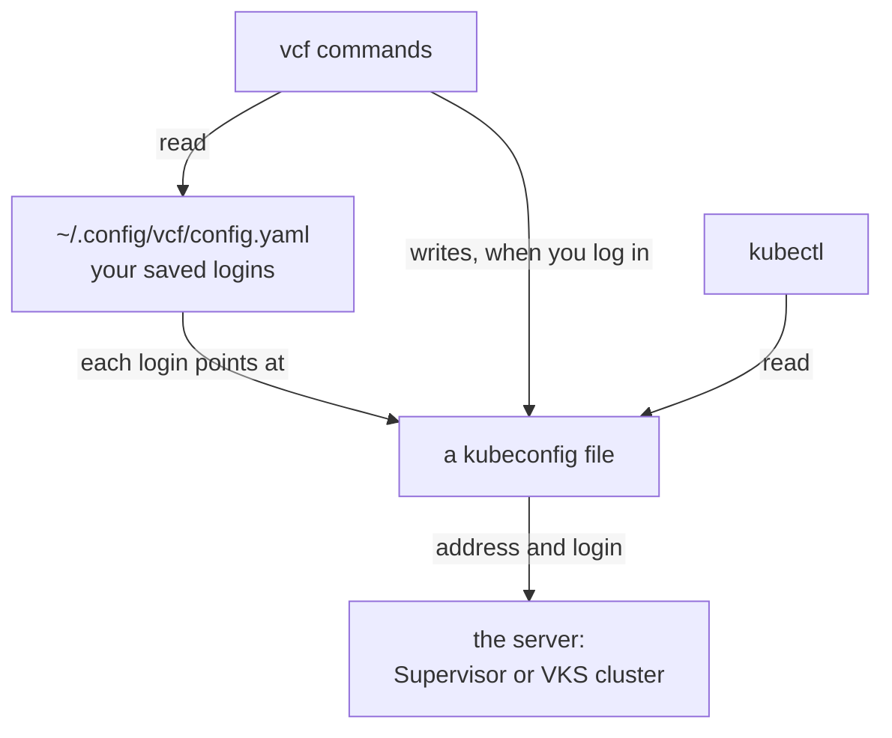
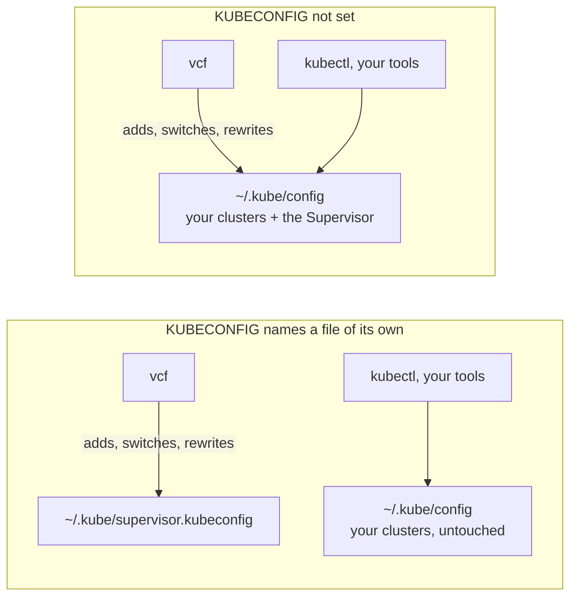
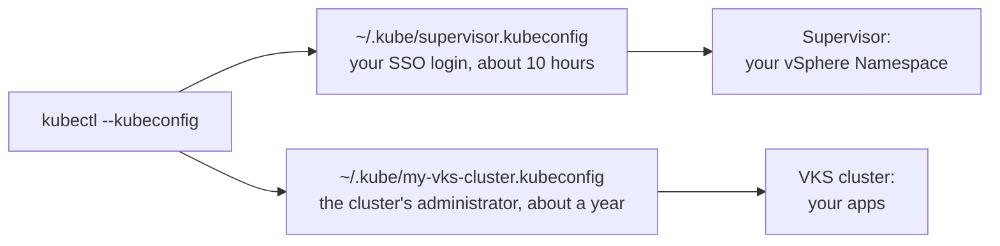
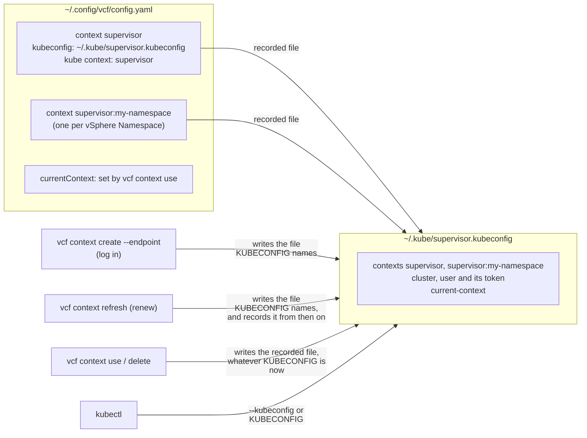

# Install the VCF CLI and its plugins

> [!NOTE]
> **Official Broadcom documentation (VCF 9.1.1) for this guide**
>
> - [Installing the VCF CLI](https://techdocs.broadcom.com/us/en/vmware-cis/vcf/vcf-consumption/latest/consumer-interfaces-in-vcf/installing-and-using-vcf-cli-v9/installing-the-vcf-cli-in-internet-connected-environments/install-the-vcf-cli%283%29.html) (install the downloaded binary)
> - [VCF CLI `context` commands](https://techdocs.broadcom.com/us/en/vmware-cis/vcf/vcf-consumption/latest/consumer-interfaces-in-vcf/installing-and-using-vcf-cli-v9/command-reference2/system-commands%281%29/context2.html) (how contexts use kubeconfig files)
> - [Connect to the VKS Cluster Control Plane as a Kubernetes Administrator](https://techdocs.broadcom.com/us/en/vmware-cis/vcf/vcf-consumption/latest/managing-vsphere-kuberenetes-service-clusters-and-workloads/configuring-identity-and-access-for-tkg-service-clusters/connect-to-the-tkg-service-cluster-control-plane-as-a-kubernetes-administrator.html) and [Log in to a VKS Cluster Using vCenter Single Sign-On Credentials](https://techdocs.broadcom.com/us/en/vmware-cis/vcf/vcf-consumption/latest/managing-vsphere-kuberenetes-service-clusters-and-workloads/configuring-identity-and-access-for-tkg-service-clusters/connecting-to-vsphere-with-tanzu-clusters/connect-to-a-tkg-service-cluster-as-a-vcenter-single-sign-on-user-with-kubectl/log-in-using-credentials.html) (the two ways to log in to a VKS cluster)
> - [Installing the VCF CLI in Internet Restricted Environments](https://techdocs.broadcom.com/us/en/vmware-cis/vcf/vcf-consumption/latest/consumer-interfaces-in-vcf/installing-and-using-vcf-cli-v9/installing-the-vcf-cli-in-internet-connected-environments/installing-the-vcf-cli-in-internet-restricted-environments%282%29.html) (the download and the plugin bundle)

`vcf` is VMware's command-line tool; you use it to [log in to the Supervisor](LOGIN.md) (the
vSphere service that holds your vSphere Namespace). The
plugin bundle adds its other commands (`vcf cluster`, `vcf addon`, …). Download two files from
Broadcom, then run the install block; it needs no internet access.

## Prerequisites

- a Broadcom support account with access to your company's VMware downloads ([Download](#download));
- [tar](PREREQS.md) (Linux, macOS);
- for [the check of your contexts](#what-a-login-creates-and-when-it-matters) only:
  [kubectl](KUBECTL.md) and [jq](PREREQS.md).

The connections this guide needs, for a firewall (all TCP):

| from | to | port | for |
|---|---|---|---|
| your browser | `support.broadcom.com` | 443 | Download |

## Download

You need a Broadcom support account with access to your company's VMware downloads (ask your
vSphere administrator for access, or for the two files). Download both files for your platform:
`Linux_AMD64` (most PCs; `uname -m` prints `x86_64`), `Linux_ARM64`, `Darwin_ARM64` or
`Darwin_AMD64` (macOS), or for Windows PowerShell `Windows_AMD64` or `Windows_ARM64` (`.zip`
instead of `.tar.gz`). In WSL 2, take `Linux_AMD64` (`Linux_ARM64` on an
Arm PC). On a machine without a browser, download them on another one and copy both to
`DOWNLOAD_DIR`.

| file | where to click | direct link |
|---|---|---|
| `VCF-Consumption-CLI-<platform>-9.1.1.0100.25746586.tar.gz` | [My Downloads](https://support.broadcom.com/group/ecx/downloads) → VMware vSphere Foundation → VMware vSphere Foundation 9 → 9.1.1.0100 → **VCF Consumption CLI** | [VCF CLI](https://support.broadcom.com/group/ecx/productfiles?displayGroup=VMware%20vSphere%20Foundation%209&release=9.1.1.0100&os=&servicePk=547810&language=EN&groupId=545612&viewGroup=true) |
| `VCF-Consumption-CLI-PluginBundle-<platform>-9.1.1.0200.25839222.tar.gz` | [My Downloads](https://support.broadcom.com/group/ecx/downloads) → VMware vSphere Foundation → VMware vSphere Foundation 9 → 9.1.1.0200 → **VCF Consumption CLI Plugins** | [VCF CLI plugins](https://support.broadcom.com/group/ecx/productfiles?displayGroup=VMware%20vSphere%20Foundation%209&release=9.1.1.0200&os=&servicePk=548172&language=EN&groupId=545621&viewGroup=true) |

- With a VMware Cloud Foundation account, click VMware Cloud Foundation → VMware Cloud Foundation
  9 instead, then for each file the release whose file names match the table. Until you pick the
  release, the page reads "No data found".
- Tick **"I agree to the Terms and Conditions"**. The checkbox stays greyed out until you open
  both Terms links, and until it is ticked the download icon does nothing.
- Take the row for your platform, not the files without one (`…-Binaries-…`, plain
  `…-PluginBundle-…`, `…-OCI-…`).
- Copy the **SHA2** value of each file (its SHA-256 checksum: 64 letters and digits); the install
  block checks them.
- Take the files whose names contain `9.1.1.0100.25746586` (the CLI) and `9.1.1.0200.25839222`
  (the plugins), the names the install block expects; the two come from different releases. The
  plugins' VKS plugins (`addon`, `cluster`, …) are v3.8.0, for VKS 3.8 (the bundle also carries
v3.7.2).

## Install

This checks the two files you downloaded against their SHA2 values, installs `vcf`, then installs
its plugins from the bundle. If a file does not match, it installs nothing.

1. Copy the block for your OS into a text editor.
2. Paste the two SHA2 values between the quotes on its first two lines.
3. If the files are not in `~/Downloads`, change `DOWNLOAD_DIR` (in WSL, see
   [Prerequisites](PREREQS.md#wsl-2-with-ubuntu)).
4. Paste the whole block into the terminal. Values you set in the terminal before do not count:
   the block's first lines set them again.

`vcf` goes into `INSTALL_DIR`, or into `~/.local/bin` if that folder needs `sudo` and `sudo` would
ask for a password (see [Prerequisites](PREREQS.md#sudo-optional)).

<details>
<summary><b>Linux (Ubuntu, AlmaLinux, Photon OS), macOS, WSL (bash or zsh)</b></summary>

```sh
VCF_CLI_SHA256=""        # SHA2 of the CLI file from the download page
VCF_PLUGINS_SHA256=""    # SHA2 of the plugin bundle from the download page
DOWNLOAD_DIR="$HOME/Downloads"
INSTALL_DIR="/usr/local/bin"
VCF_CLI_VERSION="9.1.1.0100.25746586"
VCF_PLUGINS_VERSION="9.1.1.0200.25839222"

case "$(uname -s)/$(uname -m)" in
  Linux/x86_64)  P=Linux_AMD64 ;;
  Linux/aarch64) P=Linux_ARM64 ;;
  Darwin/arm64)  P=Darwin_ARM64 ;;
  Darwin/x86_64) P=Darwin_AMD64 ;;
  *)             P=unsupported ;;
esac
CLI_TGZ="$DOWNLOAD_DIR/VCF-Consumption-CLI-${P}-${VCF_CLI_VERSION}.tar.gz"
PLUGINS_TGZ="$DOWNLOAD_DIR/VCF-Consumption-CLI-PluginBundle-${P}-${VCF_PLUGINS_VERSION}.tar.gz"
CLI_SUM="$( (sha256sum "$CLI_TGZ" 2>/dev/null || shasum -a 256 "$CLI_TGZ" 2>/dev/null) | cut -d' ' -f1)"
PLUGINS_SUM="$( (sha256sum "$PLUGINS_TGZ" 2>/dev/null || shasum -a 256 "$PLUGINS_TGZ" 2>/dev/null) | cut -d' ' -f1)"
TMP="$(mktemp -d)"

if [ ! -f "$CLI_TGZ" ] || [ ! -f "$PLUGINS_TGZ" ]; then
  [ -f "$CLI_TGZ" ]     || echo "FAILED: not found: $CLI_TGZ"
  [ -f "$PLUGINS_TGZ" ] || echo "FAILED: not found: $PLUGINS_TGZ"
elif [ -z "$VCF_CLI_SHA256" ] || [ -z "$VCF_PLUGINS_SHA256" ]; then
  echo "FAILED: set VCF_CLI_SHA256 and VCF_PLUGINS_SHA256 from the download page"
elif [ "$CLI_SUM" != "$(printf '%s' "$VCF_CLI_SHA256" | tr -d '[:space:]' | tr 'A-F' 'a-f')" ] \
     || [ "$PLUGINS_SUM" != "$(printf '%s' "$VCF_PLUGINS_SHA256" | tr -d '[:space:]' | tr 'A-F' 'a-f')" ]; then
  echo "FAILED: checksum mismatch; nothing installed"
  echo "  CLI     $CLI_SUM"
  echo "  plugins $PLUGINS_SUM"
elif ! tar -xzf "$CLI_TGZ" -C "$TMP" || ! mv "$TMP"/vcf-cli-* "$TMP/vcf" \
     || ! mkdir "$TMP/plugins" || ! tar -xzf "$PLUGINS_TGZ" -C "$TMP/plugins"; then
  echo "FAILED: could not unpack the downloads"
else
  echo "checksums OK"
  if { mkdir -p "$INSTALL_DIR" 2>/dev/null && [ -w "$INSTALL_DIR" ] && install -m 0755 "$TMP/vcf" "$INSTALL_DIR/vcf"; } \
     || { sudo -n install -d "$INSTALL_DIR" 2>/dev/null && sudo -n install -m 0755 "$TMP/vcf" "$INSTALL_DIR/vcf"; }; then
    DEST="$INSTALL_DIR"
  else
    DEST="$HOME/.local/bin"; mkdir -p "$DEST" && install -m 0755 "$TMP/vcf" "$DEST/vcf"
    echo "note: $INSTALL_DIR needs sudo; installed into $DEST"
  fi
  case ":$PATH:" in *":$DEST:"*) ;; *) PATH="$DEST:$PATH"; echo "note: $DEST added to PATH for this terminal only (see PREREQS.md)";; esac
  hash -r 2>/dev/null
  "$DEST/vcf" plugin install all --local-source "$TMP/plugins" || echo "FAILED: plugin install (vcf itself is installed)"
  "$DEST/vcf" version | head -1
  "$DEST/vcf" plugin list
  [ "$(command -v vcf)" = "$DEST/vcf" ] || echo "WARNING: 'vcf' on PATH is $(command -v vcf)"
fi; rm -rf "$TMP"
```

</details>

<details>
<summary><b>Windows (PowerShell)</b></summary>

```powershell
$VCF_CLI_SHA256 = ""                     # SHA2 of the CLI file from the download page
$VCF_PLUGINS_SHA256 = ""                 # SHA2 of the plugin bundle from the download page
$DOWNLOAD_DIR = "$HOME\Downloads"
$INSTALL_DIR = "$env:LOCALAPPDATA\Programs\vks-tools"
$VCF_CLI_VERSION = "9.1.1.0100.25746586"
$VCF_PLUGINS_VERSION = "9.1.1.0200.25839222"

$global:LASTEXITCODE = $null
$P = if ($env:PROCESSOR_ARCHITECTURE -eq 'ARM64') { 'Windows_ARM64' } else { 'Windows_AMD64' }
$CLI_ZIP = "$DOWNLOAD_DIR\VCF-Consumption-CLI-$P-$VCF_CLI_VERSION.zip"
$PLUGINS_ZIP = "$DOWNLOAD_DIR\VCF-Consumption-CLI-PluginBundle-$P-$VCF_PLUGINS_VERSION.zip"
$CLI_SUM = if (Test-Path $CLI_ZIP) { (Get-FileHash -Algorithm SHA256 $CLI_ZIP).Hash.ToLower() }
$PLUGINS_SUM = if (Test-Path $PLUGINS_ZIP) { (Get-FileHash -Algorithm SHA256 $PLUGINS_ZIP).Hash.ToLower() }
$TMP = Join-Path $env:TEMP ([guid]::NewGuid()); New-Item -ItemType Directory -Path $TMP | Out-Null

if (-not $CLI_SUM -or -not $PLUGINS_SUM) {
  if (-not $CLI_SUM) { "FAILED: not found: $CLI_ZIP" }
  if (-not $PLUGINS_SUM) { "FAILED: not found: $PLUGINS_ZIP" }
} elseif (-not $VCF_CLI_SHA256 -or -not $VCF_PLUGINS_SHA256) {
  "FAILED: set VCF_CLI_SHA256 and VCF_PLUGINS_SHA256 from the download page"
} elseif ($CLI_SUM -ne $VCF_CLI_SHA256.Trim() -or $PLUGINS_SUM -ne $VCF_PLUGINS_SHA256.Trim()) {
  "FAILED: checksum mismatch; nothing installed"
  "  CLI     $CLI_SUM"
  "  plugins $PLUGINS_SUM"
} else {
  Expand-Archive -Force -Path $CLI_ZIP -DestinationPath "$TMP\cli" -ErrorAction SilentlyContinue
  Expand-Archive -Force -Path $PLUGINS_ZIP -DestinationPath "$TMP\plugins" -ErrorAction SilentlyContinue
  $EXE = Get-ChildItem -Recurse -Path "$TMP\cli" -Filter 'vcf-cli-*.exe' -ErrorAction SilentlyContinue | Select-Object -First 1
  if (-not $EXE -or -not (Test-Path "$TMP\plugins\*")) {
    "FAILED: could not unpack the downloads"
  } else {
    "checksums OK"
    New-Item -ItemType Directory -Force -Path $INSTALL_DIR | Out-Null
    Copy-Item -Force $EXE.FullName "$INSTALL_DIR\vcf.exe"
    $USER_PATH = [Environment]::GetEnvironmentVariable('Path', 'User')
    if (("$USER_PATH" -split ';') -notcontains $INSTALL_DIR) {
      $NEW_PATH = @("$USER_PATH".TrimEnd(';'), $INSTALL_DIR) | Where-Object { $_ }
      [Environment]::SetEnvironmentVariable('Path', ($NEW_PATH -join ';'), 'User')
      "note: $INSTALL_DIR added to your PATH"
    }
    if (($env:Path -split ';') -notcontains $INSTALL_DIR) { $env:Path = "$INSTALL_DIR;$env:Path" }
    & "$INSTALL_DIR\vcf.exe" plugin install all --local-source "$TMP\plugins"
    if ($LASTEXITCODE -ne 0) { "FAILED: plugin install (vcf itself is installed)" }
    & "$INSTALL_DIR\vcf.exe" version | Select-Object -First 1
    & "$INSTALL_DIR\vcf.exe" plugin list
    $FOUND = (Get-Command vcf -ErrorAction SilentlyContinue).Source
    if ($FOUND -ne "$INSTALL_DIR\vcf.exe") { "WARNING: 'vcf' on PATH is $FOUND" }
  }
}
Remove-Item -Recurse -Force $TMP
```

</details>

**Expect:** `checksums OK`, `Initialization done!` (first run only), `Installing plugin …` lines,
`version: v9.1.1.0100.25746586`, then the plugins, each `installed` (`addon`, `cluster`,
`kubernetes-release`, `package` and `registry-secret` at `v3.8.0`), and no `FAILED` or `WARNING` line.
Lines about the `essential plugins` or `telemetry:v9.0.2` are harmless; the next section stops them.

**If not:**
- `FAILED: not found: …`: the file is not in `DOWNLOAD_DIR`, or it is from another release
  (download the file with the name in the `FAILED` line). `unsupported` in the name means there is no VCF CLI build for
  this OS/CPU.
- `FAILED: set VCF_CLI_SHA256 …`: copy both SHA2 values from the download page into the block.
- `FAILED: checksum mismatch; nothing installed`: compare the printed values with the page. If
  you copied them right, the file is damaged: delete it and download it again.
- `FAILED: could not unpack the downloads`: a download is incomplete. Download it again.
- `FAILED: plugin install`: `vcf` works without its plugins; the error above it says why the
  plugins failed. Run the block again once fixed.
- `note: … added to PATH for this terminal only`: make it permanent with
  [`~/.local/bin` on your PATH](PREREQS.md#localbin-on-your-path).
- `note: … added to your PATH` (Windows): new terminals find `vcf` from now on; nothing to do.
- `WARNING: 'vcf' on PATH is …`: another `vcf` (the path in that line) is found first. Delete that
  file, or put `INSTALL_DIR` first in your `PATH`.

## Stop the essentials message

Once `vcf` has been used on a machine, every command may first print `The vcf cli essential
plugins have not been installed …` and `Failed to install plugin 'telemetry:v9.0.2'`: `vcf` looks
online for a plugin version Broadcom has not published. The command still runs. Setting
`VCF_CLI_ESSENTIALS_PLUGIN_GROUP_VERSION` to `v9.1.1` stops the lookup; Broadcom does not document
this variable. This sets it for this terminal and for new ones.

**Linux (Ubuntu, AlmaLinux, Photon OS), macOS, WSL (bash or zsh):**

```sh
case "$(uname -s)/${BASH_VERSION:+bash}" in
  Darwin/bash) RC="$HOME/.bash_profile" ;;
  */bash)      RC="$HOME/.bashrc" ;;
  *)           RC="$HOME/.zshrc" ;;
esac
grep -qs 'VCF_CLI_ESSENTIALS_PLUGIN_GROUP_VERSION' "$RC" \
  || echo 'export VCF_CLI_ESSENTIALS_PLUGIN_GROUP_VERSION=v9.1.1' >> "$RC"
if [ "$RC" = "$HOME/.bashrc" ]; then
  [ -f "$HOME/.bash_profile" ] || [ -f "$HOME/.bash_login" ] || [ -f "$HOME/.profile" ] \
    || echo '[ -f ~/.bashrc ] && . ~/.bashrc' > "$HOME/.bash_profile"
fi
export VCF_CLI_ESSENTIALS_PLUGIN_GROUP_VERSION=v9.1.1
echo "set in $RC"
vcf plugin list
```

**Windows (PowerShell):**

```powershell
[Environment]::SetEnvironmentVariable('VCF_CLI_ESSENTIALS_PLUGIN_GROUP_VERSION', 'v9.1.1', 'User')
$env:VCF_CLI_ESSENTIALS_PLUGIN_GROUP_VERSION = 'v9.1.1'
"set for your Windows user"
vcf plugin list
```

**Expect:** `set in …` (or `set for your Windows user`), then the plugins, each `installed`, with
no `essential plugins` or `telemetry:v9.0.2` line before them.

**If not:** the lines still appear in a terminal opened before this block: close it; terminals
opened after it have the setting.

## How `vcf` contexts use kubeconfig files

**In short:** run the blocks as written, and keep a VKS cluster's kubeconfig (the file that holds
the login to a VKS cluster, the Kubernetes cluster you create in your vSphere Namespace) private.
The rest of this section explains why, and what to do if something already went wrong.

- The guides keep the Supervisor's login in `~/.kube/supervisor.kubeconfig` and each VKS cluster's
  in `~/.kube/<cluster>.kubeconfig`. The names are their choice, not a rule; the blocks use them,
  so another name means changing it in every block.
- Log in and renew with `KUBECONFIG="$HOME/.kube/supervisor.kubeconfig"` in front, as LOGIN.md
  does, also in a terminal where you ran
  [Make it the default in this terminal](LOGIN.md#make-it-the-default-in-this-terminal). Then your
  own `~/.kube/config`, and any file your `KUBECONFIG` lists, is not changed.

A *context* is a saved choice of "this server, as this user". `kubectl` (the Kubernetes
command-line tool, [KUBECTL.md](KUBECTL.md)) and `vcf` each keep a list of contexts, in their own
file, and each marks one as current:

| | kubeconfig | `config.yaml` |
|---|---|---|
| what it is | the standard Kubernetes file that tells `kubectl` (and other Kubernetes tools) which server to talk to and how to log in to it | the VCF CLI's own list of your saved logins, and which one `vcf` commands such as `vcf cluster list` use |
| holds | each server's address and certificate (so `kubectl` knows it is the real server), your login (for the Supervisor a *token*: a temporary key), and the contexts; its *current-context* is the one `kubectl` uses | for each `vcf` context, the kubeconfig file it uses and the name of a context in that file; its *currentContext* (same idea, other spelling) is the one `vcf` uses |
| where | any file; `kubectl`'s default is `~/.kube/config` (Windows: `%USERPROFILE%\.kube\config`). These guides use one file per server instead (why: [below](#if-you-already-use-kubectl-with-other-clusters)) | `~/.config/vcf/config.yaml` (Windows: `%USERPROFILE%\.config\vcf\config.yaml`) |
| written by | `vcf`, when you log in, renew or switch (`vcf context use`), and [Log out](LOGIN.md#log-out) deletes it (Supervisor); you, with [Get the VKS cluster's kubeconfig](LOGIN.md#get-the-vks-clusters-kubeconfig) (VKS cluster) | `vcf` |



`kubectl` never reads `config.yaml`; `vcf` keeps its own list on top, and writes the kubeconfig
when you log in so that `kubectl` works afterwards. You never edit `config.yaml` yourself.

`KUBECONFIG` is an environment variable naming the kubeconfig to use: one file, or several
separated by `:` (Windows: `;`), which `kubectl` reads together. `kubectl` uses it when a command
has no `--kubeconfig`, and `~/.kube/config` when neither is given. A `vcf` login writes into the
first file it names, and a renewal (`vcf context refresh`) into the file it names, not into the
login's own file; `vcf context use` and `delete` write the file recorded for the login.

### If you already use kubectl with other clusters

Skip this if `~/.kube/config` does not exist (`ls ~/.kube/config` prints `No such file`). kind,
minikube, Docker Desktop and `aws eks update-kubeconfig` create it even if you never ran `kubectl`
yourself. If you have it, it holds your other clusters, and what `vcf` does to it depends on
`KUBECONFIG` when you log in or renew:

| | `KUBECONFIG` not set: the login goes into `~/.kube/config` (with a list in `KUBECONFIG`: into its first file) | `KUBECONFIG` names a file of its own, as in these guides |
|---|---|---|
| log in (`vcf context create`) | adds the Supervisor's contexts (`supervisor`, `supervisor:<namespace>`), one cluster and one user, all named after the login; your current-context stays; the whole file is written again (its comments are lost) | writes that file, creating it; `~/.kube/config` is not touched |
| `vcf context use` | makes the Supervisor the current-context of `~/.kube/config`: plain `kubectl` and your other tools now talk to the Supervisor | changes only that file |
| `vcf context refresh` (renew) | writes the new login into that same file again, and keeps using it | writes only that file |
| `vcf context delete -y` | removes the Supervisor's contexts, cluster and user; your other clusters stay | changes only that file |



If you logged in with `KUBECONFIG` not set, plain `kubectl` may now talk to the Supervisor instead
of your own clusters. This saves a copy of `~/.kube/config`, makes your own context the current one
again, and removes the Supervisor's contexts from the file. Run it in a new terminal, not one where
you ran *Make it the default in this terminal*, so that it sees the same files as your login did.

1. Run it as it is. It lists your contexts; the switch fails and nothing is removed.
2. Set `MY_CONTEXT` to your old context from that list and `VCF_CONTEXT` to the name you logged in
   with, and run it again.
3. Log in again as [LOGIN.md](LOGIN.md) shows.

**Linux (Ubuntu, AlmaLinux, Photon OS), macOS, WSL (bash or zsh):**

```sh
VCF_CONTEXT="supervisor"
MY_CONTEXT="my-old-context"

[ ! -f "$HOME/.kube/config" ] || cp -p "$HOME/.kube/config" "$HOME/.kube/config.before-cleanup"
kubectl config get-contexts -o name
kubectl config use-context "$MY_CONTEXT" && vcf context delete "$VCF_CONTEXT" -y
```

**Windows (PowerShell):**

```powershell
$VCF_CONTEXT = "supervisor"
$MY_CONTEXT = "my-old-context"

if (Test-Path "$HOME\.kube\config") { Copy-Item "$HOME\.kube\config" "$HOME\.kube\config.before-cleanup" }
kubectl config get-contexts -o name
kubectl config use-context $MY_CONTEXT
if ($LASTEXITCODE -eq 0) { vcf context delete $VCF_CONTEXT -y }
```

**Expect:** your contexts and the Supervisor's, then `Switched to context "<yours>".`, one
`[i] Deleting kubeconfig context …` line per Supervisor context, and
`[ok] Successfully deleted context "supervisor"`. `~/.kube/config.before-cleanup` is your file
before this block; the comments it lost at the login are not restored.

**If not:** `no context exists with the name`: set `MY_CONTEXT` to a name from the list (the
Supervisor's are not removed then). `context supervisor not found`: set `VCF_CONTEXT` to the
name you logged in with (`vcf context list`).

### Why the Supervisor and each VKS cluster have their own kubeconfig

They are two different servers, with different logins:



| | Supervisor | VKS cluster |
|---|---|---|
| what you work with there | what is in your vSphere Namespace: VKS clusters, VMs, Supervisor Service instances such as ArgoCD | your apps |
| login | your SSO user, with your role on each vSphere Namespace | an administrator certificate stored in the file: anyone with a copy of the file is the cluster's administrator |
| lasts | about 10 hours, then [Renew the Supervisor login](LOGIN.md#renew-the-supervisor-login) | about a year from when the cluster made the certificate (so 6 to 12 months from when you ran *Get the VKS cluster's kubeconfig*), whatever happens to your SSO login; then `kubectl` answers `Unauthorized`: run [Get the VKS cluster's kubeconfig](LOGIN.md#get-the-vks-clusters-kubeconfig) again |
| file changed by | `vcf` when you log in, renew or switch | only you, when you run [Get the VKS cluster's kubeconfig](LOGIN.md#get-the-vks-clusters-kubeconfig) (and `vcf`, if you log in or renew while `KUBECONFIG` names it) |

Keeping them apart:

- each command names the server it acts on, so an app meant for the VKS cluster does not end up on
  the Supervisor by mistake (your role on the vSphere Namespace, such as Edit, can run apps there
  too, as vSphere Pods, where the Supervisor supports them);
- renewing or ending the Supervisor login as LOGIN.md does leaves the VKS cluster files as they
  are, and deleting a VKS cluster file changes nothing else.

The cost: every `kubectl` command carries `--kubeconfig <file>`, or you set `KUBECONFIG` for one
terminal ([Make it the default in this terminal](LOGIN.md#make-it-the-default-in-this-terminal)).
Do not copy the Supervisor's entries into another file (for example with `kubectl config view
--flatten`): renewing updates only `~/.kube/supervisor.kubeconfig`, so a copy answers
`Unauthorized` after about 10 hours. Adding the guides' files at the end of your own `KUBECONFIG`
list is fine.

Keep a VKS cluster file private: no one can cancel a copy, so whoever has one controls the cluster
until it expires or the cluster is deleted, even after losing their role on the vSphere Namespace.
If a copy leaks, tell your vSphere administrator at once.

Optional: Broadcom also documents logging in to a VKS cluster as your own SSO user
([Log in to a VKS Cluster Using vCenter SSO Credentials](https://techdocs.broadcom.com/us/en/vmware-cis/vcf/vcf-consumption/latest/managing-vsphere-kuberenetes-service-clusters-and-workloads/configuring-identity-and-access-for-tkg-service-clusters/connecting-to-vsphere-with-tanzu-clusters/connect-to-a-tkg-service-cluster-as-a-vcenter-single-sign-on-user-with-kubectl/log-in-using-credentials.html)).
That login ends when your role does, but also after about 10 hours, like the Supervisor login.
These guides use the administrator file because it needs no extra login and does not end in the
middle of a block.

### What a login creates, and when it matters

Logging in to the Supervisor ([LOGIN.md](LOGIN.md)) creates a `vcf` context for the Supervisor and
one per vSphere Namespace you can see, named `<name>:<namespace>` (with LOGIN.md: `supervisor` and
`supervisor:my-namespace`; an administrator also gets one for each Supervisor Service's `svc-…`
namespace), all in the same kubeconfig.

You need `config.yaml` only when a `vcf` command complains about it: `no current context set`
(below), or `context "supervisor" already exists` at login (then run [Log out](LOGIN.md#log-out)
and log in again).

What this means for you:

- Renew with `KUBECONFIG="$HOME/.kube/supervisor.kubeconfig"` in front, as LOGIN.md does:
  `vcf context refresh` writes the new login into the file `KUBECONFIG` names and records that
  file for the login from then on, so without it the Supervisor's file keeps the old token.
- In a terminal where you ran *Make it the default in this terminal*, `KUBECONFIG` names the VKS
  cluster's file: a `vcf` login or renewal there would be written into it.
- `vcf context use` can print `failed to discover plugin sources …` and exit with an error even
  though it switched (on a Supervisor with no system Harbor registry). Check the switch with
  `kubectl --kubeconfig <the file> config current-context`, not with the exit code.
- A login whose token has expired makes `vcf context use` ask for the password; the guides run it
  with `</dev/null` (PowerShell: `$null | vcf context use supervisor`), so it stops with `Unable to
  read password from terminal` instead (renew the login, then run the block again).
- `no current context set for type "kubernetes"` from a command such as `vcf cluster list`: no
  context is active (a login does not make one active); `vcf context use <name>` does.

Run this when `vcf` or `kubectl` reaches the wrong server, or says that no context is set. It
shows your `vcf` contexts, the kubeconfig file each one uses, and the current-context of each file.
It needs `jq` ([Prerequisites](PREREQS.md)) and `kubectl` ([KUBECTL.md](KUBECTL.md)).

**Linux (Ubuntu, AlmaLinux, Photon OS), macOS, WSL (bash or zsh):**

```sh
vcf context list --wide
vcf context list --wide -o json | jq -r '.[].kubeconfigpath // empty' | sort -u | while IFS= read -r F; do
  if [ -f "$F" ]; then
    echo "$F: current-context $(kubectl --kubeconfig "$F" config current-context 2>&1)"
  else
    echo "$F: missing"
  fi
done
```

**Windows (PowerShell):**

```powershell
vcf context list --wide
$L = vcf context list --wide -o json | Out-String | ConvertFrom-Json
foreach ($F in @($L | Where-Object { $_.kubeconfigpath } | ForEach-Object { $_.kubeconfigpath } | Sort-Object -Unique)) {
  if (Test-Path $F) { "${F}: current-context $(kubectl --kubeconfig $F config current-context 2>&1)" } else { "${F}: missing" }
}
```

**Expect:** a table with the columns `NAME`, `CURRENT`, `TYPE`, `ENDPOINT`, `KUBECONFIGPATH` and
`KUBECONTEXT`, `true` under `CURRENT` for the active context if there is one (all `false` until
`vcf context use`), then one line per kubeconfig file with its current-context.

**If not:** `error: current-context is not set` for a file: no context is selected in it; `vcf
context use <name>` sets one. `missing` for a file: it was deleted; `vcf context delete <name> -y
--skip-delete-kubeconfig-context` removes the contexts that use it, and you can log in again.

<details>
<summary><b>What each command changes</b></summary>

Read this only if `kubectl` reaches the wrong server, or a kubeconfig changed when you did not
expect it.



| command | what changes for you | `config.yaml` (read by `vcf`) | kubeconfig (read by `kubectl`) |
|---|---|---|---|
| `vcf context create <name> --endpoint …` (log in) | you are logged in; no context is active yet | adds `<name>` and its `<name>:<namespace>` contexts, recording the kubeconfig file; does not make one active | adds their contexts, cluster and user to the file `KUBECONFIG` names (the first one if it lists several; `~/.kube/config` when it is not set), creating it if missing, and writes that whole file again (its comments are lost); its current-context stays |
| `vcf context refresh <name>` (renew) | the login is renewed | records the file `KUBECONFIG` names as the login's file from then on | writes the new login into the file `KUBECONFIG` names, not into the file recorded before |
| `vcf context create <name> --kubeconfig F --kubecontext C` | `vcf` can use a context that already exists in a kubeconfig; no login | adds `<name>`, recording `F` and `C` (give `F` as a full path) | none |
| `vcf context use <name>` | `<name>` becomes the active context for `vcf`, and for `kubectl` with the recorded file | sets `currentContext` | sets the recorded file's current-context to the recorded context, and writes that whole file again (its comments are lost); `KUBECONFIG` is ignored |
| `vcf context list`, `get` | nothing; they only show | none | none |
| `vcf context unset <name>` | no context is active for `vcf`; `kubectl` is unchanged | clears `currentContext` (the active context only) | none |
| `vcf context delete <name> -y`, for a login or a `--kubeconfig` context | the login and its namespace contexts are gone, from both files | removes `<name>` and its `<name>:<namespace>` contexts | removes their contexts, cluster and user from the recorded file (other entries stay), and clears its current-context if it was one of them |
| `vcf context delete <name>:<namespace> -y` | one namespace context is gone | removes that context | removes only that context |
| `vcf context delete <name> -y --skip-delete-kubeconfig-context` | `vcf` forgets the login; the kubeconfig keeps it (LOGIN.md's Log out then deletes that file) | removes `<name>` and its `<name>:<namespace>` contexts | none |

To stop `vcf context use` from changing the kubeconfig, set
`VCF_CLI_SKIP_UPDATE_KUBECONFIG_ON_CONTEXT_USE=true`. Broadcom does not document this variable.

</details>

Back to [README](../README.md).
